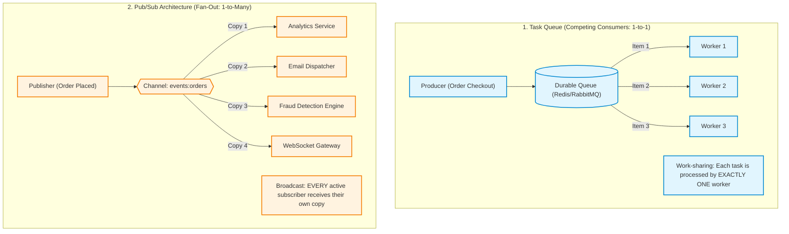
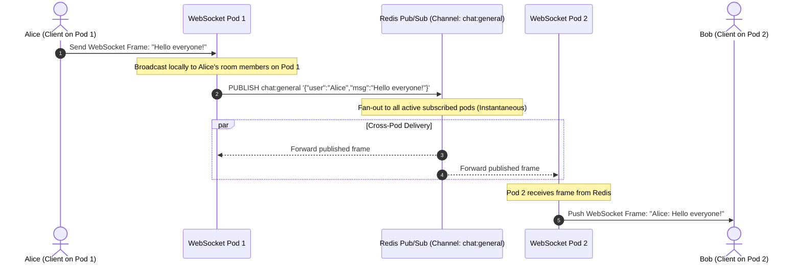

# Module 08: Pub/Sub Architecture

In single-node prototypes, broadcasting updates between components is straightforward: you iterate through an in-memory list of active sockets. In modern distributed systems, backends run across dozens of container replicas. An event generated on Container A—such as a user posting a message or a background job completing—must be transmitted to users connected to Containers B, C, and D. **Publish/Subscribe (Pub/Sub)** decouples producers from consumers: publishers broadcast messages to named **channels** without knowing or caring how many subscribers exist. However, confusing fire-and-forget Pub/Sub with durable task queues is one of the most destructive architectural mistakes in backend engineering.

> [!TIP]
> **The Golden Rule:** Use Pub/Sub strictly for ephemeral, latency-sensitive broadcast telemetry where dropped messages are acceptable; never use raw fire-and-forget Pub/Sub for critical business transactions. If work MUST survive worker restarts and network disconnects, use durable queues or append-only event logs (Redis Streams/Kafka).

---

## 1. Visual Mental Models

### Pub/Sub Fan-Out vs. Task Queue Competing Consumers

A task queue balances work among workers (1-to-1), while a pub/sub channel broadcasts each event to every listener (1-to-many):



### Multi-Node WebSocket Cluster with Redis Pub/Sub Backplane

Bridging the multi-process gap: Redis acts as a high-speed shared bus so that an event received on one container reaches users connected to any container in the cluster:



---

## 2. Structured Reference Grids

### Messaging Models: Pub/Sub vs. Queues vs. Event Logs

| Dimension | Classic Pub/Sub (Redis Pub/Sub) | Task Queue (RabbitMQ / Celery) | Event Log (Redis Streams / Kafka) |
| :--- | :--- | :--- | :--- |
| **Delivery Model** | Fan-out to all current subscribers | Competing consumers (1 item to 1 worker) | Consumer group offset tracking |
| **Durability** | **None (Fire-and-forget in RAM)** | High (Disk-persisted queues) | Highest (Immutable append-only on disk) |
| **Offline Consumers** | **Messages dropped silently** | Queued until consumer recovers | Replayable from last acknowledged offset |
| **Acknowledgment (ACK)** | None (Publisher receives subscriber count) | Explicit ACK / NACK per message | Offset commit / Checkpointed position |
| **Ideal Use Case** | Ephemeral chat, presence, UI invalidation | Financial charges, PDF rendering, webhooks | Audit trails, event sourcing, CDC pipelines |

### Redis Pub/Sub CLI Command Reference

| Command | Syntax | Return Value | Operational Note |
| :--- | :--- | :--- | :--- |
| `PUBLISH` | `PUBLISH <channel> <message>` | Integer (Count of active subscribers reached) | If return is `0`, the message vanished into void |
| `SUBSCRIBE` | `SUBSCRIBE <channel> [channel ...]` | Stream of messages (`message`, `<chan>`, `<msg>`) | Blocks the client connection exclusively for pub/sub |
| `PSUBSCRIBE` | `PSUBSCRIBE <pattern>` (e.g., `orders.*`) | Stream of matching messages | Matches wildcards (`orders.created`, `orders.paid`) |
| `PUBSUB CHANNELS`| `PUBSUB CHANNELS [pattern]` | List of active channels with $\ge 1$ subscriber | Useful for real-time observability and health checks |
| `PUBSUB NUMSUB` | `PUBSUB NUMSUB <channel>` | Array of `[channel, count]` pairs | Inspect active listener density |

---

## 3. Production War Story

### The Kubernetes Rolling Deploy That Discarded 4,200 Stock Trades

#### The Incident
A FinTech startup built their stock trading engine using Redis Pub/Sub. When a trader submitted a trade, the HTTP API published `order.execute` to a Redis channel. A fleet of 4 worker pods subscribed to the channel to execute matching orders against exchanges. During market hours, a CI/CD pipeline triggered a routine Kubernetes rolling update of the worker pods. For 14 minutes, API servers happily returned `200 OK: Trade Submitted`. However, 4,200 trades completely vanished from the system. No orders were placed on the market, no logs showed errors, and customers lost $1.2M in trading opportunities.

```mermaid
sequenceDiagram
    autonumber
    actor Trader as Retail Traders
    participant API as Ingestion API
    participant Redis as Redis Pub/Sub (Channel: trade_orders)
    participant K8s as Kubernetes Control Plane
    participant Workers as Worker Pods (Replica: 4)

    Trader->>API: POST /v1/trades/buy (Apple AAPL 100 shares)
    K8s->>Workers: SIGTERM to Pod 1, 2, 3, 4 (Rolling Container Upgrade)
    Note over Workers: Worker pods terminate; unsubscribe from Redis!
    Note over Redis: Active subscribers on channel trade_orders = 0!
    API->>Redis: PUBLISH trade_orders '{"trade_id": 9012, "symbol": "AAPL"}'
    Note over Redis: Subscribers = 0 -> Message DROPPED IMMEDIATELY!
    Redis-->>API: (integer) 0 (Ignored by API!)
    API-->>Trader: 200 OK {"status": "submitted"}
    Note over Trader,API: 4,200 trade messages vanish into thin air without a trace!
```

#### The Root Cause
1. **Misusing Ephemeral Pub/Sub for Critical State:** Redis Pub/Sub has zero memory buffers. While worker containers were recreating during the rolling deployment, the channel had zero active listeners. Redis discarded every published message.
2. **Ignoring the Return Code:** `PUBLISH` returned `0` (meaning zero subscribers received the message), but the API did not check or alert on this response.

#### The Verified Production Fix
1. Migrated trade execution from Redis Pub/Sub to **Redis Streams** (`XADD` with Consumer Groups).
2. With Redis Streams, messages are durably appended to an ordered log. When workers restart, they read from their last acknowledged ID (`XREADGROUP`) with zero data loss.
3. Retained Redis Pub/Sub strictly for ephemeral frontend price ticker updates.

---

## 4. Multi-Language Production Implementations

### Go (Resilient Redis Pub/Sub Listener with Heartbeat)

```go
package main

import (
	"context"
	"fmt"
	"log"
	"time"

	"github.com/redis/go-redis/v9"
)

type PubSubManager struct {
	client *redis.Client
}

func NewPubSubManager(addr string) *PubSubManager {
	return &PubSubManager{
		client: redis.NewClient(&redis.Options{Addr: addr}),
	}
}

// Publish broadcasts an event and logs subscriber count
func (m *PubSubManager) Publish(ctx context.Context, channel string, message string) error {
	subsCount, err := m.client.Publish(ctx, channel, message).Result()
	if err != nil {
		return fmt.Errorf("redis publish error: %w", err)
	}
	if subsCount == 0 {
		log.Printf("[Warning] Published to %s, but zero active subscribers were listening!", channel)
	} else {
		log.Printf("[PubSub] Message delivered to %d active subscribers on %s", subsCount, channel)
	}
	return nil
}

// Subscribe listens continuously with reconnection support
func (m *PubSubManager) Subscribe(ctx context.Context, channel string, handler func(msg string)) {
	pubsub := m.client.Subscribe(ctx, channel)
	defer pubsub.Close()

	ch := pubsub.Channel()
	log.Printf("[PubSub] Subscribed to channel: %s", channel)

	for {
		select {
		case msg, ok := <-ch:
			if !ok {
				log.Println("[PubSub] Channel closed; exiting listener.")
				return
			}
			handler(msg.Payload)
		case <-ctx.Done():
			log.Println("[PubSub] Context canceled; shutting down subscriber.")
			return
		}
	}
}
```

---

### Node.js / TypeScript (`IORedis` Multi-Pod WebSocket Backplane)

```typescript
import IORedis from 'ioredis';
import { WebSocketServer, WebSocket } from 'ws';

const REDIS_URL = 'redis://127.0.0.1:6379';
const pubClient = new IORedis(REDIS_URL);
const subClient = new IORedis(REDIS_URL);

const wss = new WebSocketServer({ port: 8080 });
const CHAT_CHANNEL = 'chat:broadcast';

// 1. Subscribe to Redis Channel for cross-pod messaging
subClient.subscribe(CHAT_CHANNEL, (err, count) => {
  if (err) console.error('[Redis Sub] Failed to subscribe:', err);
  else console.log(`[Redis Sub] Subscribed to ${CHAT_CHANNEL}. Total subs: ${count}`);
});

subClient.on('message', (channel, message) => {
  if (channel === CHAT_CHANNEL) {
    console.log(`[Redis Backplane] Received broadcast from peer pod: ${message}`);
    // Relay down to all locally connected WebSocket clients
    wss.clients.forEach((client) => {
      if (client.readyState === WebSocket.OPEN) {
        client.send(message);
      }
    });
  }
});

// 2. Handle local client connections and forward to Redis
wss.on('connection', (ws) => {
  ws.on('message', async (data) => {
    const payload = data.toString();
    console.log(`[Local Client] Forwarding to Redis backplane: ${payload}`);
    // Publish to Redis so all pod replicas receive and broadcast it
    await pubClient.publish(CHAT_CHANNEL, payload);
  });
});
```

---

### Python (`redis-py` Asyncio WebSocket Backplane)

```python
import asyncio
import json
import redis.asyncio as aioredis
from fastapi import FastAPI, WebSocket, WebSocketDisconnect

app = FastAPI()
REDIS_URL = "redis://127.0.0.1:6379"

class RedisWebSocketBackplane:
    def __init__(self, channel_name: str = "cluster:events"):
        self.channel_name = channel_name
        self.redis = aioredis.from_url(REDIS_URL)
        self.local_sockets: set[WebSocket] = set()

    async def start_listener(self):
        """Background coroutine listening to Redis Pub/Sub events"""
        pubsub = self.redis.pubsub()
        await pubsub.subscribe(self.channel_name)
        print(f"[Backplane] Subscribed to Redis channel: {self.channel_name}")
        
        try:
            async for message in pubsub.listen():
                if message["type"] == "message":
                    payload = message["data"].decode("utf-8")
                    await self._broadcast_local(payload)
        except asyncio.CancelledError:
            await pubsub.unsubscribe(self.channel_name)

    async def publish(self, data: dict):
        """Publish event to all pods via Redis"""
        serialized = json.dumps(data)
        subs = await self.redis.publish(self.channel_name, serialized)
        return subs

    async def _broadcast_local(self, payload: str):
        """Relay message to all WebSockets connected to THIS server process"""
        for ws in list(self.local_sockets):
            try:
                await ws.send_text(payload)
            except Exception:
                self.local_sockets.discard(ws)

backplane = RedisWebSocketBackplane()

@app.on_event("startup")
async def startup_event():
    asyncio.create_task(backplane.start_listener())

@app.websocket("/ws")
async def websocket_endpoint(websocket: WebSocket):
    await websocket.accept()
    backplane.local_sockets.add(websocket)
    try:
        while True:
            text = await websocket.receive_text()
            await backplane.publish({"sender": "client", "content": text})
    except WebSocketDisconnect:
        pass
    finally:
        backplane.local_sockets.discard(websocket)
```

---

## 5. Practical Hands-On Verification

### 1. Test Channel Broadcasting via Redis CLI

Open two separate terminal windows to observe real-time fan-out:

**Terminal 1 (Subscriber):**
```bash
redis-cli SUBSCRIBE notifications:live
```
```text
Reading messages... (press Ctrl-C to quit)
1) "subscribe"
2) "notifications:live"
3) (integer) 1
```

**Terminal 2 (Publisher):**
```bash
redis-cli PUBLISH notifications:live "{\"alert\": \"High CPU Load\"}"
```
```text
(integer) 1
```

**Terminal 1 receives immediately:**
```text
1) "message"
2) "notifications:live"
3) "{\"alert\": \"High CPU Load\"}"
```

### 2. Inspect Active Channels and Subscriber Density

```bash
redis-cli PUBSUB CHANNELS
redis-cli PUBSUB NUMSUB notifications:live
```

**Output:**
```text
1) "notifications:live"
2) (integer) 1
```

---

## 6. Operational Validation Checkpoints

<details>
<summary><strong>Checkpoint 1: The Fatal Slow Consumer Disconnect Trap</strong></summary>

**Scenario:** A subscriber connects to a high-volume Redis Pub/Sub channel pushing 10,000 updates/sec. The subscriber process slows down due to a CPU-intensive garbage collection pause. Suddenly, Redis forcibly terminates the subscriber's TCP connection. What configuration caused this?

*Explanation:*
Redis enforces a safety limit: `client-output-buffer-limit pubsub <hard-limit> <soft-limit> <soft-seconds>`.
Because Redis Pub/Sub operates entirely in RAM, Redis buffers outgoing messages for each subscriber in an in-memory output buffer. If a subscriber consumes slower than the publish rate and the buffer exceeds the hard limit (e.g., 32MB), Redis immediately closes the socket to protect itself from Out-Of-Memory (OOM) crashes.
**The Fix:** Offload slow processing to local worker pools or replace Redis Pub/Sub with **Kafka / Redis Streams**, where consumers pull at their own pace without burdening the server's RAM buffers.
</details>

<details>
<summary><strong>Checkpoint 2: Competing Consumers via Pub/Sub Mistake</strong></summary>

**Scenario:** A team wants to scale order processing across 4 worker servers. They configure all 4 servers to run `SUBSCRIBE orders:new`. When an order is published, all 4 servers process the exact same order in parallel, leading to quadruple fulfillment. Why did this happen?

*Explanation:*
Pub/Sub is fundamentally a **broadcast / fan-out** architecture. Every active subscriber receives every message.
**The Fix:** For load-balanced work distribution (**Competing Consumers**), use a **Queue** (e.g., Redis `LPUSH` / `BRPOP`, Celery, or RabbitMQ queue) or a **Consumer Group** (Redis Streams `XREADGROUP`), where each job is delivered to exactly one worker in the group.
</details>

<details>
<summary><strong>Checkpoint 3: Reconnection Gaps & Zero Message History</strong></summary>

**Scenario:** A frontend client connected to a real-time price feed suffers a 3-second WiFi blip and reconnects. The client asks the backend for the "missed" messages published during those 3 seconds using the Redis channel. Can Redis Pub/Sub provide them?

*Explanation:*
No. Redis Pub/Sub retains zero message history. Once a message is transmitted across the TCP socket to active subscribers, it is instantly discarded from memory.
**The Fix:** If consumers require historical replay or reconnect recovery, use **Redis Streams** (`XRANGE` / `XREAD` from the last known stream ID) or an external database to query events occurring between $T_{\text{disconnect}}$ and $T_{\text{reconnect}}$.
</details>

---

## Next

[09-message-brokers-rabbitmq](../09-message-brokers-rabbitmq/README.md) —
you've been using Redis as a broker/pub-sub bus all along; now open up what a
dedicated message broker actually gives you (exchanges, routing, durable
acknowledgment, dead-lettering) that Redis's simpler primitives don't.
