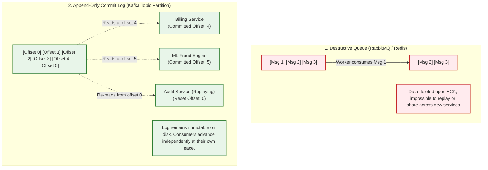
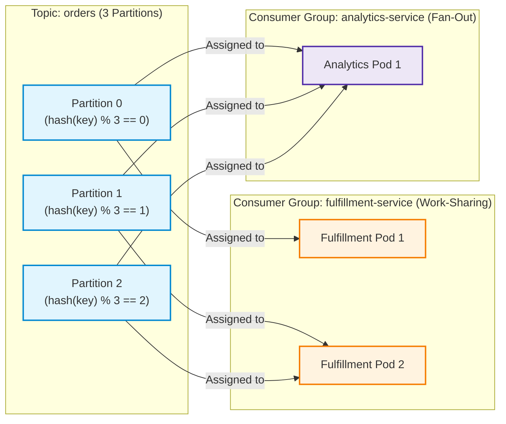
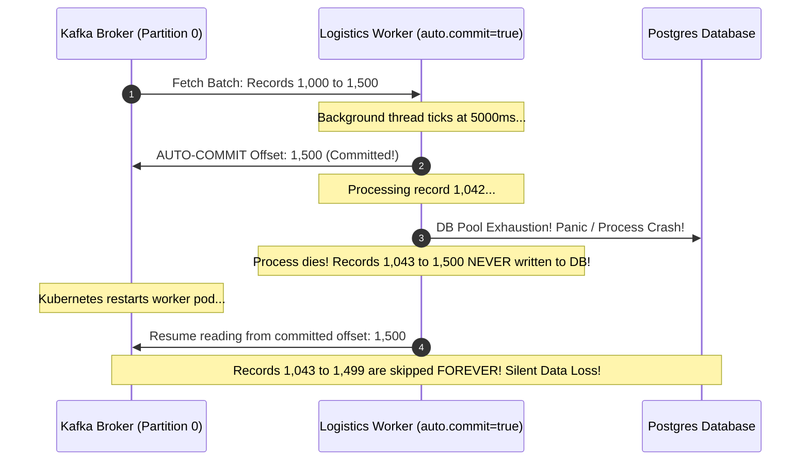

# Module 10: Message Brokers — Kafka

Traditional message brokers (like RabbitMQ or Redis) operate on destructive consumption: once a worker acknowledges a message, it is permanently erased from the broker. This model succeeds for isolated task execution, but collapses in modern streaming architectures where multiple autonomous services—such as billing, real-time analytics, machine learning fraud models, and compliance audit loggers—must consume the exact same event stream independently, at their own velocity, and periodically **replay history** from days or months ago. **Apache Kafka** solves this by modeling data as a distributed, append-only, partitioned **commit log**.

> [!TIP]
> **The Golden Rule:** Kafka topics are durable, replayable commit logs, not destructive queues. Always assign message keys deterministically by entity identifier (`order_id`) for strict partition ordering, scale consumer groups up to the partition count ($N_{\text{consumers}} \le N_{\text{partitions}}$), and commit offsets manually only after business operations succeed.

---

## 1. Visual Mental Models

### Destructive Queue vs. Append-Only Distributed Log

In traditional queues, reading destroys data. In Kafka, consuming is simply advancing an independent read pointer (offset) across an immutable append-only disk log:



### Partition Hashing & Consumer Group Parallelism

Kafka achieves both work-sharing and pub/sub fan-out simultaneously through Consumer Groups and Partition Allocation:



---

## 2. Structured Reference Grids

### Kafka vs. RabbitMQ vs. Redis Streams Architectural Matrix

| Architectural Feature | Apache Kafka | RabbitMQ | Redis Streams |
| :--- | :--- | :--- | :--- |
| **Storage Primitive** | Append-only partitioned disk log | Memory-backed AMQP queue | In-memory radix tree / stream log |
| **Message Consumption** | Non-destructive; read via cursor offsets | **Destructive**; deleted on ACK | Non-destructive; consumer group cursor |
| **Historical Replay** | Native (`--reset-offsets --to-offset N`) | Impossible (Messages deleted) | Supported (`XREAD` from stream ID) |
| **Ordering Guarantee** | **Strict per-partition ordering** | Strict per-queue ordering | Strict per-stream ordering |
| **Throughput Scaling** | Millions of msgs/sec via zero-copy OS sendfile | ~50k–100k msgs/sec | ~500k msgs/sec (RAM bounded) |
| **Concurrency Ceiling** | Strictly capped by partition count | Uncapped (Any number of workers) | Uncapped within consumer group |

### Offset Management & Configuration Directives

| Parameter | Recommended Setting | Failure Prevented |
| :--- | :--- | :--- |
| `enable.auto.commit` | `false` | Data loss when consumer crashes between timer tick and DB commit |
| `auto.offset.reset` | `earliest` | Brand new consumer groups missing existing unread backlog |
| `max.poll.interval.ms`| `300000` (5 minutes) | Slow record processing triggering endless rebalance storms |
| `acks` (Producer) | `all` (`-1`) | Producer acknowledging before replicas write to disk (prevents broker data loss) |

---

## 3. Production War Story

### The `enable.auto.commit=True` Data Loss & The Out-of-Order Notification

#### The Incident
An on-demand logistics platform ingested driver GPS location pings and package status changes into Kafka. When volume surged, customer support was inundated with complaints: users received "Package Delivered" push notifications *before* the "Package Dispatched" notification arrived. Worse, when an automated database connection pool exhausted and crashed 4 consumer pods, 12,000 package status events completely disappeared without being updated in PostgreSQL.



#### The Root Cause
1. **Background Auto-Commit:** The consumer was configured with `enable.auto.commit=True`. The Kafka client committed offset `1500` to the broker based purely on a timer, long before the worker finished writing records to the database. When the pod crashed, Kafka assumed everything up to `1500` was done.
2. **Missing Message Keys:** Producers emitted order events with `key=None`. Kafka round-robined events across partitions 0, 1, and 2. Partition 1 processed the `delivered` event faster than Partition 0 processed `dispatched`, scrambling event sequence.

#### The Verified Production Fix
1. Disabled automatic offset commits (`enable.auto.commit=False`). Configured the consumer to commit offsets manually (`commitSync()` / `commit()`) strictly after database transactions commit.
2. Required explicit entity keys on all outgoing messages: `key=order.id.encode('utf-8')`. This guarantees that all lifecycle events for a specific order route to the identical partition, preserving strict chronological ordering.

---

## 4. Multi-Language Production Implementations

### Go (`segmentio/kafka-go` Resilient Reader with Manual Commits)

```go
package main

import (
	"context"
	"fmt"
	"log"
	"time"

	"github.com/segmentio/kafka-go"
)

func RunKafkaConsumer(ctx context.Context) {
	reader := kafka.NewReader(kafka.ReaderConfig{
		Brokers:        []string{"localhost:9092"},
		GroupID:        "order-processing-group",
		Topic:          "orders.v1",
		MinBytes:       10e3, // 10KB
		MaxBytes:       10e6, // 10MB
		CommitInterval: 0,    // Synchronous manual commits only
		StartOffset:    kafka.FirstOffset,
	})
	defer reader.Close()

	log.Println("[Kafka] Consumer online. Reading topic: orders.v1...")

	for {
		// 1. Fetch next message from partition
		m, err := reader.FetchMessage(ctx)
		if err != nil {
			log.Printf("[Kafka] Error fetching message: %v", err)
			break
		}

		log.Printf("[Kafka] Partition: %d, Offset: %d, Key: %s", m.Partition, m.Offset, string(m.Key))

		// 2. Execute business logic
		if err := processOrderEvent(m.Value); err != nil {
			log.Printf("[Error] Failed processing order. Not committing offset: %v", err)
			continue // Retry or DLQ strategy
		}

		// 3. Commit offset strictly after successful execution
		if err := reader.CommitMessages(ctx, m); err != nil {
			log.Printf("[Error] Failed to commit offset %d: %v", m.Offset, err)
		}
	}
}

func processOrderEvent(payload []byte) error {
	time.Sleep(20 * time.Millisecond)
	return nil
}
```

---

### Node.js / TypeScript (`KafkaJS` Manual Commit & Key Hashing)

```typescript
import { Kafka, Partitioners } from 'kafkajs';

const kafka = new Kafka({
  clientId: 'order-service',
  brokers: ['localhost:9092'],
});

// 1. Production Producer with Partition Keys
export async function publishOrderEvent(orderId: string, eventType: string, data: object) {
  const producer = kafka.producer({ createPartitioner: Partitioners.DefaultPartitioner });
  await producer.connect();

  await producer.send({
    topic: 'orders.v1',
    messages: [
      {
        key: orderId, // Crucial: Keys guarantee partition ordering!
        value: JSON.stringify({ eventType, orderId, data, timestamp: Date.now() }),
        headers: { 'source-service': 'order-gateway' },
      },
    ],
  });

  await producer.disconnect();
}

// 2. Resilient Consumer with Manual Offset Commit
export async function startConsumerGroup() {
  const consumer = kafka.consumer({
    groupId: 'order-fulfillment-group',
    autoCommit: false, // Enforce manual offset commits
  });

  await consumer.connect();
  await consumer.subscribe({ topic: 'orders.v1', fromBeginning: true });

  await consumer.run({
    autoCommit: false,
    eachMessage: async ({ topic, partition, message }) => {
      const offset = message.offset;
      const key = message.key?.toString();
      const value = message.value?.toString();

      console.log(`[Kafka Consumer] Partition ${partition} | Offset ${offset} | Key: ${key}`);

      // Process business event
      await executeFulfillment(value);

      // Commit offset explicitly
      await consumer.commitOffsets([
        { topic, partition, offset: (BigInt(offset) + 1n).toString() },
      ]);
    },
  });
}

async function executeFulfillment(payload: string | undefined) {
  // Database update...
}
```

---

### Python (`confluent-kafka` High-Throughput Consumer)

```python
import json
from confluent_kafka import Consumer, KafkaError, Producer

def delivery_report(err, msg):
    if err is not None:
        print(f"[Producer Error] Message delivery failed: {err}")
    else:
        print(f"[Producer] Delivered to {msg.topic()} [{msg.partition()}] at offset {msg.offset()}")

def produce_order_event(order_id: str, payload: dict):
    producer = Producer({'bootstrap.servers': 'localhost:9092', 'acks': 'all'})
    
    # Passing order_id as key guarantees partition affinity
    producer.produce(
        topic='orders.v1',
        key=order_id.encode('utf-8'),
        value=json.dumps(payload).encode('utf-8'),
        on_delivery=delivery_report
    )
    producer.flush()

def consume_orders():
    conf = {
        'bootstrap.servers': 'localhost:9092',
        'group.id': 'analytics-consumer-group',
        'auto.offset.reset': 'earliest',
        'enable.auto.commit': False, # Manual offset commits
    }

    consumer = Consumer(conf)
    consumer.subscribe(['orders.v1'])
    print("[Kafka] Subscribed to orders.v1 with manual offset tracking...")

    try:
        while True:
            msg = consumer.poll(timeout=1.0)
            if msg is None:
                continue
            if msg.error():
                if msg.error().code() == KafkaError._PARTITION_EOF:
                    continue
                else:
                    print(f"[Kafka Error] {msg.error()}")
                    break

            order_id = msg.key().decode('utf-8')
            event = json.loads(msg.value().decode('utf-8'))
            print(f"[Worker] Processing Order {order_id} at offset {msg.offset()}")

            # Business execution
            # ... write to DB ...

            # Commit offset synchronously
            consumer.commit(msg, asynchronous=False)
    finally:
        consumer.close()
```

---

## 5. Practical Hands-On Verification

### 1. Create Multi-Partition Topic via Kafka CLI

```bash
kafka-topics.sh --bootstrap-server localhost:9092 --create \
  --topic orders.v1 \
  --partitions 3 \
  --replication-factor 1
```

**Output:**
```text
Created topic orders.v1.
```

### 2. Inspect Consumer Group Lag

Verify consumer progress and detect stuck consumers across partitions:

```bash
kafka-consumer-groups.sh --bootstrap-server localhost:9092 \
  --describe --group order-processing-group
```

**Output:**
```text
GROUP                  TOPIC     PARTITION  CURRENT-OFFSET  LOG-END-OFFSET  LAG             CONSUMER-ID     HOST
order-processing-group orders.v1 0          104             104             0               consumer-pod-1  /172.18.0.4
order-processing-group orders.v1 1          89              92              3               consumer-pod-2  /172.18.0.5
order-processing-group orders.v1 2          150             150             0               consumer-pod-2  /172.18.0.5
```

### 3. Replay Historical Topic Log

Reset a consumer group's offset to the beginning to reprocess historical events:

```bash
kafka-consumer-groups.sh --bootstrap-server localhost:9092 \
  --group order-processing-group \
  --reset-offsets --to-earliest \
  --topic orders.v1 \
  --execute
```

---

## 6. Operational Validation Checkpoints

<details>
<summary><strong>Checkpoint 1: The Partition Count Concurrency Ceiling</strong></summary>

**Scenario:** A topic has 4 partitions. Due to an unexpected surge in event volume, the DevOps team scales the Kubernetes consumer deployment from 4 pods to 12 pods. However, overall processing throughput does not increase by a single transaction per second. Why?

*Explanation:*
Kafka enforces a strict invariant: **Within a consumer group, each partition is assigned to at most one consumer instance at any given time**.
Because the topic only has 4 partitions, 4 consumer pods are assigned 1 partition each, and the remaining 8 pods sit completely idle.
**The Fix:** Partition count dictates the maximum consumer concurrency ceiling. To scale consumers to 12 active workers, you must increase the topic's partition count to at least 12 using `kafka-topics.sh --alter --partitions 12`.
</details>

<details>
<summary><strong>Checkpoint 2: The Cascading Consumer Rebalance Storm</strong></summary>

**Scenario:** A consumer pulls a batch of 100 heavy image-processing messages from Kafka. Processing the batch takes 8 minutes. Suddenly, the consumer crashes with `CommitFailedException`, and all other consumers in the group freeze, constantly dropping and re-assigning partitions in an infinite loop. What happened?

*Explanation:*
Kafka requires consumers to call `.poll()` at least once every `max.poll.interval.ms` (default: 5 minutes / 300,000ms).
Because the worker took 8 minutes to process the batch, the Kafka coordinator concluded the worker was dead, evicted it from the group, and initiated a **Group Rebalance**. When the worker finally tried to commit its offset, its membership was invalid.
**The Fix:**
1. Decrease `max.poll.records` (e.g., from 500 down to 20) so batches complete well within the interval.
2. Increase `max.poll.interval.ms` to comfortably exceed the 99th percentile processing duration.
</details>

<details>
<summary><strong>Checkpoint 3: The Danger of Null Message Keys</strong></summary>

**Scenario:** A developer publishes user profile updates without specifying a message key (`key=None`). A user rapidly updates their email address from A to B, and then from B to C within 500ms. In the database, the user's final email ends up as B instead of C. Why?

*Explanation:*
When `key=None`, Kafka distributes messages across partitions using round-robin or sticky partitioning. Update 1 (`A -> B`) was routed to Partition 0, while Update 2 (`B -> C`) landed on Partition 1. Two separate consumer workers processed the partitions in parallel. Worker 2 finished before Worker 1, allowing Worker 1's older update to overwrite Worker 2's newer state.
**The Rule:** Always key messages by domain entity (`key=user_id`). All updates for a given user are guaranteed to land on the same partition and be consumed in strict sequential order.
</details>

---

## Next

[11-mobile-push-notifications](../11-mobile-push-notifications/README.md) —
one more outbound channel this track hasn't covered yet: reaching a user's
phone even when your app isn't open, via a push provider (APNs/FCM)
instead of a broker you run yourself.
