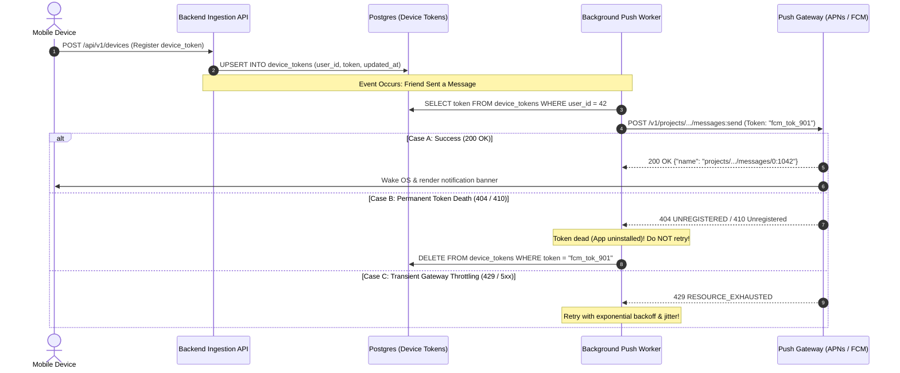
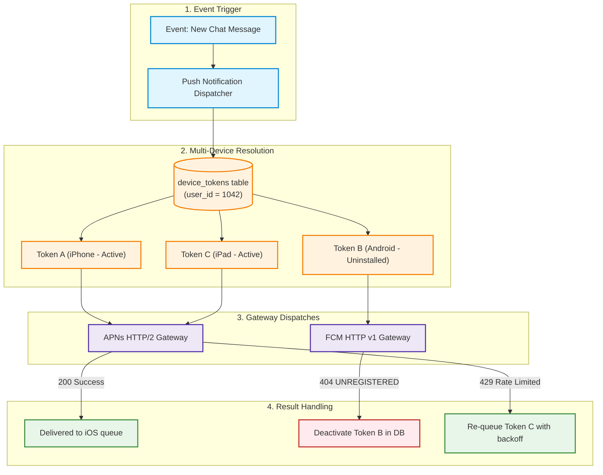
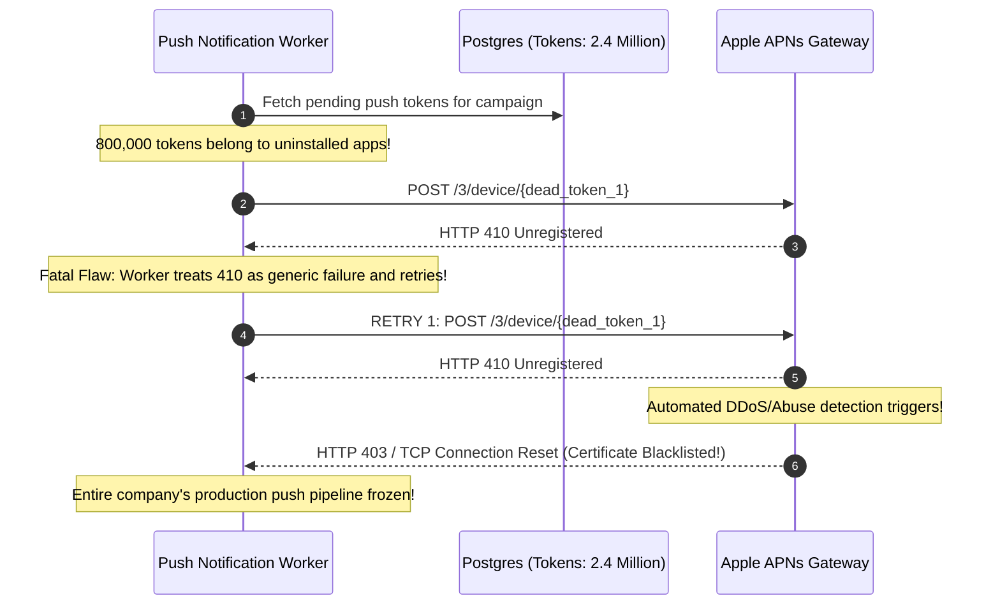

# Module 11: Mobile Push Notifications

Reaching a user when your application is closed and their phone is locked requires mobile push notifications. Unlike WebSockets (where you maintain an active TCP socket) or transactional emails (where you connect directly to recipient mail servers), mobile push notifications require an intermediary architecture. You never connect directly to the user's handset; instead, your backend transmits payloads to Apple Push Notification service (**APNs**) or Google Firebase Cloud Messaging (**FCM**), which manage durable battery-optimized connections to the operating system. Successfully running push notifications at scale requires rigorous device token lifecycle management, handling gateway error classifications, and avoiding token ghosting disasters.

> [!TIP]
> **The Golden Rule:** Treat device tokens as ephemeral; immediately purge tokens returned with permanent unregistration errors (`404 UNREGISTERED` / `410 Unregistered`), retry exclusively on transient gateway throttling (`429` / `5xx`), and transmit minimalist pointer payloads ($\le 4\text{KB}$) with client-side deduplication keys.

---

## 1. Visual Mental Models

### Mobile Push Gateway Hand-Off & The Delivery Loop

Your backend communicates exclusively with platform gateway APIs; Apple and Google manage the last-mile delivery to physical devices:



### Multi-Device Fan-Out & Token Pruning Architecture

A single user may own multiple devices (an iPhone, an iPad, and an Android tablet). The push architecture must fan out per-device and react to individual token status independently:



---

## 2. Structured Reference Grids

### Gateway Error Taxonomy & Action Matrix

| Platform | HTTP Status | Error Reason Code | Category | Correct Backend Action |
| :--- | :--- | :--- | :--- | :--- |
| **FCM** | `404 Not Found` | `UNREGISTERED` | **Permanent** | **Delete token from DB immediately**; do not retry |
| **APNs** | `410 Gone` | `Unregistered` | **Permanent** | **Delete token from DB immediately**; do not retry |
| **FCM** | `400 Bad Request`| `INVALID_ARGUMENT` | **Permanent** | Log schema error, remove invalid malformed token |
| **APNs** | `400 Bad Request`| `BadDeviceToken` | **Permanent** | Remove corrupted hex token; verify APNs certificate environment |
| **FCM** | `429 Too Many Req`| `RESOURCE_EXHAUSTED`| **Transient** | **Retry with exponential backoff & jitter** |
| **APNs** | `429 Too Many Req`| `TooManyRequests` | **Transient** | Back off immediately; respect server rate limit |
| **Both** | `500 / 503` | `InternalServerError` | **Transient** | Re-queue for retry with backoff |

### Display Notifications vs. Silent Background Pushes

| Dimension | Display / Alert Push | Silent / Background Push (`content-available: 1`) |
| :--- | :--- | :--- |
| **User Experience** | Visual banner, lock screen alert, sound, badge count | Invisible to user; wakes app code in background |
| **Payload Size** | Up to 4KB (FCM) / 4KB (APNs) | Up to 4KB (FCM) / 4KB (APNs) |
| **Delivery Guarantee** | High priority; delivered promptly by OS | **Best-effort; aggressively throttled by iOS/Android battery policy** |
| **App State Requirement**| None; rendered by mobile OS even if app killed | Requires app to be installed; won't wake if user force-quit |
| **Primary Use Cases** | Breaking news, chat messages, shipment updates | Pre-fetching email, syncing local SQLite cache |

---

## 3. Production War Story

### The 800,000 Ghost Token Storm That Triggered an APNs IP Ban

#### The Incident
A fast-growing fitness application operated for 3 years without implementing token cleanup. Every time a user logged in, their device token was inserted into PostgreSQL. When users uninstalled the app or bought new phones, the old tokens remained in the database. During a New Year's campaign, the backend dispatched 2.4 million push notifications. Over 800,000 requests to Apple APNs returned `410 Unregistered`. Because the Celery worker caught all exceptions as retryable, it retried every dead token 5 times. Within 30 minutes, Apple's automated intrusion systems flagged the sender IP and revoked the company's APNs TLS certificates for protocol abuse, halting all push delivery globally for 48 hours.



#### The Root Cause
1. **No Token Deactivation Logic:** The backend treated token storage as append-only.
2. **Conflating Transient and Permanent Errors:** The retry policy did not inspect HTTP status codes; permanent `410 Unregistered` errors were retried aggressively.
3. **Breach of Apple Delivery Policy:** Apple requires senders to cease transmitting to invalid tokens immediately upon receiving `410 Gone`.

#### The Verified Production Fix
1. Modified the worker to inspect gateway response codes. Any `404 UNREGISTERED` or `410 Unregistered` immediately marks the token record `is_active = FALSE` in PostgreSQL.
2. Implemented a nightly cleanup cron that hard-deletes tokens inactive for $> 90$ days.
3. Added a mobile app startup hook that re-registers the current token upon every launch, keeping the database updated.

---

## 4. Multi-Language Production Implementations

### Go (Concurrent FCM Worker with Token Pruning)

```go
package main

import (
	"context"
	"fmt"
	"log"
	"time"

	firebase "firebase.google.com/go/v4"
	"firebase.google.com/go/v4/messaging"
	"google.golang.org/api/option"
)

type PushService struct {
	client *messaging.Client
}

func NewPushService(ctx context.Context, credentialsFile string) (*PushService, error) {
	app, err := firebase.NewApp(ctx, nil, option.WithCredentialsFile(credentialsFile))
	if err != nil {
		return nil, fmt.Errorf("error initializing firebase app: %w", err)
	}

	client, err := app.Messaging(ctx)
	if err != nil {
		return nil, fmt.Errorf("error getting messaging client: %w", err)
	}

	return &PushService{client: client}, nil
}

func (s *PushService) SendNotification(ctx context.Context, deviceToken, title, body string) error {
	message := &messaging.Message{
		Token: deviceToken,
		Notification: &messaging.Notification{
			Title: title,
			Body:  body,
		},
		Data: map[string]string{
			"timestamp": fmt.Sprintf("%d", time.Now().Unix()),
			"click_action": "FLUTTER_NOTIFICATION_CLICK",
		},
	}

	_, err := s.client.Send(ctx, message)
	if err != nil {
		// 1. Check if token is permanently unregistered
		if messaging.IsUnregistered(err) {
			log.Printf("[FCM] Token %s is dead (UNREGISTERED). Deleting from DB.", deviceToken)
			deleteTokenFromDatabase(deviceToken)
			return nil // Terminal: do not retry
		}

		// 2. Transient error: retry with backoff
		log.Printf("[FCM Transient Error] %v. Retrying...", err)
		return err
	}

	log.Printf("[FCM] Push successfully sent to %s", deviceToken)
	return nil
}

func deleteTokenFromDatabase(token string) {
	// Execute SQL: DELETE FROM device_tokens WHERE token = $1
}
```

---

### Node.js / TypeScript (`firebase-admin` Multicast with Pruning)

```typescript
import * as admin from 'firebase-admin';

// Initialize Firebase Admin SDK
if (!admin.apps.length) {
  admin.initializeApp({
    credential: admin.credential.applicationDefault(),
  });
}

export interface PushPayload {
  tokens: string[];
  title: string;
  body: string;
  metadata?: Record<string, string>;
}

export async function sendMulticastPush(payload: PushPayload): Promise<void> {
  const message: admin.messaging.MulticastMessage = {
    tokens: payload.tokens,
    notification: {
      title: payload.title,
      body: payload.body,
    },
    data: payload.metadata || {},
    android: { priority: 'high' },
    apns: {
      payload: {
        aps: { sound: 'default', badge: 1 },
      },
    },
  };

  const response = await admin.messaging().sendEachForMulticast(message);
  console.log(`[Push] Successfully sent ${response.successCount} of ${payload.tokens.length}`);

  if (response.failureCount > 0) {
    const deadTokens: string[] = [];

    response.responses.forEach((resp, idx) => {
      if (!resp.success) {
        const error = resp.error;
        const failedToken = payload.tokens[idx];

        // Identify permanently invalid/unregistered tokens
        if (
          error?.code === 'messaging/registration-token-not-registered' ||
          error?.code === 'messaging/invalid-registration-token'
        ) {
          deadTokens.push(failedToken);
        } else {
          console.warn(`[Push Transient] Token ${failedToken} failed with code: ${error?.code}`);
        }
      }
    });

    if (deadTokens.length > 0) {
      console.log(`[Token Cleanup] Pruning ${deadTokens.length} dead tokens from database`);
      await purgeTokensFromDatabase(deadTokens);
    }
  }
}

async function purgeTokensFromDatabase(tokens: string[]) {
  // DB query: DELETE FROM device_tokens WHERE token = ANY($1)
}
```

---

### Python (`firebase-admin` + Token Cleanup Task)

```python
import firebase_admin
from firebase_admin import credentials, messaging
from celery import Celery

app = Celery('push_service', broker='redis://127.0.0.1:6379/0')

# Initialize Firebase app once at module load
if not firebase_admin._apps:
    cred = credentials.Certificate('/path/to/serviceAccountKey.json')
    firebase_admin.initialize_app(cred)

@app.task(
    bind=True,
    name='tasks.send_mobile_push',
    max_retries=3,
    retry_backoff=True,
    retry_jitter=True,
)
def send_mobile_push(self, device_token: str, title: str, body: str, event_id: str):
    message = messaging.Message(
        notification=messaging.Notification(title=title, body=body),
        data={"event_id": event_id},
        token=device_token,
    )

    try:
        response = messaging.send(message)
        print(f"[Push] Successfully delivered message {response} to {device_token}")
        return {"status": "DELIVERED", "id": response}
    except messaging.UnregisteredError:
        # Permanent failure: Delete token from database immediately
        print(f"[Push Cleanup] Token {device_token} is UNREGISTERED. Deleting.")
        # db.execute("DELETE FROM device_tokens WHERE token = :t", {"t": device_token})
        return {"status": "DEAD_TOKEN_PRUNED"}
    except messaging.SenderIdMismatchError:
        print(f"[Push Error] Token belongs to another project. Deleting.")
        return {"status": "INVALID_TOKEN_PRUNED"}
    except Exception as exc:
        print(f"[Push Transient Error] {exc}. Retrying...")
        raise self.retry(exc=exc)
```

---

## 5. Practical Hands-On Verification

### 1. Test FCM HTTP v1 API Send via Terminal

Authenticate with Google OAuth2 and submit a push request with `curl.exe`:

```bash
# Obtain Google OAuth2 access token
ACCESS_TOKEN=$(gcloud auth print-access-token)

# Send Push Message
curl.exe -i -X POST \
  -H "Authorization: Bearer ${ACCESS_TOKEN}" \
  -H "Content-Type: application/json" \
  -d '{
    "message": {
      "token": "fake_test_device_token_9012a",
      "notification": {
        "title": "Order Update",
        "body": "Your order #1042 has shipped!"
      },
      "data": {"order_id": "1042"}
    }
  }' \
  https://fcm.googleapis.com/v1/projects/my-firebase-project/messages:send
```

**Output:**
```http
HTTP/2 404 
content-type: application/json; charset=UTF-8

{
  "error": {
    "code": 404,
    "message": "Requested entity was not found.",
    "status": "NOT_FOUND",
    "details": [
      {
        "@type": "type.googleapis.com/google.firebase.fcm.v1.FcmError",
        "errorCode": "UNREGISTERED"
      }
    ]
  }
}
```
*(The `UNREGISTERED` error code instructs your backend to immediately delete this token from PostgreSQL).*

---

## 6. Operational Validation Checkpoints

<details>
<summary><strong>Checkpoint 1: The Stale Token Storage Bloat Anti-Pattern</strong></summary>

**Scenario:** A mobile application records device tokens upon user login. However, when users switch devices or log out, the old token remains associated with the user account. Over time, sending a single notification to User Alice results in dispatching 12 push requests to 12 different historical device tokens. What problems arise?

*Explanation:*
1. **Wasted Network Bandwidth & Compute:** The backend makes 12 outbound API requests instead of 1 or 2, increasing cloud latency and worker pool load.
2. **Gateway Rate Limiting:** Gateway providers (APNs/FCM) enforce per-project quota limits; transmitting to thousands of dead tokens triggers `429 Too Many Requests`.
3. **Security Hazard:** If another user is subsequently assigned that recycled mobile IP/carrier device, they may receive private notification previews intended for the previous owner.
**The Fix:** Enforce a single active token per device UUID or track `last_seen_at` timestamps, automatically deactivating tokens not refreshed within 30 days.
</details>

<details>
<summary><strong>Checkpoint 2: The Silent Push iOS Execution Budget Trap</strong></summary>

**Scenario:** An iOS developer uses silent pushes (`"content-available": 1` with no visual alert) to wake up the app every 10 minutes to download fresh data. In real-world user testing, the app rarely wakes up, and data remains stale until the user manually launches the app. Why?

*Explanation:*
Apple's iOS operating system treats silent notifications as **best-effort background tasks**. iOS enforces strict energy budgets: if the device is on low battery, if the user rarely opens the app, or if silent pushes arrive too frequently (e.g., more than 2–3 per hour), the iOS kernel throttles or drops the push packets entirely without notifying the server.
**The Rule:** Never rely on silent background pushes for critical application workflows. Use background pushes strictly for opportunistic pre-caching, and design the mobile client to always fetch fresh state from your API upon foreground launch.
</details>

<details>
<summary><strong>Checkpoint 3: Client-Side Deduplication Strategy</strong></summary>

**Scenario:** Neither APNs nor FCM provide distributed idempotency keys for send requests. If your backend worker times out while waiting for FCM's response and retries the delivery, the user may receive two identical "Your driver has arrived" notifications on their lock screen. How is this prevented?

*Explanation:*
Because push gateways lack request-level idempotency guarantees, the responsibility for deduplication shifts to the **client-side mobile application code**:
1. Always include a stable, unique identifier in the notification data payload: `{"data": {"notification_id": "notif_msg_89012"}}`.
2. On Android/iOS, the app's notification handling delegate checks local storage (SQLite/CoreData/SharedPreferences) before displaying the notification banner.
3. If `notification_id` was already rendered within the past 10 minutes, the OS silently suppresses the duplicate banner.
</details>

---

## Next

[12-payment-processing-in-practice](../12-payment-processing-in-practice/README.md)
— module 06's webhook fundamentals meet a real, unforgiving external
system: a payment provider's webhook stream, where idempotency keys and
signature verification aren't optional hardening but the only thing
standing between you and double-charging a real customer's real card.
