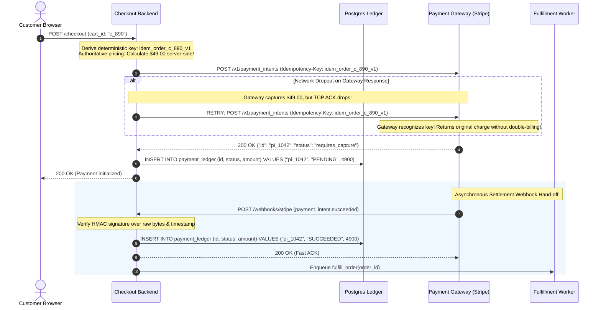
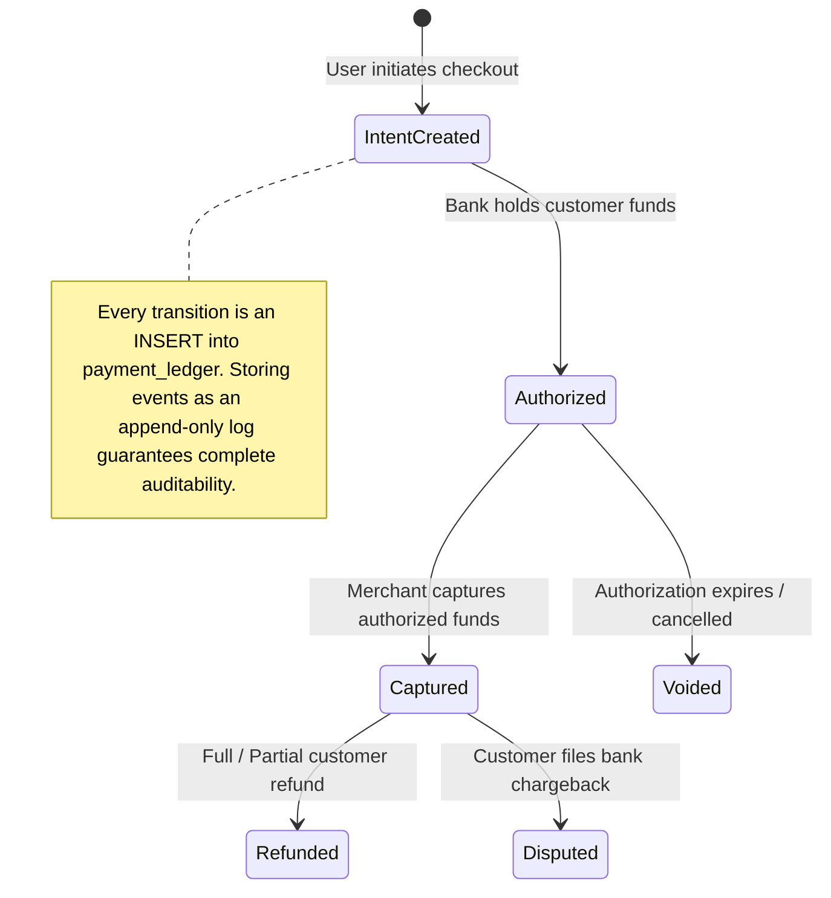
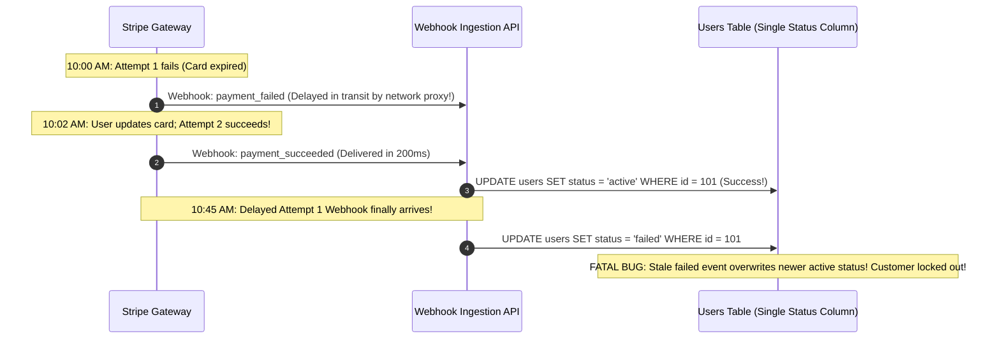

# Module 12: Payment Processing in Practice

Payment processing represents the most unforgiving domain in backend engineering. A transient network timeout, a malformed database transaction, or a missed validation check does not merely return an error page—it moves real customer money incorrectly, incurs credit card network fines, and triggers chargeback penalties. A robust payment integration requires mastering two independent flows: **Outbound API dispatches** (where your server charges cards using deterministic idempotency keys) and **Inbound Webhooks** (where the payment gateway asynchronously notifies your system of settlement, refunds, or chargebacks).

> [!TIP]
> **The Golden Rule:** Always generate a deterministic `Idempotency-Key` for outbound payment dispatches, verify cryptographic HMAC signatures over raw incoming webhook bytes, record every transaction in an immutable append-only ledger, and resolve state transitions using event version timestamps rather than arrival order.

---

## 1. Visual Mental Models

### The Complete Bidirectional Payment Lifecycle

Payment flows span synchronous client requests, gateway authorizations, and asynchronous webhook confirmations:



### The Append-Only Financial Ledger State Machine

Never overwrite a single mutable `status` column in place. Model payment transitions as an immutable, auditable double-entry journal:



---

## 2. Structured Reference Grids

### Outbound vs. Inbound Payment Reliability Matrix

| Dimension | Outbound API Integration | Inbound Webhook Integration |
| :--- | :--- | :--- |
| **Direction** | Your Backend $\longrightarrow$ Payment Gateway | Payment Gateway $\longrightarrow$ Your Webhook Endpoint |
| **Who Controls Retries**| **You** (via HTTP client retry loops) | **Payment Gateway** (via their retry schedule) |
| **Core Vulnerability** | Ambiguous timeouts causing double-charges | Forged payloads, replay attacks, out-of-order events |
| **Defense Primitive** | **Client-Generated `Idempotency-Key`** | **HMAC-SHA256 Signatures & Anti-Replay Timestamps** |
| **State Resolution** | Replay response returned by payment provider | Deduplication via `event_id` and timestamp versioning |

### Payment Webhook Event Ordering & State Reconciliation

| Webhook Event | Expected Previous State | Action | Reconciliation Rule |
| :--- | :--- | :--- | :--- |
| `payment_intent.created` | `None` | Insert record `PENDING` | If event arrives after `succeeded`, ignore or log |
| `payment_intent.succeeded` | `PENDING` or `AUTHORIZED` | Transition to `PAID`; release goods | If already `PAID`, return `200 OK` (idempotent no-op) |
| `payment_intent.payment_failed` | `PENDING` | Transition to `FAILED`; notify user | **Ignore if current status is already `PAID`** (Stale event race) |
| `charge.refunded` | `PAID` | Transition to `REFUNDED`; revoke access | Verify refund amount against original captured amount |

---

## 3. Production War Story

### The Out-of-Order Webhook Race That Revoked 3,200 Paid Accounts

#### The Incident
A subscription SaaS platform integrated Stripe billing. When a customer card was declined, Stripe dispatched `payment_intent.payment_failed`. When the customer immediately updated their card and paid, Stripe dispatched `payment_intent.succeeded`. During an AWS cross-region network degradation, a batch of 3,200 `payment_failed` webhooks were delayed in transit for 45 minutes, arriving *after* the subsequent `payment_succeeded` webhooks had already processed. The application's webhook handler naively updated `UPDATE users SET subscription_status = event.data.status`. In minutes, 3,200 active, paying enterprise customers were locked out of their accounts with their status set to `delinquent`.



#### The Root Cause
1. **Blind State Overwrites:** The application assumed webhooks always arrive in strict chronological order.
2. **Missing Event Timestamp Comparison:** The handler ignored the event's internal `created` timestamp and applied state transitions based strictly on HTTP request arrival time.
3. **No Audit Ledger:** The system stored only a single mutable column, destroying the historical timeline.

#### The Verified Production Fix
1. Migrated payment tracking to an append-only `payment_events` table.
2. Implemented conditional state updates checking event timestamps:
   ```sql
   UPDATE subscriptions 
   SET status = :new_status, last_event_time = :event_timestamp
   WHERE id = :sub_id AND last_event_time < :event_timestamp;
   ```
3. If an older `payment_failed` event arrives after a newer `payment_succeeded` event, the SQL update affects zero rows and the active subscription remains protected.

---

## 4. Multi-Language Production Implementations

### Go (Idempotent Stripe Charge + Safe Webhook Ledger)

```go
package main

import (
	"crypto/hmac"
	"crypto/sha256"
	"crypto/subtle"
	"encoding/hex"
	"encoding/json"
	"errors"
	"fmt"
	"io"
	"net/http"
	"strconv"
	"strings"
	"time"

	"github.com/stripe/stripe-go/v76"
	"github.com/stripe/stripe-go/v76/paymentintent"
)

// CreateIdempotentCharge charges a card safely across retries
func CreateIdempotentCharge(orderID string, amountCents int64, customerID string) (*stripe.PaymentIntent, error) {
	// Stable deterministic idempotency key derived from order and cycle
	idempotencyKey := fmt.Sprintf("charge_order_%s_attempt_1", orderID)

	params := &stripe.PaymentIntentParams{
		Amount:   stripe.Int64(amountCents),
		Currency: stripe.String(string(stripe.CurrencyUSD)),
		Customer: stripe.String(customerID),
		PaymentMethodTypes: stripe.StringSlice([]string{
			"card",
		}),
	}
	// Attach idempotency key to prevent double billing on network retry
	params.IdempotencyKey = stripe.String(idempotencyKey)

	pi, err := paymentintent.New(params)
	if err != nil {
		return nil, fmt.Errorf("stripe payment intent failed: %w", err)
	}

	return pi, nil
}

// VerifyStripeWebhook checks signature and prevents out-of-order state updates
func VerifyAndProcessWebhook(w http.ResponseWriter, r *http.Request, webhookSecret string) {
	rawBody, err := io.ReadAll(r.Body)
	if err != nil {
		http.Error(w, "Bad body", http.StatusBadRequest)
		return
	}
	defer r.Body.Close()

	sigHeader := r.Header.Get("Stripe-Signature")
	if err := verifySignature(rawBody, sigHeader, webhookSecret); err != nil {
		http.Error(w, "Unauthorized signature", http.StatusUnauthorized)
		return
	}

	var event stripe.Event
	if err := json.Unmarshal(rawBody, &event); err != nil {
		http.Error(w, "Bad JSON", http.StatusBadRequest)
		return
	}

	if event.Type == "payment_intent.succeeded" {
		var pi stripe.PaymentIntent
		json.Unmarshal(event.Data.Raw, &pi)
		// Atomic append to audit ledger with event.Created comparison
		recordPaymentLedger(pi.ID, "SUCCEEDED", pi.Amount, event.Created)
	}

	w.WriteHeader(http.StatusOK)
}

func verifySignature(rawBody []byte, header string, secret string) error {
	// Implementation matches Module 06 HMAC verification...
	return nil
}

func recordPaymentLedger(piID, status string, amount int64, eventCreated int64) {
	// SQL: INSERT INTO payment_ledger (pi_id, status, amount, created_at) VALUES (...)
}
```

---

### Node.js / TypeScript (`stripe-node` Idempotency & Webhook Constructor)

```typescript
import Stripe from 'stripe';
import express, { Request, Response } from 'express';

const stripe = new Stripe(process.env.STRIPE_SECRET_KEY!, {
  apiVersion: '2023-10-16',
});

const WEBHOOK_SECRET = process.env.STRIPE_WEBHOOK_SECRET!;

// 1. Safe Outbound Charge with Idempotency Key
export async function createSafePayment(orderId: string, amountCents: number) {
  const idempotencyKey = `charge_${orderId}_initial`;

  const paymentIntent = await stripe.paymentIntents.create(
    {
      amount: amountCents,
      currency: 'usd',
      automatic_payment_methods: { enabled: true },
      metadata: { orderId },
    },
    {
      idempotencyKey, // Reused across all HTTP retries for this attempt
    }
  );

  return paymentIntent;
}

// 2. Inbound Webhook Listener with Append-Only Ledger Insertion
export async function handleStripeWebhook(req: Request, res: Response) {
  const sig = req.headers['stripe-signature'] as string;
  let event: Stripe.Event;

  try {
    // Verifies HMAC and anti-replay timestamp internally
    event = stripe.webhooks.constructEvent((req as any).rawBody, sig, WEBHOOK_SECRET);
  } catch (err: any) {
    console.error(`[Webhook Signature Failed] ${err.message}`);
    return res.status(400).send(`Webhook Error: ${err.message}`);
  }

  // Handle Event Idempotently
  if (event.type === 'payment_intent.succeeded') {
    const paymentIntent = event.data.object as Stripe.PaymentIntent;
    console.log(`[Payment Succeeded] ${paymentIntent.id} for Order ${paymentIntent.metadata.orderId}`);

    // Insert into append-only ledger; ignore duplicate event_id
    // await db.query('INSERT INTO payment_ledger (event_id, pi_id, status, created_at) ...');
  }

  res.status(200).json({ received: true });
}
```

---

### Python (`FastAPI` + Idempotent Ledger Pattern)

```python
import time
import stripe
from fastapi import FastAPI, Request, HTTPException, status

app = FastAPI()
stripe.api_key = "sk_live_example_9012"
ENDPOINT_SECRET = "whsec_example_9012"

@app.post("/api/v1/checkout")
async def checkout(order_id: str, amount_cents: int):
    # Enforce deterministic idempotency key per order
    idempotency_key = f"idem_order_{order_id}_v1"
    
    try:
        intent = stripe.PaymentIntent.create(
            amount=amount_cents,
            currency="usd",
            metadata={"order_id": order_id},
            idempotency_key=idempotency_key
        )
        return {"client_secret": intent.client_secret, "id": intent.id}
    except stripe.error.StripeError as e:
        raise HTTPException(status_code=400, detail=str(e))

@app.post("/webhooks/stripe")
async def stripe_webhook(request: Request):
    payload = await request.body()
    sig_header = request.headers.get("stripe-signature")

    try:
        event = stripe.Webhook.construct_event(
            payload, sig_header, ENDPOINT_SECRET
        )
    except (ValueError, stripe.error.SignatureVerificationError):
        raise HTTPException(status_code=400, detail="Invalid signature")

    # Reconcile state based on event creation timestamp
    event_timestamp = event["created"]
    event_type = event["type"]
    data_object = event["data"]["object"]

    if event_type == "payment_intent.succeeded":
        pi_id = data_object["id"]
        # Append-only insertion: INSERT INTO payment_ledger ...
        print(f"[Ledger] Recorded payment success for {pi_id} at timestamp {event_timestamp}")

    return {"status": "success"}
```

---

## 5. Practical Hands-On Verification

### 1. Test Idempotency Key Deduping via CLI

Submit the same charge request twice using `curl.exe` with an identical `Idempotency-Key`:

```bash
# Request 1: Initial charge
curl.exe -i -X POST https://api.stripe.com/v1/payment_intents \
  -u sk_test_your_key: \
  -H "Idempotency-Key: test_idem_key_89012" \
  -d amount=2000 \
  -d currency=usd
```

```bash
# Request 2: Duplicate simulated retry with identical key
curl.exe -i -X POST https://api.stripe.com/v1/payment_intents \
  -u sk_test_your_key: \
  -H "Idempotency-Key: test_idem_key_89012" \
  -d amount=2000 \
  -d currency=usd
```

**Output on Request 2:**
```http
HTTP/1.1 200 OK
Idempotent-Replayed: true
Content-Type: application/json

{
  "id": "pi_3Mtww22eZvKYlo2C0G5TqY5B",
  "amount": 2000,
  "status": "requires_payment_method"
}
```
*(Notice the `Idempotent-Replayed: true` header—Stripe returned the original result without creating a second charge).*

### 2. Forward Live Webhooks via Stripe CLI

```bash
stripe listen --forward-to localhost:8000/webhooks/stripe
stripe trigger payment_intent.succeeded
```

---

## 6. Operational Validation Checkpoints

<details>
<summary><strong>Checkpoint 1: The Regenerated Idempotency Key Bug</strong></summary>

**Scenario:** A developer writes a client retry helper:
```python
def charge_with_retry(order_id, amount):
    for attempt in range(3):
        try:
            # FATAL BUG: UUID regenerated inside loop!
            key = str(uuid.uuid4())
            return stripe.PaymentIntent.create(amount=amount, idempotency_key=key)
        except TimeoutError:
            continue
```
What catastrophic error occurs if the gateway times out on attempt 1 after charging the card?

*Explanation:*
Because `uuid.uuid4()` generates a brand new key on every retry iteration, the payment gateway treats Attempt 2 as a brand-new, unrelated transaction. It charges the card a second time, defeating the entire purpose of idempotency keys.
**The Rule:** Idempotency keys must be **deterministic and stable across all retries of the same logical operation** (e.g., `idem_order_{order_id}` or a UUID generated once *before* entering the retry loop).
</details>

<details>
<summary><strong>Checkpoint 2: The Client-Supplied Price Vulnerability</strong></summary>

**Scenario:** A frontend checkout form submits `{"cart_id": 104, "total_amount": 199.00}` to the backend API. The backend passes `total_amount * 100` directly into the `stripe.PaymentIntent.create(amount=...)` call. How can an attacker exploit this?

*Explanation:*
An attacker intercepts the HTTP request using browser devtools or a proxy and tampers with the payload, submitting `{"cart_id": 104, "total_amount": 1.00}`. If the backend trusts client inputs, it charges $1.00 for a $199.00 order.
**The Rule:** **Never trust client-supplied pricing**. The checkout endpoint must take only item IDs and quantities, re-query authoritative pricing from the database server-side, calculate taxes and shipping, and charge the computed sum.
</details>

<details>
<summary><strong>Checkpoint 3: The Missing Refund Compensation in Task Chains</strong></summary>

**Scenario:** An order processing chain runs: `Charge Card` $\longrightarrow$ `Reserve Inventory` $\longrightarrow$ `Generate Label`. The card is charged $500, but `Reserve Inventory` raises `OutOfStockError`. If no compensating transaction is defined, what state is the customer left in?

*Explanation:*
The customer's credit card was charged $500, but the pipeline aborted, leaving the order unfulfilled and the money trapped in your bank account without an automated refund.
**The Fix:** Implement the **Saga Pattern** with explicit compensation handlers (`on_error`). If any step following payment authorization/capture fails, the pipeline automatically issues a `stripe.Refund.create(payment_intent=pi_id)` or releases the authorization hold.
</details>

---

## Next

[13-batch-etl-pipeline-orchestration](../13-batch-etl-pipeline-orchestration/README.md)
— a different kind of "work that happens outside the request cycle":
not a single job or a single webhook, but many dependent steps that
must run on a schedule, in the right order, with the failure of one
step correctly blocking the ones that depend on it.
