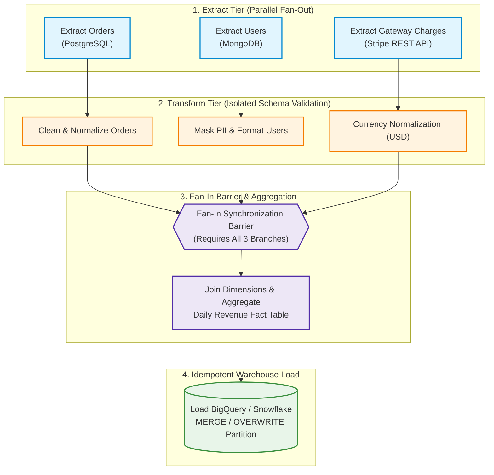
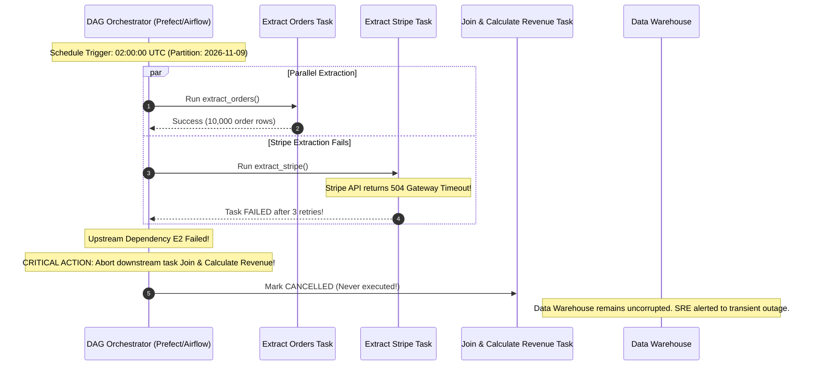
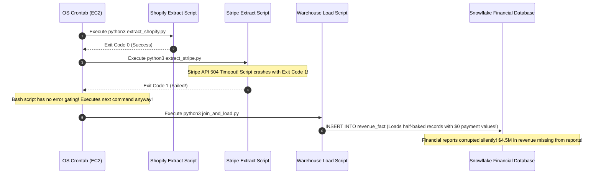

# Module 13: Batch ETL Pipeline Orchestration

Scheduling a single background task with a cron timer (Module 03) works well for self-contained, isolated operations like generating an hourly sitemap. However, production enterprise data systems require complex **Extract, Transform, and Load (ETL)** workflows: extracting transactional data from multiple disparate databases, validating schemas, joining dimensions with fact tables, and loading clean analytical snapshots into a cloud data warehouse. Chaining these multi-step operations using brittle bash scripts or uncoordinated task queues introduces severe operational hazards: upstream failures go undetected, downstream steps run on partial data, and pipelines silently write corrupted analytics that executives use to make critical business decisions.

> [!TIP]
> **The Golden Rule:** Construct batch data pipelines as explicit Directed Acyclic Graphs (DAGs) where upstream task failures immediately block dependent downstream steps, retries are isolated strictly to failing task boundaries, and partition writes are strictly idempotent (`OVERWRITE` or `UPSERT`) to guarantee safe historical backfills.

---

## 1. Visual Mental Models

### Industrial Multi-Source ETL DAG with Fan-In Synchronization

A resilient data orchestration pipeline coordinates parallel extractions, independent transformations, and synchronized joins before loading:



### Upstream Failure Blocking vs. Blind Sequential Execution

A dedicated orchestrator prevents cascading data corruption by immediately canceling downstream dependent tasks when an upstream step fails:



---

## 2. Structured Reference Grids

### Modern Pipeline Orchestration Engines Comparison

| Capability | Prefect 3.x | Apache Airflow | Dagster | Temporal / Cadence |
| :--- | :--- | :--- | :--- | :--- |
| **Orchestration Model** | Pure Python code as workflows (`@flow`, `@task`) | Python AST DAG definitions | Asset-based software-defined data assets | Durable event-sourced state machine |
| **Dynamic Execution** | Native Python loops & conditionals | Complex (requires dynamic task mapping) | Native asset graphs | Native code execution |
| **Granular Retries** | Declared per-task with exponential backoff | Declared per-operator | Declared per-op / per-asset | Declared per-activity |
| **Historical Backfills** | Parameterized flow runs by partition date | Built-in CLI & UI backfill engine | First-class partition backfills | Manual workflow invocation loop |
| **Primary Sweet Spot** | High-velocity Python ETL, data science, ML | Enterprise scheduled data warehousing | Modern data stack (dbt, Snowflake, DuckDB)| Long-running business transactions & sagas |

### Partitioning & Idempotency Strategy Matrix

| Storage Target | Partition Key | Idempotent Write Strategy | Anti-Pattern to Avoid |
| :--- | :--- | :--- | :--- |
| **BigQuery / Snowflake** | `partition_date` (`YYYY-MM-DD`) | `MERGE INTO target USING staging ON target.date = staging.date` | Blind `INSERT INTO target SELECT ...` (Duplicates historical rows) |
| **PostgreSQL / MySQL** | `run_id` or `day_bucket` | `INSERT ... ON CONFLICT (date_bucket, id) DO UPDATE` | Truncating tables before load without transactional rollback |
| **S3 / Cloud Storage** | `s3://bucket/year/month/day/` | Atomic file overwrite (`PUT s3://.../part-00.parquet`) | Appending to unversioned CSV files |

---

## 3. Production War Story

### The Blind Bash Cron That Corrupted 6 Months of Revenue Reports

#### The Incident
An enterprise e-commerce business generated board-level executive revenue reports via a nightly bash script on an EC2 instance:
```bash
#!/bin/bash
python3 extract_shopify.py
python3 extract_stripe.py
python3 join_and_load.py
```
On a Sunday night, the Stripe API experienced a 20-minute maintenance window. `extract_stripe.py` printed a connection error and crashed with exit code 1. Because the bash script omitted `set -e`, it happily proceeded to execute `join_and_load.py`. The loading script joined Shopify orders with an empty Stripe dataset, treating the missing payment confirmations as uncollected cash. For the next 6 weeks, revenue rollups underreported gross operating revenue by $4.5 million. The executive team suspended hiring and initiated cost cuts based on the corrupted financial report before a financial auditor discovered the missing Stripe records.



#### The Root Cause
1. **Lack of Dependency Enforcement:** The shell script executed downstream steps regardless of upstream completion.
2. **Missing Granular Retries:** A 3-minute transient gateway blip caused an unrecoverable failure because the script had no automated retry logic.
3. **Destructive Non-Idempotent Inserts:** Re-running the script manually appended duplicate rows into the warehouse.

#### The Verified Production Fix
1. Replaced the bash crontab with a **Prefect DAG Flow**. If `extract_stripe` fails after its 3 configured retries, downstream aggregation steps are immediately marked `CANCELLED` and never execute.
2. Migrated database loading queries to use SQL `MERGE` statements keyed by `transaction_date`, making backfills and re-runs completely idempotent.

---

## 4. Multi-Language Production Implementations

### Go (DAG Orchestrator with `errgroup` & Barrier Synchronization)

```go
package main

import (
	"context"
	"fmt"
	"log"
	"time"

	"golang.org/x/sync/errgroup"
)

type ExtractedData struct {
	Source string
	Rows   int
}

// ExecuteETLPipeline coordinates an explicit Fan-Out / Fan-In DAG
func ExecuteETLPipeline(ctx context.Context, partitionDate string) error {
	log.Printf("[Pipeline] Starting ETL for partition: %s", partitionDate)

	// Step 1: Parallel Fan-Out Extractions
	g, ctx := errgroup.WithContext(ctx)
	results := make([]ExtractedData, 2)

	g.Go(func() error {
		data, err := extractSourceWithRetry(ctx, "Postgres Orders", 3)
		if err != nil {
			return fmt.Errorf("postgres extract failed: %w", err)
		}
		results[0] = data
		return nil
	})

	g.Go(func() error {
		data, err := extractSourceWithRetry(ctx, "Stripe Gateway", 3)
		if err != nil {
			return fmt.Errorf("stripe extract failed: %w", err)
		}
		results[1] = data
		return nil
	})

	// Wait for all upstream extractions to finish
	if err := g.Wait(); err != nil {
		// CRITICAL: Upstream failed, abort immediately! Downstream will not run!
		return fmt.Errorf("[Pipeline Aborted] Upstream dependency failure: %w", err)
	}

	log.Printf("[Pipeline] All extracts succeeded. Entering Fan-In Barrier...")

	// Step 2: Downstream Aggregation & Idempotent Load
	if err := loadWarehousePartition(ctx, partitionDate, results); err != nil {
		return fmt.Errorf("warehouse load failed: %w", err)
	}

	log.Printf("[Pipeline] Partition %s processed successfully.", partitionDate)
	return nil
}

func extractSourceWithRetry(ctx context.Context, source string, maxRetries int) (ExtractedData, error) {
	for attempt := 1; attempt <= maxRetries; attempt++ {
		log.Printf("[Extract] Fetching %s (Attempt %d/%d)...", source, attempt, maxRetries)
		// Simulate network call
		if attempt == 1 && source == "Stripe Gateway" {
			time.Sleep(100 * time.Millisecond)
			continue // Simulate 1 transient retry
		}
		return ExtractedData{Source: source, Rows: 5000}, nil
	}
	return ExtractedData{}, fmt.Errorf("exhausted retries for %s", source)
}

func loadWarehousePartition(ctx context.Context, partitionDate string, data []ExtractedData) error {
	log.Printf("[Warehouse] Executing MERGE INTO daily_revenue PARTITION ('%s')...", partitionDate)
	time.Sleep(150 * time.Millisecond)
	return nil
}
```

---

### Node.js / TypeScript (`BullMQ` Multi-Step Flow DAG)

```typescript
import { FlowProducer, Worker, Job } from 'bullmq';
import IORedis from 'ioredis';

const connection = new IORedis('redis://127.0.0.1:6379', { maxRetriesPerRequest: null });
const flowProducer = new FlowProducer({ connection });

export async function scheduleDailyETLFlow(partitionDate: string) {
  // Construct DAG: Parent (Load) waits for all Children (Extract & Transform)
  const flow = await flowProducer.add({
    name: 'load-warehouse-fact-table',
    queueName: 'etl-load-queue',
    data: { partitionDate },
    opts: { failParentOnFailure: true }, // Upstream failure immediately cancels parent
    children: [
      {
        name: 'extract-orders',
        queueName: 'etl-extract-queue',
        data: { source: 'postgres', partitionDate },
        opts: { attempts: 3, backoff: { type: 'exponential', delay: 2000 } },
      },
      {
        name: 'extract-stripe-charges',
        queueName: 'etl-extract-queue',
        data: { source: 'stripe', partitionDate },
        opts: { attempts: 3, backoff: { type: 'exponential', delay: 2000 } },
      },
    ],
  });

  console.log(`[ETL Orchestrator] Enqueued DAG flow for partition: ${partitionDate}`);
  return flow.job.id;
}

// 1. Worker for Extract Tasks
export const extractWorker = new Worker(
  'etl-extract-queue',
  async (job: Job) => {
    console.log(`[Extract Task] Fetching data for ${job.data.source} (${job.data.partitionDate})`);
    return { source: job.data.source, rowCount: 10420 };
  },
  { connection }
);

// 2. Worker for Final Aggregation (Fan-In Barrier)
export const loadWorker = new Worker(
  'etl-load-queue',
  async (job: Job) => {
    // Only runs if ALL children succeeded
    const childrenValues = await job.getChildrenValues();
    console.log(`[Load Task] All extractions complete. Loading partition ${job.data.partitionDate}`);
    console.log(`[Load Task] Input data sources:`, childrenValues);
    return { status: 'PARTITION_LOADED', partitionDate: job.data.partitionDate };
  },
  { connection }
);
```

---

### Python (`Prefect 3.x` Native Function DAG with Retries & Backfill)

```python
import time
from datetime import date
from prefect import flow, task

@task(retries=3, retry_delay_seconds=2)
def extract_orders(partition_date: str) -> list[dict]:
    print(f"[Extract] Querying PostgreSQL orders for date: {partition_date}")
    time.sleep(0.5)
    return [{"order_id": 101, "amount": 50.0}, {"order_id": 102, "amount": 75.0}]

@task(retries=3, retry_delay_seconds=2)
def extract_stripe_payments(partition_date: str) -> list[dict]:
    print(f"[Extract] Querying Stripe API for date: {partition_date}")
    time.sleep(0.5)
    return [{"order_id": 101, "fee": 1.50}, {"order_id": 102, "fee": 2.25}]

@task
def transform_and_join(orders: list[dict], payments: list[dict]) -> list[dict]:
    """Pure in-memory transform (No retries needed for deterministic code)"""
    print("[Transform] Joining order items with gateway fee records...")
    payment_map = {p["order_id"]: p["fee"] for p in payments}
    
    enriched = []
    for o in orders:
        fee = payment_map.get(o["order_id"], 0.0)
        enriched.append({"order_id": o["order_id"], "net_revenue": o["amount"] - fee})
    return enriched

@task
def load_idempotent_partition(partition_date: str, aggregated_records: list[dict]):
    """
    Idempotent SQL MERGE or partition replacement.
    Safe to execute repeatedly across historical backfills.
    """
    print(f"[Warehouse Load] OVERWRITE PARTITION ({partition_date}) with {len(aggregated_records)} rows.")
    # SQL: MERGE INTO analytics.daily_revenue USING staging ...
    return True

@flow(name="Daily-Financial-Rollup-ETL")
def daily_financial_etl_flow(partition_date: str = None):
    if partition_date is None:
        partition_date = str(date.today())

    # Step 1: Parallel Extracts
    orders_future = extract_orders(partition_date)
    payments_future = extract_stripe_payments(partition_date)

    # Step 2: Transform (Fan-In Barrier: Automatically waits for both futures)
    enriched_data = transform_and_join(orders_future, payments_future)

    # Step 3: Idempotent Load
    load_idempotent_partition(partition_date, enriched_data)

if __name__ == "__main__":
    # Can run live or backfill historical dates safely
    daily_financial_etl_flow("2026-11-08")
```

---

## 5. Practical Hands-On Verification

### 1. Trigger Parameterized Historical Backfill via Prefect CLI

Trigger an isolated historical re-run for a specific historical partition:

```bash
prefect deployment run 'Daily-Financial-Rollup-ETL/production-deployment' \
  --param partition_date="2026-11-01"
```

**Output:**
```text
Created run 'radiant-badger' for deployment 'Daily-Financial-Rollup-ETL/production-deployment'
Flow run 'radiant-badger' - Task 'extract_orders' [COMPLETED]
Flow run 'radiant-badger' - Task 'extract_stripe_payments' [COMPLETED]
Flow run 'radiant-badger' - Task 'transform_and_join' [COMPLETED]
Flow run 'radiant-badger' - Task 'load_idempotent_partition' [COMPLETED]
Flow run 'radiant-badger' - Flow run COMPLETED in 2.14s
```

### 2. Verify Warehouse Partition Idempotency

Ensure that running the backfill twice does not duplicate rows in the analytics database:

```sql
SELECT partition_date, COUNT(*) as row_count 
FROM analytics.daily_revenue 
WHERE partition_date = '2026-11-01' 
GROUP BY partition_date;
```

**Output:**
```text
partition_date | row_count
---------------+----------
2026-11-01     | 2
```
*(Row count remains exactly 2 regardless of how many times the backfill is triggered).*

---

## 6. Operational Validation Checkpoints

<details>
<summary><strong>Checkpoint 1: In-Memory Transforms vs. External Network Retries</strong></summary>

**Scenario:** A junior data engineer configures `@task(retries=5, retry_delay_seconds=10)` across all tasks in a flow, including `clean_timestamps()` which performs pure string manipulation. When a data anomaly causes a `ValueError: Invalid date format '2026-99-99'`, the pipeline pauses and retries the calculation 5 times before failing 1 minute later. What design rule was broken?

*Explanation:*
Retries are designed exclusively for **transient external conditions** (e.g., HTTP 503 timeouts, network socket disconnects, database deadlocks). Deterministic code errors (e.g., `ValueError`, `KeyError`, `ZeroDivisionError`) will fail identically on every execution attempt. Retrying deterministic transforms simply delays the inevitable failure and clogs worker compute.
**The Rule:** Apply retries only to tasks performing external I/O (extracts and warehouse loads).
</details>

<details>
<summary><strong>Checkpoint 2: The Silent Missing Key in Fan-In Joins</strong></summary>

**Scenario:** A transform step joins an orders table with a newly introduced shipping carriers table using a standard SQL `INNER JOIN`. If the carrier extraction task produces 0 rows due to an upstream API outage, what happens to the final fact table?

*Explanation:*
An `INNER JOIN` against an empty table returns zero rows. The pipeline loads 0 records into the warehouse, wiping out the day's order metrics without throwing an explicit Python error.
**The Fix:** Implement **Data Quality Assertion Gates** (e.g., Great Expectations or Prefect artifacts). Before running downstream joins, assert that `assert len(orders) > 0 and len(carriers) > 0`. If a required dimension is empty, fail the task explicitly to prevent writing blank reports.
</details>

<details>
<summary><strong>Checkpoint 3: The Danger of Global State in Backfills</strong></summary>

**Scenario:** A pipeline extracts orders using the query `SELECT * FROM orders WHERE updated_at >= NOW() - INTERVAL '24 hours'`. When you trigger a backfill to fix corrupted data from two weeks ago, the pipeline extracts today's data instead of historical data. Why?

*Explanation:*
The task query uses dynamic wall-clock references (`NOW()`) instead of an explicit, parameterized partition boundary.
**The Rule:** Every ETL task must accept explicit, immutable time boundaries: `WHERE order_date >= :start_date AND order_date < :end_date`. A backfill simply passes the historical date range (`start_date="2026-10-15"`) to execute cleanly on historical partitions.
</details>

---

## Next

[14-object-storage-and-large-files](../14-object-storage-and-large-files/README.md)
— the last building block before the capstone. You'll handle large files
the right way: why they don't belong in your database, object storage
(S3-style) concepts, multipart uploads in FastAPI, chunked/streamed
downloads, and presigned URLs that let clients upload and download
directly to storage without proxying gigabytes through your API.
