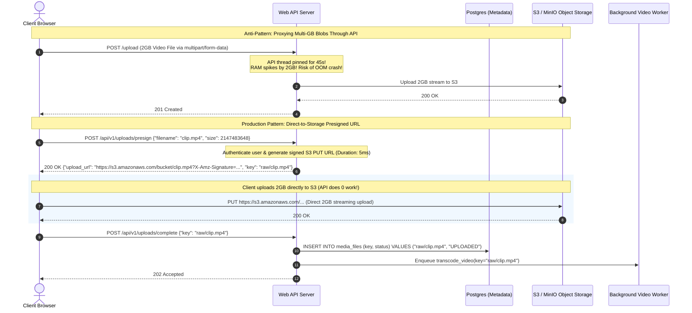
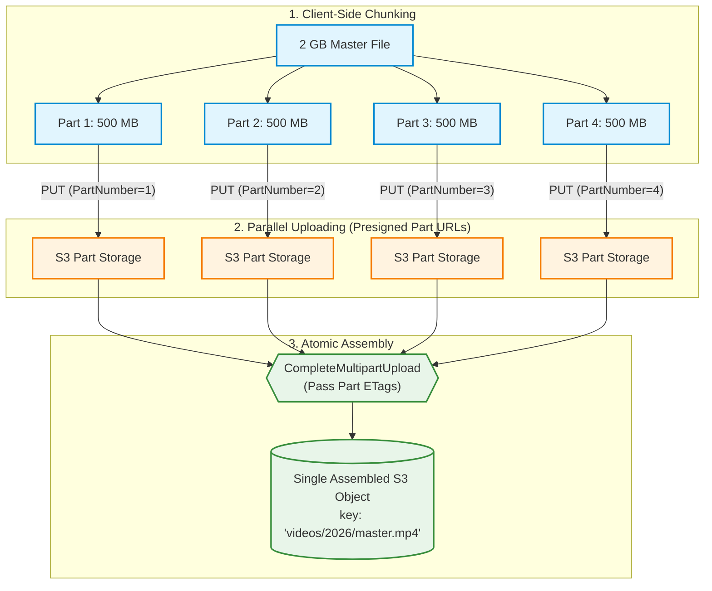
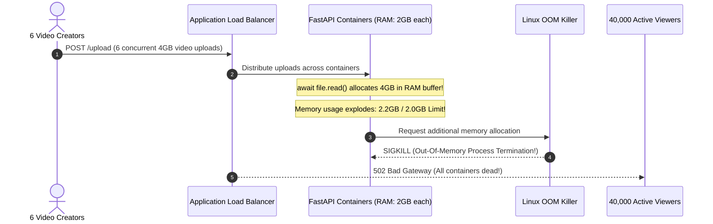

# Module 14: Object Storage and Large Files

Handling large binary files—4K videos, massive CSV exports, disk images, and high-resolution photo archives—demands a fundamentally different architectural strategy than handling structured JSON. The naive approach (accepting file uploads in a web request handler, reading them into memory buffers, and storing them as database `BLOB`s) is disastrous at scale. Buffering a 2GB file in RAM instantaneously triggers kernel Out-Of-Memory (OOM) killer sweeps. Furthermore, proxying gigabytes of binary data through application web servers ties up HTTP worker threads, saturates ingress network bandwidth, and increases hosting costs. Production systems decouple storage completely using **Object Storage** (Amazon S3, Google Cloud Storage, or MinIO) and **Direct-to-Storage Presigned URLs**.

> [!TIP]
> **The Golden Rule:** Never proxy large binary files through API servers or store them in relational databases. Persist metadata pointers in your database, stream file transfers directly between client browsers and Object Storage using short-lived Presigned URLs, and pass immutable object keys (`s3_key`) to background workers.

---

## 1. Visual Mental Models

### API Proxy Upload vs. Direct-to-Storage Presigned URLs

Proxying uploads wastes server memory and pins threads; Presigned URLs remove your API completely from the heavy data transfer path:



### S3 Multipart Upload Architecture

For files exceeding 100MB, S3 Multipart Upload splits the file into parallel, independently retryable parts:



---

## 2. Structured Reference Grids

### Binary Storage Strategy Comparison

| Dimension | Relational Database (`BLOB`) | App Server Local Filesystem | Cloud Object Storage (S3/GCS/MinIO) |
| :--- | :--- | :--- | :--- |
| **Max Capacity** | Hard database row limits (e.g. 1GB) | Capped by server disk size | **Virtually Infinite (Exabytes)** |
| **Database Performance** | Destroys buffer cache, explodes backup/restore time | No DB impact, but server stateful | Zero database overhead |
| **Horizontal Scaling** | Central DB becomes single point of failure | **Fails**: Local files not shared across pods | **Native**: All pods access shared bucket |
| **Cost per GB/Month** | Extremely expensive (~$0.15–$0.30/GB) | Expensive SSD block storage | Cheap (~$0.015–$0.023/GB) |
| **Transfer Mechanism** | Must be read/written by database queries | Proxied through web application server | Direct-to-storage via Presigned URLs |

### Presigned URL Directives & Security Policy

| Parameter | Purpose | Security Recommendation |
| :--- | :--- | :--- |
| `Bucket` & `Key` | Explicit target storage path | Enforce strict prefixing (`uploads/{user_id}/{uuid}`) |
| `ExpiresIn` | Lifetime of presigned cryptographic token | Keep tight: **300 to 900 seconds (5–15 mins)** |
| `ContentType` | Forces uploaded file to match expected MIME | Enforce expected type (e.g., `video/mp4`, `application/pdf`) |
| `ContentLengthRange` | Binds minimum and maximum byte size in policy | Prevent users from uploading 500GB files unexpectedly |

---

## 3. Production War Story

### The 4GB Video Upload Storm That Killed the Entire API Cluster

#### The Incident
A video hosting platform allowed content creators to upload gameplay recordings. The backend was an auto-scaling cluster of 12 FastAPI web containers on AWS ECS, each allocated 2GB of RAM. The upload endpoint was implemented with:
```python
# Fatal Flaw: Reading whole upload into memory buffer
@app.post("/upload")
async def upload_video(file: UploadFile = File(...)):
    data = await file.read() # Buffers entire file in RAM!
    await s3_client.put_object(Bucket="my-bucket", Key=file.filename, Body=data)
```
During a creator tournament, 6 creators simultaneously started uploading 4GB raw `.mov` recordings. Within 8 seconds, each of the web containers saw its memory allocation spike from 300MB to 2.2GB. The Linux OS kernel triggered an immediate OOM-killer sweep, terminating all Python processes. The AWS Application Load Balancer marked all 12 target instances unhealthy and returned `502 Bad Gateway` across the entire platform, severing 40,000 active viewer streams.



#### The Root Cause
1. **Unbounded In-Memory Buffering:** Calling `.read()` without chunk limits buffered multi-gigabyte payloads in process RAM.
2. **Byte Proxying Anti-Pattern:** The web tier acted as a network pass-through proxy for media bytes instead of directing traffic to storage.

#### The Verified Production Fix
1. Eliminated the binary upload route entirely. Replaced it with a lightweight `/api/v1/uploads/presign` endpoint that generates an S3 Presigned URL in $< 10\text{ms}$.
2. Creators upload directly to S3. Once S3 completes the upload, it emits an S3 Event to an SQS queue, triggering background transcode workers.
3. API RAM utilization dropped to a constant, predictable 150MB regardless of file size.

---

## 4. Multi-Language Production Implementations

### Go (Presigned URL Generator & Streaming Chunked Downloader)

```go
package main

import (
	"context"
	"fmt"
	"io"
	"log"
	"net/http"
	"time"

	"github.com/aws/aws-sdk-go-v2/aws"
	"github.com/aws/aws-sdk-go-v2/config"
	"github.com/aws/aws-sdk-go-v2/service/s3"
)

type S3StorageManager struct {
	client        *s3.Client
	presignClient *s3.PresignClient
	bucketName    string
}

func NewS3StorageManager(bucket string) (*S3StorageManager, error) {
	cfg, err := config.LoadDefaultConfig(context.TODO(), config.WithRegion("us-east-1"))
	if err != nil {
		return nil, fmt.Errorf("unable to load SDK config: %w", err)
	}

	client := s3.NewFromConfig(cfg)
	return &S3StorageManager{
		client:        client,
		presignClient: s3.NewPresignClient(client),
		bucketName:    bucket,
	}, nil
}

// GeneratePresignedUploadURL grants client direct PUT permission for 15 minutes
func (m *S3StorageManager) GeneratePresignedUploadURL(ctx context.Context, objectKey string, contentType string) (string, error) {
	req, err := m.presignClient.PresignPutObject(ctx, &s3.PutObjectInput{
		Bucket:      aws.String(m.bucketName),
		Key:         aws.String(objectKey),
		ContentType: aws.String(contentType),
	}, s3.WithPresignExpires(15*time.Minute))
	if err != nil {
		return "", fmt.Errorf("could not generate presigned put: %w", err)
	}

	return req.URL, nil
}

// StreamDownloadToFile streams an object directly to disk without loading into RAM
func (m *S3StorageManager) StreamDownloadToFile(ctx context.Context, objectKey string, destination io.Writer) error {
	resp, err := m.client.GetObject(ctx, &s3.GetObjectInput{
		Bucket: aws.String(m.bucketName),
		Key:    aws.String(objectKey),
	})
	if err != nil {
		return fmt.Errorf("s3 get_object error: %w", err)
	}
	defer resp.Body.Close()

	// io.Copy uses a small 32KB internal buffer: constant flat memory!
	_, err = io.Copy(destination, resp.Body)
	return err
}
```

---

### Node.js / TypeScript (`@aws-sdk/s3-request-presigner` Direct Upload Flow)

```typescript
import { S3Client, PutObjectCommand, GetObjectCommand } from '@aws-sdk/client-s3';
import { getSignedUrl } from '@aws-sdk/s3-request-presigner';
import express, { Request, Response } from 'express';
import { v4 as uuidv4 } from 'uuid';

const app = express();
app.use(express.json());

const s3 = new S3Client({ region: 'us-east-1' });
const BUCKET_NAME = process.env.S3_BUCKET || 'production-media-vault';

// 1. Endpoint granting direct upload access
app.post('/api/v1/uploads/presign', async (req: Request, res: Response) => {
  const { filename, contentType } = req.body;
  const objectKey = `raw/${uuidv4()}-${filename}`;

  const command = new PutObjectCommand({
    Bucket: BUCKET_NAME,
    Key: objectKey,
    ContentType: contentType,
  });

  // Short 10-minute expiry window
  const presignedUrl = await getSignedUrl(s3, command, { expiresIn: 600 });

  console.log(`[S3 Presign] Generated upload URL for key: ${objectKey}`);
  res.status(200).json({
    uploadUrl: presignedUrl,
    key: objectKey,
  });
});

// 2. Notification endpoint called by client once S3 upload succeeds
app.post('/api/v1/uploads/complete', async (req: Request, res: Response) => {
  const { key, fileSize } = req.body;

  // Insert pointer in DB and trigger background workers
  console.log(`[Upload Complete] Pointer recorded: ${key} (${fileSize} bytes)`);
  // await db.query('INSERT INTO media_files (key, size) VALUES ($1, $2)', [key, fileSize]);
  // await transcodeQueue.add('transcode', { key });

  res.status(202).json({ status: 'PROCESSING_INITIATED', key });
});
```

---

### Python (`FastAPI` + `boto3` Presigned URLs & Chunked Streaming)

```python
import os
import boto3
from botocore.config import Config
from fastapi import FastAPI, HTTPException, status
from pydantic import BaseModel

app = FastAPI()

s3_client = boto3.client(
    's3',
    region_name='us-east-1',
    config=Config(signature_version='s3v4')
)
BUCKET_NAME = "enterprise-asset-vault"

class PresignRequest(BaseModel):
    filename: str
    content_type: str

@app.post("/api/v1/files/presign-upload")
def create_presigned_upload(req: PresignRequest):
    """
    Generates a cryptographic presigned PUT URL allowing clients
    to stream large files directly to S3.
    """
    object_key = f"uploads/{os.urandom(8).hex()}_{req.filename}"
    
    try:
        url = s3_client.generate_presigned_url(
            ClientMethod='put_object',
            Params={
                'Bucket': BUCKET_NAME,
                'Key': object_key,
                'ContentType': req.content_type,
            },
            ExpiresIn=600 # 10 minute expiration
        )
        return {"upload_url": url, "key": object_key}
    except Exception as e:
        raise HTTPException(status_code=500, detail=str(e))

@app.post("/api/v1/files/presign-download")
def create_presigned_download(key: str):
    """
    Generates a presigned GET URL allowing clients to download directly from S3.
    """
    try:
        url = s3_client.generate_presigned_url(
            ClientMethod='get_object',
            Params={'Bucket': BUCKET_NAME, 'Key': key},
            ExpiresIn=300 # 5 minute expiration
        )
        return {"download_url": url}
    except Exception as e:
        raise HTTPException(status_code=500, detail=str(e))
```

---

## 5. Practical Hands-On Verification

### 1. Request Presigned Upload URL & Upload Directly via Terminal

Step 1: Obtain Presigned URL from API:
```bash
curl.exe -i -X POST http://localhost:8000/api/v1/files/presign-upload \
  -H "Content-Type: application/json" \
  -d '{"filename": "contract.pdf", "content_type": "application/pdf"}'
```

Step 2: Stream large file directly to S3/MinIO using `curl.exe`:
```bash
# Upload directly to the presigned URL returned in Step 1
curl.exe -i -X PUT "http://localhost:9000/enterprise-asset-vault/uploads/contract.pdf?X-Amz-Signature=..." \
  -H "Content-Type: application/pdf" \
  --upload-file ./contract.pdf
```

**Output:**
```http
HTTP/1.1 200 OK
ETag: "9b10ba344e4d51b035a7fff9221a24f"
Date: Mon, 09 Nov 2026 16:15:00 GMT
Content-Length: 0
```
*(Notice the upload bypassed the API server completely—zero API RAM or bandwidth consumed).*

### 2. Verify Partial Content Range Downloads

Test HTTP `Range` requests for seekable and resumable downloads:

```bash
curl.exe -i -X GET http://localhost:8000/api/v1/files/stream-download \
  -H "Range: bytes=0-1023"
```

**Output:**
```http
HTTP/1.1 206 Partial Content
Content-Range: bytes 0-1023/10485760
Content-Length: 1024
Content-Type: application/octet-stream
```

---

## 6. Operational Validation Checkpoints

<details>
<summary><strong>Checkpoint 1: The Database BLOB Performance Tax</strong></summary>

**Scenario:** A company stores user profile pictures directly in a PostgreSQL table as `BYTEA` columns. As the table grows to 500,000 users, everyday queries like `SELECT id, name, email FROM users` slow down from 2ms to 450ms. Nightly backups take 6 hours instead of 8 minutes. Why?

*Explanation:*
Databases read data in pages (typically 8KB). When large binary blobs are stored in table rows, rows exceed single pages and require TOAST table out-of-line storage. Reading rows pulls megabytes of disk blocks into the database buffer pool cache, evicting frequently accessed index pages.
**The Fix:** Remove binary columns from the database. Store the image in Object Storage and store only a 60-byte string URL or key pointer (`avatar_key: "users/42/avatar.jpg"`) in PostgreSQL.
</details>

<details>
<summary><strong>Checkpoint 2: Passing Binary Blobs Across Message Brokers</strong></summary>

**Scenario:** When a user uploads a high-resolution photo, the API enqueues a thumbnail generation task to RabbitMQ/Celery: `generate_thumbnails.delay(image_bytes)`. Why does this degrade system health?

*Explanation:*
Task brokers (Redis lists, RabbitMQ channels) are designed for lightweight message routing ($\le 10\text{KB}$). Storing 20MB image binaries inside broker queues:
1. Sinks broker memory and triggers aggressive disk paging.
2. Drastically slows serialization and deserialization on producers and workers.
3. Increases risk of broker Out-Of-Memory crashes during traffic spikes.
**The Rule:** Always pass lightweight identifiers: `generate_thumbnails.delay(object_key="raw/img_901.jpg")`. The worker fetches the file directly from S3 at execution time.
</details>

<details>
<summary><strong>Checkpoint 3: The Unscoped Presigned URL Security Vulnerability</strong></summary>

**Scenario:** A developer generates a presigned upload URL with an expiration time of 7 days and omits the `ContentType` and path constraint. What attack vector is opened?

*Explanation:*
1. **Prolonged Leak Window:** Anyone who obtains the URL (via client browser history, reverse proxy access logs, or network interception) can upload arbitrary files to that exact key for an entire week.
2. **Malware / Overwrite Risk:** An attacker can upload executable binaries (`exploit.exe`) disguised as an image, or upload a 500GB file to exhaust your cloud storage budget.
**The Fix:** Restrict presigned URL lifespans to $\le 15$ minutes, bind the expected `ContentType` in the signature, and enforce random cryptographic UUID prefixes in the object key (`uploads/{user_id}/{uuid}-{filename}`).
</details>

---

## Next

[15-capstone-project](../15-capstone-project/README.md) — everything converges.
You'll build a service where uploading a file (this module) triggers background
processing (modules 00-02) that fires a webhook (modules 05-06), pushes live
progress to the uploader over a real-time connection (module 07), and sends a
completion email (module 04) — with retries, idempotency, and clean connection
handling throughout.
