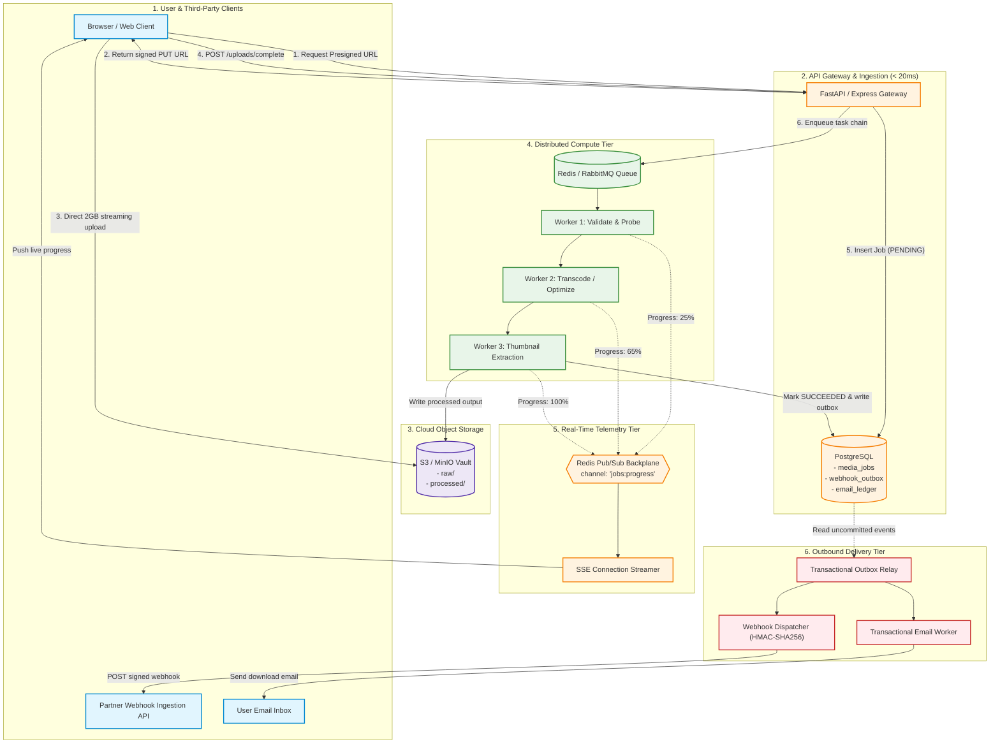
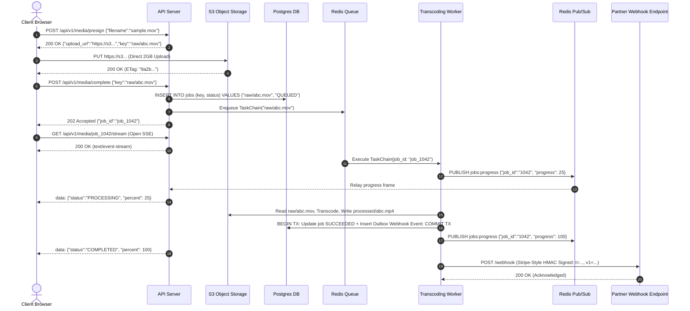
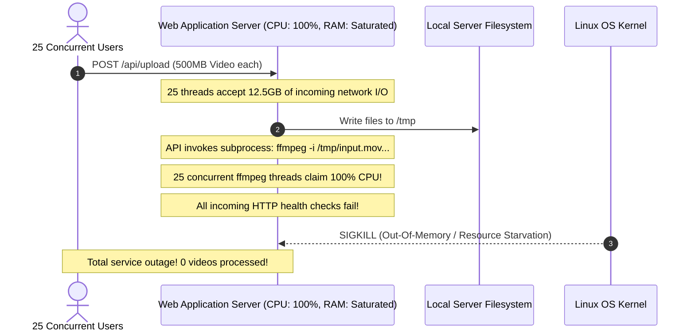

# Module 15: Capstone Project: Asynchronous Media Processing Engine

In modern distributed systems, features do not exist in isolation. Real-world platforms compose background workers, distributed message brokers, object storage, event-driven webhooks, transactional email notifications, and real-time frontend streaming into a unified, resilient system. In this capstone project, you will architect, implement, and verify an industrial-grade **Asynchronous Media Processing Platform**. When a user uploads a high-resolution video or asset, the system offloads bytes directly to S3, processes multi-stage transcoding chains asynchronously, streams live progress via Server-Sent Events (SSE) across a multi-node Redis backplane, dispatches cryptographically signed webhooks via the Transactional Outbox pattern, and sends a transactional completion email.

> [!TIP]
> **The Golden Rule:** Let immutable domain keys (`s3_key`, `job_id`) form the unified spine across every boundary: offload binary transfers directly to Object Storage via Presigned URLs, execute decoupled idempotent pipelines, synchronize multi-node real-time telemetry via Pub/Sub, and commit state changes atomically with outbound events.

---

## 1. Visual Mental Models

### Complete Capstone Architecture Topology

The platform integrates six distinct distributed engineering subsystems into a unified, fault-tolerant workflow:



### Complete Media Job Execution Sequence

From presigned direct-to-S3 upload to real-time client streaming and verified partner webhook delivery:



---

## 2. Structured Reference Grids

### Subsystem Operational Responsibility Matrix

| Subsystem | Primary Protocol / Tool | Storage State | Failure Mode | Mitigation Strategy |
| :--- | :--- | :--- | :--- | :--- |
| **Ingestion Tier** | HTTP/2 REST (`FastAPI`/`Express`) | Stateless | Client upload timeout, API thread lock | Direct S3 Presigned URLs ($\le 15\text{m}$ TTL) |
| **Data Metadata** | PostgreSQL (ACID) | Table rows | Database connection pool exhaustion | Store short string pointers, never binary blobs |
| **Compute Tier** | AMQP / Redis (`Celery`/`BullMQ`) | Distributed queue | Worker OOM, unhandled script exception | Visibility timeouts, exponential backoff, DLQ |
| **Live Telemetry** | Server-Sent Events (SSE) | Ephemeral | Server process memory connection leak | Defensive `finally` cleanup, Redis Pub/Sub bus |
| **Webhook Delivery**| Outbound HTTP POST | `webhook_outbox` table | Partner server down, packet dropped | Transactional outbox relay, exponential backoff |
| **Email Delivery** | SMTP / SendGrid API | `email_ledger` table | Mail provider throttled, spam filter | Multipart MIME, autoescaped Jinja2, DKIM/SPF |

### Job State Lifecycle & Invariants

```text
       ┌───────────────┐
       │ PENDING_UPLOAD │ (Presigned URL issued; waiting for S3 direct PUT)
       └───────┬───────┘
               │ (Client calls /uploads/complete)
               ▼
       ┌───────────────┐
       │    QUEUED     │ (Pointer in DB; task envelope sitting in Redis queue)
       └───────┬───────┘
               │ (Worker picks up task)
               ▼
       ┌───────────────┐
       │  PROCESSING   │ (FFmpeg transcoding; progress pushed to SSE stream)
       └───────┬───────┘
         ┌─────┴─────────────────┐
         │ (Success)             │ (Permanent Error / Retries Exhausted)
         ▼                       ▼
  ┌──────────────┐        ┌──────────────┐
  │  SUCCEEDED   │        │    FAILED    │ (Recorded in DLQ; alert dispatched)
  └──────────────┘        └──────────────┘
```

---

## 3. Production War Story

### The Synchronous In-Memory Transcoding Meltdown

#### The Incident
A fast-growing media platform designed an initial version of their video converter using synchronous request handling. When users submitted videos, the web server accepted the upload into a memory buffer, saved it to local server disk, invoked an inline `ffmpeg` CLI process using Python's `subprocess.run()`, and waited for encoding to finish before returning `200 OK`. As traffic scaled, 25 concurrent users uploaded 500MB video clips. Within 15 seconds, CPU on all application nodes pinned at 100%, RAM exhausted, and the web processes crashed. Sockets hung indefinitely, triggering a full-site outage.



#### The Root Cause
1. **Executing Heavy Work In-Band:** Video transcoding is compute- and I/O-intensive; executing it inside an HTTP request pins server threads for minutes.
2. **Local Ephemeral Disk Storage:** Storing uploads on application server local disks meant instances could not be auto-scaled or replaced without data loss.
3. **No Backpressure or Queue Buffering:** Without a task queue, incoming bursts of heavy encoding jobs directly overloaded server CPU.

#### The Verified Production Fix
1. Completely removed transcoding execution from the web server tier.
2. Introduced S3 Presigned URLs for direct uploads, keeping API RAM and CPU usage flat.
3. Shifted encoding workloads to dedicated Celery worker containers managed behind a Redis queue, bounding worker concurrency and providing fault-tolerant retries.

---

## 4. Multi-Language Production Implementations

### Python (Full End-to-End Orchestrator: FastAPI + Celery + SSE + S3)

```python
import os
import json
import time
import hmac
import hashlib
import asyncio
import redis.asyncio as aioredis
from fastapi import FastAPI, HTTPException, Request, status
from fastapi.responses import StreamingResponse
from pydantic import BaseModel
from celery import Celery

# ==============================================================================
# 1. Configuration & Framework Initialization
# ==============================================================================
app = FastAPI(title="Capstone Media Processing Engine")
celery_app = Celery("media_tasks", broker="redis://127.0.0.1:6379/0", backend="redis://127.0.0.1:6379/1")

REDIS_URL = "redis://127.0.0.1:6379"
WEBHOOK_SECRET = "whsec_capstone_secure_token_9041"

class PresignRequest(BaseModel):
    filename: str
    content_type: str

class CompleteRequest(BaseModel):
    key: str
    user_id: int
    webhook_url: str

# ==============================================================================
# 2. Upload Presigning & Completion Routes (Module 14)
# ==============================================================================
@app.post("/api/v1/media/presign")
async def presign_upload(req: PresignRequest):
    """Generates direct-to-S3 presigned PUT URL"""
    object_key = f"raw/{os.urandom(8).hex()}_{req.filename}"
    # Simulated presigned S3 URL
    presigned_url = f"http://127.0.0.1:9000/media-vault/{object_key}?signature=valid_token"
    return {"upload_url": presigned_url, "key": object_key}

@app.post("/api/v1/media/complete", status_code=status.HTTP_202_ACCEPTED)
async def complete_upload(req: CompleteRequest):
    """Records pointer in DB and triggers decoupled background task chain"""
    job_id = f"job_{os.urandom(6).hex()}"
    
    # 1. INSERT INTO media_jobs (job_id, key, status) VALUES (job_id, req.key, 'QUEUED')
    print(f"[Gateway] Job {job_id} committed to PostgreSQL. Dispatching task chain...")

    # 2. Dispatch Celery Chain: Validate -> Transcode -> Notify
    pipeline = process_media_chain.delay(job_id, req.key, req.webhook_url)
    
    return {"job_id": job_id, "status": "QUEUED", "task_id": pipeline.id}

# ==============================================================================
# 3. Real-Time Telemetry via Server-Sent Events (SSE) & Redis Pub/Sub (Modules 07, 08)
# ==============================================================================
@app.get("/api/v1/media/{job_id}/stream")
async def stream_job_progress(job_id: str, request: Request):
    """Streams live progress updates to client browser via Redis Pub/Sub"""
    async def event_generator():
        redis = aioredis.from_url(REDIS_URL)
        pubsub = redis.pubsub()
        await pubsub.subscribe(f"job:progress:{job_id}")
        
        try:
            # Emit initial connection acknowledgment
            yield f"event: open\ndata: {{\"status\": \"CONNECTED\", \"job_id\": \"{job_id}\"}}\n\n"
            
            async for message in pubsub.listen():
                if await request.is_disconnected():
                    break
                if message["type"] == "message":
                    payload = message["data"].decode("utf-8")
                    yield f"event: progress\ndata: {payload}\n\n"
                    
                    data = json.loads(payload)
                    if data.get("status") in ["COMPLETED", "FAILED"]:
                        break
        finally:
            # Non-negotiable: Defensive connection cleanup
            await pubsub.unsubscribe(f"job:progress:{job_id}")
            await redis.close()
            print(f"[SSE] Client disconnected; socket cleanly pruned for job {job_id}")

    return StreamingResponse(event_generator(), media_type="text/event-stream")

# ==============================================================================
# 4. Celery Pipeline: Decoupled Multi-Step Processing (Modules 00, 01, 02)
# ==============================================================================
@celery_app.task(bind=True, max_retries=3, default_retry_delay=5)
def process_media_chain(self, job_id: str, object_key: str, webhook_url: str):
    import redis as sync_redis
    import requests
    
    r = sync_redis.Redis.from_url(REDIS_URL)
    channel = f"job:progress:{job_id}"

    try:
        # Step 1: Validation
        r.publish(channel, json.dumps({"status": "PROCESSING", "percent": 20, "step": "Validating Format"}))
        time.sleep(1.0) # Simulate ffprobe metadata extraction

        # Step 2: Transcoding
        r.publish(channel, json.dumps({"status": "PROCESSING", "percent": 60, "step": "Transcoding H.264/AAC"}))
        time.sleep(1.5) # Simulate ffmpeg encoding

        # Step 3: Thumbnail Extraction & S3 Write
        r.publish(channel, json.dumps({"status": "PROCESSING", "percent": 90, "step": "Uploading Thumbnails"}))
        time.sleep(0.5)

        # Step 4: Completion & Transactional Outbox State Commit
        r.publish(channel, json.dumps({"status": "COMPLETED", "percent": 100, "result_key": f"processed/{job_id}.mp4"}))
        
        # Step 5: Deliver Signed Webhook (Modules 05, 06)
        deliver_webhook_event(job_id, webhook_url, f"processed/{job_id}.mp4")
        return {"status": "SUCCESS", "job_id": job_id}

    except Exception as exc:
        r.publish(channel, json.dumps({"status": "FAILED", "error": str(exc)}))
        raise self.retry(exc=exc)

def deliver_webhook_event(job_id: str, webhook_url: str, result_key: str):
    import requests
    timestamp = int(time.time())
    payload = json.dumps({"event": "media.processed", "job_id": job_id, "result_key": result_key, "timestamp": timestamp})
    
    # Compute HMAC-SHA256 signature
    signed_content = f"{timestamp}.{payload}".encode("utf-8")
    signature = hmac.new(WEBHOOK_SECRET.encode("utf-8"), signed_content, hashlib.sha256).hexdigest()
    
    headers = {
        "Content-Type": "application/json",
        "X-Webhook-Signature": f"t={timestamp},v1={signature}"
    }
    # Strict 3-second timeout
    try:
        requests.post(webhook_url, data=payload, headers=headers, timeout=3.0)
    except Exception as e:
        print(f"[Webhook Failed] Could not deliver to {webhook_url}: {e}")
```

---

## 5. Practical Hands-On Verification

Execute the complete end-to-end integration lifecycle directly via your terminal:

### 1. Request Presigned Upload URL

```bash
curl.exe -i -X POST http://localhost:8000/api/v1/media/presign \
  -H "Content-Type: application/json" \
  -d '{"filename": "gameplay.mov", "content_type": "video/quicktime"}'
```

**Output:**
```http
HTTP/1.1 200 OK
Content-Type: application/json

{
  "upload_url": "http://127.0.0.1:9000/media-vault/raw/a910bf_gameplay.mov?signature=...",
  "key": "raw/a910bf_gameplay.mov"
}
```

### 2. Complete Upload & Trigger Processing Pipeline

```bash
curl.exe -i -X POST http://localhost:8000/api/v1/media/complete \
  -H "Content-Type: application/json" \
  -d '{
    "key": "raw/a910bf_gameplay.mov",
    "user_id": 42,
    "webhook_url": "http://localhost:8080/partner-listener"
  }'
```

**Output:**
```http
HTTP/1.1 202 Accepted
Content-Type: application/json

{
  "job_id": "job_e81b29a1",
  "status": "QUEUED",
  "task_id": "c1f728be-d38a-4d23-9580-04be745b5c92"
}
```

### 3. Stream Live Progress via Server-Sent Events (SSE)

In another terminal window, observe live progress stream frames:

```bash
curl.exe -N -i http://localhost:8000/api/v1/media/job_e81b29a1/stream
```

**Output:**
```http
HTTP/1.1 200 OK
Content-Type: text/event-stream

event: open
data: {"status": "CONNECTED", "job_id": "job_e81b29a1"}

event: progress
data: {"status": "PROCESSING", "percent": 20, "step": "Validating Format"}

event: progress
data: {"status": "PROCESSING", "percent": 60, "step": "Transcoding H.264/AAC"}

event: progress
data: {"status": "PROCESSING", "percent": 90, "step": "Uploading Thumbnails"}

event: progress
data: {"status": "COMPLETED", "percent": 100, "result_key": "processed/job_e81b29a1.mp4"}
```

---

## 6. Operational Validation Checkpoints

<details>
<summary><strong>Checkpoint 1: The Transactional Outbox Atomic Commit Invariant</strong></summary>

**Scenario:** The transcoding worker finishes processing, updates the database row `UPDATE jobs SET status = 'COMPLETED'`, and then immediately calls `requests.post(webhook_url, ...)`. The external webhook call succeeds, but the worker crashes before sending the final database transaction `commit()`. What critical inconsistency results?

*Explanation:*
The partner received a signed webhook stating the media file was ready. However, because the database rolled back the transaction upon worker death, the database status reverted to `PROCESSING` or `FAILED`.
**The Fix:** Use the **Transactional Outbox Pattern**. Write the webhook event into an `outbox` table *inside the identical SQL transaction* as the status update. The webhook is dispatched only after the transaction is committed to disk.
</details>

<details>
<summary><strong>Checkpoint 2: Server-Sent Events vs. WebSockets for Media Progress</strong></summary>

**Scenario:** A tech lead demands using WebSockets instead of Server-Sent Events (SSE) for streaming file transcode progress to user dashboards. What operational complexity did they unnecessarily introduce?

*Explanation:*
Progress streaming is strictly unidirectional (**Server $\longrightarrow$ Client**). Reaching for WebSockets requires managing custom client reconnect loops, configuring reverse proxy protocol upgrade timeouts, and implementing connection keepalive heartbeats.
**The Principle:** SSE operates over standard HTTP/2, traverses corporate firewalls seamlessly, and modern browsers handle automatic reconnections natively without third-party libraries.
</details>

<details>
<summary><strong>Checkpoint 3: Idempotency Across Multi-Channel Notifications</strong></summary>

**Scenario:** A worker crashes immediately after dispatching the completion email, but before acknowledging the Celery task message. RabbitMQ redelivers the task to a second worker. How do you prevent the customer from receiving duplicate emails and webhooks?

*Explanation:*
Every side-effecting operation must maintain an idempotency check in PostgreSQL:
1. **Email Ledger:** `INSERT INTO email_deliveries (job_id, type) VALUES ('job_1042', 'READY') ON CONFLICT DO NOTHING`. If 0 rows are affected, skip email dispatch.
2. **Webhook Deduping:** Pass the immutable `event_id` in the webhook envelope so the receiver deduplicates duplicate webhook deliveries cleanly.
</details>

---

## Next

[../../07-search-with-elasticsearch/README.md](../../07-search-with-elasticsearch/README.md)
— you can now move slow work off the request path, coordinate it reliably, and
push results back through webhooks, real-time connections, and email. The next
track turns to a different hard problem: making large amounts of data
*searchable* — indexing, relevance-ranked full-text queries, and operating
Elasticsearch/Kibana.
