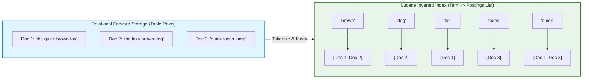
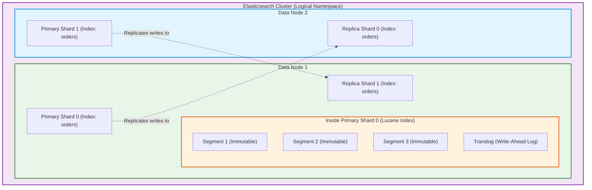
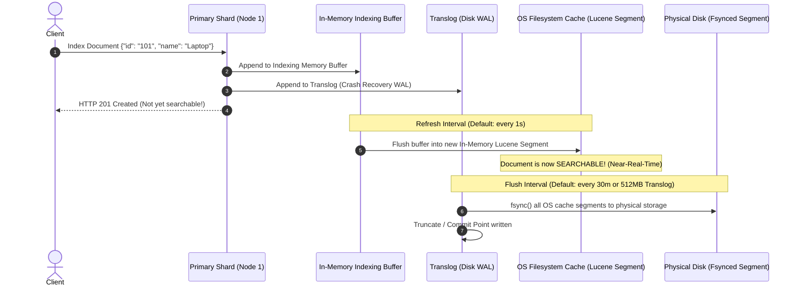
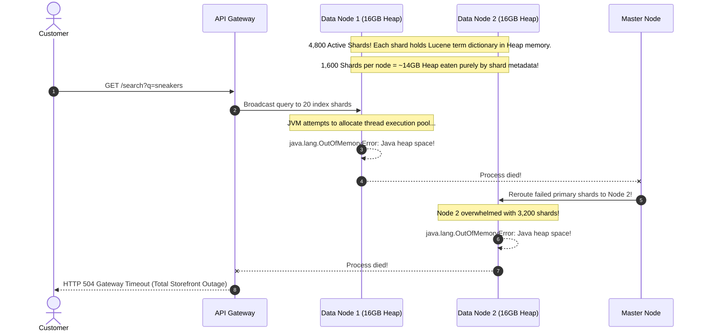

# Module 00: Elasticsearch Fundamentals & Core Architecture

> **Prerequisites**: [Module 04: Databases & The Data Layer](../../04-databases-and-data-layer/README.md), [Module 05: Caching & Performance](../../05-caching-and-performance/README.md).  
> **Estimated Reading Time**: 25 minutes  
> **Target Audience**: Backend Engineers, Search Infrastructure Engineers, Distributed Systems Architects.

> [!TIP]
> **Golden Rule of Search Architecture**: Elasticsearch is a specialized, distributed inverted-index engine built on Apache Lucene—it is **NOT** a system of record. Maintain your relational database (PostgreSQL/MySQL) as the authoritative source of truth and synchronize data into Elasticsearch asynchronously. Never rely on Elasticsearch for ACID transactions, financial bookkeeping, or non-rebuildable business state.

---

## 1. Visual Mental Models & System Architecture

Relational databases excel at ACID guarantees, structured schema constraints, and complex foreign key joins. However, answering full-text queries like *"Find products mentioning 'waterproof running shoes', rank the most relevant first, and tolerate spelling mistakes"* creates severe performance bottlenecks. A SQL `LIKE '%running shoes%'` query bypasses standard B-tree indexes, forces full table scans, and cannot compute probabilistic relevance.

Elasticsearch solves this by organizing data into **Inverted Indexes**, sharded across a distributed cluster of nodes.

### 1.1 The Inverted Index vs. Relational Storage

While a relational database maps an identifier to a row of text, an **inverted index** tokenizes text into distinct terms and maps each term to the sorted list of document IDs (the **postings list**) in which it appears.



### 1.2 Cluster, Node, Shard & Lucene Segment Hierarchy

An Elasticsearch index is a logical namespace partitioned across one or more physical **shards**. Each shard is a fully autonomous **Apache Lucene index** comprised of immutable **segments**.



### 1.3 Near-Real-Time (NRT) Refresh & Flush Lifecycle

When a document is indexed, it does not immediately write to an immutable Lucene segment on disk. It traverses memory buffers, the write-ahead transaction log (Translog), and an in-memory refresh cycle:



---

## 2. Taxonomic Reference Grids

### 2.1 RDBMS Full-Text Search vs. Elasticsearch Engine

| Capability Dimension | Relational Database (PostgreSQL `tsvector`) | Dedicated Search Engine (Elasticsearch) |
| :--- | :--- | :--- |
| **Primary Architectural Role** | System of Record, ACID transactions | Read-optimized search index & analytics |
| **Inverted Index Engine** | GIN / GiST index | Apache Lucene (Immutable LSM-style segments) |
| **Relevance Scoring Model** | Basic Term Frequency (`ts_rank`) | BM25 (Term Frequency saturation + Inverse Doc Frequency + Length Normalization) |
| **Scaling & Sharding** | Vertical scaling, manual table partitioning | Native horizontal sharding & automatic shard routing |
| **Typo Tolerance & Fuzzy** | Requires `pg_trgm` extensions; slow on large text | Native Levenshtein automaton fuzzy queries |
| **Aggregation Performance** | Expensive `GROUP BY` running aggregate functions | Lucene doc-values (columnar storage) aggregating billions of items in milliseconds |
| **Write Latency & Consistency** | Immediate Read-After-Write consistency | Near-Real-Time ($\sim 1\text{s}$ refresh interval window) |

### 2.2 Core Structural Primitives Matrix

| Primitive | Architectural Scope | Physical vs. Logical | Mutability | Failure Behavior |
| :--- | :--- | :--- | :--- | :--- |
| **Cluster** | Collection of connected nodes sharing cluster state | Physical / Network | Dynamic | Elects new master node if active master disconnects |
| **Node** | Single running Elasticsearch JVM process | Physical (Server / Container) | Dynamic | Shards evacuated to remaining nodes if node goes offline |
| **Index** | Logical container of documents sharing mappings | Logical namespace | Settings partially mutable | Read-only if disk threshold ($>95\%$) breached |
| **Primary Shard** | Authoritative partition of an index; independent Lucene engine | Physical file directory | Dynamic (adds segments) | Replicas promoted to primary if primary fails |
| **Replica Shard** | Exact real-time mirror of a primary shard | Physical file directory | Dynamic (receives primary ops) | Cluster health turns Yellow if unallocated; Red if primary lost |
| **Lucene Segment** | Inverted index block on disk | Physical binary files | **Strictly Immutable** | Merged periodically in background (Segment Merging) |
| **Translog** | Write-ahead transaction log on disk | Physical append-only file | Mutable (appended then reset) | Replays writes during crash recovery before segment fsync |

---

## 3. Production War Stories: Incident Post-Mortem

### The $1.2M Cluster Meltdown: Unbounded Shard Explosion and Out-of-Memory Cascade

```
SEVERITY LEVEL: SEV-1 (Complete Search & Catalog Blackout)
DETECTION TIME: 8 Minutes
RECOVERY TIME: 240 Minutes
FINANCIAL PENALTY: $1,200,000 in lost e-commerce checkout revenue
```

#### Incident Background
An enterprise e-commerce platform utilized Elasticsearch to power search, autocomplete, and product filtering across 40 distinct regional websites. The cluster consisted of 3 high-spec data nodes, each configured with 32 GB of RAM (16 GB JVM Heap).

#### What Happened
To maintain isolated logs and analytics, a newly hired DevOps engineer created a script generating daily indices for each microservice with the default setting of 5 primary shards and 1 replica per index. Within 4 months, the cluster had accumulated **4,800 active shards** across the 3 nodes. 

At 11:00 AM on a high-traffic marketing day, a surge of user searches hit the cluster. The master node suddenly disconnected. Within 60 seconds, Node 2 and Node 3 triggered OutOfMemory (OOM) fatal errors and crashed. Every product search endpoint returned HTTP 502 / 504 errors, taking down the entire customer-facing storefront.



#### Root Cause Analysis
1. **Unbounded Shard Over-Allocation**: Every Lucene shard maintains internal data structures (FST term dictionaries, postings list headers, and field mapping caches) directly in JVM Heap memory. Holding 1,600 shards on a 16 GB heap consumed over 85% of available heap memory purely on idle metadata, leaving zero headroom for query execution.
2. **Tiny Shard Anti-Pattern**: Over 90% of the shards held less than 20 MB of data. Shards should ideally size between **20 GB and 50 GB**.
3. **Missing Index Lifecycle Management (ILM)**: Old daily indices were never consolidated, shrunk, or deleted, allowing shard counts to grow monotonically.

#### The Architectural Hardening
1. **Shrunk Shard Count via Reindexing & Rollover**: Reindexed the microservices to use monthly partitioned indices with 1 primary shard instead of 5, reducing total cluster shard count from 4,800 to 140.
2. **Index Lifecycle Management (ILM) Policy**: Enforced automated ILM:
   - Hot Phase: 1 primary shard, rolled over only when reaching 30 GB or 30 days.
   - Warm Phase: Consolidated down to 1 replica after 30 days; force-merged to single segments.
   - Delete Phase: Automatically purged indices older than 90 days.
3. **Hard Shard Quotas**: Configured `cluster.max_shards_per_node: 400` to prevent unconstrained index creation from threatening cluster stability.

---

## 4. Multi-Language Production Implementations

Below are four enterprise implementations demonstrating client connection pooling, index management, document indexing, and cluster health monitoring.

### 4.1 Go: Production Elasticsearch Client with Health Checks & Index Creation

```go
package main

import (
	"bytes"
	"context"
	"encoding/json"
	"errors"
	"fmt"
	"net/http"
	"time"

	"github.com/elastic/go-elasticsearch/v8"
	"github.com/elastic/go-elasticsearch/v8/esapi"
)

type ProductDocument struct {
	ID          string    `json:"id"`
	Title       string    `json:"title"`
	Description string    `json:"description"`
	PriceCents  int64     `json:"price_cents"`
	InStock     bool      `json:"in_stock"`
	CreatedAt   time.Time `json:"created_at"`
}

type SearchClient struct {
	es *elasticsearch.Client
}

func NewSearchClient(addresses []string) (*SearchClient, error) {
	cfg := elasticsearch.Config{
		Addresses: addresses,
		Transport: &http.Transport{
			MaxIdleConnsPerHost:   10,
			ResponseHeaderTimeout: 5 * time.Second,
		},
	}

	client, err := elasticsearch.NewClient(cfg)
	if err != nil {
		return nil, fmt.Errorf("failed to initialize ES client: %w", err)
	}

	return &SearchClient{es: client}, nil
}

// CheckClusterHealth inspects the cluster status (Green, Yellow, Red).
func (sc *SearchClient) CheckClusterHealth(ctx context.Context) (string, error) {
	req := esapi.ClusterHealthRequest{
		Timeout: 5 * time.Second,
	}

	res, err := req.Do(ctx, sc.es)
	if err != nil {
		return "", err
	}
	defer res.Body.Close()

	if res.IsError() {
		return "", fmt.Errorf("cluster health request failed with code %d", res.StatusCode)
	}

	var healthResp struct {
		Status string `json:"status"`
	}
	if err := json.NewDecoder(res.Body).Decode(&healthResp); err != nil {
		return "", err
	}

	return healthResp.Status, nil
}

// CreateIndex creates an index with custom primary and replica shard counts.
func (sc *SearchClient) CreateIndex(ctx context.Context, indexName string, primaryShards, replicas int) error {
	settings := map[string]any{
		"settings": map[string]any{
			"number_of_shards":   primaryShards,
			"number_of_replicas": replicas,
			"refresh_interval":   "1s",
		},
	}

	bodyBytes, _ := json.Marshal(settings)

	req := esapi.IndicesCreateRequest{
		Index: indexName,
		Body:  bytes.NewReader(bodyBytes),
	}

	res, err := req.Do(ctx, sc.es)
	if err != nil {
		return err
	}
	defer res.Body.Close()

	if res.StatusCode == http.StatusBadRequest {
		// Index might already exist
		return errors.New("index already exists or invalid settings")
	}

	return nil
}

// IndexProduct writes a document to Elasticsearch with near-real-time refresh control.
func (sc *SearchClient) IndexProduct(ctx context.Context, indexName string, doc ProductDocument) error {
	payload, err := json.Marshal(doc)
	if err != nil {
		return err
	}

	req := esapi.IndexRequest{
		Index:      indexName,
		DocumentID: doc.ID,
		Body:       bytes.NewReader(payload),
		Refresh:    "false", // Rely on background 1s refresh for high write throughput
	}

	res, err := req.Do(ctx, sc.es)
	if err != nil {
		return err
	}
	defer res.Body.Close()

	if res.IsError() {
		return fmt.Errorf("indexing error code: %d", res.StatusCode)
	}

	return nil
}

func main() {
	client, err := NewSearchClient([]string{"http://localhost:9200"})
	if err != nil {
		panic(err)
	}

	ctx := context.Background()
	status, err := client.CheckClusterHealth(ctx)
	if err != nil {
		fmt.Printf("Health check: %v (Ensure local ES is running)\n", err)
		return
	}
	fmt.Printf("[Cluster Health] Current status: %s\n", status)
}
```

---

### 4.2 TypeScript: Resilient Client Integration with `@elastic/elasticsearch`

```typescript
import { Client } from "@elastic/elasticsearch";

export interface ProductDocument {
  id: string;
  title: string;
  description: string;
  priceCents: number;
  inStock: boolean;
  createdAt: string;
}

export class ElasticsearchService {
  private client: Client;

  constructor(nodeUrl: string = "http://localhost:9200") {
    this.client = new Client({
      node: nodeUrl,
      maxRetries: 3,
      requestTimeout: 10000,
    });
  }

  public async getClusterHealth(): Promise<string> {
    const health = await this.client.cluster.health({});
    return health.status;
  }

  public async createProductIndex(indexName: string): Promise<boolean> {
    const exists = await this.client.indices.exists({ index: indexName });
    if (exists) {
      return false;
    }

    await this.client.indices.create({
      index: indexName,
      body: {
        settings: {
          number_of_shards: 1, // Single shard for small datasets
          number_of_replicas: 1,
          refresh_interval: "1s",
        },
        mappings: {
          properties: {
            id: { type: "keyword" },
            title: { type: "text" },
            description: { type: "text" },
            priceCents: { type: "long" },
            inStock: { type: "boolean" },
            createdAt: { type: "date" },
          },
        },
      },
    });

    return true;
  }

  public async indexProduct(indexName: string, product: ProductDocument): Promise<void> {
    await this.client.index({
      index: indexName,
      id: product.id,
      document: product,
      refresh: false, // High throughput: defer to 1s engine refresh
    });
  }

  public async close(): Promise<void> {
    await this.client.close();
  }
}
```

---

### 4.3 Python: Production Bulk Indexing & Cluster Diagnostics

```python
from datetime import datetime
from typing import Dict, List, Optional
from elasticsearch import Elasticsearch, helpers


class ElasticSearchManager:
    def __init__(self, host: str = "http://localhost:9200"):
        self.es = Elasticsearch(
            hosts=[host],
            request_timeout=10.0,
            max_retries=3,
            retry_on_timeout=True,
        )

    def get_cluster_status(self) -> Dict[str, any]:
        health = self.es.cluster.health()
        return {
            "cluster_name": health["cluster_name"],
            "status": health["status"],  # green, yellow, red
            "number_of_nodes": health["number_of_nodes"],
            "active_primary_shards": health["active_primary_shards"],
            "unassigned_shards": health["unassigned_shards"],
        }

    def setup_index(self, index_name: str, shards: int = 1, replicas: int = 1) -> bool:
        if self.es.indices.exists(index=index_name):
            return False

        body = {
            "settings": {
                "number_of_shards": shards,
                "number_of_replicas": replicas,
                "refresh_interval": "1s",
            },
            "mappings": {
                "properties": {
                    "sku": {"type": "keyword"},
                    "title": {"type": "text"},
                    "description": {"type": "text"},
                    "price": {"type": "scaled_float", "scaling_factor": 100},
                    "indexed_at": {"type": "date"},
                }
            },
        }
        self.es.indices.create(index=index_name, body=body)
        return True

    def bulk_index_products(self, index_name: str, documents: List[Dict]) -> Tuple[int, List]:
        actions = [
            {
                "_index": index_name,
                "_id": doc["sku"],
                "_source": {
                    **doc,
                    "indexed_at": datetime.utcnow().isoformat(),
                },
            }
            for doc in documents
        ]
        # Helpers bulk executes under an optimal batch size without exhausting JVM heap
        success_count, errors = helpers.bulk(self.es, actions, stats_only=False)
        return success_count, errors
```

---

### 4.4 C#: Resilient Client Integration via Elastic.Clients.Elasticsearch

```csharp
using System;
using System.Threading.Tasks;
using Elastic.Clients.Elasticsearch;
using Elastic.Transport;

namespace Architecture.Search
{
    public record Product(string Id, string Title, string Description, decimal Price, bool InStock);

    public class ElasticsearchRepository
    {
        private readonly ElasticsearchClient _client;

        public ElasticsearchRepository(string uriString = "http://localhost:9200")
        {
            var settings = new ElasticsearchClientSettings(new Uri(uriString))
                .MaximumRetries(3)
                .RequestTimeout(TimeSpan.FromSeconds(10));

            _client = new ElasticsearchClient(settings);
        }

        public async Task<string> GetHealthStatusAsync()
        {
            var health = await _client.Cluster.HealthAsync();
            return health.Status.ToString();
        }

        public async Task<bool> IndexProductAsync(string indexName, Product product)
        {
            var response = await _client.IndexAsync(product, idx => idx
                .Index(indexName)
                .Id(product.Id)
                .Refresh(Refresh.False) // Let engine perform 1s NRT background refresh
            );

            return response.IsValidResponse;
        }
    }
}
```

---

## 5. Practical Hands-On Verification Workflows

### 5.1 CLI Verification of Shards, Nodes & Health

Execute these standard `curl` commands against an Elasticsearch endpoint to inspect cluster telemetry:

```bash
# 1. Inspect cluster health
curl -s -X GET "http://localhost:9200/_cat/health?v"

# Expected Output:
# epoch      timestamp cluster       status node.total node.data shards pri relo init unassign
# 1715421200 10:46:40  elasticsearch yellow          1         1      5   5    0    0        5

# 2. Inspect active primary vs replica shards
curl -s -X GET "http://localhost:9200/_cat/shards?v"

# Expected Output:
# index   shard prirep state      docs  store ip        node
# orders  0     p      STARTED    1420  1.2mb 127.0.0.1 es-node-1
# orders  0     r      UNASSIGNED

# 3. Create a test index with 1 primary shard and 0 replicas (Green on single node)
curl -s -X PUT "http://localhost:9200/products" -H "Content-Type: application/json" -d'
{
  "settings": {
    "number_of_shards": 1,
    "number_of_replicas": 0
  }
}'

# Expected Output:
# {"acknowledged":true,"shards_acknowledged":true,"index":"products"}
```

---

## 6. Operational Validation Checkpoints (Scenario Quizzes)

<details>
<summary><strong>Checkpoint 1: The Yellow Cluster Health Paradox</strong></summary>

**Scenario**: You spin up a brand-new single-node Elasticsearch container for local microservice integration tests. You create an index with default settings. `_cat/health` reports status **YELLOW**. A junior engineer panics, believing data corruption has occurred or the node is broken. What does YELLOW mean, and how do you resolve it for a single-node setup?

<strong>Answer:</strong>
**Unassigned Replica Shards on a Single Node**:
- **Explanation**: In Elasticsearch:
  - **GREEN**: All primary and replica shards are allocated across nodes.
  - **YELLOW**: All **primary** shards are active and functional, but at least one **replica** shard is unassigned.
  - **RED**: At least one primary shard is missing/unallocated (actual data loss / query downtime).
- In a single-node cluster, a replica shard can never be allocated because placing a replica on the same machine as its primary provides zero fault tolerance and is disallowed by the scheduler.
- **Resolution**: Set `number_of_replicas: 0` for development or single-node clusters:
  `PUT /orders/_settings { "index": { "number_of_replicas": 0 } }`. Health immediately turns **GREEN**.
</details>

<details>
<summary><strong>Checkpoint 2: The "Immediate Read-After-Write" Trap</strong></summary>

**Scenario**: A web API accepts a `POST /items` request, inserts the item into Elasticsearch, and immediately issues a `GET /items?search=...` to render the newly added item on the user's dashboard. In 70% of integration test runs, the new item does not appear in the search results, causing tests to fail intermittently. Why does this occur, and why should you NOT use `refresh=true` in production?

<strong>Answer:</strong>
**Near-Real-Time (NRT) Refresh Window**:
- **Diagnosis**: Documents written to Elasticsearch enter an in-memory buffer and only become searchable after a **refresh** cycle (default: once every 1 second) flushes them into a new Lucene segment. An immediate query issued milliseconds later will miss the document.
- **Why NOT `refresh=true` in Production**:
  - Calling `?refresh=true` (or `?refresh=wait_for`) forces Lucene to create a tiny segment immediately.
  - Doing this under heavy write load (e.g., 500 req/s) generates hundreds of tiny 2 KB Lucene segments per second.
  - This causes severe disk I/O thrashing, overwhelms background segment merging, triggers thread pool exhaustion, and ruins read performance.
- **Production Solution**: Treat Elasticsearch as eventually consistent; return the created entity directly from application memory or read from the primary SQL database for the creator's immediate redirect.
</details>

<details>
<summary><strong>Checkpoint 3: The Danger of Treating Elasticsearch as a Primary DB</strong></summary>

**Scenario**: A startup decides to simplify their stack by eliminating PostgreSQL and storing user profiles and account balances directly in Elasticsearch as their sole primary database. What three catastrophic architectural failures will they inevitably face?

<strong>Answer:</strong>
1. **Lack of ACID Transactions & Multi-Document Isolation**: Elasticsearch has no cross-document transactions or rollbacks. If a financial transfer deducts from User A and crashes before crediting User B, the system is left in a corrupted, unrecoverable state.
2. **Silent Data Loss on Segment Corruption**: Lucene segments can suffer disk write corruptions during ungraceful hardware shutdowns. Without a relational database WAL or authoritative database to replay from, lost data is gone permanently.
3. **Expensive Updates & Compaction Overhead**: Updating a document in Lucene does not modify bytes in-place; it marks the old document deleted and appends an entirely new document in a new segment. High-frequency write/update workloads cause massive disk bloat and heavy CPU merge overhead.
</details>

---

## 7. Further Reading & References

- [Elasticsearch Reference: Scalability and Resilience](https://www.elastic.co/guide/en/elasticsearch/reference/current/scalability.html) - Official guide on cluster nodes, shards, and fault tolerance.
- [Lucene Core: Understanding Segments & Inverted Indexes](https://lucene.apache.org/core/) - Deep dive on the storage engine powering Elasticsearch.
- [Elastic Blog: How Many Shards Should I Have in My Cluster?](https://www.elastic.co/blog/how-many-shards-should-i-have-in-my-elasticsearch-cluster) - Sizing heuristics and preventing shard explosion.

---

## Next Steps

Advance to [Module 01: Indexes, Mappings & The Text vs. Keyword Divide](../01-indexes-and-mappings/README.md) to master explicit schema definitions, analyzers, and avoiding dynamic mapping disasters.
