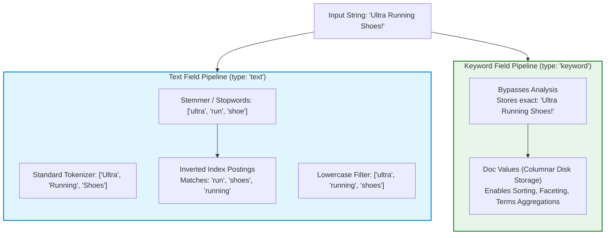
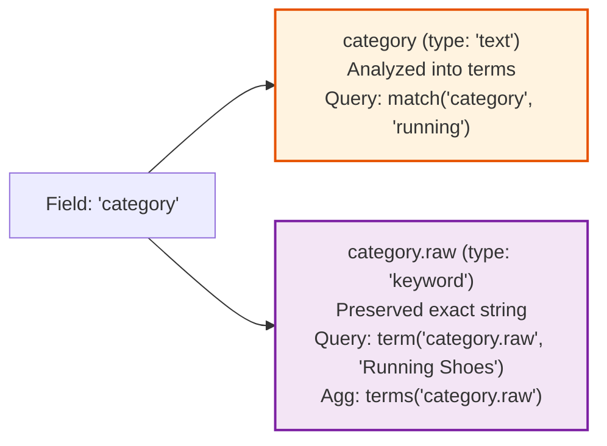
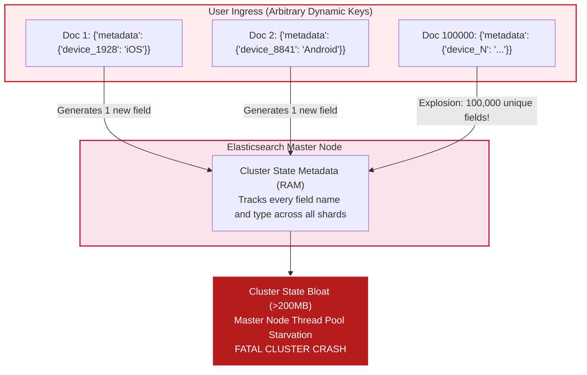
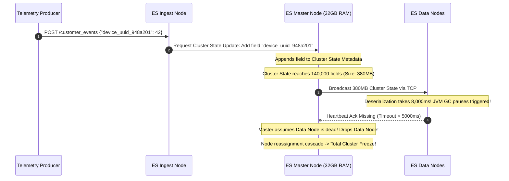

# Module 01: Indexes, Mappings & The Text vs. Keyword Divide

> **Prerequisites**: [Module 00: Elasticsearch Fundamentals](../00-elasticsearch-fundamentals/README.md).  
> **Estimated Reading Time**: 25 minutes  
> **Target Audience**: Backend Engineers, Search Specialists, Platform Data Engineers.

> [!TIP]
> **Golden Rule of Index Schema Design**: Never rely on Elasticsearch **dynamic mapping** in production environments. Dynamic mapping produces silent "mapping explosions" and generates unoptimized multi-fields that bloat cluster state and exhaust memory. Always define explicit mappings prior to data ingestion: use **`keyword`** for exact-match filtering, sorting, and aggregations, and reserve **`text`** strictly for analyzed full-text search.

---

## 1. Visual Mental Models & The String Bifurcation

In relational databases, `VARCHAR` handles exact equality (`WHERE status = 'active'`), sorting, and grouping. In Elasticsearch, string fields bifurcate into two fundamentally different types: **`text`** and **`keyword`**.

### 1.1 The Analysis Pipeline: `text` vs. `keyword`

When a document string is indexed:
- **`text`** fields pass through an **Analyzer** (Character filters $\rightarrow$ Tokenizer $\rightarrow$ Token filters) to produce individual lowercase stemmed tokens stored in the **Inverted Index**.
- **`keyword`** fields bypass text analysis entirely. The raw string is preserved verbatim and stored in both the **Inverted Index** (for fast term equality) and **Doc Values** (columnar storage on disk for sorting and aggregations).



---

### 1.2 Multi-Fields: The Dual-Indexing Pattern

When a field must support **both** full-text search and exact aggregation/sorting, declare a multi-field:



---

### 1.3 The Dynamic Mapping Explosion Threat Model

If arbitrary user-supplied JSON keys are indexed into an index configured with `dynamic: true`, each new key registers a new field across cluster state metadata.



---

## 2. Taxonomic Reference Grids

### 2.1 `text` vs. `keyword` Systematic Comparison Grid

| Operational Requirement | `type: "text"` | `type: "keyword"` |
| :--- | :--- | :--- |
| **Analysis / Tokenization** | Yes (breaks into tokens, lowercases, stems) | No (verbatim exact string preserved) |
| **Primary Query Type** | `match`, `multi_match`, `match_phrase` | `term`, `terms`, `prefix`, `wildcard` |
| **Case Sensitivity** | Case-insensitive (tokens normalized to lowercase) | **Strictly case-sensitive** (`Active` $\ne$ `active`) |
| **Doc Values Support** | Disabled by default (incompatible with text) | Enabled by default (stored on disk in columnar format) |
| **Sorting & Aggregations** | Fails with `Fielddata is disabled` error | High-performance, memory-efficient aggregation |
| **Memory Consumption** | Postings list in Inverted Index | Inverted Index + Columnar Doc Values |
| **Best Architectural Use Case** | Product titles, blog descriptions, review text | IDs, SKUs, email addresses, tags, status enums |

### 2.2 Core Field Types Taxonomy Grid

| Data Type | Structural Mechanism | Mutability Post-Creation | Key Architectural Benefit | Common Antipattern / Trap |
| :--- | :--- | :--- | :--- | :--- |
| **`keyword`** | Exact-match string with Doc Values | Mapping immutable | $\mathcal{O}(1)$ exact filter and terms aggregation | Storing multi-sentence prose as `keyword` (breaks search) |
| **`text`** | Analyzed token stream in Inverted Index | Mapping immutable | Relevance scoring and fuzzy search | Trying to run a `terms` aggregation on `text` without `.raw` |
| **`integer` / `long`** | Numeric inverted index (BKD-tree) | Mapping immutable | Range queries (`gte`, `lte`) in $\mathcal{O}(\log N)$ | Using `long` for IDs or zip codes (use `keyword` instead!) |
| **`date`** | Milliseconds since epoch stored as `long` | Mapping immutable | Date math, range filters, and date-histogram aggregations | Mismatched date formatting strings in ISO 8601 |
| **`boolean`** | Single-bit inverted index flag | Mapping immutable | Compact storage for true/false flags | Null handling (`null` is neither true nor false) |
| **`nested`** | Separate hidden Lucene documents per sub-object | Mapping immutable | Preserves array-of-objects relationship integrity | Heavy performance penalty on deep updates |
| **`flattened`** | Indexes entire arbitrary JSON object as single keywords | Dynamic keys supported | **Immune to Mapping Explosion** | Cannot perform deep individual field typing or date math |

---

## 3. Production War Stories: Incident Post-Mortem

### The $800K Mapping Explosion: How Arbitrary User-Generated JSON Keys Crashed Cluster Master Nodes

```
SEVERITY LEVEL: SEV-1 (Cluster Split-Brain & Global API Outage)
DETECTION TIME: 10 Minutes
RECOVERY TIME: 180 Minutes
FINANCIAL PENALTY: $800,000 in missed partner API transactions and SLA credits
```

#### Incident Background
A SaaS telemetry platform collected customer webhook events. To make integration frictionless, developers configured Elasticsearch to ingest arbitrary payload JSON into a `customer_events` index using dynamic mapping:
```json
{ "mappings": { "dynamic": true } }
```

#### What Happened
A newly onboarded enterprise client sent analytics payloads where unique device IDs and timestamps were formatted as **JSON keys** rather than values:
```json
{
  "event_id": "evt_991",
  "device_telemetry": {
    "device_uuid_948a201": { "metric": 42 },
    "device_uuid_102b558": { "metric": 88 }
  }
}
```
Within 48 hours, over 140,000 unique device keys were registered as distinct fields in the index mapping. In Elasticsearch, the **Cluster State** contains the schema metadata of every field in every index and is maintained in heap memory on the master node. 

The cluster state ballooned from 3 MB to **380 MB**. Every time a node joined or updated, the master node serialized this 380 MB blob over the network. TCP network buffers became congested, master heartbeats timed out, and the cluster entered a catastrophic split-brain master reelection loop. All reads and writes across the entire cluster hung indefinitely.



#### Root Cause Analysis
1. **Unbounded Dynamic Mapping**: `dynamic: true` allowed external clients to introduce arbitrary schema keys into cluster state.
2. **Key-Value Inversion Antipattern**: The client modeled entity identifiers as JSON field names rather than normalized array elements (`{"deviceId": "uuid", "metric": 42}`).
3. **No Field Limit Safeguard**: The default safety limit (`index.mapping.total_fields.limit: 1000`) had been explicitly disabled by a previous developer.

#### The Architectural Hardening
1. **Enforced Strict Dynamic Mapping**:
   Configured `"dynamic": "strict"` on all production indices. Any document containing an undeclared field is rejected with HTTP 400.
2. **The `flattened` Data Type for Arbitrary Metadata**:
   For fields that genuinely require arbitrary key-value storage (such as custom customer metadata), configured the **`flattened`** type:
   ```json
   "metadata": { "type": "flattened" }
   ```
   The `flattened` type treats the entire nested JSON hierarchy as leaf keywords without creating individual field mappings in cluster state.
3. **Cluster Health Field Limit Monitoring**: Enforced `index.mapping.total_fields.limit: 1000` with automated Prometheus alerting if field count crosses 600.

---

## 4. Multi-Language Production Implementations

Below are four enterprise implementations demonstrating explicit schema declaration, multi-fields, analyzers, and zero-downtime index alias management.

### 4.1 Go: Explicit Mapping Definition with Reindexing via Zero-Downtime Aliases

```go
package main

import (
	"bytes"
	"context"
	"encoding/json"
	"fmt"
	"net/http"
	"time"

	"github.com/elastic/go-elasticsearch/v8"
	"github.com/elastic/go-elasticsearch/v8/esapi"
)

type IndexManager struct {
	es *elasticsearch.Client
}

func NewIndexManager(address string) (*IndexManager, error) {
	client, err := elasticsearch.NewClient(elasticsearch.Config{
		Addresses: []string{address},
	})
	if err != nil {
		return nil, err
	}
	return &IndexManager{es: client}, nil
}

// CreateProductsIndexV1 explicitly declares mappings with multi-fields and strict dynamic controls.
func (im *IndexManager) CreateProductsIndexV1(ctx context.Context, indexName string) error {
	schema := map[string]any{
		"settings": map[string]any{
			"number_of_shards":   1,
			"number_of_replicas": 1,
			"analysis": map[string]any{
				"analyzer": map[string]any{
					"autocomplete_analyzer": map[string]any{
						"tokenizer": "standard",
						"filter":    []string{"lowercase"},
					},
				},
			},
		},
		"mappings": map[string]any{
			"dynamic": "strict", // Prevent mapping explosion!
			"properties": map[string]any{
				"id": map[string]any{"type": "keyword"},
				"sku": map[string]any{"type": "keyword"},
				"title": map[string]any{
					"type": "text",
					"fields": map[string]any{
						"raw": map[string]any{"type": "keyword"}, // Multi-field for sorting/aggregations
					},
				},
				"description": map[string]any{"type": "text"},
				"price_cents": map[string]any{"type": "long"},
				"created_at":  map[string]any{"type": "date"},
				"attributes":  map[string]any{"type": "flattened"}, // Arbitrary metadata safe from explosion
			},
		},
	}

	payload, _ := json.Marshal(schema)
	req := esapi.IndicesCreateRequest{
		Index: indexName,
		Body:  bytes.NewReader(payload),
	}

	res, err := req.Do(ctx, im.es)
	if err != nil {
		return err
	}
	defer res.Body.Close()

	if res.StatusCode != http.StatusOK {
		return fmt.Errorf("failed to create index, status code: %d", res.StatusCode)
	}

	return nil
}

// PointAliasToVersion performs zero-downtime atomic alias migration.
func (im *IndexManager) PointAliasToVersion(ctx context.Context, aliasName, targetIndex string) error {
	actions := map[string]any{
		"actions": []any{
			map[string]any{
				"add": map[string]any{
					"index": targetIndex,
					"alias": aliasName,
				},
			},
		},
	}

	payload, _ := json.Marshal(actions)
	req := esapi.IndicesUpdateAliasesRequest{
		Body: bytes.NewReader(payload),
	}

	res, err := req.Do(ctx, im.es)
	if err != nil {
		return err
	}
	defer res.Body.Close()

	if res.IsError() {
		return fmt.Errorf("failed to update alias, status: %d", res.StatusCode)
	}

	return nil
}

func main() {
	im, err := NewIndexManager("http://localhost:9200")
	if err != nil {
		panic(err)
	}

	ctx, cancel := context.WithTimeout(context.Background(), 10*time.Second)
	defer cancel()

	idx := "products_v1"
	alias := "products"

	err = im.CreateProductsIndexV1(ctx, idx)
	if err != nil {
		fmt.Printf("Index creation note: %v\n", err)
	} else {
		fmt.Printf("[Success] Created index %s with strict mappings and multi-fields\n", idx)
		_ = im.PointAliasToVersion(ctx, alias, idx)
		fmt.Printf("[Success] Alias '%s' now atomically points to '%s'\n", alias, idx)
	}
}
```

---

### 4.2 TypeScript: Resilient Schema Creation with Zero-Downtime Reindexing

```typescript
import { Client } from "@elastic/elasticsearch";

export class SchemaManager {
  private client: Client;

  constructor(node: string = "http://localhost:9200") {
    this.client = new Client({ node });
  }

  public async deployProductSchema(versionedIndex: string): Promise<void> {
    const exists = await this.client.indices.exists({ index: versionedIndex });
    if (exists) {
      console.log(`Index ${versionedIndex} already exists.`);
      return;
    }

    await this.client.indices.create({
      index: versionedIndex,
      body: {
        settings: {
          number_of_shards: 1,
          number_of_replicas: 1,
        },
        mappings: {
          dynamic: "strict", // Block unknown keys
          properties: {
            productId: { type: "keyword" },
            name: {
              type: "text",
              fields: {
                keyword: { type: "keyword", ignore_above: 256 }, // Multi-field for faceting
              },
            },
            tags: { type: "keyword" }, // Array of keywords
            metadata: { type: "flattened" }, // Immunized against mapping explosion
            price: { type: "scaled_float", scaling_factor: 100 },
            availableDate: { type: "date" },
          },
        },
      },
    });

    console.log(`[Success] Index ${versionedIndex} created with strict typing.`);
  }

  public async atomicSwapAlias(alias: string, oldIndex: string, newIndex: string): Promise<void> {
    await this.client.indices.updateAliases({
      body: {
        actions: [
          { remove: { index: oldIndex, alias } },
          { add: { index: newIndex, alias } },
        ],
      },
    });
    console.log(`[Success] Atomic alias swap: '${alias}' moved from ${oldIndex} to ${newIndex}`);
  }
}
```

---

### 4.3 Python: Strict Mapping Enforcement & Analyzed Field Verification

```python
from elasticsearch import Elasticsearch


def create_strict_catalog_index(es: Elasticsearch, index_name: str) -> None:
    mapping_body = {
        "settings": {
            "index": {
                "number_of_shards": 1,
                "number_of_replicas": 0,
                "mapping.total_fields.limit": 500,  # Strict safeguard limit
            }
        },
        "mappings": {
            "dynamic": "strict",  # Unmapped fields throw HTTP 400
            "properties": {
                "sku": {"type": "keyword"},
                "title": {
                    "type": "text",
                    "fields": {
                        "raw": {"type": "keyword"}  # For sorting and aggregation
                    },
                },
                "category": {"type": "keyword"},
                "price_usd": {"type": "double"},
                "in_stock": {"type": "boolean"},
                "extra_specs": {"type": "flattened"},  # Safe arbitrary client JSON
            },
        },
    }

    if not es.indices.exists(index=index_name):
        es.indices.create(index=index_name, body=mapping_body)
        print(f"[Success] Created strict index '{index_name}'")
    else:
        print(f"Index '{index_name}' already exists.")


if __name__ == "__main__":
    client = Elasticsearch("http://localhost:9200")
    try:
        create_strict_catalog_index(client, "catalog_v1")
    except Exception as e:
        print(f"Connection/Index notice: {e}")
```

---

### 4.4 C#: Strongly Typed Mapping Definition via Elastic.Clients.Elasticsearch

```csharp
using System;
using System.Threading.Tasks;
using Elastic.Clients.Elasticsearch;
using Elastic.Clients.Elasticsearch.IndexManagement;
using Elastic.Clients.Elasticsearch.Mapping;

namespace Architecture.Search.Mappings
{
    public class ProductRecord
    {
        public string Sku { get; set; } = string.Empty;
        public string Title { get; set; } = string.Empty;
        public decimal Price { get; set; }
        public DateTime CreatedAt { get; set; }
    }

    public class SchemaConfigurator
    {
        private readonly ElasticsearchClient _client;

        public SchemaConfigurator(ElasticsearchClient client)
        {
            _client = client;
        }

        public async Task<bool> InitializeIndexAsync(string indexName)
        {
            var createResponse = await _client.Indices.CreateAsync(indexName, c => c
                .Settings(s => s
                    .NumberOfShards(1)
                    .NumberOfReplicas(1)
                )
                .Mappings(m => m
                    .Dynamic(DynamicMapping.Strict)
                    .Properties<ProductRecord>(p => p
                        .Keyword(k => k.Sku)
                        .Text(t => t.Title, txt => txt
                            .Fields(f => f
                                .Keyword("raw") // Multi-field for sorting
                            )
                        )
                        .DoubleNumber(d => d.Price)
                        .Date(dt => dt.CreatedAt)
                    )
                )
            );

            return createResponse.IsValidResponse;
        }
    }
}
```

---

## 5. Practical Hands-On Verification Workflows

### 5.1 CLI Verification of the `_analyze` API

To understand exactly how Elasticsearch tokenizes `text` vs preserving `keyword`, execute the `_analyze` API in your terminal:

```bash
# 1. Inspect how standard analyzer processes a text string
curl -s -X POST "http://localhost:9200/_analyze" -H "Content-Type: application/json" -d'
{
  "analyzer": "standard",
  "text": "Ultra-light Running Shoes!"
}'

# Expected Output: Tokenized, lowercased terms
# {
#   "tokens": [
#     {"token": "ultra", "start_offset": 0, "end_offset": 5, "type": "<ALPHANUM>", "position": 0},
#     {"token": "light", "start_offset": 6, "end_offset": 11, "type": "<ALPHANUM>", "position": 1},
#     {"token": "running", "start_offset": 12, "end_offset": 19, "type": "<ALPHANUM>", "position": 2},
#     {"token": "shoes", "start_offset": 20, "end_offset": 25, "type": "<ALPHANUM>", "position": 3}
#   ]
# }

# 2. Inspect keyword analyzer (verbatim exact term)
curl -s -X POST "http://localhost:9200/_analyze" -H "Content-Type: application/json" -d'
{
  "analyzer": "keyword",
  "text": "Ultra-light Running Shoes!"
}'

# Expected Output: Exactly ONE raw token
# {
#   "tokens": [
#     {"token": "Ultra-light Running Shoes!", "start_offset": 0, "end_offset": 26, "type": "word", "position": 0}
#   ]
# }
```

---

## 6. Operational Validation Checkpoints (Scenario Quizzes)

<details>
<summary><strong>Checkpoint 1: The "Fielddata is disabled" Aggregation Crash</strong></summary>

**Scenario**: A developer executes a `terms` aggregation on the `description` field:
```json
{ "aggs": { "popular_terms": { "terms": { "field": "description" } } } }
```
Elasticsearch throws an HTTP 400 error:
`"Fielddata is disabled on text fields by default. Set fielddata=true on [description] in order to load fielddata in memory..."`
The developer prepares a pull request enabling `fielddata=true`. Why should you immediately reject this pull request in code review, and what is the proper fix?

<strong>Answer:</strong>
**Severe JVM Heap Exhaustion Threat**:
- **Why Reject `fielddata=true`**:
  - `text` fields are stored in an inverted index (Term $\rightarrow$ Doc). To aggregate or sort, Lucene must invert the index in reverse (Doc $\rightarrow$ Terms).
  - Enabling `fielddata=true` forces Elasticsearch to load the entire inverted index of that field uncompressed into **JVM Heap memory**.
  - On large indices, fielddata easily consumes 100% of the heap, triggers massive Garbage Collection freezes, and crashes the node.
- **The Proper Fix**:
  - If you need aggregations on a string, use a **`keyword`** field (or a multi-field `description.keyword`). Keywords use **Doc Values**—an on-disk, OS-cached columnar structure that aggregates billions of values with zero JVM heap bloat.
</details>

<details>
<summary><strong>Checkpoint 2: The Silent Term Exact-Match Failure</strong></summary>

**Scenario**: An index has a field `status` mapped as `type: "text"`. A document exists with `status: "PENDING_APPROVAL"`. A client issues this filter:
```json
{ "query": { "term": { "status": "PENDING_APPROVAL" } } }
```
The query returns **0 results**. Yet if the client issues `match: { "status": "pending" }`, the document matches. Why did the `term` query fail?

<strong>Answer:</strong>
**Mismatched Analyzer Tokens**:
1. When `status: "PENDING_APPROVAL"` was indexed into a `text` field, the standard analyzer lowercased it into two tokens: `["pending", "approval"]`.
2. A **`term` query** is a raw, unanalyzed exact query. It searches the inverted index for the verbatim string `"PENDING_APPROVAL"`.
3. Because the inverted index only contains lowercase `["pending", "approval"]`, the exact uppercase string is never found.
4. **Resolution**: Status fields should be mapped as **`keyword`**, not `text`.
</details>

<details>
<summary><strong>Checkpoint 3: The Zero-Downtime Reindexing Dilemma</strong></summary>

**Scenario**: You have 50 million documents in index `products_v1`. You need to change the mapping of `price` from `integer` to `scaled_float`. Because Elasticsearch mappings are immutable, you cannot update it in-place. How do you execute this migration without any API downtime for active shoppers?

<strong>Answer:</strong>
**The Index Alias & Reindex Migration Blueprint**:
1. **Initial Architecture**: Applications should never query concrete index names directly. They query an alias: `products`.
2. **Step 1 (Create V2)**: Create `products_v2` with the updated mapping (`price: scaled_float`).
3. **Step 2 (Reindex)**: Trigger background asynchronous reindexing:
   `POST /_reindex?wait_for_completion=false { "source": { "index": "products_v1" }, "dest": { "index": "products_v2" } }`.
4. **Step 3 (Dual Writing or Catch-Up)**: Replay any writes created during the reindex window.
5. **Step 4 (Atomic Alias Swap)**:
   ```json
   POST /_aliases
   {
     "actions": [
       { "remove": { "index": "products_v1", "alias": "products" } },
       { "add":    { "index": "products_v2", "alias": "products" } }
     ]
   }
   ```
   The alias swap executes in 1 millisecond. Zero queries are dropped; zero clients experience downtime.
</details>

---

## 7. Further Reading & References

- [Elasticsearch Reference: Text vs. Keyword](https://www.elastic.co/guide/en/elasticsearch/reference/current/text.html) - Official technical documentation on string data types.
- [Elastic Blog: The Flattened Data Type](https://www.elastic.co/blog/introducing-the-flattened-data-type-in-elasticsearch) - How to safely index arbitrary JSON without mapping explosions.
- [Elasticsearch Reference: Index Aliases](https://www.elastic.co/guide/en/elasticsearch/reference/current/aliases.html) - Zero-downtime index migration strategies.

---

## Next Steps

Advance to [Module 02: Basic & Full-Text Search Queries](../02-basic-and-full-text-search/README.md) to master Query DSL, compound `bool` filters, match phrases, and precision matching.
