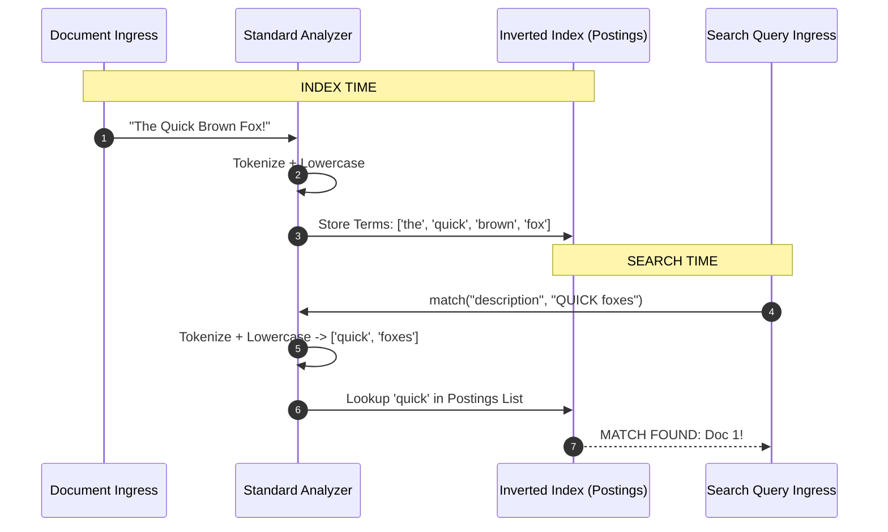
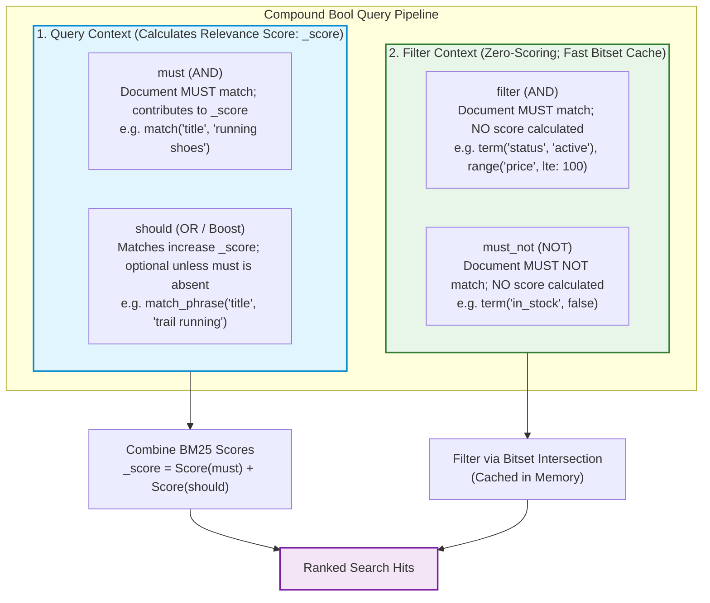
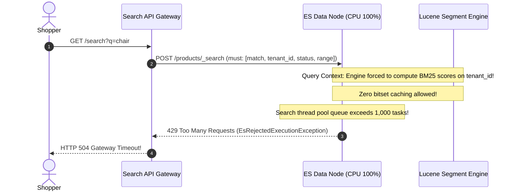

# Module 02: Basic & Full-Text Search Queries

> **Prerequisites**: [Module 00: Elasticsearch Fundamentals](../00-elasticsearch-fundamentals/README.md), [Module 01: Indexes and Mappings](../01-indexes-and-mappings/README.md).  
> **Estimated Reading Time**: 25 minutes  
> **Target Audience**: Backend Engineers, Search Application Developers, Systems Architects.

> [!TIP]
> **Golden Rule of Query Construction**: Every Elasticsearch query executes in one of two contexts: **Query Context** (`must`, `should`), which calculates probabilistic BM25 relevance scores, or **Filter Context** (`filter`, `must_not`), which performs binary yes/no matching. Always place exact-match constraints (tenant IDs, status flags, categories, date/price ranges) inside **`filter` clauses**. Filter clauses skip score calculation and are automatically cached in Lucene bitset memory, cutting CPU overhead by up to $80\%$.

---

## 1. Visual Mental Models & Query Architecture

Building high-performance search requires understanding **Analysis Symmetry** and the anatomy of the compound **`bool` query**.

### 1.1 Analysis Symmetry: Index-Time vs. Search-Time

When a user executes a `match` query, Elasticsearch runs the search string through the **same analyzer** configured on that field. Matching occurs on the generated **terms**, not raw characters.



---

### 1.2 The Compound `bool` Query Architecture

Production search engines rarely issue raw single queries. The **`bool` query** combines full-text relevance scoring with cached binary filtering:



---

## 2. Taxonomic Reference Grids

### 2.1 Query Context vs. Filter Context Comparison Matrix

| Evaluation Dimension | Query Context (`must`, `should`) | Filter Context (`filter`, `must_not`) |
| :--- | :--- | :--- |
| **Primary Question** | *"How well does this document match the query?"* | *"Does this document match the criteria?"* (Yes/No) |
| **Relevance Scoring ($\_score$)** | Computes mathematical BM25 score | **Score is 0.0** (Completely ignored) |
| **Memory Caching** | Never cached (scores vary based on query terms) | **Cached automatically** as compressed Roaring Bitsets |
| **CPU Utilization** | High (calculates TF-IDF, field lengths, saturation) | Very Low (bitwise AND operations across bitsets) |
| **Ideal Architectural Candidates** | Free-text search terms, user input, descriptions | User IDs, tenant IDs, categories, dates, stock flags |

### 2.2 Core Query Types Taxonomy Grid

| Query Clause | Context | Analysis Applied? | Search Semantics | Best Use Case |
| :--- | :--- | :--- | :--- | :--- |
| **`match`** | Query | Yes | Standard full-text search; matches analyzed tokens | Product title, article body, search bar queries |
| **`match_phrase`** | Query | Yes | Terms must appear in **exact positional sequence** | Exact phrase matches (`"wireless noise canceling"`) |
| **`multi_match`** | Query | Yes | Searches across multiple fields with optional cross-field boosting | Omnibox search across `title^3`, `tags^2`, `body` |
| **`term`** | Filter | **No** (Exact) | Checks exact value in inverted index (case-sensitive) | Status flags, IDs, non-analyzed `keyword` fields |
| **`terms`** | Filter | **No** (Exact) | Set membership: matches if field equals any item in array | In-clause filtering: `status IN ('ACTIVE', 'PENDING')` |
| **`range`** | Filter | **No** | Numeric or date comparison (`gte`, `gt`, `lte`, `lt`) | Price ranges, timestamp boundaries |

---

## 3. Production War Stories: Incident Post-Mortem

### The $1.5M Query Context Disaster: How Scoring on Tenant IDs and Dates Starved CPU Threads

```
SEVERITY LEVEL: SEV-1 (Search Engine Latency Collapse)
DETECTION TIME: 6 Minutes
RECOVERY TIME: 110 Minutes
FINANCIAL PENALTY: $1,500,000 in lost holiday sales transactions
```

#### Incident Background
A multi-tenant B2B marketplace handled 25,000 queries per second during Cyber Monday. The platform stored product listings across 5,000 independent merchant stores within a shared Elasticsearch index.

#### What Happened
At 10:00 AM, query latency surged from 25ms to over 8,500ms. CPU usage across all 12 data nodes spiked to 100%. Thread pool rejections on the `search` pool triggered HTTP 429 and 504 errors. An audit of application query builders revealed that developers constructed queries by dumping every constraint into the `must` array:
```json
{
  "query": {
    "bool": {
      "must": [
        { "match": { "description": "ergonomic chair" } },
        { "term":  { "tenant_id": "tenant_9921" } },
        { "term":  { "status": "AVAILABLE" } },
        { "range": { "created_at": { "gte": "2024-01-01" } } }
      ]
    }
  }
}
```
Because `tenant_id`, `status`, and `created_at` were placed in `must`, Elasticsearch treated them as scoring queries. For every candidate document, the Lucene engine evaluated BM25 relevance scores for the tenant ID and date range. This caused two compounding failures:
1. **Zero Bitset Caching**: The engine could not reuse cached bitsets for identical `tenant_id` or `status` filters.
2. **Useless Math**: CPU cycles were wasted calculating scores for static equality checks that had zero relevance value to human shoppers.



#### Root Cause Analysis
1. **Query Context Misuse**: Placing non-scoring categorical filters inside `must` forced unnecessary floating-point score calculations.
2. **Cache Bypass**: Filter caching is strictly disabled inside `must` clauses.
3. **Thread Starvation**: Inefficient scoring exhausted CPU cores, causing incoming queries to queue up and drop.

#### The Architectural Hardening
1. **Strict Context Separation**: Rewrote the query generator to isolate text scoring strictly to `must`/`should`, routing all boolean flags, IDs, and ranges into **`filter`**:
   ```json
   {
     "query": {
       "bool": {
         "must": [{ "match": { "description": "ergonomic chair" } }],
         "filter": [
           { "term":  { "tenant_id": "tenant_9921" } },
           { "term":  { "status": "AVAILABLE" } },
           { "range": { "created_at": { "gte": "2024-01-01" } } }
         ]
       }
     }
   }
   ```
2. **Performance Payoff**: Query latencies dropped from 8,500ms to 12ms. CPU utilization plunged from 100% to 18% as Lucene served 95% of tenant filters directly from in-memory Roaring Bitset caches.

---

## 4. Multi-Language Production Implementations

Below are four enterprise implementations demonstrating compound `bool` query construction, highlighting, and filter context separation.

### 4.1 Go: Production Compound Bool Query with Filter Caching

```go
package main

import (
	"bytes"
	"context"
	"encoding/json"
	"fmt"
	"time"

	"github.com/elastic/go-elasticsearch/v8"
	"github.com/elastic/go-elasticsearch/v8/esapi"
)

type ProductSearchResult struct {
	ID    string  `json:"id"`
	Title string  `json:"title"`
	Price float64 `json:"price"`
	Score float64 `json:"_score"`
}

type SearchService struct {
	es *elasticsearch.Client
}

func NewSearchService(client *elasticsearch.Client) *SearchService {
	return &SearchService{es: client}
}

// SearchProducts executes an optimized compound query separating scoring from filtering.
func (s *SearchService) SearchProducts(ctx context.Context, indexName, searchTerm, category string, maxPrice float64) ([]ProductSearchResult, error) {
	queryBody := map[string]any{
		"query": map[string]any{
			"bool": map[string]any{
				// 1. Scoring Query Context: Evaluates text relevance
				"must": []any{
					map[string]any{
						"match": map[string]any{
							"title": map[string]any{
								"query":     searchTerm,
								"operator":  "and",
								"fuzziness": "AUTO",
							},
						},
					},
				},
				// Optional boost for exact phrase match
				"should": []any{
					map[string]any{
						"match_phrase": map[string]any{
							"title": map[string]any{
								"query": searchTerm,
								"boost": 2.0,
							},
						},
					},
				},
				// 2. Filter Context: Cached binary bitsets, zero score calculation
				"filter": []any{
					map[string]any{
						"term": map[string]any{
							"category.keyword": category,
						},
					},
					map[string]any{
						"range": map[string]any{
							"price": map[string]any{
								"lte": maxPrice,
							},
						},
					},
				},
			},
		},
		"highlight": map[string]any{
			"fields": map[string]any{
				"title": map[string]any{},
			},
		},
		"size": 20,
	}

	payload, err := json.Marshal(queryBody)
	if err != nil {
		return nil, err
	}

	req := esapi.SearchRequest{
		Index: []string{indexName},
		Body:  bytes.NewReader(payload),
	}

	res, err := req.Do(ctx, s.es)
	if err != nil {
		return nil, err
	}
	defer res.Body.Close()

	if res.IsError() {
		return nil, fmt.Errorf("search error status code: %d", res.StatusCode)
	}

	var esResponse struct {
		Hits struct {
			Hits []struct {
				ID     string                 `json:"_id"`
				Score  float64                `json:"_score"`
				Source map[string]any         `json:"_source"`
			} `json:"hits"`
		} `json:"hits"`
	}

	if err := json.NewDecoder(res.Body).Decode(&esResponse); err != nil {
		return nil, err
	}

	results := make([]ProductSearchResult, 0, len(esResponse.Hits.Hits))
	for _, h := range esResponse.Hits.Hits {
		title, _ := h.Source["title"].(string)
		price, _ := h.Source["price"].(float64)
		results = append(results, ProductSearchResult{
			ID:    h.ID,
			Title: title,
			Price: price,
			Score: h.Score,
		})
	}

	return results, nil
}

func main() {
	client, err := elasticsearch.NewDefaultClient()
	if err != nil {
		panic(err)
	}

	svc := NewSearchService(client)
	ctx, cancel := context.WithTimeout(context.Background(), 5*time.Second)
	defer cancel()

	results, err := svc.SearchProducts(ctx, "products", "running shoes", "Footwear", 150.0)
	if err != nil {
		fmt.Printf("Search query note: %v (Ensure local ES is up)\n", err)
		return
	}

	fmt.Printf("[Search Results] Found %d matching products\n", len(results))
}
```

---

### 4.2 TypeScript: Full-Text Query Builder with Highlight Extraction

```typescript
import { Client } from "@elastic/elasticsearch";

export interface SearchHit {
  id: string;
  title: string;
  highlightedTitle?: string;
  score: number;
}

export class ProductSearchEngine {
  constructor(private readonly client: Client) {}

  public async searchCatalog(
    queryText: string,
    brandFilter: string,
    inStockOnly: boolean = true
  ): Promise<SearchHit[]> {
    const response = await this.client.search({
      index: "catalog",
      body: {
        query: {
          bool: {
            must: [
              {
                multi_match: {
                  query: queryText,
                  fields: ["title^3", "description"],
                  type: "best_fields",
                },
              },
            ],
            filter: [
              { term: { "brand.keyword": brandFilter } },
              ...(inStockOnly ? [{ term: { in_stock: true } }] : []),
            ],
          },
        },
        highlight: {
          pre_tags: ["<mark>"],
          post_tags: ["</mark>"],
          fields: {
            title: {},
          },
        },
      },
    });

    return response.hits.hits.map((hit: any) => ({
      id: hit._id,
      title: hit._source.title,
      highlightedTitle: hit.highlight?.title?.[0],
      score: hit._score,
    }));
  }
}
```

---

### 4.3 Python: Production Compound Search Service

```python
from typing import Dict, List, Optional
from elasticsearch import Elasticsearch


class CatalogSearchService:
    def __init__(self, es_client: Elasticsearch, index_name: str = "products"):
        self.es = es_client
        self.index_name = index_name

    def execute_search(
        self,
        search_term: str,
        category: Optional[str] = None,
        min_rating: float = 4.0,
        page: int = 1,
        page_size: int = 20,
    ) -> Dict:
        # Build strict bool query separating scoring from filtering
        must_clauses = [
            {
                "match": {
                    "title": {
                        "query": search_term,
                        "operator": "and",
                        "fuzziness": "AUTO",
                    }
                }
            }
        ]

        # Filter context: cached bitsets, zero score overhead
        filter_clauses = [
            {"range": {"rating": {"gte": min_rating}}},
            {"term": {"status": "ACTIVE"}},
        ]

        if category:
            filter_clauses.append({"term": {"category.keyword": category}})

        query_body = {
            "query": {
                "bool": {
                    "must": must_clauses,
                    "filter": filter_clauses,
                }
            },
            "from": (page - 1) * page_size,
            "size": page_size,
            "sort": ["_score", {"price": "asc"}],
        }

        response = self.es.search(index=self.index_name, body=query_body)
        total_hits = response["hits"]["total"]["value"]
        hits = [
            {
                "id": h["_id"],
                "score": h["_score"],
                "title": h["_source"].get("title"),
                "price": h["_source"].get("price"),
            }
            for h in response["hits"]["hits"]
        ]

        return {"total": total_hits, "page": page, "results": hits}
```

---

### 4.4 C#: Strongly Typed Bool Query via Elastic.Clients.Elasticsearch

```csharp
using System.Collections.Generic;
using System.Threading.Tasks;
using Elastic.Clients.Elasticsearch;
using Elastic.Clients.Elasticsearch.QueryDsl;

namespace Architecture.Search.Queries
{
    public class SearchFilterRequest
    {
        public string SearchTerm { get; set; } = string.Empty;
        public string Category { get; set; } = string.Empty;
        public decimal MaxPrice { get; set; }
    }

    public class ProductCatalogQueryEngine
    {
        private readonly ElasticsearchClient _client;

        public ProductCatalogQueryEngine(ElasticsearchClient client)
        {
            _client = client;
        }

        public async Task<IReadOnlyCollection<ProductDocument>> QueryProductsAsync(SearchFilterRequest req)
        {
            var response = await _client.SearchAsync<ProductDocument>(s => s
                .Index("products")
                .Query(q => q
                    .Bool(b => b
                        // Scoring Query Context
                        .Must(m => m
                            .Match(t => t
                                .Field(f => f.Title)
                                .Query(req.SearchTerm)
                                .Fuzziness(new Fuzziness("AUTO"))
                            )
                        )
                        // Filter Context: Cached Bitsets
                        .Filter(
                            f => f.Term(t => t.Field("category.keyword").Value(req.Category)),
                            f => f.Range(r => r.NumberRange(nr => nr.Field(p => p.Price).Lte((double)req.MaxPrice)))
                        )
                    )
                )
                .Size(20)
            );

            return response.Documents;
        }
    }

    public class ProductDocument
    {
        public string Title { get; set; } = string.Empty;
        public decimal Price { get; set; }
    }
}
```

---

## 5. Practical Hands-On Verification Workflows

### 5.1 CLI Verification of Match vs. Match Phrase

Execute these `curl` commands to observe how `match` compares to `match_phrase`:

```bash
# 1. Match query: matches documents containing terms in ANY order
curl -s -X POST "http://localhost:9200/products/_search" -H "Content-Type: application/json" -d'
{
  "query": {
    "match": {
      "title": "shoes running"
    }
  }
}'

# 2. Match Phrase query: matches terms in exact positional sequence
curl -s -X POST "http://localhost:9200/products/_search" -H "Content-Type: application/json" -d'
{
  "query": {
    "match_phrase": {
      "title": "running shoes"
    }
  }
}'
```

---

## 6. Operational Validation Checkpoints (Scenario Quizzes)

<details>
<summary><strong>Checkpoint 1: The Slop Factor in Phrase Matching</strong></summary>

**Scenario**: A user searches for `"quick fox"`. The document text contains: `"The quick brown fox jumps"`. A standard `match_phrase` query for `"quick fox"` returns **0 results**. How do you allow intervening words like `"brown"` while preserving overall word order?

<strong>Answer:</strong>
**Configure the `slop` Parameter**:
- `match_phrase` requires tokens to have adjacent positional indexes (distance = 0).
- Setting `"slop": 1` allows **1 intervening token** between `"quick"` and `"fox"`.
```json
{
  "query": {
    "match_phrase": {
      "title": {
        "query": "quick fox",
        "slop": 1
      }
    }
  }
}
```
With `slop: 1`, `"quick brown fox"` matches because the terms are separated by at most 1 position.
</details>

<details>
<summary><strong>Checkpoint 2: The `minimum_should_match` Trap</strong></summary>

**Scenario**: You construct a `bool` query with both a `must` clause and three `should` clauses. You expect the query to require at least one of the `should` clauses to match. However, documents that match **none** of the `should` clauses are returned in the results. Why?

<strong>Answer:</strong>
**`should` Behavior in the Presence of `must`**:
- When a `bool` query contains **NO `must` clauses**, at least one `should` clause is required to match (`minimum_should_match: 1` by default).
- However, when at least **one `must` clause is present**, `should` clauses act purely as **relevance boosters**; matching them is optional (`minimum_should_match: 0` by default).
- **Resolution**: Explicitly enforce `"minimum_should_match": 1` inside the `bool` query to require at least one `should` condition to hold true alongside `must`.
</details>

<details>
<summary><strong>Checkpoint 3: The Danger of Wildcard Queries (`*term*`)</strong></summary>

**Scenario**: A frontend engineer writes a search feature using leading wildcard queries: `{ "wildcard": { "title": "*phone" } }`. Under a modest load of 50 concurrent requests, cluster search latencies spike to 12 seconds. Why are leading wildcards catastrophic in Lucene?

<strong>Answer:</strong>
**Complete Inverted Index Term Dictionary Traversal**:
- Lucene indexes terms in a sorted Finite State Transducer (FST) or B-Tree. A prefix query (`phone*`) jumps directly to the `"phone"` range in $\mathcal{O}(\log T)$ time.
- A **leading wildcard** (`*phone`) cannot use the index sorting. The engine must scan **every single term in the entire inverted index dictionary** across all shards, evaluate regex matching on millions of strings, and merge postings lists.
- **Production Solution**: Never use leading wildcards. Use **Edge N-Grams** or **Reverse Analyzers** to convert suffix searches into fast indexable prefix queries.
</details>

---

## 7. Further Reading & References

- [Elasticsearch Reference: Boolean Query](https://www.elastic.co/guide/en/elasticsearch/reference/current/query-dsl-bool-query.html) - Official Query DSL compound query documentation.
- [Elasticsearch Reference: Query and Filter Context](https://www.elastic.co/guide/en/elasticsearch/reference/current/query-filter-context.html) - Understanding Lucene scoring vs. bitset caching.
- [Lucene Core: Roaring Bitsets in Filter Execution](https://lucene.apache.org/core/) - How Lucene achieves sub-millisecond filter intersections.

---

## Next Steps

Advance to [Module 03: Relevance Scoring & Boosting](../03-relevance-scoring-and-boosting/README.md) to master Okapi BM25 mathematics, term frequency saturation, field length normalization, and custom function-score boosting.
