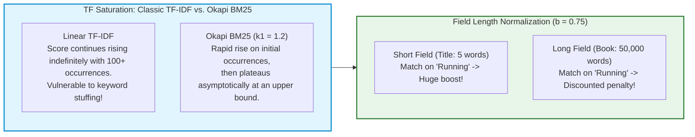
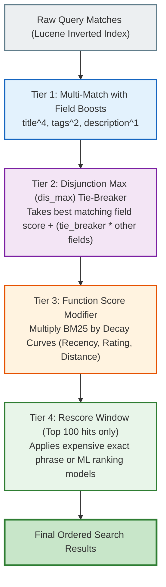
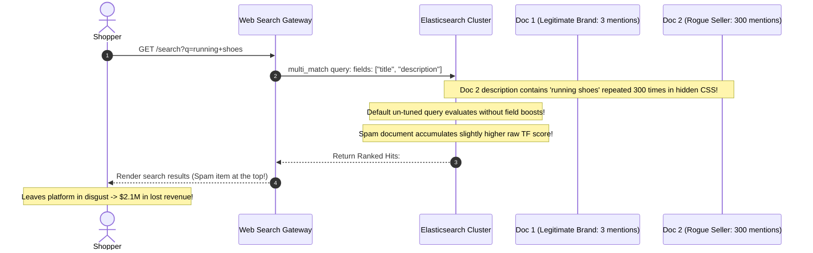

# Module 03: Relevance Scoring & Boosting with Okapi BM25

> **Prerequisites**: [Module 01: Indexes and Mappings](../01-indexes-and-mappings/README.md), [Module 02: Basic and Full-Text Search](../02-basic-and-full-text-search/README.md).  
> **Estimated Reading Time**: 25 minutes  
> **Target Audience**: Backend Engineers, Search Specialists, Recommendation & Ranking Engineers.

> [!TIP]
> **Golden Rule of Relevance Tuning**: Okapi BM25 calculates document relevance via three core mathematical pillars: **Inverse Document Frequency (IDF)** (penalizes common words, rewards rare terms), **Term Frequency Saturation** ($k_1$), and **Field Length Normalization** ($b$). Never allow keyword stuffing to hijack your ranking; use deterministic field-level boosts (`title^3`, `brand^2`) and **`function_score` decay curves** to blend textual relevance with business signals (recency, ratings, stock availability).

---

## 1. Visual Mental Models & The Mathematics of BM25

In modern search engines, retrieving matching documents is only half the battle; ordering them so the best result appears in the top 3 spots is what drives user trust and conversion.

### 1.1 The Okapi BM25 Mathematical Formulation

The relevance score of a document $D$ for query $Q = \{q_1, q_2, \dots, q_n\}$ is defined as:

$$\text{Score}(D, Q) = \sum_{i=1}^n \text{IDF}(q_i) \cdot \frac{f(q_i, D) \cdot (k_1 + 1)}{f(q_i, D) + k_1 \cdot \left(1 - b + b \cdot \frac{|D|}{\text{avgdl}}\right)}$$

Where:
- $f(q_i, D)$ is the term frequency of $q_i$ in document $D$.
- $|D|$ is the length of document $D$ in tokens, and $\text{avgdl}$ is the average document length across the entire index.
- $k_1$ controls **Term Frequency Saturation** (default $\approx 1.2$): dictates how quickly additional term occurrences yield diminishing returns.
- $b$ controls **Field Length Normalization** (default $\approx 0.75$): penalizes longer documents for accidental term inclusion.



---

### 1.2 The Relevance Tuning Hierarchy

To blend text matching with commercial ranking, production search applies a 4-tier pipeline:



---

## 2. Taxonomic Reference Grids

### 2.1 Classic TF-IDF vs. Okapi BM25

| Mathematical Property | Classic TF-IDF | Okapi BM25 (Elasticsearch Standard) |
| :--- | :--- | :--- |
| **Term Frequency (TF)** | Linear ($\sqrt{\text{TF}}$ or raw count) | **Saturated asymptote** ($\lim_{\text{TF} \to \infty} = k_1 + 1$) |
| **Keyword Stuffing Vulnerability** | Extreme (100 repetitions yields huge score) | Immune (repeating a term 50 times scores nearly identically to 5 times) |
| **Document Length Normalization** | $1 / \sqrt{|D|}$ (Overly aggressive on short texts) | Scaled by parameter $b$ relative to index $\text{avgdl}$ |
| **IDF Formulation** | $\ln(1 + \frac{N}{\text{DF}})$ | $\ln\left(1 + \frac{N - \text{DF} + 0.5}{\text{DF} + 0.5}\right)$ |
| **Configurable Parameters** | None (Static formula) | $k_1$ (saturation, typically 1.2) and $b$ (length penalty, typically 0.75) |

### 2.2 Function Score Decay Functions Matrix

When adjusting textual scores with continuous real-world metrics (e.g., date of publication or geolocation distance), decay functions calculate a multiplier between $0.0$ and $1.0$:

| Decay Function | Mathematical Profile | Decay Curve Steepness | Best Architectural Use Case |
| :--- | :--- | :--- | :--- |
| **Gaussian (`gauss`)** | Bell curve ($e^{-\frac{(x - \text{offset})^2}{2\sigma^2}}$) | Smooth, gentle initial drop, gradual plateau | General popularity and product ratings |
| **Exponential (`exp`)** | Exponential half-life ($e^{-\lambda x}$) | Sharp immediate drop, long tail | News articles, breaking alerts, event recency |
| **Linear (`linear`)** | Straight line ($1 - \frac{x - \text{offset}}{\text{scale}}$) | Constant rate of decay down to zero | Hard geographic search radius (delivery boundary) |

---

## 3. Production War Stories: Incident Post-Mortem

### The $2.1M Keyword-Stuffer Hijack: How Vendor SEO Manipulation Broke Marketplace Search

```
SEVERITY LEVEL: SEV-1 (Search Quality Corruption & Revenue Drop)
DETECTION TIME: 4 Hours
RECOVERY TIME: 120 Minutes
FINANCIAL IMPACT: $2,100,000 in diverted traffic and brand trademark claims
```

#### Incident Background
An international retail marketplace hosted 50,000 third-party merchants selling consumer goods. Product search ranked items using a simple `multi_match` query across `title` and `description` with default parameters.

#### What Happened
Several rogue merchants discovered that repeating high-demand brand keywords (such as *"Apple iPhone Sony PlayStation Nike"*) 300 times inside the HTML description field boosted their obscure imitation accessories to the #1 spot on search results for generic queries like "shoes" or "headphones." 

Genuine top-tier brands were pushed to page 3. Conversion rates cratered by 32%, customer support received thousands of counterfeit complaints, and major brand partners threatened legal action for trademark dilution.



#### Root Cause Analysis
1. **Unbalanced Field Weights**: The query searched `description` with the same weight as `title`.
2. **Missing Disjunction Max (dis_max) Enforcement**: A document matching many occurrences in a long description was able to accumulate a higher aggregate score than a document with an exact match in the title.
3. **Absence of Business Signal Multiplying**: Ranking relied 100% on text matching without multiplying by verified merchant rating, inventory count, or order volume.

#### The Architectural Hardening
1. **Field-Level Asymmetric Boosting**:
   Gave the curated `title` field a $5\times$ boost over the user-editable `description`:
   ```json
   "fields": ["title^5", "brand.keyword^3", "description^1"]
   ```
2. **Disjunction Max with Low Tie-Breaker**:
   Configured `type: "best_fields"` with `"tie_breaker": 0.1` so matches across multiple low-value fields cannot overpower an exact title match.
3. **Function Score Popularity & Rating Boost**:
   Blended BM25 text relevance with verified sales velocity and merchant ratings:
   $$\text{FinalScore} = \text{BM25Score} \cdot \log(1 + \text{sales\_count}) \cdot \text{rating}$$
   Spam products with 0 sales and low ratings were immediately suppressed to the bottom of search results.

---

## 4. Multi-Language Production Implementations

Below are four enterprise implementations demonstrating BM25 tuning, multi-field boosting, and function-score decay curves.

### 4.1 Go: Advanced Search with Field Boosting and Gaussian Recency Decay

```go
package main

import (
	"bytes"
	"context"
	"encoding/json"
	"fmt"
	"time"

	"github.com/elastic/go-elasticsearch/v8"
	"github.com/elastic/go-elasticsearch/v8/esapi"
)

type ProductSearchResult struct {
	ID    string  `json:"id"`
	Title string  `json:"title"`
	Score float64 `json:"_score"`
}

type SearchRanker struct {
	es *elasticsearch.Client
}

func NewSearchRanker(client *elasticsearch.Client) *SearchRanker {
	return &SearchRanker{es: client}
}

// SearchWithDecayAndBoost blends text matching with a Gaussian recency decay and rating boost.
func (sr *SearchRanker) SearchWithDecayAndBoost(ctx context.Context, indexName, searchTerm string) ([]ProductSearchResult, error) {
	queryBody := map[string]any{
		"query": map[string]any{
			"function_score": map[string]any{
				// 1. Base Query: Multi-match with field boosts and best_fields dis_max
				"query": map[string]any{
					"multi_match": map[string]any{
						"query":       searchTerm,
						"fields":      []string{"title^4", "brand.keyword^2", "description"},
						"type":        "best_fields",
						"tie_breaker": 0.2,
					},
				},
				// 2. Business Functions: Adjust BM25 score
				"functions": []any{
					// Function A: Exponential recency decay (favor items added recently)
					map[string]any{
						"exp": map[string]any{
							"created_at": map[string]any{
								"origin": "now",
								"scale":  "30d",
								"offset": "7d",
								"decay":  0.5,
							},
						},
						"weight": 1.5,
					},
					// Function B: Field value factor based on customer rating
					map[string]any{
						"field_value_factor": map[string]any{
							"field":    "rating",
							"factor":   0.2,
							"modifier": "sqrt",
							"missing":  1.0,
						},
						"weight": 2.0,
					},
				},
				"score_mode": "multiply",
				"boost_mode": "multiply",
			},
		},
		"size": 10,
	}

	payload, err := json.Marshal(queryBody)
	if err != nil {
		return nil, err
	}

	req := esapi.SearchRequest{
		Index: []string{indexName},
		Body:  bytes.NewReader(payload),
	}

	res, err := req.Do(ctx, sr.es)
	if err != nil {
		return nil, err
	}
	defer res.Body.Close()

	if res.IsError() {
		return nil, fmt.Errorf("search error code: %d", res.StatusCode)
	}

	var esResponse struct {
		Hits struct {
			Hits []struct {
				ID     string         `json:"_id"`
				Score  float64        `json:"_score"`
				Source map[string]any `json:"_source"`
			} `json:"hits"`
		} `json:"hits"`
	}

	if err := json.NewDecoder(res.Body).Decode(&esResponse); err != nil {
		return nil, err
	}

	results := make([]ProductSearchResult, 0, len(esResponse.Hits.Hits))
	for _, h := range esResponse.Hits.Hits {
		title, _ := h.Source["title"].(string)
		results = append(results, ProductSearchResult{
			ID:    h.ID,
			Title: title,
			Score: h.Score,
		})
	}

	return results, nil
}

func main() {
	client, err := elasticsearch.NewDefaultClient()
	if err != nil {
		panic(err)
	}

	ranker := NewSearchRanker(client)
	ctx, cancel := context.WithTimeout(context.Background(), 5*time.Second)
	defer cancel()

	results, err := ranker.SearchWithDecayAndBoost(ctx, "products", "wireless headphones")
	if err != nil {
		fmt.Printf("Ranker execution note: %v\n", err)
		return
	}

	fmt.Printf("[Success] Ranked %d products using BM25 + Function Score\n", len(results))
}
```

---

### 4.2 TypeScript: Resilient Search Query Builder with Field Boosting

```typescript
import { Client } from "@elastic/elasticsearch";

export interface RankedHit {
  id: string;
  title: string;
  score: number;
}

export class RelevanceEngine {
  constructor(private client: Client) {}

  public async searchWithBusinessDecay(index: string, query: string): Promise<RankedHit[]> {
    const response = await this.client.search({
      index,
      body: {
        query: {
          function_score: {
            query: {
              multi_match: {
                query,
                fields: ["title^3", "tags^2", "description"],
                type: "best_fields",
                tie_breaker: 0.1,
              },
            },
            functions: [
              {
                gauss: {
                  created_at: {
                    origin: "now",
                    scale: "14d",
                    offset: "2d",
                    decay: 0.5,
                  },
                },
              },
              {
                field_value_factor: {
                  field: "sales_rank",
                  factor: 1.2,
                  modifier: "log1p",
                  missing: 1,
                },
              },
            ],
            score_mode: "sum",
            boost_mode: "multiply",
          },
        },
      },
    });

    return response.hits.hits.map((hit: any) => ({
      id: hit._id,
      title: hit._source.title,
      score: hit._score,
    }));
  }
}
```

---

### 4.3 Python: Decoding BM25 Relevance via the `_explain` API

```python
import json
from typing import Dict
from elasticsearch import Elasticsearch


class RelevanceExplainer:
    def __init__(self, es_client: Elasticsearch):
        self.es = es_client

    def explain_document_score(self, index_name: str, doc_id: str, search_term: str) -> Dict:
        """
        Executes the Lucene _explain API to inspect IDF, TF, and length norm breakdowns.
        """
        query = {
            "query": {
                "match": {
                    "title": search_term
                }
            }
        }
        
        explanation = self.es.explain(index=index_name, id=doc_id, body=query)
        
        return {
            "matched": explanation["matched"],
            "calculated_score": explanation["explanation"]["value"],
            "description": explanation["explanation"]["description"],
            "details": explanation["explanation"]["details"],
        }


if __name__ == "__main__":
    client = Elasticsearch("http://localhost:9200")
    explainer = RelevanceExplainer(client)
    try:
        data = explainer.explain_document_score("products", "101", "sneakers")
        print(f"Explained Score: {data['calculated_score']}")
    except Exception as e:
        print(f"Explain API note: {e}")
```

---

### 4.4 C#: Multi-Match and Function Score Query via NEST

```csharp
using System;
using System.Threading.Tasks;
using Elastic.Clients.Elasticsearch;
using Elastic.Clients.Elasticsearch.QueryDsl;

namespace Architecture.Search.Relevance
{
    public class RelevanceRankingService
    {
        private readonly ElasticsearchClient _client;

        public RelevanceRankingService(ElasticsearchClient client)
        {
            _client = client;
        }

        public async Task SearchWithFunctionScoreAsync(string queryText)
        {
            var response = await _client.SearchAsync<object>(s => s
                .Index("products")
                .Query(q => q
                    .FunctionScore(fs => fs
                        .Query(qq => qq
                            .MultiMatch(mm => mm
                                .Query(queryText)
                                .Fields(new[] { "title^3", "description" })
                                .TieBreaker(0.1)
                            )
                        )
                        .Functions(fn => fn
                            .FieldValueFactor(fvf => fvf
                                .Field("popularity")
                                .Factor(1.1)
                                .Modifier(FieldValueFactorModifier.Log1p)
                                .Missing(1.0)
                            )
                        )
                        .ScoreMode(FunctionScoreMode.Multiply)
                        .BoostMode(FunctionBoostMode.Multiply)
                    )
                )
            );
        }
    }
}
```

---

## 5. Practical Hands-On Verification Workflows

### 5.1 CLI Verification of the `_explain` API

Execute this `curl` command against Elasticsearch to inspect the raw mathematical components of BM25:

```bash
# Decode the exact BM25 computation for document '101'
curl -s -X GET "http://localhost:9200/products/_explain/101" -H "Content-Type: application/json" -d'
{
  "query": {
    "match": {
      "title": "running"
    }
  }
}'

# Expected Breakdown Output Structure:
# {
#   "_index": "products",
#   "_id": "101",
#   "matched": true,
#   "explanation": {
#     "value": 1.48203,
#     "description": "weight(title:running in 0) [PerFieldSimilarity], result of:",
#     "details": [
#       {
#         "value": 1.48203,
#         "description": "score(freq=1.0), product of:",
#         "details": [
#           { "value": 1.25276, "description": "idf, computed as log(1 + (N - n + 0.5) / (n + 0.5))" },
#           { "value": 1.18301, "description": "tf, computed as freq / (freq + k1 * (1 - b + b * dl / avgdl))" }
#         ]
#       }
#     ]
#   }
# }
```

---

## 6. Operational Validation Checkpoints (Scenario Quizzes)

<details>
<summary><strong>Checkpoint 1: The Short vs. Long Field Scoring Mystery</strong></summary>

**Scenario**: You have two documents:
- Document A: Title is `"Nike Pegasus Running Shoes"` (4 words).
- Document B: Description is a 1,000-word product manual that happens to mention `"running"` 8 times.
A user searches for `"running"`. Even though Document B mentions `"running"` 8 times and Document A mentions it only once, Document A scores higher. Why does this occur in BM25?

<strong>Answer:</strong>
**Field Length Normalization ($b$) and TF Saturation ($k_1$)**:
1. **Length Normalization ($b = 0.75$)**: Lucene penalizes long fields because words appearing in large documents are more likely to appear by chance. A 4-word title matching 1 keyword has a much higher density ($\frac{1}{4} = 25\%$) than a 1,000-word text matching 8 times ($\frac{8}{1000} = 0.8\%$).
2. **TF Saturation**: In BM25, term frequency plateaus quickly. The jump from 1 mention to 8 mentions yields a negligible score increase ($+15\%$), while Document B's length penalty severely reduces its overall score.
</details>

<details>
<summary><strong>Checkpoint 2: The Multi-Match `best_fields` vs. `cross_fields` Trap</strong></summary>

**Scenario**: A user searches for `"iPhone Charger"`. 
- Document 1 has `"iPhone"` in the title and `"Charger"` in the description.
- Document 2 has `"iPhone"` in the title and `"Case"` in the description.
Using a standard `multi_match` query with default `best_fields`, Document 1 and Document 2 receive the exact same score. Why, and what multi-match type resolves this?

<strong>Answer:</strong>
**`best_fields` Evaluates Fields Independently**:
- **Why it failed**: `best_fields` finds the single field that matches the query best. For both documents, the title field matches `"iPhone"`. Because neither document had *both* words in a single field, `best_fields` ignored the cross-field match in Document 1's description!
- **Resolution**: Use **`type: "cross_fields"`**:
  - `cross_fields` treats multiple fields as if they were one unified virtual document.
  - It expects `"iPhone"` and `"Charger"` across any of the declared fields, rewarding Document 1 with a much higher score.
</details>

<details>
<summary><strong>Checkpoint 3: The Danger of Extreme Query-Time Boosting</strong></summary>

**Scenario**: A product manager asks you to configure `"title^100"` so that title matches always overpower all other considerations. What unexpected side effect occurs when boosts are set excessively high?

<strong>Answer:</strong>
**Score Distortion and Masking of Document Quality**:
- Setting an extreme boost like `^100` multiplies the entire BM25 sub-score by 100, dwarfing all other scoring signals.
- **Consequence**: A single accidental or low-quality match in the title of a garbage document will completely overwhelm verified user ratings, brand matches, and exact phrase matches across all other fields.
- **Best Practice**: Keep boosts moderate (e.g., `title^2` to `title^4`). Use **`dis_max` with `tie_breaker`** or secondary rescore windows to refine ordering without blowing out the score scale.
</details>

---

## 7. Further Reading & References

- [The Probabilistic Relevance Framework: BM25 and Beyond](https://www.staff.city.ac.uk/~sbrp622/papers/foundations_bm25_review.pdf) - Stephen Robertson & Hugo Zaragoza's foundational whitepaper on the mathematical underpinnings of the Okapi BM25 model.
- [Elastic Blog: Practical BM25 Part 2 - The BM25 Algorithm](https://www.elastic.co/blog/practical-bm25-part-2-the-bm25-algorithm-and-its-variables) - Complete breakdown of $k_1$ and $b$ parameters.
- [Elasticsearch Reference: Function Score Query](https://www.elastic.co/guide/en/elasticsearch/reference/current/query-dsl-function-score-query.html) - Official technical reference for Gaussian and exponential decay scoring.

---

## Next Steps

Advance to [Module 04: Aggregations & Fuzzy Search](../04-aggregations-and-fuzzy-search/README.md) to master faceted navigation, metric/bucket aggregations, and Levenshtein typo tolerance.
