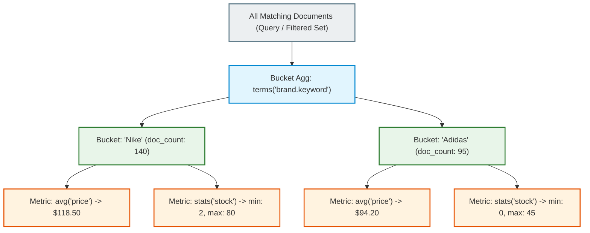
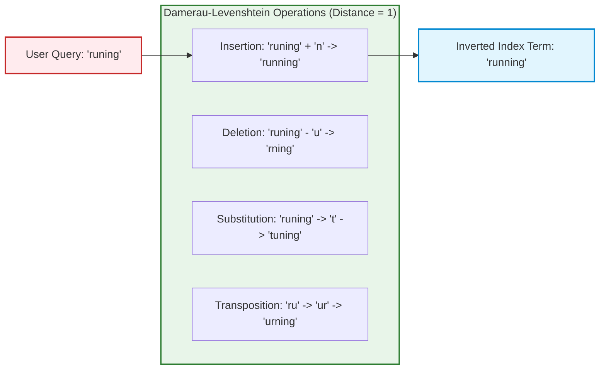
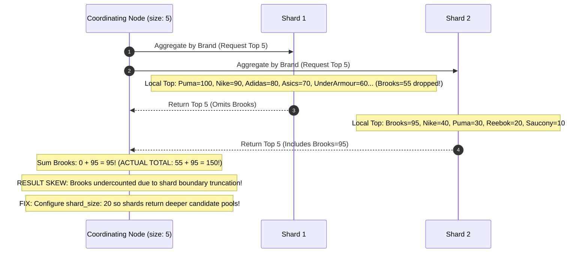
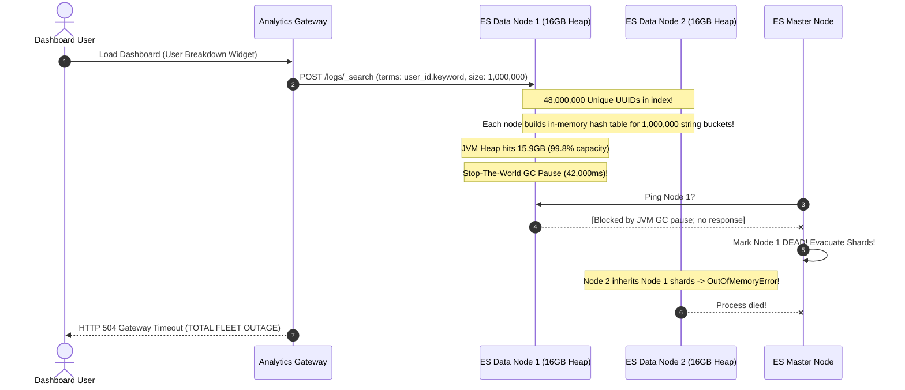

# Module 04: Aggregations & Fuzzy Search Engine Architecture

> **Prerequisites**: [Module 01: Indexes and Mappings](../01-indexes-and-mappings/README.md), [Module 02: Basic and Full-Text Search](../02-basic-and-full-text-search/README.md).  
> **Estimated Reading Time**: 25 minutes  
> **Target Audience**: Backend Engineers, Analytics Developers, Search Infrastructure Specialists.

> [!TIP]
> **Golden Rule of Aggregations & Fuzzy Matching**: Aggregations execute on **Doc Values** (columnar on-disk storage), completely bypassing the inverted index. Never execute bucket aggregations on high-cardinality fields without setting **`shard_size`** to eliminate distributed count-merge skew. In typo-tolerant search, always use **`fuzziness: "AUTO"`** with a non-zero **`prefix_length`** (e.g., 2) to prevent combinatorial query expansion storms.

---

## 1. Visual Mental Models & The Analytics Pipeline

Elasticsearch operates simultaneously as a full-text search engine and an ultra-fast distributed analytics engine. The analytics capability is powered by **Aggregations**, while typo tolerance is governed by **Levenshtein Automata**.

### 1.1 The Nested Aggregation Tree

Aggregations partition documents into **Buckets** (sets of documents) and compute **Metrics** (mathematical summaries) over each bucket. Buckets can be recursively nested to compute multi-dimensional metrics in a single pass:



---

### 1.2 Damerau-Levenshtein Edit Distance in Fuzzy Search

Typo tolerance computes the minimum number of single-character operations required to transform string $A$ into string $B$:



---

### 1.3 Distributed Top-N Merge Skew & The `shard_size` Solution

When aggregating on a sharded cluster, each shard computes its local top $N$ buckets and transmits them to the coordinating node. If a low-frequency term is ranked 11th on Shard 1 and 1st on Shard 2, setting `size: 10` causes Shard 1 to drop the term, causing count errors.



---

## 2. Taxonomic Reference Grids

### 2.1 Bucket vs. Metric Aggregations Matrix

| Aggregation Family | Category | Key Aggregations | Distributed Execution Profile | Ideal Use Case |
| :--- | :--- | :--- | :--- | :--- |
| **Bucket Aggregations** | Partitioning | `terms`, `range`, `date_histogram`, `filter` | Builds document sets based on field values | Faceted navigation, time-series metrics |
| **Metric Aggregations** | Numeric Reductions | `avg`, `sum`, `min`, `max`, `stats`, `extended_stats` | Single number computed per bucket | Revenue totals, average prices |
| **Approximate Metrics** | Probabilistic Data Structures | `cardinality` (HyperLogLog++), `percentiles` (T-Digest) | $\mathcal{O}(1)$ memory regardless of document count | Unique visitor counts, p99 API latency tracking |
| **Pipeline Aggregations** | Meta-Calculations | `derivative`, `moving_fn`, `cumulative_sum` | Runs on the outputs of other aggregations | Daily growth rate, 7-day moving averages |

### 2.2 Fuzzy Query Parameters Matrix

| Parameter | Default Value | Recommended Setting | Operational Mechanism | Failure Mode if Misconfigured |
| :--- | :--- | :--- | :--- | :--- |
| **`fuzziness`** | `AUTO` | `AUTO` (or `1`) | Max edit distance (0 for length $<3$, 1 for $3-5$, 2 for $>5$) | Setting `fuzziness: 2` on short words (`cat` matches `car`, `bat`, `hat`) |
| **`prefix_length`** | `0` | **`2`** | Number of initial characters that must match exactly | Setting `0` forces search across entire alphabet of term prefixes |
| **`max_expansions`** | `50` | `20–50` | Max number of candidate terms generated in Lucene automaton | High value ($>500$) triggers catastrophic query expansion latency |
| **`transpositions`** | `true` | `true` | Allows character swaps (`ab` $\rightarrow$ `ba`) as distance 1 | Setting `false` treats swap as 2 operations (delete + insert) |

---

## 3. Production War Stories: Incident Post-Mortem

### The $1.3M Facet Explosion: How a Terms Aggregation on User UUIDs Brought Down the Analytics Fleet

```
SEVERITY LEVEL: SEV-1 (Fleet-Wide Out-of-Memory Outage)
DETECTION TIME: 5 Minutes
RECOVERY TIME: 140 Minutes
FINANCIAL PENALTY: $1,300,000 in missed analytics SLAs and lost revenue
```

#### Incident Background
An enterprise B2B SaaS platform provided real-time dashboard analytics over 150 million user activity logs. The analytics backend was powered by an 8-node Elasticsearch cluster, with each node allocated 32 GB of RAM (16 GB JVM Heap).

#### What Happened
A product engineer added a "User Breakdown" widget to the admin dashboard. The widget queried:
```json
{
  "size": 0,
  "aggs": {
    "unique_users": {
      "terms": {
        "field": "user_id.keyword",
        "size": 1000000
      }
    }
  }
}
```
The `user_id.keyword` field contained **48,000,000 unique UUID values**. When the query arrived, every data node began instantiating in-memory bucket structures for hundreds of thousands of distinct string keys simultaneously. Within 12 seconds, JVM Garbage Collection paused for 45 seconds (Stop-the-World pause). Master heartbeats dropped, nodes were evicted from the cluster, and all 8 nodes entered a cyclic crash loop.



#### Root Cause Analysis
1. **Unbounded High-Cardinality Terms Aggregation**: Running `terms` aggregations on unique entity identifiers (UUIDs, transaction IDs) forces Elasticsearch to instantiate millions of bucket objects in memory.
2. **Absence of Cardinality HyperLogLog++**: The engineer intended to count unique users, but used a heavy `terms` bucket enumeration instead of the lightweight `cardinality` aggregation.
3. **Missing Circuit Breaker Guard**: The cluster lacked parent circuit breaker thresholds to cancel runaway aggregation queries before JVM heap exhaustion.

#### The Architectural Hardening
1. **Replacement with `cardinality` (HyperLogLog++)**: Replaced the `terms` aggregation with `cardinality`:
   ```json
   { "aggs": { "distinct_users": { "cardinality": { "field": "user_id.keyword" } } } }
   ```
   HyperLogLog++ computes the distinct count with a configurable memory footprint of less than **5 KB** per query with an accuracy error under $1\%$.
2. **Enforced Circuit Breakers**:
   Configured strict memory breakers in `elasticsearch.yml`:
   `indices.breaker.total.use_real_memory: true`
   `indices.breaker.total.limit: 70%`
   Queries that exceed 70% heap memory are immediately aborted with a clean HTTP 429 error rather than crashing the JVM.
3. **API Query Gatekeeping**: Enforced a hard limit on the API gateway restricting `terms.size` to a maximum of 100 for all client-facing requests.

---

## 4. Multi-Language Production Implementations

Below are four enterprise implementations demonstrating multi-bucket aggregations, metric sub-aggregations, and auto-fuzzy text matching.

### 4.1 Go: Faceted Aggregations with Sub-Metrics and Auto-Fuzzy Search

```go
package main

import (
	"bytes"
	"context"
	"encoding/json"
	"fmt"
	"time"

	"github.com/elastic/go-elasticsearch/v8"
	"github.com/elastic/go-elasticsearch/v8/esapi"
)

type FacetResult struct {
	BrandName string  `json:"brand"`
	DocCount  int64   `json:"count"`
	AvgPrice  float64 `json:"avg_price"`
}

type AggregationService struct {
	es *elasticsearch.Client
}

func NewAggregationService(client *elasticsearch.Client) *AggregationService {
	return &AggregationService{es: client}
}

// GetCatalogFacets retrieves brand counts and average prices with typo-tolerant filtering.
func (as *AggregationService) GetCatalogFacets(ctx context.Context, indexName, queryText string) ([]FacetResult, error) {
	queryBody := map[string]any{
		// 1. Size 0: Do NOT return raw document hits, only computed aggregations!
		"size": 0,
		"query": map[string]any{
			"match": map[string]any{
				"title": map[string]any{
					"query":         queryText,
					"fuzziness":     "AUTO", // Dynamic Levenshtein distance
					"prefix_length": 2,      // First 2 chars must match exactly
				},
			},
		},
		"aggs": map[string]any{
			"brands": map[string]any{
				"terms": map[string]any{
					"field":      "brand.keyword",
					"size":       10, // Top 10 brands
					"shard_size": 25, // Prevent distributed count skew across shards!
				},
				"aggs": map[string]any{
					"average_price": map[string]any{
						"avg": map[string]any{
							"field": "price",
						},
					},
				},
			},
		},
	}

	payload, err := json.Marshal(queryBody)
	if err != nil {
		return nil, err
	}

	req := esapi.SearchRequest{
		Index: []string{indexName},
		Body:  bytes.NewReader(payload),
	}

	res, err := req.Do(ctx, as.es)
	if err != nil {
		return nil, err
	}
	defer res.Body.Close()

	if res.IsError() {
		return nil, fmt.Errorf("aggregation error status code: %d", res.StatusCode)
	}

	var esResponse struct {
		Aggregations struct {
			Brands struct {
				Buckets []struct {
					Key          string `json:"key"`
					DocCount     int64  `json:"doc_count"`
					AveragePrice struct {
						Value float64 `json:"value"`
					} `json:"average_price"`
				} `json:"buckets"`
			} `json:"brands"`
		} `json:"aggregations"`
	}

	if err := json.NewDecoder(res.Body).Decode(&esResponse); err != nil {
		return nil, err
	}

	results := make([]FacetResult, 0, len(esResponse.Aggregations.Brands.Buckets))
	for _, b := range esResponse.Aggregations.Brands.Buckets {
		results = append(results, FacetResult{
			BrandName: b.Key,
			DocCount:  b.DocCount,
			AvgPrice:  b.AveragePrice.Value,
		})
	}

	return results, nil
}

func main() {
	client, err := elasticsearch.NewDefaultClient()
	if err != nil {
		panic(err)
	}

	service := NewAggregationService(client)
	ctx, cancel := context.WithTimeout(context.Background(), 5*time.Second)
	defer cancel()

	// Query with deliberate typo "runing" -> AUTO fuzziness resolves to "running"
	facets, err := service.GetCatalogFacets(ctx, "products", "runing shoes")
	if err != nil {
		fmt.Printf("Facet query note: %v (Ensure local ES is up)\n", err)
		return
	}

	fmt.Printf("[Aggregations] Retrieved %d brand facets:\n", len(facets))
	for _, f := range facets {
		fmt.Printf(" - %s: %d items (Avg: $%.2f)\n", f.BrandName, f.DocCount, f.AvgPrice)
	}
}
```

---

### 4.2 TypeScript: E-Commerce Faceted Sidebar Generator (`size: 0`)

```typescript
import { Client } from "@elastic/elasticsearch";

export interface FacetBucket {
  category: string;
  count: number;
}

export class FacetService {
  constructor(private client: Client) {}

  public async getProductFacets(searchTerm: string): Promise<FacetBucket[]> {
    const response = await this.client.search({
      index: "ecommerce_catalog",
      body: {
        size: 0, // Zero document payload overhead
        query: {
          match: {
            name: {
              query: searchTerm,
              fuzziness: "AUTO",
              prefix_length: 2,
            },
          },
        },
        aggs: {
          categories: {
            terms: {
              field: "category.keyword",
              size: 20,
              shard_size: 50, // Eliminate shard-merge skew
            },
          },
          price_stats: {
            stats: {
              field: "price",
            },
          },
        },
      },
    });

    const buckets = (response.aggregations as any)?.categories?.buckets ?? [];
    return buckets.map((b: any) => ({
      category: b.key,
      count: b.doc_count,
    }));
  }
}
```

---

### 4.3 Python: Date Histogram Aggregation with Distinct User Cardinality

```python
from typing import Dict, List
from elasticsearch import Elasticsearch


class AnalyticsAggregator:
    def __init__(self, es: Elasticsearch):
        self.es = es

    def get_hourly_traffic_and_unique_users(self, index_name: str) -> List[Dict]:
        """
        Executes a date_histogram bucket aggregation with a nested HyperLogLog++ cardinality metric.
        """
        query_body = {
            "size": 0,
            "aggs": {
                "events_over_time": {
                    "date_histogram": {
                        "field": "timestamp",
                        "calendar_interval": "1h",
                    },
                    "aggs": {
                        # HyperLogLog++: <5KB memory, zero heap explosion!
                        "distinct_visitors": {
                            "cardinality": {
                                "field": "user_id.keyword",
                                "precision_threshold": 4000,
                            }
                        }
                    },
                }
            },
        }

        response = self.es.search(index=index_name, body=query_body)
        buckets = response["aggregations"]["events_over_time"]["buckets"]

        return [
            {
                "time": b["key_as_string"],
                "total_events": b["doc_count"],
                "unique_users": b["distinct_visitors"]["value"],
            }
            for b in buckets
        ]
```

---

### 4.4 C#: Strongly Typed Multi-Aggregation Engine via NEST

```csharp
using System.Collections.Generic;
using System.Threading.Tasks;
using Elastic.Clients.Elasticsearch;
using Elastic.Clients.Elasticsearch.Aggregations;

namespace Architecture.Search.Aggregations
{
    public record FacetItem(string Brand, long Count, double? AveragePrice);

    public class CatalogAnalyticsEngine
    {
        private readonly ElasticsearchClient _client;

        public CatalogAnalyticsEngine(ElasticsearchClient client)
        {
            _client = client;
        }

        public async Task<List<FacetItem>> ComputeBrandFacetsAsync(string queryTerm)
        {
            var searchResponse = await _client.SearchAsync<object>(s => s
                .Index("products")
                .Size(0)
                .Query(q => q
                    .Match(m => m
                        .Field("title")
                        .Query(queryTerm)
                        .Fuzziness(new Fuzziness("AUTO"))
                    )
                )
                .Aggregations(a => a
                    .Add("brands", agg => agg
                        .Terms(t => t
                            .Field("brand.keyword")
                            .Size(10)
                        )
                        .Aggregations(sub => sub
                            .Add("avg_price", sa => sa.Average(av => av.Field("price")))
                        )
                    )
                )
            );

            var items = new List<FacetItem>();
            var termsBucket = searchResponse.Aggregations.GetStringTerms("brands");

            foreach (var b in termsBucket.Buckets)
            {
                var avg = b.Aggregations.GetAverage("avg_price")?.Value;
                items.Add(new FacetItem(b.Key, b.DocCount, avg));
            }

            return items;
        }
    }
}
```

---

## 5. Practical Hands-On Verification Workflows

### 5.1 CLI Verification of Faceted Aggregation (`size: 0`)

Execute this `curl` command to compute brand aggregation summaries without returning raw hits:

```bash
# Execute aggregation query over products
curl -s -X POST "http://localhost:9200/products/_search" -H "Content-Type: application/json" -d'
{
  "size": 0,
  "aggs": {
    "by_category": {
      "terms": {
        "field": "category.keyword",
        "size": 5
      },
      "aggs": {
        "avg_price": {
          "avg": { "field": "price" }
        }
      }
    }
  }
}'

# Expected Response Structure:
# {
#   "took": 4,
#   "timed_out": false,
#   "hits": { "total": {"value": 1540}, "hits": [] },
#   "aggregations": {
#     "by_category": {
#       "buckets": [
#         { "key": "Footwear", "doc_count": 820, "avg_price": { "value": 124.50 } },
#         { "key": "Apparel", "doc_count": 720, "avg_price": { "value": 45.20 } }
#       ]
#     }
#   }
# }
```

---

## 6. Operational Validation Checkpoints (Scenario Quizzes)

<details>
<summary><strong>Checkpoint 1: The Zero-Hits Facet Trap</strong></summary>

**Scenario**: A user searches for `"waterproof red shoes"`. The search query returns 0 hits. The frontend requests facets for `"brand"` and `"category"`, but all facet counts return empty (`[]`). The product team wants the facet sidebar to continue showing all available catalog brands with `0` counts so users can uncheck filters. How do you resolve this?

<strong>Answer:</strong>
**Global and Post-Filter Aggregations**:
- By default, aggregations run **only over the documents that match the `query` clause**.
- If the query matches 0 documents, standard aggregations evaluate to 0 buckets.
- **Resolution**:
  1. Use a **`global` aggregation**: Escapes the current query context and evaluates over all documents in the entire index.
  2. Use **`post_filter`**:
     - Place text search (`"waterproof red shoes"`) in `query`.
     - Place user-selected facets (e.g., `brand: Nike`) in `post_filter`.
     - Aggregations evaluate *before* the post-filter runs, allowing the facet counts to show what would match if the user switched brands.
</details>

<details>
<summary><strong>Checkpoint 2: The Typo Storm on Short Strings</strong></summary>

**Scenario**: A search bar has fuzzy matching enabled with `fuzziness: 2`. A user types `"cat"`. Search results return documents for `"car"`, `"cab"`, `"bat"`, `"rat"`, `"hat"`, and `"can"`. Users complain that searching for felines returns automotive parts. Why did this happen, and what is the fix?

<strong>Answer:</strong>
**Excessive Edit Distance Relative to Word Length**:
- An edit distance of 2 on a 3-letter word permits changing $\frac{2}{3}$ of the entire term!
- Almost every 3-letter word in the English language is within edit distance 2 of `"cat"`.
- **Resolution**:
  - Use **`fuzziness: "AUTO"`** (which calculates Levenshtein thresholds dynamically: 0 edits for words $<3$ chars, 1 edit for $3-5$ chars, 2 edits only for words $>5$ chars).
  - Configure `"prefix_length": 1` or `2` so that the initial character(s) cannot be substituted.
</details>

<details>
<summary><strong>Checkpoint 3: Shard-Level Aggregation Inaccuracy</strong></summary>

**Scenario**: An index has 10 shards. You run a `terms` aggregation for `size: 10`. The returned count for the #10 brand is reported as `doc_count: 5,420`. However, running a direct count query (`GET /_count?q=brand:BrandX`) returns `7,890`. Why did the aggregation undercount by over 2,400 documents?

<strong>Answer:</strong>
**Distributed Top-N Truncation Skew**:
- When you request `size: 10`, each of the 10 shards evaluates its local documents and returns only its **local top 10** terms to the coordinating node.
- If BrandX was ranked #11 or #12 on 6 of those 10 shards, those 6 shards completely excluded BrandX from their response!
- The coordinating node summed only the counts from the shards where BrandX cracked the top 10.
- **Resolution**:
  - Increase **`shard_size`**: Set `shard_size: 50` or higher.
  - Each shard evaluates and sends its top 50 terms, allowing low-frequency or distributed terms to be merged accurately before final top-10 truncation.
</details>

---

## 7. Further Reading & References

- [Elasticsearch Reference: Aggregations Guide](https://www.elastic.co/guide/en/elasticsearch/reference/current/search-aggregations.html) - Complete official reference for bucket and metric aggregations.
- [Elastic Blog: Terms Aggregation Accuracy & shard_size](https://www.elastic.co/blog/terms-aggregation-accuracy) - Understanding distributed top-$N$ count skews.
- [Damerau-Levenshtein Automaton in Apache Lucene](https://lucene.apache.org/core/) - How Lucene achieves high-speed fuzzy search using finite state automata.

---

## Next Steps

Advance to [Module 05: Pagination & Performance Optimization](../05-pagination-and-performance-optimization/README.md) to master Deep Pagination (`from`/`size` vs. `search_after` vs. Point-in-Time PIT) and memory-efficient bulk indexing.
