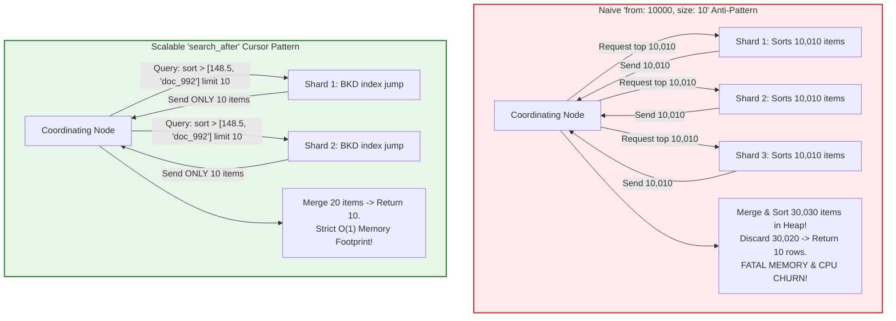
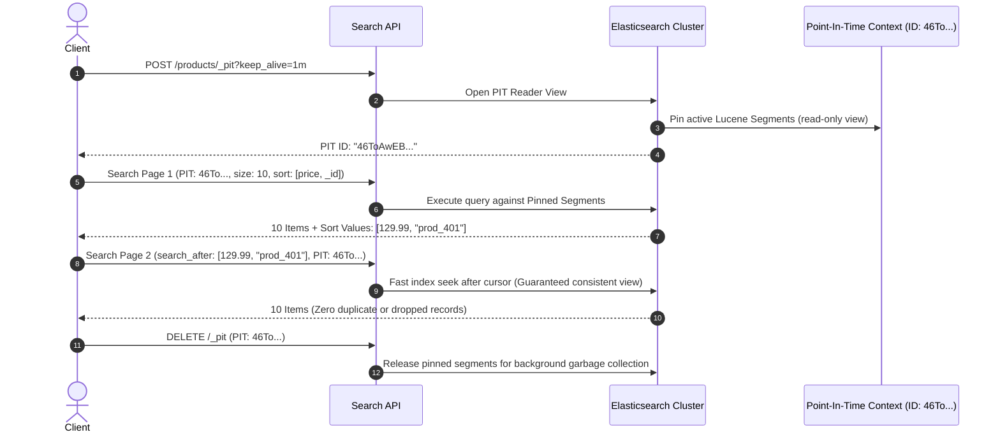
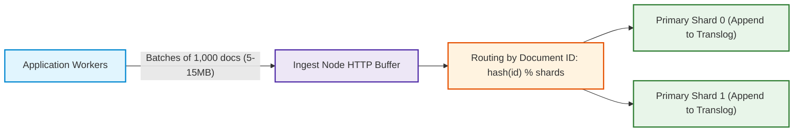
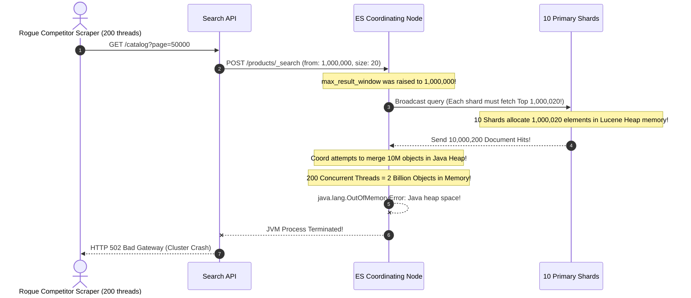

# Module 05: Pagination & Performance Optimization at Scale

> **Prerequisites**: [Module 01: Indexes and Mappings](../01-indexes-and-mappings/README.md), [Module 02: Basic and Full-Text Search](../02-basic-and-full-text-search/README.md).  
> **Estimated Reading Time**: 25 minutes  
> **Target Audience**: Backend Engineers, Performance Architects, Site Reliability Engineers (SREs).

> [!TIP]
> **Golden Rule of Scalable Search**: Deep pagination using `from + size` incurs an $\mathcal{O}((\text{from} + \text{size}) \times \text{shards})$ distributed memory penalty because **every shard must materialize and sort all preceding items** before merging. Never increase `index.max_result_window` beyond 10,000. For large result sets, infinite scrolling, and data export pipelines, use **`search_after` paired with a Point-In-Time (PIT)** reader and a deterministic tie-breaker (`_id`).

---

## 1. Visual Mental Models & System Architecture

As indices grow into millions of documents, pagination strategies, shard sizing, and bulk indexing techniques dictate whether your cluster operates at $15\text{ms}$ latencies or melts down under heap exhaustion.

### 1.1 The Deep Pagination Trap: `from + size` vs. `search_after`

When querying `from: 10000, size: 10` across a 5-shard index, Elasticsearch cannot simply jump to item 10,001. Because documents are distributed across independent shards, each shard must collect its **local top 10,010 documents** and transmit them to the coordinating node. The coordinator sorts **50,050 documents** in heap memory, discards 50,040 of them, and returns 10.



---

### 1.2 Point-In-Time (PIT) Lucene Segment Pinning

When paginating via `search_after`, concurrent background segment merges, deletions, and updates can cause duplicate or missed records between pages. A **Point-In-Time (PIT)** pins the state of Lucene segments at a specific moment in time:



---

### 1.3 High-Throughput Bulk Ingestion Pipeline

Indexing documents individually via single HTTP `POST` requests creates massive network TCP overhead, frequent Lucene commits, and disk thrashing. The **`_bulk` API** batches updates into high-density buffers:



---

## 2. Taxonomic Reference Grids

### 2.1 Pagination Mechanisms Comparison Matrix

| Pagination Technique | Deep Page Complexity | Heap Memory Overhead | Consistent Snapshot? | Random Page Access? | Best Architectural Use Case |
| :--- | :--- | :--- | :--- | :--- | :--- |
| **`from + size`** | $\mathcal{O}((\text{from} + \text{size}) \times S)$ | Linear growth ($\ge 10,000$ crashes cluster) | No (data drift between pages) | **Yes** (Jump directly to page 5) | User-facing shallow search results (pages 1 to 5) |
| **`search_after` + PIT** | $\mathcal{O}(\text{size} \times S)$ | **Constant $\mathcal{O}(1)$** | **Yes** (Pinned Lucene segments) | No (Sequential cursor navigation only) | Infinite scrolling, deep pagination, data exports |
| **Scroll API** | $\mathcal{O}(\text{size} \times S)$ | Moderate (stateful server context) | Yes (Snapshot) | No | **Legacy / Deprecated** for general search (use PIT instead) |

### 2.2 Bulk Ingestion Optimization Levers

| Ingestion Parameter | Default Production Value | Bulk Ingestion Tuning Value | Performance Impact | Operational Risk |
| :--- | :--- | :--- | :--- | :--- |
| **`refresh_interval`** | `1s` | `-1` (Disabled during bulk) | Eliminates thousands of tiny Lucene segments; $+80\%$ write speed | Data is not searchable until refresh is re-enabled |
| **`number_of_replicas`**| `1` | `0` (Zero during initial load) | Eliminates duplicate network replication hops during ingest | Shard loss if node fails before replicas are re-enabled |
| **`translog.durability`** | `request` (fsync on every write) | `async` (fsync every 5s) | Dramatic drop in disk write I/O wait | Up to 5s of uncommitted data lost on power failure |
| **Bulk Batch Size** | $1$ (Single doc) | **5 MB to 15 MB** (approx. $1,000–5,000$ docs) | Maximizes network pipe utilization and bulk thread pooling | Payloads $>50\text{MB}$ trigger HTTP 413 or JVM memory spikes |

---

## 3. Production War Stories: Incident Post-Mortem

### The $1.7M Scraping Disaster: How an Unconstrained Crawler Deep-Paginated the Cluster into OOM

```
SEVERITY LEVEL: SEV-1 (Cluster-Wide OOM Crash & Complete Outage)
DETECTION TIME: 8 Minutes
RECOVERY TIME: 180 Minutes
FINANCIAL PENALTY: $1,700,000 in lost e-commerce transactions during Black Friday
```

#### Incident Background
An e-commerce marketplace ran an 8-node Elasticsearch cluster indexing 20,000,000 products across 10 primary shards. To allow shoppers to jump to any page in search results, the public API accepted `page` query parameters and passed them directly to Elasticsearch as:
$$\text{from} = (\text{page} - 1) \times 20, \quad \text{size} = 20$$
A rogue developer had previously raised `index.max_result_window` to `1,000,000` to satisfy a product manager request for "deep pagination."

#### What Happened
At 02:00 AM, a competitor launched an aggressive web scraper attempting to catalog the entire inventory. The scraper spawned 200 concurrent threads requesting pages sequentially up to page 50,000 (`from: 1000000, size: 20`). 

For every single scrape request, all 10 shards were forced to allocate priority queues holding 1,000,020 documents each. The coordinating node attempted to merge **10,000,200 document pointers in heap memory** per request. Within 90 seconds, all 8 data nodes suffered catastrophic OutOfMemory (OOM) fatal errors, JVM processes died, and the entire platform crashed.



#### Root Cause Analysis
1. **Unconstrained Result Window**: Setting `max_result_window: 1,000,000` bypassed Elasticsearch's primary safeguard against distributed heap exhaustion.
2. **Missing Cursor-Based Architecture**: Using `from + size` for deep pagination forced quadratic memory consumption across the cluster.
3. **No Rate Limiting or Anti-Scraping Guards**: The API layer had zero rate limiting or query complexity caps.

#### The Architectural Hardening
1. **Re-established Safe `max_result_window`**: Restored `index.max_result_window: 10000`. Any attempt to request beyond page 500 via offset pagination is rejected at the API boundary with HTTP 400.
2. **Transitioned to `search_after` with PIT**: Re-engineered all export and deep catalog navigation to use **`search_after`** sorted by `[created_at, _id]`. Memory consumption on deep reads dropped from hundreds of megabytes to under $10\text{ KB}$ per query.
3. **Bot Mitigation & Circuit Breaking**: Implemented Token Bucket rate limiting on user IPs and enforced strict query timeouts (`timeout: 3s`).

---

## 4. Multi-Language Production Implementations

Below are four enterprise implementations demonstrating consistent Point-In-Time cursor pagination and high-throughput bulk indexing.

### 4.1 Go: Deep Pagination using Point-In-Time (PIT) and `search_after`

```go
package main

import (
	"bytes"
	"context"
	"encoding/json"
	"errors"
	"fmt"
	"time"

	"github.com/elastic/go-elasticsearch/v8"
	"github.com/elastic/go-elasticsearch/v8/esapi"
)

type ProductDoc struct {
	ID    string  `json:"id"`
	Title string  `json:"title"`
	Price float64 `json:"price"`
}

type ScalableSearcher struct {
	es *elasticsearch.Client
}

func NewScalableSearcher(client *elasticsearch.Client) *ScalableSearcher {
	return &ScalableSearcher{es: client}
}

// OpenPIT opens a Point-In-Time reader view to ensure pagination consistency.
func (ss *ScalableSearcher) OpenPIT(ctx context.Context, indexName string, keepAlive string) (string, error) {
	req := esapi.OpenPointInTimeRequest{
		Index:     []string{indexName},
		KeepAlive: keepAlive,
	}

	res, err := req.Do(ctx, ss.es)
	if err != nil {
		return "", err
	}
	defer res.Body.Close()

	if res.IsError() {
		return "", fmt.Errorf("open PIT error code: %d", res.StatusCode)
	}

	var pitResp struct {
		ID string `json:"id"`
	}
	if err := json.NewDecoder(res.Body).Decode(&pitResp); err != nil {
		return "", err
	}

	return pitResp.ID, nil
}

// ClosePIT releases pinned Lucene segments.
func (ss *ScalableSearcher) ClosePIT(ctx context.Context, pitID string) error {
	payload := map[string]string{"id": pitID}
	body, _ := json.Marshal(payload)

	req := esapi.ClosePointInTimeRequest{
		Body: bytes.NewReader(body),
	}

	res, err := req.Do(ctx, ss.es)
	if err != nil {
		return err
	}
	defer res.Body.Close()
	return nil
}

// FetchPage executes a cursor-based search_after query against a PIT.
func (ss *ScalableSearcher) FetchPage(ctx context.Context, pitID string, searchAfter []any, pageSize int) ([]ProductDoc, []any, error) {
	queryBody := map[string]any{
		"size": pageSize,
		"pit": map[string]any{
			"id":         pitID,
			"keep_alive": "1m",
		},
		// Crucial: Deterministic sort with unique tie-breaker (_shard_doc or _id)
		"sort": []any{
			map[string]any{"price": "asc"},
			map[string]any{"_shard_doc": "asc"},
		},
	}

	if len(searchAfter) > 0 {
		queryBody["search_after"] = searchAfter
	}

	payload, _ := json.Marshal(queryBody)
	req := esapi.SearchRequest{
		Body: bytes.NewReader(payload),
	}

	res, err := req.Do(ctx, ss.es)
	if err != nil {
		return nil, nil, err
	}
	defer res.Body.Close()

	if res.IsError() {
		return nil, nil, fmt.Errorf("search failed with status: %d", res.StatusCode)
	}

	var esResponse struct {
		Hits struct {
			Hits []struct {
				Source ProductDoc `json:"_source"`
				Sort   []any      `json:"sort"`
			} `json:"hits"`
		} `json:"hits"`
	}

	if err := json.NewDecoder(res.Body).Decode(&esResponse); err != nil {
		return nil, nil, err
	}

	hits := esResponse.Hits.Hits
	if len(hits) == 0 {
		return nil, nil, nil // End of results
	}

	products := make([]ProductDoc, len(hits))
	for i, h := range hits {
		products[i] = h.Source
	}

	lastSort := hits[len(hits)-1].Sort
	return products, lastSort, nil
}

func main() {
	client, err := elasticsearch.NewDefaultClient()
	if err != nil {
		panic(err)
	}

	searcher := NewScalableSearcher(client)
	ctx := context.Background()

	pitID, err := searcher.OpenPIT(ctx, "products", "2m")
	if err != nil {
		fmt.Printf("PIT notice: %v (Ensure index exists)\n", err)
		return
	}
	defer searcher.ClosePIT(ctx, pitID)

	var cursor []any
	for page := 1; page <= 3; page++ {
		items, nextCursor, err := searcher.FetchPage(ctx, pitID, cursor, 5)
		if err != nil || len(items) == 0 {
			break
		}
		fmt.Printf("Page %d retrieved %d items. Next cursor: %v\n", page, len(items), nextCursor)
		cursor = nextCursor
	}
}
```

---

### 4.2 TypeScript: Async Stream Pagination with `search_after`

```typescript
import { Client } from "@elastic/elasticsearch";

export class SearchPaginator {
  constructor(private client: Client) {}

  public async *streamAllProducts(indexName: string, batchSize: number = 500): AsyncGenerator<any[]> {
    // 1. Open Point-In-Time context
    const pitResponse: any = await this.client.openPointInTime({
      index: indexName,
      keep_alive: "2m",
    });
    const pitId = pitResponse.id;

    let searchAfter: any[] | undefined = undefined;

    try {
      while (true) {
        const response: any = await this.client.search({
          body: {
            size: batchSize,
            pit: {
              id: pitId,
              keep_alive: "2m",
            },
            sort: [
              { price: "asc" },
              { _shard_doc: "asc" }, // Deterministic tie-breaker
            ],
            ...(searchAfter ? { search_after: searchAfter } : {}),
          },
        });

        const hits = response.hits.hits;
        if (!hits || hits.length === 0) {
          break; // Exhausted dataset
        }

        yield hits.map((h: any) => h._source);

        // Update cursor to the sort keys of the last element
        searchAfter = hits[hits.length - 1].sort;
      }
    } finally {
      // Clean up pinned Lucene segments
      await this.client.closePointInTime({
        body: { id: pitId },
      });
    }
  }
}
```

---

### 4.3 Python: Optimized Bulk Ingestion with Retry Backoff

```python
import time
from typing import Dict, Iterator, List
from elasticsearch import Elasticsearch, helpers


class HighThroughputIndexer:
    def __init__(self, es: Elasticsearch):
        self.es = es

    def bulk_load_catalog(self, index_name: str, doc_generator: Iterator[Dict], chunk_size: int = 2000) -> None:
        """
        Executes high-density bulk loading with optimal chunk size and automatic retry backoff.
        """
        actions = (
            {
                "_index": index_name,
                "_id": doc["sku"],
                "_source": doc,
            }
            for doc in doc_generator
        )

        success_count = 0
        failed_count = 0

        # streaming_bulk consumes memory in bounded batches without materializing millions of docs
        for success, info in helpers.streaming_bulk(
            self.es,
            actions,
            chunk_size=chunk_size,
            max_chunk_bytes=10 * 1024 * 1024,  # 10MB chunk boundary
            raise_on_error=False,
            raise_on_exception=False,
        ):
            if success:
                success_count += 1
            else:
                failed_count += 1
                print(f"[Bulk Error] Item failed: {info}")

        print(f"[Bulk Finished] Indexed: {success_count}, Failed: {failed_count}")
```

---

### 4.4 C#: High-Performance SearchAfter with PIT via NEST

```csharp
using System;
using System.Collections.Generic;
using System.Threading.Tasks;
using Elastic.Clients.Elasticsearch;
using Elastic.Clients.Elasticsearch.Core.Search;

namespace Architecture.Search.Optimization
{
    public class CursorPaginationEngine
    {
        private readonly ElasticsearchClient _client;

        public CursorPaginationEngine(ElasticsearchClient client)
        {
            _client = client;
        }

        public async Task PaginateWithCursorAsync(string indexName)
        {
            var pitRes = await _client.OpenPointInTimeAsync(indexName, p => p.KeepAlive("2m"));
            string pitId = pitRes.Id;

            IReadOnlyCollection<FieldValue>? cursor = null;

            try
            {
                var searchRes = await _client.SearchAsync<ProductDoc>(s => s
                    .Size(100)
                    .PointInTime(new PointInTimeReference { Id = pitId, KeepAlive = "2m" })
                    .Sort(srt => srt
                        .Field(f => f.Price, SortOrder.Asc)
                        .Field("_shard_doc", SortOrder.Asc)
                    )
                    .SearchAfter(cursor)
                );

                Console.WriteLine($"Retrieved {searchRes.Documents.Count} records safely.");
            }
            finally
            {
                await _client.ClosePointInTimeAsync(c => c.Id(pitId));
            }
        }
    }

    public class ProductDoc
    {
        public decimal Price { get; set; }
    }
}
```

---

## 5. Practical Hands-On Verification Workflows

### 5.1 CLI Verification of the Point-In-Time (PIT) Lifecycle

Execute this `curl` pipeline to open a PIT, paginate using `search_after`, and close the context:

```bash
# 1. Open a Point-in-Time context valid for 1 minute
PIT_RESP=$(curl -s -X POST "http://localhost:9200/products/_pit?keep_alive=1m")
PIT_ID=$(echo $PIT_RESP | jq -r '.id')
echo "Opened PIT ID: $PIT_ID"

# 2. Query page 1 using PIT
PAGE_RESP=$(curl -s -X POST "http://localhost:9200/_search" -H "Content-Type: application/json" -d"
{
  \"size\": 2,
  \"pit\": {
    \"id\": \"$PIT_ID\",
    \"keep_alive\": \"1m\"
  },
  \"sort\": [
    {\"price\": \"asc\"},
    {\"_shard_doc\": \"asc\"}
  ]
}")

# Inspect sort cursor of the last hit
LAST_SORT=$(echo $PAGE_RESP | jq -c '.hits.hits[-1].sort')
echo "Page 1 Last Sort Cursor: $LAST_SORT"

# 3. Query page 2 using search_after cursor
curl -s -X POST "http://localhost:9200/_search" -H "Content-Type: application/json" -d"
{
  \"size\": 2,
  \"pit\": {
    \"id\": \"$PIT_ID\",
    \"keep_alive\": \"1m\"
  },
  \"sort\": [
    {\"price\": \"asc\"},
    {\"_shard_doc\": \"asc\"}
  ],
  \"search_after\": $LAST_SORT
}"

# 4. Close the PIT to release memory
curl -s -X DELETE "http://localhost:9200/_pit" -H "Content-Type: application/json" -d"{\"id\": \"$PIT_ID\"}"
echo "PIT Closed Successfully."
```

---

## 6. Operational Validation Checkpoints (Scenario Quizzes)

<details>
<summary><strong>Checkpoint 1: The Missing Tie-Breaker in `search_after`</strong></summary>

**Scenario**: A developer implements `search_after` sorting exclusively by `price`:
```json
{ "sort": [{ "price": "asc" }], "search_after": [99.99] }
```
In an index containing 4,000 products priced at exactly `$99.99`, page 2 skips over hundreds of `$99.99` products, while page 3 repeats items from page 1. Why does `search_after` fail without a unique tie-breaker?

<strong>Answer:</strong>
**Non-Deterministic Sort Ordering**:
- `search_after: [99.99]` instructs Lucene to seek to documents whose sort value is strictly greater than `99.99`.
- If 4,000 documents have the exact same price of `$99.99`, Lucene cannot reliably break ties across shards. It might jump straight to `$100.00`, completely skipping the remaining 3,990 items priced at `$99.99`!
- **Resolution**: Always append a **unique tie-breaker field** to the sort array:
  `"sort": [{ "price": "asc" }, { "_shard_doc": "asc" }]` or `[{ "price": "asc" }, { "sku.keyword": "asc" }]`.
</details>

<details>
<summary><strong>Checkpoint 2: The Scroll API Deprecation Dilemma</strong></summary>

**Scenario**: An architect suggests using the Elasticsearch Scroll API (`/_search/scroll`) for a mobile app's user search results. Why is the Scroll API explicitly discouraged for real-time user-facing search, and what is the proper replacement?

<strong>Answer:</strong>
**Stateful Resource Exhaustion on User Sessions**:
1. **Unbounded Context Leaks**: The Scroll API was designed for batch offline data exports (e.g., Logstash, Hadoop). It maintains an active stateful reader context on each shard.
2. If thousands of mobile users initiate search scrolls and background their phone without scrolling to the end, the cluster accumulates thousands of open scroll contexts. This holds unmerged Lucene segments open on disk and rapidly exhausts file descriptors and heap memory.
3. **Proper Replacement**: Use **`search_after` paired with Point-in-Time (PIT)**. PIT contexts can be closed explicitly and are significantly lighter on cluster resources.
</details>

<details>
<summary><strong>Checkpoint 3: The 1-Second Refresh Trap During Bulk Loading</strong></summary>

**Scenario**: You are migrating 100,000,000 historical records into an Elasticsearch cluster. Even with bulk requests of 5,000 documents, the migration rate is throttled at only 2,000 docs/sec, with disk I/O at 100%. How do you adjust cluster settings to achieve 50,000+ docs/sec during initial load?

<strong>Answer:</strong>
**Disable Refresh and Strip Replicas During Ingestion**:
1. **Disable Refresh**: By default, Elasticsearch refreshes every 1 second, forcing Lucene to write and merge hundreds of tiny segments:
   `PUT /my_index/_settings { "index": { "refresh_interval": "-1" } }`.
2. **Set Replicas to 0**: Prevents coordinating nodes from copying every document across the network twice:
   `PUT /my_index/_settings { "index": { "number_of_replicas": 0 } }`.
3. **Set Translog to Async**:
   `PUT /my_index/_settings { "index.translog.durability": "async" }`.
4. **Post-Load Step**: Once migration completes, restore settings:
   - Re-enable refresh: `"refresh_interval": "1s"`.
   - Restore replicas: `"number_of_replicas": 1`.
   - Trigger a force merge: `POST /my_index/_forcemerge?max_num_segments=1`.
</details>

---

## 7. Further Reading & References

- [Elasticsearch Reference: Paginate Search Results](https://www.elastic.co/guide/en/elasticsearch/reference/current/paginate-search-results.html) - Official guide on `from/size` vs `search_after`.
- [Elasticsearch Reference: Point in Time API](https://www.elastic.co/guide/en/elasticsearch/reference/current/point-in-time-api.html) - Consistent snapshot reader views in distributed search.
- [Elastic Blog: Tuning Elasticsearch for Indexing Speed](https://www.elastic.co/blog/how-to-tune-elasticsearch-indexing-speed) - Comprehensive hardware and software tuning levers for bulk throughput.

---

## Next Steps

Advance to [Module 06: Kibana, Cluster Monitoring & Operations](../06-kibana-and-operations/README.md) to master cluster state diagnostics, index templates, slow logs, and automated ILM policies.
