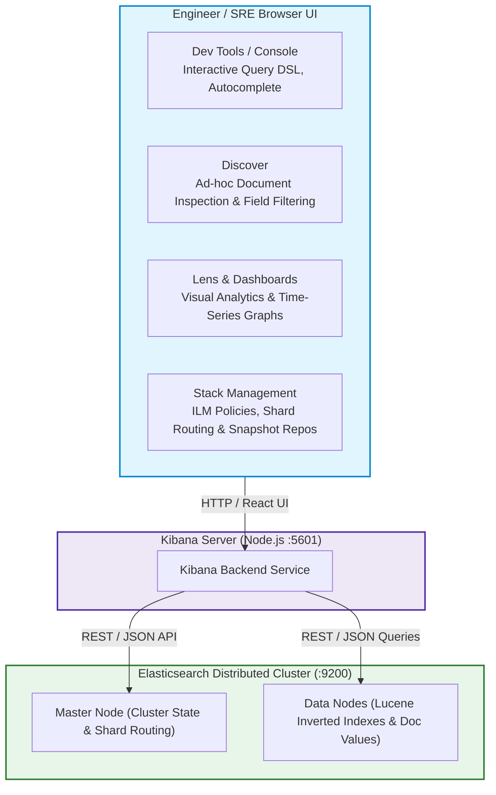
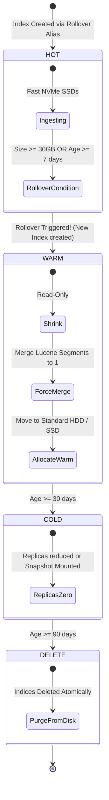
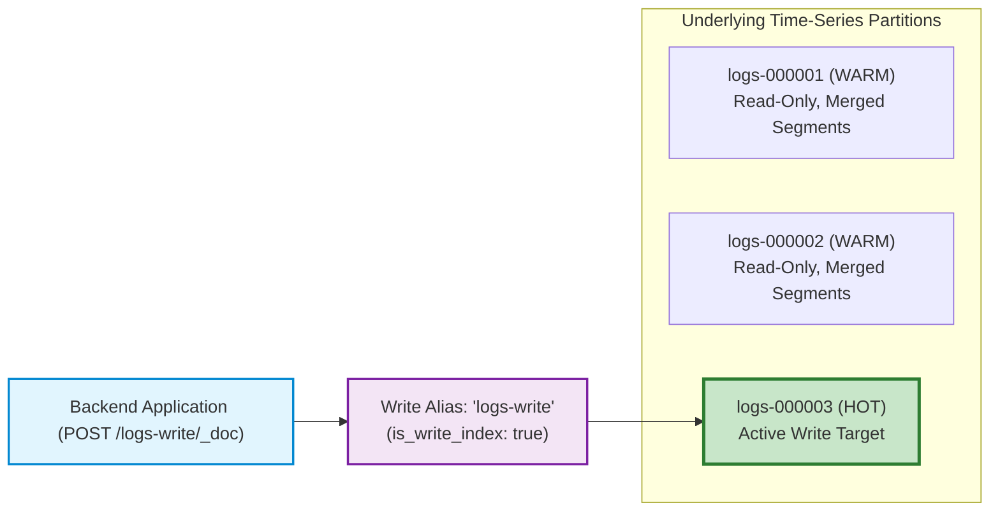
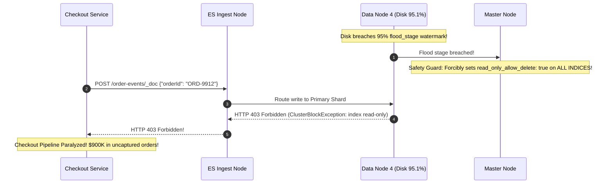

# Module 06: Kibana, Cluster Operations & Index Lifecycle Management (ILM)

> **Prerequisites**: [Module 00: Elasticsearch Fundamentals](../00-elasticsearch-fundamentals/README.md), [Module 01: Indexes and Mappings](../01-indexes-and-mappings/README.md), [Module 05: Pagination and Performance Optimization](../05-pagination-and-performance-optimization/README.md).  
> **Estimated Reading Time**: 25 minutes  
> **Target Audience**: Backend Engineers, Site Reliability Engineers (SREs), Search Platform Administrators.

> [!TIP]
> **Golden Rule of Search Cluster Operations**: Time-series indices (logs, telemetry, audit records, analytics events) will exhaust disk and heap memory without automated lifecycle governance. Never ingest time-series data into static unbounded indices. Always deploy an **Index Lifecycle Management (ILM)** policy governing the **Hot $\rightarrow$ Warm $\rightarrow$ Cold $\rightarrow$ Delete** transitions, backed by **Composable Index Templates** and **Rollover Write Aliases** (`is_write_index: true`).

---

## 1. Visual Mental Models & Operational Architecture

Operating a production Elasticsearch deployment requires moving beyond ad-hoc queries into continuous cluster monitoring, interactive debugging via Kibana, and automated data retention lifecycles.

### 1.1 Kibana Architectural Role & Interaction Flow

Kibana serves as the administrative control plane, interactive developer console, and data visualization window over Elasticsearch:



---

### 1.2 The 5-Phase Index Lifecycle Management (ILM) Pipeline

Data changes in value over time: recent events require fast SSDs and high write throughput, while historical data is read rarely and can be compressed onto cheaper storage before deletion.



---

### 1.3 The Rollover Alias Write Architecture

Applications write exclusively to a single logical alias (`logs-write`). When ILM conditions are met, Elasticsearch atomically points the write alias to the newly initialized index partition with zero application reconfiguration:



---

## 2. Taxonomic Reference Grids

### 2.1 ILM Phase Tier Specifications Matrix

| Phase | Read/Write Role | Storage Tier | Replicas | Force Merge? | Actions Executed |
| :--- | :--- | :--- | :--- | :--- | :--- |
| **Hot** | Active High-Rate Ingestion & Queries | Ultra-fast NVMe SSDs | 1 or 2 | No | Rollover triggered when primary reaches $30–50\text{GB}$ or 7 days |
| **Warm** | Read-Only Queries, No Writes | Standard SSDs | 1 | **Yes** (`max_num_segments: 1`) | Shrink shards, force-merge segments to release deleted doc space |
| **Cold** | Infrequent Queries (Audits) | Low-cost HDDs / Object Storage | 0 or 1 | Yes | Searchable snapshots mounted; replicas dropped to save storage |
| **Frozen** | Rare Compliance Lookups | Direct S3 / GCS Object Storage | 0 | Yes | Shards remain unmounted until explicit long-running query issued |
| **Delete** | None (End of Life) | N/A | 0 | N/A | Index physically purged from cluster storage |

### 2.2 Operational Cluster Metrics Diagnostic Matrix

| Metric / Symptom | Healthy Target | Warning Threshold | Critical Alert Threshold | Root Cause / Remedy |
| :--- | :--- | :--- | :--- | :--- |
| **JVM Heap Usage** | $40\% – 65\%$ | $>75\%$ sustained | **$>85\%$ (GC Pauses)** | Shard over-allocation, runaway aggregations. Add nodes or reduce shards. |
| **Cluster Health** | `GREEN` | `YELLOW` (Replica unassigned) | **`RED` (Primary missing)** | Run `_cluster/allocation/explain` to diagnose why shard cannot allocate. |
| **Search Thread Pool Queue** | $0$ | $>50$ | **$>500$ (Rejections)** | Inefficient scoring queries or un-cached filters. Route exact filters to `filter`. |
| **Disk Watermark** | $<70\%$ | $85\%$ (`low` watermark) | **$95\%$ (`flood_stage`)** | Index locked read-only (`read_only_allow_delete`). Free disk or purge old indices. |
| **Young/Old Gen GC Time** | $<200\text{ms}$ | $>1,000\text{ms}$ | **$>5,000\text{ms}$ (STW)** | Stop-the-world garbage collection freeze. Nodes risk being dropped by master. |

---

## 3. Production War Stories: Incident Post-Mortem

### The $900K Disk Full Read-Only Lockout: How Missing ILM Frozen Indices Stopped Global Writes

```
SEVERITY LEVEL: SEV-1 (Cluster-Wide Write Halt & Order Ingestion Freeze)
DETECTION TIME: 4 Minutes
RECOVERY TIME: 160 Minutes
FINANCIAL PENALTY: $900,000 in dropped customer checkout logs and payments
```

#### Incident Background
A global logistics platform utilized a 6-node Elasticsearch cluster to record order events, vehicle GPS pings, and delivery verification photos. The indices were generated daily with names like `order-events-2024.11.10`.

#### What Happened
At 04:15 AM on a Saturday, disk utilization on Data Node 4 reached **95.1%**. Elasticsearch's automated disk safety circuit breaker, the **Flood Stage Watermark**, was immediately triggered:
```
[WARN ][o.e.c.r.a.DiskThresholdMonitor] flood stage disk watermark [95%] exceeded on node [data-node-4], all indices on this node are now locked READ-ONLY
```
To protect Lucene indexes from physical disk corruption, Elasticsearch forcibly applied `"index.blocks.read_only_allow_delete": true` across every active index in the cluster. 

Instantly, all write requests (`POST /order-events/_doc`) failed with HTTP 403 Forbidden. Mobile checkout gateways threw errors, order ingestion stalled nationwide, and warehouse scanning guns displayed "Cluster Locked" error messages.



#### Root Cause Analysis
1. **Absence of Index Retention Lifecycle (ILM)**: No retention policy existed. Over 3 years of old daily indices remained active on high-cost primary NVMe disks.
2. **Missing Disk Capacity Alerting**: SRE teams monitored overall cloud compute but lacked proactive alerts on the 85% Elasticsearch `low_watermark`.
3. **Misunderstanding of the Read-Only Flood Lock**: Even after deleting 50 GB of log files, the indices **remained locked in read-only mode** because Elasticsearch requires an explicit administrative API call to release the `read_only_allow_delete` block.

#### The Architectural Hardening
1. **Automated ILM with Hot-to-Delete Pipeline**: Deployed an automated ILM policy moving indices to Warm at 7 days, Cold at 30 days, and automatically executing `delete` at 90 days.
2. **Proactive Disk Monitoring & Rebalanced Watermarks**:
   Configured custom watermarks in `elasticsearch.yml`:
   ```yaml
   cluster.routing.allocation.disk.watermark.low: 80%
   cluster.routing.allocation.disk.watermark.high: 88%
   cluster.routing.allocation.disk.watermark.flood_stage: 93%
   ```
   Set up PagerDuty alerts firing at 80% disk threshold.
3. **Emergency Lock Release Runbook**: Documented the cluster unblock command for on-call engineers:
   ```bash
   PUT /*/_settings { "index.blocks.read_only_allow_delete": null }
   ```

---

## 4. Multi-Language Production Implementations

Below are four enterprise implementations demonstrating automated ILM policy deployment, index templates, and SRE cluster health diagnostics.

### 4.1 Go: SRE Cluster Health Diagnostic CLI & Metric Scraper

```go
package main

import (
	"context"
	"encoding/json"
	"fmt"
	"net/http"
	"os"
	"time"

	"github.com/elastic/go-elasticsearch/v8"
	"github.com/elastic/go-elasticsearch/v8/esapi"
)

type ClusterHealthSummary struct {
	ClusterName         string  `json:"cluster_name"`
	Status              string  `json:"status"` // green, yellow, red
	ActivePrimaryShards int     `json:"active_primary_shards"`
	UnassignedShards    int     `json:"unassigned_shards"`
	DiskUsageRatio      float64 `json:"disk_usage_ratio"`
}

type SREDiagnostics struct {
	es *elasticsearch.Client
}

func NewSREDiagnostics(addr string) (*SREDiagnostics, error) {
	client, err := elasticsearch.NewClient(elasticsearch.Config{
		Addresses: []string{addr},
	})
	if err != nil {
		return nil, err
	}
	return &SREDiagnostics{es: client}, nil
}

// InspectCluster performs pre-flight checks and returns health metrics.
func (d *SREDiagnostics) InspectCluster(ctx context.Context) (*ClusterHealthSummary, error) {
	req := esapi.ClusterHealthRequest{
		Timeout: 5 * time.Second,
	}

	res, err := req.Do(ctx, d.es)
	if err != nil {
		return nil, err
	}
	defer res.Body.Close()

	if res.IsError() {
		return nil, fmt.Errorf("health check returned status %d", res.StatusCode)
	}

	var raw struct {
		ClusterName         string `json:"cluster_name"`
		Status              string `json:"status"`
		ActivePrimaryShards int    `json:"active_primary_shards"`
		UnassignedShards    int    `json:"unassigned_shards"`
	}

	if err := json.NewDecoder(res.Body).Decode(&raw); err != nil {
		return nil, err
	}

	summary := &ClusterHealthSummary{
		ClusterName:         raw.ClusterName,
		Status:              raw.Status,
		ActivePrimaryShards: raw.ActivePrimaryShards,
		UnassignedShards:    raw.UnassignedShards,
	}

	return summary, nil
}

// EmergencyUnblockReadonly releases the flood_stage lock across all indices.
func (d *SREDiagnostics) EmergencyUnblockReadonly(ctx context.Context) error {
	req := esapi.IndicesPutSettingsRequest{
		Index: []string{"_all"},
		Body:  bytes.NewReader([]byte(`{"index.blocks.read_only_allow_delete": null}`)),
	}

	res, err := req.Do(ctx, d.es)
	if err != nil {
		return err
	}
	defer res.Body.Close()

	if res.IsError() {
		return fmt.Errorf("failed to unblock indices: %d", res.StatusCode)
	}
	return nil
}

func main() {
	diag, err := NewSREDiagnostics("http://localhost:9200")
	if err != nil {
		panic(err)
	}

	ctx, cancel := context.WithTimeout(context.Background(), 5*time.Second)
	defer cancel()

	summary, err := diag.InspectCluster(ctx)
	if err != nil {
		fmt.Printf("Cluster inspection note: %v (Ensure local ES is up)\n", err)
		return
	}

	fmt.Printf("[Cluster Status: %s] Active Primaries: %d, Unassigned: %d\n",
		summary.Status, summary.ActivePrimaryShards, summary.UnassignedShards)

	if summary.Status == "red" {
		fmt.Fprintf(os.Stderr, "ALERT: Cluster health RED! Missing primary shards!\n")
	}
}
```

---

### 4.2 TypeScript: Automated ILM Policy & Composable Index Template Deployer

```typescript
import { Client } from "@elastic/elasticsearch";

export class ClusterOpsManager {
  private client: Client;

  constructor(node: string = "http://localhost:9200") {
    this.client = new Client({ node });
  }

  // 1. Deploy the 3-phase ILM policy
  public async configureILMPolicy(policyName: string): Promise<void> {
    await this.client.ilm.putLifecycle({
      name: policyName,
      body: {
        policy: {
          phases: {
            hot: {
              actions: {
                rollover: {
                  max_primary_shard_size: "30gb",
                  max_age: "7d",
                },
              },
            },
            warm: {
              min_age: "7d",
              actions: {
                forcemerge: {
                  max_num_segments: 1, // Consolidate Lucene segments
                },
              },
            },
            delete: {
              min_age: "30d",
              actions: {
                delete: {},
              },
            },
          },
        },
      },
    });
    console.log(`[Success] ILM Policy '${policyName}' deployed.`);
  }

  // 2. Deploy Composable Index Template attaching ILM to all 'telemetry-*' indices
  public async configureIndexTemplate(templateName: string, policyName: string): Promise<void> {
    await this.client.indices.putIndexTemplate({
      name: templateName,
      body: {
        index_patterns: ["telemetry-*"],
        template: {
          settings: {
            number_of_shards: 1,
            number_of_replicas: 1,
            "index.lifecycle.name": policyName,
            "index.lifecycle.rollover_alias": "telemetry-write",
          },
          mappings: {
            properties: {
              timestamp: { type: "date" },
              service: { type: "keyword" },
              latency_ms: { type: "double" },
            },
          },
        },
      },
    });
    console.log(`[Success] Index Template '${templateName}' deployed.`);
  }

  // 3. Bootstrap initial index partition with write alias
  public async bootstrapRolloverIndex(initialIndex: string, aliasName: string): Promise<void> {
    const exists = await this.client.indices.exists({ index: initialIndex });
    if (!exists) {
      await this.client.indices.create({
        index: initialIndex,
        body: {
          aliases: {
            [aliasName]: {
              is_write_index: true, // Only ONE partition holds this flag!
            },
          },
        },
      });
      console.log(`[Success] Bootstrapped '${initialIndex}' with write alias '${aliasName}'.`);
    }
  }
}
```

---

### 4.3 Python: Cluster Shard Allocation Diagnostics (`allocation/explain`)

```python
from typing import Dict
from elasticsearch import Elasticsearch


class ClusterTriageTool:
    def __init__(self, es_host: str = "http://localhost:9200"):
        self.es = Elasticsearch(hosts=[es_host])

    def diagnose_unassigned_shards(self) -> Dict:
        """
        Executes the Elasticsearch Allocation Explain API to identify exactly why a shard is unassigned.
        """
        try:
            # Passing empty body explains the first unassigned shard encountered
            explanation = self.es.cluster.allocation_explain()
            return {
                "index": explanation.get("index"),
                "shard": explanation.get("shard"),
                "primary": explanation.get("primary"),
                "unassigned_reason": explanation.get("unassigned_info", {}).get("reason"),
                "explanation": explanation.get("explanation"),
                "node_decisions": [
                    {
                        "node_name": d["node_name"],
                        "decision": d["node_decision"],
                        "explanation": d.get("deciders", [{}])[0].get("explanation", ""),
                    }
                    for d in explanation.get("node_allocation_decisions", [])
                ],
            }
        except Exception as e:
            return {"error": f"Failed to run allocation explain: {e}"}


if __name__ == "__main__":
    triage = ClusterTriageTool()
    diag = triage.diagnose_unassigned_shards()
    print("Shard Allocation Diagnosis:")
    print(diag)
```

---

### 4.4 C#: Health Check Middleware Probe for Kubernetes Readiness

```csharp
using System;
using System.Threading;
using System.Threading.Tasks;
using Elastic.Clients.Elasticsearch;
using Microsoft.Extensions.Diagnostics.HealthChecks;

namespace Architecture.Search.Operations
{
    public class ElasticsearchHealthCheck : IHealthCheck
    {
        private readonly ElasticsearchClient _client;

        public ElasticsearchHealthCheck(ElasticsearchClient client)
        {
            _client = client;
        }

        public async Task<HealthCheckResult> CheckHealthAsync(HealthCheckContext context, CancellationToken ct = default)
        {
            try
            {
                var health = await _client.Cluster.HealthAsync(ct);

                if (!health.IsValidResponse)
                {
                    return HealthCheckResult.Unhealthy($"Elasticsearch ping failed: {health.ElasticsearchServerError?.Error.Reason}");
                }

                return health.Status switch
                {
                    HealthStatus.Green => HealthCheckResult.Healthy("Cluster status is GREEN."),
                    HealthStatus.Yellow => HealthCheckResult.Degraded("Cluster status is YELLOW (Replica unassigned)."),
                    HealthStatus.Red => HealthCheckResult.Unhealthy("Cluster status is RED (Primary shard unavailable)."),
                    _ => HealthCheckResult.Unhealthy("Unknown cluster state.")
                };
            }
            catch (Exception ex)
            {
                return HealthCheckResult.Unhealthy("Exception connecting to Elasticsearch", ex);
            }
        }
    }
}
```

---

## 5. Practical Hands-On Verification Workflows

### 5.1 CLI Verification of the Complete ILM & Rollover Lifecycle

Execute this `curl` workflow to configure an ILM policy, register an index template, and bootstrap a rollover write alias:

```bash
# 1. Create the ILM Policy with a 10MB test rollover threshold
curl -s -X PUT "http://localhost:9200/_ilm/policy/telemetry_ilm_policy" -H "Content-Type: application/json" -d'
{
  "policy": {
    "phases": {
      "hot": {
        "actions": {
          "rollover": {
            "max_primary_shard_size": "10mb",
            "max_age": "1d"
          }
        }
      },
      "delete": {
        "min_age": "7d",
        "actions": {
          "delete": {}
        }
      }
    }
  }
}'

# 2. Register Composable Index Template
curl -s -X PUT "http://localhost:9200/_index_template/telemetry_template" -H "Content-Type: application/json" -d'
{
  "index_patterns": ["telemetry-*"],
  "template": {
    "settings": {
      "number_of_shards": 1,
      "number_of_replicas": 0,
      "index.lifecycle.name": "telemetry_ilm_policy",
      "index.lifecycle.rollover_alias": "telemetry-write"
    }
  }
}'

# 3. Bootstrap initial index with is_write_index alias
curl -s -X PUT "http://localhost:9200/telemetry-000001" -H "Content-Type: application/json" -d'
{
  "aliases": {
    "telemetry-write": {
      "is_write_index": true
    }
  }
}'

# 4. Verify that applications write cleanly to the alias
curl -s -X POST "http://localhost:9200/telemetry-write/_doc" -H "Content-Type: application/json" -d'
{
  "service": "auth-service",
  "latency_ms": 14.2,
  "timestamp": "2024-11-10T12:00:00Z"
}'

# Expected Output: {"_index":"telemetry-000001","_id":"...","result":"created"}
```

---

## 6. Operational Validation Checkpoints (Scenario Quizzes)

<details>
<summary><strong>Checkpoint 1: The Allocation Explain Triage</strong></summary>

**Scenario**: A cluster health drops to **YELLOW** after creating a new index `audit_logs`. `_cat/shards` reports:
`audit_logs 0 r UNASSIGNED`.
You run `GET /_cluster/allocation/explain`. The API response reports:
`"allocate_explanation": "cannot allocate because allocation depth limit was reached on node [es-node-1]..."`
What does this mean, and how do you resolve it?

<strong>Answer:</strong>
**Same-Host Colocation Prohibition**:
- In Elasticsearch, a **replica shard can never be assigned to the exact same physical node that holds its primary shard** (doing so provides zero protection against hardware failure).
- If your cluster has only 1 data node, or if other data nodes lack sufficient disk space (`low_watermark: 85%`), the replica shard remains permanently unassigned.
- **Resolution**:
  - In development / single-node environments: Set `"number_of_replicas": 0`.
  - In production multi-node environments: Add an additional data node or purge disk space on existing nodes to allow shard relocation.
</details>

<details>
<summary><strong>Checkpoint 2: The Multiple Write Index Collision</strong></summary>

**Scenario**: You manage indices using an alias `orders-write`. During a manual reindex, a developer accidentally creates `orders_v2` and adds it to the alias `orders-write` without setting `is_write_index: false` on the old index. The next document write fails with:
`"no write index is defined for alias [orders-write]. The write alias points to more than one index..."`
Why did the write fail, and what is the strict rule for write aliases?

<strong>Answer:</strong>
**Ambiguous Target for Document Insertion**:
- A read alias can point to 500 indices simultaneously (executing searches across all of them in parallel).
- However, **a write alias must unambiguously resolve to exactly ONE active write target**.
- If an alias points to multiple indices and none (or more than one) has `"is_write_index": true`, Elasticsearch rejects writes to prevent data divergence.
- **Resolution**: Update the alias atomically:
  ```json
  POST /_aliases
  {
    "actions": [
      { "add": { "index": "orders_v1", "alias": "orders-write", "is_write_index": false } },
      { "add": { "index": "orders_v2", "alias": "orders-write", "is_write_index": true } }
    ]
  }
  ```
</details>

<details>
<summary><strong>Checkpoint 3: The Danger of Force Merging Active Indices</strong></summary>

**Scenario**: An SRE notices that index `logs-active` has 45 Lucene segments. To improve performance, they execute `POST /logs-active/_forcemerge?max_num_segments=1` while the index is actively ingesting 10,000 documents per second. Cluster latency explodes, and disk usage doubles. Why is force-merging an active write index dangerous?

<strong>Answer:</strong>
**Massive I/O Write Amplification & Segment Duplication**:
1. **Force Merging** reads all existing segments and writes out an entirely new, single giant segment. During the merge, **both the old segments and the new segment exist simultaneously on disk**, doubling disk space consumption.
2. In an index that is actively receiving writes, new small segments are created continuously while the force merge is running. The merge takes hours, exhausts disk throughput, and does not leave the index with 1 segment anyway because new segments keep appearing!
3. **Best Practice**: Force merge **ONLY read-only, rolled-over indices** in the Warm or Cold phase. Never execute force merge on an actively written Hot index.
</details>

---

## 7. Further Reading & References

- [Elasticsearch Reference: Index Lifecycle Management (ILM)](https://www.elastic.co/guide/en/elasticsearch/reference/current/index-lifecycle-management.html) - Complete guide on automated phase transitions and actions.
- [Elasticsearch Reference: Cluster Allocation Explain API](https://www.elastic.co/guide/en/elasticsearch/reference/current/cluster-allocation-explain.html) - SRE triage tool for unassigned shards.
- [Kibana Documentation: Dev Tools Console](https://www.elastic.co/guide/en/kibana/current/console-kibana.html) - Interactive development workflows in Kibana.

---

## Next Steps

Advance to [Module 07: Search Capstone Project](../07-capstone-project/README.md) to integrate everything into an end-to-end e-commerce search service with autocomplete, filters, BM25 tuning, and resilient error boundaries.
