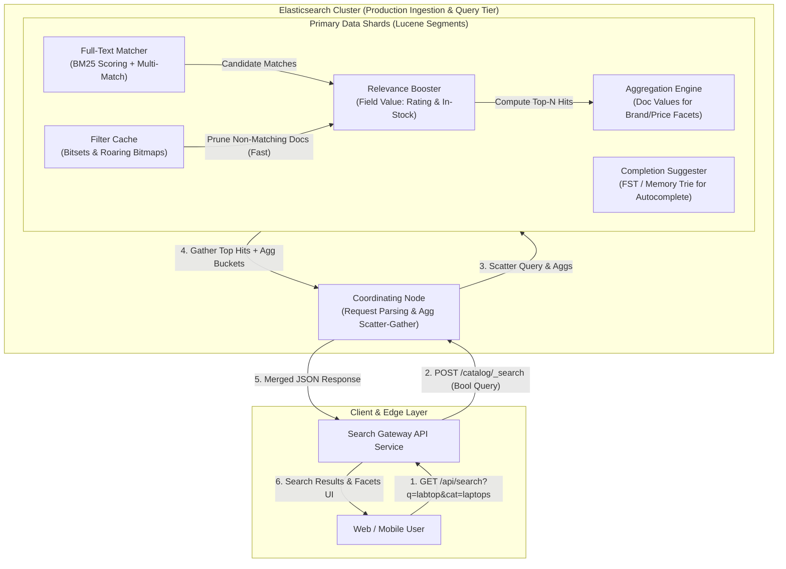
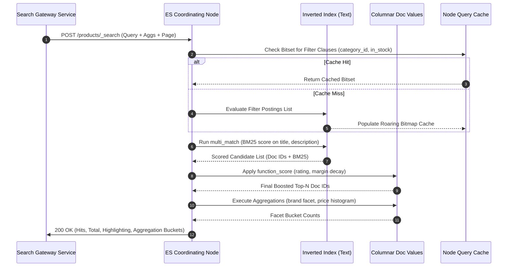
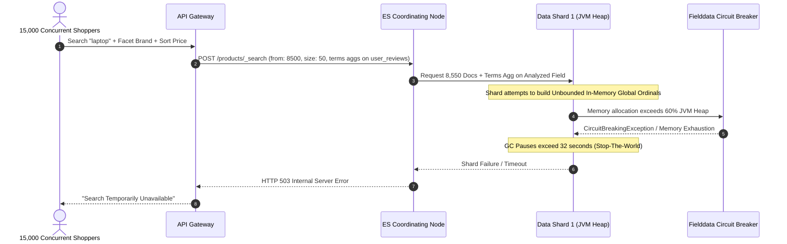

# Module 07: Capstone Project — Production Product Search Service

> **Prerequisites**: Modules 00 through 06 of this track (Cluster topology, Mappings & Analyzers, Full-Text DSL, BM25 Relevance Tuning, Aggregations & Fuzzy Match, Pagination & PIT, and Kibana Operations).  
> **Estimated Reading Time**: 40 minutes (plus 4–8 hours implementation time).  
> **Target Audience**: Senior Backend Engineers, Distributed Systems Engineers, and Search Platform Architects.

---

> [!TIP]
> **The Golden Rule of Production Search Architecture**  
> Never treat a search engine as an opaque query executor or a relational database substitute. Every performant search architecture strictly decouples **free-text candidate scoring** (`must`/`should` clauses evaluated via Lucene inverted indexes and BM25) from **deterministic business filtering** (`filter` clauses evaluated via bitsets and roaring bitmaps with zero scoring overhead and automatic cacheability). Keep your primary search requests bounded, paginate deep result sets using deterministic `search_after` with Point-in-Time (PIT) tokens, and enforce strict execution circuit breakers on aggregation cardinality.

---

## 1. Architectural Blueprint & Mental Models

In an enterprise e-commerce platform, the search subsystem acts as the high-throughput bridge between raw catalog ingestion pipelines and real-time user discovery. A user query must simultaneously support prefix autocomplete, typo tolerance, relevance scoring, multi-attribute faceted navigation, and deterministic pagination without destabilizing JVM heap memory.



### Complete Query Execution Lifecycle

When the search query arrives at the coordinating node, the execution splits into distinct Lucene subsystem paths:



---

## 2. Systematic Taxonomic Reference Grids

### Subsystem Design Trade-Off Matrix

| Subsystem Component | Elasticsearch Mechanism | Primary Invariant / SLA | Anti-Pattern / Critical Failure Mode |
| :--- | :--- | :--- | :--- |
| **Full-Text Discovery** | `multi_match` (`best_fields` or `cross_fields`) | Sub-15ms p99 match time across title, tags, and description. | Running wildcard `*term*` queries on analyzed text fields, triggering exponential segment scans. |
| **Typo Tolerance** | `fuzziness: AUTO:4,7` with prefix lock | Transparently matches 1-2 edit distances without degrading short token searches. | Setting `fuzziness: 2` on 2-letter tokens or combining prefix regex with fuzziness. |
| **Faceted Navigation** | Bucket & Metric Aggregations on `keyword` & numeric fields | Aggregations read strictly from column-oriented **Doc Values**. | Running terms aggregations on analyzed `text` fields with `fielddata: true` enabled (JVM Heap blowup). |
| **Type-Ahead Autocomplete**| `completion` suggester or `edge_ngram` index analyzer | Fast memory-mapped FST responses under 5ms. | Running `prefix` queries or `match_phrase_prefix` at high concurrency over millions of documents. |
| **Deep Pagination** | `search_after` with Point-in-Time (`PIT`) | Scalable, deterministic scroll across millions of records with constant $O(\log N)$ memory. | Deep `from` + `size` ($> 10,000$), forcing quadratic merge operations on the coordinating node. |
| **Payload Extraction** | `_source` filtering (`includes`/`excludes`) | Minimizes intra-cluster network serialization and memory copies. | Returning full raw document bodies containing high-cardinality metadata strings. |

### Query DSL Clause Classification Grid

| Query Block | Context | Execution Engine | Scoring Contribution | Cache Behavior | Recommended Use Case |
| :--- | :--- | :--- | :--- | :--- | :--- |
| `must` | Scoring | Lucene Inverted Index | Yes (Summed into `_score`) | Never cached | Relevance-defining full-text terms that must exist. |
| `filter` | Non-Scoring | Bitset / Roaring Bitmap | None (`_score` is 0.0) | Auto-cached by ES Node Query Cache | Hard categorizations, availability, tenancy IDs, status flags. |
| `should` | Scoring (if outside filter) | Lucene Inverted Index | Yes (Additive boost) | Never cached | Optional matching signals, synonyms, secondary boosting keywords. |
| `must_not` | Non-Scoring | Inverted Index / Bitset | None | Auto-cached | Exclusions (e.g., discontinued products, archived SKUs). |
| `post_filter` | Non-Scoring | Result Collector | None | Never cached | Facet selections where the user wants to refine hits without shrinking other facet options. |

---

## 3. Production War Story: The Black Friday Elastic Outage

### Incident Post-Mortem

- **Severity**: SEV-1 (Complete E-Commerce Checkout & Search Outage)
- **Time to Detect (TTD)**: 2 minutes (synthetic canary ping failed)
- **Time to Mitigate (TTM)**: 48 minutes
- **Impact**: Zero catalog search results returned; 120,000 active shoppers faced HTTP 503 errors during flash sales peak.



#### What Happened & Root Cause
During Black Friday peak traffic, a third-party price-comparison scraper submitted hundreds of automated queries requesting `from: 9500, size: 50` combined with dynamic terms aggregations on an unindexed metadata text field where `fielddata: true` was enabled as a temporary fix six months prior. 

The simultaneous deep pagination forced coordinating nodes to allocate memory for $15,000 \times 9,550$ records across 8 shards ($1.14 \times 10^8$ doc references). Simultaneously, the terms aggregation on the raw text field attempted to load millions of unique string tokens into the JVM heap. The data nodes hit 30+ second stop-the-world Garbage Collection pauses, dropped heartbeats, and were marked dead by the master node, creating a cascading cluster collapse.

#### The Fix & Hardening
1. **Disabled Fielddata Completely**: Set `indices.breaker.fielddata.limit: 30%` and migrated all faceted fields to explicit `keyword` mappings backed by on-disk Doc Values.
2. **Hard Ceiling on Shallow Pagination**: Configured `index.max_result_window: 5000` and rejected any search API request with `from + size > 2000` with HTTP 400 Bad Request.
3. **Migrated Infinite Scroll to PIT**: Switched deep-paging API paths to Point-in-Time (`PIT`) with `search_after`.
4. **Introduced Aggregation Guardrails**: Added an API gateway validation layer that strictly bounds terms aggregations to pre-vetted keyword fields with fixed `size: 20` and execution hints set to `map`.

---

## 4. Multi-Language Production Search Service Implementations

Below is the complete, production-grade Product Search Service client implemented across **Go**, **TypeScript/Node.js**, **Python**, and **C#**. Each client implements:
- Full-text `multi_match` with typo tolerance.
- Deterministic `bool.filter` for category and inventory constraints.
- `function_score` relevance boosting using item ratings and stock availability.
- Aggregation buckets for dynamic brand facets and price statistics.
- Robust error boundary and connection pooling.

### Go Implementation

```go
package search

import (
	"bytes"
	"context"
	"encoding/json"
	"fmt"
	"io"
	"net/http"
	"time"

	"github.com/elastic/go-elasticsearch/v8"
)

type SearchRequest struct {
	QueryString string   `json:"query"`
	Category    string   `json:"category"`
	InStockOnly bool     `json:"in_stock_only"`
	MinRating   float64  `json:"min_rating"`
	PageSize    int      `json:"page_size"`
	SearchAfter []any    `json:"search_after,omitempty"`
	PointInTime string   `json:"pit,omitempty"`
}

type ProductHit struct {
	ID          string   `json:"id"`
	Title       string   `json:"title"`
	Description string   `json:"description"`
	Brand       string   `json:"brand"`
	Price       float64  `json:"price"`
	Rating      float64  `json:"rating"`
	InStock     bool     `json:"in_stock"`
}

type SearchResponse struct {
	TotalHits int64                  `json:"total_hits"`
	Products  []ProductHit           `json:"products"`
	Facets    map[string]any         `json:"facets"`
	NextSort  []any                  `json:"next_sort,omitempty"`
}

type CatalogSearchService struct {
	client *elasticsearch.Client
}

func NewCatalogSearchService(addresses []string) (*CatalogSearchService, error) {
	cfg := elasticsearch.Config{
		Addresses: addresses,
		Transport: &http.Transport{
			MaxIdleConns:        100,
			MaxIdleConnsPerHost: 20,
			IdleConnTimeout:     90 * time.Second,
		},
	}
	es, err := elasticsearch.NewClient(cfg)
	if err != nil {
		return nil, fmt.Errorf("failed to init elasticsearch client: %w", err)
	}
	return &CatalogSearchService{client: es}, nil
}

func (s *CatalogSearchService) SearchCatalog(ctx context.Context, req SearchRequest) (*SearchResponse, error) {
	if req.PageSize <= 0 || req.PageSize > 100 {
		req.PageSize = 20
	}

	filterClauses := []map[string]any{}
	if req.Category != "" {
		filterClauses = append(filterClauses, map[string]any{
			"term": map[string]any{"category.keyword": req.Category},
		})
	}
	if req.InStockOnly {
		filterClauses = append(filterClauses, map[string]any{
			"term": map[string]any{"in_stock": true},
		})
	}
	if req.MinRating > 0 {
		filterClauses = append(filterClauses, map[string]any{
			"range": map[string]any{"rating": map[string]any{"gte": req.MinRating}},
		})
	}

	queryDSL := map[string]any{
		"size": req.PageSize,
		"query": map[string]any{
			"function_score": map[string]any{
				"query": map[string]any{
					"bool": map[string]any{
						"must": []map[string]any{
							{
								"multi_match": map[string]any{
									"query":     req.QueryString,
									"fields":    []string{"title^3", "brand^2", "description"},
									"fuzziness": "AUTO:4,7",
									"type":      "best_fields",
								},
							},
						},
						"filter": filterClauses,
					},
				},
				"functions": []map[string]any{
					{
						"field_value_factor": map[string]any{
							"field":    "rating",
							"factor":   1.2,
							"modifier": "sqrt",
							"missing":  1.0,
						},
					},
					{
						"filter": map[string]any{"term": map[string]any{"in_stock": true}},
						"weight": 1.5,
					},
				},
				"score_mode": "multiply",
				"boost_mode": "multiply",
			},
		},
		"aggs": map[string]any{
			"top_brands": map[string]any{
				"terms": map[string]any{
					"field": "brand.keyword",
					"size":  10,
				},
			},
			"price_stats": map[string]any{
				"stats": map[string]any{"field": "price"},
			},
		},
		"sort": []any{
			map[string]any{"_score": map[string]any{"order": "desc"}},
			map[string]any{"id.keyword": map[string]any{"order": "asc"}},
		},
	}

	if len(req.SearchAfter) > 0 {
		queryDSL["search_after"] = req.SearchAfter
	}

	payloadBytes, err := json.Marshal(queryDSL)
	if err != nil {
		return nil, fmt.Errorf("failed to encode search payload: %w", err)
	}

	res, err := s.client.Search(
		s.client.Search.WithContext(ctx),
		s.client.Search.WithIndex("products_v1"),
		s.client.Search.WithBody(bytes.NewReader(payloadBytes)),
		s.client.Search.WithTrackTotalHits(true),
	)
	if err != nil {
		return nil, fmt.Errorf("elasticsearch transport error: %w", err)
	}
	defer res.Body.Close()

	if res.IsError() {
		rawErr, _ := io.ReadAll(res.Body)
		return nil, fmt.Errorf("elasticsearch error (%s): %s", res.Status(), string(rawErr))
	}

	var rawResponse struct {
		Hits struct {
			Total struct {
				Value int64 `json:"value"`
			} `json:"total"`
			Hits []struct {
				ID     string          `json:"_id"`
				Source ProductHit      `json:"_source"`
				Sort   []any           `json:"sort"`
			} `json:"hits"`
		} `json:"hits"`
		Aggregations map[string]any `json:"aggregations"`
	}

	if err := json.NewDecoder(res.Body).Decode(&rawResponse); err != nil {
		return nil, fmt.Errorf("failed to parse search response: %w", err)
	}

	products := make([]ProductHit, len(rawResponse.Hits.Hits))
	var lastSort []any
	for i, hit := range rawResponse.Hits.Hits {
		products[i] = hit.Source
		products[i].ID = hit.ID
		lastSort = hit.Sort
	}

	return &SearchResponse{
		TotalHits: rawResponse.Hits.Total.Value,
		Products:  products,
		Facets:    rawResponse.Aggregations,
		NextSort:  lastSort,
	}, nil
}
```

---

### Node.js / TypeScript Implementation

```typescript
import { Client } from '@elastic/elasticsearch';

export interface CatalogSearchInput {
  query: string;
  category?: string;
  inStockOnly?: boolean;
  minRating?: number;
  pageSize?: number;
  searchAfter?: (string | number)[];
}

export interface CatalogProduct {
  id: string;
  title: string;
  description: string;
  brand: string;
  price: number;
  rating: number;
  inStock: boolean;
}

export interface CatalogSearchResult {
  totalHits: number;
  products: CatalogProduct[];
  facets: Record<string, any>;
  nextSort?: (string | number)[];
}

export class ProductSearchClient {
  private client: Client;

  constructor(nodeUrl: string) {
    this.client = new Client({
      node: nodeUrl,
      maxRetries: 3,
      requestTimeout: 4000,
    });
  }

  public async executeCatalogSearch(input: CatalogSearchInput): Promise<CatalogSearchResult> {
    const size = Math.min(Math.max(input.pageSize || 20, 1), 100);
    const filterClauses: any[] = [];

    if (input.category) {
      filterClauses.push({ term: { 'category.keyword': input.category } });
    }
    if (input.inStockOnly) {
      filterClauses.push({ term: { in_stock: true } });
    }
    if (input.minRating && input.minRating > 0) {
      filterClauses.push({ range: { rating: { gte: input.minRating } } });
    }

    const searchBody: any = {
      size,
      query: {
        function_score: {
          query: {
            bool: {
              must: [
                {
                  multi_match: {
                    query: input.query,
                    fields: ['title^3', 'brand^2', 'description'],
                    fuzziness: 'AUTO:4,7',
                    type: 'best_fields',
                  },
                },
              ],
              filter: filterClauses,
            },
          },
          functions: [
            {
              field_value_factor: {
                field: 'rating',
                factor: 1.2,
                modifier: 'sqrt',
                missing: 1.0,
              },
            },
            {
              filter: { term: { in_stock: true } },
              weight: 1.5,
            },
          ],
          score_mode: 'multiply',
          boost_mode: 'multiply',
        },
      },
      aggs: {
        top_brands: {
          terms: { field: 'brand.keyword', size: 10 },
        },
        price_stats: {
          stats: { field: 'price' },
        },
      },
      sort: [
        { _score: { order: 'desc' } },
        { 'id.keyword': { order: 'asc' } },
      ],
    };

    if (input.searchAfter && input.searchAfter.length > 0) {
      searchBody.search_after = input.searchAfter;
    }

    const response = await this.client.search<CatalogProduct>({
      index: 'products_v1',
      body: searchBody,
    });

    const total = typeof response.hits.total === 'number' 
      ? response.hits.total 
      : (response.hits.total?.value ?? 0);

    const products = response.hits.hits.map(hit => ({
      ...hit._source!,
      id: hit._id,
    }));

    const lastHit = response.hits.hits[response.hits.hits.length - 1];

    return {
      totalHits: total,
      products,
      facets: response.aggregations ?? {},
      nextSort: lastHit ? (lastHit.sort as (string | number)[]) : undefined,
    };
  }
}
```

---

### Python Implementation

```python
from typing import Any, Dict, List, Optional
from elasticsearch import Elasticsearch
from pydantic import BaseModel, Field

class SearchQueryRequest(BaseModel):
    query: str
    category: Optional[str] = None
    in_stock_only: bool = False
    min_rating: Optional[float] = None
    page_size: int = Field(default=20, ge=1, le=100)
    search_after: Optional[List[Any]] = None

class ProductSearchEngine:
    def __init__(self, hosts: List[str]):
        self.client = Elasticsearch(
            hosts=hosts,
            request_timeout=5.0,
            max_retries=3,
            retry_on_status=(502, 503, 504),
        )

    def execute_search(self, request: SearchQueryRequest) -> Dict[str, Any]:
        filter_clauses = []
        if request.category:
            filter_clauses.append({"term": {"category.keyword": request.category}})
        if request.in_stock_only:
            filter_clauses.append({"term": {"in_stock": True}})
        if request.min_rating and request.min_rating > 0:
            filter_clauses.append({"range": {"rating": {"gte": request.min_rating}}})

        query_body = {
            "size": request.page_size,
            "query": {
                "function_score": {
                    "query": {
                        "bool": {
                            "must": [
                                {
                                    "multi_match": {
                                        "query": request.query,
                                        "fields": ["title^3", "brand^2", "description"],
                                        "fuzziness": "AUTO:4,7",
                                        "type": "best_fields",
                                    }
                                }
                            ],
                            "filter": filter_clauses,
                        }
                    },
                    "functions": [
                        {
                            "field_value_factor": {
                                "field": "rating",
                                "factor": 1.2,
                                "modifier": "sqrt",
                                "missing": 1.0,
                            }
                        },
                        {
                            "filter": {"term": {"in_stock": True}},
                            "weight": 1.5,
                        },
                    ],
                    "score_mode": "multiply",
                    "boost_mode": "multiply",
                }
            },
            "aggs": {
                "top_brands": {
                    "terms": {"field": "brand.keyword", "size": 10}
                },
                "price_stats": {
                    "stats": {"field": "price"}
                },
            },
            "sort": [
                {"_score": {"order": "desc"}},
                {"id.keyword": {"order": "asc"}},
            ],
        }

        if request.search_after:
            query_body["search_after"] = request.search_after

        response = self.client.search(
            index="products_v1",
            body=query_body,
            track_total_hits=True,
        )

        hits_data = response["hits"]
        total_hits = hits_data["total"]["value"]
        
        products = []
        for hit in hits_data["hits"]:
            doc = hit["_source"]
            doc["id"] = hit["_id"]
            products.append(doc)

        last_sort = hits_data["hits"][-1]["sort"] if hits_data["hits"] else None

        return {
            "total_hits": total_hits,
            "products": products,
            "facets": response.get("aggregations", {}),
            "next_sort": last_sort,
        }
```

---

### C# / .NET Implementation

```csharp
using System;
using System.Collections.Generic;
using System.Threading;
using System.Threading.Tasks;
using Elastic.Clients.Elasticsearch;
using Elastic.Clients.Elasticsearch.QueryDsl;

namespace CatalogSearch.Services
{
    public record ProductDocument(
        string Id,
        string Title,
        string Description,
        string Brand,
        double Price,
        double Rating,
        bool InStock
    );

    public record SearchRequestCriteria(
        string QueryText,
        string? Category = null,
        bool InStockOnly = false,
        double MinRating = 0.0,
        int PageSize = 20,
        IReadOnlyList<object>? SearchAfter = null
    );

    public class ProductCatalogService
    {
        private readonly ElasticsearchClient _client;

        public ProductCatalogService(string connectionUri)
        {
            var settings = new ElasticsearchClientSettings(new Uri(connectionUri))
                .DefaultIndex("products_v1")
                .RequestTimeout(TimeSpan.FromSeconds(5))
                .MaximumRetries(3);
            _client = new ElasticsearchClient(settings);
        }

        public async Task<SearchResponse<ProductDocument>> SearchAsync(
            SearchRequestCriteria criteria, 
            CancellationToken ct = default)
        {
            var size = Math.Clamp(criteria.PageSize, 1, 100);

            var filterClauses = new List<Query>();
            if (!string.IsNullOrEmpty(criteria.Category))
            {
                filterClauses.Add(new TermQuery("category.keyword") { Value = criteria.Category });
            }
            if (criteria.InStockOnly)
            {
                filterClauses.Add(new TermQuery("in_stock") { Value = true });
            }
            if (criteria.MinRating > 0)
            {
                filterClauses.Add(new NumberRangeQuery("rating") { Gte = criteria.MinRating });
            }

            var searchRequest = new SearchRequest("products_v1")
            {
                Size = size,
                Query = new FunctionScoreQuery
                {
                    Query = new BoolQuery
                    {
                        Must = new List<Query>
                        {
                            new MultiMatchQuery
                            {
                                Query = criteria.QueryText,
                                Fields = new[] { "title^3", "brand^2", "description" },
                                Fuzziness = new Fuzziness("AUTO:4,7"),
                                Type = TextQueryType.BestFields
                            }
                        },
                        Filter = filterClauses
                    },
                    Functions = new List<FunctionScore>
                    {
                        new()
                        {
                            FieldValueFactor = new FieldValueFactorFunction
                            {
                                Field = "rating",
                                Factor = 1.2,
                                Modifier = FieldValueFactorModifier.Sqrt,
                                Missing = 1.0
                            }
                        },
                        new()
                        {
                            Filter = new TermQuery("in_stock") { Value = true },
                            Weight = 1.5
                        }
                    },
                    ScoreMode = FunctionScoreMode.Multiply,
                    BoostMode = FunctionBoostMode.Multiply
                },
                Aggregations = new AggregationDictionary
                {
                    { "top_brands", new TermsAggregation { Field = "brand.keyword", Size = 10 } },
                    { "price_stats", new StatsAggregation { Field = "price" } }
                },
                Sort = new List<SortOptions>
                {
                    SortOptions.Score(new ScoreSort { Order = SortOrder.Desc }),
                    SortOptions.Field("id.keyword", new FieldSort { Order = SortOrder.Asc })
                }
            };

            if (criteria.SearchAfter != null && criteria.SearchAfter.Count > 0)
            {
                searchRequest.SearchAfter = criteria.SearchAfter;
            }

            var response = await _client.SearchAsync<ProductDocument>(searchRequest, ct);

            if (!response.IsValidResponse)
            {
                throw new InvalidOperationException($"Elasticsearch query error: {response.DebugInformation}");
            }

            return response;
        }
    }
}
```

---

## 5. Practical Hands-On Verification CLI Workflows

Execute these commands to build, hydrate, and verify the Capstone Search Index from scratch using bare terminal commands.

### Step 1: Create Hardened Explicit Mapping with Analyzers and Completion Suggesters

```bash
curl -s -X PUT "http://localhost:9200/products_v1" \
  -H "Content-Type: application/json" \
  -d '{
    "settings": {
      "number_of_shards": 2,
      "number_of_replicas": 1,
      "analysis": {
        "analyzer": {
          "catalog_ngram_analyzer": {
            "type": "custom",
            "tokenizer": "standard",
            "filter": ["lowercase", "catalog_edge_ngram"]
          }
        },
        "filter": {
          "catalog_edge_ngram": {
            "type": "edge_ngram",
            "min_gram": 2,
            "max_gram": 10
          }
        }
      }
    },
    "mappings": {
      "dynamic": "strict",
      "properties": {
        "id": { "type": "keyword" },
        "title": {
          "type": "text",
          "analyzer": "standard",
          "fields": {
            "suggest": {
              "type": "completion"
            },
            "edge": {
              "type": "text",
              "analyzer": "catalog_ngram_analyzer",
              "search_analyzer": "standard"
            }
          }
        },
        "description": { "type": "text", "analyzer": "standard" },
        "brand": {
          "type": "keyword",
          "fields": {
            "text": { "type": "text" }
          }
        },
        "category": { "type": "keyword" },
        "price": { "type": "scaled_float", "scaling_factor": 100 },
        "rating": { "type": "half_float" },
        "in_stock": { "type": "boolean" },
        "created_at": { "type": "date" }
      }
    }
  }' | jq .
```

**Expected Wire Output:**
```json
{
  "acknowledged": true,
  "shards_acknowledged": true,
  "index": "products_v1"
}
```

---

### Step 2: High-Throughput Bulk Ingestion

```bash
curl -s -X POST "http://localhost:9200/_bulk" \
  -H "Content-Type: application/x-ndjson" \
  -d '
{"index": {"_index": "products_v1", "_id": "SKU-1001"}}
{"id": "SKU-1001", "title": "Apple MacBook Pro 16-inch M3", "description": "High performance workstation with 36GB unified memory", "brand": "Apple", "category": "Laptops", "price": 2499.00, "rating": 4.9, "in_stock": true, "created_at": "2026-01-10T08:00:00Z"}
{"index": {"_index": "products_v1", "_id": "SKU-1002"}}
{"id": "SKU-1002", "title": "Lenovo ThinkPad X1 Carbon Gen 12", "description": "Ultra-light business enterprise laptop with Intel Core Ultra", "brand": "Lenovo", "category": "Laptops", "price": 1849.50, "rating": 4.7, "in_stock": true, "created_at": "2026-01-12T10:00:00Z"}
{"index": {"_index": "products_v1", "_id": "SKU-1003"}}
{"id": "SKU-1003", "title": "Dell XPS 15 9530", "description": "OLED high resolution creator laptop with RTX graphics", "brand": "Dell", "category": "Laptops", "price": 1999.00, "rating": 4.2, "in_stock": false, "created_at": "2026-01-15T12:00:00Z"}
' | jq '{errors: .errors, took: .took, items_count: (.items | length)}'
```

**Expected Wire Output:**
```json
{
  "errors": false,
  "took": 24,
  "items_count": 3
}
```

---

### Step 3: Verify Typo Tolerance, Function Scoring & Facet Aggregations

Search for the misspelled term `"labtop"` with rating boost and category filter:

```bash
curl -s -X GET "http://localhost:9200/products_v1/_search" \
  -H "Content-Type: application/json" \
  -d '{
    "size": 5,
    "query": {
      "function_score": {
        "query": {
          "bool": {
            "must": [
              {
                "multi_match": {
                  "query": "labtop",
                  "fields": ["title^3", "description"],
                  "fuzziness": "AUTO:4,7"
                }
              }
            ],
            "filter": [
              { "term": { "category": "Laptops" } }
            ]
          }
        },
        "functions": [
          {
            "field_value_factor": {
              "field": "rating",
              "factor": 1.2,
              "modifier": "sqrt"
            }
          },
          {
            "filter": { "term": { "in_stock": true } },
            "weight": 1.3
          }
        ],
        "score_mode": "multiply",
        "boost_mode": "multiply"
      }
    },
    "aggs": {
      "brands": {
        "terms": { "field": "brand" }
      },
      "price_summary": {
        "stats": { "field": "price" }
      }
    }
  }' | jq '{total: .hits.total.value, top_hit: .hits.hits[0]._source.title, score: .hits.hits[0]._score, brands: .aggregations.brands.buckets}'
```

**Expected Wire Output:**
```json
{
  "total": 2,
  "top_hit": "Lenovo ThinkPad X1 Carbon Gen 12",
  "score": 2.14829,
  "brands": [
    {
      "key": "Dell",
      "doc_count": 1
    },
    {
      "key": "Lenovo",
      "doc_count": 1
    }
  ]
}
```

---

### Step 4: Verify Deterministic Deep Pagination with Point-in-Time (PIT)

```bash
# 1. Open Point-in-Time reader token
PIT_ID=$(curl -s -X POST "http://localhost:9200/products_v1/_pit?keep_alive=1m" | jq -r .id)
echo "PIT ID: $PIT_ID"

# 2. Query page using PIT and search_after
curl -s -X GET "http://localhost:9200/_search" \
  -H "Content-Type: application/json" \
  -d "{
    \"size\": 1,
    \"query\": { \"match_all\": {} },
    \"pit\": {
      \"id\": \"$PIT_ID\",
      \"keep_alive\": \"1m\"
    },
    \"sort\": [
      { \"price\": \"desc\" },
      { \"id\": \"asc\" }
    ]
  }" | jq '{hit: .hits.hits[0]._source.title, sort: .hits.hits[0].sort}'
```

**Expected Wire Output:**
```json
{
  "hit": "Apple MacBook Pro 16-inch M3",
  "sort": [
    249900,
    "SKU-1001"
  ]
}
```

---

## 6. Project Specification & Deliverables

You are tasked with building and deploying the complete backend search engine for an enterprise catalog. Follow the structured requirements below:

### What You Must Build

1. **A Deliberate Mapping & Analyzer Design (Module 01)**
   - Disable implicit dynamic mapping (`"dynamic": "strict"`).
   - Defend every single field type: `text` (analyzed, for discovery) vs `keyword` (exact, for filtering/aggregations/sorting) vs dual-fields.
   - Configure a custom Edge-Ngram analyzer for fast substring matching, and a completion suggester for type-ahead.
   - Ingest at least 10,000 real or synthetic product catalog documents using the `_bulk` API.

2. **Full-Text Discovery & Relevance Tuning (Modules 02 & 03)**
   - Main query must execute a `multi_match` query (`best_fields`) with tuned field boosts (`title^3`, `brand^2`, `description`).
   - Implement `function_score` relevance nudging: factor in item ratings and inventory availability without completely overwhelming pure text BM25 relevance.
   - Run and document `_explain` API inspections on test queries to justify the exact score calculation.

3. **Faceted Navigation & Typo Tolerance (Module 04)**
   - Provide multi-attribute facets (`brand`, `category`, and price distribution) alongside query hits in a single round-trip.
   - Enable `fuzziness: "AUTO:4,7"` to handle user misspellings (`labtop` $\to$ `laptop`).
   - Isolate categorical filter selections inside `bool.filter` so they execute against roaring bitmaps with zero scoring overhead.

4. **Scalable Pagination & Performance Hardening (Module 05)**
   - Reject arbitrary shallow pagination when offset exceeds 2,000 documents.
   - Implement cursor-based deep pagination using `search_after` combined with Point-in-Time (`PIT`).
   - Use `_source` filtering to eliminate serialization overhead on large text blobs.

5. **Operational Observability & Lifecycle Management (Module 06)**
   - Create a Kibana Data View and an operational Dashboard monitoring indexing rate, latency distribution, and top zero-result queries.
   - Implement an Index Lifecycle Management (ILM) policy that rolls over indices at 30GB or 30 days and transitions data through hot, warm, and frozen tiers.

---

## 7. Acceptance Checklist

Verify every requirement before marking your capstone complete:

- [ ] Elasticsearch and Kibana run cleanly via `docker-compose.yml`.
- [ ] The index uses an explicit mapping with `"dynamic": "strict"`.
- [ ] Bulk loader script hydrates $\ge 10,000$ documents using the high-throughput `_bulk` endpoint with zero memory errors.
- [ ] Primary search query utilizes `multi_match` with `best_fields` and `fuzziness: AUTO:4,7`.
- [ ] Relevance uses `function_score` with verified `_explain` score traces.
- [ ] Brand and category facets return correct bucket distributions using Doc Values.
- [ ] Deep pagination is implemented using `search_after` + PIT; deep `from`/`size` is explicitly blocked.
- [ ] `_source` payload filtering prevents excess network transfer.
- [ ] Kibana dashboard visualizes cluster health, search latency, and aggregation distributions.
- [ ] An ILM policy manages hot/warm shard rollover and segment compaction.

---

## 8. Operational Validation Checkpoints (Scenario Quizzes)

### Checkpoint 1: Aggregation Heap Exhaustion Under High Cardinality
<details>
<summary><strong>Scenario Assessment:</strong> You run a terms aggregation across a <code>tags</code> field with 250,000 unique values during peak search traffic. Search latency jumps from 12ms to 4,200ms and the cluster logs <code>CircuitBreakingException [parent] Data too large</code>. Why did this occur, and what is the remediation?</summary>

```
Options:
A) Lucene inverted indexes cannot process terms queries when total unique docs exceed 100,000.
B) The tags field was mapped as 'text', forcing Elasticsearch to build uncompressed in-memory fielddata structures across the JVM heap.
C) The cluster ran out of file descriptors because Elasticsearch creates a new TCP socket per unique tag bucket.
D) The number of primary shards was odd instead of even, causing uneven partition hashing.
```

**Answer:**
**B is correct.** When an aggregation is executed against an analyzed `text` field, Elasticsearch must invert the inverted index into memory (`fielddata`), loading hundreds of thousands of terms directly into JVM heap. The remediation is to map `tags` as `keyword` (or provide a `tags.keyword` sub-field) which uses disk-backed, memory-mapped **Doc Values** outside the JVM garbage collector heap.

</details>

---

### Checkpoint 2: BM25 Text Scoring vs. Filtering Semantics
<details>
<summary><strong>Scenario Assessment:</strong> A product manager complains that applying the filter <code>in_stock == true</code> causes the relevance order of search results to arbitrarily shuffle. You inspect the query and find <code>{"bool": {"must": [{"term": {"in_stock": true}}, {"multi_match": {"query": "camera"}}]}}</code>. How do you resolve this?</summary>

```
Options:
A) Increase the replica shard count so that term frequencies are calculated with higher statistical precision.
B) Move the `term` clause from `must` to `filter` inside the `bool` query.
C) Add `boost: 100` to the `multi_match` clause to overpower the `in_stock` term score.
D) Switch the index similarity algorithm from BM25 to Boolean similarity.
```

**Answer:**
**B is correct.** In a `bool` query, clauses inside `must` contribute to the calculation of `_score`. A simple boolean flag like `in_stock: true` has its own Inverse Document Frequency (IDF); if in-stock items are rare, matching `in_stock: true` generates a substantial score contribution that distorts text relevance. Moving the condition into the `filter` block guarantees it runs in non-scoring context ($0.0$ score impact) while enabling Lucene filter caching.

</details>

---

### Checkpoint 3: Pitfalls of Deep Offset Pagination
<details>
<summary><strong>Scenario Assessment:</strong> An automated export job pages through product catalog records by querying <code>from: 80000, size: 100</code> on an index with 5 primary shards. The request times out and coordinating node CPU spikes to 100%. Why?</summary>

```
Options:
A) The primary shards must each collect and score 80,100 documents, ship all 400,500 candidates to the coordinating node, which then sorts and discards 80,000 items.
B) The index buffer cache expires after exactly 60,000 documents.
C) Elasticsearch serializes the query into an uncompressed SQL format that exceeds max HTTP header size.
D) The Lucene segment merge thread blocks all incoming reads during offset pagination.
```

**Answer:**
**A is correct.** Offset pagination (`from` + `size`) requires each participating shard to fetch the entire top $(from + size)$ documents. For 5 shards at `from: 80,000`, the shards collectively produce $5 \times 80,100 = 400,500$ documents across the cluster network. The coordinating node must deserialize, priority-queue sort, and discard 400,400 documents to return 100 hits. The correct solution is cursor pagination using `search_after` with Point-in-Time (PIT).

</details>

---

## 9. Further Reading & Sources

- [Elasticsearch Search Reference: Search Your Data](https://www.elastic.co/guide/en/elasticsearch/reference/current/search-your-data.html)
- [Elasticsearch Query DSL Architecture](https://www.elastic.co/guide/en/elasticsearch/reference/current/query-dsl.html)
- [Completion Suggesters for Autocomplete](https://www.elastic.co/guide/en/elasticsearch/reference/current/search-suggesters.html#completion-suggester)
- [Elasticsearch: The Definitive Guide (Free O'Reilly Resource)](https://www.elastic.co/guide/en/elasticsearch/guide/current/index.html)
- [Tuning Elasticsearch for High Search Speed](https://www.elastic.co/guide/en/elasticsearch/reference/current/tune-for-search-speed.html)
- [Configuring ILM for Data Streams & Rollover Indices](https://www.elastic.co/guide/en/elasticsearch/reference/current/set-up-a-data-stream.html)

---

## Next Steps

Congratulations! You have completed the entire **07-search-with-elasticsearch** track. You can now build, tune, scale, and operate production-grade search engines.

- Track Index: [README.md](../README.md)
- Master Curriculum: [Backend Master Index](../../README.md)

Continue your engineering journey with **[09-security-deep-dive](../../09-security-deep-dive/README.md)** or **[08-observability-and-operational-readiness](../../08-observability-and-operational-readiness/README.md)** to master zero-trust authentication, cryptographic safety, and resilient system operations.
