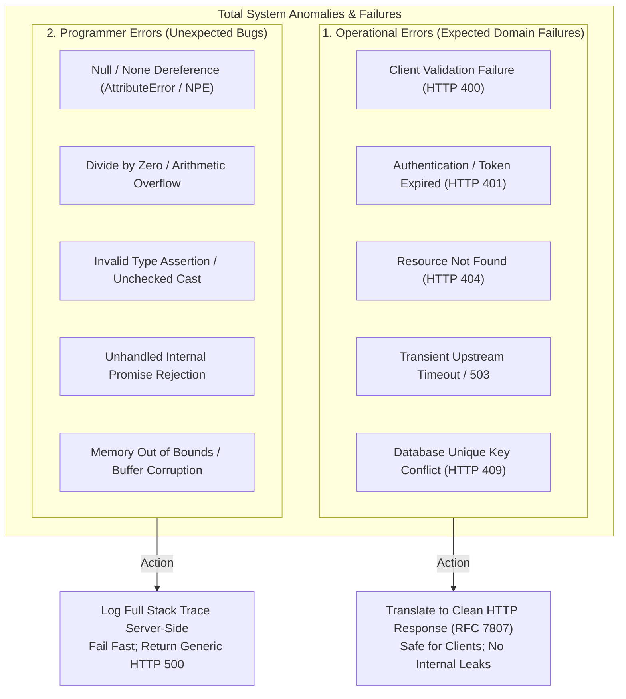
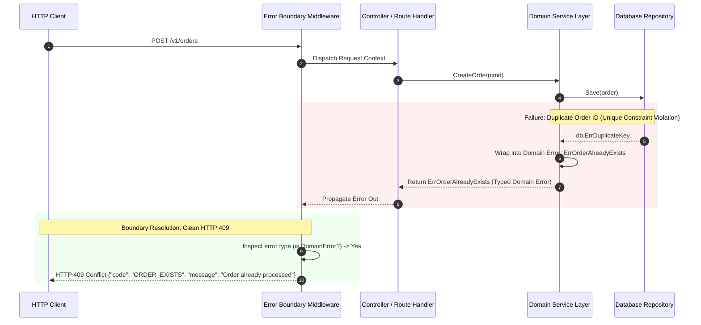
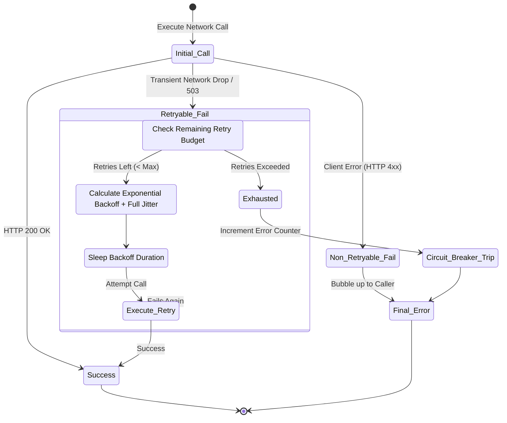
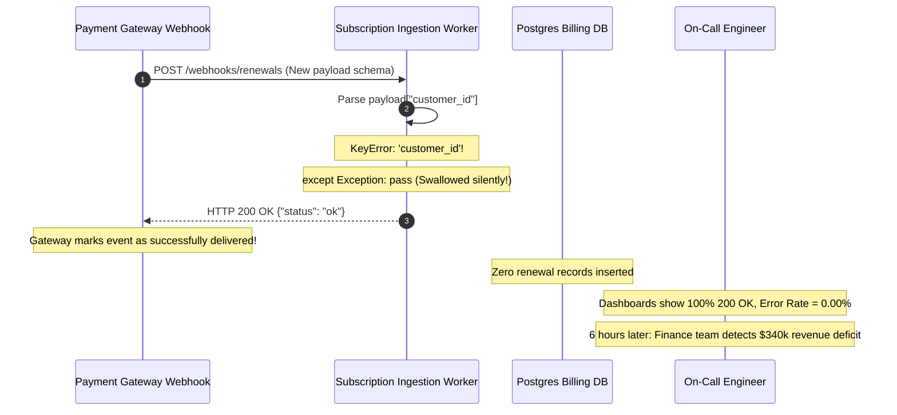

# Module 00: Error Handling Strategies

> **Prerequisites:** [Module 01: Request & Response Fundamentals](../../01-request-response-fundamentals/README.md), [Module 02: API Layer & Request Handling](../../02-api-layer-and-request-handling/README.md).
> **Estimated Reading Time:** 30 minutes
> **Target Audience:** Backend Engineers, Site Reliability Engineers, Distributed Systems Architects.

---

> [!TIP]
> **Golden Rule of Backend Error Handling**: Distinguish sharply between **expected operational domain failures** (invalid inputs, resource conflicts, upstream timeouts) and **unexpected programmer bugs or system panics** (null pointer dereferences, divide-by-zero, unhandled exceptions). Translate operational errors into typed, safe, actionable responses at the API boundary, while letting unexpected bugs crash loudly or bubble up to a centralized error boundary with full diagnostic stack traces logged server-side—never swallow exceptions silently with empty `catch` or `except: pass` blocks.

---

## 1. Visual Mental Models & System Architecture

Every production backend is primarily an engine designed to handle things going wrong: database connections drop mid-query, downstream microservices return HTTP 503, user payloads violate schema constraints, and concurrent transactions deadlock. The happy path—the code that runs when everything works—is only a fraction of your codebase.

The difference between a fragile hobby script and an enterprise-grade backend lies in how it behaves when the happy path fails.

### The Operational vs. Programmer Error Hierarchy



### Exception Propagation Through Layered Architecture



### State Machine of Transient Error Handling (Retries & Circuit Breaking)



---

## 2. Taxonomic Reference Grids & Systematic Comparison Grids

### Operational Errors vs. Programmer Errors

| Dimension | Operational Errors (Domain) | Programmer Errors (Bugs) |
| :--- | :--- | :--- |
| **Nature** | Expected failure states inherent to interacting with the real world (bad input, network drops, rate limits). | Mistakes in code logic, broken invariants, violated type contracts, or logic oversights. |
| **Examples** | `UserNotFound`, `InsufficientFunds`, `ConnectionTimeout`, `InvalidPayload`. | `TypeError: undefined is not a function`, `IndexError`, `nil pointer dereference`. |
| **Handling Strategy** | Catch explicitly at domain boundary, translate into meaningful business outcomes or HTTP error codes. | Fail fast, log full context and stack trace server-side, surface a generic HTTP 500 to the client. |
| **Client Visibility** | Actionable message returned to client (e.g., "Email already registered"). | Opaque generic error returned (e.g., "Internal Server Error, Ref: `req_88a91`"). Never leak tracebacks! |
| **Logging Severity** | `WARN` or `INFO` (normal operational friction). | `ERROR` or `CRITICAL` (indicates code or platform malfunction requiring human review). |
| **Alerting Policy** | Alert only if aggregate rate anomalies occur (e.g., 401 rate spikes 500%). | Alert immediately on recurring spikes or unhandled panic rates. |

### Error Propagation Models Across Languages

| Paradigm | Exemplar Languages | Mechanism | Strengths | Failure Modes & Pitfalls |
| :--- | :--- | :--- | :--- | :--- |
| **Explicit Return Values** | Go, C, POSIX | `val, err := fn()` | Forces caller to immediately evaluate error before continuing; zero hidden control-flow jumps. | Verbose boilerplate (`if err != nil`); temptation to ignore `_ = fn()`. |
| **Monadic `Result<T, E>`** | Rust, Haskell, Scala | `Result<T, E>` with `match` or `?` | Enforces exhaustive pattern matching at compile time; impossible to access value without checking error. | Steeper learning curve; requires monadic composition patterns. |
| **Exceptions & Stack Unwinding** | Python, TypeScript, Java, C# | `throw / raise` and `try / catch / except` | Decouples error detection from handling; bubbles cleanly up to top-level middleware. | Invisible control flow; easy to accidentally swallow errors with bare `catch (e) {}`. |

### Exponential Backoff & Full Jitter Formula Reference

When retrying transient operational failures against downstream APIs, naive immediate retries trigger **thundering herd** problems that collapse recovering servers. Use exponential backoff with **Full Jitter**:

$$\text{Sleep Time} = \text{random\_between}\left(0, \min\left(\text{MaxBackoff}, \text{InitialDelay} \times 2^{\text{attempt}}\right)\right)$$

| Parameter | Recommended Value | Operational Purpose |
| :--- | :--- | :--- |
| **Initial Delay** | $100\text{ ms} - 250\text{ ms}$ | Immediate brief pause allowing micro-blips to resolve. |
| **Backoff Multiplier** | $2.0$ | Exponential growth preventing repeated concurrent hammer strikes. |
| **Max Backoff Cap** | $5{,}000\text{ ms} - 10{,}000\text{ ms}$ | Caps latency penalty so requests don't hang indefinitely. |
| **Full Jitter** | Uniform Random $[0, \text{Sleep}]$ | Disperses retry waves across time, preventing synchronized resonance spikes. |

---

## 3. Production War Stories: Incident Post-Mortem

### The Incident: The Silent Payment Processor Stoppage from Swallowed KeyError

- **Severity:** SEV-1 (Critical Revenue Interruption)
- **Time to Detection:** 6 hours 12 minutes
- **Time to Mitigation:** 20 minutes
- **Impact:** \$340,000 in recurring customer subscription renewals failed to process. Upstream webhook queues backed up with 180,000 stalled events; monitoring reported zero errors because HTTP 200 was returned for all dropped events.

#### What Happened
A subscription billing service received asynchronous webhook events from a third-party payment gateway (Stripe/Adyen). To ensure high availability and prevent one malformed event from crashing the webhook listener process, an engineer wrapped the event processor in a broad `try/except` block:

```python
# The Defective Code in Webhook Worker
try:
    process_subscription_event(payload)
except Exception:
    # "Temporary safeguard to ensure worker keeps processing other events"
    pass
return {"status": "ok"}, 200
```

The payment gateway executed a scheduled API update that renamed the payload metadata property from `"customer_id"` to `"customer_reference"`. When the webhook service ran, `process_subscription_event` raised a standard `KeyError: 'customer_id'`. 

Because of the broad `except Exception: pass`, the exception was caught, swallowed without logging, and the service returned HTTP 200 OK. The payment gateway assumed the event was processed successfully and did not retry. For six hours, hundreds of customer renewal events vanished without a trace.



#### Root Cause
1. **Silent Exception Swallowing:** Using a broad exception handler (`except Exception: pass`) with no logging eliminated all visibility into production failures, violating the fundamental principle of failing loudly and legibly.
2. **False Success Acknowledgement:** Acknowledging HTTP 200 OK on unhandled processing failures caused upstream systems to purge events that should have been routed to a Dead-Letter Queue (DLQ).

#### The Fix & Architectural Hardening
1. **Removed Broad Exception Swallowing:** Refactored handlers to catch only expected, typed domain errors (`ValidationError`, `ExpiredWebhookTokenError`).
2. **Dead-Letter Queue (DLQ) Routing:** Any unexpected exception causes the unhandled payload to be written transactionally to an isolated Dead-Letter Queue with full stack traces:
   ```python
   except Exception as err:
       logger.exception("Unexpected error processing webhook %s", event_id)
       dlq.publish(event_id, payload, error=str(err))
       return {"status": "accepted_for_dlq"}, 500
   ```
3. **Business Metric Alerting:** Added an alert monitoring **payment event volume**: if processed billing volume falls below 80% of historical moving averages during business hours, a SEV-1 alert fires immediately regardless of HTTP status codes.

---

## 4. Multi-Language Production Implementations

The following code tabs demonstrate enterprise-grade error handling: typed domain errors, causal exception wrapping (`raise ... from` / `%w`), and safe boundary handling across Go, TypeScript, and Python.

### Go Production Implementation (Explicit Typed Error Hierarchy)

```go
package main

import (
	"errors"
	"fmt"
	"net/http"
)

// Standard sentinel domain errors
var (
	ErrNotFound       = errors.New("requested resource not found")
	ErrConflict       = errors.New("resource conflict detected")
	ErrInvalidPayload = errors.New("validation failed on input payload")
)

// AppError wraps domain errors with client-facing codes and HTTP status mapping.
type AppError struct {
	Err        error  // Underlying technical root cause (internal)
	Message    string // Safe, human-readable client message
	Code       string // Machine-readable error code
	StatusCode int    // HTTP Status Code
}

func (e *AppError) Error() string {
	if e.Err != nil {
		return fmt.Sprintf("[%s] %s: %v", e.Code, e.Message, e.Err)
	}
	return fmt.Sprintf("[%s] %s", e.Code, e.Message)
}

// Unwrap enables standard errors.Is and errors.As traversal.
func (e *AppError) Unwrap() error {
	return e.Err
}

// Service Layer function demonstrating error wrapping with %w
func FindUserAccount(userID string) (*User, error) {
	if userID == "" {
		return nil, &AppError{
			Err:        ErrInvalidPayload,
			Message:    "User ID must be provided",
			Code:       "INVALID_USER_ID",
			StatusCode: http.StatusBadRequest,
		}
	}

	user, err := queryDatabase(userID)
	if err != nil {
		if errors.Is(err, ErrNotFound) {
			return nil, &AppError{
				Err:        err,
				Message:    fmt.Sprintf("User %s does not exist", userID),
				Code:       "USER_NOT_FOUND",
				StatusCode: http.StatusNotFound,
			}
		}
		// Wrap unexpected database infrastructure failures
		return nil, fmt.Errorf("database query failure for user %s: %w", userID, err)
	}

	return user, nil
}

type User struct{ ID string }

func queryDatabase(id string) (*User, error) {
	// Simulating resource not found
	return nil, ErrNotFound
}
```

### TypeScript / Node.js Production Implementation

```typescript
export abstract class DomainError extends Error {
  public abstract readonly statusCode: number;
  public abstract readonly errorCode: string;
  public readonly isOperational: boolean = true;

  constructor(message: string, public readonly cause?: Error) {
    super(message);
    Object.setPrototypeOf(this, new.target.prototype);
    Error.captureStackTrace(this, this.constructor);
  }
}

export class NotFoundError extends DomainError {
  public readonly statusCode = 404;
  public readonly errorCode = 'RESOURCE_NOT_FOUND';

  constructor(resource: string, id: string, cause?: Error) {
    super(`${resource} with identifier '${id}' was not found`, cause);
  }
}

export class ValidationError extends DomainError {
  public readonly statusCode = 400;
  public readonly errorCode = 'INVALID_PAYLOAD';

  constructor(public readonly details: Record<string, string>, cause?: Error) {
    super('Input payload validation failed', cause);
  }
}

// Production Controller demonstrating safe error boundary translation
export function handleRequestError(err: unknown): { status: number; body: Record<string, any> } {
  if (err instanceof DomainError) {
    // Expected operational error: return structured, safe client response
    return {
      status: err.statusCode,
      body: {
        error: {
          code: err.errorCode,
          message: err.message,
          ...(err instanceof ValidationError ? { details: err.details } : {}),
        },
      },
    };
  }

  // Unexpected programmer error / bug: log loudly and mask from client
  const traceId = `err_${Date.now()}`;
  console.error(`[CRITICAL] Unhandled programmer error [Trace: ${traceId}]:`, err);

  return {
    status: 500,
    body: {
      error: {
        code: 'INTERNAL_SERVER_ERROR',
        message: 'An unexpected error occurred. Please contact support.',
        reference: traceId,
      },
    },
  };
}
```

### Python Production Implementation

```python
"""
Enterprise Python Exception Hierarchy and Causal Chaining.
Demonstrates custom domain errors, 'raise ... from' chaining,
and safe boundary translation.
"""

from __future__ import annotations

import logging
import uuid
from typing import Any, Dict, Optional

logger = logging.getLogger(__name__)


class DomainError(Exception):
    """Base class for all expected operational business domain errors."""
    status_code: int = 500
    error_code: str = "INTERNAL_ERROR"

    def __init__(self, message: str, details: Optional[Dict[str, Any]] = None):
        super().__init__(message)
        self.message = message
        self.details = details or {}


class ResourceNotFoundError(DomainError):
    status_code = 404
    error_code = "RESOURCE_NOT_FOUND"

    def __init__(self, entity: str, entity_id: str):
        super().__init__(f"{entity} with ID '{entity_id}' does not exist.")
        self.details = {"entity": entity, "entity_id": entity_id}


class ConflictError(DomainError):
    status_code = 409
    error_code = "RESOURCE_CONFLICT"


def fetch_account_profile(account_id: str) -> Dict[str, Any]:
    try:
        # Simulate an infrastructure query that raises an internal driver exception
        raise KeyError(f"Database row key missing for {account_id}")
    except KeyError as exc:
        # Causal chaining: 'raise ... from exc' explicitly preserves the diagnostic trail!
        raise ResourceNotFoundError("Account", account_id) from exc


def api_error_boundary(err: Exception) -> tuple[Dict[str, Any], int]:
    """
    Central error boundary translating domain errors into safe JSON
    and catching unexpected bugs without leaking internal traces.
    """
    if isinstance(err, DomainError):
        # Operational error: safe to expose to client
        return {
            "error": {
                "code": err.error_code,
                "message": err.message,
                "details": err.details,
            }
        }, err.status_code

    # Programmer bug: log full traceback server-side with unique correlation ID
    incident_id = f"inc_{uuid.uuid4().hex[:12]}"
    logger.exception("Unexpected system failure [Incident: %s]: %s", incident_id, str(err))

    # Return sanitized generic error to client
    return {
        "error": {
            "code": "INTERNAL_SERVER_ERROR",
            "message": "An unexpected error occurred. Please provide reference code to support.",
            "incident_id": incident_id,
        }
    }, 500
```

---

## 5. Practical Hands-On Verification CLI Workflows

Verify Python exception chaining and test the difference between bare re-raises and causal chaining.

### Workflow 1: Inspecting Exception Chaining (`__cause__` vs. Bare `raise`)

```bash
# Execute standalone script verifying that 'raise ... from' preserves root cause diagnostics
python -c "
class AppError(Exception): pass

def test_chaining():
    try:
        raw = int('not_a_number')
    except ValueError as err:
        raise AppError('Application validation failure') from err

try:
    test_chaining()
except AppError as e:
    print('Caught Top-Level Error:', e)
    print('Underlying Cause:', repr(e.__cause__))
    print('Chaining intact:', e.__cause__ is not None)
"
```

Expected wire output:
```text
Caught Top-Level Error: Application validation failure
Underlying Cause: ValueError("invalid literal for int() with base 10: 'not_a_number'")
Chaining intact: True
```

---

## 6. Operational Validation Checkpoints (Scenario Quizzes)

### Checkpoint 1: The Danger of Swallowing Exceptions
**Scenario:** A background worker consumes image upload jobs from a queue. A junior engineer wraps the resizing loop with:
```python
try:
    resize_and_upload(image)
except Exception:
    pass
```
They explain: "This ensures that if one corrupted image arrives, the worker doesn't crash, so it keeps processing images for other users." Why is this an anti-pattern, and what is the production-grade architectural solution?

<details><summary>Click to view diagnosis and architectural solution</summary>

**Answer:**
1. **The Critical Failure Mode:**
   Swallowing all exceptions via `except Exception: pass` hides all defects—including programming bugs, disk out-of-space errors, expired cloud credentials, and memory leaks. The job returns success to the queue, discarding the corrupt task without recording metrics, logs, or traces. If a configuration error breaks cloud credentials, millions of customer images will silently fail without triggering an alert.
2. **Production-Grade Solution:**
   - **Log the Exception:** Always log the exception with full traceback (`logger.exception(...)`).
   - **Dead-Letter Queue (DLQ):** Reject or nack the message with an explicit failure reason, routing failing items into a DLQ after $N$ retry attempts.
   - **Metric Emission:** Increment an explicit Prometheus failure counter (`image_processing_errors_total{reason="..."}`) so on-call engineers receive immediate alert visibility.
</details>

---

### Checkpoint 2: Causal Chaining with `raise ... from`
**Scenario:** An application queries an external payment provider using `requests.post`. If the provider times out, the service catches `requests.exceptions.Timeout` and executes:
```python
# Implementation A:
raise PaymentGatewayTimeout("Payment provider unresponsive")

# Implementation B:
raise PaymentGatewayTimeout("Payment provider unresponsive") from exc
```
Why is Implementation B mandatory in enterprise production environments?

<details><summary>Click to view diagnosis and architectural solution</summary>

**Answer:**
1. **Loss of Diagnostic Context in Implementation A:**
   In Implementation A, Python discards the direct causal association. If the exception is logged, the traceback may display only the custom domain error, obscuring the original network socket error, HTTP status code, or downstream URL.
2. **Causal Integrity in Implementation B:**
   Implementation B sets `__cause__` on the newly raised exception. When logged with `logger.exception`, the runtime prints the complete causal chain:
   ```text
   requests.exceptions.ConnectTimeout: HTTPSConnectionPool(host='api.stripe.com'): Max retries exceeded
   The above exception was the direct cause of the following exception:
   PaymentGatewayTimeout: Payment provider unresponsive
   ```
   This gives engineers immediate root-cause visibility during incident triage.
</details>

---

### Checkpoint 3: Designing Resilient Retries Against Downstream Rate Limits
**Scenario:** A microservice calls an external inventory API that enforces a strict rate limit of 100 requests/second. When the inventory API returns HTTP 429 Too Many Requests, the microservice immediately retries up to 3 times in a loop (`for i in range(3): call()`). Under heavy peak traffic, this retry logic causes the downstream API to crash completely. What architectural design fixes this failure?

<details><summary>Click to view diagnosis and architectural solution</summary>

**Answer:**
1. **The Thundering Herd Resonance Problem:**
   Immediate retries under rate-limiting or service overload create a **retry storm**. If 50 requests fail simultaneously at $T=0$, all 50 immediately fire retry #1 at $T=0.01\text{s}$, driving the downstream API from 100% capacity to 300% capacity and prolonging the outage.
2. **The Three-Part Fix:**
   - **Exponential Backoff with Full Jitter:** Space retries apart with randomized delays:
     $$\text{Sleep} = \text{random}(0, \min(\text{MaxDelay}, \text{Base} \times 2^{\text{attempt}}))$$
   - **Inspect `Retry-After` Header:** If the downstream returns an explicit `Retry-After: 5` header, strictly respect that duration before attempting the next call.
   - **Circuit Breaker:** If 429 or 503 error rates exceed a failure threshold (e.g., 50% over a 10-second window), trip the circuit breaker open to fail fast locally without sending additional requests downstream.
</details>

---

## 7. Free PDF Notes & References

- [Python: Errors and Exceptions](https://docs.python.org/3/tutorial/errors.html) — Language reference on exceptions, chaining (`raise ... from`), and `try/except` semantics.
- [Google SRE Book — Handling Overload](https://sre.google/sre-book/handling-overload/) — Graceful degradation and load-shedding best practices.
- [Martin Fowler — Fail Fast](https://www.martinfowler.com/ieeeSoftware/failFast.pdf) — Architectural essay on why loud, immediate crashes beat silent limping.
- [AWS Builders' Library — Timeouts, retries, and backoff with jitter](https://aws.amazon.com/builders-library/timeouts-retries-and-backoff-with-jitter/) — Practical guidance on retrying transient failures safely.

Download these notes as a printable PDF, with every diagram and interview questions: [SD-C-011: API Error Handling](https://backendroadmap.com/notes/system-design/SD-C-011.pdf). Each section in one file: [Phase 2, APIs (PDF)](https://backendroadmap.com/notes/system-design/Phase2_APIs_Notes.pdf).

---

## Next

[Module 01: Global Error Handlers and User-Facing Errors](../01-global-error-handlers-and-user-facing-errors/README.md) — Connect your domain exception hierarchy into web framework middleware, implementing centralized error boundaries that format consistent RFC 7807 responses without leaking server stack traces.
