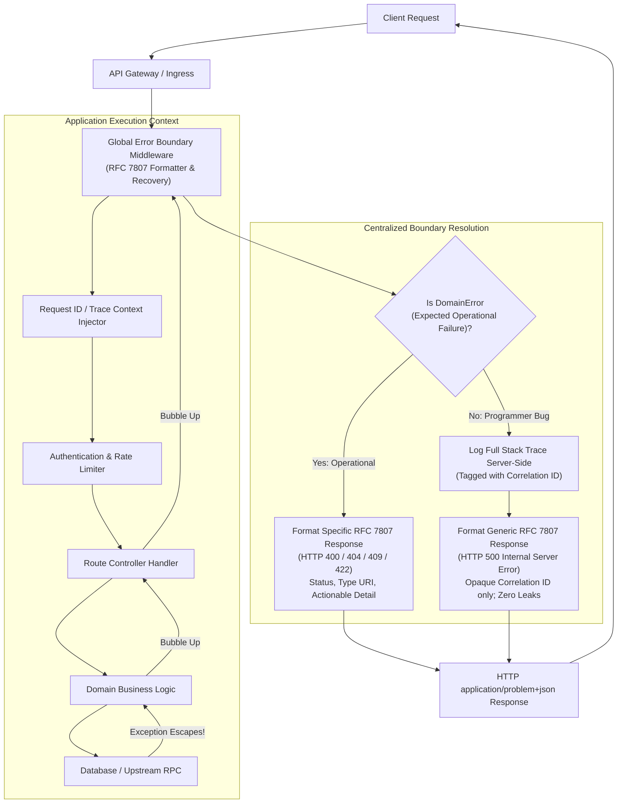
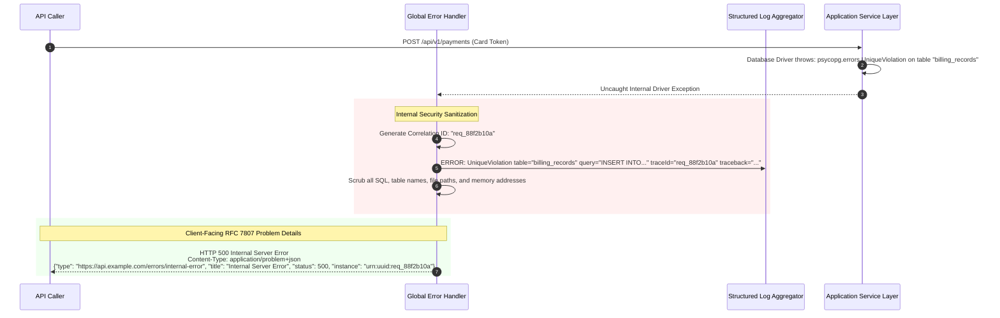
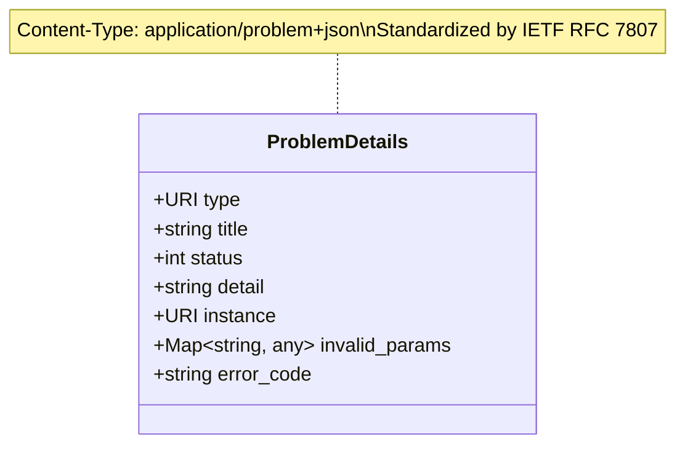

# Module 01: Global Error Handlers and User-Facing Errors

> **Prerequisites:** [Module 00: Error Handling Strategies](../00-error-handling-strategies/README.md), [Module 02: API Layer & Request Handling](../../02-api-layer-and-request-handling/README.md).
> **Estimated Reading Time:** 30 minutes
> **Target Audience:** Backend Engineers, Security Engineers, API Platform Architects.

---

> [!TIP]
> **Golden Rule of User-Facing Error Responses**: Enforce a single centralized global error handler at the outermost application boundary that formats all client responses according to the **RFC 7807 Problem Details** specification (`application/problem+json`). Every error response must include an opaque correlation identifier (`req_...`) logged alongside the full internal diagnostic stack trace server-side, while strictly stripping database queries, internal file paths, framework versions, and stack traces from the client-facing payload.

---

## 1. Visual Mental Models & System Architecture

When an error escapes a route handler or service method, something at the application perimeter must translate that internal exception into an HTTP response. Without a disciplined central boundary, web frameworks default to dangerous behaviors: leaking full stack traces containing file paths, SQL statements, and secrets, or over-correcting into a vague `{"error": "something went wrong"}` that forces API consumers to guess what failed.

A **Centralized Global Error Handler** establishes an authoritative boundary between internal diagnostics and external contracts.

### Centralized Error Boundary Architecture



### Information Sanitization Filter Sequence



### The RFC 7807 Problem Details Data Structure

RFC 7807 standardizes error responses using five primary machine-readable attributes, supplemented by domain-specific extension fields:



---

## 2. Taxonomic Reference Grids & Systematic Comparison Grids

### RFC 7807 Attribute Reference

| Attribute | JSON Type | Mandatory? | Purpose & Best Practice | Example |
| :--- | :--- | :--- | :--- | :--- |
| `type` | String (URI) | Recommended | A URI reference that identifies the problem type. When dereferenced, should provide human-readable documentation. | `"https://api.example.com/errors/insufficient-funds"` |
| `title` | String | Mandatory | A short, human-readable summary of the problem type. Must **not** change from occurrence to occurrence. | `"Insufficient Account Balance"` |
| `status` | Integer | Mandatory | The HTTP status code generated by the origin server for this occurrence. | `400`, `404`, `409`, `500` |
| `detail` | String | Recommended | A human-readable explanation specific to this occurrence of the problem. Safe for end users. | `"Your balance of $12.50 is insufficient for the requested $50.00 withdrawal."` |
| `instance` | String (URI) | Mandatory | An opaque URI reference that identifies the specific occurrence of the problem. Maps directly to server-side logs. | `"urn:request:req_89bc712f"` |
| `invalid_params` | Array / Object | Optional | Extension member listing validation failures per field. | `[{"name": "email", "reason": "Malformed syntax"}]` |
| `code` | String | Optional | Domain-specific machine-readable error code for client SDK conditional logic. | `"ACCOUNT_LOCKED"`, `"RATE_LIMIT_EXCEEDED"` |

### Common Domain Errors to HTTP Status Code Mapping

| Domain Failure | Standard HTTP Status | RFC 7807 `title` | Client Safe `detail` |
| :--- | :--- | :--- | :--- |
| **Payload Schema Failure** | `422 Unprocessable Entity` | `"Validation Failed"` | `"The request payload contained 2 validation errors."` |
| **Missing Auth Credentials**| `401 Unauthorized` | `"Authentication Required"` | `"Bearer token is missing or expired."` |
| **Insufficient Permissions** | `403 Forbidden` | `"Forbidden Access"` | `"You do not possess permission 'billing.invoices.delete'."` |
| **Missing Resource** | `404 Not Found` | `"Resource Not Found"` | `"Invoice 'INV-1099' does not exist."` |
| **Concurrent Edit Conflict**| `409 Conflict` | `"Resource State Conflict"` | `"Invoice was modified by another user. Reload and retry."` |
| **Rate Limit Exhaustion** | `429 Too Many Requests` | `"Rate Limit Exceeded"` | `"Quota exceeded. Retry after 15 seconds."` |
| **Unhandled Bug / Crash** | `500 Internal Server Error` | `"Internal Server Error"` | `"An internal error occurred. Quote reference ID to support."` |
| **Downstream Outage** | `503 Service Unavailable` | `"Service Unavailable"` | `"Upstream payment provider is currently unreachable."` |

### Information Disclosure Hazard Matrix

| Diagnostic Data Point | Safe for Client Response? | Safe for Server Logs? | Security & Operational Risk |
| :--- | :---: | :---: | :--- |
| **Traceback / Stack Frames** | **NEVER** | **YES** | Exposes source file paths, internal framework versions, and directory layouts to attackers. |
| **Raw SQL Queries** | **NEVER** | **YES (with param scrubbing)**| Leaks internal schema, table names, and column relationships for SQL injection attacks. |
| **Internal IP / Hostnames** | **NEVER** | **YES** | Exposes private VPC network topology and internal cluster hostnames. |
| **Database Connection String**| **NEVER** | **NEVER (Scrub credentials)** | Catastrophic credential breach leading to full database takeover. |
| **Request Correlation ID** | **YES** | **YES** | Essential for allowing users to quote a reference ID without leaking internal diagnostics. |
| **Field Validation Errors** | **YES** | **YES** | Necessary for client-side form rendering and automated API integrations. |

---

## 3. Production War Stories: Incident Post-Mortem

### The Incident: Database Schema Leak and Targeted Injection Escalation via Unhandled 500 Traceback

- **Severity:** SEV-1 (Critical Security Breach)
- **Time to Detection:** 1 hour 40 minutes
- **Time to Mitigation:** 25 minutes
- **Impact:** An attacker utilized internal SQL query structures and column definitions leaked in an unhandled HTTP 500 response to execute an unauthorized data extraction exploit, accessing 45,000 customer email records.

#### What Happened
A logistics microservice deployed a new search endpoint. Due to a missing type check on a sorting query parameter, passing an unexpected value triggered a database driver exception. 

Because the microservice lacked a centralized global error handler, the web framework's default debug error handler intercepted the exception. When an attacker sent a probe request with `?sort=INVALID`, the API responded with an HTTP 500 containing a 45-line Python traceback:

```text
HTTP/1.1 500 Internal Server Error
Content-Type: text/plain

Traceback (most recent call last):
  File "/app/routes/shipments.py", line 84, in list_shipments
    cursor.execute(f"SELECT shipment_id, tracking_code, customer_internal_id FROM tbl_logistics_v2 WHERE tenant_id = '{tenant_id}' ORDER BY {sort_column}")
psycopg2.errors.UndefinedColumn: column "INVALID" does not exist
```

The response leaked:
1. The exact server directory path: `/app/routes/shipments.py`.
2. The internal production database table name: `tbl_logistics_v2`.
3. Three sensitive column names: `shipment_id`, `tracking_code`, `customer_internal_id`.
4. The exact SQL query construction showing an unparameterized f-string injection point!

Armed with the exact table and column names, the attacker crafted a secondary request exploiting the format string, bypassing tenant isolation and dumping sensitive shipment logs.

```mermaid
sequenceDiagram
    autonumber
    participant Attacker as Malicious Client
    participant Framework as Web App (No Global Handler)
    participant DB as Postgres Database

    Attacker->>Framework: GET /api/v1/shipments?sort=INVALID
    Framework->>DB: Execute raw query with unvalidated parameter
    DB-->>Framework: psycopg2.errors.UndefinedColumn
    Note over Framework: Default framework handler catches unhandled error
    Framework-->>Attacker: Leaks full traceback + raw SQL + table "tbl_logistics_v2"
    Note over Attacker: Attacker analyzes leaked query & table structure
    Attacker->>Framework: GET /api/v1/shipments?sort=customer_internal_id;--
    Framework->>DB: Executes injected query
    DB-->>Framework: Dumps 45,000 customer records
    Framework-->>Attacker: Unauthorized data exfiltration
```

#### Root Cause
1. **Absence of a Global Error Boundary:** The application had no top-level exception handler to catch unhandled errors and enforce sanitization before emitting HTTP responses.
2. **Framework Debug Mode in Production:** The application ran with framework debug/development exception rendering active, which intentionally prints tracebacks for developer convenience.

#### The Fix & Architectural Hardening
1. **Registered Central RFC 7807 Handler:** Implemented an outermost catch-all exception handler that catches `Exception` and returns a strictly sanitized `application/problem+json` payload:
   ```json
   {
     "type": "https://api.example.com/errors/internal-server-error",
     "title": "Internal Server Error",
     "status": 500,
     "detail": "An internal error occurred. Please contact support with the reference ID.",
     "instance": "urn:request:req_8f12a9c"
   }
   ```
2. **Hardened Logging Pipeline:** All stack traces and raw error messages were routed exclusively to server-side stdout with structured JSON logging, completely isolated from HTTP response streams.
3. **Automated Security Fuzzing:** Integrated OWASP ZAP and automated CI security tests that fuzz query parameters and assert that HTTP response bodies **never** contain the words `"Traceback"`, `"File /"`, or SQL driver package names.

---

## 4. Multi-Language Production Implementations

The following code tabs illustrate production implementations of a centralized RFC 7807 global error boundary across Go, TypeScript, and Python.

### Go Production Implementation (Gin / HTTP Middleware)

```go
package main

import (
	"errors"
	"fmt"
	"log/slog"
	"net/http"

	"github.com/gin-gonic/gin"
	"github.com/google/uuid"
)

// RFC7807Problem defines the standardized Problem Details structure.
type RFC7807Problem struct {
	Type     string                 `json:"type"`
	Title    string                 `json:"title"`
	Status   int                    `json:"status"`
	Detail   string                 `json:"detail,omitempty"`
	Instance string                 `json:"instance"`
	Code     string                 `json:"code,omitempty"`
	Errors   map[string]interface{} `json:"invalid_params,omitempty"`
}

// DomainError represents an operational business error safe for client visibility.
type DomainError struct {
	Status  int
	Title   string
	Detail  string
	Code    string
	Params  map[string]interface{}
	RootErr error
}

func (e *DomainError) Error() string {
	return fmt.Sprintf("[%s] %s: %s", e.Code, e.Title, e.Detail)
}

// GlobalErrorBoundary returns a Gin middleware enforcing RFC 7807 response formatting.
func GlobalErrorBoundary() gin.HandlerFunc {
	return func(c *gin.Context) {
		// Ensure Request ID exists
		requestID := c.GetHeader("X-Request-ID")
		if requestID == "" {
			requestID = "req_" + uuid.NewString()[:8]
			c.Header("X-Request-ID", requestID)
		}

		c.Next()

		// Evaluate errors that bubbled up during route execution
		if len(c.Errors) > 0 {
			err := c.Errors.Last().Err
			var domainErr *DomainError

			if errors.As(err, &domainErr) {
				// Expected operational error
				c.Header("Content-Type", "application/problem+json")
				c.JSON(domainErr.Status, RFC7807Problem{
					Type:     fmt.Sprintf("https://api.example.com/errors/%s", domainErr.Code),
					Title:    domainErr.Title,
					Status:   domainErr.Status,
					Detail:   domainErr.Detail,
					Instance: fmt.Sprintf("urn:request:%s", requestID),
					Code:     domainErr.Code,
					Errors:   domainErr.Params,
				})
				return
			}

			// Unexpected programmer error / panic
			slog.Error("Unhandled system exception",
				"request_id", requestID,
				"path", c.Request.URL.Path,
				"error", err.Error(),
			)

			c.Header("Content-Type", "application/problem+json")
			c.JSON(http.StatusInternalServerError, RFC7807Problem{
				Type:     "https://api.example.com/errors/internal-server-error",
				Title:    "Internal Server Error",
				Status:   http.StatusInternalServerError,
				Detail:   "An internal error occurred. Please provide the instance reference to support.",
				Instance: fmt.Sprintf("urn:request:%s", requestID),
				Code:     "INTERNAL_ERROR",
			})
		}
	}
}
```

### TypeScript / Node.js Production Implementation (Express Error Boundary)

```typescript
import { Request, Response, NextFunction } from 'express';
import { v4 as uuidv4 } from 'uuid';

export interface RFC7807Response {
  type: string;
  title: string;
  status: number;
  detail?: string;
  instance: string;
  code?: string;
  invalid_params?: Record<string, string>;
}

export class AppDomainError extends Error {
  constructor(
    public readonly status: number,
    public readonly code: string,
    public readonly title: string,
    message: string,
    public readonly invalidParams?: Record<string, string>,
    public readonly cause?: Error
  ) {
    super(message);
    Object.setPrototypeOf(this, new.target.prototype);
  }
}

// Global Error Handler Middleware
export function globalErrorHandler(
  err: Error,
  req: Request,
  res: Response,
  next: NextFunction
): void {
  const requestId = (req.headers['x-request-id'] as string) || `req_${uuidv4().substring(0, 8)}`;
  res.setHeader('Content-Type', 'application/problem+json');
  res.setHeader('X-Request-ID', requestId);

  if (err instanceof AppDomainError) {
    // Expected operational error: return structured RFC 7807
    const problem: RFC7807Response = {
      type: `https://api.example.com/errors/${err.code.toLowerCase().replace(/_/g, '-')}`,
      title: err.title,
      status: err.status,
      detail: err.message,
      instance: `urn:request:${requestId}`,
      code: err.code,
      invalid_params: err.invalidParams,
    };
    res.status(err.status).json(problem);
    return;
  }

  // Unexpected programmer error: log server-side with stack trace
  console.error(`[CRITICAL] Unhandled Error [Request: ${requestId}]:`, {
    path: req.path,
    method: req.method,
    message: err.message,
    stack: err.stack,
  });

  // Client receives strictly sanitized generic response
  const genericProblem: RFC7807Response = {
    type: 'https://api.example.com/errors/internal-server-error',
    title: 'Internal Server Error',
    status: 500,
    detail: 'An unexpected internal error occurred. Quote reference ID to support.',
    instance: `urn:request:${requestId}`,
    code: 'INTERNAL_SERVER_ERROR',
  };
  res.status(500).json(genericProblem);
}
```

### Python Production Implementation (FastAPI RFC 7807 Exception Handlers)

```python
"""
Production-Grade FastAPI RFC 7807 Global Error Boundary.
Translates domain exceptions, schema validation errors, and unexpected bugs
into compliant application/problem+json payloads.
"""

from __future__ import annotations

import logging
import uuid
from typing import Any, Dict, Optional
from fastapi import FastAPI, Request, status
from fastapi.exceptions import RequestValidationError
from fastapi.responses import JSONResponse

logger = logging.getLogger(__name__)
app = FastAPI()


class DomainException(Exception):
    def __init__(
        self,
        status_code: int,
        code: str,
        title: str,
        detail: str,
        invalid_params: Optional[Dict[str, Any]] = None,
    ):
        super().__init__(detail)
        self.status_code = status_code
        self.code = code
        self.title = title
        self.detail = detail
        self.invalid_params = invalid_params or {}


@app.exception_handler(DomainException)
async def domain_exception_handler(request: Request, exc: DomainException) -> JSONResponse:
    request_id = request.headers.get("x-request-id", f"req_{uuid.uuid4().hex[:8]}")
    payload = {
        "type": f"https://api.example.com/errors/{exc.code.lower().replace('_', '-')}",
        "title": exc.title,
        "status": exc.status_code,
        "detail": exc.detail,
        "instance": f"urn:request:{request_id}",
        "code": exc.code,
    }
    if exc.invalid_params:
        payload["invalid_params"] = exc.invalid_params

    return JSONResponse(
        status_code=exc.status_code,
        content=payload,
        media_type="application/problem+json",
        headers={"X-Request-ID": request_id},
    )


@app.exception_handler(RequestValidationError)
async def validation_exception_handler(request: Request, exc: RequestValidationError) -> JSONResponse:
    request_id = request.headers.get("x-request-id", f"req_{uuid.uuid4().hex[:8]}")
    formatted_errors = {
        ".".join(str(loc) for loc in err["loc"]): err["msg"]
        for err in exc.errors()
    }

    payload = {
        "type": "https://api.example.com/errors/validation-error",
        "title": "Invalid Request Content",
        "status": status.HTTP_422_UNPROCESSABLE_ENTITY,
        "detail": f"Request body contained {len(formatted_errors)} validation errors.",
        "instance": f"urn:request:{request_id}",
        "code": "VALIDATION_FAILED",
        "invalid_params": formatted_errors,
    }
    return JSONResponse(
        status_code=status.HTTP_422_UNPROCESSABLE_ENTITY,
        content=payload,
        media_type="application/problem+json",
        headers={"X-Request-ID": request_id},
    )


@app.exception_handler(Exception)
async def unhandled_exception_handler(request: Request, exc: Exception) -> JSONResponse:
    request_id = request.headers.get("x-request-id", f"req_{uuid.uuid4().hex[:8]}")

    # Server-side structured diagnostic logging
    logger.exception(
        "Unhandled programmer bug on %s %s [Request: %s]",
        request.method,
        request.url.path,
        request_id,
    )

    # Strictly sanitized client response
    payload = {
        "type": "https://api.example.com/errors/internal-server-error",
        "title": "Internal Server Error",
        "status": status.HTTP_500_INTERNAL_SERVER_ERROR,
        "detail": "An unexpected error occurred. Please provide reference code to support.",
        "instance": f"urn:request:{request_id}",
        "code": "INTERNAL_ERROR",
    }
    return JSONResponse(
        status_code=status.HTTP_500_INTERNAL_SERVER_ERROR,
        content=payload,
        media_type="application/problem+json",
        headers={"X-Request-ID": request_id},
    )
```

---

## 5. Practical Hands-On Verification CLI Workflows

Verify that global error handlers emit compliant RFC 7807 responses and verify that internal traces remain masked.

### Workflow 1: Inspecting RFC 7807 Response Headers and Payload

```bash
# Verify Content-Type and Problem Details wire format on an error endpoint
curl -i -s -X POST "http://localhost:8000/api/v1/orders" \
  -H "Content-Type: application/json" \
  -d '{"amount": -100}'
```

Expected wire output:
```text
HTTP/1.1 422 Unprocessable Entity
Date: Tue, 10 Nov 2026 14:00:00 GMT
Content-Type: application/problem+json
Content-Length: 284
X-Request-ID: req_9a8f21bc

{
  "type": "https://api.example.com/errors/validation-error",
  "title": "Invalid Request Content",
  "status": 422,
  "detail": "Request body contained 1 validation errors.",
  "instance": "urn:request:req_9a8f21bc",
  "code": "VALIDATION_FAILED",
  "invalid_params": {
    "body.amount": "Input should be greater than 0"
  }
}
```

### Workflow 2: Verifying Stack Trace Stripping on Server Panic

```bash
# Verify that an internal server error contains zero internal file paths or stack traces
curl -i -s "http://localhost:8000/api/v1/debug/panic"
```

Expected wire output:
```text
HTTP/1.1 500 Internal Server Error
Content-Type: application/problem+json
X-Request-ID: req_c0012fab

{
  "type": "https://api.example.com/errors/internal-server-error",
  "title": "Internal Server Error",
  "status": 500,
  "detail": "An unexpected error occurred. Please provide reference code to support.",
  "instance": "urn:request:req_c0012fab",
  "code": "INTERNAL_ERROR"
}
```

---

## 6. Operational Validation Checkpoints (Scenario Quizzes)

### Checkpoint 1: Why RFC 7807 is Essential in Microservice Ecosystems
**Scenario:** A company operates 40 microservices authored in Go, Python, and Node.js. The frontend team complains that error handling is a nightmare because Service A returns `{"error": "msg"}`, Service B returns `{"message": "err", "status": 400}`, and Service C returns a raw string `"Not found"`. How does enforcing RFC 7807 across all services solve this at the platform level?

<details><summary>Click to view diagnosis and architectural solution</summary>

**Answer:**
1. **Unified Client Ingestion:**
   RFC 7807 (`application/problem+json`) provides a single, predictable schema across all services: `type`, `title`, `status`, `detail`, `instance`.
2. **Frontend Interceptor Standardization:**
   The frontend API client (e.g., Axios or Fetch interceptor) can implement a **single universal error handler**:
   - Reads `instance` to render `"Incident ID: req_xxx"` in error toasts.
   - Reads `status` to direct authorization redirects (401 $\to$ login).
   - Reads `invalid_params` to automatically map field errors directly into form validation inputs without writing custom parser logic per endpoint.
</details>

---

### Checkpoint 2: The Security Risk of Exposing Database Primary Keys in Error Messages
**Scenario:** A developer modifies an error response to return:
```json
{
  "error": "Record with primary key 104928 on shard_db_03 does not exist."
}
```
What security risk does this create, and how should it be rewritten?

<details><summary>Click to view diagnosis and architectural solution</summary>

**Answer:**
1. **The Vulnerabilities (Insecure Direct Object Reference & Topology Leakage):**
   - **Enumeration Attack:** Exposing sequential auto-increment primary keys (`104928`) allows competitors or attackers to enumerate the total size of your database and customer acquisition velocity.
   - **Infrastructure Leak:** Exposing internal partition names (`shard_db_03`) informs attackers of your underlying database sharding topology.
2. **The Hardened Rewrite:**
   Use public opaque identifiers (e.g., UUIDv7 or `usr_89f1...`) and sanitize infrastructure references:
   ```json
   {
     "type": "https://api.example.com/errors/resource-not-found",
     "title": "User Not Found",
     "status": 404,
     "detail": "The requested user profile does not exist.",
     "instance": "urn:request:req_88f12a"
   }
   ```
</details>

---

### Checkpoint 3: Decoupling Framework Errors from Internal Exceptions
**Scenario:** In a FastAPI or Express application, an unhandled database unique constraint violation is thrown. Instead of reaching the global error handler, the framework crashes or returns an empty HTTP 500 response. Why did the exception escape the handler, and how is the middleware registration order audited?

<details><summary>Click to view diagnosis and architectural solution</summary>

**Answer:**
1. **Middleware Ordering Failure:**
   In Express, error-handling middleware (`(err, req, res, next)`) **must be registered last**, after all routes and normal middleware. If a route throws an error and no subsequent error middleware is registered, Express falls back to its default HTML error page.
2. **FastAPI Catch-All Requirement:**
   In FastAPI, registering `@app.exception_handler(DomainException)` catches only custom domain exceptions. If an internal database driver raises `psycopg.errors.UniqueViolation`, it inherits from `Exception`, not `DomainException`. You must register an explicit catch-all handler for `@app.exception_handler(Exception)` to capture all unhandled programmer errors and guarantee RFC 7807 formatting.
</details>

---

## 7. Further Reading & References

- [IETF RFC 7807: Problem Details for HTTP APIs](https://datatracker.ietf.org/doc/html/rfc7807) — Official specification for standardized HTTP error representation.
- [OWASP API Security Top 10: API3 Broken Object Property Level Authorization](https://owasp.org/www-project-api-security/) — Guidelines on preventing sensitive diagnostic data leakage.
- [FastAPI: Handling Errors](https://fastapi.tiangolo.com/tutorial/handling-errors/) — Official documentation on custom exception handlers and request validation overrides.

---

## Next

[Module 02: Config Management Fundamentals](../02-config-management-fundamentals/README.md) — Separate environment configuration from application code, applying 12-factor principles to guarantee repeatable, immutable deployments across dev, staging, and production environments.
