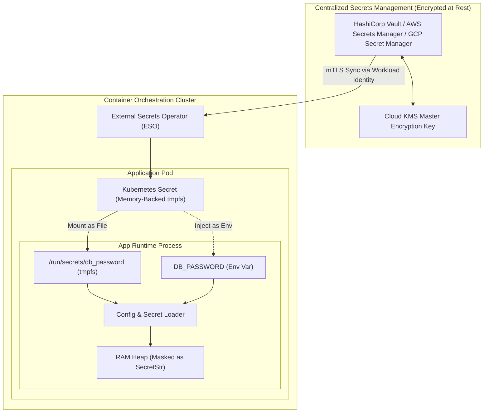
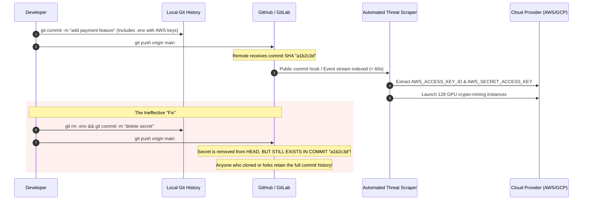
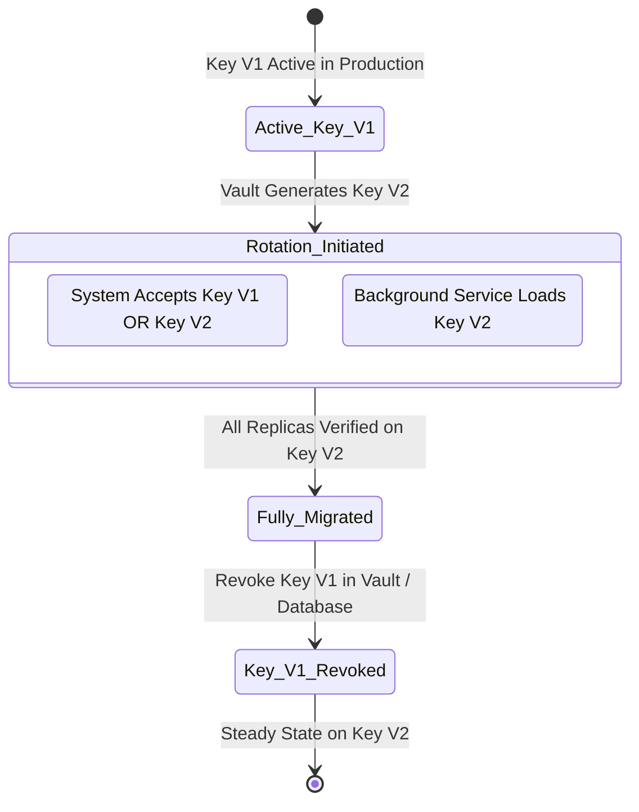
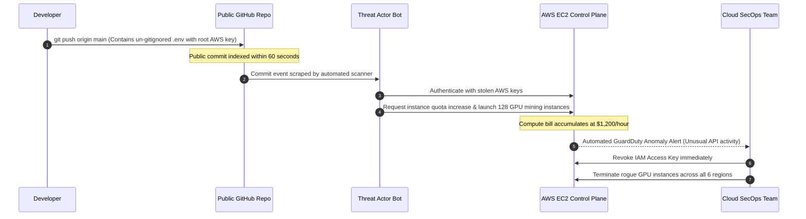

# Module 03: Config Sources and Secrets

> **Prerequisites:** [Module 00: Error Handling Strategies](../00-error-handling-strategies/README.md), [Module 01: Global Error Handlers & User-Facing Errors](../01-global-error-handlers-and-user-facing-errors/README.md), [Module 02: Config Management Fundamentals](../02-config-management-fundamentals/README.md).
> **Estimated Reading Time:** 30 minutes
> **Target Audience:** Backend Engineers, Platform Security Engineers, SREs.

---

> [!TIP]
> **Golden Rule of Secrets Management**: Secrets are not merely configuration; they are high-risk security credentials that must **never** be committed to source control, embedded in Docker image layers, or logged to stdout. Inject secrets at runtime via in-memory volume mounts (`/run/secrets/`), dedicated secret orchestrators (HashiCorp Vault, AWS Secrets Manager, GCP Secret Manager), or Kubernetes Secrets, and always wrap sensitive variables in memory-masking types (`SecretStr`) to prevent accidental diagnostic leaks.

---

## 1. Visual Mental Models & System Architecture

Configuration values and secrets travel different security pathways. While non-sensitive settings (ports, URLs, log levels) can safely reside in environment variables, sensitive credentials (database passwords, private signing keys, API tokens) demand strict isolation. Automated adversary bots continuously scrape public source control for committed API keys; the median time-to-exploitation for an exposed cloud credential is under **180 seconds**.

### Enterprise Secret Delivery Architecture



### The Git Commit Secret Leak Anatomy (Why `git rm` Fails)



### Dynamic Secret Rotation Lifecycle (Zero Downtime)



---

## 2. Taxonomic Reference Grids & Systematic Comparison Grids

### Configuration and Secret Sources Compared

| Delivery Source | Primary Storage Location | Security Rating | Rotation Complexity | Best Suited For |
| :--- | :--- | :---: | :--- | :--- |
| **Local `.env` File** | Local file system (`.env`) | **Low (Risk of commit)** | Manual file editing | Local developer laptop prototyping only. Must be in `.gitignore`! |
| **Environment Variables** | Process OS Environment | **Moderate** | Requires container recreation | Non-sensitive settings, container ports, URLs, flags. |
| **Mounted Files (`tmpfs`)**| In-memory file (`/run/secrets/*`)| **High** | Hot-reloadable via file watch | High-security secrets, private keys, database passwords. |
| **Cloud Secrets Manager** | HashiCorp Vault, AWS/GCP KMS | **Maximum** | Automated via dynamic credential APIs | Production enterprise infrastructure, audited access. |

### Secret Leak Vectors & Architectural Countermeasures

| Leak Vector | How the Leak Occurs | Real-World Impact | Mandatory Architectural Prevention |
| :--- | :--- | :--- | :--- |
| **Git Repository History** | Committing `.env` or hardcoding keys in source files. | Scraped by adversary bots in minutes; persists in git commit DAG forever. | Pre-commit hooks (`gitleaks`, `trufflehog`), strict `.gitignore`, GitHub Secret Scanning. |
| **Docker Image Layers** | Writing `COPY .env /app` or `ENV SECRET=123` in Dockerfile. | Secret is baked into immutable layer blobs; readable via `docker history`. | Multi-stage builds, never copy `.env`, use BuildKit `--mount=type=secret`. |
| **Process Environment Dumps** | Reading `/proc/$PID/environ` or inspecting crash dumps. | Any compromised sidecar container or unprivileged user reads memory envs. | Mount secrets as files (`tmpfs`) with restricted file permissions (`chmod 0400`). |
| **Application Log Dumps** | Calling `print(config)` or logging uncaught exceptions. | Credentials written in plaintext to centralized log aggregators (Datadog/Elastic). | Wrap all sensitive keys in `SecretStr` types; scrub tokens via log filters. |

---

## 3. Production War Stories: Incident Post-Mortem

### The Incident: $60,000 Cloud Bill from Committed AWS Root Keys in Public Repository

- **Severity:** SEV-1 (Critical Security & Financial Incident)
- **Time to Detection:** 14 minutes
- **Time to Mitigation:** 45 minutes
- **Impact:** An unauthorized threat actor spawned 128 high-performance GPU instances across six AWS regions, generating \$62,400 in unauthorized compute charges before account lockdown.

#### What Happened
A software engineer built a prototype document parsing worker on their personal machine. To test S3 bucket access, the engineer created an `.env` file containing an AWS Access Key ID and Secret Access Key. The credentials belonged to an administrative account without billing budget alarms.

When pushing the code to a new public GitHub repository, the developer ran:
```bash
git add .
git commit -m "Initial commit for document parser"
git push origin main
```

The developer forgot to create a `.gitignore` file. Within 90 seconds of the push, an automated threat scraper indexed the public commit. 

Four minutes later, the adversary used the leaked credentials to call the AWS EC2 API, requesting service quota increases and launching dozens of `p3.16xlarge` GPU instances running cryptocurrency mining containers.



#### Root Cause
1. **Absence of Source Control Guardrails:** The repository was initialized without an active `.gitignore` and without pre-commit scanning hooks to detect credential patterns.
2. **Use of Long-Lived Static Keys:** The developer used permanent root AWS access keys instead of short-lived temporary STS tokens or IAM Roles.

#### The Fix & Architectural Hardening
1. **Immediate Revocation & Key Invalidation:** The compromised IAM key was immediately revoked in AWS IAM.
2. **Repository Cleansing via BFG Repo-Cleaner:** The entire git history was purged of the commit using `git filter-repo` to ensure no historical snapshots remained.
3. **Automated Pre-Commit Hooks:** Enforced `gitleaks` as a mandatory pre-commit hook across all engineering laptops:
   ```bash
   # .pre-commit-config.yaml
   - repo: https://github.com/gitleaks/gitleaks
     rev: v8.18.2
     hooks:
       - id: gitleaks
   ```
4. **Adoption of Workload Identity:** Replaced all static AWS access keys in production with AWS IAM Roles for Service Accounts (IRSA) / OIDC tokens, completely eliminating long-lived credentials.

---

## 4. Multi-Language Production Implementations

The following code tabs demonstrate enterprise-grade secret ingestion: reading from in-memory mounted files (`/run/secrets/`), fallback to environment variables, memory-safe masking, and zero-memory leakage across Go, TypeScript, and Python.

### Go Production Implementation (File-Mount Secret Reader with Masking)

```go
package main

import (
	"errors"
	"fmt"
	"os"
	"path/filepath"
	"strings"
)

// SecretString encapsulates sensitive strings, masking output in formatters.
type SecretString string

func (s SecretString) String() string {
	return "********"
}

func (s SecretString) Expose() string {
	return string(s)
}

// ReadSecret retrieves a secret prioritizing Docker/K8s file mounts over environment variables.
func ReadSecret(secretName string) (SecretString, error) {
	// 1. Check for file-mounted secret in /run/secrets/
	secretFilePath := filepath.Join("/run/secrets", secretName)
	if data, err := os.ReadFile(secretFilePath); err == nil {
		cleanSecret := strings.TrimSpace(string(data))
		if cleanSecret != "" {
			return SecretString(cleanSecret), nil
		}
	}

	// 2. Check for custom file path pointed by ENV_FILE
	envFileKey := fmt.Sprintf("%s_FILE", strings.ToUpper(secretName))
	if customPath := os.Getenv(envFileKey); customPath != "" {
		if data, err := os.ReadFile(customPath); err == nil {
			cleanSecret := strings.TrimSpace(string(data))
			if cleanSecret != "" {
				return SecretString(cleanSecret), nil
			}
		}
	}

	// 3. Fallback to direct environment variable
	envKey := strings.ToUpper(secretName)
	if envVal := os.Getenv(envKey); envVal != "" {
		return SecretString(envVal), nil
	}

	return "", fmt.Errorf("secret '%s' not found in file mount or environment", secretName)
}

type DatabaseConfig struct {
	Host     string
	Username string
	Password SecretString
}

func LoadDatabaseConfig() (*DatabaseConfig, error) {
	host := os.Getenv("DB_HOST")
	if host == "" {
		host = "localhost"
	}

	user := os.Getenv("DB_USER")
	if user == "" {
		user = "postgres"
	}

	pass, err := ReadSecret("db_password")
	if err != nil {
		return nil, err
	}

	return &DatabaseConfig{
		Host:     host,
		Username: user,
		Password: pass,
	}, nil
}
```

### TypeScript / Node.js Production Implementation

```typescript
import * as fs from 'fs';
import * as path from 'path';

export class SecretValue {
  private readonly value: string;

  constructor(secret: string) {
    this.value = secret;
  }

  // Prevents accidental leakage in JSON.stringify() and console.log()
  public toString(): string {
    return '********';
  }

  public toJSON(): string {
    return '********';
  }

  public getRawSecret(): string {
    return this.value;
  }
}

export class SecretLoader {
  public static readSecret(secretName: string): SecretValue {
    // 1. Check /run/secrets/{secretName} (Kubernetes / Docker Secret Mount)
    const mountPath = path.join('/run/secrets', secretName);
    if (fs.existsSync(mountPath)) {
      try {
        const fileContent = fs.readFileSync(mountPath, 'utf-8').trim();
        if (fileContent.length > 0) {
          return new SecretValue(fileContent);
        }
      } catch (err) {
        console.warn(`Warning: Could not read secret file at ${mountPath}`);
      }
    }

    // 2. Check {NAME}_FILE environment variable pointer
    const envFileKey = `${secretName.toUpperCase()}_FILE`;
    const customFilePath = process.env[envFileKey];
    if (customFilePath && fs.existsSync(customFilePath)) {
      const fileContent = fs.readFileSync(customFilePath, 'utf-8').trim();
      return new SecretValue(fileContent);
    }

    // 3. Fallback to direct environment variable
    const envKey = secretName.toUpperCase();
    const envValue = process.env[envKey];
    if (envValue && envValue.trim().length > 0) {
      return new SecretValue(envValue.trim());
    }

    throw new Error(`Fatal: Mandatory secret '${secretName}' could not be resolved.`);
  }
}
```

### Python Production Implementation (Pydantic Settings with File Mount Support)

```python
"""
Production Secrets Management using Pydantic Settings and File Secrets.
Supports Docker/Kubernetes secrets directory, environment variable fallbacks,
and automatic SecretStr redaction in application logs.
"""

from __future__ import annotations

import os
import sys
from pydantic import Field, SecretStr
from pydantic_settings import BaseSettings, SettingsConfigDict


class AppSecuritySettings(BaseSettings):
    model_config = SettingsConfigDict(
        # Look for secrets mounted as files in /run/secrets first
        secrets_dir="/run/secrets" if os.path.exists("/run/secrets") else None,
        env_file=".env",
        env_file_encoding="utf-8",
        extra="ignore",
    )

    APP_NAME: str = "ProductionService"
    DATABASE_HOST: str = Field(default="localhost")
    DATABASE_PORT: int = Field(default=5432)
    DATABASE_USER: str = Field(default="app_user")
    
    # Reading 'db_password' will automatically check:
    # 1. File: /run/secrets/db_password
    # 2. Env: DB_PASSWORD
    DB_PASSWORD: SecretStr

    JWT_SIGNING_KEY: SecretStr


def get_verified_settings() -> AppSecuritySettings:
    try:
        settings = AppSecuritySettings()
        # Safe logging: SecretStr fields are masked automatically as '**********'
        print(f"Loaded config for {settings.APP_NAME}: DB User={settings.DATABASE_USER}, DB Password={settings.DB_PASSWORD}")
        return settings
    except Exception as exc:
        print(f"❌ Configuration/Secret initialization failed:\n{exc}", file=sys.stderr)
        sys.exit(1)
```

---

## 5. Practical Hands-On Verification CLI Workflows

Verify secret mounting and automated git secret detection using standard CLI tools.

### Workflow 1: Inspecting Container Secrets Mounted via tmpfs

```bash
# Run a container with a simulated Docker secret mounted at /run/secrets/
docker run --rm \
  -v "$(pwd)/local_secret.txt:/run/secrets/api_key:ro" \
  alpine:latest \
  sh -c "ls -la /run/secrets/ && cat /run/secrets/api_key"
```

Expected wire output:
```text
total 4
drwxr-xr-x    2 root     root            60 Nov 10 14:00 .
drwxr-xr-x    3 root     root            60 Nov 10 14:00 ..
-r--r--r--    1 root     root            32 Nov 10 14:00 api_key
super_secret_production_api_token
```

### Workflow 2: Scanning Repository for Accidental Committed Secrets with Gitleaks

```bash
# Run Gitleaks across the git commit history to detect leaked credentials
docker run --rm -v "$(pwd):/path" zricethezav/gitleaks:latest detect --source="/path" --verbose
```

Expected wire output (Clean Repo):
```text
    ○
    │╲
    │ ○
    ○  새
    Gitleaks scan complete: 0 leaks found across 248 commits.
```

---

## 6. Operational Validation Checkpoints (Scenario Quizzes)

### Checkpoint 1: Why Git Force-Push Does Not Remediate a Leaked Key
**Scenario:** A developer accidentally commits a file containing a production database password to a public repository. Realizing the mistake 10 minutes later, they run:
```bash
git rm config/secrets.yaml
git commit -m "remove secrets"
git push --force origin main
```
The developer tells the security team: "The repository is clean now, so we don't need to rotate the database password." Why is this statement critically false?

<details><summary>Click to view diagnosis and architectural solution</summary>

**Answer:**
1. **The Fallacy of Git History Deletion:**
   The secret was publicly exposed for 10 minutes. Automated threat actor bots scrape the public GitHub Events API stream in real time ($< 180\text{ seconds}$). The key was almost certainly copied into an adversary's database within minutes of the initial push.
2. **Git Commit Graph Reality:**
   Even if the commit is deleted from `main`, forks, local clones, and cached GitHub API views often retain references to the commit SHA.
3. **Mandatory Remediation:**
   Once a secret touches source control, it must be considered **permanently compromised**. The **only** valid remediation is to immediately **rotate the credential** in the database and cloud provider, invalidating the old password.
</details>

---

### Checkpoint 2: File Mounts (`/run/secrets/`) vs. Environment Variables in Kubernetes
**Scenario:** A security architect mandates that production microservices must read database passwords from mounted files (`/run/secrets/db_password`) rather than environment variables (`DATABASE_PASSWORD`). Why are file mounts superior from a container security perspective?

<details><summary>Click to view diagnosis and architectural solution</summary>

**Answer:**
1. **Exposure through `/proc` File System:**
   In Linux, every process exposes its environment variables in `/proc/$PID/environ`. Any local code execution vulnerability (e.g., shell injection or a compromised sidecar container sharing PID namespaces) can dump all environment variables with `cat /proc/1/environ`.
2. **Crash Dump & Child Process Leaks:**
   Environment variables are automatically inherited by child processes (e.g., shell scripts spawned by the app) and often printed verbatim in crash logs or application APM traces.
3. **Mounted File Protection:**
   Mounted secrets (`tmpfs`) exist in volatile RAM, are protected by standard Linux file permissions (`chmod 0400`), and can be hot-reloaded by the application watching the file path without needing to terminate and restart the pod.
</details>

---

### Checkpoint 3: Dual-Verification Secret Rotation with Zero Downtime
**Scenario:** You need to rotate the JWT HMAC signing key for an API handling 5,000 requests/second without logging out millions of active users or causing 401 errors during deployment. How do you orchestrate the rotation?

<details><summary>Click to view diagnosis and architectural solution</summary>

**Answer:**
1. **The Dual-Key Overlap Architecture:**
   - **Phase 1 (Dual Verification):** Deploy an updated configuration containing two keys: `PRIMARY_KEY` (Key V1) and `SECONDARY_KEY` (Key V2). The application signs new tokens using Key V1, but verifies incoming tokens against **either** Key V1 or Key V2.
   - **Phase 2 (Promotion):** Promote Key V2 to `PRIMARY_KEY` (sign new tokens with V2), while keeping Key V1 as `SECONDARY_KEY` (verify older active sessions).
   - **Phase 3 (Revocation):** Wait for the maximum JWT session expiration window (e.g., 24 hours). After 24 hours, all active user tokens have transitioned to Key V2. Safely remove Key V1 from the configuration.
2. **Outcome:**
   100% of user requests succeed without a single 401 logout error.
</details>

---

## 7. Further Reading & References

- [OWASP Secrets Management Cheat Sheet](https://cheatsheetseries.owasp.org/cheatsheets/Secrets_Management_Cheat_Sheet.html) — Comprehensive guide on credential storage, rotation, and lifecycle management.
- [Gitleaks Documentation](https://github.com/gitleaks/gitleaks) — Automated secret scanning tool for source control repositories.
- [Kubernetes Secrets Documentation](https://kubernetes.io/docs/concepts/configuration/secret/) — Configuring memory-backed `tmpfs` secret volumes in Kubernetes pods.

---

## Next

[Module 04: Logging Fundamentals](../04-logging-fundamentals/README.md) — Transform console logging into structured JSON telemetry, propagate W3C distributed trace contexts, and eliminate blind spots in high-throughput microservices.
