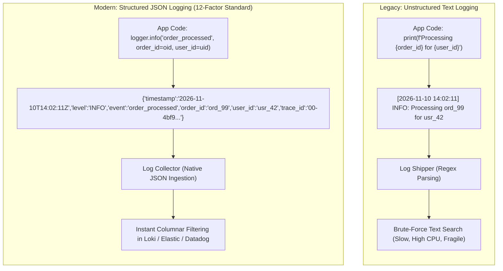
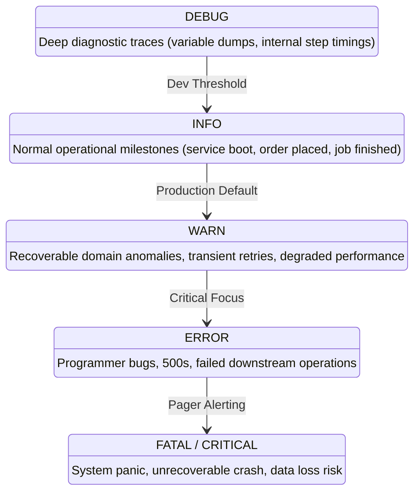
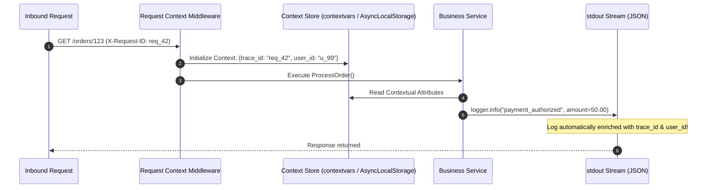
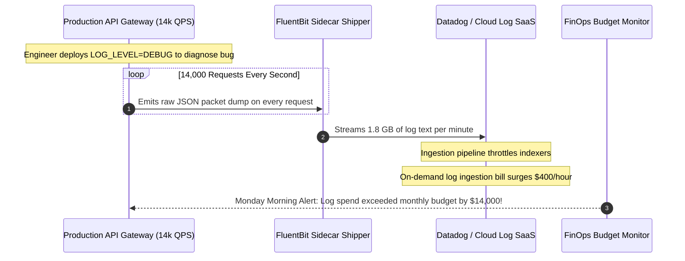

# Module 04: Logging Fundamentals

> **Prerequisites:** [Module 00: Error Handling Strategies](../00-error-handling-strategies/README.md), [Module 01: Global Error Handlers & User-Facing Errors](../01-global-error-handlers-and-user-facing-errors/README.md).
> **Estimated Reading Time:** 30 minutes
> **Target Audience:** Backend Engineers, SREs, Systems Architects.

---

> [!TIP]
> **Golden Rule of Production Logging**: Never use unformatted string interpolation or `print()` statements in production code. Emit all application events strictly as **structured, machine-parseable JSON lines to `stdout`**, tagged with standardized severity levels (`DEBUG`, `INFO`, `WARN`, `ERROR`), ISO-8601 UTC timestamps, and context-propagated correlation identifiers (`trace_id`). Let external container runtimes and log collectors handle shipping and storage—never write log files to local container filesystems.

---

## 1. Visual Mental Models & System Architecture

At 3:00 AM during an active production outage, when you cannot attach an interactive debugger to production containers, logs are the authoritative narrative of what transpired. However, logs are only as effective as their structure. A codebase riddled with unstructured `print("here")`, `log.info("user created: " + user.toString())`, and un-indexed error dumps produces a firehose of noise that is impossible to search, filter, or correlate across distributed replicas.

### The Evolution: Unstructured Text vs. Structured JSON Telemetry



### The Log Level Severity Pyramid and Dynamic Filtering

Log levels provide operational control over volume. You instrument your codebase thoroughly across all levels, and configure an environmental threshold so the runtime process only outputs lines at or above that threshold without code changes:



### Contextual Log Enrichment Architecture

Every log line emitted within an asynchronous request pipeline must inherit context without requiring engineers to manually pass IDs through 20 function arguments:



---

## 2. Taxonomic Reference Grids & Systematic Comparison Grids

### Log Level Operational Reference

| Log Level | Operational Meaning | When to Emit | Recommended Dev Setting | Recommended Prod Setting | Pager Duty Impact |
| :--- | :--- | :--- | :---: | :---: | :--- |
| **DEBUG** | Fine-grained internal mechanics for diagnostic analysis. | Variable payloads, branch evaluations, sub-millisecond step timings. | **Active** | **Disabled** (Turn on temporarily during triage) | Never page. |
| **INFO** | Significant, normal business milestones. | Service boot complete, user logged in, order placed, transaction committed. | **Active** | **Active** | Never page; used for business metrics & audit. |
| **WARN** | Unexpected condition that the system recovered from gracefully. | Transient network retry succeeded, deprecated API endpoint used, cache miss fallback. | **Active** | **Active** | Alert if aggregate rate spikes $> 300\%$. |
| **ERROR** | Operation failed; user received a 500 or background job failed. | Uncaught exception, database deadlock, third-party API timeout after retries. | **Active** | **Active** | Track in error budgets; page if error rate $> 1\%$. |
| **FATAL / CRITICAL**| Catastrophic failure causing immediate process shutdown. | Database credentials invalid at boot, out of memory, corrupted disk volume. | **Active** | **Active** | **Immediate PagerDuty wake-up call.** |

### Unstructured Text Logs vs. Structured JSON Logs

| Architectural Dimension | Unstructured Plain Text (`print`) | Structured JSON Lines (`stdout`) |
| :--- | :--- | :--- |
| **Format** | `2026-11-10 User 42 failed login: bad password` | `{"timestamp":"2026-11-10T14:00:00Z","level":"WARN","event":"auth_failed","user_id":42}` |
| **Machine Parsability** | Requires complex, brittle Regex parsing in collectors. | Instantly parsed natively by Vector, FluentBit, Logstash, and Loki. |
| **Query Flexibility** | Full-text substring search only (`grep`). | Rich Boolean queries: `level = "WARN" AND user_id = 42 AND latency_ms > 200`. |
| **Cardinality Handling**| High risk of unbounded index bloat. | Key-value indexing allows separate indexing of labels vs. unstructured message strings. |
| **Context Propagation** | Hardcoded into string; easy to forget fields. | Context variables automatically injected into every emitted JSON object. |

### Mandatory Production Log Envelope Fields

| Key Name | JSON Type | Standard Example | Operational Purpose |
| :--- | :--- | :--- | :--- |
| `timestamp` | String (ISO-8601 UTC) | `"2026-11-10T14:32:01.124Z"` | Precise chronological ordering across distributed systems. |
| `level` | String | `"INFO"`, `"ERROR"`, `"WARN"` | Filtering and routing threshold in log collectors. |
| `event` / `message` | String | `"order_checkout_completed"` | Stable, machine-queryable identifier of the log event. |
| `service` | String | `"billing-api"` | Disambiguates microservices within a centralized log lake. |
| `version` | String | `"v2.4.1"` / Git SHA | Correlates error spikes directly with specific releases. |
| `trace_id` | String | `"4bf92f3577b34da6a3ce929d0e0e4736"` | W3C distributed trace context correlating all logs for one request. |
| `duration_ms` | Float | `14.28` | Performance profiling and latency percentiles. |

---

## 3. Production War Stories: Incident Post-Mortem

### The Incident: $14,000 Datadog Log Ingestion Spike from Uncapped DEBUG Logging in Production

- **Severity:** SEV-2 (Operational Budget Exhaustion & Pipeline Degradation)
- **Time to Detection:** 36 hours
- **Time to Mitigation:** 15 minutes
- **Impact:** 4.2 billion unnecessary debug log lines shipped to a cloud logging SaaS provider, resulting in a \$14,200 on-demand ingestion overage bill and throttling production log search indexing.

#### What Happened
To diagnose an intermittent WebSocket disconnection issue that only occurred under live traffic, an engineer temporarily deployed a configuration override setting `LOG_LEVEL=DEBUG` on a high-throughput gateway service handling 14,000 requests per second.

The gateway's logging middleware contained a diagnostic statement:
```python
# The Expensive Line in Gateway Middleware
logger.debug("packet_received", raw_payload=body.decode("utf-8"), headers=dict(request.headers))
```

In development, this line was harmless. In production at 14,000 QPS, it emitted **840,000 JSON lines every minute**. Over 36 hours of weekend traffic, the service generated **4.2 billion lines** totaling 3.8 Terabytes of log telemetry.



#### Root Cause
1. **Unbounded Verbose Logging in Production:** Enabling `DEBUG` log levels in high-throughput production paths without sampling or volume limits.
2. **Missing Ingestion Quotas:** The cloud logging account lacked hard daily volume caps or automated rate-limiting drops.
3. **Payload Dumping:** Logging full uncompressed request and response payloads, massively amplifying bytes per event.

#### The Fix & Architectural Hardening
1. **Dynamic Log Sampling:** Implemented adaptive sampling for debug logs: even when `DEBUG` is active, only 0.1% of debug events are serialized and emitted.
2. **Ingress Payload Size Limits:** Added a linter and wrapper ensuring no log field exceeds 1 KB in length, truncating large bodies automatically.
3. **Automated Budget Guardrails:** Configured cloud logging provider ingestion rules to automatically drop debug-level lines if total daily ingestion exceeds 100 GB.

---

## 4. Multi-Language Production Implementations

The following code tabs illustrate production structured logging: JSON formatting, context propagation (`trace_id`), level management, and sensitive credential masking across Go, TypeScript, and Python.

### Go Production Implementation (`log/slog` Standard Library)

```go
package main

import (
	"context"
	"log/slog"
	"net/http"
	"os"
	"time"

	"github.com/google/uuid"
)

type contextKey string

const TraceIDKey contextKey = "trace_id"

// ContextHandler wraps slog.JSONHandler to automatically extract trace_id from context.
type ContextHandler struct {
	slog.Handler
}

func (h *ContextHandler) Handle(ctx context.Context, r slog.Record) error {
	if traceID, ok := ctx.Value(TraceIDKey).(string); ok {
		r.AddAttrs(slog.String("trace_id", traceID))
	}
	return h.Handler.Handle(ctx, r)
}

func InitializeLogger(env string) *slog.Logger {
	var level slog.Level
	if env == "production" {
		level = slog.LevelInfo
	} else {
		level = slog.LevelDebug
	}

	opts := &slog.HandlerOptions{
		Level: level,
		// Redact sensitive keys from log output
		ReplaceAttr: func(groups []string, a slog.Attr) slog.Attr {
			if a.Key == "password" || a.Key == "token" || a.Key == "secret" {
				return slog.String(a.Key, "********")
			}
			return a
		},
	}

	jsonHandler := slog.NewJSONHandler(os.Stdout, opts)
	logger := slog.New(&ContextHandler{Handler: jsonHandler}).With(
		slog.String("service", "order-service"),
		slog.String("version", "v1.2.0"),
	)
	slog.SetDefault(logger)
	return logger
}

func LoggingMiddleware(next http.Handler) http.Handler {
	return http.HandlerFunc(func(w http.ResponseWriter, r *http.Request) {
		start := time.Now()
		traceID := r.Header.Get("X-Request-ID")
		if traceID == "" {
			traceID = "req_" + uuid.NewString()[:8]
		}

		ctx := context.WithValue(r.Context(), TraceIDKey, traceID)
		r = r.WithContext(ctx)

		next.ServeHTTP(w, r)

		slog.InfoContext(ctx, "http_request_completed",
			slog.String("method", r.Method),
			slog.String("path", r.URL.Path),
			slog.Float64("duration_ms", float64(time.Since(start).Microseconds())/1000.0),
		)
	})
}
```

### TypeScript / Node.js Production Implementation (Pino Structured Logger)

```typescript
import pino from 'pino';
import { AsyncLocalStorage } from 'async_hooks';
import { Request, Response, NextFunction } from 'express';

// AsyncLocalStorage propagates context across asynchronous callback chains
export const requestContext = new AsyncLocalStorage<{ traceId: string; userId?: string }>();

export const logger = pino({
  level: process.env.LOG_LEVEL || 'info',
  formatters: {
    level: (label) => ({ level: label.toUpperCase() }),
  },
  redact: {
    paths: ['password', 'token', 'authorization', 'creditCard'],
    censor: '********',
  },
  mixin() {
    const store = requestContext.getStore();
    return {
      trace_id: store?.traceId,
      user_id: store?.userId,
      service: 'payment-gateway',
    };
  },
  timestamp: pino.stdTimeFunctions.isoTime,
});

export function pinoLoggingMiddleware(req: Request, res: Response, next: NextFunction): void {
  const start = process.hrtime.bigint();
  const traceId = (req.headers['x-request-id'] as string) || `req_${Date.now()}`;

  requestContext.run({ traceId }, () => {
    res.on('finish', () => {
      const durationMs = Number(process.hrtime.bigint() - start) / 1_000_000;
      logger.info(
        {
          method: req.method,
          path: req.path,
          status: res.statusCode,
          duration_ms: parseFloat(durationMs.toFixed(2)),
        },
        'http_request_finished'
      );
    });
    next();
  });
}
```

### Python Production Implementation (Structured Contextvars Logger)

```python
"""
Production Structured JSON Logging using Standard Library & Contextvars.
Provides automatic trace_id injection, sensitive key scrubbing,
and 12-factor JSON stdout formatting.
"""

from __future__ import annotations

import contextvars
import json
import logging
import sys
import time
from typing import Any, Dict

# Context variable holds per-request trace_id across async coroutines
current_trace_id: contextvars.ContextVar[str] = contextvars.ContextVar("trace_id", default="none")


class JSONLogFormatter(logging.Formatter):
    SENSITIVE_KEYS = {"password", "token", "secret", "authorization", "cookie"}

    def format(self, record: logging.LogRecord) -> str:
        log_entry: Dict[str, Any] = {
            "timestamp": self.formatTime(record, "%Y-%m-%dT%H:%M:%SZ"),
            "level": record.levelname,
            "message": record.getMessage(),
            "logger": record.name,
            "trace_id": current_trace_id.get(),
            "service": "billing-service",
        }

        # Include custom structured attributes passed via extra={}
        if hasattr(record, "extra_fields") and isinstance(record.extra_fields, dict):
            for k, v in record.extra_fields.items():
                if k.lower() in self.SENSITIVE_KEYS:
                    log_entry[k] = "********"
                else:
                    log_entry[k] = v

        if record.exc_info:
            log_entry["exception"] = self.formatException(record.exc_info)

        return json.dumps(log_entry)


def setup_production_logging(log_level: str = "INFO") -> logging.Logger:
    handler = logging.StreamHandler(sys.stdout)
    handler.setFormatter(JSONLogFormatter())

    root_logger = logging.getLogger()
    root_logger.setLevel(log_level.upper())
    # Remove existing default handlers to prevent duplicate lines
    root_logger.handlers = [handler]
    return logging.getLogger("app")


# Usage demonstration
logger = setup_production_logging()

def process_order(order_id: str, amount: float) -> None:
    current_trace_id.set("req_88f921ab")
    logger.info(
        "order_payment_processed",
        extra={"extra_fields": {"order_id": order_id, "amount": amount, "password": "supersecret"}},
    )
```

---

## 5. Practical Hands-On Verification CLI Workflows

Verify structured JSON log emission and use `jq` to query and filter log attributes.

### Workflow 1: Inspecting JSON Output and Querying with `jq`

```bash
# Execute standalone Python script emitting structured JSON lines and filter with jq
python -c "
import json, sys, time

events = [
    {'timestamp': '2026-11-10T14:00:00Z', 'level': 'INFO', 'event': 'service_boot', 'port': 8080},
    {'timestamp': '2026-11-10T14:00:01Z', 'level': 'WARN', 'event': 'cache_miss', 'key': 'user_42'},
    {'timestamp': '2026-11-10T14:00:02Z', 'level': 'ERROR', 'event': 'db_timeout', 'duration_ms': 5020.4}
]

for e in events:
    sys.stdout.write(json.dumps(e) + '\n')
" | jq -r 'select(.level == "ERROR") | "[\(.timestamp)] FATAL ERROR: \(.event) took \(.duration_ms)ms"'
```

Expected wire output:
```text
[2026-11-10T14:00:02Z] FATAL ERROR: db_timeout took 5020.4ms
```

---

## 6. Operational Validation Checkpoints (Scenario Quizzes)

### Checkpoint 1: Why Logging Full Request Bodies Breaks Compliance (GDPR / PCI-DSS)
**Scenario:** To make API debugging simple, a backend developer adds middleware that logs every incoming JSON request body at `INFO` level. A user registers with their credit card number and password. What severe compliance violation has occurred?

<details><summary>Click to view diagnosis and architectural solution</summary>

**Answer:**
1. **Severe Compliance Violations:**
   - **PCI-DSS Violation:** Storing plaintext Primary Account Numbers (PAN) or CVV codes in application logs violates PCI-DSS Requirement 3. It can result in massive financial fines and loss of payment processing rights.
   - **GDPR Violation:** Storing un-redacted Personally Identifiable Information (PII) like plaintext passwords, national IDs, or health data violates data minimization principles and the "Right to be Forgotten" (since removing data from immutable log indexes is technically challenging).
2. **Architectural Hardening:**
   - Never log full request bodies in production.
   - Implement **automated field redaction** in logging formatters that masks sensitive keys (`password`, `token`, `cardNumber`).
   - Log only metadata: endpoint path, query parameters (sanitized), duration, and HTTP status code.
</details>

---

### Checkpoint 2: Dynamically Altering Log Levels Without Restarting Containers
**Scenario:** A microservice is experiencing an intermittent race condition that only appears in production. The current log level is `INFO`, which does not provide enough diagnostic detail. How can engineers toggle the log level to `DEBUG` for 10 minutes without redeploying code or terminating the running pods?

<details><summary>Click to view diagnosis and architectural solution</summary>

**Answer:**
1. **Administrative Runtime Control Endpoint:**
   Expose an internal, authenticated management endpoint (e.g., `PUT /admin/log-level` with body `{"level": "DEBUG"}`).
2. **Implementation:**
   The controller dynamically updates the active logger handler threshold:
   ```python
   # FastAPI handler
   logging.getLogger().setLevel(logging.DEBUG)
   ```
3. **Automated Reset:**
   Schedule a timer that automatically reverts the log level back to `INFO` after 10 or 15 minutes, preventing accidental permanent disk and SaaS cost explosions if an engineer forgets to reset it.
</details>

---

### Checkpoint 3: The Danger of Logging Inside Tight Computation Loops
**Scenario:** An ETL pipeline processes 2,000,000 database records in a batch loop. A developer adds `logger.info("Processed row %d", row_id)` inside the loop. The batch job's execution time increases from 4 minutes to 3 hours. Why did logging cause a 45x slowdown?

<details><summary>Click to view diagnosis and architectural solution</summary>

**Answer:**
1. **I/O Blocking and System Call Overhead:**
   Writing to `stdout` involves making a synchronous `write()` syscall to the operating system file descriptor. Doing this 2 million times incurs massive context switching and blocks CPU execution waiting for terminal/pipe buffers to flush.
2. **JSON Serialization Cost:**
   Formatting 2 million JSON strings, calculating timestamps, and evaluating stack frames consumes significant CPU cycles.
3. **The Solution (Batch Sampling):**
   Log progress in coarse increments rather than per-item:
   ```python
   if idx % 50000 == 0:
       logger.info("Batch progress", extra={"processed": idx, "total": total})
   ```
</details>

---

## 7. Further Reading & References

- [The Twelve-Factor App: Factor XI - Logs](https://12factor.net/logs) — Treat logs as event streams piped to stdout.
- [Go `log/slog` Package Documentation](https://pkg.go.dev/log/slog) — Standard library structured logging in Go.
- [Pino: High-Speed Node.js Structured Logger](https://getpino.io/) — Official documentation on asynchronous JSON logging and redaction.

---

## Next

[Module 05: Centralized Logging and Best Practices](../05-centralized-logging-and-best-practices/README.md) — Aggregate stdout streams across ephemeral container clusters, correlate distributed requests with W3C Trace IDs, and establish data retention and compliance policies.
