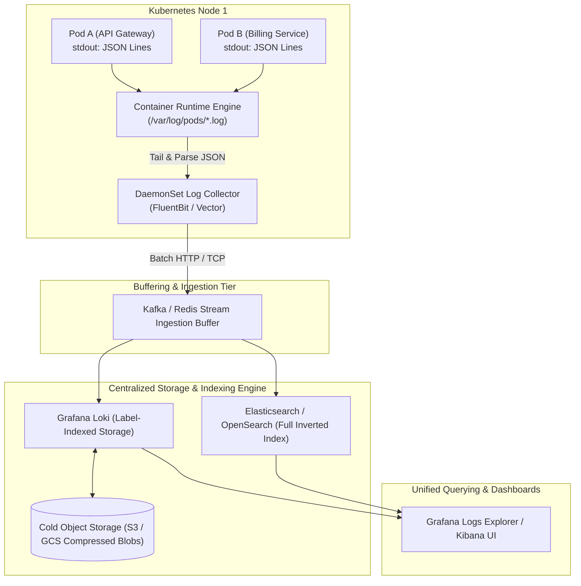
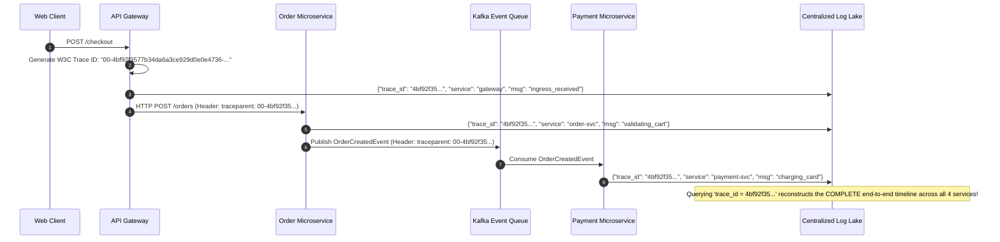
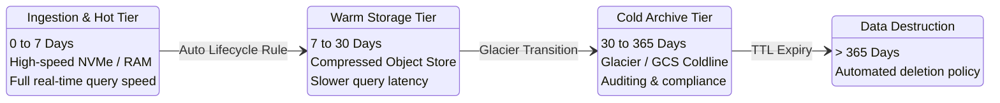
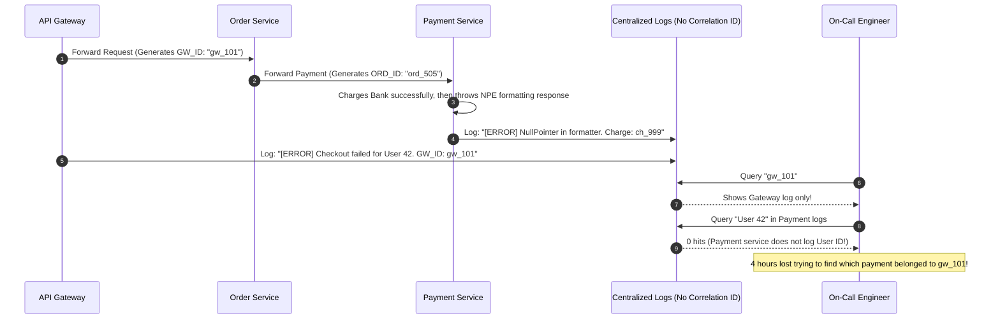

# Module 05: Centralized Logging and Best Practices

> **Prerequisites:** [Module 00: Error Handling Strategies](../00-error-handling-strategies/README.md), [Module 04: Logging Fundamentals](../04-logging-fundamentals/README.md).
> **Estimated Reading Time:** 30 minutes
> **Target Audience:** Backend Engineers, DevOps Engineers, SREs.

---

> [!TIP]
> **Golden Rule of Centralized Logging**: In distributed systems, treat application processes as strictly ephemeral log emitters that stream structured JSON to `stdout`. Decouple log aggregation and shipping to specialized node-level daemonsets (FluentBit, Vector), tag every log record with a persistent W3C distributed `trace_id` propagated across HTTP headers and message queues, and enforce tiered retention policies (hot 7-day SSD, warm 30-day object storage, cold 1-year archive) to control storage costs.

---

## 1. Visual Mental Models & System Architecture

In modern cloud environments, applications run as dozens or hundreds of ephemeral containers across a dynamic cluster. Containers are destroyed on deploy, rescheduled on node failure, and scaled down when traffic drops. When an ephemeral pod is terminated, its local filesystem vanishes. 

The traditional practice of SSHing into a server to run `tail -f /var/log/app.log` is dead. Production operations require **Centralized Logging**, where all stdout streams from all pods converge into a single, high-speed, queryable log lake.

### The Centralized Log Shipping Pipeline



### Distributed Correlation via W3C Trace Context

A single user transaction often traverses multiple independent microservices and asynchronous message queues. Without a shared correlation identifier, diagnosing multi-service failures is nearly impossible:



### Tiered Log Lifecycle & Cost Management



---

## 2. Taxonomic Reference Grids & Systematic Comparison Grids

### Centralized Logging Engines Compared

| Dimension | Grafana Loki | Elasticsearch / OpenSearch | CloudWatch Logs / Datadog |
| :--- | :--- | :--- | :--- |
| **Indexing Philosophy** | **Labels only**; log lines are stored un-indexed in compressed chunk streams. | **Full inverted index**; every word and JSON field is indexed in Lucene. | Managed proprietary indexing; serverless ingestion. |
| **Storage Cost** | **Ultra-low** (stores compressed chunks directly in S3/GCS). | **High** (indexes consume $1.5\times$ raw data size on SSDs). | **High** (charges per GB ingested + per GB scanned). |
| **Query Speed** | Extremely fast on label filters; slower on brute-force regex grep over huge datasets. | Instant sub-second search across billions of words. | Fast, but subject to concurrency rate limits. |
| **Operational Overhead**| Low to Moderate (Stateless microservices backed by S3). | High (requires cluster sharding, JVM heap tuning, and disk rebalancing). | Zero infrastructure operations (Fully Managed). |
| **Best Suited For** | Cloud-native Kubernetes clusters running Prometheus & Grafana. | Complex security audit log search and enterprise text search. | Fast time-to-market teams wanting zero cluster ops. |

### W3C Trace Context Specification (`traceparent` header)

The W3C Trace Context standard defines the `traceparent` HTTP header format:
`00-4bf92f3577b34da6a3ce929d0e0e4736-00f067aa0ba902b7-01`

| Field Component | Character Width | Format | Purpose |
| :--- | :---: | :--- | :--- |
| **Version** | 2 hex chars | `00` | Current W3C specification version. |
| **Trace ID** | 32 hex chars | `4bf92f3577b34da6a3ce929d0e0e4736` | Globally unique 16-byte identifier for the entire distributed request. |
| **Parent Span ID** | 16 hex chars | `00f067aa0ba902b7` | Unique 8-byte identifier for the immediate upstream caller. |
| **Trace Flags** | 2 hex chars | `01` | Bitmask controlling options (e.g., `01` = recorded/sampled). |

---

## 3. Production War Stories: Incident Post-Mortem

### The Incident: Multi-Service Outage Investigation Stalled for 4 Hours Due to Missing Correlation IDs

- **Severity:** SEV-1 (Critical Checkout Outage)
- **Time to Detection:** 4 hours 15 minutes
- **Time to Mitigation:** 20 minutes
- **Impact:** An intermittent payment failure dropped 18% of e-commerce checkout attempts during a flash sale. Investigation stalled because engineers could not correlate API Gateway logs with downstream Payment logs.

#### What Happened
A multi-service platform comprised an API Gateway, an Order Service, an Inventory Service, and a Payment Service. A user reported: *"My cart failed with an error saying 'Payment Declined', but my bank account was charged."*

The SRE team opened Kibana to investigate. The API Gateway logged:
`[ERROR] Order 8812 failed: payment service returned 500`

The engineer then searched the Payment Service logs for `"Order 8812"`. Zero records appeared. 

The Payment Service logged transactions strictly by internal `"charge_id"`, which was generated downstream. Each service had its own independent logging convention with separate random IDs. Over 40,000 requests per minute were flowing through the system; searching by timestamp yielded hundreds of concurrent payment events. The on-call team spent over four hours manually guessing timestamps across log files to piece together what happened.



#### Root Cause
1. **Absence of a Global Trace Identifier:** Services failed to propagate a consistent distributed correlation ID across HTTP boundaries.
2. **Disconnected Logging Paradigms:** Different engineering teams logged domain entities using inconsistent naming schemes (`gw_id` vs `ord_id` vs `charge_id`), preventing automated join queries.

#### The Fix & Architectural Hardening
1. **Mandated W3C `traceparent` Propagation:** Added HTTP interceptors to all microservices and HTTP client libraries. The edge API Gateway generates a W3C `trace_id` if absent, and all downstream services forward the header.
2. **Automatic Trace Injection in Logger:** Configured log formatters to automatically append `trace_id` to every JSON log output.
3. **Outcome:** During the next incident, querying `trace_id = "4bf9..."` in Grafana returned the unified, chronological log trail across all four services in under **90 seconds**, cutting Mean Time to Identify (MTTI) by 98%.

---

## 4. Multi-Language Production Implementations

The following code tabs implement W3C Trace Context propagation and structured log enrichment across Go, TypeScript, and Python.

### Go Production Implementation (W3C Trace Context Propagation)

```go
package main

import (
	"context"
	"crypto/rand"
	"encoding/hex"
	"fmt"
	"log/slog"
	"net/http"
	"os"
	"strings"
)

type ctxKey string
const TraceIDKey ctxKey = "trace_id"

// GenerateW3CTraceID generates a compliant 16-byte hex trace ID.
func GenerateW3CTraceID() string {
	b := make([]byte, 16)
	_, _ = rand.Read(b)
	return hex.EncodeToString(b)
}

// TraceContextMiddleware extracts or injects W3C traceparent headers.
func TraceContextMiddleware(next http.Handler) http.Handler {
	return http.HandlerFunc(func(w http.ResponseWriter, r *http.Request) {
		traceHeader := r.Header.Get("traceparent")
		var traceID string

		// Format: 00-{trace_id}-{parent_id}-{flags}
		parts := strings.Split(traceHeader, "-")
		if len(parts) == 4 && len(parts[1]) == 32 {
			traceID = parts[1]
		} else {
			traceID = GenerateW3CTraceID()
			traceHeader = fmt.Sprintf("00-%s-0000000000000000-01", traceID)
		}

		ctx := context.WithValue(r.Context(), TraceIDKey, traceID)
		w.Header().Set("traceparent", traceHeader)
		w.Header().Set("X-Trace-ID", traceID)

		next.ServeHTTP(w, r.WithContext(ctx))
	})
}

// OutgoingHTTPClient creates an HTTP client that forwards the traceparent header.
func ForwardRequest(ctx context.Context, targetURL string) (*http.Response, error) {
	req, err := http.NewRequestWithContext(ctx, "GET", targetURL, nil)
	if err != nil {
		return nil, err
	}

	if traceID, ok := ctx.Value(TraceIDKey).(string); ok {
		req.Header.Set("traceparent", fmt.Sprintf("00-%s-0000000000000000-01", traceID))
	}

	return http.DefaultClient.Do(req)
}
```

### TypeScript / Node.js Production Implementation (Express & Axios Interceptors)

```typescript
import { Request, Response, NextFunction } from 'express';
import axios from 'axios';
import { AsyncLocalStorage } from 'async_hooks';
import crypto from 'crypto';

interface TraceContext {
  traceId: string;
}

export const traceStorage = new AsyncLocalStorage<TraceContext>();

// Middleware to parse and propagate W3C traceparent
export function w3cTraceMiddleware(req: Request, res: Response, next: NextFunction): void {
  const header = req.headers['traceparent'] as string | undefined;
  let traceId = '';

  if (header && header.startsWith('00-')) {
    const parts = header.split('-');
    if (parts.length === 4 && parts[1].length === 32) {
      traceId = parts[1];
    }
  }

  if (!traceId) {
    traceId = crypto.randomBytes(16).toString('hex');
  }

  const outboundHeader = `00-${traceId}-0000000000000000-01`;
  res.setHeader('traceparent', outboundHeader);
  res.setHeader('X-Trace-ID', traceId);

  traceStorage.run({ traceId }, () => {
    next();
  });
}

// Axios Interceptor automatically attaching traceparent to all outgoing calls
export const apiClient = axios.create();

apiClient.interceptors.request.use((config) => {
  const context = traceStorage.getStore();
  if (context?.traceId) {
    config.headers['traceparent'] = `00-${context.traceId}-0000000000000000-01`;
  }
  return config;
});
```

### Python Production Implementation (FastAPI & HTTPX W3C Forwarding)

```python
"""
Enterprise W3C Trace Context Middleware and Downstream HTTPX Client.
Guarantees uniform distributed trace correlation across services.
"""

from __future__ import annotations

import contextvars
import os
import secrets
from typing import Callable
from fastapi import FastAPI, Request, Response
import httpx

trace_id_ctx: contextvars.ContextVar[str] = contextvars.ContextVar("trace_id", default="")
app = FastAPI()


@app.middleware("http")
async def w3c_trace_context_middleware(request: Request, call_next: Callable) -> Response:
    traceparent = request.headers.get("traceparent")
    trace_id = ""

    if traceparent and traceparent.startswith("00-"):
        parts = traceparent.split("-")
        if len(parts) == 4 and len(parts[1]) == 32:
            trace_id = parts[1]

    if not trace_id:
        trace_id = secrets.token_hex(16)
        traceparent = f"00-{trace_id}-0000000000000000-01"

    token = trace_id_ctx.set(trace_id)
    try:
        response = await call_next(request)
        response.headers["traceparent"] = traceparent
        response.headers["X-Trace-ID"] = trace_id
        return response
    finally:
        trace_id_ctx.reset(token)


async def call_downstream_service(url: str) -> httpx.Response:
    """Invokes downstream microservice, propagating the traceparent header."""
    trace_id = trace_id_ctx.get()
    headers = {}
    if trace_id:
        headers["traceparent"] = f"00-{trace_id}-0000000000000000-01"

    async with httpx.AsyncClient() as client:
        return await client.get(url, headers=headers)
```

---

## 5. Practical Hands-On Verification CLI Workflows

Verify W3C trace propagation and test log shipping using native command line tools.

### Workflow 1: Inspecting Inbound and Outbound W3C Trace Headers

```bash
# Send request with a custom W3C traceparent and verify header echo
curl -i -s "http://localhost:8000/api/v1/orders" \
  -H "traceparent: 00-4bf92f3577b34da6a3ce929d0e0e4736-00f067aa0ba902b7-01"
```

Expected wire output:
```text
HTTP/1.1 200 OK
Date: Tue, 10 Nov 2026 14:00:00 GMT
traceparent: 00-4bf92f3577b34da6a3ce929d0e0e4736-00f067aa0ba902b7-01
X-Trace-ID: 4bf92f3577b34da6a3ce929d0e0e4736
Content-Type: application/json
```

---

## 6. Operational Validation Checkpoints (Scenario Quizzes)

### Checkpoint 1: Why Loki Indexes Only Labels, Not Full Log Lines
**Scenario:** An engineering team evaluates Grafana Loki against Elasticsearch for centralized logging across 200 Kubernetes microservices. The team is worried because Loki does not build a full-text inverted index on the log body. Why is this architectural choice actually Loki's greatest operational advantage?

<details><summary>Click to view diagnosis and architectural solution</summary>

**Answer:**
1. **The Elasticsearch SSD Cost Problem:**
   Elasticsearch parses every word in every log line into Lucene inverted index trees. On high-volume logging (e.g., 500 GB/day), index overhead requires massive physical RAM allocations and expensive enterprise NVMe SSD disks.
2. **Loki's Efficiency Model:**
   Loki indexes only **metadata labels** (e.g., `app="billing"`, `env="prod"`). The actual log lines are compressed into gzip/zstd chunks and stored directly in cheap cloud object storage (S3/GCS).
3. **The Trade-Off:**
   Loki reduces log infrastructure costs by **80% to 90%**. While full-text queries perform a streaming grep over compressed chunks, combining label filters with `trace_id` makes queries fast enough for real-time debugging.
</details>

---

### Checkpoint 2: The Danger of High-Cardinality Labels in Grafana Loki
**Scenario:** A developer configures the log shipper to extract `user_id` from every JSON log line and add it as a Loki index label: `stream = {app="order-svc", user_id="u_9941"}`. Within three days, the Loki ingester pods crash with Out-Of-Memory errors. What happened?

<details><summary>Click to view diagnosis and architectural solution</summary>

**Answer:**
1. **High Cardinality Explosion:**
   In Loki, each unique combination of label key-values creates an independent **log stream**. If an application has 1,000,000 active users, adding `user_id` as a label creates 1,000,000 distinct streams.
2. **Memory Exhaustion:**
   Loki maintains in-memory chunk buffers for every active stream before flushing them to S3. 1,000,000 concurrent streams overwhelm the ingester's RAM, causing OOM crashes.
3. **The Solution:**
   Keep Loki labels strictly low-cardinality: `app`, `env`, `namespace`, `cluster`. Keep high-cardinality fields (`user_id`, `order_id`, `trace_id`) **inside the JSON log body**, querying them via LogQL line filters: `{app="order-svc"} | json | user_id = "u_9941"`.
</details>

---

### Checkpoint 3: GDPR Compliance and the Right to Be Forgotten in Centralized Logs
**Scenario:** Under GDPR Article 17 ("Right to be Forgotten"), a former customer requests the complete erasure of their personal data. The legal compliance team discovers that the customer's plaintext email address is stored across 30,000 log lines in an immutable cloud logging bucket with a 90-day retention lock. How do you resolve this architectural conflict?

<details><summary>Click to view diagnosis and architectural solution</summary>

**Answer:**
1. **The Conflict with Write-Once Storage:**
   Modern compliant log lakes (e.g., S3 Object Lock) are intentionally immutable (WORM) to prevent tampering by attackers or rogue administrators. Selectively deleting individual log lines from compressed gzip chunks without breaking SHA verification hashes is virtually impossible.
2. **Architectural Prevention (Pseudonymization):**
   - Never log raw customer emails, names, or phone numbers.
   - Replace PII in logs with an internal **pseudonymous customer token** (e.g., `usr_9a8f21bc`).
   - Maintain the mapping between `usr_9a8f21bc` and the real email in an ACID relational database.
   - When a GDPR erasure request arrives, delete the single row in the relational database. The logs remain intact for operational auditing, but the customer's data is permanently anonymized.
</details>

---

## 7. Further Reading & References

- [W3C Trace Context Specification](https://www.w3.org/TR/trace-context/) — The authoritative standard for distributed trace headers.
- [Grafana Loki Architecture & Best Practices](https://grafana.com/docs/loki/latest/fundamentals/architecture/) — Official documentation on label indexing and chunk storage.
- [FluentBit Documentation](https://docs.fluentbit.io/) — High-performance log and metric shipper for Kubernetes.

---

## Next

[Module 06: Monitoring and Metrics](../06-monitoring-and-metrics/README.md) — Transition from event-level logs to aggregate time series, master the four Prometheus metric types, and apply the RED method to monitor service health.
