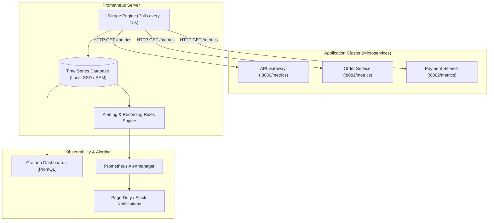
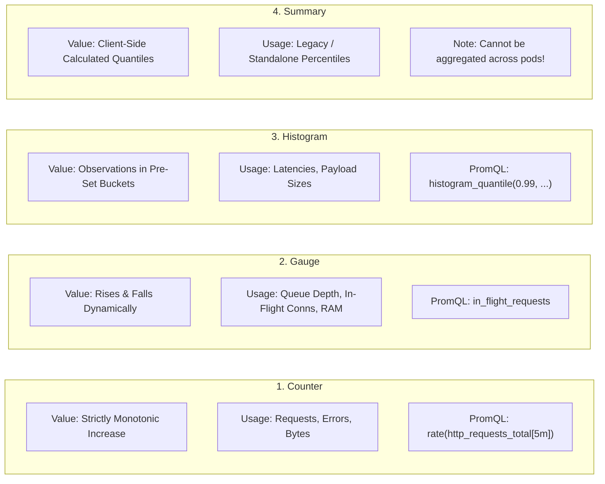
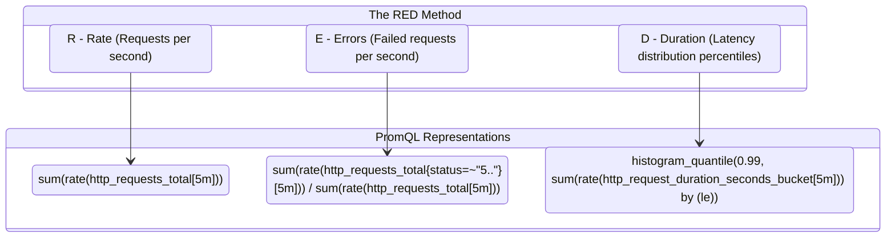
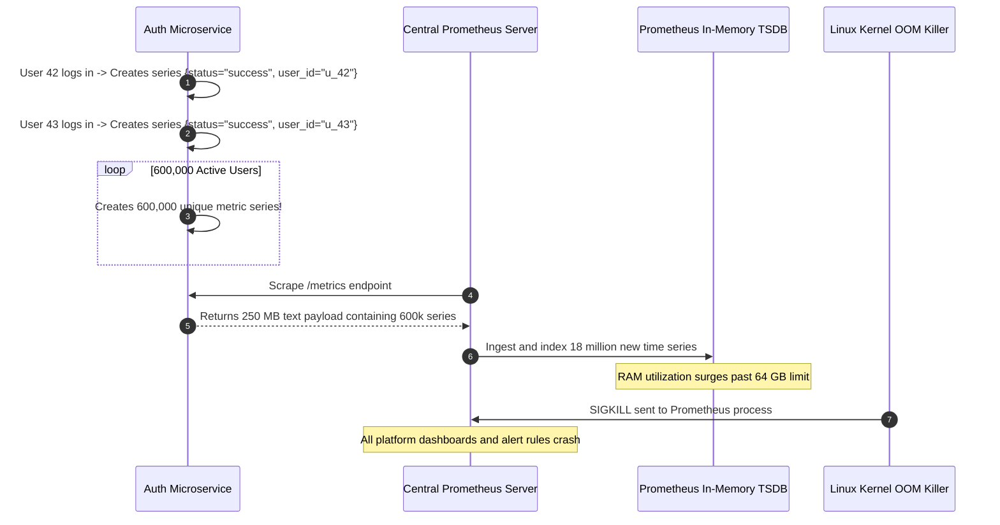

# Module 06: Monitoring and Metrics

> **Prerequisites:** [Module 04: Logging Fundamentals](../04-logging-fundamentals/README.md), [Module 05: Centralized Logging & Best Practices](../05-centralized-logging-and-best-practices/README.md).
> **Estimated Reading Time:** 30 minutes
> **Target Audience:** Backend Engineers, SREs, Systems Architects.

---

> [!TIP]
> **Golden Rule of Metrics Instrumentation**: Use **Counters** for values that only increase (requests served, errors encountered), **Gauges** for values that fluctuate up and down (in-flight connections, queue size, memory), and **Histograms** for statistical distributions (latencies, payload bytes). Instrument every request-driven service according to the **RED method** (Rate, Errors, Duration), and never place high-cardinality values (user IDs, email addresses, UUIDs) into metric labels.

---

## 1. Visual Mental Models & System Architecture

Logs tell the granular story of individual requests; **Metrics** answer the aggregate, macro-level question: *"Is the service healthy right now?"* 

A metric is an aggregate numeric measurement sampled over time (a time series). While logging costs bytes-per-event and becomes expensive under high load, metrics have near-zero overhead: a metric is simply a numerical counter updated in memory and exposed via an HTTP endpoint.

### The Prometheus Pull-Based Metrics Architecture



### The Four Prometheus Metric Types



### The RED Method Framework for Services

For every request-driven service, structure your baseline dashboard around the **RED Method**:



---

## 2. Taxonomic Reference Grids & Systematic Comparison Grids

### Prometheus Metric Types Reference

| Metric Type | Mathematical Behavior | When to Use | Key PromQL Functions | Critical Anti-Pattern |
| :--- | :--- | :--- | :--- | :--- |
| **Counter** | Monotonically increasing integer or float (resets to 0 on crash). | Request totals, error totals, task completions, cache hits. | `rate()`, `increase()` | Do not use for values that can decrease. Never alert on raw counter value! |
| **Gauge** | Value can increase or decrease arbitrarily. | Active connections, memory usage, worker queue depth, disk usage. | `avg_over_time()`, `delta()` | Do not use for counting events (use Counter instead). |
| **Histogram** | Counts observations across configurable cumulative buckets (`le`). | Request duration, response payload sizes, external API call latencies. | `histogram_quantile()`, `sum(rate())` | Setting bucket boundaries poorly, destroying p99 resolution. |
| **Summary** | Computes quantiles (p50, p99) directly in client memory. | Static single-instance services needing cheap percentiles. | Direct quantile retrieval | **Cannot be aggregated across replicas!** (Mathematically invalid). |

### Monitoring Methodologies Compared

| Methodology | Target Domain | The Core Signals Measured |
| :--- | :--- | :--- |
| **RED Method** | Request-driven services (HTTP APIs, gRPC services). | **R**ate, **E**rrors, **D**uration. |
| **USE Method** | Hardware resources (CPUs, Disks, Memory, Network interfaces). | **U**tilization, **S**aturation, **E**rrors. |
| **Google Four Golden Signals** | Comprehensive service level agreements (SRE standard). | Latency, Traffic, Errors, Saturation. |

### The Metric Cardinality Explosion Matrix

Cardinality is the total number of unique time series generated by a metric:
$$\text{Total Time Series} = \prod_{\text{labels}} |\text{unique label values}|$$

| Metric Definition | Label Set Dimensions | Resulting Time Series Count | Operational Feasibility |
| :--- | :--- | :--- | :--- |
| `http_requests_total` | `method` (4) $\times$ `status` (5) $\times$ `handler` (20) | $4 \times 5 \times 20 = \mathbf{400}$ | **Extremely Safe** (< 1MB RAM) |
| With `tenant_id` | $400 \times \text{tenants } (500)$ | $400 \times 500 = \mathbf{200{,}000}$ | **Moderate** (Acceptable on dedicated cluster) |
| With `user_id` | $400 \times \text{users } (1{,}000{,}000)$ | $400 \times 1{,}000{,}000 = \mathbf{400{,}000{,}000}$ | **FATAL: Prometheus OOM Crash!** |

---

## 3. Production War Stories: Incident Post-Mortem

### The Incident: Prometheus Server Crash from User-ID Injected into Metric Labels

- **Severity:** SEV-1 (Complete Observability Outage)
- **Time to Detection:** 12 minutes
- **Time to Mitigation:** 35 minutes
- **Impact:** Central Prometheus server crashed due to Linux kernel OOM killer. All platform dashboards, autoscaling triggers, and alerting rules went offline simultaneously across 40 production microservices.

#### What Happened
An engineer deployed an update to the user authentication service. To visualize which customers experienced login friction, the developer modified the Prometheus metric declaration:

```python
# The Defective Metric Declaration
LOGIN_ATTEMPTS = Counter(
    "auth_login_attempts_total",
    "Login attempts by user and status",
    ["status", "user_id"],  # High-cardinality hazard!
)
```

The service served 600,000 active users. As customers logged in on Monday morning, every unique user ID spawned a brand new Prometheus time series. 

Within 10 minutes, the Prometheus server's active time series count surged from 250,000 to **18,500,000 series**. Prometheus RAM consumption spiked from 12 GB to 64 GB, completely exhausting node physical memory and triggering the Linux kernel OOM killer.



#### Root Cause
1. **High-Cardinality Metric Labels:** Inserting an unbounded, dynamic identifier (`user_id`) into Prometheus metric labels, triggering exponential series creation.
2. **Missing Scrape Series Limits:** The Prometheus scrape configuration lacked defensive `sample_limit` guards to reject oversized metric payloads.

#### The Fix & Architectural Hardening
1. **Removed High-Cardinality Labels:** Stripped `user_id` from metric labels. High-cardinality debugging was routed exclusively to structured logs and distributed traces.
2. **Scrape Limit Enforcement:** Configured Prometheus scrape job guards to automatically drop targets that exceed 10,000 samples:
   ```yaml
   # prometheus.yml
   scrape_configs:
     - job_name: 'auth-service'
       sample_limit: 10000
   ```
3. **Automated CI Cardinality Linter:** Added an AST linter in CI that scans all Prometheus metric declarations and fails builds if label names include `user_id`, `email`, `order_id`, or `token`.

---

## 4. Multi-Language Production Implementations

The following code tabs demonstrate production instrumentation: Counter, Gauge, and Histogram metrics exposed via `/metrics` according to the RED method across Go, TypeScript, and Python.

### Go Production Implementation (`prometheus/client_golang`)

```go
package main

import (
	"net/http"
	"strconv"
	"time"

	"github.com/prometheus/client_golang/prometheus"
	"github.com/prometheus/client_golang/prometheus/promhttp"
)

var (
	// RED Method: Rate & Errors
	httpRequestsTotal = prometheus.NewCounterVec(
		prometheus.CounterOpts{
			Name: "http_requests_total",
			Help: "Total number of HTTP requests processed.",
		},
		[]string{"method", "handler", "status"},
	)

	// RED Method: Duration (Latency Distribution)
	httpRequestDuration = prometheus.NewHistogramVec(
		prometheus.HistogramOpts{
			Name:    "http_request_duration_seconds",
			Help:    "HTTP request latency distribution in seconds.",
			Buckets: []float64{0.005, 0.01, 0.025, 0.05, 0.1, 0.25, 0.5, 1.0, 2.5},
		},
		[]string{"method", "handler"},
	)

	// In-Flight Request Gauge
	inFlightRequests = prometheus.NewGauge(
		prometheus.GaugeOpts{
			Name: "http_in_flight_requests",
			Help: "Current number of in-flight HTTP requests.",
		},
	)
)

func init() {
	prometheus.MustRegister(httpRequestsTotal)
	prometheus.MustRegister(httpRequestDuration)
	prometheus.MustRegister(inFlightRequests)
}

// InstrumentMiddleware wraps an http.Handler with RED metrics.
func InstrumentMiddleware(handlerName string, next http.HandlerFunc) http.HandlerFunc {
	return func(w http.ResponseWriter, r *http.Request) {
		inFlightRequests.Inc()
		defer inFlightRequests.Dec()

		start := time.Now()
		rw := &statusResponseWriter{ResponseWriter: w, statusCode: http.StatusOK}
		
		next.ServeHTTP(rw, r)

		duration := time.Since(start).Seconds()
		statusStr := strconv.Itoa(rw.statusCode)

		httpRequestsTotal.WithLabelValues(r.Method, handlerName, statusStr).Inc()
		httpRequestDuration.WithLabelValues(r.Method, handlerName).Observe(duration)
	}
}

type statusResponseWriter struct {
	http.ResponseWriter
	statusCode int
}

func (rw *statusResponseWriter) WriteHeader(code int) {
	rw.statusCode = code
	rw.ResponseWriter.WriteHeader(code)
}
```

### TypeScript / Node.js Production Implementation (`prom-client`)

```typescript
import express, { Request, Response, NextFunction } from 'express';
import client from 'prom-client';

const app = express();

// Initialize Prometheus Default Metrics (CPU, Memory, Event Loop)
client.collectDefaultMetrics({ prefix: 'node_' });

// RED Method: Rate & Errors
const httpRequestsTotal = new client.Counter({
  name: 'http_requests_total',
  help: 'Total number of HTTP requests processed.',
  labelNames: ['method', 'route', 'status'],
});

// RED Method: Duration (Latency Distribution)
const httpRequestDuration = new client.Histogram({
  name: 'http_request_duration_seconds',
  help: 'HTTP request duration in seconds.',
  labelNames: ['method', 'route'],
  buckets: [0.005, 0.01, 0.025, 0.05, 0.1, 0.25, 0.5, 1.0, 2.5],
});

// In-Flight Request Gauge
const inFlightRequests = new client.Gauge({
  name: 'http_in_flight_requests',
  help: 'Current number of active in-flight requests.',
});

export function metricsMiddleware(req: Request, res: Response, next: NextFunction): void {
  const start = process.hrtime.bigint();
  inFlightRequests.inc();

  res.on('finish', () => {
    inFlightRequests.dec();
    const durationSeconds = Number(process.hrtime.bigint() - start) / 1_000_000_000;
    const route = req.route?.path || req.path;

    httpRequestsTotal.inc({
      method: req.method,
      route,
      status: res.statusCode.toString(),
    });

    httpRequestDuration.observe({ method: req.method, route }, durationSeconds);
  });

  next();
}

// Expose standard /metrics endpoint
app.get('/metrics', async (req: Request, res: Response) => {
  res.setHeader('Content-Type', client.register.contentType);
  res.send(await client.register.metrics());
});
```

### Python Production Implementation (FastAPI with `prometheus_client`)

```python
"""
Production FastAPI Prometheus Instrumentation implementing the RED Method.
Provides Prometheus metric exposition, latency histograms, and in-flight gauges.
"""

from __future__ import annotations

import time
from fastapi import FastAPI, Request, Response
from prometheus_client import (
    Counter,
    Gauge,
    Histogram,
    generate_latest,
    CONTENT_TYPE_LATEST,
)

app = FastAPI()

# 1. Rate & Errors (Counter)
HTTP_REQUESTS_TOTAL = Counter(
    "http_requests_total",
    "Total HTTP requests processed by method, endpoint, and status.",
    ["method", "endpoint", "status"],
)

# 2. Duration (Histogram)
HTTP_REQUEST_DURATION_SECONDS = Histogram(
    "http_request_duration_seconds",
    "HTTP request latency distribution in seconds.",
    ["method", "endpoint"],
    buckets=[0.005, 0.01, 0.025, 0.05, 0.1, 0.25, 0.5, 1.0, 2.5],
)

# 3. Saturation (In-Flight Gauge)
IN_FLIGHT_REQUESTS = Gauge(
    "http_in_flight_requests",
    "Number of active in-flight HTTP requests.",
)


@app.middleware("http")
async def prometheus_metrics_middleware(request: Request, call_next) -> Response:
    IN_FLIGHT_REQUESTS.inc()
    start_time = time.perf_counter()
    status_code = 500

    try:
        response = await call_next(request)
        status_code = response.status_code
        return response
    finally:
        duration = time.perf_counter() - start_time
        IN_FLIGHT_REQUESTS.dec()

        # Sanitize endpoint path to prevent cardinality explosion from IDs (/users/123 -> /users/{id})
        endpoint = request.url.path
        if request.scope.get("endpoint"):
            endpoint = getattr(request.scope["endpoint"], "__name__", endpoint)

        HTTP_REQUESTS_TOTAL.labels(
            method=request.method,
            endpoint=endpoint,
            status=str(status_code),
        ).inc()

        HTTP_REQUEST_DURATION_SECONDS.labels(
            method=request.method,
            endpoint=endpoint,
        ).observe(duration)


@app.get("/metrics")
def metrics() -> Response:
    return Response(content=generate_latest(), media_type=CONTENT_TYPE_LATEST)
```

---

## 5. Practical Hands-On Verification CLI Workflows

Verify Prometheus `/metrics` exposition and validate PromQL output using standard command line tools.

### Workflow 1: Scraping and Validating Metric Format via cURL

```bash
# Scrape the metrics endpoint and filter for HTTP request metrics
curl -s http://localhost:8000/metrics | grep -E "^http_requests_total"
```

Expected wire output:
```text
# HELP http_requests_total Total HTTP requests processed by method, endpoint, and status.
# TYPE http_requests_total counter
http_requests_total{endpoint="get_orders",method="GET",status="200"} 4128.0
http_requests_total{endpoint="create_order",method="POST",status="201"} 184.0
http_requests_total{endpoint="create_order",method="POST",status="422"} 12.0
```

---

## 6. Operational Validation Checkpoints (Scenario Quizzes)

### Checkpoint 1: Why You Must Never Alert on Raw Counter Values
**Scenario:** A junior SRE configures an alert rule: `http_requests_total{status="500"} > 50`. The alert fires every day at 3:00 PM, even when the service is completely healthy and handling millions of requests with a 99.999% success rate. Why is this rule flawed, and what is the proper PromQL formulation?

<details><summary>Click to view diagnosis and architectural solution</summary>

**Answer:**
1. **The Flaw of Monotonic Accumulation:**
   A Counter **only goes up**. If a service handles 10 million requests over two months and accumulates 51 intermittent errors over 60 days, `http_requests_total` will equal 51 forever. The alert will stay permanently triggered until the pod restarts!
2. **The Correct PromQL Formulation:**
   Always use **`rate()`** over a time window to measure the rate of change per second:
   ```promql
   sum(rate(http_requests_total{status="500"}[5m])) > 5
   ```
   Or better, calculate the **error percentage**:
   ```promql
   sum(rate(http_requests_total{status=~"5.."}[5m])) 
   / 
   sum(rate(http_requests_total[5m])) > 0.01  # Alert if error rate > 1%
   ```
</details>

---

### Checkpoint 2: Sizing Prometheus Histogram Buckets for Web Latency
**Scenario:** An API service defines latency histogram buckets: `[1.0, 5.0, 10.0, 30.0]`. When calculating `histogram_quantile(0.99, ...)` in Grafana, the dashboard shows that p99 latency is flat at exactly 1.0 second, even though users complain about slow 250ms page loads. What went wrong?

<details><summary>Click to view diagnosis and architectural solution</summary>

**Answer:**
1. **Histogram Bucket Quantization Loss:**
   Prometheus calculates quantiles using linear interpolation inside the buckets. If the smallest bucket is `1.0` second, all fast requests (e.g., 20ms, 150ms, 400ms) fall into the first bucket (`<= 1.0`). Prometheus has zero visibility into where within the 0 to 1.0s range the requests actually landed!
2. **The Fix (Sub-Second Buckets):**
   Configure buckets that mirror human-perceived web latency SLAs:
   ```python
   buckets = [0.005, 0.01, 0.025, 0.05, 0.1, 0.25, 0.5, 1.0, 2.5, 5.0]
   ```
   This provides granular resolution around 50ms, 100ms, and 250ms boundaries.
</details>

---

### Checkpoint 3: Why Summary Metrics Cannot Be Aggregated Across Pods
**Scenario:** A company operates 10 replicas of an API service. To save Prometheus storage, an engineer replaces the latency Histogram with a Prometheus Summary metric configured to compute the 99th percentile client-side. The dashboard runs `avg(http_request_duration_seconds{quantile="0.99"})`. Why is this mathematically invalid?

<details><summary>Click to view diagnosis and architectural solution</summary>

**Answer:**
1. **The Fallacy of Averaging Percentiles:**
   Averaging percentiles across independent datasets is mathematically meaningless. If Pod A serves 10 requests with p99 = 100ms, and Pod B serves 100,000 requests with p99 = 2,000ms, averaging their p99s yields:
   $$\frac{100\text{ms} + 2000\text{ms}}{2} = 1050\text{ms}$$
   This completely ignores traffic weight and obscures the true platform p99.
2. **Histograms Enable Global Quantiles:**
   Histograms expose raw observation counts per bucket (`_bucket`). Prometheus can sum the buckets across all 10 pods first, and then calculate the true global platform percentile using `histogram_quantile(0.99, sum(...) by (le))`.
</details>

---

## 7. Further Reading & References

- [Prometheus Metric Types Documentation](https://prometheus.io/docs/concepts/metric_types/) — Official reference for Counters, Gauges, Histograms, and Summaries.
- [The RED Method by Tom Wilkie](https://grafana.com/blog/2018/08/02/the-red-method-how-to-instrument-your-services/) — The definitive guide to microservice rate, error, and duration monitoring.
- [PromQL Tutorial: `rate()` vs. `increase()`](https://prometheus.io/docs/prometheus/latest/querying/functions/) — Understanding time-window derivations over monotonic counters.

---

## Next

[Module 07: The Three Pillars of Observability](../07-the-three-pillars-of-observability/README.md) — Synthesize logs, metrics, and distributed traces into a unified observability framework using the OpenTelemetry standard.
