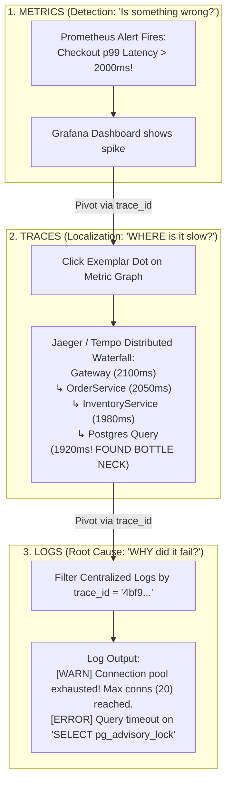
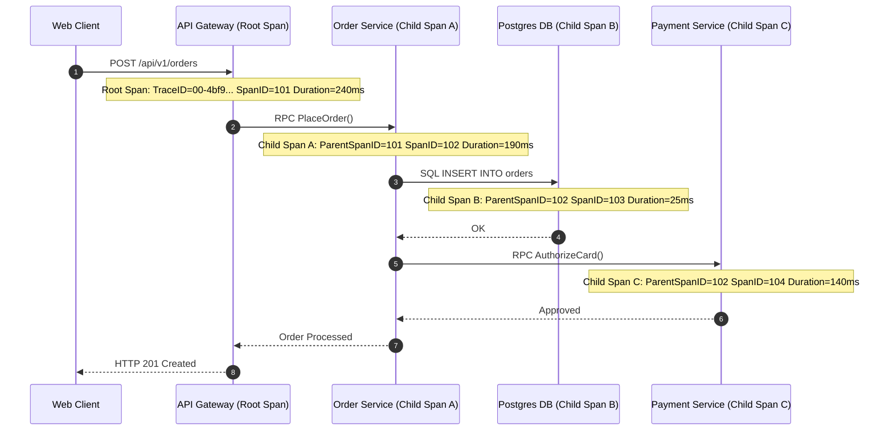
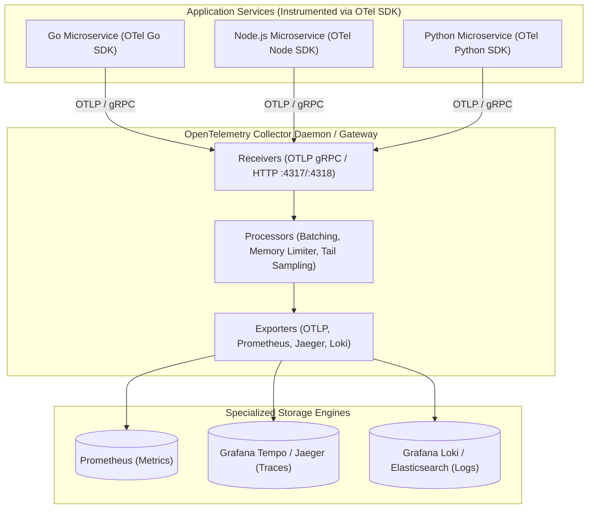

# Module 07: The Three Pillars of Observability

> **Prerequisites:** [Module 04: Logging Fundamentals](../04-logging-fundamentals/README.md), [Module 05: Centralized Logging & Best Practices](../05-centralized-logging-and-best-practices/README.md), [Module 06: Monitoring and Metrics](../06-monitoring-and-metrics/README.md).
> **Estimated Reading Time:** 30 minutes
> **Target Audience:** Backend Engineers, SREs, Systems Architects.

---

> [!TIP]
> **Golden Rule of the Three Pillars**: Treat **Metrics**, **Traces**, and **Logs** not as isolated siloed tools, but as three correlated perspectives of the exact same distributed execution. Use **Metrics** to detect *when* and *that* an anomaly is occurring, **Traces** to isolate *where* in the distributed dependency graph the latency or failure occurred, and **Logs** to diagnose *why* the failure happened at that exact line of code. Anchor all three signals to a shared W3C `trace_id` using **OpenTelemetry (OTel)**.

---

## 1. Visual Mental Models & System Architecture

Modern distributed architectures break traditional debugging assumptions. A metric dashboard informs you that p99 latency has surged to 3 seconds; a log tells you that a specific transaction aborted. Neither tool explains *where* the request spent those 3 seconds. 

Did the request wait 2.9 seconds in an overloaded database connection pool, stall in an un-batched downstream RPC loop, or queue behind garbage collection? Answering this requires **Distributed Tracing**, the third pillar that unifies your telemetry into an actionable diagnostic workflow.

### The Observability Triad Correlation Flywheel



### Anatomy of a Distributed Trace (Spans & Context Trees)

A **Trace** represents the complete lifecycle of a request as it flows across a distributed system. A trace is a directed acyclic graph (DAG) of **Spans**, where each span represents a contiguous timed block of work:



### The OpenTelemetry (OTel) Unified Pipeline

OpenTelemetry provides a single vendor-agnostic standard (API, SDK, and Collector) that outputs all three signals via the OpenTelemetry Protocol (**OTLP**):



---

## 2. Taxonomic Reference Grids & Systematic Comparison Grids

### The Three Pillars Systematic Comparison

| Signal Dimension | Metrics | Distributed Traces | Structured Logs |
| :--- | :--- | :--- | :--- |
| **Operational Role** | **Detection**: Warns that an anomaly is occurring. | **Localization**: Identifies which service or query is the bottleneck. | **Diagnosis**: Pinpoints the exact code line, variables, and error message. |
| **Primary Data Structure** | Numerical Time Series (`timestamp`, `float64`, `labels`). | Directed Acyclic Graph of Spans (`trace_id`, `span_id`, `duration`). | Discrete JSON Events (`timestamp`, `message`, `level`, `attributes`). |
| **Data Volume & Cost** | **Constant**: Cost is independent of traffic volume. | **Scales with Traffic**: Requires sampling (1%–5%) to control cost. | **High**: Volume scales directly with user events and logging frequency. |
| **Cardinality Tolerance**| **Strictly Low**: Unbounded labels crash TSDBs. | **Very High**: Span attributes support high-cardinality IDs (`user_id`). | **Very High**: Full JSON bodies and user metadata supported. |
| **Industry Standard** | Prometheus / PromQL / OpenMetrics | W3C Trace Context / OpenTelemetry / Jaeger | OpenTelemetry / Grafana Loki / Elastic |

### OpenTelemetry Core Concepts Reference

| Concept | Architectural Definition | Practical Example |
| :--- | :--- | :--- |
| **TracerProvider** | State factory object maintaining tracer configuration and span exporters. | Initialized once at process boot: `otel.SetTracerProvider(tp)`. |
| **Tracer** | The operational interface used to start and end spans within a package. | `tracer := otel.Tracer("order-service")`. |
| **Span** | A single timed unit of work containing timestamps, name, status, and attributes. | Represents `db.query`, `http.handler`, or `cache.get`. |
| **Span Attributes** | Structured key-value metadata attached to a span. | `http.status_code = 200`, `db.statement = "SELECT * FROM users"`. |
| **Span Events** | Informational timestamped annotations inside a span (in-span logs). | `span.AddEvent("cache_miss_fallback_initiated")`. |
| **Baggage** | Contextual key-value pairs propagated across network boundaries (not indexed). | Propagating `account_tier = "enterprise"` across 5 downstream RPCs. |

### Trace Sampling Strategies

| Sampling Strategy | When Decision is Made | Pros | Cons & Failure Modes | Ideal Use Case |
| :--- | :--- | :--- | :--- | :--- |
| **Head Sampling** | At request ingress (in the root span). | Zero memory buffer required; simple percentage decision (`5%`). | **Blind to Errors**: If an error occurs on a non-sampled request, the trace is permanently lost! | High-volume APIs with uniform traffic distributions. |
| **Tail-Based Sampling** | At the OTel Collector after all spans complete. | **100% Error Capture**: Retains all 5xx traces and all slow traces ($>1\text{s}$) while dropping 99% of fast 200 OKs. | Requires OTel Collector to buffer traces in memory until requests finish. | Enterprise microservice production clusters. |

---

## 3. Production War Stories: Incident Post-Mortem

### The Incident: The 3-Second Mystery Latency in Microservice Mesh

- **Severity:** SEV-1 (Severe Latency Degradation)
- **Time to Detection:** 15 minutes
- **Time to Mitigation:** 25 minutes
- **Impact:** E-commerce checkout p99 latency jumped from 120ms to 3,250ms during prime shopping hours. Customer checkout abandonment surged 35%.

#### What Happened
A product team launched an e-commerce feature allowing customers to buy product bundles. Following the release, p99 checkout response times spiked to 3.2 seconds. 

Engineers opened Grafana. The Gateway showed 3.2s latency, but CPU, memory, and database connection pool utilization across all downstream microservices (Cart, Inventory, Pricing, Database) were hovering under 25%. Centralized logs revealed no errors. The on-call team was baffled: all downstream services appeared completely idle and healthy, yet requests took over 3 seconds to complete.

```mermaid
gantt
    title Distributed Waterfall Trace: GET /bundle/checkout (Total: 3,200ms)
    dateFormat  X
    axisFormat %s ms

    section Gateway
    HTTP Ingress Handler           :active, 0, 3200
    section CartService
    ValidateCart()                 :active, 20, 150
    section PricingService
    CalculateBundleDiscounts()     :crit, active, 150, 3150
    GetItemPrice(Item 1)           :150, 180
    GetItemPrice(Item 2)           :180, 210
    GetItemPrice(Item 3)           :210, 240
    GetItemPrice(Item 100)         :3120, 3150
```



#### Root Cause
With OpenTelemetry distributed tracing enabled, an engineer clicked an exemplar trace dot on the p99 latency metric. 

The Jaeger waterfall trace immediately exposed the smoking gun:
The `PricingService` contained a child span called `CalculateBundleDiscounts` that took **3,000ms**. Inside that span were **100 individual sequential child RPC spans** called `GetItemPrice()`, each taking 30ms:
$$100 \text{ sequential round-trips} \times 30\text{ms} = 3{,}000\text{ms}$$

A junior developer had written an un-batched `for` loop that called the item pricing microservice one item at a time over network HTTP, rather than passing the bundle of 100 IDs in a single batch query! Because each individual RPC took only 30ms, no individual service or database ever reported high load.

#### The Fix & Architectural Hardening
1. **Batched Downstream RPC:** Replaced the sequential `for` loop with a single batch RPC: `BatchGetItemPrices(item_ids)`.
2. **Post-Fix Performance:** The entire pricing operation collapsed from 100 sequential network round-trips into a single 35ms network call. Overall p99 checkout latency dropped from **3,250ms to 65ms** (a 98% reduction).
3. **Trace-Based Linting:** Configured an automated CI check with OpenTelemetry integration tests that alerts if an HTTP route issues more than 5 downstream RPC spans of the same type in a single request (detecting N+1 network queries).

---

## 4. Multi-Language Production Implementations

The following code tabs demonstrate how to initialize OpenTelemetry, create custom child spans, inject span attributes, and export telemetry via OTLP across Go, TypeScript, and Python.

### Go Production Implementation (OpenTelemetry Go SDK)

```go
package main

import (
	"context"
	"fmt"
	"log"
	"net/http"
	"time"

	"go.opentelemetry.io/otel"
	"go.opentelemetry.io/otel/attribute"
	"go.opentelemetry.io/otel/exporters/otlp/otlptrace/otlptracegrpc"
	"go.opentelemetry.io/otel/propagation"
	"go.opentelemetry.io/otel/sdk/resource"
	sdktrace "go.opentelemetry.io/otel/sdk/trace"
	semconv "go.opentelemetry.io/otel/semconv/v1.24.0"
	"go.opentelemetry.io/otel/trace"
)

var tracer trace.Tracer

func InitTracer(ctx context.Context, serviceName string) (*sdktrace.TracerProvider, error) {
	exporter, err := otlptracegrpc.New(ctx,
		otlptracegrpc.WithInsecure(),
		otlptracegrpc.WithEndpoint("localhost:4317"),
	)
	if err != nil {
		return nil, fmt.Errorf("failed to create OTLP trace exporter: %w", err)
	}

	res, err := resource.New(ctx,
		resource.WithAttributes(
			semconv.ServiceNameKey.String(serviceName),
			attribute.String("environment", "production"),
		),
	)
	if err != nil {
		return nil, err
	}

	tp := sdktrace.NewTracerProvider(
		sdktrace.WithBatcher(exporter),
		sdktrace.WithResource(res),
		sdktrace.WithSampler(sdktrace.AlwaysSample()),
	)

	otel.SetTracerProvider(tp)
	otel.SetTextMapPropagator(propagation.NewCompositeTextMapPropagator(
		propagation.TraceContext{},
		propagation.Baggage{},
	))

	tracer = otel.Tracer(serviceName)
	return tp, nil
}

// OrderProcessingService demonstrating nested custom spans
func ProcessOrder(ctx context.Context, orderID string, amount float64) error {
	ctx, span := tracer.Start(ctx, "ProcessOrder",
		trace.WithAttributes(
			attribute.String("order.id", orderID),
			attribute.Float64("order.amount", amount),
		),
	)
	defer span.End()

	// Child Span: Charge Card
	if err := authorizePayment(ctx, orderID, amount); err != nil {
		span.RecordError(err)
		span.SetAttributes(attribute.String("error.type", "payment_failed"))
		return err
	}

	span.AddEvent("order_processed_successfully")
	return nil
}

func authorizePayment(ctx context.Context, orderID string, amount float64) error {
	ctx, span := tracer.Start(ctx, "authorizePayment")
	defer span.End()

	time.Sleep(20 * time.Millisecond) // Simulate network RPC
	span.SetAttributes(attribute.String("payment.gateway", "stripe"))
	return nil
}
```

### TypeScript / Node.js Production Implementation (OpenTelemetry SDK)

```typescript
import { trace, context, SpanStatusCode } from '@opentelemetry/api';
import { NodeTracerProvider } from '@opentelemetry/sdk-trace-node';
import { BatchSpanProcessor } from '@opentelemetry/sdk-trace-base';
import { OTLPTraceExporter } from '@opentelemetry/exporter-trace-otlp-grpc';
import { Resource } from '@opentelemetry/resources';
import { SemanticResourceAttributes } from '@opentelemetry/semantic-conventions';

// Initialize OpenTelemetry Tracer Provider
const provider = new NodeTracerProvider({
  resource: new Resource({
    [SemanticResourceAttributes.SERVICE_NAME]: 'order-service-ts',
    [SemanticResourceAttributes.DEPLOYMENT_ENVIRONMENT]: 'production',
  }),
});

const exporter = new OTLPTraceExporter({ url: 'http://localhost:4317' });
provider.addSpanProcessor(new BatchSpanProcessor(exporter));
provider.register();

const tracer = trace.getTracer('order-service-ts');

export async function executeOrderWorkflow(orderId: string, customerId: string): Promise<void> {
  // Start Root/Parent Span
  return tracer.startActiveSpan('executeOrderWorkflow', async (parentSpan) => {
    try {
      parentSpan.setAttribute('order.id', orderId);
      parentSpan.setAttribute('customer.id', customerId);

      // Child Span: Inventory Check
      await tracer.startActiveSpan('checkInventory', async (childSpan) => {
        childSpan.setAttribute('inventory.warehouse', 'us-east-1');
        await new Promise((resolve) => setTimeout(resolve, 15));
        childSpan.end();
      });

      parentSpan.setStatus({ code: SpanStatusCode.OK });
    } catch (err: any) {
      parentSpan.recordError(err);
      parentSpan.setStatus({ code: SpanStatusCode.ERROR, message: err.message });
      throw err;
    } finally {
      parentSpan.end();
    }
  });
}
```

### Python Production Implementation (FastAPI with OpenTelemetry)

```python
"""
Enterprise OpenTelemetry Python Implementation.
Demonstrates custom span creation, span events, OTLP exporter setup,
and error status recording.
"""

from __future__ import annotations

import time
from opentelemetry import trace
from opentelemetry.exporter.otlp.proto.grpc.trace_exporter import OTLPSpanExporter
from opentelemetry.sdk.resources import Resource
from opentelemetry.sdk.trace import TracerProvider
from opentelemetry.sdk.trace.export import BatchSpanProcessor
from opentelemetry.trace import Status, StatusCode

# Initialize OTel Tracer Provider
resource = Resource.create({"service.name": "checkout-service-py", "environment": "production"})
provider = TracerProvider(resource=resource)
processor = BatchSpanProcessor(OTLPSpanExporter(endpoint="localhost:4317", insecure=True))
provider.add_span_processor(processor)
trace.set_tracer_provider(provider)

tracer = trace.get_tracer("checkout-service-py")


def process_checkout(cart_id: str, total_price: float) -> str:
    # Start parent span
    with tracer.start_as_current_span("process_checkout") as span:
        span.set_attribute("cart.id", cart_id)
        span.set_attribute("cart.total_price", total_price)

        try:
            # Child span: Reserve Stock
            with tracer.start_as_current_span("reserve_stock") as stock_span:
                stock_span.set_attribute("items.count", 3)
                time.sleep(0.02)  # Simulate database write
                stock_span.add_event("stock_reserved")

            # Child span: Authorize Payment
            with tracer.start_as_current_span("authorize_payment") as pay_span:
                pay_span.set_attribute("payment.method", "credit_card")
                time.sleep(0.04)

            span.set_status(Status(StatusCode.OK))
            return "SUCCESS"
        except Exception as exc:
            span.record_exception(exc)
            span.set_status(Status(StatusCode.ERROR, str(exc)))
            raise
```

---

## 5. Practical Hands-On Verification CLI Workflows

Launch an all-in-one local Jaeger observability container and inspect exported traces via web UI and API.

### Workflow 1: Running Local Jaeger Tracing UI with OTLP Ingestion

```bash
# Start an isolated Jaeger container supporting OTLP gRPC (4317), HTTP (4318), and UI (16686)
docker run -d --name jaeger-test \
  -p 16686:16686 \
  -p 4317:4317 \
  -p 4318:4318 \
  jaegertracing/all-in-one:latest
```

### Workflow 2: Verifying Ingestion of Spans via Jaeger REST API

```bash
# Query the Jaeger API for traces emitted by service "checkout-service-py"
curl -s "http://localhost:16686/api/traces?service=checkout-service-py&limit=1" | jq '.data[0].spans[] | {operationName, duration, spanID}'
```

Expected wire output:
```json
{
  "operationName": "process_checkout",
  "duration": 60234,
  "spanID": "a1b2c3d4e5f60718"
}
{
  "operationName": "reserve_stock",
  "duration": 20112,
  "spanID": "b2c3d4e5f6071829"
}
{
  "operationName": "authorize_payment",
  "duration": 40050,
  "spanID": "c3d4e5f607182930"
}
```

---

## 6. Operational Validation Checkpoints (Scenario Quizzes)

### Checkpoint 1: Metrics with Exemplars (The Metric-to-Trace Pivot)
**Scenario:** In Grafana, an on-call engineer views a Prometheus latency graph showing that p99 latency spiked to 4.2 seconds at 10:15 AM. Rather than searching through millions of traces in Jaeger by guessing timestamps, the engineer clicks directly on an individual data point dot on the Grafana graph, and the exact slow trace immediately opens. What telemetry feature enables this?

<details><summary>Click to view diagnosis and architectural solution</summary>

**Answer:**
1. **The Feature: OpenMetrics / Prometheus Exemplars:**
   An **Exemplar** is a reference to data outside the metric set (specifically a W3C `trace_id`) that is attached to a specific metric observation.
2. **How It Works:**
   When the histogram measures a request that took 4.2 seconds, the OpenTelemetry metrics SDK attaches the active span's `trace_id` to that bucket observation:
   ```text
   http_request_duration_seconds_bucket{le="5.0"} 1 # {trace_id="4bf92f3577b34da6..."} 4.215
   ```
3. **The User Experience:**
   Grafana renders exemplars as interactive clickable dots overlaid on time-series charts, allowing engineers to transition from a macro metric alert to the exact micro trace waterfall in **one click**.
</details>

---

### Checkpoint 2: Tail-Based Sampling vs. Head Sampling
**Scenario:** A high-throughput fintech platform processes 50,000 transactions per second. The infrastructure team calculates that recording 100% of distributed traces would generate 15 Terabytes of trace data per day, which would exceed their storage budget. If they enable 1% head sampling, they miss 99% of the traces for rare 500 errors. How does **Tail-Based Sampling** solve this dilemma?

<details><summary>Click to view diagnosis and architectural solution</summary>

**Answer:**
1. **The Flaw of Head Sampling:**
   Head sampling makes the sampling decision at request start before knowing whether the request will succeed, fail, or be slow. A 1% head sample will drop 99% of the rare error traces that engineers most desperately need to debug.
2. **The Tail-Based Sampling Architecture:**
   - Deploy an **OpenTelemetry Collector** cluster configured with the `tail_sampling` processor.
   - The Collector buffers all incoming spans for a request in memory until the root span completes.
   - **Sampling Rules:**
     - If any span in the trace has `status.code == ERROR` $\implies$ **Keep 100%**.
     - If the trace duration exceeds 1,000ms $\implies$ **Keep 100%**.
     - For normal, fast HTTP 200 requests $\implies$ **Keep 0.1%**.
3. **Outcome:**
   Reduces total trace storage volume by 95% while guaranteeing **100% capture of every outage and latency spike**.
</details>

---

### Checkpoint 3: The Danger of Storing Sensitive Data in Span Baggage
**Scenario:** A developer wants all downstream microservices to know the user's credit card number and email address without querying the database repeatedly. The developer adds these fields to OpenTelemetry **Baggage**:
```typescript
propagation.setBaggage(context, baggage.setEntry("credit_card", "4111222233334444"));
```
What critical security failure does this create?

<details><summary>Click to view diagnosis and architectural solution</summary>

**Answer:**
1. **Plaintext Network Header Transmission:**
   OpenTelemetry Baggage is transmitted across every outbound HTTP request as an unencrypted, plaintext HTTP header: `baggage: credit_card=4111222233334444`.
2. **Accidental Exposure to Third Parties:**
   If the service calls an external third-party API (e.g., Stripe, AWS, Twilio, or an external partner webhook) using an HTTP client that forwards baggage, the user's raw credit card number is transmitted to external vendors in plaintext headers.
3. **Compliance Violation:**
   This constitutes an immediate violation of PCI-DSS and GDPR. Baggage must **never** contain sensitive data, credentials, or PII. Use Baggage strictly for non-sensitive operational metadata (e.g., `routing_zone=us-east`, `experiment_id=exp_42`).
</details>

---

## 7. Further Reading & References

- [OpenTelemetry Official Documentation](https://opentelemetry.io/docs/) — Architecture, specifications, and language SDK references.
- [Grafana Tempo: Distributed Tracing](https://grafana.com/docs/tempo/latest/) — High-scale, cost-effective distributed tracing backed by cloud object storage.
- [Google Dapper Paper](https://research.google/pubs/pub36356/) — The foundational 2010 research paper that introduced distributed tracing at internet scale.

---

## Next

[Module 08: Alerting Without Fatigue](../08-alerting-without-fatigue/README.md) — Convert metrics into actionable, high-signal alerts, implement Google SRE multi-window multi-burn-rate alerts, and eradicate pager fatigue.
