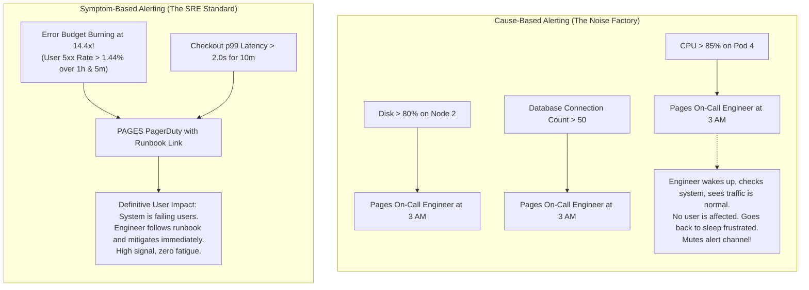
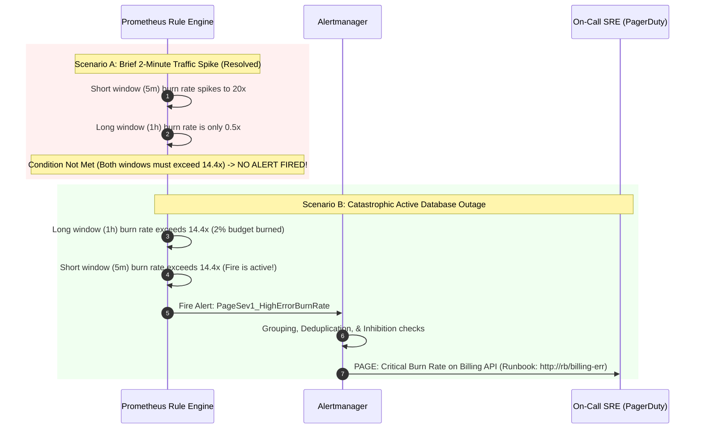
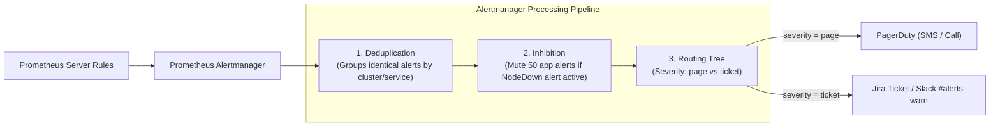

# Module 08: Alerting Without Fatigue

> **Prerequisites:** [Module 00: Error Handling Strategies](../00-error-handling-strategies/README.md), [Module 06: Monitoring and Metrics](../06-monitoring-and-metrics/README.md), [Module 07: The Three Pillars of Observability](../07-the-three-pillars-of-observability/README.md).
> **Estimated Reading Time:** 30 minutes
> **Target Audience:** SREs, DevOps Engineers, Backend Leads.

---

> [!TIP]
> **Golden Rule of Alerting**: Never page a human for an internal cause; page only for a **user-impacting symptom** that directly threatens your Service Level Objective (SLO). Every pageable alert must be **immediately actionable** by an on-call engineer with a verified runbook link, while non-urgent anomalies belong on dashboards or asynchronous tickets. Implement **multi-window multi-burn-rate alerts** (14.4× burn rate over 1h/5m, 6× burn rate over 6h/30m) to eliminate false alarms during transient spikes without sacrificing rapid disaster detection.

---

## 1. Visual Mental Models & System Architecture

Observability allows you to investigate a system once an issue is detected; **Alerting** is the discipline of waking or notifying a human when an intervention is urgently required. The most dangerous failure mode in operations is not having too few alerts; it is **Alert Fatigue**—a barrage of noisy, non-actionable notifications that causes engineers to mute channels, leading to genuine SEV-1 outages scrolling by unheeded.

### Cause-Based vs. Symptom-Based (SLO) Alerting



### Multi-Window Multi-Burn-Rate Architecture

Traditional alerts using a single time window suffer from a fatal trade-off: short windows (e.g., 5m) trigger false alarms on brief transient spikes, while long windows (e.g., 1h) delay detection and continue alerting long after an outage has resolved. 

The Google SRE **Multi-Window Multi-Burn-Rate** model solves this by requiring **both** a long window (confirming budget consumption) and a short window (confirming the fire is still burning) to fire concurrently:



### Alertmanager Routing, Grouping, and Inhibition Topology



---

## 2. Taxonomic Reference Grids & Systematic Comparison Grids

### The SRE Reliability Hierarchy: SLI, SLO, SLA, and Error Budgets

| Concept | Mathematical Formula | Definition & Purpose | Stakeholder Owner |
| :--- | :--- | :--- | :--- |
| **SLI (Service Level Indicator)** | $\frac{\text{Successful Requests}}{\text{Total Valid Requests}} \times 100$ | Quantitative real-time measurement of service behavior (e.g., HTTP 2xx/3xx rate). | Platform / Backend Engineering |
| **SLO (Service Level Objective)** | $\text{SLI} \ge 99.9\% \text{ over 30 days}$ | Target reliability level agreed upon by engineering and product management. | Engineering & Product Teams |
| **SLA (Service Level Agreement)** | $\text{SLI} \ge 99.5\% \text{ (Breach penalty: \$ credit)}$ | Legal contract committing to reliability with financial consequences. | Legal & Enterprise Customers |
| **Error Budget** | $1.0 - \text{SLO} \implies 100\% - 99.9\% = \mathbf{0.1\%}$ | Allowable fraction of failures over 30 days before feature freeze. | SRE & Product Leads |

### Google SRE Standard Multi-Burn-Rate Alerting Rules (30-Day Window)

| Severity Tier | Burn Rate Factor | Error Budget Consumed | Long Window | Short Window | Action & Routing |
| :--- | :---: | :---: | :---: | :---: | :--- |
| **Critical (SEV-1)** | **$14.4\times$** | $2\%$ in 1 hour | **1 Hour** | **5 Minutes** | **Page Immediately (PagerDuty)** |
| **Critical (SEV-1)** | **$6.0\times$** | $5\%$ in 6 hours | **6 Hours** | **30 Minutes** | **Page Immediately (PagerDuty)** |
| **Warning (SEV-2)** | **$3.0\times$** | $10\%$ in 24 hours | **24 Hours** | **2 Hours** | **Next-Day Ticket / Slack Notification** |
| **Warning (SEV-2)** | **$1.0\times$** | $100\%$ in 30 days | **3 Days** | **6 Hours** | **Daily Asynchronous Triage Report** |

### The 5-Point Pager Litmus Test

Before any alert is granted permission to trigger a human pager, it must satisfy all five criteria:

1. **User Impact:** Does this anomaly directly degrade real users or critical transactions? (If no $\to$ Dashboard).
2. **Actionability:** Can the engineer who is woken up take an immediate, concrete corrective action? (If no $\to$ Ticket).
3. **Urgency:** Will significant user damage or budget loss occur if this waits 4 hours until morning? (If no $\to$ Ticket).
4. **Persistence:** Has the condition persisted long enough to rule out transient self-healing blips? (If no $\to$ Short window gate).
5. **Verified Runbook:** Does the alert payload include a functioning, tested link to an exact step-by-step triage guide? (If no $\to$ Block alert creation).

---

## 3. Production War Stories: Incident Post-Mortem

### The Incident: Critical Database Outage Ignored Due to 40 Daily False Positives

- **Severity:** SEV-1 (Extended Enterprise Outage)
- **Time to Detection:** 1 hour 45 minutes
- **Time to Mitigation:** 18 minutes
- **Impact:** Primary transactional database froze into read-only mode during an unhandled disk controller stall. The on-call engineer slept through the incident because their pager had been muted after receiving 42 false alerts earlier that evening.

#### What Happened
A backend team configured infrastructure alerts generously. Among them was a CPU threshold alert:
`ALERT HighCPU IF container_cpu_usage_ratio > 0.75 FOR 1m`

During routine background garbage collection and batch reporting, CPU regularly fluctuated above 75%. On average, this single alert fired **35 to 50 times per day**. Engineers created a Slack rule that automatically routed notifications to `#alerts-muted`.

At 2:15 AM on a Sunday, an AWS disk hardware failure caused the primary PostgreSQL instance to lock up. A genuine alert fired:
`ALERT PrimaryDatabaseUnreachable IF up{job="postgres"} == 0 FOR 1m`

The alert arrived in the muted channel alongside 40 noisy CPU alerts. The on-call engineer did not wake up. 

The outage persisted undetected for 105 minutes until the VP of Engineering was phoned by the executive escalation team when thousands of customer checkout transactions failed.

```mermaid
sequenceDiagram
    autonumber
    participant Prom as Prometheus
    participant Slack as #alerts-prod (Muted Channel)
    participant SRE as On-Call Engineer (Asleep)
    participant DB as Production Database
    participant VP as VP of Engineering

    loop 40 times throughout the night
        Prom->>Slack: [ALERT] CPU > 75% on worker-pod-12 (Transient noise)
    end
    Note over SRE: SRE mutes phone notifications due to incessant false alarms
    
    DB->>DB: Hardware storage controller stalls; DB goes down!
    Prom->>Slack: [CRITICAL] PrimaryDatabaseUnreachable!
    Note over Slack: Alert lands in muted channel next to 40 CPU alerts!
    Note over SRE: SRE sleeps through critical page
    Note over DB: 105 minutes of complete downtime accumulates ($120k lost)
    VP->>SRE: Emergency Phone Call: "Why is production down?!"
```

#### Root Cause
1. **Pervasive Alert Fatigue:** Noisy, non-actionable cause-based alerts (`CPU > 75%`) desensitized on-call personnel, causing the primary alert delivery pathway to be muted.
2. **Missing Severity Separation:** Critical system outages were routed to the same unmonitored chat channels as minor informational warnings.

#### The Fix & Architectural Hardening
1. **Purged All Cause-Based Alerts:** Deleted 85% of existing alerts, removing all generic CPU, memory, and thread-count threshold alerts.
2. **Implemented Multi-Burn-Rate SLO Alerts:** Replaced threshold alerts with error-budget burn rate alerts on user-facing 5xx errors and checkout latency.
3. **Strict Alert Routing Policies:**
   - **SEV-1 (Critical):** Dispatched via PagerDuty (phone call + siren override) strictly for SLO burn rates $> 6\times$.
   - **SEV-2 (Warning):** Dispatched to Slack tickets during business hours only.
4. **Weekly Alert Hygiene Audit:** Instituted a weekly operational review: any alert that fires without resulting in an engineer taking an actionable mitigation is deleted or tuned immediately.

---

## 4. Multi-Language Production Implementations

The following code tabs implement an SRE Error Budget & Multi-Burn-Rate calculator, Alertmanager webhook validation, and automated PagerDuty dispatch across Go, TypeScript, and Python.

### Go Production Implementation (Alertmanager Webhook Receiver)

```go
package main

import (
	"encoding/json"
	"fmt"
	"log/slog"
	"net/http"
	"time"
)

// AlertmanagerWebhook represents the incoming payload from Prometheus Alertmanager.
type AlertmanagerWebhook struct {
	Version           string            `json:"version"`
	GroupKey          string            `json:"groupKey"`
	Status            string            `json:"status"` // "firing" or "resolved"
	Receiver          string            `json:"receiver"`
	GroupLabels       map[string]string `json:"groupLabels"`
	CommonLabels      map[string]string `json:"commonLabels"`
	CommonAnnotations map[string]string `json:"commonAnnotations"`
	Alerts            []AlertInstance   `json:"alerts"`
}

type AlertInstance struct {
	Status       string            `json:"status"`
	Labels       map[string]string `json:"labels"`
	Annotations  map[string]string `json:"annotations"`
	StartsAt     time.Time         `json:"startsAt"`
	EndsAt       time.Time         `json:"endsAt"`
	GeneratorURL string            `json:"generatorURL"`
}

// WebhookHandler processes alerts and dispatches PagerDuty incidents for SEV-1.
func AlertWebhookHandler(w http.ResponseWriter, r *http.Request) {
	if r.Method != http.MethodPost {
		http.Error(w, "Method not allowed", http.StatusMethodNotAllowed)
		return
	}

	var payload AlertmanagerWebhook
	if err := json.NewDecoder(r.Body).Decode(&payload); err != nil {
		slog.Error("Failed to decode Alertmanager webhook", "error", err)
		http.Error(w, "Bad request", http.StatusBadRequest)
		return
	}

	for _, alert := range payload.Alerts {
		severity := alert.Labels["severity"]
		alertName := alert.Labels["alertname"]
		runbook := alert.Annotations["runbook_url"]

		slog.Info("Alert received from Alertmanager",
			"alert", alertName,
			"severity", severity,
			"status", alert.Status,
			"runbook", runbook,
		)

		if severity == "critical" && alert.Status == "firing" {
			// Trigger PagerDuty dispatch
			dispatchPagerDuty(alertName, alert.Annotations["summary"], runbook)
		}
	}

	w.WriteHeader(http.StatusOK)
	_, _ = w.Write([]byte(`{"status":"processed"}`))
}

func dispatchPagerDuty(title, summary, runbook string) {
	fmt.Printf("🚨 [PAGERDUTY DISPATCH] Waking On-Call! Title: %s | Summary: %s | Runbook: %s\n",
		title, summary, runbook)
}
```

### TypeScript / Node.js Production Implementation

```typescript
export interface PrometheusAlert {
  status: 'firing' | 'resolved';
  labels: Record<string, string>;
  annotations: {
    summary: string;
    description: string;
    runbook_url: string;
  };
}

export class AlertFilter {
  // Evaluates whether an incoming alert satisfies the 5-point pager criteria
  public static shouldPageEngineer(alert: PrometheusAlert): boolean {
    const isFiring = alert.status === 'firing';
    const isCritical = alert.labels.severity === 'critical';
    const hasRunbook = Boolean(alert.annotations.runbook_url && alert.annotations.runbook_url.startsWith('http'));
    const isUserFacing = alert.labels.scope === 'user_facing' || alert.labels.slo === 'true';

    // Must be actively firing, critical severity, user-impacting, and contain a runbook
    return isFiring && isCritical && hasRunbook && isUserFacing;
  }

  public static routeAlert(alert: PrometheusAlert): string {
    if (this.shouldPageEngineer(alert)) {
      return 'PAGERDUTY_ONCALL_ROTATION';
    }
    if (alert.labels.severity === 'warning') {
      return 'SLACK_CHANNEL_ALERTS_WARN';
    }
    return 'JIRA_ASYNCHRONOUS_TICKET';
  }
}
```

### Python Production Implementation (SRE Error Budget & Multi-Burn-Rate Calculator)

```python
"""
Google SRE Standard Multi-Burn-Rate Alerting Engine.
Calculates error budget consumption across short and long windows,
firing critical alerts only when SLO burn rates indicate active disasters.
"""

from __future__ import annotations

import dataclasses
from typing import Dict, List, Optional


@dataclasses.dataclass(frozen=True)
class BurnRateAlertRule:
    name: str
    severity: str
    burn_rate_threshold: float
    long_window_minutes: int
    short_window_minutes: int
    runbook_url: str


class SREAlertingEngine:
    def __init__(self, target_slo: float = 0.999):  # 99.9% SLO
        self.target_slo = target_slo
        self.error_budget = 1.0 - target_slo  # 0.001 (0.1% allowed failures)

        # Standard SRE Multi-Burn-Rate Rules (Google SRE Book Chapter 5)
        self.rules = [
            BurnRateAlertRule(
                name="ErrorBudgetFastBurn",
                severity="critical",
                burn_rate_threshold=14.4,  # Burns 2% of budget in 1 hour
                long_window_minutes=60,
                short_window_minutes=5,
                runbook_url="https://wiki.internal/runbooks/high-error-rate",
            ),
            BurnRateAlertRule(
                name="ErrorBudgetSlowBurn",
                severity="critical",
                burn_rate_threshold=6.0,   # Burns 5% of budget in 6 hours
                long_window_minutes=360,
                short_window_minutes=30,
                runbook_url="https://wiki.internal/runbooks/slow-error-burn",
            ),
        ]

    def calculate_burn_rate(self, error_count: int, total_requests: int) -> float:
        if total_requests == 0:
            return 0.0
        observed_error_rate = error_count / total_requests
        return observed_error_rate / self.error_budget

    def evaluate_rules(
        self,
        long_window_errors: int,
        long_window_requests: int,
        short_window_errors: int,
        short_window_requests: int,
    ) -> List[Dict[str, str]]:
        long_burn = self.calculate_burn_rate(long_window_errors, long_window_requests)
        short_burn = self.calculate_burn_rate(short_window_errors, short_window_requests)

        active_pages = []
        for rule in self.rules:
            # BOTH short and long windows must exceed the threshold!
            if long_burn >= rule.burn_rate_threshold and short_burn >= rule.burn_rate_threshold:
                active_pages.append({
                    "alert": rule.name,
                    "severity": rule.severity,
                    "long_burn": f"{long_burn:.2f}x",
                    "short_burn": f"{short_burn:.2f}x",
                    "runbook": rule.runbook_url,
                })

        return active_pages
```

---

## 5. Practical Hands-On Verification CLI Workflows

Verify Alertmanager Prometheus configuration and test rule syntax using native CLI utilities.

### Workflow 1: Validating Prometheus Alert Rules with `promtool`

```bash
# Verify Prometheus rule syntax using official promtool validator
docker run --rm -v "$(pwd):/etc/prometheus" prom/prometheus:latest \
  promtool check rules /etc/prometheus/alert_rules.yml
```

Expected wire output:
```text
Checking /etc/prometheus/alert_rules.yml
  SUCCESS: 2 rules found
```

### Workflow 2: Testing Alertmanager Webhook Delivery via cURL

```bash
# Dispatch simulated Alertmanager webhook payload to verify receiver
curl -s -X POST "http://localhost:8080/api/v1/alerts/webhook" \
  -H "Content-Type: application/json" \
  -d '{
    "version": "4",
    "status": "firing",
    "alerts": [
      {
        "status": "firing",
        "labels": {"alertname": "ErrorBudgetFastBurn", "severity": "critical", "scope": "user_facing"},
        "annotations": {
          "summary": "14.4x Error budget burn on Billing API",
          "runbook_url": "https://wiki.internal/runbooks/billing"
        }
      }
    ]
  }' | jq .
```

Expected wire output:
```json
{
  "status": "processed"
}
```

---

## 6. Operational Validation Checkpoints (Scenario Quizzes)

### Checkpoint 1: Why 14.4x Burn Rate is the Golden SRE Standard
**Scenario:** A company enforces a 99.9% 30-day availability SLO. Why is $14.4\times$ burn rate chosen by Google SRE as the primary pageable threshold for a 1-hour window?

<details><summary>Click to view diagnosis and architectural solution</summary>

**Answer:**
1. **The Mathematical Derivation:**
   A 30-day month contains:
   $$30 \times 24 = 720 \text{ hours}$$
   A burn rate of $1.0\times$ consumes exactly 100% of the error budget over 720 hours.
   Therefore, to consume **$2\%$ of the total 30-day error budget in 1 hour**:
   $$\text{Burn Rate} = \frac{720 \text{ hours}}{1 \text{ hour}} \times 0.02 = \mathbf{14.4}$$
2. **Operational Meaning:**
   If the system continues burning at $14.4\times$, the **entire monthly error budget will be completely exhausted in 50 hours**. This represents an active, major emergency that warrants waking an engineer immediately.
</details>

---

### Checkpoint 2: The Double-Window Safeguard against Spikes
**Scenario:** An automated database cron job runs every night at 2:00 AM, causing a 45-second network reconnect blip where 20 requests fail. With a single 1-hour window alert (`long_burn > 14.4`), the alert fires at 2:45 AM, waking the on-call engineer 45 minutes after the issue has already resolved itself. How does adding a 5-minute short window eliminate this false wake-up?

<details><summary>Click to view diagnosis and architectural solution</summary>

**Answer:**
1. **The Trailing Average Flaw:**
   In a single 1-hour window, a brief 45-second burst of errors pulls up the 1-hour average, keeping the alert in a "firing" state for the remainder of the hour long after normal operations resume.
2. **The Short-Window Solution:**
   The multi-window rule requires **both** the 1-hour window AND the 5-minute window to exceed $14.4\times$.
   At 2:45 AM, the 5-minute window error rate is 0.0%. Because the short window condition fails, Alertmanager **instantly resolves or suppresses the alert**, ensuring the on-call engineer is never woken up for a problem that is already over.
</details>

---

### Checkpoint 3: Alertmanager Inhibition Rules (Root Cause Suppression)
**Scenario:** A datacenter top-of-rack network switch fails. Within 30 seconds, 120 separate alerts fire simultaneously across Prometheus: 40 Kubernetes pods report `CrashLoopBackOff`, 50 microservices report `DatabaseUnreachable`, and 30 services report `DownstreamTimeout`. The on-call engineer receives 120 SMS messages within 2 minutes. How does Alertmanager **Inhibition** prevent this storm?

<details><summary>Click to view diagnosis and architectural solution</summary>

**Answer:**
1. **Alertmanager Inhibition Mechanics:**
   Inhibition rules allow an active high-level alert to **mute and suppress** a set of lower-level child alerts matching specific label filters.
2. **The Configuration:**
   ```yaml
   # alertmanager.yml
   inhibit_rules:
     - source_match:
         alertname: 'NodeNetworkInterfaceDown'
         severity: 'critical'
       target_match_re:
         alertname: '^(DatabaseUnreachable|PodCrashLoop|DownstreamTimeout)$'
       equal: ['node', 'zone']
   ```
3. **The Result:**
   When the switch fails, the engineer receives **one single page**: `"NodeNetworkInterfaceDown on node-04"`. The 119 secondary derivative alerts are suppressed, giving the engineer instant clarity on the root cause without message overload.
</details>

---

## 7. Further Reading & References

- [Google SRE Book: Chapter 5 - Alerting on SLOs](https://sre.google/workbook/alerting-on-slos/) — The definitive guide to multi-window multi-burn-rate alerting.
- [Prometheus Alertmanager Documentation](https://prometheus.io/docs/alerting/latest/alertmanager/) — Configuration guide for grouping, routing, and inhibition rules.
- [My Philosophy on Alerting by Rob Ewaschuk](https://docs.google.com/document/d/199PqyG3UsyXlrieHaqX0WODhTDZs54UpURLMks53oA8) — The foundational manifesto on actionable, symptom-based alerting.

---

## Next

[Module 09: Graceful Shutdown](../09-graceful-shutdown/README.md) — Orchestrate clean OS signal handling (`SIGTERM`/`SIGINT`), drain in-flight requests, and achieve zero-downtime rolling deployments in Kubernetes.
