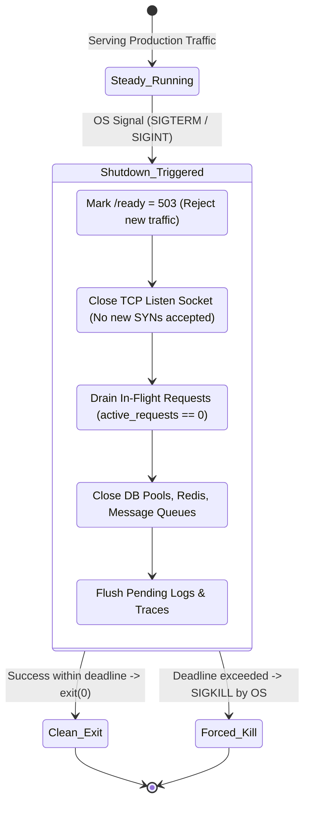
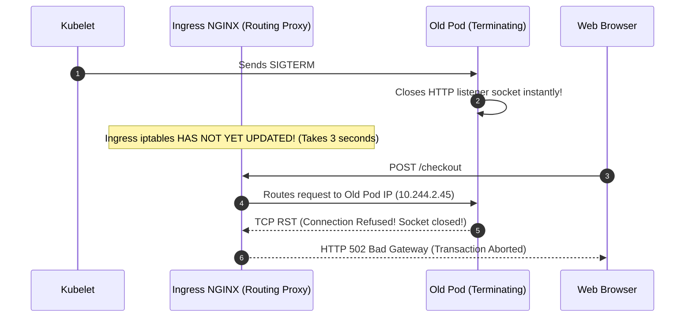

# Module 09: Graceful Shutdown

> **Prerequisites:** [Module 00: Error Handling Strategies](../00-error-handling-strategies/README.md), [Module 06: Monitoring and Metrics](../06-monitoring-and-metrics/README.md), [Module 08: Alerting Without Fatigue](../08-alerting-without-fatigue/README.md).
> **Estimated Reading Time:** 30 minutes
> **Target Audience:** Backend Engineers, DevOps Engineers, Kubernetes Administrators.

---

> [!TIP]
> **Golden Rule of Graceful Shutdown**: Treat application process termination not as a disaster, but as a frequent, routine operational event. Upon receiving an OS `SIGTERM` signal, immediately fail the readiness probe (`/ready`) to stop ingress proxies from routing new connections, complete all in-flight requests within a bounded time budget ($T \le 30\text{s}$), flush all telemetry buffers and database connection pools, and exit cleanly with code 0 before the orchestrator issues a forced `SIGKILL`.

---

## 1. Visual Mental Models & System Architecture

In modern cloud environments, services do not run indefinitely. A service process is started and terminated continuously: every rolling deployment replaces running containers, autoscalers terminate surplus replicas when traffic falls, and node upgrades evict pods across the cluster.

A naive process that terminates abruptly upon receiving a shutdown signal drops active client requests mid-flight, leaves database transactions hanging, and corrupts background worker queues. **Graceful Shutdown** is the discipline of stopping cleanly, ensuring that zero requests are dropped during deployments.

### The Kubernetes Pod Termination Timeline

```mermaid
sequenceDiagram
    autonumber
    participant K8s as Kubernetes API / Kubelet
    participant Ingress as Ingress / Kube-Proxy (iptables)
    participant Pod as Application Container Process
    participant DB as Postgres Database

    K8s->>Pod: 1. Pod marked "Terminating"
    par Concurrent Endpoint Removal & PreStop
        K8s->>Ingress: Remove Pod IP from Service Endpoints (Takes 2-5s to propagate)
        K8s->>Pod: 2. Execute preStop hook (sleep 5s)
    end
    Note over Ingress: Ingress stops routing NEW requests to Pod IP
    K8s->>Pod: 3. Kubelet sends SIGTERM signal
    Pod->>Pod: 4. Mark /ready endpoint as DOWN (HTTP 503)
    Pod->>Pod: 5. Stop HTTP Listener; Drain in-flight requests (up to 20s)
    Pod->>DB: 6. Commit active transactions & close connection pools
    Pod->>Pod: 7. Flush structured logs and OpenTelemetry spans
    Pod-->>K8s: 8. Process exits cleanly (Exit Code 0)
    Note over K8s: If process had not exited within 30s, Kubelet would issue SIGKILL!
```

### In-Flight Request Draining State Machine



---

## 2. Taxonomic Reference Grids & Systematic Comparison Grids

### POSIX Signals Relevant to Application Lifecycle

| Signal | Number | Catchable? | Default Action | Operational Meaning in Cloud Platforms |
| :--- | :---: | :---: | :--- | :--- |
| **`SIGTERM`** | 15 | **YES** | Terminate | The polite shutdown request sent by Docker (`docker stop`) and Kubernetes when terminating a container. **Your app must catch this.** |
| **`SIGINT`** | 2 | **YES** | Terminate | Interrupt signal sent when an engineer presses `Ctrl+C` in a local development terminal. |
| **`SIGKILL`** | 9 | **NO** | Hard Kill | Unconditional immediate process death executed by the Linux kernel. Memory is reclaimed instantly; zero cleanup code can run. |
| **`SIGHUP`** | 1 | **YES** | Terminate | Hangup signal; traditionally used by daemons (NGINX, Prometheus) to reload configuration without dropping connections. |
| **`SIGQUIT`** | 3 | **YES** | Core Dump | Quit signal; commonly caught by Go or Java runtimes to dump diagnostic goroutine/thread stack traces. |

### Abrupt Crash vs. Graceful Shutdown

| Operational Dimension | Abrupt Crash (`SIGKILL` / Immediate Exit) | Graceful Shutdown (`SIGTERM` Drain) |
| :--- | :--- | :--- |
| **In-Flight Client Requests** | Dropped immediately; client receives `ECONNRESET` or HTTP 502 Bad Gateway. | In-flight requests are served to completion and returned successfully. |
| **Database Connection Pools** | Sockets severed ungracefully; database server holds idle locks until TCP keep-alive times out. | Clean `DISCONNECT` sent; database server immediately reclaims connection slots. |
| **Background Message Queues** | Tasks dropped mid-execution; requires complex redelivery timeout mechanisms. | Messages acknowledged or returned cleanly to the queue (`nack`). |
| **Telemetry & Observability** | In-memory log buffers and OTel spans are lost forever. | Buffers flushed cleanly to stdout/collector before termination. |
| **Deploy Experience** | Every deploy causes small error budget burn spikes. | Rolling deploys are completely invisible to end users (Zero downtime). |

### Kubernetes Shutdown Timing Configuration

```yaml
spec:
  terminationGracePeriodSeconds: 30 # Master timeout before SIGKILL
  containers:
    - name: api
      lifecycle:
        preStop:
          exec:
            command: ["/bin/sh", "-c", "sleep 5"] # Wait for iptables endpoint removal
```

---

## 3. Production War Stories: Incident Post-Mortem

### The Incident: 502 Bad Gateway Spikes on Every Production Deploy

- **Severity:** SEV-2 (Chronic Customer Degradation)
- **Time to Detection:** 2 weeks
- **Time to Mitigation:** 15 minutes
- **Impact:** Over 4,200 production customer requests failed with HTTP 502 Bad Gateway over a two-week period. Every rolling deployment dropped between 20 and 150 active user sessions.

#### What Happened
A fintech startup deployed code to their Kubernetes cluster 8 to 10 times a day. While their automated smoke tests always passed, customer support continuously received intermittent complaints from users whose checkout forms failed with `502 Bad Gateway: Connection refused`.

The SRE team analyzed the ingress NGINX logs and observed that the 502 errors occurred in sharp bursts that correlated with deployment timestamps:

```text
[2026-11-10T14:02:11Z] 502 Bad Gateway upstream: 10.244.2.45:8080 connecting to backend failed
```

The application had implemented a standard `SIGTERM` signal listener:
```python
# The Flawed Shutdown Handler
def sigterm_handler(signum, frame):
    logger.info("SIGTERM received. Stopping server immediately.")
    server.stop() # Closed listening socket instantly!
```



#### Root Cause
1. **Asynchronous Endpoint Propagation:** When a Kubernetes pod is deleted, the removal of the pod's IP from the cluster endpoints (`iptables` / IPVS rules across all worker nodes) takes **2 to 5 seconds**.
2. **Premature Socket Termination:** Because the application immediately stopped its HTTP server upon receiving `SIGTERM`, it rejected new TCP connection attempts while the Ingress controller was still routing requests to it.

#### The Fix & Architectural Hardening
1. **Added `preStop` Sleep Hook:** Added a 5-second sleep hook to the pod deployment spec:
   ```yaml
   lifecycle:
     preStop:
       exec:
         command: ["sleep", "5"]
   ```
   During this 5-second window, the pod continues serving traffic normally while Kubernetes cleanly removes its IP from all load balancer endpoints.
2. **Bounded Server Draining:** Configured the application server with a 15-second graceful drain timeout, allowing in-flight requests to complete before closing database connection pools.
3. **Outcome:** In subsequent deployments, HTTP 502 errors dropped from 150 per deploy to **exactly 0**.

---

## 4. Multi-Language Production Implementations

The following code tabs implement graceful shutdown: signal trapping, in-flight request tracking, HTTP server shutdown contexts, and resource cleanup across Go, TypeScript, and Python.

### Go Production Implementation (`http.Server` Shutdown Context)

```go
package main

import (
	"context"
	"errors"
	"log/slog"
	"net/http"
	"os"
	"os/signal"
	"sync/atomic"
	"syscall"
	"time"
)

type AppServer struct {
	httpServer *http.Server
	isReady    atomic.Bool
}

func NewAppServer(addr string) *AppServer {
	s := &AppServer{}
	s.isReady.Store(true)

	mux := http.NewServeMux()
	
	// Readiness probe
	mux.HandleFunc("/ready", func(w http.ResponseWriter, r *http.Request) {
		if s.isReady.Load() {
			w.WriteHeader(http.StatusOK)
			_, _ = w.Write([]byte("READY"))
		} else {
			w.WriteHeader(http.StatusServiceUnavailable)
			_, _ = w.Write([]byte("DRAINING"))
		}
	})

	// Sample business endpoint
	mux.HandleFunc("/api/work", func(w http.ResponseWriter, r *http.Request) {
		time.Sleep(2 * time.Second) // Simulate in-flight work
		w.WriteHeader(http.StatusOK)
		_, _ = w.Write([]byte("WORK_COMPLETE"))
	})

	s.httpServer = &http.Server{
		Addr:    addr,
		Handler: mux,
	}
	return s
}

func (s *AppServer) StartAndServeGracefully() {
	// Channel listening for OS signals
	stopChan := make(chan os.Signal, 1)
	signal.Notify(stopChan, os.Interrupt, syscall.SIGTERM)

	go func() {
		slog.Info("Server listening", "addr", s.httpServer.Addr)
		if err := s.httpServer.ListenAndServe(); err != nil && !errors.Is(err, http.ErrServerClosed) {
			slog.Error("HTTP server failure", "error", err)
			os.Exit(1)
		}
	}()

	// Block until SIGINT or SIGTERM arrives
	sig := <-stopChan
	slog.Info("Shutdown signal received. Beginning graceful drain...", "signal", sig.String())

	// 1. Immediately fail readiness probe so ingress removes this instance
	s.isReady.Store(false)

	// 2. Create shutdown context with strict 25-second deadline
	shutdownCtx, cancel := context.WithTimeout(context.Background(), 25*time.Second)
	defer cancel()

	// 3. Close listener and wait for in-flight requests to complete
	if err := s.httpServer.Shutdown(shutdownCtx); err != nil {
		slog.Error("Forced shutdown invoked: in-flight requests did not drain", "error", err)
		os.Exit(1)
	}

	// 4. Close database connections and flush buffers
	slog.Info("All in-flight requests drained. Releasing resources...")
	slog.Info("Clean process exit completed.")
}
```

### TypeScript / Node.js Production Implementation (Express Server Draining)

```typescript
import express, { Request, Response } from 'express';
import http from 'http';

const app = express();
let isDraining = false;
let inFlightRequests = 0;

// Readiness Probe
app.get('/ready', (req: Request, res: Response) => {
  if (isDraining) {
    return res.status(503).send('DRAINING');
  }
  res.status(200).send('READY');
});

// Middleware tracking active in-flight requests
app.use((req: Request, res: Response, next) => {
  inFlightRequests++;
  res.on('finish', () => {
    inFlightRequests--;
  });
  next();
});

// Sample business endpoint
app.get('/api/work', async (req: Request, res: Response) => {
  await new Promise((resolve) => setTimeout(resolve, 2000));
  res.send('WORK_COMPLETE');
});

const server = http.createServer(app);
server.listen(8080, () => {
  console.log('Server listening on port 8080');
});

function handleShutdown(signal: string): void {
  console.log(`Received ${signal}. Starting graceful shutdown...`);
  isDraining = true; // 1. Fail readiness probe

  // 2. Stop accepting new TCP connections
  server.close(async () => {
    console.log('HTTP listener closed. Draining database connection pools...');
    // Close DB pools here: await db.close();
    console.log('Graceful shutdown complete. Exiting cleanly.');
    process.exit(0);
  });

  // 3. Enforce maximum shutdown deadline
  setTimeout(() => {
    console.error(`Forced shutdown: ${inFlightRequests} in-flight requests failed to drain.`);
    process.exit(1);
  }, 25000).unref();
}

process.on('SIGTERM', () => handleShutdown('SIGTERM'));
process.on('SIGINT', () => handleShutdown('SIGINT'));
```

### Python Production Implementation (Asyncio & Uvicorn Signal Management)

```python
"""
Production AsyncIO Graceful Shutdown Handler for FastAPI / Uvicorn.
Drains active asyncio tasks, unregisters readiness, and closes connection pools.
"""

from __future__ import annotations

import asyncio
import logging
import signal
import sys
from fastapi import FastAPI, Response, status

logger = logging.getLogger(__name__)
app = FastAPI()

is_shutting_down = False
active_tasks_count = 0


@app.get("/ready")
def readiness_check() -> Response:
    if is_shutting_down:
        return Response(content="DRAINING", status_code=status.HTTP_503_SERVICE_UNAVAILABLE)
    return Response(content="READY", status_code=status.HTTP_200_OK)


@app.middleware("http")
async def track_in_flight_middleware(request, call_next):
    global active_tasks_count
    active_tasks_count += 1
    try:
        return await call_next(request)
    finally:
        active_tasks_count -= 1


async def shutdown_handler(sig: signal.Signals) -> None:
    global is_shutting_down
    logger.info("Received %s. Initiating graceful drain...", sig.name)
    is_shutting_down = True  # 1. Fail readiness probe

    # 2. Wait up to 20 seconds for in-flight requests to complete
    max_wait = 20.0
    elapsed = 0.0
    while active_tasks_count > 0 and elapsed < max_wait:
        logger.info("Draining in-flight requests (%d active)...", active_tasks_count)
        await asyncio.sleep(0.5)
        elapsed += 0.5

    # 3. Close database pools
    logger.info("Closing database and cache connection pools...")
    logger.info("Graceful shutdown finished. Exiting.")
    sys.exit(0)


def setup_signal_handlers(loop: asyncio.AbstractEventLoop) -> None:
    for sig in (signal.SIGTERM, signal.SIGINT):
        loop.add_signal_handler(sig, lambda s=sig: asyncio.create_task(shutdown_handler(s)))
```

---

## 5. Practical Hands-On Verification CLI Workflows

Verify graceful shutdown behavior using Docker signals and test connection draining.

### Workflow 1: Testing Graceful Signal Trapping via Docker

```bash
# Run application container in background
docker run -d --name shutdown-test -p 8080:8080 my-backend-app:v1.0.0

# Send SIGTERM via docker stop with a 15-second grace period and monitor logs
docker stop --time 15 shutdown-test && docker logs shutdown-test
```

Expected wire output:
```text
Server listening on port 8080...
Received SIGTERM. Starting graceful shutdown...
HTTP listener closed. Draining database connection pools...
Graceful shutdown complete. Exiting cleanly.
```

---

## 6. Operational Validation Checkpoints (Scenario Quizzes)

### Checkpoint 1: Why `preStop: sleep 5` is Necessary in Kubernetes
**Scenario:** A backend service implements perfect graceful shutdown: it traps `SIGTERM`, drains active requests, and closes connection pools. However, during rolling deployments, users still occasionally receive `HTTP 502 Bad Gateway` errors. Why is an explicit `preStop` sleep hook in Kubernetes required?

<details><summary>Click to view diagnosis and architectural solution</summary>

**Answer:**
1. **The Distributed Race Condition:**
   When a pod deletion begins, two events happen asynchronously and concurrently:
   - Event A: Kubelet sends `SIGTERM` to the pod container.
   - Event B: Kubernetes control plane updates the Endpoint object, and `kube-proxy` rewrites `iptables` rules across all nodes in the cluster.
2. **The Timing Mismatch:**
   Event B (updating network routing rules across the entire cluster) typically takes **1 to 3 seconds**. If Event A triggers immediately, the application closes its listening socket while worker nodes are still routing incoming client traffic to the pod's IP!
3. **The `preStop` Solution:**
   A `preStop: exec: command: ["sleep", "5"]` delays `SIGTERM` delivery to the container by 5 seconds, giving the network routing layer ample time to remove the pod's IP before the application shuts down its listener.
</details>

---

### Checkpoint 2: Handling Long-Running Background Tasks during Shutdown
**Scenario:** A background worker is 30 seconds into generating a 5-minute PDF report when Kubernetes issues a `SIGTERM` to scale down the node. The pod has `terminationGracePeriodSeconds: 30`. What happens to the report, and how should background jobs be designed?

<details><summary>Click to view diagnosis and architectural solution</summary>

**Answer:**
1. **The Impending Hard Kill:**
   Because `terminationGracePeriodSeconds` is 30 seconds, the Kubelet will issue an uncatchable **`SIGKILL`** at $T=30\text{s}$, abruptly aborting the 5-minute report mid-generation and potentially leaving corrupted partial files in storage.
2. **Architectural Remediation:**
   - **Do Not Run 5-Minute Tasks on Request Servers:** Decouple long-running tasks to dedicated worker pools (Celery, BullMQ, Temporal) separate from HTTP API servers.
   - **Checkpointing & Cooperative Cancellation:** Background tasks should check an `is_cancelled` token periodically. Upon `SIGTERM`, the task saves its current progress state to the database and re-queues the remaining work before the 30-second timer expires.
</details>

---

### Checkpoint 3: Liveness Probe vs. Readiness Probe During Shutdown
**Scenario:** A developer writes a health handler that makes both the liveness probe (`/live`) and the readiness probe (`/ready`) return HTTP 503 the moment `SIGTERM` is received. What catastrophic behavior does this cause in Kubernetes?

<details><summary>Click to view diagnosis and architectural solution</summary>

**Answer:**
1. **The Liveness Probe Trap:**
   - **Readiness Probe (`/ready`):** Tells Kubernetes whether the pod can accept **new traffic**. Failing readiness (returning 503) is **correct** because it removes the pod from load balancer endpoints during shutdown.
   - **Liveness Probe (`/live`):** Tells Kubernetes whether the process is deadlocked or broken. If liveness fails, Kubernetes **immediately restarts the container** (or sends an early `SIGKILL`).
2. **The Catastrophe:**
   Failing the liveness probe during shutdown triggers an aggressive restart or premature kill, completely defeating the purpose of graceful draining and corrupting in-flight requests! Liveness must **stay green (HTTP 200)** as long as the process is making steady progress toward shutting down.
</details>

---

## 7. Further Reading & References

- [Kubernetes Documentation: Pod Lifecycle & Termination](https://kubernetes.io/docs/concepts/workloads/pods/pod-lifecycle/#pod-termination) — Official sequence of pod deletion and signal dispatch.
- [Go `http.Server.Shutdown()` Reference](https://pkg.go.dev/net/http#Server.Shutdown) — Standard library context-driven HTTP draining.
- [Container Termination Lifecycle by Mark Betz](https://learnk8s.io/graceful-shutdown) — In-depth analysis of iptables race conditions during pod draining.

---

## Next

[Module 10: The 12-Factor App](../10-the-12-factor-app/README.md) — Synthesize all operational disciplines into the unified Twelve-Factor App methodology for cloud-native software engineering.
