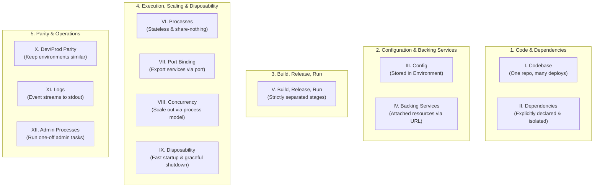
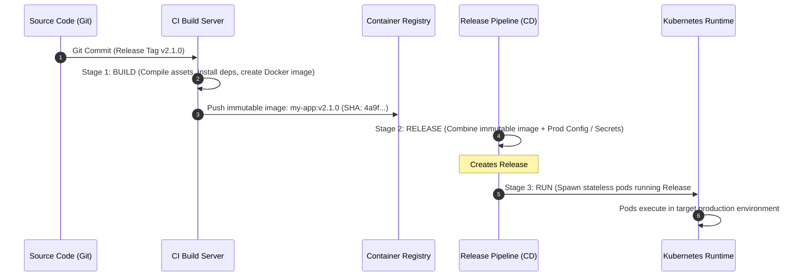
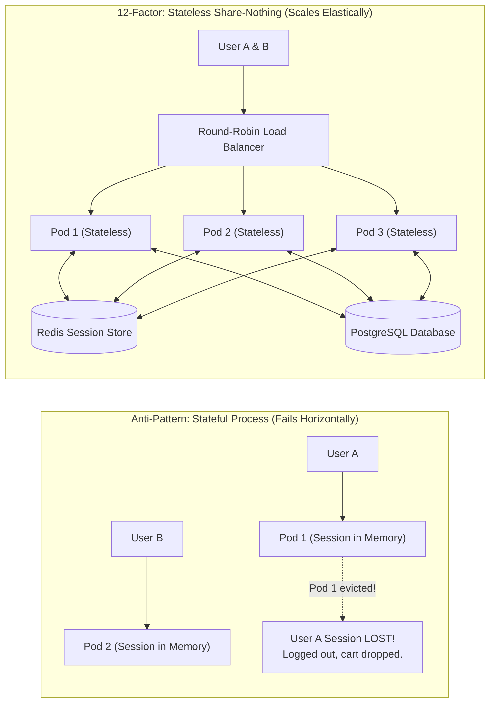
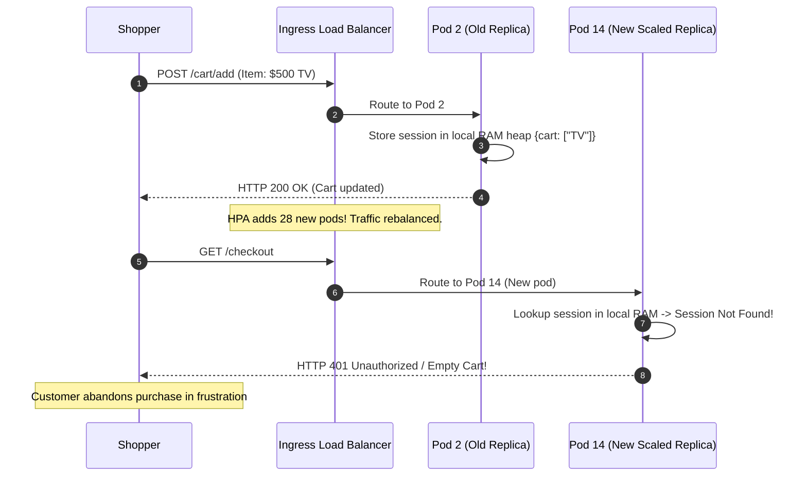

# Module 10: The 12-Factor App

> **Prerequisites:** All previous modules in Track 08 ([Module 00: Error Handling Strategies](../00-error-handling-strategies/README.md) through [Module 09: Graceful Shutdown](../09-graceful-shutdown/README.md)).
> **Estimated Reading Time:** 30 minutes
> **Target Audience:** Backend Engineers, Cloud Architects, Platform Engineers.

---

> [!TIP]
> **Golden Rule of 12-Factor Applications**: Design your application so that all persistent state resides exclusively in external **backing services** (databases, distributed caches, object stores) while keeping application processes completely **stateless and share-nothing**. A stateless application can scale horizontally from 1 to 100 replicas instantaneously, survive arbitrary container eviction without data loss, and deploy predictably across development, staging, and production environments.

---

## 1. Visual Mental Models & System Architecture

The **Twelve-Factor App** methodology, formulated by the system architects at Heroku, synthesizes operational best practices for building software that thrives in modern cloud platforms. It is the architectural blueprint for applications that scale elastically, deploy continuously, and minimize the divergence between local development and production.

### The Twelve-Factor Architecture Map



### Build, Release, Run Separation Pipeline

A build artifact must never change after compilation. A release is the immutable combination of a build artifact with environment-specific configuration:



### Stateless vs. Stateful Process Scalability



---

## 2. Taxonomic Reference Grids & Systematic Comparison Grids

### The Twelve Factors: Complete Reference Matrix

| # | Factor Name | Core Engineering Principle | Modern Cloud / Kubernetes Implementation | Violation Anti-Pattern |
| :---: | :--- | :--- | :--- | :--- |
| **I** | **Codebase** | One codebase tracked in version control, many deploys. | Git repository deploying across dev, staging, prod via GitOps. | Separate repos or diverging branches for dev vs. prod code. |
| **II** | **Dependencies** | Explicitly declare and isolate all dependencies. | `go.mod`, `package-lock.json`, `pyproject.toml`, Docker images. | Assuming system-wide libraries (`curl`, `imagemagick`) exist on host. |
| **III** | **Config** | Store configuration strictly in the environment. | Kubernetes ConfigMaps and Secrets injected as Environment Variables. | Committing `.env` or hardcoding hostnames in source files. |
| **IV** | **Backing Services**| Treat backing services as attached resources via URLs. | Connecting to local Postgres vs. AWS RDS purely by swapping `DATABASE_URL`. | Hardcoded database connection logic tailored to specific vendors. |
| **V** | **Build, Release, Run**| Strictly separate build, release, and run stages. | CI generates immutable container; CD injects config; runtime executes image. | Mutating live code in production or re-compiling inside pods. |
| **VI** | **Processes** | Execute the app as one or more stateless, share-nothing processes. | Storing session state in Redis; storing uploaded files in S3. | Storing customer sessions in local RAM or local container disk. |
| **VII** | **Port Binding** | Export services via self-contained port binding. | App embeds its own HTTP server (Kestrel, Uvicorn, Gin) listening on `$PORT`. | Relying on an external Apache/IIS server injection container. |
| **VIII**| **Concurrency** | Scale out via the process model (horizontal scaling). | Kubernetes Horizontal Pod Autoscaler (HPA) adding container replicas. | Relying on a massive vertical thread pool inside a single giant monolithic VM. |
| **IX** | **Disposability** | Maximize robustness with fast startup and graceful shutdown. | Handling `SIGTERM`, draining in-flight requests within 30s, crashing fast on error. | Hanging during deploys; leaking transactions when pods terminate. |
| **X** | **Dev/Prod Parity**| Keep development, staging, and production as similar as possible. | Running identical PostgreSQL/Redis versions locally via Docker Compose. | Using SQLite in local development and PostgreSQL in production. |
| **XI** | **Logs** | Treat logs as unbuffered event streams emitted to `stdout`. | Writing JSON lines to `stdout`; daemonsets (FluentBit) ship to Loki/Elastic. | Writing logs to local files (`/var/log/app.log`) requiring logrotate. |
| **XII**| **Admin Processes**| Run admin/management tasks as one-off one-shot processes. | Running DB migrations via Kubernetes `Job` objects during CD release pipeline. | Running migrations inside application startup handlers on every replica. |

---

## 3. Production War Stories: Incident Post-Mortem

### The Incident: Cart Disappearances During Black Friday Autoscaling from Stateful Container Sessions

- **Severity:** SEV-1 (Critical Business Disruption)
- **Time to Detection:** 25 minutes
- **Time to Mitigation:** 1 hour 15 minutes
- **Impact:** Over 12,000 active shoppers experienced cart deletions and unexpected logouts during the first hour of a Black Friday promotional sale, resulting in an estimated \$450,000 in abandoned checkout revenue.

#### What Happened
An e-commerce engineering team deployed their Node.js web application using default session middleware settings:

```typescript
// The Anti-Pattern in Express
app.use(session({
  secret: 'app_secret',
  resave: false,
  saveUninitialized: false,
  // Default: MemoryStore (stores sessions in process heap memory!)
}));
```

In development and staging, with only 1 or 2 pods and sticky sessions enabled at the ingress load balancer, everything functioned smoothly. 

On Black Friday at 9:00 AM, traffic spiked $10\times$. The Kubernetes Horizontal Pod Autoscaler (HPA) detected high CPU utilization and immediately scaled the deployment from **4 replicas to 32 replicas**. 

As 28 new pods initialized, the ingress load balancer re-distributed traffic across the enlarged pool. A user who added an item to their cart on Pod #2 was routed on their next click to Pod #14. Because Pod #14 maintained an independent in-memory session store, the user's session was unrecognized. The user was logged out, and their shopping cart appeared completely empty.



#### Root Cause
1. **Violation of Factor VI (Processes):** The application was not stateless. It stored persistent user session state directly in the ephemeral process memory heap, creating hard affinity between clients and specific container instances.
2. **Fragility of Sticky Sessions:** Relying on load balancer sticky sessions fails during dynamic autoscaling, pod rescheduling, and rolling deployments.

#### The Fix & Architectural Hardening
1. **Externalized Session State to Redis:** Replaced the in-memory store with a distributed Redis cluster:
   ```typescript
   import RedisStore from 'connect-redis';
   app.use(session({
     store: new RedisStore({ client: redisClient }),
     secret: config.SESSION_SECRET,
   }));
   ```
2. **Enforced Stateless Share-Nothing Invariant:** Audited all microservices to guarantee that zero local disk files or memory variables hold cross-request customer data.
3. **Outcome:** Subsequent autoscaling events scaled pods up and down dynamically with **zero session drops** or cart discrepancies.

---

## 4. Multi-Language Production Implementations

The following code tabs demonstrate a 12-factor compliant backend: reading configuration from the environment (Factor III), attaching backing services via URLs (Factor IV), stateless session verification (Factor VI), port binding (Factor VII), and stdout JSON logging (Factor XI) across Go, TypeScript, and Python.

### Go Production Implementation (12-Factor Compliant Service)

```go
package main

import (
	"context"
	"fmt"
	"log/slog"
	"net/http"
	"os"
	"os/signal"
	"syscall"
	"time"

	"github.com/redis/go-redis/v9"
)

type TwelveFactorApp struct {
	server      *http.Server
	redisClient *redis.Client
}

func NewTwelveFactorApp() (*TwelveFactorApp, error) {
	// Factor III: Config stored strictly in environment
	port := os.Getenv("PORT")
	if port == "" {
		port = "8080"
	}

	// Factor IV: Backing services treated as attached resources via URL
	redisURL := os.Getenv("REDIS_URL")
	if redisURL == "" {
		return nil, fmt.Errorf("mandatory backing service REDIS_URL missing")
	}

	opt, err := redis.ParseURL(redisURL)
	if err != nil {
		return nil, fmt.Errorf("invalid REDIS_URL: %w", err)
	}
	rClient := redis.NewClient(opt)

	mux := http.NewServeMux()

	// Factor VI: Stateless request handler (reads session from backing Redis)
	mux.HandleFunc("/api/cart", func(w http.ResponseWriter, r *http.Request) {
		sessionID := r.Header.Get("X-Session-ID")
		ctx := r.Context()

		cartData, err := rClient.Get(ctx, fmt.Sprintf("session:%s:cart", sessionID)).Result()
		if err != nil && err != redis.Nil {
			http.Error(w, "Database error", http.StatusInternalServerError)
			return
		}

		w.Header().Set("Content-Type", "application/json")
		_, _ = w.Write([]byte(fmt.Sprintf(`{"cart": %q}`, cartData)))
	})

	// Factor VII: Port binding
	srv := &http.Server{
		Addr:    ":" + port,
		Handler: mux,
	}

	return &TwelveFactorApp{
		server:      srv,
		redisClient: rClient,
	}, nil
}

// Factor IX: Disposability (Fast startup and clean graceful shutdown)
func (a *TwelveFactorApp) Run() {
	stop := make(chan os.Signal, 1)
	signal.Notify(stop, os.Interrupt, syscall.SIGTERM)

	go func() {
		// Factor XI: Logs as event streams to stdout
		slog.Info("12-factor service listening", "addr", a.server.Addr)
		if err := a.server.ListenAndServe(); err != nil && err != http.ErrServerClosed {
			slog.Error("Server error", "err", err)
			os.Exit(1)
		}
	}()

	<-stop
	slog.Info("Shutting down cleanly...")
	ctx, cancel := context.WithTimeout(context.Background(), 15*time.Second)
	defer cancel()

	_ = a.server.Shutdown(ctx)
	_ = a.redisClient.Close()
	slog.Info("Process exit complete.")
}
```

### TypeScript / Node.js Production Implementation

```typescript
import express, { Request, Response } from 'express';
import { createClient } from 'redis';

// Factor III: Config from environment
const PORT = parseInt(process.env.PORT || '8080', 10);
const REDIS_URL = process.env.REDIS_URL;

if (!REDIS_URL) {
  console.error('FATAL: REDIS_URL backing service environment variable missing.');
  process.exit(1);
}

// Factor IV: Backing services as attached resources
const redis = createClient({ url: REDIS_URL });
redis.on('error', (err) => console.error('Redis error:', err));

const app = express();
app.use(express.json());

// Factor VI: Stateless processes (All session state in Redis)
app.post('/api/cart', async (req: Request, res: Response) => {
  const sessionId = req.headers['x-session-id'] as string;
  if (!sessionId) return res.status(400).json({ error: 'Missing session ID' });

  await redis.set(`session:${sessionId}:cart`, JSON.stringify(req.body.items));
  
  // Factor XI: Logs as JSON streams to stdout
  console.log(JSON.stringify({
    timestamp: new Date().toISOString(),
    level: 'INFO',
    event: 'cart_updated',
    session_id: sessionId,
  }));

  res.json({ status: 'saved' });
});

async function boot() {
  await redis.connect();
  // Factor VII: Port binding
  const server = app.listen(PORT, () => {
    console.log(JSON.stringify({
      timestamp: new Date().toISOString(),
      level: 'INFO',
      message: `Stateless app listening on port ${PORT}`,
    }));
  });

  // Factor IX: Disposability
  process.on('SIGTERM', () => {
    console.log('SIGTERM received. Closing connections...');
    server.close(async () => {
      await redis.quit();
      process.exit(0);
    });
  });
}

boot();
```

### Python Production Implementation

```python
"""
12-Factor Compliant FastAPI Service:
Stateless Execution (Factor VI), Attached Backing Services (Factor IV),
Environment Configuration (Factor III), and Stdout JSON Logging (Factor XI).
"""

from __future__ import annotations

import json
import os
import sys
from fastapi import FastAPI, Header, HTTPException
import redis.asyncio as redis

# Factor III: Config in Environment
PORT = int(os.getenv("PORT", "8080"))
REDIS_URL = os.getenv("REDIS_URL")

if not REDIS_URL:
    sys.stderr.write("FATAL: REDIS_URL backing service missing.\n")
    sys.exit(1)

# Factor IV: Backing Services as attached resources
redis_client = redis.from_url(REDIS_URL)
app = FastAPI()


@app.post("/api/cart")
async def update_cart(items: list, x_session_id: str = Header(...)):
    # Factor VI: Stateless execution - store state in Redis backing store
    await redis_client.set(f"session:{x_session_id}:cart", json.dumps(items))

    # Factor XI: Logs as event stream to stdout
    print(json.dumps({
        "timestamp": "2026-11-10T14:00:00Z",
        "level": "INFO",
        "event": "cart_updated",
        "session_id": x_session_id,
        "items_count": len(items),
    }))

    return {"status": "success"}


@app.on_event("shutdown")
async def on_shutdown():
    # Factor IX: Disposability (clean resource disconnect)
    await redis_client.close()
```

---

## 5. Practical Hands-On Verification CLI Workflows

Verify container statelessness and attached backing resource mechanics using Docker Compose.

### Workflow 1: Auditing Statelessness across Multiple Scaled Replicas

```bash
# Run multiple replicas of a stateless container backed by a shared Redis instance
docker run -d --name test-redis -p 6379:6379 redis:alpine

# Launch two independent stateless replicas on different ports
docker run -d --name app-replica-1 -p 8081:8080 -e REDIS_URL=redis://host.docker.internal:6379 my-12factor-app:v1
docker run -d --name app-replica-2 -p 8082:8080 -e REDIS_URL=redis://host.docker.internal:6379 my-12factor-app:v1

# Write session to Replica 1
curl -s -X POST "http://localhost:8081/api/cart" \
  -H "X-Session-ID: user_42" \
  -H "Content-Type: application/json" \
  -d '{"items": ["book", "laptop"]}'

# Read session immediately from Replica 2 (Verifying stateless share-nothing property)
curl -s "http://localhost:8082/api/cart" -H "X-Session-ID: user_42"
```

Expected wire output:
```json
{"cart": "[\"book\", \"laptop\"]"}
```

---

## 6. Operational Validation Checkpoints (Scenario Quizzes)

### Checkpoint 1: Factor XII (Admin Processes) - Where Database Migrations Belong
**Scenario:** A development team configures their application container so that whenever a pod boots, it automatically runs database migrations (`alembic upgrade head` or `prisma migrate deploy`) in its startup hook. When deploying a new release with 20 replicas, multiple pods boot simultaneously. What critical failure occurs?

<details><summary>Click to view diagnosis and architectural solution</summary>

**Answer:**
1. **The Concurrency Race Condition:**
   Running schema migrations inside application container startup means **20 separate processes** attempt to execute DDL (`ALTER TABLE`, `CREATE INDEX`) simultaneously on the same database. This causes transaction deadlocks, broken migration lock tables, and failed pod boots.
2. **The 12-Factor Solution (Factor XII):**
   Admin tasks must run as **isolated one-off processes**. In Kubernetes, run database migrations as a standalone **Kubernetes `Job`** or Helm `pre-install` hook that executes once, verifies schema migration success, and exits. Only after the Job completes successfully does the deployment roll out the 20 application pods.
</details>

---

### Checkpoint 2: Factor X (Dev/Prod Parity) - SQLite in Dev vs. Postgres in Prod
**Scenario:** A company uses SQLite in local development because "it requires no setup," while production runs PostgreSQL 16. A developer writes a query using case-insensitive `LIKE` matching and JSON queries. The test suite passes locally on SQLite, but crashes in production. Why does this violate Factor X?

<details><summary>Click to view diagnosis and architectural solution</summary>

**Answer:**
1. **The Divergence Hazard:**
   Different backing service engines possess fundamentally different SQL dialect nuances, concurrency locking behaviors (table-level locking in SQLite vs MVCC row-level in Postgres), and type casting rules.
2. **The 12-Factor Mandate:**
   Factor X mandates that development and production backing services must be **identical**. With modern container tooling (Docker Compose, Testcontainers), running the exact same version of PostgreSQL locally takes seconds and eliminates an entire class of production-only bugs.
</details>

---

### Checkpoint 3: Factor VII (Port Binding) vs. External App Servers
**Scenario:** A legacy Java or PHP application is packaged into a container that requires an external Apache HTTP Server or Tomcat daemon pre-installed on the host VM to route requests into it. Why does this violate Factor VII, and how is it modernized?

<details><summary>Click to view diagnosis and architectural solution</summary>

**Answer:**
1. **The Flaw of External Hosting Injection:**
   The application is not self-contained; it cannot execute on an arbitrary cloud platform or container orchestrator without external host-level web server software.
2. **The Port Binding Standard:**
   The application must be completely self-contained, embedding its own lightweight HTTP listener runtime (e.g., Go `net/http`, Node.js `http`, Python Uvicorn, Java Spring Boot embedded Tomcat). The application binds directly to the port assigned by the `$PORT` environment variable, allowing the platform router to proxy traffic directly.
</details>

---

## 7. Further Reading & References

- [The Twelve-Factor App Official Manifesto](https://12factor.net/) — The original document authored by Adam Wiggins.
- [Beyond the Twelve-Factor App (O'Reilly)](https://www.oreilly.com/library/view/beyond-the-twelve-factor/9781492042631/) — Modern additions including API-First design and telemetry.
- [Kubernetes Documentation: Jobs](https://kubernetes.io/docs/concepts/workloads/controllers/job/) — Running one-off administrative and migration tasks.

---

## Next

[Module 11: Capstone Project: Production-Ready Microservice](../11-capstone-project/README.md) — Synthesize all operational disciplines into an end-to-end, resilient, fully observable production microservice.
