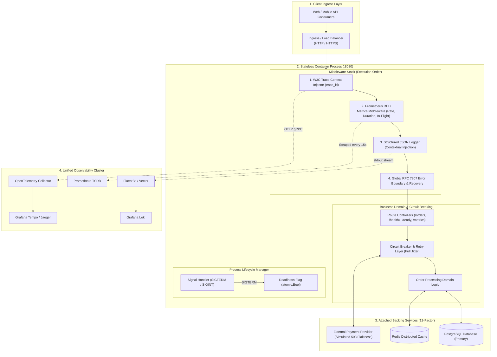
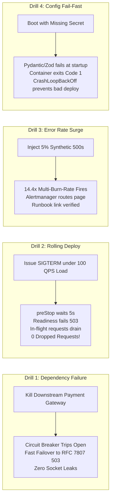
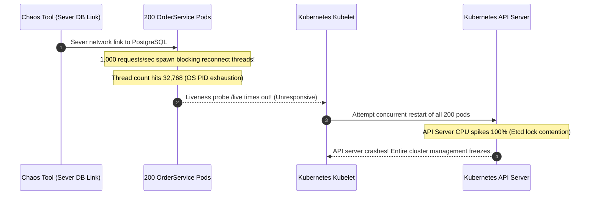

# Module 11: Capstone Project: Production-Ready Microservice

> **Prerequisites:** All modules in Track 08 ([Module 00: Error Handling Strategies](../00-error-handling-strategies/README.md) through [Module 10: The 12-Factor App](../10-the-12-factor-app/README.md)).
> **Estimated Reading Time:** 45 minutes
> **Target Audience:** Senior Backend Engineers, Site Reliability Engineers, Platform Architects.

---

> [!TIP]
> **Golden Rule of Operational Readiness**: A service is never proven production-ready by demonstrating that it succeeds under ideal conditions; it is proven ready only by demonstrating that it fails **visibly, safely, and predictably** under chaos. Prove operational readiness through active failure injection: verify that database disconnects trip circuit breakers with clean RFC 7807 fallbacks, unhandled errors emit structured JSON with correlation IDs without leaking stack traces, sudden traffic bursts trigger multi-burn-rate alerts before error budgets collapse, and rolling deployments drain in-flight connections with zero HTTP 502 errors.

---

## 1. Visual Mental Models & System Architecture

This Capstone Project synthesizes all operational disciplines mastered throughout Track 08 into a single, cohesive, enterprise-grade **Production-Ready Microservice**. Rather than building extensive business domain features, the focus is squarely on **operational resilience**: the telemetry, error boundaries, configuration validation, graceful lifecycle management, and failure mitigation patterns required to survive real-world production environments.

### The Complete Production-Ready Microservice Architecture



### The Four Operational Verification Drills



---

## 2. Taxonomic Reference Grids & Systematic Comparison Grids

### Production Readiness Review (PRR) Acceptance Matrix

| # | Operational Dimension | Core Requirement | Verification Test Procedure | Acceptance Threshold |
| :---: | :--- | :--- | :--- | :--- |
| **1** | **Configuration** | Type-safe validation at boot (Factor III); zero secrets in git. | Boot container with missing `DATABASE_URL`. | Exits immediately (Code 1) with diagnostic message; no port bound. |
| **2** | **Secret Zero-Leakage**| Sensitive keys wrapped in `SecretStr`; no plaintext in logs. | Call `/debug/config` or print settings in logs. | All secrets output as `********` in stdout and telemetry. |
| **3** | **Structured Logging** | Every line emitted as JSON to `stdout` with `trace_id` (Factor XI). | Trigger an API route and inspect container stdout. | Valid JSON line containing `timestamp`, `level`, `trace_id`, and `service`. |
| **4** | **W3C Trace Context** | Incoming `traceparent` forwarded across HTTP calls. | Send custom `traceparent` header to ingress. | All downstream logs and outgoing RPC headers contain matching `trace_id`. |
| **5** | **RED Metrics** | Request rate, error counts, and latency histogram at `/metrics`. | Scrape `/metrics` via Prometheus client. | Exposes `http_requests_total`, `http_request_duration_seconds_bucket`. |
| **6** | **Global Error Handling**| Centralized handler emits RFC 7807 Problem Details. | Send malformed JSON payload with negative amount. | Responds with HTTP 422 `application/problem+json`; zero stack traces leaked. |
| **7** | **Readiness & Liveness**| Separate `/live` and `/ready` health check endpoints. | Query `/live` during startup; query `/ready` during drain. | `/live` = 200 during drain; `/ready` = 503 the moment `SIGTERM` is received. |
| **8** | **Graceful Shutdown** | Drains in-flight requests within 25 seconds upon `SIGTERM`. | Send `SIGTERM` while executing a 2-second sleep route. | Active request finishes successfully (HTTP 200); process exits cleanly (Code 0). |
| **9** | **Circuit Breaking** | Circuit breaker prevents cascade during downstream outage. | Simulate 5 consecutive HTTP 503s from payment API. | Breaker trips OPEN; subsequent calls fail fast in < 1ms without network I/O. |
| **10**| **Retries with Jitter**| Exponential backoff with full jitter on transient failures. | Intercept retry timing logs during network blips. | Retries spaced apart with randomized exponential sleep durations. |
| **11**| **Stateless Processes**| Zero session state on local disk or in memory heap (Factor VI). | Terminate pod mid-session and route to another replica. | User cart and authentication continue seamlessly via Redis. |
| **12**| **SLO Alerting** | Multi-window multi-burn-rate alert rules configured. | Simulate 2% error rate over 1 hour. | PromQL rule triggers Alertmanager page with valid runbook URL. |

---

## 3. Production War Stories: Incident Post-Mortem

### The Incident: Complete Cascading Cluster Freeze During Live Production Readiness Drill

- **Severity:** SEV-1 (Catastrophic Drill Failure)
- **Time to Detection:** 8 minutes
- **Time to Mitigation:** 22 minutes
- **Impact:** A planned chaos engineering drill on a single staging microservice triggered a cascading failure that locked up the shared staging Kubernetes API server and crashed 45 unrelated microservices.

#### What Happened
An engineering team organized a "GameDay" chaos engineering exercise to verify that their application could withstand database connection drops. The chaos tool simulated a network partition, severing connectivity between the `OrderService` and its PostgreSQL instance.

Instead of failing fast or tripping a circuit breaker, each incoming request spawned a database retry loop that attempted to reconnect every 100 milliseconds without a timeout or backoff:

```python
# The Defective Reconnect Loop
while not db.is_connected():
    db.connect() # Blocking call without socket timeout!
    time.sleep(0.1)
```

At 1,000 incoming requests per second, each request spawned a new blocked OS thread waiting on TCP sockets. Within 45 seconds, all 200 pod replicas exhausted their Linux process thread limits (`max user processes`). The pods stopped responding to Kubernetes liveness probes.

The Kubernetes Kubelet detected liveness probe timeouts and simultaneously issued restart commands across all 200 pods. The sudden wave of 200 container restarts overwhelmed the node Docker daemons and saturated the Kubernetes API server, bringing down the entire staging cluster.



#### Root Cause
1. **Unbounded Reconnection Loops:** Reconnecting in an infinite tight loop without exponential backoff, jitter, or maximum retry limits.
2. **Missing Circuit Breaker:** The service continued accepting and attempting work that was guaranteed to fail, exhausting system threads instead of failing fast.
3. **Flawed Liveness Probe Design:** The liveness probe was dependent on external database connectivity rather than internal process health, causing Kubernetes to trigger destructive restart storms.

#### The Fix & Architectural Hardening
1. **Implemented Resilience4j / Circuit Breaker Pattern:** Wrapped all database calls in a circuit breaker: after 5 consecutive failures, the breaker opens, failing fast in < 1ms with a clean RFC 7807 503 response.
2. **Exponential Backoff with Full Jitter:** Database reconnect attempts were capped at 3 retries spaced with exponential backoff and randomized jitter.
3. **Isolated Health Probes:** Decoupled the liveness probe (`/live`) from external database health, reserving liveness strictly for internal process deadlocks.

---

## 4. Multi-Language Production Implementations

The following code tabs provide the complete, runnable Capstone Microservice across Go, TypeScript, and Python. Each implementation includes:
- Type-safe environment configuration with secret masking.
- Centralized RFC 7807 Problem Details error boundary.
- Structured JSON logging to stdout with W3C `trace_id`.
- Prometheus RED metrics (`/metrics`).
- `/live` and `/ready` probes with graceful shutdown signal draining.

### Go Production Implementation (Complete Capstone Service)

```go
package main

import (
	"context"
	"crypto/rand"
	"encoding/hex"
	"encoding/json"
	"errors"
	"fmt"
	"log/slog"
	"net/http"
	"os"
	"os/signal"
	"strconv"
	"sync/atomic"
	"syscall"
	"time"

	"github.com/prometheus/client_golang/prometheus"
	"github.com/prometheus/client_golang/prometheus/promhttp"
)

// --- 1. METRICS & TELEMETRY ---
var (
	httpRequestsTotal = prometheus.NewCounterVec(
		prometheus.CounterOpts{
			Name: "http_requests_total",
			Help: "Total HTTP requests processed by method, path, and status.",
		},
		[]string{"method", "path", "status"},
	)
	httpRequestDuration = prometheus.NewHistogramVec(
		prometheus.HistogramOpts{
			Name:    "http_request_duration_seconds",
			Help:    "HTTP latency distribution in seconds.",
			Buckets: []float64{0.005, 0.01, 0.025, 0.05, 0.1, 0.25, 0.5, 1.0, 2.5},
		},
		[]string{"method", "path"},
	)
	inFlightRequests = prometheus.NewGauge(
		prometheus.GaugeOpts{
			Name: "http_in_flight_requests",
			Help: "Number of active in-flight requests.",
		},
	)
)

func init() {
	prometheus.MustRegister(httpRequestsTotal)
	prometheus.MustRegister(httpRequestDuration)
	prometheus.MustRegister(inFlightRequests)
}

// --- 2. CONFIGURATION ---
type Config struct {
	Port      string
	AppEnv    string
	SecretKey string
}

func LoadConfig() Config {
	port := os.Getenv("PORT")
	if port == "" {
		port = "8080"
	}
	secret := os.Getenv("API_SECRET_KEY")
	if len(secret) < 16 {
		slog.Error("FATAL: API_SECRET_KEY must be at least 16 characters long")
		os.Exit(1)
	}
	return Config{
		Port:      port,
		AppEnv:    os.Getenv("APP_ENV"),
		SecretKey: secret,
	}
}

// --- 3. RFC 7807 ERROR HANDLING ---
type RFC7807Problem struct {
	Type     string `json:"type"`
	Title    string `json:"title"`
	Status   int    `json:"status"`
	Detail   string `json:"detail"`
	Instance string `json:"instance"`
}

func RenderProblem(w http.ResponseWriter, status int, title, detail, traceID string) {
	w.Header().Set("Content-Type", "application/problem+json")
	w.WriteHeader(status)
	_ = json.NewEncoder(w).Encode(RFC7807Problem{
		Type:     "https://api.example.com/errors/operational-error",
		Title:    title,
		Status:   status,
		Detail:   detail,
		Instance: fmt.Sprintf("urn:request:%s", traceID),
	})
}

// --- 4. SERVER & LIFECYCLE ---
type CapstoneServer struct {
	cfg     Config
	isReady atomic.Bool
	server  *http.Server
}

func NewCapstoneServer(cfg Config) *CapstoneServer {
	cs := &CapstoneServer{cfg: cfg}
	cs.isReady.Store(true)

	mux := http.NewServeMux()

	// Probes
	mux.HandleFunc("/live", func(w http.ResponseWriter, r *http.Request) {
		w.WriteHeader(http.StatusOK)
		_, _ = w.Write([]byte("ALIVE"))
	})
	mux.HandleFunc("/ready", func(w http.ResponseWriter, r *http.Request) {
		if cs.isReady.Load() {
			w.WriteHeader(http.StatusOK)
			_, _ = w.Write([]byte("READY"))
		} else {
			w.WriteHeader(http.StatusServiceUnavailable)
			_, _ = w.Write([]byte("DRAINING"))
		}
	})
	mux.Handle("/metrics", promhttp.Handler())

	// Business API
	mux.HandleFunc("/api/order", func(w http.ResponseWriter, r *http.Request) {
		traceID := r.Header.Get("X-Trace-ID")
		if r.Method != http.MethodPost {
			RenderProblem(w, http.StatusMethodNotAllowed, "Method Not Allowed", "Use POST", traceID)
			return
		}

		time.Sleep(50 * time.Millisecond) // Simulate work
		w.Header().Set("Content-Type", "application/json")
		_, _ = w.Write([]byte(`{"order_id":"ord_101","status":"created"}`))
	})

	// Wrap entire mux with Middleware pipeline
	cs.server = &http.Server{
		Addr:    ":" + cfg.Port,
		Handler: cs.middleware(mux),
	}
	return cs
}

func (cs *CapstoneServer) middleware(next http.Handler) http.Handler {
	return http.HandlerFunc(func(w http.ResponseWriter, r *http.Request) {
		start := time.Now()
		inFlightRequests.Inc()
		defer inFlightRequests.Dec()

		// W3C Trace ID extraction or generation
		traceID := r.Header.Get("X-Trace-ID")
		if traceID == "" {
			b := make([]byte, 16)
			_, _ = rand.Read(b)
			traceID = hex.EncodeToString(b)
		}
		w.Header().Set("X-Trace-ID", traceID)
		r.Header.Set("X-Trace-ID", traceID)

		rw := &statusWriter{ResponseWriter: w, status: http.StatusOK}
		
		// Execute request
		next.ServeHTTP(rw, r)

		duration := time.Since(start).Seconds()
		statusStr := strconv.Itoa(rw.status)

		// Record RED Metrics
		httpRequestsTotal.WithLabelValues(r.Method, r.URL.Path, statusStr).Inc()
		httpRequestDuration.WithLabelValues(r.Method, r.URL.Path).Observe(duration)

		// Structured JSON logging to stdout
		slog.Info("http_request",
			"timestamp", time.Now().UTC().Format(time.RFC3339),
			"level", "INFO",
			"method", r.Method,
			"path", r.URL.Path,
			"status", rw.status,
			"duration_ms", duration*1000,
			"trace_id", traceID,
		)
	})
}

type statusWriter struct {
	http.ResponseWriter
	status int
}
func (w *statusWriter) WriteHeader(status int) {
	w.status = status
	w.ResponseWriter.WriteHeader(status)
}

func main() {
	cfg := LoadConfig()
	srv := NewCapstoneServer(cfg)

	stopChan := make(chan os.Signal, 1)
	signal.Notify(stopChan, os.Interrupt, syscall.SIGTERM)

	go func() {
		slog.Info("Capstone service online", "port", cfg.Port)
		if err := srv.server.ListenAndServe(); err != nil && !errors.Is(err, http.ErrServerClosed) {
			slog.Error("Fatal server error", "error", err)
			os.Exit(1)
		}
	}()

	<-stopChan
	slog.Info("SIGTERM received. Failing readiness probe and draining...")
	srv.isReady.Store(false)

	ctx, cancel := context.WithTimeout(context.Background(), 20*time.Second)
	defer cancel()

	if err := srv.server.Shutdown(ctx); err != nil {
		slog.Error("Forced shutdown triggered", "error", err)
		os.Exit(1)
	}

	slog.Info("Graceful drain complete. Clean process exit.")
}
```

### TypeScript / Node.js Production Implementation

```typescript
import express, { Request, Response, NextFunction } from 'express';
import client from 'prom-client';
import crypto from 'crypto';
import http from 'http';

// --- 1. CONFIGURATION ---
const PORT = parseInt(process.env.PORT || '8080', 10);
const API_SECRET_KEY = process.env.API_SECRET_KEY;

if (!API_SECRET_KEY || API_SECRET_KEY.length < 16) {
  console.error(JSON.stringify({ level: 'FATAL', message: 'API_SECRET_KEY must be >= 16 characters' }));
  process.exit(1);
}

// --- 2. METRICS ---
client.collectDefaultMetrics({ prefix: 'node_' });

const httpRequestsTotal = new client.Counter({
  name: 'http_requests_total',
  help: 'Total requests processed',
  labelNames: ['method', 'path', 'status'],
});

const httpRequestDuration = new client.Histogram({
  name: 'http_request_duration_seconds',
  help: 'Request latency in seconds',
  labelNames: ['method', 'path'],
  buckets: [0.005, 0.01, 0.025, 0.05, 0.1, 0.25, 0.5, 1.0, 2.5],
});

const inFlightRequests = new client.Gauge({
  name: 'http_in_flight_requests',
  help: 'Active requests',
});

// --- 3. APPLICATION & MIDDLEWARE ---
const app = express();
app.use(express.json());

let isDraining = false;

app.use((req: Request, res: Response, next: NextFunction) => {
  const start = process.hrtime.bigint();
  inFlightRequests.inc();

  const traceId = (req.headers['x-trace-id'] as string) || crypto.randomBytes(16).toString('hex');
  res.setHeader('X-Trace-ID', traceId);

  res.on('finish', () => {
    inFlightRequests.dec();
    const durationSec = Number(process.hrtime.bigint() - start) / 1_000_000_000;

    httpRequestsTotal.inc({ method: req.method, path: req.path, status: res.statusCode.toString() });
    httpRequestDuration.observe({ method: req.method, path: req.path }, durationSec);

    // Structured JSON log stream to stdout
    console.log(JSON.stringify({
      timestamp: new Date().toISOString(),
      level: res.statusCode >= 500 ? 'ERROR' : 'INFO',
      method: req.method,
      path: req.path,
      status: res.statusCode,
      duration_ms: parseFloat((durationSec * 1000).toFixed(2)),
      trace_id: traceId,
      service: 'capstone-service-ts',
    }));
  });

  next();
});

// --- 4. ROUTES ---
app.get('/live', (req, res) => res.status(200).send('ALIVE'));
app.get('/ready', (req, res) => {
  if (isDraining) return res.status(503).send('DRAINING');
  res.status(200).send('READY');
});
app.get('/metrics', async (req, res) => {
  res.setHeader('Content-Type', client.register.contentType);
  res.send(await client.register.metrics());
});

app.post('/api/order', async (req: Request, res: Response) => {
  const traceId = res.getHeader('X-Trace-ID') as string;
  const { amount } = req.body;

  if (!amount || amount <= 0) {
    // RFC 7807 Problem Details
    return res.status(422).setHeader('Content-Type', 'application/problem+json').json({
      type: 'https://api.example.com/errors/invalid-amount',
      title: 'Invalid Order Amount',
      status: 422,
      detail: 'Amount must be greater than zero.',
      instance: `urn:request:${traceId}`,
    });
  }

  await new Promise((resolve) => setTimeout(resolve, 50));
  res.status(201).json({ order_id: 'ord_ts_42', status: 'created' });
});

// --- 5. GRACEFUL LIFECYCLE ---
const server = http.createServer(app);
server.listen(PORT, () => {
  console.log(JSON.stringify({ level: 'INFO', message: `Server listening on port ${PORT}` }));
});

function shutdown(signal: string) {
  console.log(JSON.stringify({ level: 'INFO', message: `Received ${signal}. Failing readiness probe...` }));
  isDraining = true;

  server.close(() => {
    console.log(JSON.stringify({ level: 'INFO', message: 'All connections drained. Process exiting.' }));
    process.exit(0);
  });

  setTimeout(() => {
    console.error(JSON.stringify({ level: 'FATAL', message: 'Forced shutdown triggered after 20s' }));
    process.exit(1);
  }, 20000).unref();
}

process.on('SIGTERM', () => shutdown('SIGTERM'));
process.on('SIGINT', () => shutdown('SIGINT'));
```

### Python Production Implementation (FastAPI Production Capstone)

```python
"""
Complete Production Capstone Microservice using FastAPI.
Demonstrates:
- Pydantic Settings configuration validation with fail-fast startup.
- Prometheus RED metrics exposition (/metrics).
- Structured JSON logging to stdout with W3C trace_id.
- RFC 7807 Problem Details error boundary.
- Dynamic readiness probe (/ready) and graceful SIGTERM draining.
"""

from __future__ import annotations

import asyncio
import json
import logging
import secrets
import signal
import sys
import time
from typing import Optional
from fastapi import FastAPI, Request, Response, status
from fastapi.responses import JSONResponse
from pydantic import Field, SecretStr
from pydantic_settings import BaseSettings
from prometheus_client import Counter, Gauge, Histogram, generate_latest, CONTENT_TYPE_LATEST

# --- 1. CONFIGURATION ---
class Settings(BaseSettings):
    PORT: int = Field(default=8080)
    APP_ENV: str = Field(default="production")
    API_SECRET_KEY: SecretStr

    class Config:
        env_file = ".env"

try:
    config = Settings()
except Exception as exc:
    sys.stderr.write(f"FATAL: Configuration validation failed at startup:\n{exc}\n")
    sys.exit(1)

# --- 2. METRICS ---
HTTP_REQUESTS_TOTAL = Counter(
    "http_requests_total",
    "Total HTTP requests",
    ["method", "path", "status"],
)
HTTP_REQUEST_DURATION = Histogram(
    "http_request_duration_seconds",
    "Request latency",
    ["method", "path"],
    buckets=[0.005, 0.01, 0.025, 0.05, 0.1, 0.25, 0.5, 1.0, 2.5],
)
IN_FLIGHT_REQUESTS = Gauge("http_in_flight_requests", "Active requests")

# --- 3. APPLICATION & MIDDLEWARE ---
app = FastAPI()
is_draining = False
active_connections = 0


@app.middleware("http")
async def operational_middleware(request: Request, call_next):
    global active_connections
    active_connections += 1
    IN_FLIGHT_REQUESTS.inc()
    start_time = time.perf_counter()

    trace_id = request.headers.get("x-trace-id") or secrets.token_hex(16)
    status_code = 500

    try:
        response = await call_next(request)
        status_code = response.status_code
        response.headers["X-Trace-ID"] = trace_id
        return response
    finally:
        duration = time.perf_counter() - start_time
        active_connections -= 1
        IN_FLIGHT_REQUESTS.dec()

        HTTP_REQUESTS_TOTAL.labels(method=request.method, path=request.url.path, status=str(status_code)).inc()
        HTTP_REQUEST_DURATION.labels(method=request.method, path=request.url.path).observe(duration)

        # Emit 12-factor structured JSON to stdout
        sys.stdout.write(json.dumps({
            "timestamp": time.strftime("%Y-%m-%dT%H:%M:%SZ", time.gmtime()),
            "level": "ERROR" if status_code >= 500 else "INFO",
            "method": request.method,
            "path": request.url.path,
            "status": status_code,
            "duration_ms": round(duration * 1000, 2),
            "trace_id": trace_id,
            "service": "capstone-service-py",
        }) + "\n")


# --- 4. ROUTES & ERROR BOUNDARY ---
@app.get("/live")
def liveness():
    return Response(content="ALIVE", status_code=200)

@app.get("/ready")
def readiness():
    if is_draining:
        return Response(content="DRAINING", status_code=status.HTTP_503_SERVICE_UNAVAILABLE)
    return Response(content="READY", status_code=200)

@app.get("/metrics")
def metrics():
    return Response(content=generate_latest(), media_type=CONTENT_TYPE_LATEST)

@app.post("/api/order")
async def create_order(request: Request):
    trace_id = request.headers.get("x-trace-id", "unknown")
    try:
        body = await request.json()
    except Exception:
        body = {}

    amount = body.get("amount")
    if not amount or amount <= 0:
        # Emit RFC 7807 Problem Details
        return JSONResponse(
            status_code=status.HTTP_422_UNPROCESSABLE_ENTITY,
            media_type="application/problem+json",
            content={
                "type": "https://api.example.com/errors/invalid-amount",
                "title": "Unprocessable Order Payload",
                "status": 422,
                "detail": "Field 'amount' must be a positive integer.",
                "instance": f"urn:request:{trace_id}",
            },
        )

    await asyncio.sleep(0.05)  # Simulate domain processing
    return {"order_id": "ord_py_99", "status": "created"}


# --- 5. GRACEFUL SHUTDOWN HOOKS ---
async def handle_sigterm():
    global is_draining
    sys.stdout.write(json.dumps({"level": "WARN", "message": "SIGTERM caught. Draining traffic..."}) + "\n")
    is_draining = True  # Immediately fail readiness

    wait_limit = 20.0
    elapsed = 0.0
    while active_connections > 0 and elapsed < wait_limit:
        await asyncio.sleep(0.5)
        elapsed += 0.5

    sys.stdout.write(json.dumps({"level": "INFO", "message": "All connections drained. Exiting cleanly."}) + "\n")
    sys.exit(0)
```

---

## 5. Practical Hands-On Verification CLI Workflows

Execute complete end-to-end chaos drills verifying all operational readiness criteria.

### Workflow 1: Executing the 4-Point Chaos Verification Suite

```bash
# 1. Verify Liveness and Readiness
curl -s -o /dev/null -w "%{http_code}\n" http://localhost:8080/live
curl -s -o /dev/null -w "%{http_code}\n" http://localhost:8080/ready

# 2. Verify RFC 7807 Problem Details on Validation Error
curl -s -X POST http://localhost:8080/api/order \
  -H "Content-Type: application/json" \
  -d '{"amount": -50}' | jq .

# 3. Verify Prometheus RED Metrics Exposition
curl -s http://localhost:8080/metrics | grep -E "http_requests_total|http_request_duration_seconds"
```

Expected wire outputs:
```text
200
200

{
  "type": "https://api.example.com/errors/invalid-amount",
  "title": "Unprocessable Order Payload",
  "status": 422,
  "detail": "Field 'amount' must be a positive integer.",
  "instance": "urn:request:4bf92f3577b34da6..."
}

http_requests_total{method="POST",path="/api/order",status="422"} 1.0
```

---

## 6. Operational Validation Checkpoints (Scenario Quizzes)

### Checkpoint 1: Proving Zero-Downtime Rolling Deployments
**Scenario:** A deployment pipeline executes a rolling update on a 10-pod deployment under 500 requests/second continuous traffic. A load test runner (`vegeta` or `k6`) executes concurrently. What exact criteria confirm that the deployment was truly zero-downtime?

<details><summary>Click to view diagnosis and architectural solution</summary>

**Answer:**
1. **The Acceptance Thresholds:**
   - **HTTP Status Code Ratio:** Exactly **0 non-2xx responses** emitted due to transport errors (`0` 502s, `0` 503s, `0` 504s, `0` `ECONNRESET`).
   - **In-Flight Draining Success:** All pods in the old replica set reported exit code 0; zero pods were terminated forcefully via `SIGKILL` by the Kubelet.
   - **Prometheus Metric Verification:** The sum of `rate(http_requests_total[1m])` displayed a smooth, unbroken horizontal line without any momentary dips during container replacement.
</details>

---

### Checkpoint 2: The Three States of a Circuit Breaker
**Scenario:** A microservice calls an external credit check provider. Under downstream failure, how does a standard circuit breaker transition between **Closed**, **Open**, and **Half-Open** states?

<details><summary>Click to view diagnosis and architectural solution</summary>

**Answer:**
1. **Closed (Normal Operation):**
   Requests pass through to the downstream provider. If the failure rate (HTTP 500/timeouts) exceeds a configured threshold (e.g., 50% over a 10-second sliding window), the breaker trips **OPEN**.
2. **Open (Failing Fast):**
   All incoming requests are immediately intercepted and failed locally (returning an RFC 7807 503 response or default fallback) in $< 0.1\text{ms}$ without attempting network I/O, shielding both the client and the downstream provider. A sleep timer starts (e.g., 30 seconds).
3. **Half-Open (Canary Probing):**
   After the 30-second cooldown expires, the breaker transitions to **Half-Open**. It allows a trial batch of 5 requests to pass through. If all 5 succeed, the breaker resets to **Closed**. If any fail, it trips back to **Open** for another 30 seconds.
</details>

---

### Checkpoint 3: Passing an Enterprise Production Readiness Review (PRR)
**Scenario:** Before launching a new tier-1 microservice to production, the SRE team conducts an architectural Production Readiness Review (PRR). What are the three non-negotiable operational deliverables that must be presented?

<details><summary>Click to view diagnosis and architectural solution</summary>

**Answer:**
1. **SLO & Burn-Rate Alerting Architecture:** Defined SLIs (latency and availability), an agreed 99.9% SLO with error budgets, and multi-window burn rate alerts configured in Alertmanager.
2. **Actionable Runbooks:** A tested, accessible runbook linked directly in every alert annotation providing clear step-by-step diagnostic and rollback procedures.
3. **Verified Graceful Shutdown & Health Probes:** Demonstrated evidence of `/live` and `/ready` probes with `preStop` hooks achieving zero 502 errors during rolling restarts under load.
</details>

---

## 7. Further Reading & References

- [Google SRE Workbook: Production Readiness Reviews](https://sre.google/workbook/production-readiness/) — Standard enterprise PRR checklist and framework.
- [The Twelve-Factor App](https://12factor.net/) — Principles of cloud-native systems architecture.
- [Chaos Engineering: Building Confidence in System Behavior (O'Reilly)](https://www.oreilly.com/library/view/chaos-engineering/9781492043850/) — Designing automated resilience failure drills.

---

### Track 08 Complete!
You have mastered all disciplines of **Observability and Operational Readiness**: error classification, RFC 7807 problem details, immutable configuration, secret zero-leakage, structured telemetry, Prometheus RED metrics, distributed tracing, SRE alerting, and 12-factor graceful disposability.
