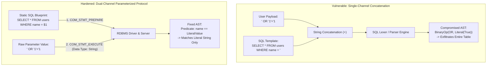
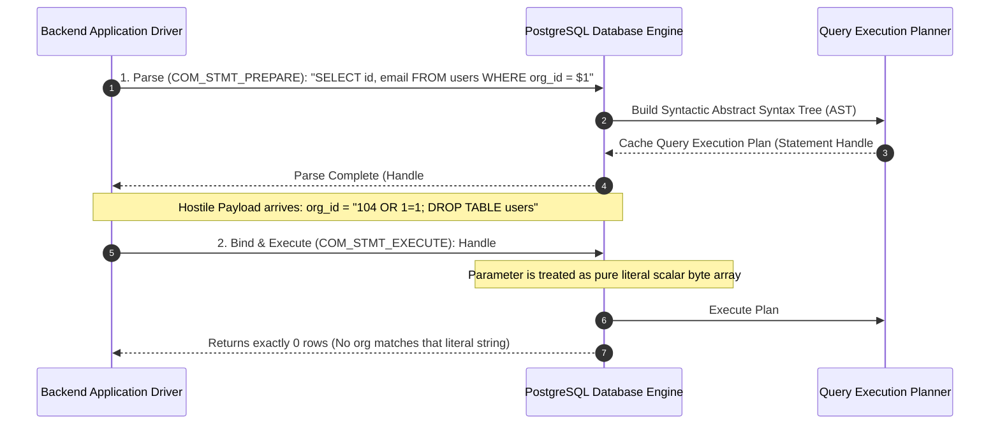
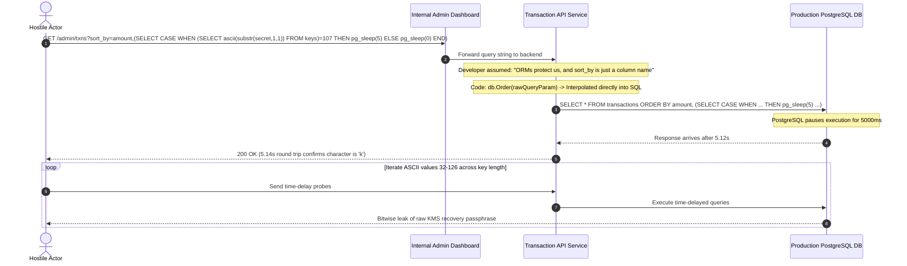

# Module 01: Injection Attacks (SQLi, Command, and NoSQL)

> **Prerequisites**: [Module 00: OWASP Top 10 Overview](../00-owasp-top-10-overview/README.md), basic SQL relational database literacy, and shell command execution concepts.  
> **Estimated Reading Time**: 35 minutes.  
> **Target Audience**: Senior Backend Engineers, Application Security Specialists, and Cloud Infrastructure Developers.

---

> [!TIP]
> **The Golden Rule of Injection Defense**  
> Injection vulnerabilities only occur when **code structure and untrusted data travel across the same channel**. The interpreter cannot differentiate between developer instructions and hostile user payloads. To achieve absolute mathematical immunity against injection, enforce **dual-channel separation**: transmit query blueprints as static code templates, bind untrusted values through dedicated parameter transport protocols (prepared statements), map dynamic structural identifiers (tables, columns, sort directions) against strict compile-time allowlists, and invoke operating system processes using isolated argument vectors with `shell=False`.

---

## 1. Architectural Blueprint & Mental Models

When user-controlled input is concatenated directly into a query or command string, it enters the parser on a single channel. The lexer tokenizes hostile input into structural keywords (`OR`, `UNION`, `DROP`, `;`, `|`), rewriting the syntax tree.



### The Database Binary Protocol: Prepared Statement Lifecycle

Prepared statements separate the syntactic compilation of the SQL command from the runtime evaluation of input values. The database engine parses, validates, and optimizes the query execution plan *before* any parameter values are inspected.



---

## 2. Systematic Taxonomic Reference Grids

### Injection Threat Spectrum & Architectural Mitigations

| Injection Variant | Target Interpreter | Root Cause | Attack Vector Mechanism | Structural Primary Defense | Fallback Layer (Defense-in-Depth) |
| :--- | :--- | :--- | :--- | :--- | :--- |
| **SQL Injection (SQLi)** | Relational Engine (PostgreSQL, MySQL, SQLite, Oracle) | String interpolation of values or identifiers into SQL text. | `UNION SELECT` credential dumps, Boolean/Time-based blind exfiltration (`SLEEP(5)`). | Parameterized Prepared Statements (`$1`, `?`). Strict allowlisting for identifiers. | Least-privilege DB user accounts (no DDL/`DROP` rights), network-isolated database VPC. |
| **OS Command Injection** | Operating System Shell (`/bin/sh`, `/bin/bash`, `cmd.exe`) | Passing unsanitized user strings to shell execution primitives (`system()`, `popen()`). | Metacharacter chaining (`;`, `\|`, `&&`, `` `cmd` ``, `$(cmd)`). | Process execution using argument vector arrays with `shell=False`. | Container privilege de-escalation, read-only root filesystems, Linux Seccomp/AppArmor. |
| **NoSQL Operator Smuggling** | Document DB Engine (MongoDB, Couchbase) | Binding raw JSON objects containing query operators directly to query filters. | Smuggling `$gt: ""` or `$ne: null` to bypass authentication checks without knowing credentials. | Schema validation & strict type-casting (Pydantic, Zod) ensuring input is primitive string. | MongoDB ODM query projections, disabling server-side JavaScript evaluation (`$where`). |
| **LDAP Injection** | Directory Service (Active Directory, OpenLDAP) | Building LDAP search filters by string formatting. | Filter manipulation via `*`, `)(`, `\|`, or `&` characters. | Contextual RFC 4515 LDAP string escaping and structured filter builders. | Scoped directory tree search bases, read-only service account bindings. |

### Query Component Parameterization Feasibility Grid

| SQL Component | Can Be Parameterized? | Explanation | Correct Defensive Implementation Pattern |
| :--- | :--- | :--- | :--- |
| **Data Values** (`WHERE id = ?`, `INSERT INTO ... VALUES (?)`) | **YES** | Relational drivers support placeholders for all primitive data types (strings, ints, floats, dates, UUIDs). | Use native driver parameters (`$1`, `?`, `:param`). Never concatenate. |
| **Column Names** (`SELECT ? FROM users`, `ORDER BY ?`) | **NO** | SQL grammar requires column identifiers to be determined at parse time to construct the query plan. | **Strict In-Memory Allowlist**: Validate input against a `Set<string>` of approved column names. |
| **Table Names** (`SELECT * FROM ?`) | **NO** | Tables dictate schema metadata and storage file descriptors; cannot be passed as scalar values. | **Strict In-Memory Allowlist** or programmatic dispatch routing. |
| **Sort Direction** (`ORDER BY created_at ?`) | **NO** | `ASC` and `DESC` are structural syntax keywords. | Ternary assertion: `sortDir.toUpperCase() === "DESC" ? "DESC" : "ASC"`. |
| **Operators** (`WHERE age ? 21`) | **NO** | Comparison operators (`=`, `>`, `<`, `LIKE`, `IN`) define AST node semantics. | Code branching with fixed static SQL clauses. |

---

## 3. Production War Story: The \$12M Liquidity Drain

### Incident Post-Mortem

- **Severity**: SEV-1 (Critical Financial Data Breach & Hot Wallet Depletion)
- **Time to Detect (TTD)**: 18 hours (Identified when automated exchange reserve alarms triggered)
- **Time to Mitigate (TTM)**: 42 minutes
- **Impact**: Attacker exfiltrated internal hot wallet multi-sig decryption seeds and drained \$12.4M in cryptocurrency assets.



#### What Happened & Root Cause
The development team used an Object-Relational Mapper (GORM / SQLAlchemy) for transaction management. While all `WHERE` clauses used bound parameters, an administrative reporting endpoint permitted users to sort transactions dynamically. 

The developer wrote:
```go
// VULNERABLE: Direct interpolation of user-controlled column identifier
query := db.Order(r.URL.Query().Get("sort_by")).Find(&transactions)
```
Because placeholders cannot bind column identifiers, the developer passed the raw string directly into the ORM's order clause. The attacker leveraged time-based blind SQL injection via PostgreSQL's `pg_sleep()` function, extracting byte-by-byte cryptographic seed phrases stored in an internal configuration table.

#### The Fix & Architectural Hardening
1. **Implemented Exhaustive Column Allowlists**: Replaced raw string ingestion with a strict set of sortable columns:
   ```go
   var AllowedSortColumns = map[string]string{
       "date":   "created_at",
       "amount": "amount_cents",
       "status": "transaction_status",
   }
   ```
2. **Hard Database Privilege Isolation**: Stripped the web application user's access to internal configuration, key management, and secrets tables.
3. **Database Statement Timeouts**: Set `statement_timeout = '3000ms'` in `postgresql.conf` across all application pools, immediately aborting long-running sleep injection probes.

---

## 4. Multi-Language Production Implementations: The Injection-Proof Defense Guard

Below is the complete, production-grade implementation of an injection-proof service across **Go**, **Node.js/TypeScript**, **Python**, and **C#**. Each client showcases:
- Fully parameterized relational queries (`pgx`, `pg`, `asyncpg`, `Npgsql`).
- Dynamic column sorting protected by compile-time allowlists.
- NoSQL typed schema enforcement preventing operator injection.
- Safe operating system command execution using argument vectors (`shell=False`).

### Go Implementation

```go
package main

import (
	"context"
	"errors"
	"fmt"
	"os/exec"
	"strings"
	"time"

	"github.com/jackc/pgx/v5"
	"github.com/jackc/pgx/v5/pgxpool"
)

var (
	ErrInvalidSortColumn = errors.New("invalid sort column requested")
	ErrExecutionTimeout  = errors.New("command execution timed out")
)

// AllowedSortFields strictly whitelist table identifiers
var AllowedSortFields = map[string]string{
	"created_at": "created_at",
	"amount":     "amount_cents",
	"name":       "customer_name",
}

type ProductSearchQuery struct {
	CategoryID string
	MinPrice   int64
	SortBy     string
	SortOrder  string
	PageSize   int
	Offset     int
}

type ProductRecord struct {
	ID          string    `json:"id"`
	Name        string    `json:"name"`
	AmountCents int64     `json:"amount_cents"`
	CreatedAt   time.Time `json:"created_at"`
}

type SecureCatalogService struct {
	pool *pgxpool.Pool
}

func NewSecureCatalogService(pool *pgxpool.Pool) *SecureCatalogService {
	return &SecureCatalogService{pool: pool}
}

// SearchProducts demonstrates dual-channel parameterization + identifier allowlisting
func (s *SecureCatalogService) SearchProducts(
	ctx context.Context, 
	query ProductSearchQuery,
) ([]ProductRecord, error) {
	// 1. Structural Identifier Defense: Allowlist verification
	targetColumn, exists := AllowedSortFields[strings.ToLower(query.SortBy)]
	if !exists {
		targetColumn = "created_at" // Safe default fallback
	}

	targetDirection := "ASC"
	if strings.EqualFold(query.SortOrder, "DESC") {
		targetDirection = "DESC"
	}

	// 2. Dynamic SQL construction with hardcoded identifiers + Parameterized values
	// Note: targetColumn and targetDirection are guaranteed safe literals from the allowlist
	sqlQuery := fmt.Sprintf(`
		SELECT id, customer_name, amount_cents, created_at
		FROM products
		WHERE category_id = $1 AND amount_cents >= $2
		ORDER BY %s %s
		LIMIT $3 OFFSET $4;
	`, targetColumn, targetDirection)

	// 3. Execution: Values transmitted on separate binary channel
	rows, err := s.pool.Query(ctx, sqlQuery, 
		query.CategoryID, 
		query.MinPrice, 
		query.PageSize, 
		query.Offset,
	)
	if err != nil {
		return nil, fmt.Errorf("failed to execute catalog query: %w", err)
	}
	defer rows.Close()

	var records []ProductRecord
	for rows.Next() {
		var p ProductRecord
		if err := rows.Scan(&p.ID, &p.Name, &p.AmountCents, &p.CreatedAt); err != nil {
			return nil, fmt.Errorf("failed to scan product row: %w", err)
		}
		records = append(records, p)
	}

	return records, rows.Err()
}

// RunSystemDiagnostic demonstrates safe OS execution without a shell
func RunSystemDiagnostic(ctx context.Context, targetHost string) ([]byte, error) {
	// 1. Strict Input Sanitization & Validation (Defense in Depth)
	if strings.ContainsAny(targetHost, ";&|`$><\n\r") {
		return nil, errors.New("target host contains illegal metacharacters")
	}

	// 2. Dual-channel process invocation: exec.CommandContext executes binary directly (NO /bin/sh)
	// targetHost is passed as a discrete argument scalar, never parsed as shell syntax
	cmd := exec.CommandContext(ctx, "ping", "-c", "1", "-W", "2", targetHost)

	output, err := cmd.CombinedOutput()
	if err != nil {
		return nil, fmt.Errorf("ping diagnostic failed: %w", err)
	}

	return output, nil
}
```

---

### Node.js / TypeScript Implementation

```typescript
import { Pool } from 'pg';
import { execFile } from 'child_process';
import { promisify } from 'util';
import { z } from 'zod';

const execFileAsync = promisify(execFile);

// 1. NoSQL / Body Validation Schema: Neutralize operator smuggling
export const LoginPayloadSchema = z.object({
  username: z.string().min(3).max(64),
  // Strict primitive string enforcement rejects smuggled MongoDB operators like { "$gt": "" }
  password: z.string().min(8).max(128),
});

export type LoginPayload = z.infer<typeof LoginPayloadSchema>;

export class HardenedDataService {
  private pool: Pool;

  // Strict identifier allowlist
  private static readonly ALLOWED_SORT_COLUMNS = new Set(['created_at', 'price', 'name']);

  constructor(pool: Pool) {
    this.pool = pool;
  }

  public async getCatalogProducts(
    categoryId: string,
    minPriceCents: number,
    rawSortColumn: string,
    rawSortDir: string
  ) {
    // Identifier Validation
    const sortColumn = HardenedDataService.ALLOWED_SORT_COLUMNS.has(rawSortColumn)
      ? rawSortColumn
      : 'created_at';
    const sortDir = rawSortDir.toUpperCase() === 'DESC' ? 'DESC' : 'ASC';

    // Safe SQL: Static structural keywords with runtime parameters
    const sql = `
      SELECT id, name, price_cents, created_at
      FROM products
      WHERE category_id = $1 AND price_cents >= $2
      ORDER BY ${sortColumn} ${sortDir}
      LIMIT $3;
    `;

    // Values passed via separate parameterized channel
    const result = await this.pool.query(sql, [categoryId, minPriceCents, 50]);
    return result.rows;
  }

  // OS Process Execution: Zero-shell invocation via execFile
  public async executeSafeReportGeneration(inputFile: string, targetFormat: 'pdf' | 'csv'): Promise<string> {
    // Validate arguments against rigid enums
    if (!['pdf', 'csv'].includes(targetFormat)) {
      throw new Error('Unsupported export format');
    }

    // execFile invokes binary directly without spawning a shell interpreter
    const { stdout } = await execFileAsync('/usr/local/bin/report-gen', [
      '--input', inputFile,
      '--format', targetFormat,
    ], {
      timeout: 5000,
      maxBuffer: 1024 * 1024,
    });

    return stdout.trim();
  }
}
```

---

### Python Implementation

```python
import subprocess
import asyncio
from typing import List, Literal, Optional
from pydantic import BaseModel, Field
import asyncpg

# 1. Neutralize NoSQL / Dict Smuggling: Rigid Pydantic Schema
class UserLoginSchema(BaseModel):
    username: str = Field(..., min_length=3, max_length=50)
    # Enforcing string type prevents dictionary/operator ingestion {"$gt": ""}
    password: str = Field(..., min_length=8, max_length=100)

ALLOWED_SORT_COLUMNS = {
    "created_at": "created_at",
    "price": "price_cents",
    "rating": "rating",
}

class ProductRepository:
    def __init__(self, pool: asyncpg.Pool):
        self.pool = pool

    async def find_products(
        self,
        category_id: str,
        min_price: int,
        sort_by: str,
        sort_desc: bool = False,
    ) -> List[asyncpg.Record]:
        # 1. Identifier Guard: Allowlist verification
        safe_sort = ALLOWED_SORT_COLUMNS.get(sort_by, "created_at")
        direction = "DESC" if sort_desc else "ASC"

        # 2. Query Template with static structural identifiers
        query = f"""
            SELECT id, title, price_cents, created_at
            FROM products
            WHERE category_id = $1 AND price_cents >= $2
            ORDER BY {safe_sort} {direction}
            LIMIT 20;
        """

        # 3. Dual-channel execution: Parameters bound via binary protocol
        async with self.pool.acquire() as conn:
            return await conn.fetch(query, category_id, min_price)

# 2. OS Process Execution: shell=False + argument list
def safe_system_ping(host: str, timeout_seconds: int = 3) -> bool:
    # Defense in depth: Verify host is an alphanumeric domain or valid IP
    cleaned_host = host.strip()
    if not all(c.isalnum() or c in ".-" for c in cleaned_host):
        raise ValueError("Invalid host format")

    try:
        # shell=False ensures host cannot break out into sub-commands
        result = subprocess.run(
            ["ping", "-c", "1", "-W", str(timeout_seconds), cleaned_host],
            shell=False,
            capture_output=True,
            timeout=timeout_seconds,
            check=False,
        )
        return result.returncode == 0
    except subprocess.TimeoutExpired:
        return False
```

---

### C# / .NET Implementation

```csharp
using System;
using System.Collections.Generic;
using System.Diagnostics;
using System.Threading;
using System.Threading.Tasks;
using Npgsql;

namespace SecurityTrack.InjectionDefense
{
    public record ProductRecord(Guid Id, string Name, long PriceCents, DateTime CreatedAt);

    public class CatalogRepository
    {
        private readonly NpgsqlDataSource _dataSource;
        
        // Strict identifier allowlist
        private static readonly Dictionary<string, string> AllowedSortColumns = new(StringComparer.OrdinalIgnoreCase)
        {
            { "date", "created_at" },
            { "price", "price_cents" },
            { "name", "name" }
        };

        public CatalogRepository(NpgsqlDataSource dataSource)
        {
            _dataSource = dataSource;
        }

        public async Task<List<ProductRecord>> SearchProductsAsync(
            string categoryId, 
            long minPriceCents, 
            string requestedSort, 
            bool descending, 
            CancellationToken ct)
        {
            // 1. Identifier Guard: Map user input against validated dictionary
            if (!AllowedSortColumns.TryGetValue(requestedSort, out var sortColumn))
            {
                sortColumn = "created_at";
            }
            var direction = descending ? "DESC" : "ASC";

            // 2. Static structural SQL template with allowlisted identifiers
            var sql = $@"
                SELECT id, name, price_cents, created_at
                FROM products
                WHERE category_id = @catId AND price_cents >= @minPrice
                ORDER BY {sortColumn} {direction}
                LIMIT 50;";

            await using var cmd = _dataSource.CreateCommand(sql);
            // 3. Values bound via parameterized parameters
            cmd.Parameters.AddWithValue("catId", categoryId);
            cmd.Parameters.AddWithValue("minPrice", minPriceCents);

            var results = new List<ProductRecord>();
            await using var reader = await cmd.ExecuteReaderAsync(ct);
            while (await reader.ReadAsync(ct))
            {
                results.Add(new ProductRecord(
                    reader.GetGuid(0),
                    reader.GetString(1),
                    reader.GetInt64(2),
                    reader.GetDateTime(3)
                ));
            }

            return results;
        }

        // Safe OS Execution: Use ProcessStartInfo with ArgumentList
        public static async Task<string> RunProcessSafelyAsync(string toolBinary, string userParam, CancellationToken ct)
        {
            var psi = new ProcessStartInfo
            {
                FileName = toolBinary,
                UseShellExecute = false, // Critical: Disables cmd.exe / /bin/sh invocation
                RedirectStandardOutput = true,
                RedirectStandardError = true,
                CreateNoWindow = true
            };

            // ArgumentList ensures argument is escaped properly and never parsed as shell syntax
            psi.ArgumentList.Add("--target");
            psi.ArgumentList.Add(userParam);

            using var process = new Process { StartInfo = psi };
            process.Start();

            var outputTask = process.StandardOutput.ReadToEndAsync(ct);
            await process.WaitForExitAsync(ct);

            return await outputTask;
        }
    }
}
```

---

## 5. Practical Hands-On Verification CLI Workflows

Verify how injection payloads behave when attacking vulnerable endpoints versus hardened dual-channel endpoints.

### Step 1: Prove SQL Injection Authentication Bypass

```bash
# 1. Probe vulnerable authentication endpoint with SQL comment injection
curl -s -X POST "http://localhost:8080/api/v1/login" \
  -H "Content-Type: application/json" \
  -d '{
    "username": "admin'\''--",
    "password": "irrelevant_password"
  }' | jq .
```

**Expected Wire Output (Vulnerable Endpoint):**
```json
{
  "token": "eyJhbGciOiJIUzI1NiIsInR5cCI...",
  "role": "admin",
  "warning": "Vulnerable SQL executed: SELECT * FROM users WHERE user='admin'--' AND pass='...'"
}
```

**Expected Wire Output (Hardened Prepared Statement):**
```json
{
  "error": "InvalidCredentials",
  "message": "Authentication failed"
}
```

---

### Step 2: Probe OS Command Injection

Attempt to break out of a diagnostic utility into shell commands:

```bash
# Probe diagnostic endpoint with shell separator payload
curl -s -X GET "http://localhost:8080/api/v1/ping?host=127.0.0.1;id" | jq .
```

**Expected Wire Output (Vulnerable with `shell=True`):**
```json
{
  "ping_result": "64 bytes from 127.0.0.1: icmp_seq=1 ttl=64 time=0.031 ms",
  "command_output": "uid=1000(appuser) gid=1000(appuser) groups=1000(appuser)"
}
```

**Expected Wire Output (Hardened with `shell=False`):**
```json
{
  "error": "DiagnosticFailed",
  "detail": "ping: cannot resolve 127.0.0.1;id: Unknown host"
}
```

---

## 6. Operational Validation Checkpoints (Scenario Quizzes)

### Checkpoint 1: Prepared Statements Under High Concurrency
<details>
<summary><strong>Scenario Assessment:</strong> A developer argues: "We don't need prepared statements; we can write a regex sanitizer function that strips single quotes, semicolons, and dashes from all incoming HTTP query params." Why is this approach fundamentally flawed?</summary>

```
Options:
A) Regex sanitizers run inside the database kernel and degrade shared buffer pool hit ratios.
B) Blocklists and string sanitizers are fragile; alternate character encodings (Unicode normalization, multibyte URL sequences) bypass filters, and legitimate names (e.g., O'Brien) are corrupted.
C) Prepared statements consume less network bandwidth because they compress TCP packets with zstandard.
D) Regex execution in Go and Node.js triggers stack overflow errors when string lengths exceed 64 bytes.
```

**Answer:**
**B is correct.** Input sanitization via character blocklists is a losing battle. Attackers continually discover bypasses via hexadecimal encoding, nested quoting, alternative syntax dialects, and comment variants. Furthermore, blocklists corrupt legitimate user data containing apostrophes (e.g., *O'Connor*). Parameterization is a **structural** defense: values are transmitted outside the SQL parser, rendering the payload inert regardless of what characters it contains.

</details>

---

### Checkpoint 2: The Limits of ORM Protection
<details>
<summary><strong>Scenario Assessment:</strong> You perform a code review on a Python FastAPI project using SQLAlchemy. You encounter the following line: <code>db.query(Product).order_by(text(sort_param))</code>. The developer claims: "SQLAlchemy automatically parameterizes all queries." What vulnerability exists?</summary>

```
Options:
A) No vulnerability exists; `text()` automatically validates column references.
B) Cross-Site Scripting (XSS); the sort parameter reflects directly into the HTML document.
C) SQL Injection; `order_by` accepts raw SQL expressions, and column identifiers cannot be parameterized via bind variables.
D) Server-Side Request Forgery; `sort_param` triggers internal RPC calls.
```

**Answer:**
**C is correct.** While ORMs automatically parameterize query values in standard `filter()` operations, wrapping user input in `text()` bypasses ORM protections. Furthermore, database drivers cannot parameterize SQL identifiers (column names, table names, or sort orders) via placeholders. Passing unsanitized input to `order_by(text(...))` enables arbitrary SQL injection, including blind time-based and boolean exfiltration.

</details>

---

### Checkpoint 3: NoSQL Operator Smuggling Mechanics
<details>
<summary><strong>Scenario Assessment:</strong> A Node.js backend using Express and MongoDB contains: <code>db.collection('accounts').findOne({ username: req.body.username, password: req.body.password })</code>. An attacker sends <code>{"username": "admin", "password": {"$ne": "random_guess"}}</code>. What occurs?</summary>

```
Options:
A) MongoDB throws an InvalidArgumentException because objects cannot be values.
B) The `$ne` operator matches any document where the password is not equal to 'random_guess', allowing the attacker to authenticate as 'admin' without knowing the password.
C) The Express JSON parser automatically converts nested objects into empty strings.
D) The query succeeds but returns an empty cursor due to strict collection schema enforcement.
```

**Answer:**
**B is correct.** Because Express's JSON body parser parses arbitrary JSON objects, the attacker injects the MongoDB `$ne` (Not Equal) query operator directly into the query dictionary. The database checks if `password != "random_guess"`, which evaluates to `true`, instantly returning the administrator's account document. The remediation is strict schema validation (using Pydantic, Zod, or Joi) ensuring that `username` and `password` are strictly primitive strings.

</details>

---

## 7. Further Reading & Sources

- [OWASP SQL Injection Prevention Cheat Sheet](https://cheatsheetseries.owasp.org/cheatsheets/SQL_Injection_Prevention_Cheat_Sheet.html)
- [OWASP Command Injection Defense Cheat Sheet](https://cheatsheetseries.owasp.org/cheatsheets/OS_Command_Injection_Defense_Cheat_Sheet.html)
- [PostgreSQL Protocol: Extended Query & Prepared Statements](https://www.postgresql.org/docs/current/protocol-flow.html#PROTOCOL-FLOW-EXT-QUERY)
- [Python Subprocess Security Considerations: shell=False Guardrails](https://docs.python.org/3/library/subprocess.html#security-considerations)
- [CWE-89: Improper Neutralization of Special Elements used in an SQL Command](https://cwe.mitre.org/data/definitions/89.html)

---

## Next Steps

With injection vulnerabilities neutralized across SQL, OS shells, and NoSQL engines, we turn to client-side interpreter exploitation:

- Next Module: **[02-xss-and-csrf](../02-xss-and-csrf/README.md)** (Cross-Site Scripting, Cross-Site Request Forgery, Contextual Output Encoding, and Content Security Policy).
- Track Index: [README.md](../README.md)
