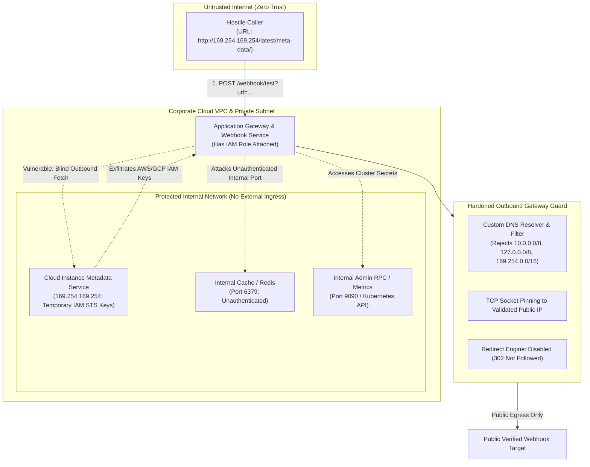
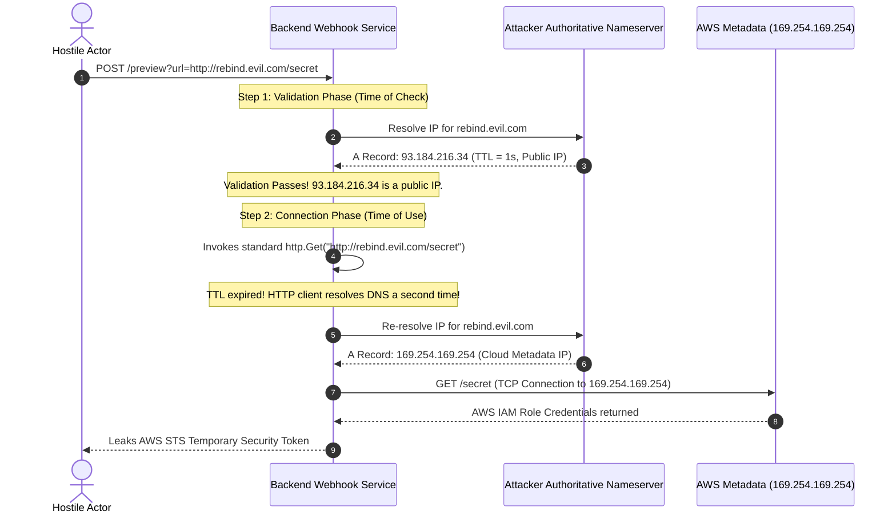
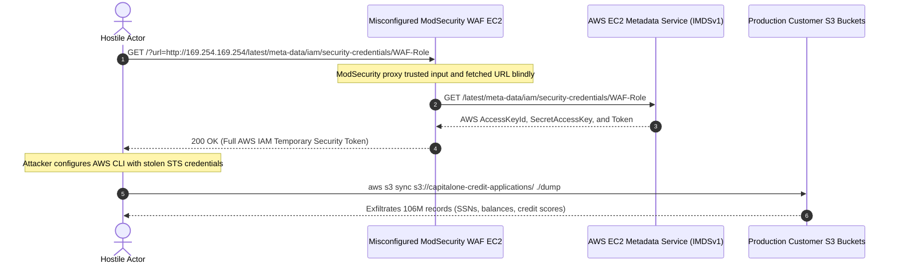

# Module 03: SSRF and Deserialization Attacks

> **Prerequisites**: [Module 00: OWASP Top 10 Overview](../00-owasp-top-10-overview/README.md), [Module 01: Injection Attacks](../01-injection-attacks/README.md), and standard TCP/IP networking fundamentals.  
> **Estimated Reading Time**: 35 minutes.  
> **Target Audience**: Backend Engineers, Cloud Platform Architects, and Site Reliability Engineers.

---

> [!TIP]
> **The Golden Rule of Outbound Trust & Deserialization**  
> Never delegate outbound network authority or object instantiation to untrusted inputs. **For SSRF**: Blocklists of `127.0.0.1` and `169.254.169.254` always fail against IP alternate encodings, DNS rebinding, and HTTP redirects. To make outbound HTTP fetches secure, enforce a strict host allowlist; when accepting arbitrary domains, perform **pre-dial DNS resolution**, reject all private, link-local, and loopback IP addresses, pin the socket connection directly to the validated IP, and disable automatic redirects. **For Deserialization**: Treat `pickle`, `yaml.load`, and binary object serializers as arbitrary code execution primitives. Use strict, data-only formats (JSON, Protocol Buffers) validated against rigid static schemas.

---

## 1. Architectural Blueprint & Mental Models

Server-Side Request Forgery (SSRF) and Insecure Deserialization exploit the server's elevated trust position within the network topology and the runtime execution process.



### The DNS Rebinding Attack & Socket Pinning Defense

A naive defense resolves the hostname to check if it points to `127.0.0.1`, and then passes the URL string to `http.Get()`. This creates a Time-of-Check to Time-of-Use (**TOCTOU**) vulnerability known as **DNS Rebinding**:



---

## 2. Systematic Taxonomic Reference Grids

### SSRF Bypass Tactics vs. Production Hardening

| Attack Variant | Exploitation Technique | Why Naive Defenses Fail | Architectural Production Defense |
| :--- | :--- | :--- | :--- |
| **Alternate IP Encoding** | Decimal: `http://2130706433/`<br/>Hex: `http://0x7f000001/`<br/>Dword: `http://0177.0.0.1/` | Regex string matching looking for literal `"127.0.0.1"` fails to recognize integer/hex representations. | Parse socket address using standard networking primitives (`net.ParseIP`, `ipaddress.ip_address`). |
| **DNS Rebinding (TOCTOU)** | Fast-flux DNS server returns public IP on check, followed by `169.254.169.254` with TTL 0 on connect. | Checking the URL string before passing it to an unpinned HTTP client causes a second, unvalidated DNS resolution. | **Socket Pinning**: Resolve hostname once, validate IP, and dial TCP directly to that validated IP without re-resolving. |
| **HTTP 302 Redirect Smuggling** | Attacker hosts public endpoint that responds with `302 Found: Location: http://10.0.0.5:6379/`. | Initial URL passes validation because the domain is public. The client library automatically follows the redirect internally. | Set `CheckRedirect` or `follow_redirects=False` to reject all redirects or re-validate every single hop. |
| **Protocol Smuggling** | `gopher://127.0.0.1:6379/_*1%0d%0a$4...`<br/>`file:///etc/passwd` | Allowing arbitrary schemes lets attackers speak raw TCP to internal Redis/SMTP or read filesystem files. | Enforce strict scheme validation (`http` / `https` only). Reject all other protocols. |
| **IPv6 Dual-Stack Escapes** | `http://[::1]/` or `http://[::ffff:127.0.0.1]/` | IPv4-only filter checks ignore IPv6 loopback addresses. | Normalize and check both IPv4 and IPv6 CIDR blocks (`::1/128`, `fc00::/7`, `fe80::/10`). |

### Serialization Safety Spectrum

| Serialization Engine | Code Execution Capability? | Primary Mechanism / Risk | Recommended Production Use |
| :--- | :--- | :--- | :--- |
| **Python `pickle`** | **YES (Immediate RCE)** | `__reduce__()` method specifies arbitrary callables (`os.system`) executed automatically on `loads()`. | **FORBIDDEN** across trust boundaries, caches, and webhooks. Use exclusively within trusted local processes. |
| **Python `yaml.load`** | **YES (Immediate RCE)** | Default/FullLoader supports type tags like `!!python/object/apply:os.system`. | **MANDATORY**: Use `yaml.safe_load()` which restricts parsing to primitive scalar types. |
| **Java Native Serialization** | **YES (Gadget Chains)** | Deserialization of `ObjectInputStream` triggers malicious gadget chains (Commons Collections, Spring). | Disallow native serialization; use Jackson/Gson with polymorphic typing disabled. |
| **JSON (`json.loads`)** | **NO (Safe by Design)** | Can only produce primitives (`string`, `number`, `boolean`, `list`, `dict`). Cannot execute code. | **GOLD STANDARD**: Primary interchange format. Always validate shape via Pydantic / Zod / static schemas. |
| **Protocol Buffers (Protobuf)** | **NO (Safe by Design)** | Strongly typed binary format with strict compiled schema parser. Cannot instantiate arbitrary types. | **ENTERPRISE STANDARD**: High-performance, schema-enforced microservice RPC format. |

---

## 3. Production War Story: The Capital One Metadata Breach

### Incident Post-Mortem

- **Severity**: SEV-1 (Catastrophic Enterprise Cloud Breach)
- **Time to Detect (TTD)**: 110 days (Discovered via responsible disclosure tip)
- **Time to Mitigate (TTM)**: 2 hours (IAM role policy revoked)
- **Impact**: 106 Million credit card applications exposed; \$80 Million regulatory fine (OCC); \$190 Million class-action settlement.



#### What Happened & Root Cause
In 2019, an attacker exploited an SSRF vulnerability in an open-source Web Application Firewall (ModSecurity) running on an Amazon EC2 instance within Capital One's cloud infrastructure. 

The proxy accepted user-supplied URLs to inspect remote assets. Because the application was deployed with AWS Instance Metadata Service Version 1 (IMDSv1), requesting `http://169.254.169.254` required no authentication headers or session tokens. The attacker made the proxy fetch the instance's IAM credentials, obtaining an STS temporary session token for the `WAF-Role`. Because the role had overly broad permissions (`AmazonS3FullAccess`), the attacker dumped over 700 S3 buckets containing unencrypted credit applications and Social Security numbers.

#### The Fix & Architectural Hardening
1. **Mandated AWS IMDSv2**: Enforced IMDSv2 across all AWS EC2 instances (`HttpTokens: required`). IMDSv2 requires an initial `PUT` request with custom headers to obtain a session token, with IP TTL set to 1. This prevents simple SSRF payloads from fetching credentials.
2. **Strict Pre-Dial IP Validation & Pinning**: Implemented custom HTTP transport layers that resolve domains, block non-public IP CIDRs, and pin socket connections.
3. **Principle of Least Privilege for IAM Roles**: Bound IAM role policies strictly to specific resource ARNs with read-only scopes.
4. **Network VPC Egress Firewalls**: Configured iptables and AWS security groups to block all outbound traffic to `169.254.169.254/32` except for designated infrastructure daemons.

---

## 4. Multi-Language Production Implementations: Airtight Outbound HTTP Client

Below is the production-grade implementation of an SSRF-safe HTTP client across **Go**, **Node.js/TypeScript**, **Python**, and **C#**. Each client showcases:
- Custom TCP dialer / resolver rejecting RFC 1918, loopback, link-local, and broadcast IPs.
- Socket pinning directly to the verified IP (preventing DNS rebinding).
- Disabling automatic HTTP redirects.
- Safe JSON deserialization backed by static schema enforcement.

### Go Implementation

```go
package ssrf

import (
	"context"
	"errors"
	"fmt"
	"io"
	"net"
	"net/http"
	"net/url"
	"syscall"
	"time"
)

var (
	ErrNonPublicIP  = errors.New("target resolves to a private, loopback, or reserved IP")
	ErrInvalidScheme = errors.New("unsupported protocol scheme: only http and https allowed")
	ErrRedirectsOff = errors.New("redirects are forbidden on safe client")
)

// IsPublicIP verifies an IP does not reside in private, loopback, link-local, or multicast blocks
func IsPublicIP(ip net.IP) bool {
	if ip == nil {
		return false
	}
	// Check IPv4 & IPv6 loopbacks, private ranges, link-local, and multicast
	if ip.IsLoopback() || ip.IsPrivate() || ip.IsLinkLocalUnicast() || 
	   ip.IsLinkLocalMulticast() || ip.IsMulticast() || ip.IsUnspecified() {
		return false
	}
	// Explicit check for AWS/Cloud link-local metadata (169.254.169.254)
	if ip4 := ip.To4(); ip4 != nil {
		if ip4[0] == 169 && ip4[1] == 254 {
			return false
		}
	}
	return true
}

// NewSafeHTTPClient builds an HTTP client immune to SSRF, DNS Rebinding, and Redirects
func NewSafeHTTPClient(timeout time.Duration) *http.Client {
	dialer := &net.Dialer{
		Timeout:   timeout,
		KeepAlive: 30 * time.Second,
		Control: func(network, address string, c syscall.RawConn) error {
			// Extract host from address (host:port)
			host, _, err := net.SplitHostPort(address)
			if err != nil {
				return err
			}
			ip := net.ParseIP(host)
			if !IsPublicIP(ip) {
				return fmt.Errorf("%w: %s", ErrNonPublicIP, host)
			}
			return nil
		},
	}

	transport := &http.Transport{
		DialContext: func(ctx context.Context, network, addr string) (net.Conn, error) {
			host, port, err := net.SplitHostPort(addr)
			if err != nil {
				return nil, err
			}

			// 1. Resolve host once
			ips, err := net.DefaultResolver.LookupIP(ctx, "ip", host)
			if err != nil {
				return nil, fmt.Errorf("DNS resolution failed: %w", err)
			}

			// 2. Validate all resolved IPs
			var safeIP net.IP
			for _, ip := range ips {
				if IsPublicIP(ip) {
					safeIP = ip
					break
				}
			}
			if safeIP == nil {
				return nil, ErrNonPublicIP
			}

			// 3. Socket Pinning: Dial the verified IP directly, bypassing secondary DNS queries
			pinnedAddr := net.JoinHostPort(safeIP.String(), port)
			return dialer.DialContext(ctx, network, pinnedAddr)
		},
		MaxIdleConns:          100,
		IdleConnTimeout:       90 * time.Second,
		TLSHandshakeTimeout:   10 * time.Second,
		ExpectContinueTimeout: 1 * time.Second,
	}

	return &http.Client{
		Transport: transport,
		Timeout:   timeout,
		// 4. Block HTTP Redirects entirely (stops 302 bounce attacks)
		CheckRedirect: func(req *http.Request, via []*http.Request) error {
			return ErrRedirectsOff
		},
	}
}

// ExecuteSafeFetch validates scheme and fetches URL content safely
func ExecuteSafeFetch(ctx context.Context, targetURL string) ([]byte, error) {
	parsed, err := url.Parse(targetURL)
	if err != nil {
		return nil, fmt.Errorf("malformed URL: %w", err)
	}

	if parsed.Scheme != "http" && parsed.Scheme != "https" {
		return nil, ErrInvalidScheme
	}

	client := NewSafeHTTPClient(5 * time.Second)
	req, err := http.NewRequestWithContext(ctx, http.MethodGet, targetURL, nil)
	if err != nil {
		return nil, err
	}
	req.Header.Set("User-Agent", "SecureWebhookFetcher/2.0")

	resp, err := client.Do(req)
	if err != nil {
		return nil, fmt.Errorf("safe fetch failed: %w", err)
	}
	defer resp.Body.Close()

	if resp.StatusCode >= 400 {
		return nil, fmt.Errorf("upstream responded with HTTP %d", resp.StatusCode)
	}

	// Limit response size to 1MB to prevent memory exhaustion
	return io.ReadAll(io.LimitReader(resp.Body, 1024*1024))
}
```

---

### Node.js / TypeScript Implementation

```typescript
import http from 'http';
import https from 'https';
import dns from 'dns/promises';
import { URL } from 'url';
import ipaddr from 'ipaddr.js';

export class SSRFValidationError extends Error {
  constructor(message: string) {
    super(message);
    this.name = 'SSRFValidationError';
  }
}

function isPublicIP(ipString: string): boolean {
  try {
    const addr = ipaddr.parse(ipString);
    const range = addr.range();
    
    // Check against standard non-routable CIDR blocks
    const privateRanges = [
      'loopback',
      'private',
      'linkLocal',
      'multicast',
      'broadcast',
      'carrierGradeNat',
      'uniqueLocal',
    ];

    if (privateRanges.includes(range)) {
      return false;
    }

    // Explicit link-local check (169.254.169.254)
    if (addr.kind() === 'ipv4') {
      const octets = (addr as ipaddr.IPv4).octets;
      if (octets[0] === 169 && octets[1] === 254) {
        return false;
      }
    }

    return true;
  } catch {
    return false;
  }
}

export async function executeSafeGet(rawUrl: string, timeoutMs: number = 4000): Promise<string> {
  const parsedUrl = new URL(rawUrl);

  if (parsedUrl.protocol !== 'http:' && parsedUrl.protocol !== 'https:') {
    throw new SSRFValidationError('Forbidden protocol: Only HTTP and HTTPS are permitted');
  }

  // 1. Resolve host to IP
  const addresses = await dns.lookup(parsedUrl.hostname, { all: true });
  if (addresses.length === 0) {
    throw new SSRFValidationError('DNS resolution yielded no address');
  }

  // 2. Validate IP safety
  const safeRecord = addresses.find(rec => isPublicIP(rec.address));
  if (!safeRecord) {
    throw new SSRFValidationError('Target domain resolves to a private or reserved IP address');
  }

  // 3. Pin socket by overriding lookup callback in agent options
  const agentOptions = {
    lookup: (_hostname: string, _options: any, callback: any) => {
      callback(null, safeRecord.address, safeRecord.family);
    },
  };

  const isHttps = parsedUrl.protocol === 'https:';
  const transport = isHttps ? https : http;
  const agent = isHttps ? new https.Agent(agentOptions) : new http.Agent(agentOptions);

  return new Promise((resolve, reject) => {
    const req = transport.request(
      parsedUrl,
      {
        method: 'GET',
        agent,
        timeout: timeoutMs,
        headers: { 'User-Agent': 'SecureBackendWorker/1.0' },
      },
      res => {
        // Disallow redirects (SSRF mitigation)
        if (res.statusCode && res.statusCode >= 300 && res.statusCode < 400) {
          reject(new SSRFValidationError('HTTP redirects are explicitly forbidden'));
          res.resume();
          return;
        }

        let data = '';
        res.setEncoding('utf8');
        res.on('data', chunk => {
          data += chunk;
          if (data.length > 512 * 1024) {
            req.destroy();
            reject(new Error('Response payload exceeded 512KB limit'));
          }
        });
        res.on('end', () => resolve(data));
      }
    );

    req.on('timeout', () => {
      req.destroy();
      reject(new Error('Request timed out'));
    });
    req.on('error', reject);
    req.end();
  });
}
```

---

### Python Implementation

```python
import ipaddress
import socket
from urllib.parse import urlparse
import httpx
from pydantic import BaseModel, Field

class SSRFSecurityException(Exception):
    pass

def is_public_ip(ip_str: str) -> bool:
    try:
        ip = ipaddress.ip_address(ip_str)
        return not (
            ip.is_private or
            ip.is_loopback or
            ip.is_link_local or
            ip.is_multicast or
            ip.is_reserved or
            ip.is_unspecified
        )
    except ValueError:
        return False

async def safe_fetch_url(target_url: str, timeout_seconds: float = 4.0) -> bytes:
    parsed = urlparse(target_url)
    if parsed.scheme not in ("http", "https"):
        raise SSRFSecurityException(f"Unsupported protocol scheme: {parsed.scheme}")

    if not parsed.hostname:
        raise SSRFSecurityException("Missing hostname in target URL")

    # 1. Resolve domain manually
    try:
        addr_info = socket.getaddrinfo(parsed.hostname, None)
    except socket.gaierror as e:
        raise SSRFSecurityException(f"DNS resolution failure: {e}")

    # 2. Extract and validate IPs
    valid_ip = None
    for item in addr_info:
        resolved_ip = item[4][0]
        if is_public_ip(resolved_ip):
            valid_ip = resolved_ip
            break

    if not valid_ip:
        raise SSRFSecurityException("Target domain resolves to a private or non-routable address")

    # 3. Socket Pinning: Construct client using verified IP while passing Host header
    port = parsed.port or (443 if parsed.scheme == "https" else 80)
    pinned_url = f"{parsed.scheme}://{valid_ip}:{port}{parsed.path}"
    if parsed.query:
        pinned_url += f"?{parsed.query}"

    headers = {
        "Host": parsed.netloc,
        "User-Agent": "SecureFetchClient/2.0",
    }

    # 4. follow_redirects=False prevents 302 redirect hopping
    async with httpx.AsyncClient(
        verify=True,
        timeout=timeout_seconds,
        follow_redirects=False
    ) as client:
        try:
            response = await client.get(pinned_url, headers=headers)
            response.raise_for_status()
            return response.content
        except httpx.HTTPStatusError as e:
            raise SSRFSecurityException(f"Upstream returned error: {e.response.status_code}")
```

---

### C# / .NET Implementation

```csharp
using System;
using System.IO;
using System.Net;
using System.Net.Http;
using System.Net.Sockets;
using System.Threading;
using System.Threading.Tasks;

namespace SecurityTrack.NetworkSafety
{
    public class SsrfeSecurityException : Exception
    {
        public SsrfeSecurityException(string message) : base(message) { }
    }

    public static class SafeHttpClientFactory
    {
        public static bool IsPublicIp(IPAddress ip)
        {
            if (IPAddress.IsLoopback(ip) || ip.IsIPv6LinkLocal || ip.IsIPv6SiteLocal || ip.IsIPv6Multicast)
            {
                return false;
            }

            var bytes = ip.GetAddressBytes();
            if (ip.AddressFamily == AddressFamily.InterNetwork)
            {
                // 10.0.0.0/8
                if (bytes[0] == 10) return false;
                // 172.16.0.0/12
                if (bytes[0] == 172 && bytes[1] >= 16 && bytes[1] <= 31) return false;
                // 192.168.0.0/16
                if (bytes[0] == 192 && bytes[1] == 168) return false;
                // 169.254.0.0/16 (Link Local / AWS Metadata)
                if (bytes[0] == 169 && bytes[1] == 254) return false;
                // 127.0.0.0/8
                if (bytes[0] == 127) return false;
            }

            return true;
        }

        public static HttpClient CreateSafeClient(TimeSpan timeout)
        {
            var handler = new SocketsHttpHandler
            {
                // Disallow automatic redirects
                AllowAutoRedirect = false,
                ConnectTimeout = timeout,
                ConnectCallback = async (context, ct) =>
                {
                    // 1. Resolve host
                    var addresses = await Dns.GetHostAddressesAsync(context.DnsEndPoint.Host, ct);
                    IPAddress? targetIp = null;

                    foreach (var ip in addresses)
                    {
                        if (IsPublicIp(ip))
                        {
                            targetIp = ip;
                            break;
                        }
                    }

                    if (targetIp == null)
                    {
                        throw new SsrfeSecurityException("Destination IP resolves to a private or link-local address.");
                    }

                    // 2. Socket Pinning: Establish connection directly to validated IP
                    var socket = new Socket(targetIp.AddressFamily, SocketType.Stream, ProtocolType.Tcp);
                    try
                    {
                        await socket.ConnectAsync(new IPEndPoint(targetIp, context.DnsEndPoint.Port), ct);
                        return new NetworkStream(socket, ownsSocket: true);
                    }
                    catch
                    {
                        socket.Dispose();
                        throw;
                    }
                }
            };

            return new HttpClient(handler) { Timeout = timeout };
        }
    }
}
```

---

## 5. Practical Hands-On Verification CLI Workflows

### Step 1: Probe SSRF Protection with IP Obfuscation

```bash
# 1. Decimal IP encoding attempt for 127.0.0.1 (2130706433)
curl -s -X POST "http://localhost:8080/api/v1/preview" \
  -H "Content-Type: application/json" \
  -d '{"url": "http://2130706433:8000/admin"}' | jq .
```

**Expected Wire Output (Vulnerable App):**
```json
{
  "preview": "<html>Admin Console Secret Settings</html>"
}
```

**Expected Wire Output (Hardened Safe Client):**
```json
{
  "error": "SSRFValidationError",
  "detail": "Target resolves to a private, loopback, or reserved IP address"
}
```

---

### Step 2: Test AWS Metadata Access (Simulated IMDS)

```bash
# 2. Attempt direct metadata credential extraction
curl -s -X POST "http://localhost:8080/api/v1/preview" \
  -H "Content-Type: application/json" \
  -d '{"url": "http://169.254.169.254/latest/meta-data/iam/security-credentials/"}' | jq .
```

**Expected Output (Hardened Safe Client):**
```json
{
  "error": "SSRFValidationError",
  "detail": "Target resolves to a private, loopback, or reserved IP address"
}
```

---

## 6. Operational Validation Checkpoints (Scenario Quizzes)

### Checkpoint 1: DNS Rebinding Mechanics
<details>
<summary><strong>Scenario Assessment:</strong> You inspect an open-source webhook library that checks user URLs with <code>if is_private(socket.gethostbyname(url.host)): raise Error()</code> and then calls <code>requests.get(url)</code>. What vulnerability exists, and how can an attacker bypass the check?</summary>

```
Options:
A) The library will fail because `requests` does not support HTTPS over port 443.
B) DNS Rebinding (TOCTOU); the attacker controls their authoritative DNS server to reply with a public IP on the first resolution, but responds with `169.254.169.254` when `requests.get()` re-resolves the domain.
C) Path traversal; the URL path can escape into `/etc/passwd`.
D) XSS; the response will execute JavaScript inside the Python runtime.
```

**Answer:**
**B is correct.** This is a classic Time-of-Check to Time-of-Use (**TOCTOU**) bug. The validation phase and the execution phase perform two separate DNS resolutions. An attacker with a custom DNS server sets the Time-to-Live (TTL) to 1 second; the first query returns a valid public IP (passing the `is_private` check), but the second query (executed by `requests.get`) returns `169.254.169.254`, bypassing the control completely. The remedy is **Socket Pinning**: resolve once, validate, and connect directly to the resolved IP.

</details>

---

### Checkpoint 2: The Fallacy of In-Memory Pickle Caching
<details>
<summary><strong>Scenario Assessment:</strong> A developer builds a Redis caching decorator in Python: <code>redis.set(key, pickle.dumps(data))</code> and <code>pickle.loads(redis.get(key))</code>. The developer states: "This data is created exclusively by our backend, so pickle is completely safe." Why is this an architectural security hazard?</summary>

```
Options:
A) Redis cannot store bytes larger than 128 bytes without data corruption.
B) If any secondary vulnerability permits an attacker to write or overwrite a single key in Redis, loading that key grants the attacker immediate Remote Code Execution (RCE) on the web server.
C) Pickle requires root operating system permissions to deserialize numbers.
D) The Python garbage collector crashes when deserializing dictionaries.
```

**Answer:**
**B is correct.** While the application intends to write its own data, treating the cache as a trusted boundary is dangerous. If an attacker discovers a Redis SSRF vulnerability, an injection into a cache key, or accesses a shared Redis cluster, they can overwrite a key with a serialized payload containing an `Exploit.__reduce__()` hook. When the backend retrieves and calls `pickle.loads()`, the payload executes arbitrary shell commands on the server. Always use data-only formats (JSON, Protobuf) across external caches.

</details>

---

### Checkpoint 3: Stopping HTTP 302 Redirect Bypasses
<details>
<summary><strong>Scenario Assessment:</strong> Your image proxy validates that user URLs point strictly to public IPs. An attacker registers <code>https://public-cdn.attacker.com/avatar.png</code>, which passes validation. However, that server responds with <code>HTTP/1.1 302 Found</code> and <code>Location: http://10.0.1.20:8000/admin</code>. What must the HTTP client do to stop this?</summary>

```
Options:
A) Enable gzip compression on incoming HTTP response streams.
B) Set the client to disable automatic redirect following (`follow_redirects=False`), or re-run the complete IP validation and socket pinning process on every redirected hop.
C) Encrypt all HTTP request bodies with AES-CBC.
D) Disallow all HTTPS URLs.
```

**Answer:**
**B is correct.** When an HTTP client automatically follows redirects, the subsequent request to the `Location` target is initiated without re-running the initial URL validation checks. The client will happily follow the redirect inward to the private RFC 1918 internal IP address. Setting `follow_redirects=False` or configuring a redirect hook that re-evaluates the destination IP prevents redirect bouncing.

</details>

---

## 7. Further Reading & Sources

- [OWASP Server-Side Request Forgery Prevention Cheat Sheet](https://cheatsheetseries.owasp.org/cheatsheets/Server_Side_Request_Forgery_Prevention_Cheat_Sheet.html)
- [OWASP Deserialization Cheat Sheet](https://cheatsheetseries.owasp.org/cheatsheets/Deserialization_Cheat_Sheet.html)
- [AWS Security: Transitioning to IMDSv2](https://aws.amazon.com/blogs/security/defense-in-depth-open-firewalls-reverse-proxies-ssrf-vulnerabilities-ec2-instance-metadata-service/)
- [Python Official Documentation: Warning on Pickle Security](https://docs.python.org/3/library/pickle.html)
- [CWE-918: Server-Side Request Forgery (SSRF)](https://cwe.mitre.org/data/definitions/918.html)

---

## Next Steps

Now that outbound network fetches and serialization layers are fortified, we transition from single-request vulnerabilities to **volumetric attacks and abuse prevention**:

- Next Module: **[04-rate-limiting-and-abuse-prevention](../04-rate-limiting-and-abuse-prevention/README.md)** (Token Bucket, Sliding Window Counter, Distributed Redis Leaky Bucket, and Credential Stuffing Defense).
- Track Index: [README.md](../README.md)
