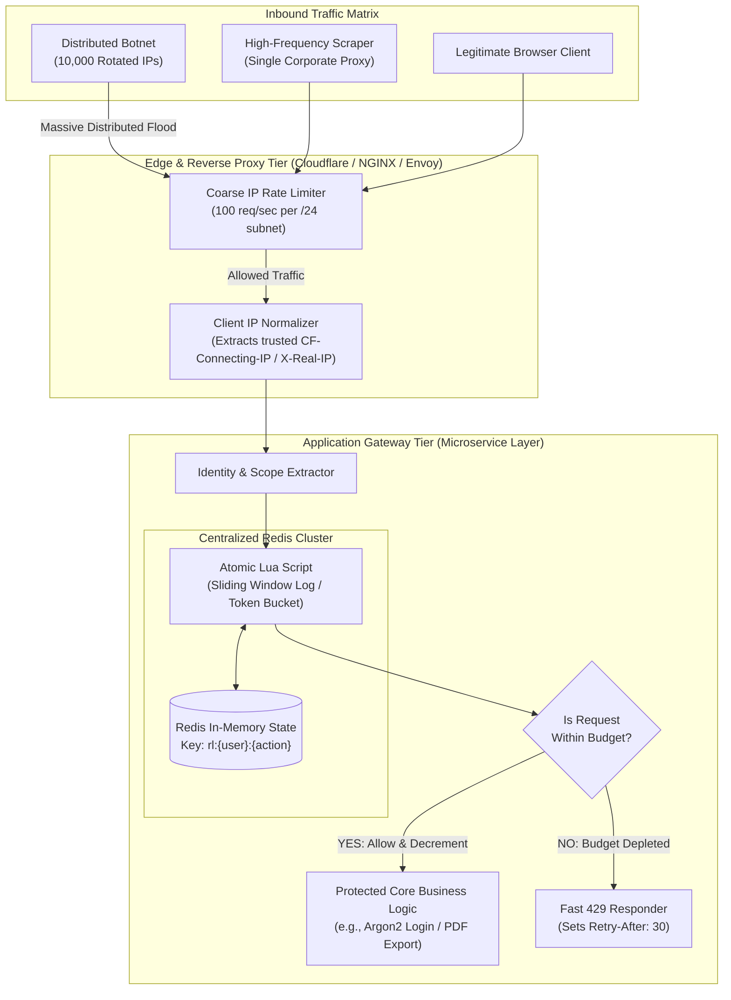
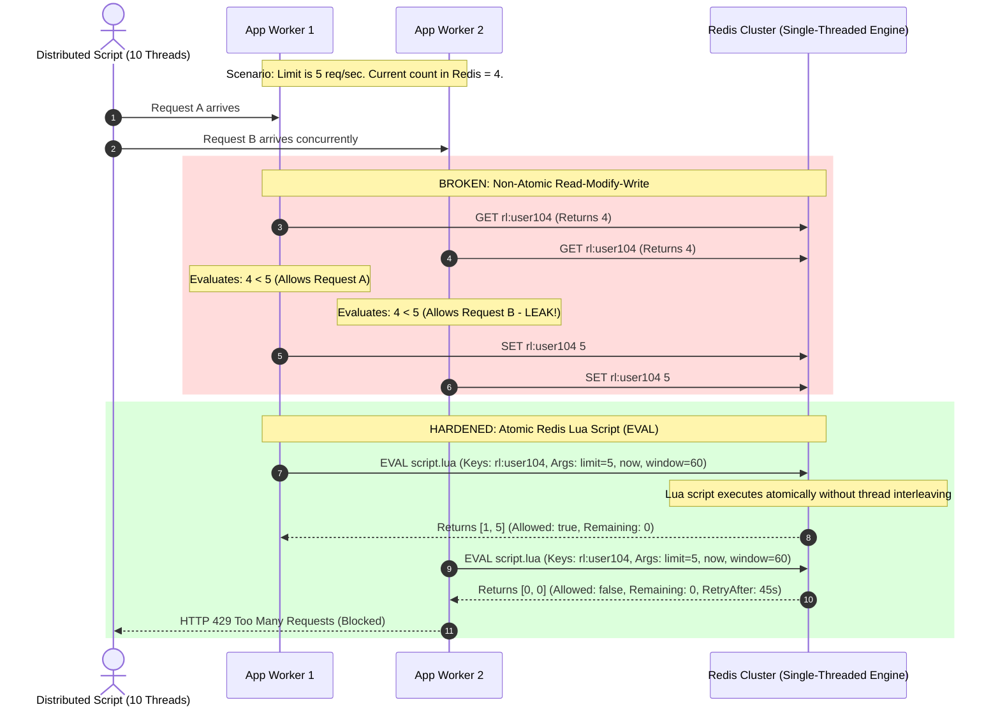
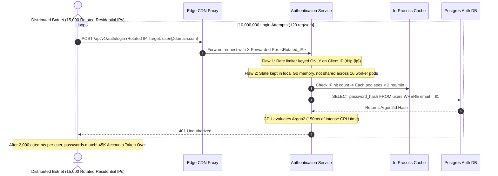

# Module 04: Rate Limiting and Abuse Prevention

> **Prerequisites**: [Module 00: OWASP Top 10 Overview](../00-owasp-top-10-overview/README.md), [Track 03: Authentication & Authorization](../../03-authentication-and-authorization/README.md), and [Track 06: Background Processing & Realtime](../../06-background-processing-and-realtime/README.md).  
> **Estimated Reading Time**: 35 minutes.  
> **Target Audience**: Backend Engineers, API Gateway Architects, and Distributed Systems Engineers.

---

> [!TIP]
> **The Golden Rule of Abuse Prevention Architecture**  
> Rate limiting is an **A04: Insecure Design** imperative, not an operational afterthought. An unthrottled endpoint—regardless of how mathematically pristine its password hashing or authorization logic is—is insecure by design against automated brute-force, credential stuffing, scraping, and resource exhaustion. Never track rate limits in local worker memory or rely on non-atomic read-modify-write cycles. Use a centralized Redis cluster executing atomic Lua scripts to evaluate sliding window logs or token buckets, rate-limit across multiple dimensions (compound keys combining real client IP and subject identity), and reject excess traffic cheaply with standard `HTTP 429 Too Many Requests` and `Retry-After` response headers.

---

## 1. Architectural Blueprint & Mental Models

Rate limiting must operate in multi-layered defense tiers. Coarse volumetric floods should be dropped at the edge/CDN layer before consuming application bandwidth, while granular, contextual limits (per account, per tenant, per payment operation) must be enforced at the application tier.



### The Atomicity Race Condition & Redis Lua Solution

When multiple concurrent requests arrive across distributed application workers, a standard application-level read-modify-write pattern causes a race condition that leaks budget:



---

## 2. Systematic Taxonomic Reference Grids

### Rate Limiting Algorithm Comparison Matrix

| Algorithm | Mechanism | Time Complexity | Memory per Key | Boundary Burst Protection | Burst Tolerance | Recommended Production Use Case |
| :--- | :--- | :--- | :--- | :--- | :--- | :--- |
| **Fixed Window Counter** | Increments a scalar integer tied to fixed calendar epoch (`user:11:00`). | $O(1)$ | $\approx 64$ bytes | **POOR** ($2\times$ limit burst possible at boundary reset) | None | Non-critical coarse throttling; low-precision background APIs. |
| **Sliding Window Log** | Stores individual millisecond timestamps in a Redis Sorted Set (`ZSET`). | $O(\log N + M)$ | $O(N)$ ($\approx 32$ bytes per request hit) | **EXCELLENT** (Zero boundary leakage) | None | Tight security barriers (Login, MFA challenge, Password Reset). |
| **Sliding Window Counter** | Blends current window counter with weighted percentage of prior window. | $O(1)$ | $\approx 128$ bytes (Two string counters) | **VERY GOOD** (Approximation within $0.05\%$ accuracy) | Moderate | High-scale public API gateways (GitHub, Stripe, Cloudflare style). |
| **Token Bucket** | Tokens accumulate at refill rate up to maximum capacity; requests spend tokens. | $O(1)$ | $\approx 128$ bytes (Tokens remaining + Last timestamp) | **EXCELLENT** | **HIGH** (Allows controlled bursts up to bucket size) | General REST APIs, Webhook delivery queues, Microservice RPC egress. |
| **Leaky Bucket** | Requests enter a FIFO queue and leak out at a constant, fixed throughput rate. | $O(1)$ | $O(\text{Queue Depth})$ | **EXCELLENT** | **NONE** (Enforces smooth, constant flow) | Ingestion pipelines feeding downstream message brokers or databases. |

### Standardized Rate Limit Response Headers (IETF Draft & RFC 6585)

| Header Name | Type | Description | Example Value |
| :--- | :--- | :--- | :--- |
| `HTTP Status` | Integer | Standard status code indicating client has exhausted quota. | `429 Too Many Requests` |
| `Retry-After` | Integer | Seconds client must wait before sending another request. | `Retry-After: 35` |
| `RateLimit-Limit` | Integer | Maximum number of requests allowed within current window. | `RateLimit-Limit: 100` |
| `RateLimit-Remaining` | Integer | Number of requests remaining in current window. | `RateLimit-Remaining: 0` |
| `RateLimit-Reset` | Integer | Unix epoch timestamp (or seconds) when budget resets. | `RateLimit-Reset: 1773491200` |

---

## 3. Production War Story: The 10-Million Request Stuffing Surge

### Incident Post-Mortem

- **Severity**: SEV-1 (Mass Account Compromise & Credential Stuffing)
- **Time to Detect (TTD)**: 4 hours (Triggered by customer support password reset complaints)
- **Time to Mitigate (TTM)**: 25 minutes
- **Impact**: 45,000 customer accounts breached via compromised third-party credential dumps; database CPU saturated at 100% due to Argon2 hash evaluations.



#### What Happened & Root Cause
A criminal syndicate launched a credential stuffing campaign against an e-commerce platform using 15,000 rotated residential proxy IPs. The backend developers implemented a rate limiter, but made two fatal architectural mistakes:
1. **Single-Dimension Keying**: The limiter was keyed *only* by client IP (`rl:ip:<ip>`). Because the attacker rotated 15,000 IPs, each IP generated only one request every two minutes, never triggering the 20-request-per-minute threshold.
2. **In-Memory Worker Isolation**: The application tracked request counts in local Go memory across 16 horizontally scaled container pods. Every container maintained its own counter, multiplying the effective threshold by 16.

#### The Fix & Architectural Hardening
1. **Compound Dual-Key Rate Limiting**: Re-architected the rate limiter to enforce compound multi-dimensional keys:
   - Key A: Client IP (`rl:ip:<ip>`) with a threshold of 30 req/min.
   - Key B: Target Username (`rl:user:<username>`) with a tight threshold of 5 failed attempts per 15 minutes.
2. **Centralized Redis Lua Engine**: Migrated rate limiting from local pod memory to a centralized Redis cluster running an atomic sliding window log.
3. **Exponential Progressive Delay**: Introduced progressive backoff: consecutive failures on a specific account double the required delay before the next attempt is processed.

---

## 4. Multi-Language Production Implementations: Redis Atomic Sliding Window Rate Limiter

Below is the production-ready distributed rate limiting client implemented across **Go**, **Node.js/TypeScript**, **Python**, and **C#**. Each client utilizes:
- An atomic Redis Lua script executing a sliding window log algorithm.
- Dual-key enforcement (Client IP + Target Account).
- Automatic injection of standard `RateLimit-*` and `Retry-After` HTTP headers.
- Safe client IP extraction from trusted proxy headers.

### The Canonical Redis Lua Script

```lua
-- KEYS[1]: Rate limit key (e.g., rl:login:user123)
-- ARGV[1]: Current timestamp in milliseconds
-- ARGV[2]: Window duration in milliseconds (e.g., 60000 for 1 minute)
-- ARGV[3]: Maximum request limit (e.g., 5)

local key = KEYS[1]
local now = tonumber(ARGV[1])
local window = tonumber(ARGV[2])
local limit = tonumber(ARGV[3])
local clearBefore = now - window

-- 1. Remove expired entries outside the sliding window
redis.call('ZREMRANGEBYSCORE', key, 0, clearBefore)

-- 2. Count current entries in window
local currentRequests = redis.call('ZCARD', key)

if currentRequests < limit then
    -- 3. Add current timestamp to sorted set
    redis.call('ZADD', key, now, now)
    redis.call('PEXPIRE', key, window)
    return {1, limit - currentRequests - 1, 0} -- [allowed: true, remaining, retry_after: 0]
else
    -- 4. Calculate oldest entry to compute accurate Retry-After
    local oldest = redis.call('ZRANGE', key, 0, 0, 'WITHSCORES')
    local retryAfterMs = 0
    if oldest and #oldest >= 2 then
        retryAfterMs = (tonumber(oldest[2]) + window) - now
    end
    if retryAfterMs < 0 then retryAfterMs = 0 end
    local retryAfterSec = math.ceil(retryAfterMs / 1000)
    return {0, 0, retryAfterSec} -- [allowed: false, remaining: 0, retry_after]
end
```

---

### Go Implementation

```go
package ratelimit

import (
	"context"
	_ "embed"
	"fmt"
	"net"
	"net/http"
	"strconv"
	"strings"
	"time"

	"github.com/redis/go-redis/v9"
)

//go:embed sliding_window.lua
var slidingWindowLuaScript string

type RateLimiter struct {
	client  *redis.Client
	luaHash string
}

type RateLimitResult struct {
	Allowed    bool
	Remaining  int64
	RetryAfter int64
}

func NewRateLimiter(client *redis.Client) (*RateLimiter, error) {
	ctx, cancel := context.WithTimeout(context.Background(), 3*time.Second)
	defer cancel()

	hash, err := client.ScriptLoad(ctx, slidingWindowLuaScript).Result()
	if err != nil {
		return nil, fmt.Errorf("failed to load rate limiter lua script: %w", err)
	}

	return &RateLimiter{client: client, luaHash: hash}, nil
}

// CheckLimit evaluates request budget atomically using Redis Lua script
func (rl *RateLimiter) CheckLimit(
	ctx context.Context, 
	key string, 
	limit int64, 
	window time.Duration,
) (*RateLimitResult, error) {
	nowMs := time.Now().UnixMilli()
	windowMs := window.Milliseconds()

	res, err := rl.client.EvalSha(ctx, rl.luaHash, []string{key}, nowMs, windowMs, limit).Result()
	if err != nil {
		return nil, fmt.Errorf("redis rate limiter eval error: %w", err)
	}

	results, ok := res.([]any)
	if !ok || len(results) < 3 {
		return nil, fmt.Errorf("invalid lua script response format")
	}

	allowed := results[0].(int64) == 1
	remaining := results[1].(int64)
	retryAfter := results[2].(int64)

	return &RateLimitResult{
		Allowed:    allowed,
		Remaining:  remaining,
		RetryAfter: retryAfter,
	}, nil
}

// Middleware creates an HTTP middleware enforcing dual-key rate limits
func (rl *RateLimiter) Middleware(limit int64, window time.Duration) func(http.Handler) http.Handler {
	return func(next http.Handler) http.Handler {
		return http.HandlerFunc(func(w http.ResponseWriter, r *http.Request) {
			// Extract real client IP (assuming trusted reverse proxy edge)
			clientIP := extractRealIP(r)
			key := fmt.Sprintf("rl:ip:%s", clientIP)

			result, err := rl.CheckLimit(r.Context(), key, limit, window)
			if err != nil {
				// Fail-open or fail-closed based on risk posture (fail-open with alert logged)
				next.ServeHTTP(w, r)
				return
			}

			w.Header().Set("RateLimit-Limit", strconv.FormatInt(limit, 10))
			w.Header().Set("RateLimit-Remaining", strconv.FormatInt(result.Remaining, 10))

			if !result.Allowed {
				w.Header().Set("Retry-After", strconv.FormatInt(result.RetryAfter, 10))
				w.WriteHeader(http.StatusTooManyRequests)
				w.Write([]byte(`{"error": "Too Many Requests", "retry_after_seconds": ` + strconv.FormatInt(result.RetryAfter, 10) + `}`))
				return
			}

			next.ServeHTTP(w, r)
		})
	}
}

func extractRealIP(r *http.Request) string {
	if xff := r.Header.Get("X-Forwarded-For"); xff != "" {
		parts := strings.Split(xff, ",")
		return strings.TrimSpace(parts[0])
	}
	host, _, _ := net.SplitHostPort(r.RemoteAddr)
	return host
}
```

---

### Node.js / TypeScript Implementation

```typescript
import { Request, Response, NextFunction } from 'express';
import Redis from 'ioredis';

const SLIDING_WINDOW_LUA = `
local key = KEYS[1]
local now = tonumber(ARGV[1])
local window = tonumber(ARGV[2])
local limit = tonumber(ARGV[3])
local clearBefore = now - window

redis.call('ZREMRANGEBYSCORE', key, 0, clearBefore)
local currentRequests = redis.call('ZCARD', key)

if currentRequests < limit then
    redis.call('ZADD', key, now, now)
    redis.call('PEXPIRE', key, window)
    return {1, limit - currentRequests - 1, 0}
else
    local oldest = redis.call('ZRANGE', key, 0, 0, 'WITHSCORES')
    local retryAfterMs = 0
    if oldest and #oldest >= 2 then
        retryAfterMs = (tonumber(oldest[2]) + window) - now
    end
    if retryAfterMs < 0 then retryAfterMs = 0 end
    return {0, 0, math.ceil(retryAfterMs / 1000)}
end
`;

export class DistributedRateLimiter {
  private redis: Redis;

  constructor(redis: Redis) {
    this.redis = redis;
    this.redis.defineCommand('slidingWindowRateLimit', {
      numberOfKeys: 1,
      lua: SLIDING_WINDOW_LUA,
    });
  }

  public createMiddleware(limit: number, windowMs: number) {
    return async (req: Request, res: Response, next: NextFunction): Promise<void> => {
      try {
        const clientIp = (req.headers['x-forwarded-for'] as string)?.split(',')[0].trim() || req.ip;
        const key = `rl:ip:${clientIp}`;
        const nowMs = Date.now();

        // Invoke pre-compiled Redis Lua command
        const [allowed, remaining, retryAfter] = (await (this.redis as any).slidingWindowRateLimit(
          key,
          nowMs,
          windowMs,
          limit
        )) as [number, number, number];

        res.setHeader('RateLimit-Limit', limit.toString());
        res.setHeader('RateLimit-Remaining', remaining.toString());

        if (allowed !== 1) {
          res.setHeader('Retry-After', retryAfter.toString());
          res.status(429).json({
            error: 'Too Many Requests',
            message: `Rate limit exceeded. Try again in ${retryAfter} seconds.`,
            retry_after_seconds: retryAfter,
          });
          return;
        }

        next();
      } catch (err) {
        // Log telemetry; fail open or closed per SLA
        console.error('Rate limiter service error:', err);
        next();
      }
    };
  }
}
```

---

### Python Implementation

```python
import time
from typing import Tuple
import redis.asyncio as redis
from fastapi import FastAPI, Request, HTTPException, status
from starlette.middleware.base import BaseHTTPMiddleware

SLIDING_WINDOW_LUA = """
local key = KEYS[1]
local now = tonumber(ARGV[1])
local window = tonumber(ARGV[2])
local limit = tonumber(ARGV[3])
local clearBefore = now - window

redis.call('ZREMRANGEBYSCORE', key, 0, clearBefore)
local current = redis.call('ZCARD', key)

if current < limit then
    redis.call('ZADD', key, now, now)
    redis.call('PEXPIRE', key, window)
    return {1, limit - current - 1, 0}
else
    local oldest = redis.call('ZRANGE', key, 0, 0, 'WITHSCORES')
    local retryMs = 0
    if oldest and #oldest >= 2 then
        retryMs = (tonumber(oldest[2]) + window) - now
    end
    if retryMs < 0 then retryMs = 0 end
    return {0, 0, math.ceil(retryMs / 1000)}
end
"""

class RedisRateLimiter:
    def __init__(self, redis_client: redis.Redis):
        self.redis = redis_client
        self.script = self.redis.register_script(SLIDING_WINDOW_LUA)

    async def check_rate_limit(
        self, key: str, limit: int, window_ms: int
    ) -> Tuple[bool, int, int]:
        now_ms = int(time.time() * 1000)
        result = await self.script(
            keys=[key],
            args=[now_ms, window_ms, limit]
        )
        allowed, remaining, retry_after = result
        return bool(allowed), int(remaining), int(retry_after)

class RateLimitMiddleware(BaseHTTPMiddleware):
    def __init__(self, app: FastAPI, limiter: RedisRateLimiter, limit: int = 60, window_seconds: int = 60):
        super().__init__(app)
        self.limiter = limiter
        self.limit = limit
        self.window_ms = window_seconds * 1000

    async def dispatch(self, request: Request, call_next):
        # Extract client IP
        forwarded = request.headers.get("X-Forwarded-For")
        client_ip = forwarded.split(",")[0].strip() if forwarded else request.client.host
        rate_key = f"rl:ip:{client_ip}"

        allowed, remaining, retry_after = await self.limiter.check_rate_limit(
            rate_key, self.limit, self.window_ms
        )

        if not allowed:
            return Response(
                content=f'{{"error": "Too Many Requests", "retry_after": {retry_after}}}',
                status_code=status.HTTP_429_TOO_MANY_REQUESTS,
                media_type="application/json",
                headers={
                    "RateLimit-Limit": str(self.limit),
                    "RateLimit-Remaining": "0",
                    "Retry-After": str(retry_after),
                }
            )

        response = await call_next(request)
        response.headers["RateLimit-Limit"] = str(self.limit)
        response.headers["RateLimit-Remaining"] = str(remaining)
        return response
```

---

### C# / .NET Implementation

```csharp
using System;
using System.Threading.Tasks;
using Microsoft.AspNetCore.Http;
using StackExchange.Redis;

namespace SecurityTrack.RateLimiting
{
    public class RedisSlidingWindowLimiter
    {
        private readonly IConnectionMultiplexer _redis;
        private readonly LuaScript _preparedScript;

        private const string LuaCode = @"
            local key = KEYS[1]
            local now = tonumber(ARGV[1])
            local window = tonumber(ARGV[2])
            local limit = tonumber(ARGV[3])
            local clearBefore = now - window

            redis.call('ZREMRANGEBYSCORE', key, 0, clearBefore)
            local current = redis.call('ZCARD', key)

            if current < limit then
                redis.call('ZADD', key, now, now)
                redis.call('PEXPIRE', key, window)
                return {1, limit - current - 1, 0}
            else
                local oldest = redis.call('ZRANGE', key, 0, 0, 'WITHSCORES')
                local retryMs = 0
                if oldest and #oldest >= 2 then
                    retryMs = (tonumber(oldest[2]) + window) - now
                end
                if retryMs < 0 then retryMs = 0 end
                return {0, 0, math.ceil(retryMs / 1000)}
            end";

        public RedisSlidingWindowLimiter(IConnectionMultiplexer redis)
        {
            _redis = redis;
            _preparedScript = LuaScript.Prepare(LuaCode);
        }

        public async Task<(bool Allowed, int Remaining, int RetryAfter)> CheckLimitAsync(
            string rateKey, int limit, TimeSpan window)
        {
            var db = _redis.GetDatabase();
            var nowMs = DateTimeOffset.UtcNow.ToUnixTimeMilliseconds();
            var windowMs = (long)window.TotalMilliseconds;

            var result = (RedisResult[])await db.ScriptEvaluateAsync(_preparedScript, new
            {
                key = (RedisKey)rateKey,
                now = nowMs,
                window = windowMs,
                limit = limit
            });

            var allowed = (int)result[0] == 1;
            var remaining = (int)result[1];
            var retryAfter = (int)result[2];

            return (allowed, remaining, retryAfter);
        }
    }

    public class RateLimitMiddleware
    {
        private readonly RequestDelegate _next;
        private readonly RedisSlidingWindowLimiter _limiter;
        private const int MaxRequests = 100;
        private static readonly TimeSpan WindowDuration = TimeSpan.FromMinutes(1);

        public RateLimitMiddleware(RequestDelegate next, RedisSlidingWindowLimiter limiter)
        {
            _next = next;
            _limiter = limiter;
        }

        public async Task InvokeAsync(HttpContext context)
        {
            var ip = context.Request.Headers["X-Forwarded-For"].ToString().Split(',')[0].Trim();
            if (string.IsNullOrEmpty(ip))
            {
                ip = context.Connection.RemoteIpAddress?.ToString() ?? "unknown";
            }

            var key = $"rl:ip:{ip}";
            var (allowed, remaining, retryAfter) = await _limiter.CheckLimitAsync(key, MaxRequests, WindowDuration);

            context.Response.Headers.Append("RateLimit-Limit", MaxRequests.ToString());
            context.Response.Headers.Append("RateLimit-Remaining", remaining.ToString());

            if (!allowed)
            {
                context.Response.StatusCode = StatusCodes.Status429TooManyRequests;
                context.Response.Headers.Append("Retry-After", retryAfter.ToString());
                await context.Response.WriteAsync($"{{\"error\": \"Too Many Requests\", \"retry_after\": {retryAfter}}}");
                return;
            }

            await _next(context);
        }
    }
}
```

---

## 5. Practical Hands-On Verification CLI Workflows

### Step 1: Fire High-Concurrency Burst to Trigger HTTP 429

```bash
# Execute rapid burst of 10 requests against rate-limited endpoint (Limit: 5 req/min)
for i in {1..8}; do
  curl -s -o /dev/null -w "Req $i: HTTP Status %{http_code}\n" -X GET "http://localhost:8080/api/v1/resource"
done
```

**Expected Wire Output:**
```
Req 1: HTTP Status 200
Req 2: HTTP Status 200
Req 3: HTTP Status 200
Req 4: HTTP Status 200
Req 5: HTTP Status 200
Req 6: HTTP Status 429
Req 7: HTTP Status 429
Req 8: HTTP Status 429
```

---

### Step 2: Inspect Wire Response Headers on Rejection

```bash
curl -i "http://localhost:8080/api/v1/resource"
```

**Expected Wire Response Headers:**
```http
HTTP/1.1 429 Too Many Requests
Content-Type: application/json
RateLimit-Limit: 5
RateLimit-Remaining: 0
Retry-After: 48

{"error": "Too Many Requests", "retry_after_seconds": 48}
```

---

## 6. Operational Validation Checkpoints (Scenario Quizzes)

### Checkpoint 1: Fixed Window vs. Sliding Window Boundary Bursts
<details>
<summary><strong>Scenario Assessment:</strong> An API implements a fixed-window rate limiter of 100 requests per minute resetting at 12:00:00, 12:01:00, etc. An attacker sends 100 requests at 12:00:59, followed immediately by 100 requests at 12:01:01. What occurs?</summary>

```
Options:
A) All 200 requests are rejected because the average rate is exceeded.
B) Exactly 100 requests succeed; the second burst is blocked by TCP congestion control.
C) All 200 requests succeed within a 2-second span, generating a 2x traffic surge that destabilizes backend resources.
D) The Redis database crashes due to key collision.
```

**Answer:**
**C is correct.** The classic weakness of the fixed-window algorithm is the **boundary burst**. Because the counter resets at the boundary (12:01:00), the client can exhaust their budget at the very end of Window 1 and exhaust a brand new budget at the very start of Window 2. This delivers $2\times$ the configured limit within milliseconds. The sliding window log or sliding window counter prevents this by evaluating request timestamps across a true rolling 60-second window.

</details>

---

### Checkpoint 2: The Pitfalls of Single-Dimension Keying
<details>
<summary><strong>Scenario Assessment:</strong> You deploy a login rate limiter configured to allow a maximum of 10 requests per minute per IP address. How can an attacker bypass this limiter to brute-force a user's password?</summary>

```
Options:
A) By sending requests using HTTP/2 multiplexing.
B) By using a residential proxy network or distributed botnet with thousands of distinct IP addresses, allowing thousands of attempts against the victim's account without any single IP exceeding 10 requests.
C) By omitting the User-Agent header from the request.
D) By URL-encoding the password parameter.
```

**Answer:**
**B is correct.** When rate limiting is keyed solely on client IP, attackers effortlessly distribute their attack across botnets, cloud functions, or residential proxies. To defend against credential stuffing, systems must implement **compound multi-dimensional rate limiting**: limit by IP *and* limit by target account identifier (`rl:user:<username>`), enforcing tight lockouts or exponential delays on consecutive authentication failures regardless of originating IP.

</details>

---

### Checkpoint 3: Rate Limiting vs. Denial-of-Service via Lockout
<details>
<summary><strong>Scenario Assessment:</strong> A security policy dictates: "After 5 failed login attempts for any username, permanently lock the account until an administrator unlocks it." Why is this policy dangerous?</summary>

```
Options:
A) It violates RFC 6585 rate limiting guidelines.
B) An attacker can deliberately script 5 failed login attempts for every valid corporate email address, causing a Denial of Service (DoS) that prevents all legitimate employees from accessing the system.
C) Permanent lockouts consume excess memory in Redis sorted sets.
D) Browsers automatically clear cookies when receiving lockout responses.
```

**Answer:**
**B is correct.** Naive account lockout turns an authentication control into a weaponized Denial-of-Service (DoS) vector. An attacker with a public list of employee emails can lock out the entire company within minutes. Modern systems employ progressive exponential delays, CAPTCHA step-ups, IP-account compound throttling, and risk-based adaptive authentication instead of indiscriminate global account lockouts.

</details>

---

## 7. Further Reading & Sources

- [OWASP Denial of Service Cheat Sheet](https://cheatsheetseries.owasp.org/cheatsheets/Denial_of_Service_Cheat_Sheet.html)
- [OWASP Authentication Cheat Sheet: Rate Limiting & Account Lockout](https://cheatsheetseries.owasp.org/cheatsheets/Authentication_Cheat_Sheet.html)
- [IETF Draft: RateLimit Header Fields for HTTP](https://datatracker.ietf.org/doc/draft-ietf-httpapi-ratelimit-headers/)
- [Redis Documentation: Pattern: Rate Limiter Using Lua](https://redis.io/docs/latest/develop/interact/programmability/eval-intro/)
- [CWE-307: Improper Restriction of Excessive Authentication Attempts](https://cwe.mitre.org/data/definitions/307.html)

---

## Free PDF notes

Download these notes as a printable PDF, with every diagram and interview questions: [SD-C-012: Rate Limiting Algorithms](https://backendroadmap.com/notes/system-design/SD-C-012.pdf). Each section in one file: [Phase 2, APIs (PDF)](https://backendroadmap.com/notes/system-design/Phase2_APIs_Notes.pdf).

---

## Next Steps

With rate limiting protecting your APIs against automated brute force and volumetric abuse, we examine cryptographic hygiene and **secrets management**:

- Next Module: **[05-secrets-management](../05-secrets-management/README.md)** (Zero-Commitment Policy, HashiCorp Vault, AWS KMS / GCP Secrets, Automated Rotation, and Git History Sanitization).
- Track Index: [README.md](../README.md)
