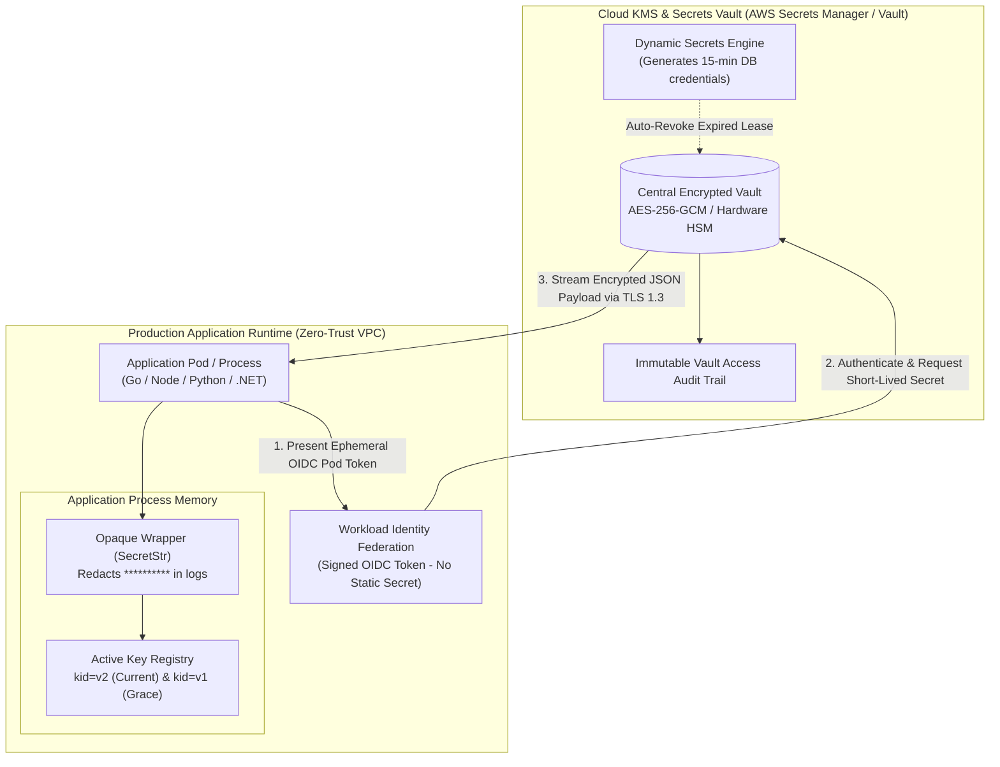
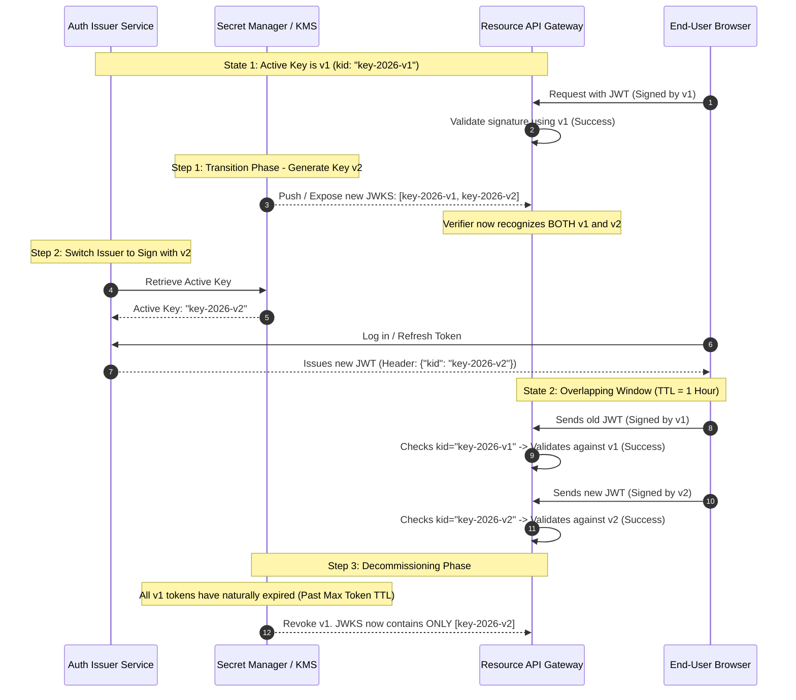
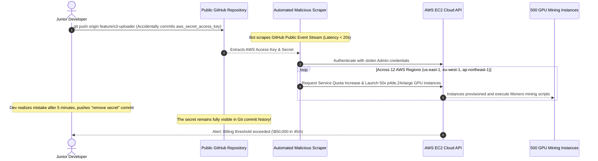

# Module 05: Secrets Management and Zero-Downtime Rotation

> **Prerequisites**: [Module 00: OWASP Top 10 Overview](../00-owasp-top-10-overview/README.md), [Track 03: Auth & Access Control](../../03-auth-and-access-control/README.md), and asymmetric/symmetric cryptographic fundamentals.  
> **Estimated Reading Time**: 35 minutes.  
> **Target Audience**: Backend Engineers, Platform Engineers, and DevSecOps Practitioners.

---

> [!TIP]
> **The Golden Rule of Secrets Management**  
> Secrets must **never exist in source code, build artifacts, container images, or version control history**. A secret committed to Git is compromised the instant it is pushed—deleting it in a subsequent commit does nothing to remove it from Git object trees or public scraper caches. Manage secrets external to the application via environment variables backed by cloud KMS/Vault services; mask secrets in runtime memory using opaque wrappers (`SecretStr`, redaction filters); and design all cryptographic keys for **zero-downtime dual-key overlapping rotation** from day one.

---

## 1. Architectural Blueprint & Mental Models

Enterprise secrets management eliminates long-lived static credentials by leveraging workload identity bootstrapping (AWS IAM Roles for Service Accounts / GCP Workload Identity / Kubernetes Projected Service Account Tokens) to retrieve ephemeral credentials directly into process memory.



### Zero-Downtime Key Rotation Lifecycle: Overlapping Validity

Rotating signing keys (such as JWT RSA/ECDSA/HMAC keys) without invalidating active user sessions requires an overlapping validity phase governed by Key IDs (`kid`):



---

## 2. Systematic Taxonomic Reference Grids

### Secrets Storage Mechanisms: Security & Operational Trade-Offs

| Storage Medium | Encryption at Rest | Access Audit Trail | Dynamic Secret Support | Operational Blast Radius | Production Recommendation |
| :--- | :--- | :--- | :--- | :--- | :--- |
| **Hardcoded in Code / Git** | **NONE** (Plaintext) | None | Impossible | **CATASTROPHIC** (Exposed to all repository clones, forks, CI runners) | **STRICTLY FORBIDDEN** (Immediate SEV-1 risk). |
| **Plain `.env` Files** | **NONE** (Plaintext filesystem) | OS filesystem access only | No | **HIGH** (Easily committed accidentally; leaks via container image layers) | Permissible **only** for local development. Must be gitignored. |
| **OS Environment Variables** | Depends on host OS | Basic process tree inspection (`/proc/$PID/environ`) | No | **MEDIUM** (Visible to all child processes; leaks into crash dumps/logs) | Standard baseline for containerized deployment (Twelve-Factor App). |
| **Kubernetes Secrets** | Base64 encoded by default (Requires etcd KMS plugin) | Kubernetes API server audit logs | No | **MEDIUM** (Readable by any service account with pod exec/get secrets) | Acceptable if etcd encryption is active and RBAC is tightly scoped. |
| **Cloud Secret Manager (AWS/GCP/Vault)** | **AES-256-GCM / HSM Backed** | **Full Audit Trail** (IP, Caller ARN, Timestamp) | **YES** (Leased, auto-revoking DB credentials) | **LOW** (Fine-grained IAM policy; secret never touches persistent disk) | **ENTERPRISE GOLD STANDARD** for all cloud backend architectures. |

### Incident Response Runbook: Leaked Secret Remediation Hierarchy

When a credential is leaked in a commit, log file, or external report, execute actions in strict chronological order:

| Step | Action Category | Execution Procedure | Why Skipping / Reversing Fails |
| :--- | :--- | :--- | :--- |
| **1. Rotate / Revoke** | Immediate Containment | Generate new credential in Secret Manager; deploy to workloads; revoke compromised credential in upstream provider. | **Scrubbing Git first does not invalidate the live key.** Attackers scan public commits within 30 seconds and keep copies. |
| **2. Invalidate Sessions** | Damage Mitigation | Revoke active sessions / tokens minted with the compromised key. Terminate active database sessions. | If a JWT signing key leaked, an attacker can continue minting tokens until existing verifier caches expire. |
| **3. Investigate Blast Radius**| Forensic Audit | Query SIEM / CloudTrail / DB logs for API activity originating from unknown IPs using the compromised key. | You cannot determine whether data exfiltration occurred without reviewing the full access log during the exposure window. |
| **4. Purge Git History** | Repository Sanitization| Use `git-filter-repo` or BFG Repo-Cleaner to rewrite commit history and force-push sanitized branches. | Historical commits retain the string indefinitely; new clones will continue to ingest the leaked secret. |

---

## 3. Production War Story: The \$340,000 Cryptomining Heist

### Incident Post-Mortem

- **Severity**: SEV-1 (Infrastructure Compromise & Cloud Resource Hijacking)
- **Time to Detect (TTD)**: 45 minutes (Automated billing threshold alert fired at \$50,000)
- **Time to Mitigate (TTM)**: 20 minutes (AWS Root account locked)
- **Financial Impact**: \$342,000 in unauthorized EC2 GPU spot instance charges incurred within 65 minutes.



#### What Happened & Root Cause
A developer committed an AWS root administrator access key into a public repository. Within 38 seconds of pushing the branch, an automated bot scraped the commit from the GitHub public events firehose. The attacker immediately scripted API requests across 12 AWS regions, provisioning hundreds of GPU instances to mine cryptocurrency. 

Five minutes after the initial push, the developer noticed the mistake and pushed a second commit deleting the file. However, because Git preserves all historical commits, the secret remained accessible. The developer believed deleting the file fixed the issue, so they did not revoke the key in the AWS console until the cloud billing alarm triggered.

#### The Fix & Architectural Hardening
1. **Zero Static Keys in Code**: Replaced all static AWS IAM access keys with **IAM Roles for Service Accounts (IRSA)**, authenticating workloads via short-lived STS tokens.
2. **Pre-Commit Shift-Left Enforcers**: Deployed `gitleaks` pre-commit hooks to block local commits containing regex patterns matching high-entropy secret structures.
3. **Repository Secret Scanning Integration**: Configured GitHub Push Protection, which automatically blocks pushes containing recognized API key structures (AWS, Stripe, Slack, OpenAI).

---

## 4. Multi-Language Production Implementations: Zero-Downtime Key Rotation & Secret Masking

Below is the complete production-grade implementation of a dual-key zero-downtime verifier and secure config wrapper across **Go**, **Node.js/TypeScript**, **Python**, and **C#**.

### Go Implementation

```go
package security

import (
	"context"
	"crypto/hmac"
	"crypto/sha256"
	"encoding/base64"
	"encoding/json"
	"errors"
	"fmt"
	"strings"
	"sync"
)

var (
	ErrSignatureInvalid = errors.New("invalid signature")
	ErrKeyNotFound      = errors.New("specified key id (kid) not found in active key registry")
)

// SecretString masks sensitive values during string formatting and JSON serialization
type SecretString string

func (s SecretString) String() string {
	return "**********"
}

func (s SecretString) MarshalJSON() ([]byte, error) {
	return json.Marshal("**********")
}

func (s SecretString) Expose() string {
	return string(s)
}

// DualKeyRotator maintains active and retiring cryptographic keys for zero-downtime rotation
type DualKeyRotator struct {
	mu         sync.RWMutex
	primaryKID string
	keys       map[string][]byte
}

func NewDualKeyRotator(initialKID string, initialSecret string) *DualKeyRotator {
	return &DualKeyRotator{
		primaryKID: initialKID,
		keys: map[string][]byte{
			initialKID: []byte(initialSecret),
		},
	}
}

// RegisterNewKey promotes a new key to primary while retaining previous keys during grace period
func (r *DualKeyRotator) RegisterNewKey(newKID string, newSecret string) {
	r.mu.Lock()
	defer r.mu.Unlock()
	r.keys[newKID] = []byte(newSecret)
	r.primaryKID = newKID
}

// DecommissionKey retires an old key once its token lifetime has fully elapsed
func (r *DualKeyRotator) DecommissionKey(oldKID string) {
	r.mu.Lock()
	defer r.mu.Unlock()
	delete(r.keys, oldKID)
}

// SignToken generates a signature using the current primary key
func (r *DualKeyRotator) SignToken(payload string) (signedToken string, kid string) {
	r.mu.RLock()
	defer r.mu.RUnlock()

	key := r.keys[r.primaryKID]
	mac := hmac.New(sha256.New, key)
	mac.Write([]byte(payload))
	signature := base64.RawURLEncoding.EncodeToString(mac.Sum(nil))

	return fmt.Sprintf("%s.%s", payload, signature), r.primaryKID
}

// VerifyToken verifies a payload signature against the specific KID embedded in the token
func (r *DualKeyRotator) VerifyToken(payload string, signatureStr string, kid string) error {
	r.mu.RLock()
	key, exists := r.keys[kid]
	r.mu.RUnlock()

	if !exists {
		return ErrKeyNotFound
	}

	mac := hmac.New(sha256.New, key)
	mac.Write([]byte(payload))
	expectedSignature := mac.Sum(nil)

	actualSignature, err := base64.RawURLEncoding.DecodeString(signatureStr)
	if err != nil {
		return ErrSignatureInvalid
	}

	// Constant-time comparison prevents timing side channels
	if !hmac.Equal(actualSignature, expectedSignature) {
		return ErrSignatureInvalid
	}

	return nil
}
```

---

### Node.js / TypeScript Implementation

```typescript
import crypto from 'crypto';

export class SecretValue {
  private readonly value: string;

  constructor(secret: string) {
    this.value = secret;
  }

  public toString(): string {
    return '**********';
  }

  public toJSON(): string {
    return '**********';
  }

  public unwrap(): string {
    return this.value;
  }
}

export interface KeyRegistryEntry {
  secret: Buffer;
  createdAt: number;
}

export class ZeroDowntimeKeyRotator {
  private primaryKid: string;
  private readonly keys: Map<string, KeyRegistryEntry> = new Map();

  constructor(initialKid: string, initialSecret: string) {
    this.primaryKid = initialKid;
    this.keys.set(initialKid, {
      secret: Buffer.from(initialSecret, 'utf-8'),
      createdAt: Date.now(),
    });
  }

  // Phase 1: Add new key and promote to primary
  public promoteNewKey(newKid: string, newSecret: string): void {
    this.keys.set(newKid, {
      secret: Buffer.from(newSecret, 'utf-8'),
      createdAt: Date.now(),
    });
    this.primaryKid = newKid;
  }

  // Phase 2: Retire old key after grace window expires
  public revokeKey(oldKid: string): void {
    if (oldKid === this.primaryKid) {
      throw new Error('Cannot revoke active primary key');
    }
    this.keys.delete(oldKid);
  }

  public sign(data: string): { signedPayload: string; kid: string } {
    const activeKey = this.keys.get(this.primaryKid);
    if (!activeKey) throw new Error('Primary key unavailable');

    const hmac = crypto.createHmac('sha256', activeKey.secret);
    hmac.update(data);
    const signature = hmac.digest('base64url');

    return {
      signedPayload: `${data}.${signature}`,
      kid: this.primaryKid,
    };
  }

  public verify(data: string, signature: string, kid: string): boolean {
    const targetKey = this.keys.get(kid);
    if (!targetKey) {
      return false;
    }

    const hmac = crypto.createHmac('sha256', targetKey.secret);
    hmac.update(data);
    const expectedSig = hmac.digest();
    const actualSig = Buffer.from(signature, 'base64url');

    if (expectedSig.length !== actualSig.length) {
      return false;
    }

    return crypto.timingSafeEqual(expectedSig, actualSig);
  }
}
```

---

### Python Implementation

```python
import hmac
import hashlib
import base64
from typing import Dict, Optional, Tuple
from pydantic import BaseModel, SecretStr
from pydantic_settings import BaseSettings, SettingsConfigDict

class AppConfig(BaseSettings):
    # Required secrets with no default: fails fast on boot if unset
    database_url: SecretStr
    jwt_primary_kid: str
    jwt_primary_secret: SecretStr
    jwt_previous_kid: Optional[str] = None
    jwt_previous_secret: Optional[SecretStr] = None

    model_config = SettingsConfigDict(env_file=".env", env_file_encoding="utf-8")

class ZeroDowntimeRotator:
    def __init__(self, primary_kid: str, primary_secret: str):
        self.primary_kid: str = primary_kid
        self.keys: Dict[str, bytes] = {
            primary_kid: primary_secret.encode("utf-8")
        }

    def rotate_key(self, new_kid: str, new_secret: str):
        # Add new key and promote to active signer
        self.keys[new_kid] = new_secret.encode("utf-8")
        self.primary_kid = new_kid

    def decommission_key(self, old_kid: str):
        if old_kid == self.primary_kid:
            raise ValueError("Cannot decommission the active primary key")
        self.keys.pop(old_kid, None)

    def sign(self, payload: str) -> Tuple[str, str]:
        secret = self.keys[self.primary_kid]
        sig = hmac.new(secret, payload.encode("utf-8"), hashlib.sha256).digest()
        encoded_sig = base64.urlsafe_b64encode(sig).decode("utf-8").rstrip("=")
        return f"{payload}.{encoded_sig}", self.primary_kid

    def verify(self, payload: str, signature: str, kid: str) -> bool:
        secret = self.keys.get(kid)
        if not secret:
            return False

        expected_sig = hmac.new(secret, payload.encode("utf-8"), hashlib.sha256).digest()
        try:
            # Re-pad base64
            padding = "=" * (-len(signature) % 4)
            actual_sig = base64.urlsafe_b64decode(signature + padding)
        except Exception:
            return False

        # Constant-time comparison
        return hmac.compare_digest(expected_sig, actual_sig)
```

---

### C# / .NET Implementation

```csharp
using System;
using System.Collections.Concurrent;
using System.Security.Cryptography;
using System.Text;

namespace SecurityTrack.SecretsManagement
{
    public sealed class SecretMaskedString
    {
        private readonly string _secret;

        public SecretMaskedString(string secret)
        {
            _secret = secret ?? throw new ArgumentNullException(nameof(secret));
        }

        public override string ToString() => "**********";

        public string Expose() => _secret;
    }

    public class ZeroDowntimeKeyRotator
    {
        private readonly ConcurrentDictionary<string, byte[]> _keyStore = new();
        private volatile string _primaryKid;

        public ZeroDowntimeKeyRotator(string initialKid, string initialSecret)
        {
            _primaryKid = initialKid;
            _keyStore[initialKid] = Encoding.UTF8.GetBytes(initialSecret);
        }

        public void PromoteNewKey(string newKid, string newSecret)
        {
            _keyStore[newKid] = Encoding.UTF8.GetBytes(newSecret);
            _primaryKid = newKid;
        }

        public void RevokeKey(string oldKid)
        {
            if (oldKid == _primaryKid)
            {
                throw new InvalidOperationException("Cannot revoke the currently active primary key");
            }
            _keyStore.TryRemove(oldKid, out _);
        }

        public (string SignedPayload, string Kid) Sign(string payload)
        {
            var kid = _primaryKid;
            if (!_keyStore.TryGetValue(kid, out var secret))
            {
                throw new InvalidOperationException("Primary key missing");
            }

            using var hmac = new HMACSHA256(secret);
            var hash = hmac.ComputeHash(Encoding.UTF8.GetBytes(payload));
            var signature = Convert.ToBase64String(hash).TrimEnd('=').Replace('+', '-').Replace('/', '_');

            return ($"{payload}.{signature}", kid);
        }

        public bool Verify(string payload, string signature, string kid)
        {
            if (!_keyStore.TryGetValue(kid, out var secret))
            {
                return false;
            }

            using var hmac = new HMACSHA256(secret);
            var expectedBytes = hmac.ComputeHash(Encoding.UTF8.GetBytes(payload));

            try
            {
                var incomingSig = signature.Replace('-', '+').Replace('_', '/');
                switch (incomingSig.Length % 4)
                {
                    case 2: incomingSig += "=="; break;
                    case 3: incomingSig += "="; break;
                }
                var actualBytes = Convert.FromBase64String(incomingSig);

                return CryptographicOperations.FixedTimeEquals(expectedBytes, actualBytes);
            }
            catch
            {
                return false;
            }
        }
    }
}
```

---

## 5. Practical Hands-On Verification CLI Workflows

### Step 1: Detect Secrets Locally with Shift-Left Scanner

Install and run `gitleaks` to inspect local uncommitted working trees:

```bash
# Scan git repository history and staged files for exposed API keys
gitleaks detect --source . --verbose
```

**Expected Scanner Output (Clean State):**
```
    ○
    │╲
    │ ○
    ○ ░
    ░
12:15PM INF 0 commits scanned.
12:15PM INF scan completed in 42ms
12:15PM INF no leaks found
```

---

### Step 2: Zero-Downtime Dual-Key Verification Flow

Verify token acceptance across overlapping rotation windows:

```bash
# 1. Verify token minted with retiring key v1
curl -s -X POST "http://localhost:8080/api/v1/auth/verify" \
  -H "Content-Type: application/json" \
  -d '{"token": "user_data.c2lnbmF0dXJl", "kid": "key-2026-v1"}' | jq .

# 2. Verify token minted with newly promoted key v2
curl -s -X POST "http://localhost:8080/api/v1/auth/verify" \
  -H "Content-Type: application/json" \
  -d '{"token": "user_data.bmV3c2lnbmF0dXJl", "kid": "key-2026-v2"}' | jq .
```

**Expected Wire Output (Both Keys Valid During Overlap):**
```json
{
  "valid": true,
  "key_id": "key-2026-v1",
  "status": "grace_period"
}
{
  "valid": true,
  "key_id": "key-2026-v2",
  "status": "active"
}
```

---

## 6. Operational Validation Checkpoints (Scenario Quizzes)

### Checkpoint 1: The Git History Deletion Fallacy
<details>
<summary><strong>Scenario Assessment:</strong> A developer accidentally commits a production Stripe secret key to GitHub, realizes the mistake 10 minutes later, and commits a second change removing the string. The developer marks the pull request as ready. What immediate action is required?</summary>

```
Options:
A) Merge the pull request because the net diff contains zero secret additions.
B) Immediately log into the Stripe dashboard, generate a new API key, update the production secret manager, and revoke the compromised key—because the secret exists in Git history and was likely scraped.
C) Run `git reset --soft HEAD~1` on the local laptop.
D) Restart the production web servers.
```

**Answer:**
**B is correct.** Committing a secret into a repository makes it permanently accessible in Git history (accessible via `git log -p` or commit hashes) and exposes it to automated scraping tools. Deleting it in a subsequent commit does **not** erase it from the object database. The only safe response is **immediate rotation and revocation**: assume the credential is compromised, update production to use a newly issued secret, and revoke the leaked key immediately.

</details>

---

### Checkpoint 2: The Bootstrapping Problem & Workload Identity
<details>
<summary><strong>Scenario Assessment:</strong> An architect is designing a service to fetch secrets from HashiCorp Vault or AWS Secrets Manager. An engineer asks: "To fetch secrets from the Vault, our code needs a Vault token. Where do we store that token?" How does modern cloud architecture solve this "Secret Zero" dilemma?</summary>

```
Options:
A) Hardcode the Vault root token inside a base64 encoded environment variable.
B) Store the Vault token in a public S3 bucket.
C) Workload Identity Federation: The cloud platform or Kubernetes cluster issues short-lived, cryptographically signed OIDC tokens to the container; the Vault validates the token signature directly against the cloud identity provider.
D) Generate the Vault token dynamically from the server's MAC address.
```

**Answer:**
**C is correct.** The "Secret Zero" dilemma is solved via **Workload Identity Federation** (e.g., AWS IAM Roles for Service Accounts, GCP Workload Identity, Vault Kubernetes Auth). The container runtime mounts an ephemeral, platform-signed OIDC token tied to the pod's service account. The application presents this token to the Vault; the Vault verifies the cryptographic signature with the identity provider and issues short-lived access without requiring any static credential in the codebase.

</details>

---

### Checkpoint 3: Designing for Zero-Downtime Key Rotation
<details>
<summary><strong>Scenario Assessment:</strong> A microservice architecture signs internal RPC payloads using a shared secret. When security requests a key rotation, the team revokes the old secret and immediately deploys the new secret to all 50 microservices simultaneously. During the rollout, 30% of internal RPC requests fail with signature verification errors. Why?</summary>

```
Options:
A) Kubernetes rolling deployments update pods incrementally; instances running the old key reject requests signed by instances running the new key, and vice versa.
B) The Linux kernel limits HMAC operations to one key per network interface.
C) HashiCorp Vault rejects concurrent connections during key creation.
D) RPC packets require AES-CBC encryption when rotating keys.
```

**Answer:**
**A is correct.** During a rolling deployment, pods running the previous version and pods running the new version coexist simultaneously. If keys are singular and swapped abruptly, older pods reject requests from newer pods, and newer pods reject requests from older pods. The proper pattern is **Dual-Key Overlapping Validity**: publish the new key alongside the old key (tagged with a `kid`), allow verifiers to validate against *both* keys, switch signers to the new key, and revoke the old key only after all in-flight requests and tokens have expired.

</details>

---

## 7. Cumulative Review: Modules 00–05 (Closed-Book Self Assessment)

Verify comprehensive retention of application security engineering across modules 00 through 05:

1. **Interpreter Defense Hierarchy**: Compare how you neutralize untrusted input across:
   - SQL Engine (Module 01: Parameterized Prepared Statements)
   - Browser DOM (Module 02: Context-Aware HTML Output Encoding & Strict CSP)
   - Outbound HTTP Client (Module 03: DNS Validation, Socket Pinning, and Disabling Redirects)
   - Deserialization Engine (Module 03: Data-only JSON with static schema enforcement)
2. **Volumetric Abuse Mitigation**: Explain why a single-dimension IP rate limiter fails against credential stuffing, and construct the compound key pattern required to neutralize distributed botnets (Module 04).
3. **The Incident Response Chronology**: When a high-privilege signing key is found in a committed file, state the four-phase response process and explain why Git history rewriting (`git-filter-repo`) is the *last* step rather than the first (Module 05).

---

## 8. Further Reading & Sources

- [OWASP Secrets Management Cheat Sheet](https://cheatsheetseries.owasp.org/cheatsheets/Secrets_Management_Cheat_Sheet.html)
- [The Twelve-Factor App: III. Config](https://12factor.net/config)
- [Pydantic Settings: Type-Safe Configuration Management](https://docs.pydantic.dev/latest/concepts/pydantic_settings/)
- [HashiCorp Vault: Dynamic Secrets Architecture](https://developer.hashicorp.com/vault/docs/concepts/dynamic-secrets)
- [Gitleaks: Standalone Secret Detection for Git](https://github.com/gitleaks/gitleaks)

---

## Next Steps

With secrets and cryptographic keys locked down and rotatable, we turn to the final foundational controls:

- Next Module: **[06-security-headers-and-hardening](../06-security-headers-and-hardening/README.md)** (HSTS, CSP, Frame Options, Cache-Control, Software Supply Chain CVE Scanning, and Secure Code Reviews).
- Track Index: [README.md](../README.md)
