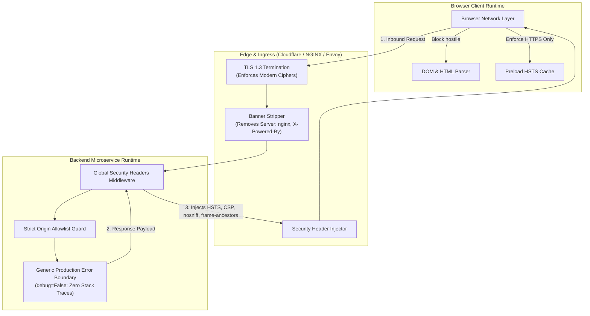
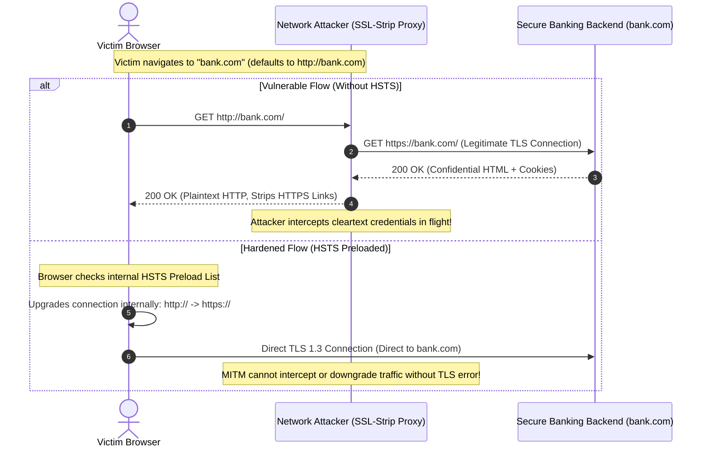
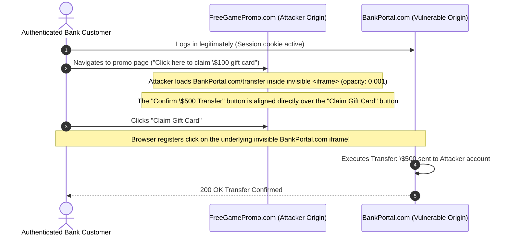

# Module 06: Security Headers and Hardening

> **Prerequisites**: [Module 00: OWASP Top 10 Overview](../00-owasp-top-10-overview/README.md), [Module 02: XSS and CSRF Defense](../02-xss-and-csrf/README.md), and [Track 02: HTTP Request-Response Fundamentals](../../01-request-response-fundamentals/README.md).  
> **Estimated Reading Time**: 35 minutes.  
> **Target Audience**: Backend Engineers, Platform Engineers, and DevSecOps Practitioners.

---

> [!TIP]
> **The Golden Rule of System Hardening**  
> Never rely on single-tier application security or assume client browsers will act defensively by default. **HTTP Security Headers** instruct the browser runtime to execute active defensive controls on your behalf: enforce strict HTTPS encryption (HSTS), refuse hostile iframe embedding (Clickjacking), prevent malicious MIME-type execution (`nosniff`), and restrict executable script origins (CSP). Configure headers centrally in global middleware, strip server technology fingerprinting banners (`Server`, `X-Powered-By`), and shift dependency vulnerability scanning (`pip-audit`, `trivy`) into CI/CD pipelines to eliminate known CVEs before deployment.

---

## 1. Architectural Blueprint & Mental Models

Hardening is an architectural envelope that spans the edge ingress, reverse proxy, application middleware, and browser sandbox.



### The SSL-Stripping Downgrade MITM Attack vs. HSTS Preload

Without HTTP Strict Transport Security (HSTS), an active Man-in-the-Middle (MITM) on an untrusted public network (e.g., airport Wi-Fi) intercepts plain HTTP traffic before the browser redirects to HTTPS:



---

## 2. Systematic Taxonomic Reference Grids

### Enterprise HTTP Security Headers Matrix

| HTTP Header Name | Recommended Production Directive | Vulnerability Neutralized | Browser Enforcement Behavior | Common Risky Anti-Pattern |
| :--- | :--- | :--- | :--- | :--- |
| **`Strict-Transport-Security`** | `max-age=63072000; includeSubDomains; preload` | SSL-Stripping, Man-in-the-Middle (MITM), Protocol Downgrades. | Re-writes all `http://` URLs to `https://` internally before sending packets over the wire. | Setting short `max-age` or deploying before all subdomains support HTTPS (locks out users). |
| **`X-Content-Type-Options`** | `nosniff` | MIME-Confusion XSS, Drive-By Malicious Script Downloads. | Forbids the browser from "sniffing" response bodies into executable types; strictly honors `Content-Type`. | Missing header, allowing an uploaded avatar `.png` containing JS to be parsed as HTML. |
| **`X-Frame-Options`** | `DENY` | Clickjacking, UI Redressing, Invisible Overlays. | Forbids rendering the document inside `<frame>`, `<iframe>`, `<embed>`, or `<object>`. | Setting `ALLOW-FROM` (deprecated in modern browsers; use CSP `frame-ancestors`). |
| **`Content-Security-Policy`** | `default-src 'self'; script-src 'self'; object-src 'none'; frame-ancestors 'none';` | Stored/Reflected XSS, Data Exfiltration, Inline Event Hijacking. | Enforces whitelist of network origins permitted to execute scripts, styles, images, and fonts. | Adding `'unsafe-inline'` or `'unsafe-eval'`, completely gutting XSS protections. |
| **`Referrer-Policy`** | `strict-origin-when-cross-origin` | Information Disclosure, Token / PII leakage via `Referer` URL headers. | Sends full URL within same origin; sends only domain name on cross-origin HTTPS requests. | `unsafe-url` (leaks sensitive URL query parameters like reset tokens to external CDNs). |
| **`Permissions-Policy`** | `camera=(), microphone=(), geolocation=(), payment=()` | Browser Hardware API Abuse, Unauthorized Device Access. | Explicitly disables sensitive Web APIs for the document and all embedded iframes. | Omission, allowing compromised third-party scripts to request microphone or camera access. |

### Cookie Security Attributes: Production Baseline

| Cookie Attribute | Directive Syntax | Security Enforcement Role |
| :--- | :--- | :--- |
| **`Secure`** | `; Secure` | Cookie is transmitted *only* over encrypted TLS/HTTPS connections. Blocked on plain HTTP. |
| **`HttpOnly`** | `; HttpOnly` | Forbids client-side JavaScript (`document.cookie`) from accessing the cookie. Shields against XSS theft. |
| **`SameSite`** | `; SameSite=Lax` or `; SameSite=Strict` | Withholds cookie on cross-origin requests. Primary browser-side barrier against CSRF. |
| **Prefix: `__Host-`** | `__Host-session=...` | Browser enforces that cookie is `Secure`, has `Path=/`, and contains no `Domain` attribute (host-bound). |

---

## 3. Production War Story: The Clickjacking Wire Transfer

### Incident Post-Mortem

- **Severity**: SEV-1 (Financial Fraud & Account Depletion)
- **Time to Detect (TTD)**: 6 days (Discovered when hundreds of chargebacks were filed)
- **Time to Mitigate (TTM)**: 15 minutes (Edge NGINX header deployment)
- **Financial Impact**: \$1.85 Million in fraudulent peer-to-peer wire transfers executed.



#### What Happened & Root Cause
An online remittance banking platform omitted `X-Frame-Options` and CSP `frame-ancestors` from its response headers. A malicious gaming site embedded the bank's `/transfer/quick-send` page within a transparent `<iframe>` styled with CSS `opacity: 0.0001` and `z-index: 999`. 

The attacker positioned the bank's "Approve One-Click \$500 Wire" button directly beneath an attractive "Click to Play Free Game" button on the decoy site. When logged-in users clicked the game button, their clicks registered on the invisible bank frame, transferring money to attacker-controlled accounts.

#### The Fix & Architectural Hardening
1. **Global Frame Suppression**: Injected `X-Frame-Options: DENY` and `Content-Security-Policy: frame-ancestors 'none'` in the global reverse proxy layer.
2. **Re-Authentication for Sensitive Operations**: Mandated re-entering user passwords or confirming biometric MFA tokens prior to executing financial mutations.
3. **Automated Scanner in CI**: Configured continuous header verification using `Mozilla Observatory` and automated end-to-end Playwright tests to ensure no page can be framed.

---

## 4. Multi-Language Production Implementations: Global Security Headers Middleware

Below is the complete production-grade implementation of a security headers middleware across **Go**, **Node.js/TypeScript**, **Python**, and **C#**. Each client showcases:
- Complete injection of HSTS, CSP, `nosniff`, `X-Frame-Options`, `Referrer-Policy`, and `Permissions-Policy`.
- Stripping of sensitive information disclosure headers (`Server`, `X-Powered-By`).
- Enforcement of secure cookie attributes (`Secure`, `HttpOnly`, `SameSite=Lax`).
- Clean error boundaries preventing stack trace leakage.

### Go Implementation

```go
package hardening

import (
	"fmt"
	"net/http"
	"strings"
)

type SecurityConfig struct {
	IsProduction bool
	CSPPolicy    string
}

func DefaultSecurityConfig(isProduction bool) SecurityConfig {
	return SecurityConfig{
		IsProduction: isProduction,
		CSPPolicy: "default-src 'self'; " +
			"script-src 'self'; " +
			"style-src 'self' 'unsafe-inline'; " +
			"img-src 'self' data: https:; " +
			"object-src 'none'; " +
			"base-uri 'self'; " +
			"frame-ancestors 'none';",
	}
}

// SecurityHeadersMiddleware applies baseline security hardening headers to all HTTP responses
func SecurityHeadersMiddleware(cfg SecurityConfig, next http.Handler) http.Handler {
	return http.HandlerFunc(func(w http.ResponseWriter, r *http.Request) {
		h := w.Header()

		// 1. Enforce HTTPS via HSTS (2 years with subdomains and preload)
		if cfg.IsProduction {
			h.Set("Strict-Transport-Security", "max-age=63072000; includeSubDomains; preload")
		}

		// 2. Prevent MIME-Sniffing
		h.Set("X-Content-Type-Options", "nosniff")

		// 3. Prevent Clickjacking (X-Frame-Options + CSP frame-ancestors)
		h.Set("X-Frame-Options", "DENY")

		// 4. Content Security Policy
		h.Set("Content-Security-Policy", cfg.CSPPolicy)

		// 5. Privacy & Device Permissions
		h.Set("Referrer-Policy", "strict-origin-when-cross-origin")
		h.Set("Permissions-Policy", "geolocation=(), microphone=(), camera=(), payment=()")

		// 6. Strip Fingerprinting Banners
		h.Del("Server")
		h.Del("X-Powered-By")

		next.ServeHTTP(w, r)
	})
}

// SetSecureSessionCookie sets an enterprise-hardened session cookie
func SetSecureSessionCookie(w http.ResponseWriter, name, value string, isProduction bool) {
	cookie := &http.Cookie{
		Name:     "__Host-" + name,
		Value:    value,
		Path:     "/",
		Secure:   true, // Mandatory for __Host- prefix
		HttpOnly: true,
		SameSite: http.SameSiteLaxMode,
		MaxAge:   3600 * 24, // 24 hours
	}
	http.SetCookie(w, cookie)
}
```

---

### Node.js / TypeScript Implementation

```typescript
import { Request, Response, NextFunction } from 'express';

export interface HardeningOptions {
  isProduction: boolean;
  cspDirectives?: string;
}

export function securityHardeningMiddleware(options: HardeningOptions) {
  const defaultCSP = 
    "default-src 'self'; " +
    "script-src 'self'; " +
    "style-src 'self' 'unsafe-inline'; " +
    "img-src 'self' data: https:; " +
    "object-src 'none'; " +
    "base-uri 'self'; " +
    "frame-ancestors 'none';";

  const cspPolicy = options.cspDirectives || defaultCSP;

  return (req: Request, res: Response, next: NextFunction): void => {
    // 1. Strict Transport Security (HSTS)
    if (options.isProduction) {
      res.setHeader('Strict-Transport-Security', 'max-age=63072000; includeSubDomains; preload');
    }

    // 2. MIME-type sniffing suppression
    res.setHeader('X-Content-Type-Options', 'nosniff');

    // 3. Clickjacking defenses
    res.setHeader('X-Frame-Options', 'DENY');

    // 4. Content Security Policy
    res.setHeader('Content-Security-Policy', cspPolicy);

    // 5. Referrer and Browser Feature Controls
    res.setHeader('Referrer-Policy', 'strict-origin-when-cross-origin');
    res.setHeader('Permissions-Policy', 'camera=(), microphone=(), geolocation=(), payment=()');

    // 6. Strip Information Disclosure Headers
    res.removeHeader('X-Powered-By');
    res.removeHeader('Server');

    next();
  };
}

// Hardened production error handler: Zero stack trace leakage
export function productionErrorHandler(err: Error, req: Request, res: Response, next: NextFunction): void {
  // Log detailed stack trace internally for telemetry (SIEM / Sentry)
  console.error(JSON.stringify({
    event: 'UNHANDLED_EXCEPTION',
    error: err.message,
    stack: err.stack,
    path: req.path,
    ip: req.ip,
  }));

  // Return sanitized generic payload to external clients
  res.status(500).json({
    error: 'InternalServerError',
    message: 'An unexpected error occurred. Please contact support.',
  });
}
```

---

### Python Implementation

```python
import logging
from fastapi import FastAPI, Request, Response
from starlette.middleware.base import BaseHTTPMiddleware
from starlette.responses import JSONResponse

logger = logging.getLogger("security.hardening")

class SecurityHardeningMiddleware(BaseHTTPMiddleware):
    def __init__(self, app: FastAPI, is_production: bool = True):
        super().__init__(app)
        self.is_production = is_production
        self.csp_policy = (
            "default-src 'self'; "
            "script-src 'self'; "
            "style-src 'self' 'unsafe-inline'; "
            "img-src 'self' data: https:; "
            "object-src 'none'; "
            "base-uri 'self'; "
            "frame-ancestors 'none';"
        )

    async def dispatch(self, request: Request, call_next):
        response: Response = await call_next(request)

        # 1. HSTS (Enforced over HTTPS in production)
        if self.is_production:
            response.headers["Strict-Transport-Security"] = (
                "max-age=63072000; includeSubDomains; preload"
            )

        # 2. Prevent MIME Sniffing
        response.headers["X-Content-Type-Options"] = "nosniff"

        # 3. Clickjacking Mitigation
        response.headers["X-Frame-Options"] = "DENY"

        # 4. Content Security Policy
        response.headers["Content-Security-Policy"] = self.csp_policy

        # 5. Referrer Policy & Device Permissions
        response.headers["Referrer-Policy"] = "strict-origin-when-cross-origin"
        response.headers["Permissions-Policy"] = (
            "camera=(), microphone=(), geolocation=(), payment=()"
        )

        # 6. Strip Fingerprinting Headers
        response.headers.pop("Server", None)
        response.headers.pop("X-Powered-By", None)

        return response

# Production Generic Error Handler: Sanitizes internal tracebacks
async def generic_exception_handler(request: Request, exc: Exception):
    logger.error("Unhandled application exception", exc_info=exc, extra={"path": request.url.path})
    return JSONResponse(
        status_code=500,
        content={"error": "InternalServerError", "message": "An unexpected error occurred."}
    )
```

---

### C# / .NET Implementation

```csharp
using System.Threading.Tasks;
using Microsoft.AspNetCore.Builder;
using Microsoft.AspNetCore.Http;
using Microsoft.Extensions.Hosting;

namespace SecurityTrack.Hardening
{
    public class SecurityHeadersMiddleware
    {
        private readonly RequestDelegate _next;
        private readonly bool _isProduction;

        private const string CspPolicy = 
            "default-src 'self'; " +
            "script-src 'self'; " +
            "style-src 'self' 'unsafe-inline'; " +
            "img-src 'self' data: https:; " +
            "object-src 'none'; " +
            "base-uri 'self'; " +
            "frame-ancestors 'none';";

        public SecurityHeadersMiddleware(RequestDelegate next, IHostEnvironment env)
        {
            _next = next;
            _isProduction = env.IsProduction();
        }

        public async Task InvokeAsync(HttpContext context)
        {
            context.Response.OnStarting(() =>
            {
                var headers = context.Response.Headers;

                // 1. HSTS
                if (_isProduction)
                {
                    headers["Strict-Transport-Security"] = "max-age=63072000; includeSubDomains; preload";
                }

                // 2. MIME sniffing suppression
                headers["X-Content-Type-Options"] = "nosniff";

                // 3. Clickjacking prevention
                headers["X-Frame-Options"] = "DENY";

                // 4. Content Security Policy
                headers["Content-Security-Policy"] = CspPolicy;

                // 5. Referrer & Permissions Policy
                headers["Referrer-Policy"] = "strict-origin-when-cross-origin";
                headers["Permissions-Policy"] = "camera=(), microphone=(), geolocation=(), payment=()";

                // 6. Strip Fingerprinting
                headers.Remove("Server");
                headers.Remove("X-Powered-By");

                return Task.CompletedTask;
            });

            await _next(context);
        }
    }
}
```

---

## 5. Practical Hands-On Verification CLI Workflows

### Step 1: Inspect Security Headers via cURL

```bash
curl -s -I "http://localhost:8080/health"
```

**Expected Wire Response Headers:**
```http
HTTP/1.1 200 OK
Content-Type: application/json; charset=utf-8
Strict-Transport-Security: max-age=63072000; includeSubDomains; preload
X-Content-Type-Options: nosniff
X-Frame-Options: DENY
Content-Security-Policy: default-src 'self'; script-src 'self'; object-src 'none'; base-uri 'self'; frame-ancestors 'none';
Referrer-Policy: strict-origin-when-cross-origin
Permissions-Policy: camera=(), microphone=(), geolocation=(), payment=()
```

---

### Step 2: Automated Dependency Vulnerability Scanning (Shift-Left)

Audit production dependencies against national CVE databases:

```bash
# Python: Check installed virtualenv or requirements.txt for unpatched CVEs
pip-audit --desc
```

**Expected Scanner Output:**
```
Found 0 known vulnerabilities in 38 packages
```

---

### Step 3: Container Image Security Scan

Scan your application's Docker image using `trivy` to detect base image operating system vulnerabilities:

```bash
trivy image --severity HIGH,CRITICAL my-company/backend-api:latest
```

**Expected Wire Output:**
```
my-company/backend-api:latest (debian 12.5)
===========================================
Total: 0 (HIGH: 0, CRITICAL: 0)
```

---

## 6. Operational Validation Checkpoints (Scenario Quizzes)

### Checkpoint 1: HSTS Preload Rollout Pitfalls
<details>
<summary><strong>Scenario Assessment:</strong> An infrastructure engineer enables <code>Strict-Transport-Security: max-age=63072000; includeSubDomains; preload</code> on a company's apex domain (<code>company.com</code>). Three hours later, an internal legacy service hosted at <code>http://billing.internal.company.com</code> that only supports plain HTTP becomes completely unreachable for all employees worldwide. Why?</summary>

```
Options:
A) The browser clears DNS caches when HSTS headers are received.
B) HSTS `includeSubDomains` instructs browsers to permanently force HTTPS on all existing and future subdomains; browsers cache this directive for 2 years (63,072,000s) and refuse to establish unencrypted HTTP connections.
C) The billing server ran out of ephemeral TCP sockets.
D) Preload requires signing every HTTP response with a hardware TPM.
```

**Answer:**
**B is correct.** The `includeSubDomains` directive applies the strict HTTPS enforcement to every subdomain under `company.com`. Because `max-age` is sticky (browsers cache it locally for the entire duration), any legacy or internal subdomain that lacks a valid TLS certificate becomes completely inaccessible. Remediate by validating TLS certificates across *all* subdomains prior to adding `includeSubDomains`, or using separate root domains for legacy non-HTTPS infrastructure.

</details>

---

### Checkpoint 2: The Dangers of MIME-Sniffing
<details>
<summary><strong>Scenario Assessment:</strong> A user uploads an avatar image file called <code>profile.jpg</code>. The file actually contains <code>&lt;script&gt;alert(document.cookie)&lt;/script&gt;</code>. The server stores the file and serves it back with <code>Content-Type: image/jpeg</code>. If <code>X-Content-Type-Options: nosniff</code> is missing, what could happen in older browsers?</summary>

```
Options:
A) The browser will reject the download with HTTP 415.
B) The browser performs MIME-sniffing: detects HTML tags in the file payload, overrides the server's `Content-Type`, parses the file as HTML, and executes the embedded script within the application origin.
C) The server's hard drive becomes corrupted due to binary mismatch.
D) The image renders as an empty grey box.
```

**Answer:**
**B is correct.** Without `nosniff`, browsers attempt to determine content types heuristically (MIME-sniffing). If an image contains HTML or JavaScript syntax, the browser may ignore `Content-Type: image/jpeg` and parse it as `text/html`, triggering Stored XSS. The `X-Content-Type-Options: nosniff` header forces the browser to strictly honor the server's declared `Content-Type` without guessing.

</details>

---

### Checkpoint 3: Production Error Boundaries & Information Disclosure
<details>
<summary><strong>Scenario Assessment:</strong> An unhandled database connection exception occurs in an API endpoint. With <code>debug=True</code> enabled, the framework renders a detailed debug screen displaying the database connection string (including username and password), local variables, and file paths. Which OWASP risk does this violate?</summary>

```
Options:
A) A01 Broken Access Control.
B) A05 Security Misconfiguration; internal implementation details and sensitive credentials leak via unhandled client tracebacks.
C) A10 Server-Side Request Forgery.
D) A04 Insecure Design.
```

**Answer:**
**B is correct.** This is an **A05: Security Misconfiguration** vulnerability. Running applications with `debug=True` in production leaks source code, directory structures, environment variables, and database credentials directly to end users and attackers. In production, applications must catch all unhandled exceptions, log the stack trace to an internal logging aggregator (SIEM), and return a sanitized, generic error response (HTTP 500) to the caller.

</details>

---

## 7. Further Reading & Sources

- [OWASP Secure Headers Project](https://owasp.org/www-project-secure-headers/)
- [Mozilla Observatory: Security Headers Analysis](https://observatory.mozilla.org/)
- [MDN Web Docs: Strict-Transport-Security (HSTS)](https://developer.mozilla.org/en-US/docs/Web/HTTP/Headers/Strict-Transport-Security)
- [Pip-Audit: Known Vulnerability Scanner for Python](https://pypi.org/project/pip-audit/)
- [Trivy: Comprehensive Security Scanner for Containers & Dependencies](https://github.com/aquasecurity/trivy)

---

## Next Steps

Now that individual attack surfaces, rate limits, secrets, and baseline security headers are mastered, proceed to the final cumulative milestone:

- Next Module: **[07-capstone-project](../07-capstone-project/README.md)** (End-to-End Security Hardening Capstone: Audit and remediate a live, vulnerable enterprise banking application).
- Track Index: [README.md](../README.md)
