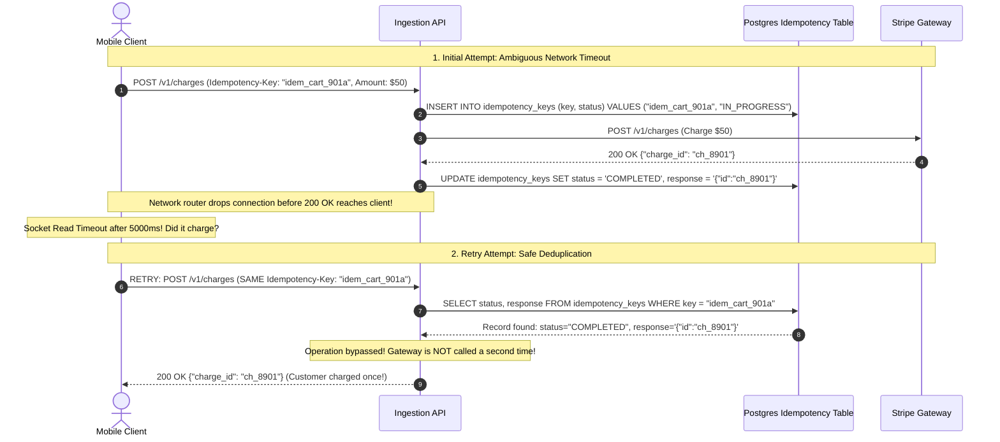
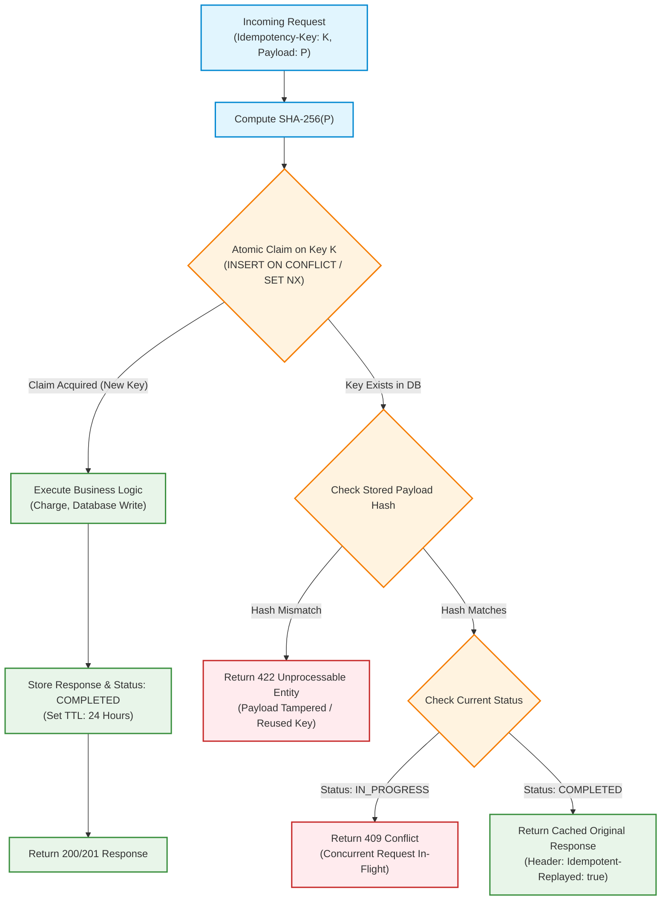
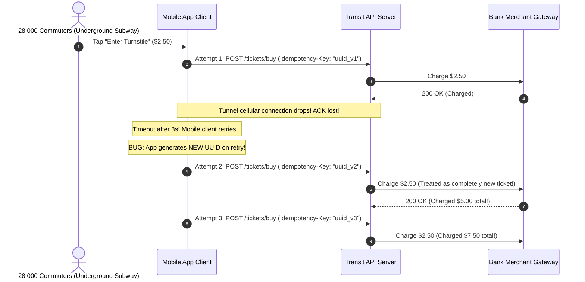

# Module 01: Idempotency in Practice

In distributed systems, network partitions, transient packet drops, and process crashes make duplicate requests the default operating condition. A client transmits an HTTP `POST /charges` request with amount $50; the payment gateway charges the customer's card, but a network router drops the TCP `ACK` frame before the client receives the `200 OK` response. From the client's perspective, the request timed out. Did the payment execute? If the client retries naively, the customer is billed twice; if the client aborts, the order is dropped. This classical **Two Generals Problem** proves that *exactly-once network delivery is mathematically impossible*. Reliability in distributed systems is achieved through **At-Least-Once Delivery coupled with Idempotent Processing**.

> [!TIP]
> **The Golden Rule:** In distributed architectures, duplicate delivery is inevitable. Every state-mutating operation MUST be guarded by an atomic idempotency key claim (`SET key val NX EX ttl` or `INSERT ... ON CONFLICT`), bind the key to a cryptographic hash of the request payload, and return the cached original response on subsequent retries.

---

## 1. Visual Mental Models

### The Two Generals Timeout Dilemma vs. Idempotency Key Recovery

When network sockets time out ambiguously, an idempotency key guarantees that retries return the original execution result rather than re-executing side effects:



### The Complete Idempotency Key State Machine

An industrial idempotency engine must guard against concurrent in-flight collisions, payload tampering, and stale execution:



---

## 2. Structured Reference Grids

### HTTP Method Idempotency: Protocol Specification vs. Implementation

| HTTP Method | RFC 9110 Specification | Implementation Invariant | Dangerous Anti-Pattern |
| :--- | :--- | :--- | :--- |
| **GET** | Idempotent & Safe | Must never produce side effects | Tracking analytics by incrementing view counters in `GET` |
| **PUT** | Idempotent | Complete resource replacement (`SET name = :name`) | Incrementing values: `UPDATE users SET attempts = attempts + 1` |
| **DELETE** | Idempotent | Deleting an already-deleted resource returns `204` or `404` | Returning `500` or modifying related records non-idempotently |
| **POST** | **Non-Idempotent** | Creating resources | Executing bare `INSERT` without unique constraint or idempotency key |
| **PATCH** | Non-Idempotent | Partial delta updates | Appending array elements without deduplicating values |

### Idempotency Ledger Relational Schema

```sql
CREATE TABLE idempotency_keys (
    idempotency_key VARCHAR(255) PRIMARY KEY,
    user_id         BIGINT NOT NULL,
    request_path    VARCHAR(255) NOT NULL,
    request_hash    CHAR(64) NOT NULL,            -- SHA-256 of raw request body
    status          VARCHAR(32) NOT NULL,          -- 'IN_PROGRESS', 'COMPLETED', 'FAILED'
    response_code   INT,
    response_body   JSONB,
    created_at      TIMESTAMPTZ NOT NULL DEFAULT NOW(),
    expires_at      TIMESTAMPTZ NOT NULL           -- TTL boundary (e.g. NOW() + INTERVAL '24 hours')
);

CREATE INDEX idx_idempotency_expires ON idempotency_keys (expires_at);
```

---

## 3. Production War Story

### The Transit Gate Flood That Billed 28,000 Riders Multiple Times

#### The Incident
A municipal transit authority launched mobile QR-code ticketing. When entering subway turnstiles underground, mobile network signals were severely degraded. The app submitted `POST /tickets/buy` when riders tapped their screens. Because connectivity dropped while waiting for the turnstile barrier to open, the mobile client library timed out after 3 seconds. The client code contained an innocent bug: on every retry attempt, it invoked `uuid.v4()` to generate a fresh request identifier. During Monday morning rush hour, 28,000 riders were billed between 3 and 7 times for a single subway fare, draining debit accounts and causing turnstile gates to stall as banks blocked transactions for suspicious velocity.



#### The Root Cause
1. **Unstable Client-Side Idempotency Keys:** The mobile app generated a new random UUID on every retry attempt rather than binding the key to the discrete logical ticket checkout intent.
2. **Missing Request Hash Validation:** The server did not validate whether duplicate incoming keys carried identical payload contents.

#### The Verified Production Fix
1. Client keys were derived deterministically from the user's intent: `hash(user_id, station_id, minute_window)`.
2. The server enforced an atomic `INSERT ... ON CONFLICT` claim. If a retry occurred with the same key, the server returned the stored ticket barcode without invoking the payment gateway.
3. Implemented automated credit card refund scripts that reversed $184,000 in duplicate transit fares within 4 hours.

---

## 4. Multi-Language Production Implementations

### Go (Production Idempotency Middleware with Redis Atomic `SETNX`)

```go
package main

import (
	"bytes"
	"context"
	"crypto/sha256"
	"encoding/hex"
	"encoding/json"
	"fmt"
	"io"
	"net/http"
	"time"

	"github.com/redis/go-redis/v9"
)

type CachedResponse struct {
	StatusCode int    `json:"status_code"`
	Body       string `json:"body"`
}

type IdempotencyMiddleware struct {
	redisClient *redis.Client
	ttl         time.Duration
}

func NewIdempotencyMiddleware(client *redis.Client, ttl time.Duration) *IdempotencyMiddleware {
	return &IdempotencyMiddleware{redisClient: client, ttl: ttl}
}

func (m *IdempotencyMiddleware) Handler(next http.Handler) http.Handler {
	return http.HandlerFunc(func(w http.ResponseWriter, r *http.Request) {
		// Only enforce on mutation methods
		if r.Method != http.MethodPost && r.Method != http.MethodPatch {
			next.ServeHTTP(w, r)
			return
		}

		key := r.Header.Get("Idempotency-Key")
		if key == "" {
			http.Error(w, "Idempotency-Key header is required", http.StatusBadRequest)
			return
		}

		// Read and hash the raw request body
		rawBody, err := io.ReadAll(r.Body)
		if err != nil {
			http.Error(w, "Failed to read body", http.StatusBadRequest)
			return
		}
		r.Body = io.NopCloser(bytes.NewBuffer(rawBody)) // Reset stream for next handler

		hash := sha256.Sum256(rawBody)
		hashStr := hex.EncodeToString(hash[:])

		ctx := r.Context()
		lockKey := fmt.Sprintf("idempotency:%s", key)
		hashKey := fmt.Sprintf("idempotency_hash:%s", key)

		// 1. Atomic Lock Claim: SETNX (Only one request can claim)
		acquired, err := m.redisClient.SetNX(ctx, lockKey, "IN_PROGRESS", m.ttl).Result()
		if err != nil {
			http.Error(w, "Redis error", http.StatusInternalServerError)
			return
		}

		if !acquired {
			// Key already exists. Check stored payload hash
			storedHash, _ := m.redisClient.Get(ctx, hashKey).Result()
			if storedHash != "" && storedHash != hashStr {
				http.Error(w, "Idempotency key reused with different payload", http.StatusUnprocessableEntity)
				return
			}

			// Check status
			cachedData, err := m.redisClient.Get(ctx, lockKey).Result()
			if err == nil && cachedData == "IN_PROGRESS" {
				http.Error(w, "Concurrent request in progress. Retry shortly.", http.StatusConflict)
				return
			}

			// Replay cached response
			var resp CachedResponse
			if err := json.Unmarshal([]byte(cachedData), &resp); err == nil {
				w.Header().Set("Content-Type", "application/json")
				w.Header().Set("Idempotent-Replayed", "true")
				w.WriteHeader(resp.StatusCode)
				w.Write([]byte(resp.Body))
				return
			}
		}

		// Store hash for tamper validation
		m.redisClient.Set(ctx, hashKey, hashStr, m.ttl)

		// Intercept and record downstream response
		recorder := &responseRecorder{ResponseWriter: w, body: bytes.NewBuffer(nil)}
		next.ServeHTTP(recorder, r)

		// Cache final response
		cachedResp, _ := json.Marshal(CachedResponse{
			StatusCode: recorder.statusCode,
			Body:       recorder.body.String(),
		})
		m.redisClient.Set(ctx, lockKey, string(cachedResp), m.ttl)
	})
}

type responseRecorder struct {
	http.ResponseWriter
	statusCode int
	body       *bytes.Buffer
}

func (r *responseRecorder) WriteHeader(statusCode int) {
	r.statusCode = statusCode
	r.ResponseWriter.WriteHeader(statusCode)
}

func (r *responseRecorder) Write(b []byte) (int, error) {
	r.body.Write(b)
	return r.ResponseWriter.Write(b)
}
```

---

### Node.js / TypeScript (Postgres `INSERT ... ON CONFLICT` Middleware)

```typescript
import { Request, Response, NextFunction } from 'express';
import crypto from 'crypto';
import { Pool } from 'pg';

const pool = new Pool({ connectionString: process.env.DATABASE_URL });

export async function idempotencyMiddleware(req: Request, res: Response, next: NextFunction) {
  if (req.method !== 'POST' && req.method !== 'PATCH') {
    return next();
  }

  const idempotencyKey = req.headers['idempotency-key'] as string;
  if (!idempotencyKey) {
    return res.status(400).json({ error: 'Missing required Idempotency-Key header' });
  }

  // Calculate SHA-256 hash of payload
  const rawBody = JSON.stringify(req.body || {});
  const requestHash = crypto.createHash('sha256').update(rawBody).digest('hex');

  const client = await pool.connect();
  try {
    // 1. Atomic claim using PostgreSQL INSERT ON CONFLICT
    const insertQuery = `
      INSERT INTO idempotency_keys (idempotency_key, user_id, request_path, request_hash, status, expires_at)
      VALUES ($1, $2, $3, $4, 'IN_PROGRESS', NOW() + INTERVAL '24 hours')
      ON CONFLICT (idempotency_key) DO NOTHING
      RETURNING *;
    `;
    const claimResult = await client.query(insertQuery, [idempotencyKey, 1, req.path, requestHash]);

    if (claimResult.rowCount === 0) {
      // Key already exists. Fetch existing state
      const selectQuery = `SELECT * FROM idempotency_keys WHERE idempotency_key = $1;`;
      const existing = (await client.query(selectQuery, [idempotencyKey])).rows[0];

      if (existing.request_hash !== requestHash) {
        return res.status(422).json({ error: 'Idempotency key reused with different request payload' });
      }

      if (existing.status === 'IN_PROGRESS') {
        return res.status(409).json({ error: 'Request in progress. Please retry in 1 second.' });
      }

      // Replay stored response
      res.setHeader('Idempotent-Replayed', 'true');
      return res.status(existing.response_code).json(existing.response_body);
    }

    // Intercept response write to cache result in DB
    const originalJson = res.json.bind(res);
    res.json = (body: any) => {
      client.query(
        `UPDATE idempotency_keys 
         SET status = 'COMPLETED', response_code = $1, response_body = $2 
         WHERE idempotency_key = $3;`,
        [res.statusCode, JSON.stringify(body), idempotencyKey]
      ).catch(console.error);

      return originalJson(body);
    };

    next();
  } finally {
    client.release();
  }
}
```

---

### Python (`FastAPI` + Redis Request Hash & Response Replay)

```python
import hashlib
import json
from fastapi import FastAPI, Request, HTTPException, status
from fastapi.responses import Response
import redis.asyncio as aioredis

app = FastAPI()
redis_client = aioredis.from_url("redis://localhost:6379")

@app.middleware("http")
async def idempotency_guard(request: Request, call_next):
    if request.method not in ["POST", "PATCH"]:
        return await call_next(request)

    idempotency_key = request.headers.get("Idempotency-Key")
    if not idempotency_key:
        return Response(content="Missing Idempotency-Key header", status_code=status.HTTP_400_BAD_REQUEST)

    # 1. Read and hash raw request body
    body_bytes = await request.body()
    body_hash = hashlib.sha256(body_bytes).hexdigest()

    key_lock = f"idem:lock:{idempotency_key}"
    key_hash = f"idem:hash:{idempotency_key}"
    key_resp = f"idem:resp:{idempotency_key}"

    # 2. Atomic SETNX Claim
    acquired = await redis_client.set(key_lock, "IN_PROGRESS", nx=True, ex=86400)
    
    if not acquired:
        stored_hash = await redis_client.get(key_hash)
        if stored_hash and stored_hash.decode("utf-8") != body_hash:
            return Response(
                content="Idempotency key reused with modified payload",
                status_code=status.HTTP_422_UNPROCESSABLE_ENTITY
            )

        cached_response = await redis_client.get(key_resp)
        if cached_response:
            data = json.loads(cached_response.decode("utf-8"))
            return Response(
                content=data["body"],
                status_code=data["status_code"],
                media_type="application/json",
                headers={"Idempotent-Replayed": "true"}
            )
        else:
            return Response(content="Request currently in progress", status_code=status.HTTP_409_CONFLICT)

    # Store payload hash
    await redis_client.set(key_hash, body_hash, ex=86400)

    # Execute downstream route handler
    response = await call_next(request)

    # Buffer and cache downstream response
    response_body = [chunk async for chunk in response.body_iterator]
    full_body = b"".join(response_body).decode("utf-8")

    cache_payload = json.dumps({"status_code": response.status_code, "body": full_body})
    await redis_client.set(key_resp, cache_payload, ex=86400)
    await redis_client.set(key_lock, "COMPLETED", ex=86400)

    return Response(content=full_body, status_code=response.status_code, headers=dict(response.headers))
```

---

## 5. Practical Hands-On Verification

### 1. Test Initial Request vs. Duplicate Replay via Terminal

Execute initial charge request:
```bash
curl.exe -i -X POST http://localhost:8000/api/v1/orders \
  -H "Content-Type: application/json" \
  -H "Idempotency-Key: test_key_8901a" \
  -d '{"order_id": 1042, "amount": 99.50}'
```

**Output (Request 1):**
```http
HTTP/1.1 201 Created
Content-Type: application/json
Date: Mon, 09 Nov 2026 16:30:00 GMT

{"status": "CREATED", "order_id": 1042, "confirmation": "CNF_99124"}
```

Execute identical retry with the same key:
```bash
curl.exe -i -X POST http://localhost:8000/api/v1/orders \
  -H "Content-Type: application/json" \
  -H "Idempotency-Key: test_key_8901a" \
  -d '{"order_id": 1042, "amount": 99.50}'
```

**Output (Request 2):**
```http
HTTP/1.1 201 Created
Idempotent-Replayed: true
Content-Type: application/json

{"status": "CREATED", "order_id": 1042, "confirmation": "CNF_99124"}
```
*(Notice the `Idempotent-Replayed: true` header—execution was skipped, and the original cached response was returned).*

### 2. Verify Payload Tampering Rejection (`422 Unprocessable Entity`)

Submit the same idempotency key with an altered amount ($150.00 instead of $99.50):
```bash
curl.exe -i -X POST http://localhost:8000/api/v1/orders \
  -H "Content-Type: application/json" \
  -H "Idempotency-Key: test_key_8901a" \
  -d '{"order_id": 1042, "amount": 150.00}'
```

**Output:**
```http
HTTP/1.1 422 Unprocessable Entity
Content-Type: text/plain

Idempotency key reused with different request payload
```

---

## 6. Operational Validation Checkpoints

<details>
<summary><strong>Checkpoint 1: The Check-Then-Insert Race Condition Trap</strong></summary>

**Scenario:** A developer implements idempotency checking in Python:
```python
existing = db.query("SELECT * FROM idempotency_keys WHERE key = :k", {"k": key})
if existing:
    return existing.response
# Execute charge
result = stripe.charge(...)
db.execute("INSERT INTO idempotency_keys (key, response) VALUES (:k, :r)", {"k": key, "r": result})
```
Two identical retries arrive concurrently within 5ms of each other. What catastrophic error occurs?

*Explanation:*
Both concurrent threads run the `SELECT` query before either thread executes the `INSERT`. Both queries return empty, both threads pass the check, and both threads call `stripe.charge(...)` in parallel, double-charging the customer.
**The Fix:** The claim **must be an atomic single-step primitive**: either PostgreSQL `INSERT ... ON CONFLICT DO NOTHING RETURNING *` or Redis `SET key val NX EX ttl`. Only the thread that claims the record executes the work; the other thread receives an error or stored response.
</details>

<details>
<summary><strong>Checkpoint 2: Distributed Locks vs. Idempotency Keys</strong></summary>

**Scenario:** A tech lead argues that using a distributed Redis lock (Redlock) replaces the need for idempotency keys. Why is this reasoning flawed?

*Explanation:*
- A **Distributed Lock** provides **mutual exclusion over a time slice**: it ensures that only one worker runs a section of code *right now*. Once the lock releases, another worker can acquire the lock and run the identical code again.
- An **Idempotency Key** provides **historical deduplication across all time**: it guarantees that once an operation has completed, it is *never* executed again, even hours or days later.
Locks prevent concurrent collisions; idempotency keys prevent duplicate execution.
</details>

<details>
<summary><strong>Checkpoint 3: The Danger of Global Key Namespaces</strong></summary>

**Scenario:** An API allows users to pass an `Idempotency-Key`. User Alice submits key `"1001"` for an order. User Bob accidentally submits key `"1001"` for a different order. If the system does not namespace keys, Bob receives Alice's cached order confirmation and private details. How do you prevent this?

*Explanation:*
Idempotency keys must be **strictly scoped to authenticated tenants/users**.
**The Rule:** Always namespace storage keys with the authenticated user ID and endpoint route:
```text
lock_key = f"idem:{authenticated_user_id}:{request.path}:{client_key}"
```
This guarantees complete tenant isolation and prevents cross-user key collisions.
</details>

---

## Free PDF notes

Download these notes as a printable PDF, with every diagram and interview questions: [SD-C-009: Idempotency Keys](https://backendroadmap.com/notes/system-design/SD-C-009.pdf). Each section in one file: [Phase 2, APIs (PDF)](https://backendroadmap.com/notes/system-design/Phase2_APIs_Notes.pdf).

## Next

[02-distributed-locking](../02-distributed-locking/README.md) — idempotency makes
a *repeated* operation safe; sometimes you instead need to guarantee that only
*one* actor performs an operation *at a time* across many processes and machines
(only one scheduler fires the nightly job, only one worker rebuilds the cache).
The next module shows why the `threading.Lock` from a single process is useless
across machines, how to build a correct Redis-based distributed lock, and why lock
expiry forces you to think about fencing tokens.
