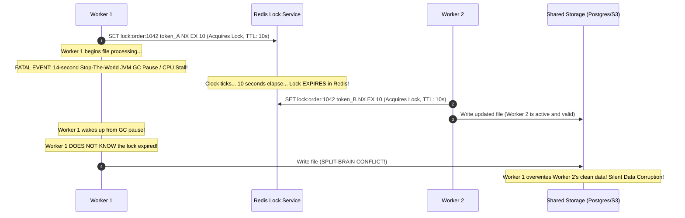
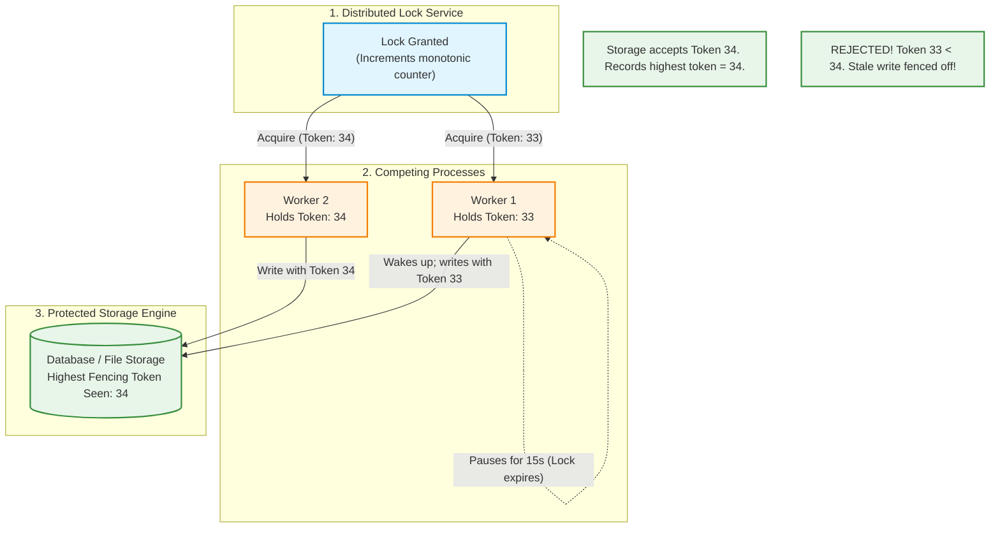
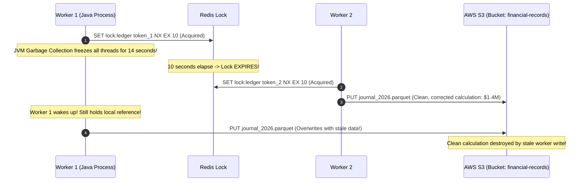

# Module 02: Distributed Locking

When scaling an application from a single process to a fleet of container replicas, in-process synchronization primitives (`sync.Mutex`, `threading.Lock`, or Java's `synchronized`) become completely ineffective. An in-memory mutex only coordinates threads sharing the same process address space; it has zero visibility into concurrent workers running on separate containers or physical servers. If multiple microservices must guarantee that only one node executes a critical operation at a time—such as generating a sequential invoice, draining a shared payment queue, or running a nightly reconciliation—they require **Distributed Locking**. However, distributed locks are notoriously prone to subtle, high-severity bugs: orphaned locks from unexpected crashes, accidental lock releases from expired TTLs, and catastrophic split-brain writes caused by garbage collection pauses.

> [!TIP]
> **The Golden Rule:** For efficiency locks, acquire with atomic `SET key uuid NX EX ttl` and release exclusively via an atomic Lua script verifying ownership; for correctness locks, the protected resource MUST enforce monotonically increasing Fencing Tokens to reject writes from paused or expired lock holders.

---

## 1. Visual Mental Models

### The Stop-the-World Pause & The Dual-Writer Catastrophe

Even with an explicit TTL, a distributed lock cannot prevent split-brain execution if a process pauses (due to garbage collection, virtual machine migration, or disk I/O):



### The Fencing Token Defense Architecture

Because the lock service cannot stop an expired worker from transmitting across a network socket, the destination resource itself must enforce mutual exclusion using a monotonically increasing **Fencing Token**:



---

## 2. Structured Reference Grids

### Distributed Locking Technology Comparison

| Technology | Primitives | Failover Safety | Performance | Ideal Use Case |
| :--- | :--- | :--- | :--- | :--- |
| **Redis (Single Node)** | `SET key token NX EX ttl` + Lua release | Low (Lost on unpersisted crash) | **Ultra Fast (< 1ms)** | Short-lived operational efficiency locks (e.g. cache rebuilding) |
| **PostgreSQL Advisory Locks** | `pg_try_advisory_lock(key)` | **High (Strict ACID transactional bound)**| Fast (1–5ms) | Business-critical operations where PostgreSQL is already the primary DB |
| **etcd / Consul** | Distributed Leases + Raft Consensus | **Highest (Tolerates minority node failures)**| Moderate (5–15ms) | Long-lived leader election, microservice cluster topology |
| **ZooKeeper** | Ephemeral Sequential znodes | **Highest (Native monotonic fencing tokens)** | Moderate (5–15ms) | Big data platforms (Kafka, Hadoop, Cassandra coordination) |

### Efficiency Locks vs. Correctness Locks

| Dimension | Efficiency Lock | Correctness Lock |
| :--- | :--- | :--- |
| **Primary Objective** | Avoid duplicate, redundant, or expensive computation | Guarantee data integrity, prevent double-spending or file corruption |
| **Impact of Split-Brain Failure** | Minor: Duplicate work performed (e.g., two workers warm the same cache) | **Catastrophic**: Corrupted databases, duplicate bank charges, lost files |
| **Required Mechanism** | Simple Redis `SETNX` with TTL | Redis lock **PLUS Fencing Tokens** enforced at the storage engine |
| **Typical Workload** | Nightly sitemap generation, video thumbnail extraction | Debit card balance withdrawal, warehouse inventory reserve |

---

## 3. Production War Story

### The 14-Second JVM Garbage Collection & The $1.4M S3 File Overwrite

#### The Incident
A distributed analytics engine processed financial ledger transactions in 10-minute batches. To prevent concurrent runs, the team implemented a Redis lock:
```bash
SET lock:batch:2026-11 token_123 NX EX 10
```
During an end-of-quarter calculation, Worker 1 acquired the lock. Halfway through compiling the final $1.4M journal entry, Worker 1 suffered a major 14-second Stop-The-World JVM garbage collection pause. Because the lock TTL was 10 seconds, Redis cleanly expired the key. Worker 2 noticed the key was vacant, acquired the lock, processed the corrected journal entry, and successfully uploaded `journal_final.parquet` to AWS S3. Seconds later, Worker 1 completed its GC pause. Believing it was still the legitimate lock holder, Worker 1 uploaded its stale, uncorrected calculation to S3, overwriting the clean file and corrupting the financial database.



#### The Root Cause
1. **Unchecked Lock Expiry:** Worker 1 performed an external write without verifying whether its lock lease had expired during processing.
2. **Missing Fencing Tokens:** S3 has no native version comparison during standard `PUT` operations; the storage layer blindly accepted the older write.

#### The Verified Production Fix
1. Shifted lock coordination to PostgreSQL Advisory Locks coupled with an incrementing integer `fencing_token`.
2. Storage writes enforce an atomic conditional update:
   ```sql
   UPDATE financial_ledger 
   SET data = :payload, fencing_token = :current_token 
   WHERE batch_id = :id AND fencing_token < :current_token;
   ```
3. If a stale worker attempts to write after being delayed, PostgreSQL detects that `fencing_token` has already advanced and discards the write.

---

## 4. Multi-Language Production Implementations

### Go (`go-redsync/redsync/v4` with Heartbeat Auto-Extension)

```go
package main

import (
	"context"
	"fmt"
	"log"
	"time"

	"github.com/go-redsync/redsync/v4"
	"github.com/go-redsync/redsync/v4/redis/goredis/v9"
	"github.com/redis/go-redis/v9"
)

type DistributedMutexManager struct {
	rs *redsync.Redsync
}

func NewMutexManager(redisAddr string) *DistributedMutexManager {
	client := redis.NewClient(&redis.Options{Addr: redisAddr})
	pool := goredis.NewPool(client)
	return &DistributedMutexManager{
		rs: redsync.New(pool),
	}
}

func (m *DistributedMutexManager) ExecuteWithLock(ctx context.Context, resourceName string, action func() error) error {
	// Configure mutex with 10s TTL and fast retry
	mutex := m.rs.NewMutex(
		resourceName,
		redsync.WithExpiry(10*time.Second),
		redsync.WithTries(3),
		redsync.WithRetryDelay(200*time.Millisecond),
	)

	// 1. Acquire Lock
	if err := mutex.LockContext(ctx); err != nil {
		return fmt.Errorf("failed to acquire distributed lock for %s: %w", resourceName, err)
	}

	// 2. Background Watchdog Ticker (Extends TTL for long-running work)
	stopHeartbeat := make(chan struct{})
	defer close(stopHeartbeat)

	go func() {
		ticker := time.NewTicker(3 * time.Second)
		defer ticker.Stop()
		for {
			select {
			case <-ticker.C:
				ok, err := mutex.Extend()
				if !ok || err != nil {
					log.Printf("[Warning] Failed to extend lock lease: %v", err)
					return
				}
			case <-stopHeartbeat:
				return
			}
		}
	}()

	// 3. Guaranteed Safe Release
	defer func() {
		if ok, err := mutex.Unlock(); !ok || err != nil {
			log.Printf("[Error] Failed to release distributed lock: %v", err)
		}
	}()

	// 4. Execute Protected Critical Section
	log.Printf("[Lock] Acquired mutual exclusion for %s", resourceName)
	return action()
}
```

---

### Node.js / TypeScript (Atomic Lua Script Release + Fencing Token)

```typescript
import IORedis from 'ioredis';
import { v4 as uuidv4 } from 'uuid';

const redis = new IORedis('redis://127.0.0.1:6379');

// Lua script guarantees atomic comparison and release
const RELEASE_LOCK_LUA = `
  if redis.call("get", KEYS[1]) == ARGV[1] then
    return redis.call("del", KEYS[1])
  else
    return 0
  end
`;

export class DistributedLock {
  private key: string;
  private token: string;
  private ttlSeconds: number;

  constructor(resource: string, ttlSeconds = 15) {
    this.key = `lock:${resource}`;
    this.token = uuidv4(); // Unique ownership token
    this.ttlSeconds = ttlSeconds;
  }

  async acquire(): Promise<boolean> {
    // Atomic SET if Not Exists with Expiry
    const result = await redis.set(this.key, this.token, 'EX', this.ttlSeconds, 'NX');
    return result === 'OK';
  }

  async release(): Promise<boolean> {
    // Execute atomic Lua script
    const result = await redis.eval(RELEASE_LOCK_LUA, 1, this.key, this.token);
    return result === 1;
  }

  async getFencingToken(): Promise<number> {
    // Increment global monotonic counter for resource
    return await redis.incr(`fencing_counter:${this.key}`);
  }
}

// Usage Example
export async function runExclusiveTask() {
  const lock = new DistributedLock('nightly-settlement', 30);
  const acquired = await lock.acquire();

  if (!acquired) {
    console.log('[Lock Busy] Another node is executing nightly settlement. Skipping.');
    return;
  }

  try {
    const fencingToken = await lock.getFencingToken();
    console.log(`[Lock Acquired] Running task with Monotonic Fencing Token: ${fencingToken}`);
    
    // Critical Section: Pass fencingToken to database query
    // await db.query('UPDATE ledgers SET balance = $1 WHERE fencing_token < $2', [bal, fencingToken]);
  } finally {
    const released = await lock.release();
    console.log(`[Lock Released] Ownership verified: ${released}`);
  }
}
```

---

### Python (`redis-py` Context Manager with Atomic Lua & Postgres Alternative)

```python
import uuid
import time
import redis
from contextlib import contextmanager

redis_client = redis.Redis(host='127.0.0.1', port=6379, db=0)

# Atomic Lua release script
RELEASE_LUA = """
if redis.call("get", KEYS[1]) == ARGV[1] then
    return redis.call("del", KEYS[1])
else
    return 0
end
"""

@contextmanager
def distributed_lock(resource_name: str, ttl_seconds: int = 10, acquire_timeout: float = 2.0):
    lock_key = f"lock:{resource_name}"
    owner_token = str(uuid.uuid4())
    deadline = time.time() + acquire_timeout
    acquired = False

    try:
        # Acquire loop with backoff
        while time.time() < deadline:
            if redis_client.set(lock_key, owner_token, nx=True, ex=ttl_seconds):
                acquired = True
                break
            time.sleep(0.05) # 50ms polling delay

        if not acquired:
            raise TimeoutError(f"Could not acquire distributed lock for {resource_name}")

        print(f"[Lock Acquired] Resource: {resource_name} (Owner: {owner_token[:8]})")
        yield owner_token

    finally:
        if acquired:
            # Atomic release: only delete if owner_token still matches!
            result = redis_client.eval(RELEASE_LUA, 1, lock_key, owner_token)
            if result == 1:
                print(f"[Lock Released] Successfully released {resource_name}")
            else:
                print(f"[Lock Warning] Lock {resource_name} expired before release; skipped deletion.")

# ==============================================================================
# PostgreSQL Advisory Lock Alternative (Strong ACID Consistency)
# ==============================================================================
def execute_with_postgres_advisory_lock(conn, lock_id: int, action_fn):
    """
    PostgreSQL session-level advisory lock.
    Guaranteed clean release upon connection close/network drop!
    """
    cursor = conn.cursor()
    # 64-bit integer lock namespace
    cursor.execute("SELECT pg_try_advisory_lock(%s);", (lock_id,))
    acquired = cursor.fetchone()[0]

    if not acquired:
        print("[Postgres Lock] Another transaction holds lock. Skipping.")
        return False

    try:
        action_fn()
        return True
    finally:
        cursor.execute("SELECT pg_advisory_unlock(%s);", (lock_id,))
```

---

## 5. Practical Hands-On Verification

### 1. Test Atomic Lock Acquisition via Redis CLI

Terminal 1: Acquire lock for 30 seconds:
```bash
redis-cli SET lock:order:8901 "worker_node_alpha" NX EX 30
```

**Output:**
```text
OK
```

Terminal 2: Attempt concurrent acquisition while Terminal 1 holds lock:
```bash
redis-cli SET lock:order:8901 "worker_node_beta" NX EX 30
```

**Output:**
```text
(nil)
```
*(Mutual exclusion holds: Terminal 2 receives `(nil)` and cannot execute).*

### 2. Verify Atomic Lua Script Safe Release

Execute atomic Lua release script to ensure you cannot delete someone else's expired lock:

```bash
# Correct Token Matches
redis-cli EVAL "if redis.call('get', KEYS[1]) == ARGV[1] then return redis.call('del', KEYS[1]) else return 0 end" 1 lock:order:8901 "worker_node_alpha"
```
**Output:** `(integer) 1` *(Successfully deleted).*

```bash
# Wrong Token (Simulating Stale Release after Expiry)
redis-cli EVAL "if redis.call('get', KEYS[1]) == ARGV[1] then return redis.call('del', KEYS[1]) else return 0 end" 1 lock:order:8901 "wrong_stale_token"
```
**Output:** `(integer) 0` *(Refused: Key is preserved, protecting peer worker).*

---

## 6. Operational Validation Checkpoints

<details>
<summary><strong>Checkpoint 1: The Unconditional `DEL` Stale Release Disaster</strong></summary>

**Scenario:** A developer writes a distributed lock:
```python
def release_lock(key):
    redis.delete(key) # Unconditional DEL!
```
Worker A acquires the lock for 10 seconds. It encounters a slow query and takes 12 seconds. At 10 seconds, the lock expires in Redis. Worker B acquires the lock. At 12 seconds, Worker A finishes and calls `release_lock(key)`. What happens next?

*Explanation:*
Worker A deletes the lock key that is **currently held by Worker B**. Now, the lock key is completely empty. Worker C immediately acquires the lock while Worker B is actively running. You now have two concurrent processes running the critical section simultaneously.
**The Fix:** Always release locks using an atomic Lua script that compares the stored token against the worker's unique UUID before deleting.
</details>

<details>
<summary><strong>Checkpoint 2: The Redlock Algorithm & Physical Clock Drift Flaw</strong></summary>

**Scenario:** A company deploys the multi-node Redlock algorithm across 5 Redis nodes. System administrators configure NTP time synchronization. On Node 3, the hardware clock experiences a sudden 2-second forward leap. Why does this invalidate Redlock's safety?

*Explanation:*
Redlock calculates lock validity by subtracting elapsed time from TTL: $\text{validity} = \text{TTL} - (\text{now} - \text{start})$.
If a physical clock leaps forward, the node believes the lock expired much earlier than it actually did, permitting another worker to acquire the same lock on a quorum of nodes.
**The Principle:** In asynchronous distributed networks, never rely on physical wall-clock time for correctness. Use **logical clocks or monotonically increasing fencing tokens**.
</details>

<details>
<summary><strong>Checkpoint 3: PostgreSQL Transaction-Level vs. Session-Level Advisory Locks</strong></summary>

**Scenario:** You use PostgreSQL advisory locks for distributed mutual exclusion. A worker acquires `pg_advisory_lock(1001)` inside an open database transaction. During a network blip, the transaction rolls back, but the application connection pool keeps the underlying TCP connection open to reuse for other requests. Does the lock release?

*Explanation:*
No! `pg_advisory_lock` is a **session-level lock**—it lives until explicitly released or until the physical database connection closes. Reusing that pooled connection leaves the lock held forever, deadlocking other workers.
**The Fix:** For operations bound to database transactions, use `pg_advisory_xact_lock(1001)`. Transaction-level advisory locks **automatically release the microsecond the transaction commits or rolls back**, guaranteeing zero lock leaks.
</details>

---

## Next

[03-distributed-transactions-and-two-phase-commit](../03-distributed-transactions-and-two-phase-commit/README.md)
— locks coordinate access to a single shared resource; the next problem is bigger:
how do you make a change that spans *multiple* independent services or databases
happen atomically — all commit or all abort? The next module examines two-phase
commit, the coordinator it requires, why it scales poorly, and — crucially — when
you actually need it versus when you're about to reach for the saga pattern
instead.
