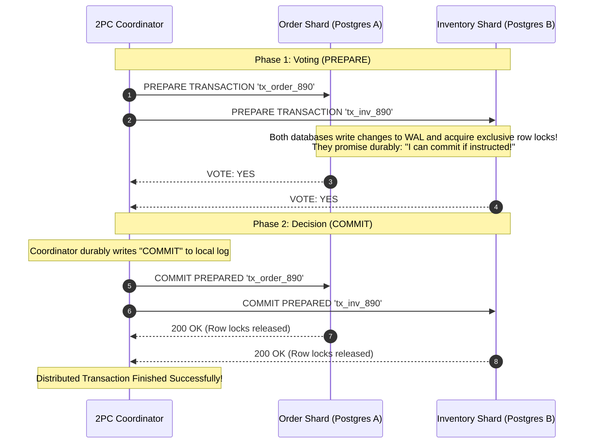
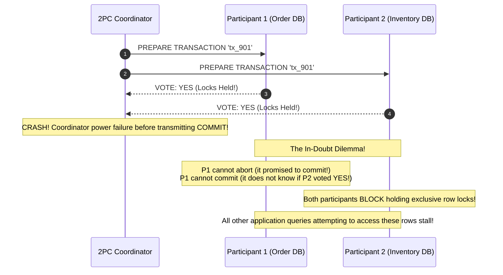
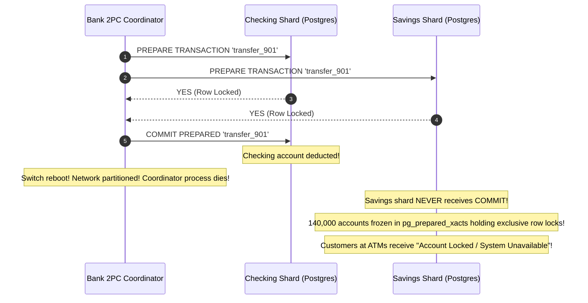

# Module 03: Distributed Transactions and Two-Phase Commit

In a single relational database, atomicity is a solved engineering problem: you wrap statements in `BEGIN ... COMMIT`, and the database engine's Write-Ahead Log (WAL) guarantees that either every update commits or all changes roll back. However, modern architectures distribute data across multiple databases, cloud storage buckets, third-party payment gateways, and independent microservices. There is no native `BEGIN` statement that can atomically wrap a debit in PostgreSQL, a payment capture in Stripe, and an inventory reservation in MongoDB. **Two-Phase Commit (2PC)** is the classic protocol designed to achieve atomic consensus across heterogeneous databases. Understanding its mechanics—and its fatal scalability bottlenecks—is essential for designing high-throughput distributed systems.

> [!TIP]
> **The Golden Rule:** Avoid Two-Phase Commit across network boundaries whenever possible; 2PC is a blocking protocol that holds locks across network round-trips and freezes participants if the coordinator dies. Restructure data into a single local database transaction or adopt eventual consistency with Sagas and the Transactional Outbox Pattern.

---

## 1. Visual Mental Models

### The Two-Phase Commit (2PC) Protocol Flow

A central Coordinator manages participants across two discrete phases: Voting (Prepare) and Decision (Commit/Abort):



### The In-Doubt Coordinator Crash Block

If the coordinator crashes during Phase 2, participants are stranded in the **In-Doubt state**, holding row locks indefinitely because they cannot unilaterally commit or abort:



---

## 2. Structured Reference Grids

### Distributed Consistency Patterns Comparison

| Architecture | Consistency Model | Performance / Throughput | Fault Tolerance | Complexity |
| :--- | :--- | :--- | :--- | :--- |
| **Two-Phase Commit (2PC / XA)** | **Strict Immediate Consistency** | **Very Poor** (Locks held across network) | **Blocking** (Stalls if coordinator crashes) | Low in theory, brutal in operations |
| **Saga Pattern (Orchestrated)** | **Eventual Consistency** | **High** (Local locks held for microseconds)| Non-blocking; recovers via compensations | Moderate (Requires reversal logic) |
| **Transactional Outbox + CDC** | **Eventual Consistency** | **Very High** (Asynchronous event stream) | Highly resilient; at-least-once delivery | Low to Moderate |
| **Dual Writes (Anti-Pattern)** | **None (Corrupted)** | Deceptively fast | **Catastrophic** (Partial writes leave data desynced) | Naive implementation |

### PostgreSQL Two-Phase Commit Wire Commands

| SQL Command | 2PC Phase | Action Taken | Lock Behavior |
| :--- | :--- | :--- | :--- |
| `BEGIN; ... PREPARE TRANSACTION 'gid';` | **Phase 1** | Flushes WAL, validates constraints, detaches transaction from current session | **Exclusive row locks retained** on database engine |
| `COMMIT PREPARED 'gid';` | **Phase 2** | Finalizes the transaction; writes commit record | Releases all retained row locks |
| `ROLLBACK PREPARED 'gid';` | **Phase 2** | Discards all changes recorded in prepared state | Releases all retained row locks |
| `SELECT * FROM pg_prepared_xacts;` | **Audit** | Inspects in-doubt orphaned prepared transactions | Allows DBAs to find stuck locks |

---

## 3. Production War Story

### The Network Partition That Locked 140,000 Accounts in 2PC Limbo

#### The Incident
A European retail bank operated an internal cross-shard transfer system using 2PC across two PostgreSQL database clusters (Checking Accounts and Savings Accounts). During a routine data center maintenance window, a core network switch severed connectivity between the coordinator service and the Savings Account database shard. The coordinator successfully received `YES` votes from both shards, sent `COMMIT PREPARED` to the Checking shard, and crashed before transmitting the commit frame to the Savings shard. The Savings shard remained in the `PREPARED` state for 140,000 concurrent transfers. Because 2PC is a **blocking protocol**, exclusive row locks were held on all 140,000 savings accounts. Every subsequent ATM withdrawal, debit card charge, and web login attempting to access those accounts blocked indefinitely, resulting in a 9-hour banking blackout.



#### The Root Cause
1. **Blocking Protocol Vulnerability:** In 2PC, once a participant votes `YES`, it surrenders its autonomy. It cannot abort because the coordinator may have already committed elsewhere; it cannot commit without instructions.
2. **Lock Amplification:** The prepared transactions held row-level locks on the accounts table for 9 hours until DBAs manually scripted `ROLLBACK PREPARED` and `COMMIT PREPARED` commands.

#### The Verified Production Fix
1. Completely removed 2PC from the banking microservices architecture.
2. Restructured the transfer into an asynchronous **Saga with Local Transactions**:
   - Step 1: Deduct from Checking (Commits locally in 5ms).
   - Step 2: Asynchronous transfer message published via Transactional Outbox.
   - Step 3: Credit Savings (Commits locally in 5ms).
3. If Step 3 fails permanently, a compensating transaction credits the money back to Checking. Account locks are held for milliseconds rather than hours.

---

## 4. Multi-Language Production Implementations

### Go (PostgreSQL Two-Phase Commit Coordinator with Recovery Audit)

```go
package main

import (
	"context"
	"database/sql"
	"fmt"
	"log"

	_ "github.com/lib/pq"
)

type TwoPhaseCoordinator struct {
	dbShardA *sql.DB
	dbShardB *sql.DB
}

func NewTwoPhaseCoordinator(dsnA, dsnB string) (*TwoPhaseCoordinator, error) {
	a, err := sql.Open("postgres", dsnA)
	if err != nil {
		return nil, err
	}
	b, err := sql.Open("postgres", dsnB)
	if err != nil {
		return nil, err
	}
	return &TwoPhaseCoordinator{dbShardA: a, dbShardB: b}, nil
}

// ExecuteAtomicTransfer runs a complete 2PC protocol across 2 Postgres instances
func (c *TwoPhaseCoordinator) ExecuteAtomicTransfer(ctx context.Context, txGID string, fromAcc, toAcc int, amount float64) error {
	log.Printf("[2PC Coordinator] Initiating 2PC for Global ID: %s", txGID)

	// ========================================================
	// Phase 1: Prepare (Voting)
	// ========================================================
	// Prepare Shard A (Debit)
	_, errA := c.dbShardA.ExecContext(ctx, fmt.Sprintf(`
		BEGIN;
		UPDATE accounts SET balance = balance - %f WHERE id = %d;
		PREPARE TRANSACTION '%s_a';
	`, amount, fromAcc, txGID))

	if errA != nil {
		log.Printf("[2PC] Shard A voted NO or failed. Aborting.")
		return fmt.Errorf("shard A prepare failed: %w", errA)
	}

	// Prepare Shard B (Credit)
	_, errB := c.dbShardB.ExecContext(ctx, fmt.Sprintf(`
		BEGIN;
		UPDATE accounts SET balance = balance + %f WHERE id = %d;
		PREPARE TRANSACTION '%s_b';
	`, amount, toAcc, txGID))

	if errB != nil {
		log.Printf("[2PC] Shard B voted NO. Executing Phase 2 ROLLBACK...")
		// Rollback prepared transaction on Shard A
		c.dbShardA.ExecContext(context.Background(), fmt.Sprintf("ROLLBACK PREPARED '%s_a';", txGID))
		return fmt.Errorf("shard B prepare failed; rolled back shard A: %w", errB)
	}

	// ========================================================
	// Phase 2: Decision (Both Voted YES -> COMMIT)
	// ========================================================
	log.Printf("[2PC] Both shards voted YES. Committing prepared transactions...")
	
	if _, err := c.dbShardA.ExecContext(ctx, fmt.Sprintf("COMMIT PREPARED '%s_a';", txGID)); err != nil {
		log.Printf("[CRITICAL] Shard A commit prepared failed! Requires manual recovery: %v", err)
	}
	if _, err := c.dbShardB.ExecContext(ctx, fmt.Sprintf("COMMIT PREPARED '%s_b';", txGID)); err != nil {
		log.Printf("[CRITICAL] Shard B commit prepared failed! Requires manual recovery: %v", err)
	}

	log.Printf("[2PC] Global transaction %s successfully committed on all shards.", txGID)
	return nil
}

// AuditInDoubtTransactions checks pg_prepared_xacts for stuck locks
func (c *TwoPhaseCoordinator) AuditInDoubtTransactions(ctx context.Context) {
	rows, err := c.dbShardA.QueryContext(ctx, "SELECT gid, prepared, owner FROM pg_prepared_xacts;")
	if err != nil {
		log.Printf("Failed to query prepared transactions: %v", err)
		return
	}
	defer rows.Close()

	for rows.Next() {
		var gid, prepared, owner string
		rows.Scan(&gid, &prepared, &owner)
		log.Printf("[ALERT] Orphaned Prepared Transaction Detected: GID=%s, PreparedAt=%s", gid, prepared)
	}
}
```

---

### Node.js / TypeScript (Two-Phase Commit Orchestrator)

```typescript
import { Client } from 'pg';

export async function executeTwoPhaseCommit(
  clientA: Client,
  clientB: Client,
  txId: string,
  fromId: number,
  toId: number,
  amount: number
): Promise<void> {
  const gidA = `tx_${txId}_shard_a`;
  const gidB = `tx_${txId}_shard_b`;

  console.log(`[2PC Orchestrator] Starting Phase 1: Prepare for ${txId}`);

  let preparedA = false;
  let preparedB = false;

  try {
    // 1. Prepare Participant A
    await clientA.query('BEGIN;');
    await clientA.query('UPDATE accounts SET balance = balance - $1 WHERE id = $2', [amount, fromId]);
    await clientA.query(`PREPARE TRANSACTION '${gidA}';`);
    preparedA = true;
    console.log('[2PC] Shard A prepared successfully (Vote: YES)');

    // 2. Prepare Participant B
    await clientB.query('BEGIN;');
    await clientB.query('UPDATE accounts SET balance = balance + $1 WHERE id = $2', [amount, toId]);
    await clientB.query(`PREPARE TRANSACTION '${gidB}';`);
    preparedB = true;
    console.log('[2PC] Shard B prepared successfully (Vote: YES)');
  } catch (err) {
    console.error('[2PC Phase 1 Failed] Rolling back all prepared participants...');
    if (preparedA) await clientA.query(`ROLLBACK PREPARED '${gidA}';`).catch(console.error);
    if (preparedB) await clientB.query(`ROLLBACK PREPARED '${gidB}';`).catch(console.error);
    throw err;
  }

  // Phase 2: Commit Decision
  console.log('[2PC Orchestrator] Starting Phase 2: Commit');
  await clientA.query(`COMMIT PREPARED '${gidA}';`);
  await clientB.query(`COMMIT PREPARED '${gidB}';`);
  console.log(`[2PC Success] Transaction ${txId} committed on all databases.`);
}
```

---

### Python (`psycopg` Two-Phase Commit Transaction Manager)

```python
import psycopg
from psycopg import errors

def run_distributed_transfer(conn_str_a: str, conn_str_b: str, tx_id: str, amount: float):
    gid_a = f"tx_{tx_id}_debit"
    gid_b = f"tx_{tx_id}_credit"

    conn_a = psycopg.connect(conn_str_a, autocommit=True)
    conn_b = psycopg.connect(conn_str_b, autocommit=True)

    print(f"[2PC] Beginning Phase 1 (Prepare) for GID: {tx_id}")
    
    # 1. Prepare Participant A
    try:
        with conn_a.cursor() as cur:
            cur.execute("BEGIN;")
            cur.execute("UPDATE checking SET balance = balance - %s WHERE user_id = 101;", (amount,))
            cur.execute(f"PREPARE TRANSACTION '{gid_a}';")
        print("[2PC] Shard A prepared (Voted YES)")
    except Exception as e:
        print(f"[2PC] Shard A failed prepare: {e}")
        return False

    # 2. Prepare Participant B
    try:
        with conn_b.cursor() as cur:
            cur.execute("BEGIN;")
            cur.execute("UPDATE savings SET balance = balance + %s WHERE user_id = 101;", (amount,))
            cur.execute(f"PREPARE TRANSACTION '{gid_b}';")
        print("[2PC] Shard B prepared (Voted YES)")
    except Exception as e:
        print(f"[2PC] Shard B failed prepare: {e}. Executing Phase 2 ROLLBACK on Shard A.")
        with conn_a.cursor() as cur:
            cur.execute(f"ROLLBACK PREPARED '{gid_a}';")
        return False

    # 3. Phase 2 Commit Decision
    print("[2PC] Phase 2: Committing prepared transactions on all shards...")
    with conn_a.cursor() as cur:
        cur.execute(f"COMMIT PREPARED '{gid_a}';")
    with conn_b.cursor() as cur:
        cur.execute(f"COMMIT PREPARED '{gid_b}';")
        
    print(f"[2PC] Successfully committed transfer {tx_id} across shards.")
    return True
```

---

## 5. Practical Hands-On Verification

### 1. Execute Two-Phase Commit Manually in PostgreSQL

Open a psql terminal to inspect prepared transaction states:

```sql
-- Session 1: Initiate and Prepare
BEGIN;
UPDATE accounts SET balance = balance - 100 WHERE id = 1;
PREPARE TRANSACTION 'tx_test_manual_101';
```

**Output:**
```text
PREPARE TRANSACTION
```
*(Notice that Session 1 can now close; the database holds the lock and state durably in its WAL).*

### 2. Inspect In-Doubt Prepared Transactions via SQL

In another terminal, query the prepared transactions table:

```sql
SELECT gid, prepared, owner, database FROM pg_prepared_xacts;
```

**Output:**
```text
          gid          |           prepared            |  owner   | database 
-----------------------+-------------------------------+----------+----------
 tx_test_manual_101    | 2026-11-09 16:45:10.14201+00 | postgres | banking
```

### 3. Finalize the Commit

```sql
COMMIT PREPARED 'tx_test_manual_101';
```

**Output:**
```text
COMMIT PREPARED
```
*(Row locks are finally released and changes are visible to standard `SELECT` queries).*

---

## 6. Operational Validation Checkpoints

<details>
<summary><strong>Checkpoint 1: The `max_prepared_transactions` Configuration Trap</strong></summary>

**Scenario:** A development team deploys 2PC to production. On the first morning of high load, the database starts throwing `ERROR: prepared transactions are disabled` and crashes transactions. Why?

*Explanation:*
In PostgreSQL, support for prepared transactions is disabled by default (`max_prepared_transactions = 0`). If you intend to use 2PC, you must set `max_prepared_transactions` to a value at least equal to `max_connections` in `postgresql.conf` and restart the server.
**Warning:** Setting this parameter allows transactions to hold locks outside of active client connections; if an application coordinator fails to commit or abort prepared transactions, the table locks persist until manual DBA intervention.
</details>

<details>
<summary><strong>Checkpoint 2: The Multi-Hop Latency Amplification Trap</strong></summary>

**Scenario:** A company splits its monolith into 4 microservices (Users, Orders, Inventory, Payments). They coordinate checkout using a 2PC coordinator over the internet. The average latency jumps from 15ms to 850ms, and peak database connection pools exhaust immediately. Why?

*Explanation:*
2PC requires a minimum of **2 sequential network round-trips to every single participant**:
1. Coordinator sends `PREPARE` $\longrightarrow$ waits for 4 HTTP/DB round trips.
2. Coordinator evaluates votes $\longrightarrow$ sends `COMMIT` $\longrightarrow$ waits for 4 HTTP/DB round trips.
Because row locks are held on all 4 databases for the entire 850ms duration, concurrent transactions queue up, exhausting connection pools.
**The Principle:** Never run 2PC across independent microservices over high-latency networks.
</details>

<details>
<summary><strong>Checkpoint 3: Sagas vs. 2PC Selection Criteria</strong></summary>

**Scenario:** An architect asks: *"When is 2PC actually the right choice over Sagas and Eventual Consistency?"* What is the strict technical criteria?

*Explanation:*
2PC is justified only when:
1. **Strict Immediate Atomicity is legally or financially mandatory** (e.g. money cannot exist in a transit state even for 1 second).
2. All participants are **databases within the same local data center LAN** (latency $< 1\text{ms}$) that natively support XA / 2PC.
3. No third-party APIs (Stripe, Twilio, Shipping) are involved (external APIs cannot vote in 2PC).
In virtually all other scenarios, use the **Saga Pattern** or the **Transactional Outbox Pattern**.
</details>

---

## Next

[04-the-saga-pattern](../04-the-saga-pattern/README.md) — you now understand why
strict cross-system atomicity is expensive, fragile, and usually the wrong tool.
The saga pattern is what high-throughput systems reach for instead: model the
distributed operation as a *sequence of local transactions*, each committing
independently, and when a later step fails, run **compensating transactions** to
semantically undo the earlier ones. The next module builds real choreographed and
orchestrated sagas — the order/payment/inventory checkout you just diagnosed as a
2PC failure — and shows how idempotency (module 01) and locking (module 02) combine
to make them correct.
