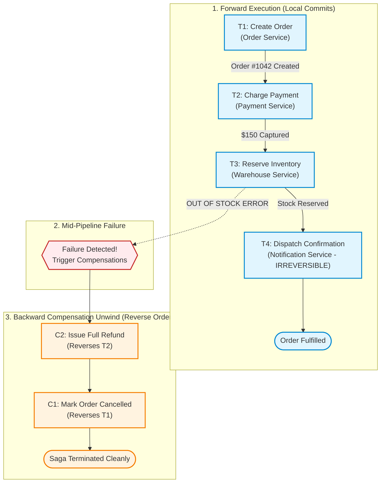
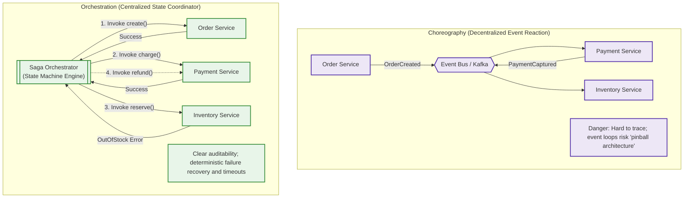
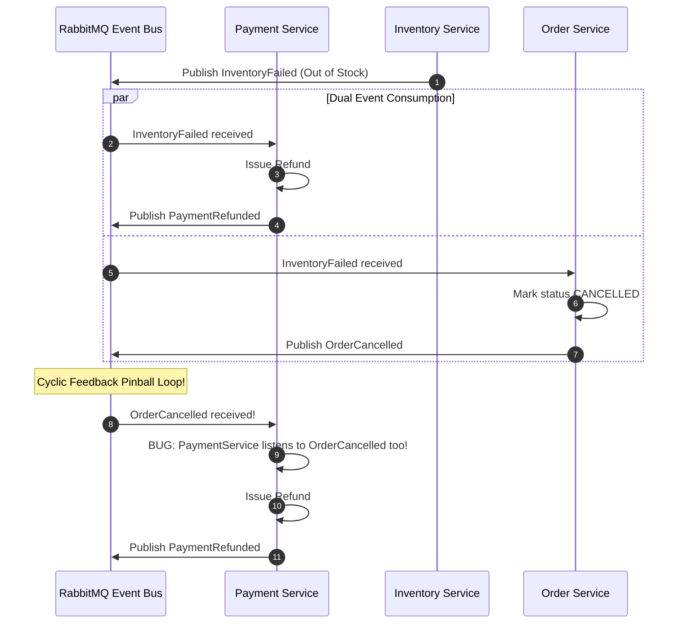

# Module 04: The Saga Pattern

When business transactions span multiple microservices—such as charging a credit card, reserving warehouse inventory, and creating a shipping manifest—Two-Phase Commit (2PC) proves too fragile, synchronous, and slow for high-throughput cloud architectures. The industry-standard alternative is the **Saga Pattern**. Instead of coordinating a single atomic commit across all participants, a Saga decomposes a distributed workflow into a **sequence of local transactions** ($T_1, T_2, \dots, T_n$), where each step commits immediately in its local database. If a downstream step fails, the system triggers a series of **compensating transactions** ($C_{n-1}, \dots, C_1$) in reverse order to semantically undo earlier modifications and restore eventual consistency.

> [!TIP]
> **The Golden Rule:** Decompose distributed business workflows into sequential local transactions paired with idempotent semantic compensating actions executed in reverse order on failure. Always position non-compensable (irreversible) actions as the final step in the saga.

---

## 1. Visual Mental Models

### Forward Progression vs. Backward Compensating Unwind

A Saga ensures that a mid-pipeline failure walks the system back to a clean, consistent business state:



### Choreography (Event-Driven Pinball) vs. Orchestration (Centralized Brain)

Choosing between Choreography and Orchestration is the defining architectural decision in Saga design:



---

## 2. Structured Reference Grids

### Saga Coordination Paradigms Comparison

| Evaluation Metric | Choreography (Event-Driven) | Orchestration (Command-Driven) |
| :--- | :--- | :--- |
| **Coordination Style** | Decentralized: Services react to domain events | Centralized: Orchestrator directs commands to workers |
| **Visibility & Observability** | Poor (Requires distributed tracing across spans) | **Excellent** (Saga state machine recorded in single DB) |
| **Service Coupling** | Low technical coupling, high semantic coupling | Services coupled to command schema, decoupled from each other |
| **Complexity Threshold** | Ideal for simple 2-step to 3-step flows | **Mandatory for $\ge 4$ steps or complex branching** |
| **Failure Debugging** | Difficult; prone to cyclic event loops | Straightforward; logs record current step and state |

### Transaction Steps Classification Taxonomy

| Step Type | Semantic Role | Compensatable? | Placement in Saga | Example Operation |
| :--- | :--- | :--- | :--- | :--- |
| **Compensatable Transaction** | Steps that can be semantically undone | **Yes** | Early steps ($T_1 \dots T_{k-1}$) | Charging a card (undone by refund), reserving stock |
| **Pivot Transaction** | The definitive point of business commitment | **No** (Once committed, saga *must* complete) | The hinge step ($T_k$) | Signing a contract, generating legal tax invoice |
| **Retriable Transaction** | Guaranteed to succeed eventually; retried | **No** (Forward recovery only) | Final steps ($T_{k+1} \dots T_n$) | Dispatching shipping label, sending receipt email |

---

## 3. Production War Story

### The Choreography Pinball Loop That Refunded $820,000 in Ghost Payments

#### The Incident
An online fashion marketplace implemented checkout using choreographed events via RabbitMQ. When an order was submitted, the `OrderService` published `OrderCreated`. The `PaymentService` charged the customer and published `PaymentProcessed`. The `InventoryService` attempted stock reservation. If an item was out of stock, it published `InventoryFailed`. Due to an uncoordinated refactoring, both the `PaymentService` and an external `RefundWorker` listened to `InventoryFailed` and `OrderCancelled`. When a flash sale for sneakers caused 1,200 out-of-stock events within 60 seconds, the services entered an infinite cyclic loop: `PaymentService` refunded the customer and published `PaymentRefunded`, which caused `OrderService` to publish `OrderCancelled`, which caused `RefundWorker` to issue a second refund. Over 3,400 customers received between 2 and 5 duplicate refunds, draining $820,000 from company merchant accounts.



#### The Root Cause
1. **Decentralized Spaghetti Logic:** In choreography, no single component understands the complete end-to-end business workflow.
2. **Missing Compensation Idempotency:** The refund handler did not check whether a refund for `order_id` had already been processed.

#### The Verified Production Fix
1. Abandoned choreography in favor of an **Orchestrated Saga** managed by an explicit state machine.
2. The orchestrator maintains a single source of truth table: `saga_instances (saga_id, state, current_step)`.
3. Compensations are executed in strict deterministic reverse sequence, with idempotency keys (`refund_{saga_id}`) preventing duplicate payouts.

---

## 4. Multi-Language Production Implementations

### Go (Robust Orchestrated Saga State Machine)

```go
package main

import (
	"context"
	"fmt"
	"log"
)

type StepAction func(ctx context.Context) error

type SagaStep struct {
	Name       string
	Execute    StepAction
	Compensate StepAction
}

type SagaOrchestrator struct {
	SagaID string
	steps  []SagaStep
}

func NewSaga(sagaID string) *SagaOrchestrator {
	return &SagaOrchestrator{SagaID: sagaID}
}

func (s *SagaOrchestrator) AddStep(name string, execute, compensate StepAction) {
	s.steps = append(s.steps, SagaStep{
		Name:       name,
		Execute:    execute,
		Compensate: compensate,
	})
}

// Run executes forward transactions, automatically rolling back on error
func (s *SagaOrchestrator) Run(ctx context.Context) error {
	var executedSteps []SagaStep

	log.Printf("[Saga %s] Starting execution...", s.SagaID)

	for _, step := range s.steps {
		log.Printf("[Saga %s] Executing forward step: %s", s.SagaID, step.Name)
		if err := step.Execute(ctx); err != nil {
			log.Printf("[Saga %s] Step '%s' FAILED: %v. Initiating rollback...", s.SagaID, step.Name, err)
			s.rollback(ctx, executedSteps)
			return fmt.Errorf("saga aborted at step %s: %w", step.Name, err)
		}
		executedSteps = append(executedSteps, step)
	}

	log.Printf("[Saga %s] All steps completed successfully.", s.SagaID)
	return nil
}

// rollback executes compensations in REVERSE order for completed steps
func (s *SagaOrchestrator) rollback(ctx context.Context, steps []SagaStep) {
	for i := len(steps) - 1; i >= 0; i-- {
		step := steps[i]
		if step.Compensate == nil {
			log.Printf("[Saga %s] Step '%s' has no compensation (Pivot/Read step).", s.SagaID, step.Name)
			continue
		}
		log.Printf("[Saga %s] Executing compensation for: %s", s.SagaID, step.Name)
		if err := step.Compensate(ctx); err != nil {
			log.Printf("[CRITICAL ERROR] Compensation '%s' failed! Alerting SRE: %v", step.Name, err)
			// In production, push to DLQ or retry queue
		}
	}
}
```

---

### Node.js / TypeScript (Saga Orchestration Engine)

```typescript
export interface SagaStepDefinition {
  name: string;
  forward: () => Promise<any>;
  compensate?: () => Promise<any>;
}

export class OrderSagaOrchestrator {
  private sagaId: string;
  private steps: SagaStepDefinition[] = [];

  constructor(sagaId: string) {
    this.sagaId = sagaId;
  }

  addStep(step: SagaStepDefinition) {
    this.steps.push(step);
    return this;
  }

  async execute(): Promise<void> {
    const executedSteps: SagaStepDefinition[] = [];
    console.log(`[Saga ${this.sagaId}] Commencing execution...`);

    for (const step of this.steps) {
      console.log(`[Saga ${this.sagaId}] Running Step: ${step.name}`);
      try {
        await step.forward();
        executedSteps.push(step);
      } catch (err: any) {
        console.error(`[Saga ${this.sagaId}] Error at ${step.name}: ${err.message}. Unwinding...`);
        await this.compensate(executedSteps);
        throw new Error(`Saga failed at ${step.name}: ${err.message}`);
      }
    }

    console.log(`[Saga ${this.sagaId}] Completed successfully.`);
  }

  private async compensate(executedSteps: SagaStepDefinition[]): Promise<void> {
    // Unwind in reverse order
    for (const step of executedSteps.reverse()) {
      if (step.compensate) {
        console.log(`[Saga ${this.sagaId}] Compensating Step: ${step.name}`);
        try {
          await step.compensate();
        } catch (compErr: any) {
          console.error(`[CRITICAL] Compensation failed for ${step.name}: ${compErr.message}`);
        }
      }
    }
  }
}
```

---

### Python (`FastAPI` State-Machine Saga Coordinator)

```python
import uuid
from typing import Callable, List

class SagaStep:
    def __init__(self, name: str, forward: Callable, compensate: Callable = None):
        self.name = name
        self.forward = forward
        self.compensate = compensate

class SagaCoordinator:
    def __init__(self, saga_id: str):
        self.saga_id = saga_id
        self.steps: List[SagaStep] = []
        self.executed_steps: List[SagaStep] = []

    def register_step(self, name: str, forward: Callable, compensate: Callable = None):
        self.steps.append(SagaStep(name, forward, compensate))

    def run(self):
        print(f"[Saga {self.saga_id}] Starting saga execution...")
        for step in self.steps:
            try:
                print(f"[Saga {self.saga_id}] Executing forward: {step.name}")
                step.forward()
                self.executed_steps.append(step)
            except Exception as exc:
                print(f"[Saga {self.saga_id}] Step {step.name} failed: {exc}. Rolling back...")
                self._rollback()
                raise

        print(f"[Saga {self.saga_id}] Saga successfully finalized.")

    def _rollback(self):
        for step in reversed(self.executed_steps):
            if step.compensate:
                print(f"[Saga {self.saga_id}] Compensating: {step.name}")
                try:
                    step.compensate()
                except Exception as comp_err:
                    print(f"[FATAL] Compensation failed for {step.name}: {comp_err}. Sending to dead-letter storage.")

# Example Usage
def create_order_saga(order_id: int, amount: float):
    saga = SagaCoordinator(f"saga_{order_id}")
    
    saga.register_step(
        name="ChargePayment",
        forward=lambda: print(f"Charged ${amount}"),
        compensate=lambda: print(f"Refunded ${amount}")
    )
    saga.register_step(
        name="ReserveStock",
        forward=lambda: (_ for _ in ()).throw(ValueError("Item Out of Stock!")), # Simulating failure
        compensate=lambda: print("Stock reservation released")
    )
    
    return saga
```

---

## 5. Practical Hands-On Verification

### 1. Test Saga Forward Success & Backward Compensation

Simulate execution and observed compensation unwinding in logs:

```python
# Test script triggering out-of-stock compensation
from coordinator import create_order_saga

saga = create_order_saga(order_id=9012, amount=199.50)
try:
    saga.run()
except Exception as e:
    print(f"Outcome: {e}")
```

**Output:**
```text
[Saga saga_9012] Starting saga execution...
[Saga saga_9012] Executing forward: ChargePayment
Charged $199.50
[Saga saga_9012] Executing forward: ReserveStock
[Saga saga_9012] Step ReserveStock failed: Item Out of Stock!. Rolling back...
[Saga saga_9012] Compensating: ChargePayment
Refunded $199.50
Outcome: saga aborted at step ReserveStock: Item Out of Stock!
```

---

## 6. Operational Validation Checkpoints

<details>
<summary><strong>Checkpoint 1: The "What If Compensation Fails?" Conundrum</strong></summary>

**Scenario:** Step 1 charges a credit card. Step 2 fails. The orchestrator calls Step 1's compensation (`refund()`), but the Stripe API returns a `503 Service Unavailable`. If the compensation throws an unhandled error, what happens?

*Explanation:*
A compensating transaction **cannot simply be abandoned**. If compensation fails, the system remains in a permanent, financially catastrophic inconsistent state (the customer was charged, but received no goods and no refund).
**The Rule:** Compensating transactions **must be idempotent and retried until they succeed**.
1. Wrap compensations in an exponential backoff retry loop.
2. If retries exhaust, write the failure record to a dedicated **Saga Dead-Letter Ledger** (`failed_compensations`) and trigger high-priority PagerDuty alerts for human operational intervention.
</details>

<details>
<summary><strong>Checkpoint 2: The Semantic Isolation Anomaly (Dirty Reads)</strong></summary>

**Scenario:** In a Saga, Step 1 updates an account balance from $1,000 to $500. While Step 2 is in-flight, an independent user query reads the balance as $500. Step 2 fails, and Step 1's compensation restores the balance back to $1,000. What distributed systems anomaly just occurred?

*Explanation:*
Sagas lack **Isolation (the 'I' in ACID)**. Because each local transaction commits immediately, intermediate states are visible to outside queries (**Dirty Reads**).
**The Mitigation:** Use **Semantic Locking (Pending States)**. Instead of mutating the definitive balance, update `balance = 500, status = 'PENDING_HOLD'`. External queries check the `status` flag and understand that the funds are reserved but not yet settled, preventing user confusion.
</details>

<details>
<summary><strong>Checkpoint 3: The Irreversible Action Ordering Trap</strong></summary>

**Scenario:** A junior developer structures an order saga:
1. `Charge Payment`
2. `Send Confirmation Email ("Your order has shipped!")`
3. `Reserve Inventory`
Step 3 fails because the item is out of stock. The saga refunds the payment, but the customer already received an email claiming their order shipped. How do you resolve this?

*Explanation:*
An email cannot be unsent. Physical shipments, printed labels, and emails are **Irreversible (Non-Compensatable) Actions**.
**The Invariant:** Irreversible actions must **always be placed as the final Pivot/Retriable step** in the saga. Never execute an irreversible action while compensatable steps remain pending downstream.
</details>

---

## Next

[05-cqrs](../05-cqrs/README.md) — sagas coordinate *writes* across services, and a
recurring theme has been that reads and writes want different things: the write path
needs strong consistency and careful coordination, while many reads happily tolerate
staleness and just want to be fast. The next module makes that split
architectural. **CQRS** (Command Query Responsibility Segregation) separates the
model you write through from the model(s) you read from — letting each be optimized,
scaled, and made consistent independently — and, crucially, examines when that
separation earns its considerable extra complexity and when it's an overkill you'll
regret.
