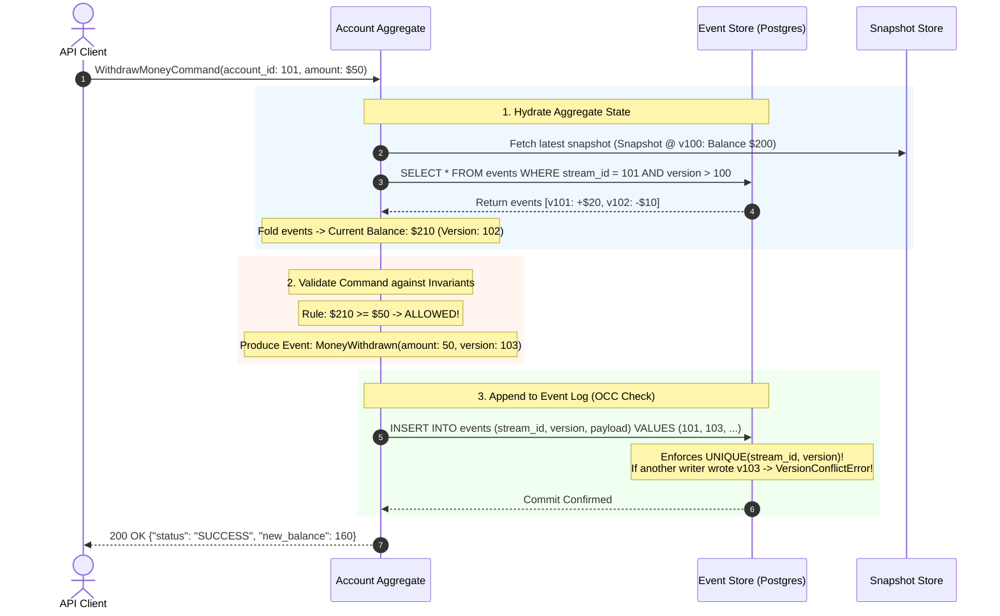
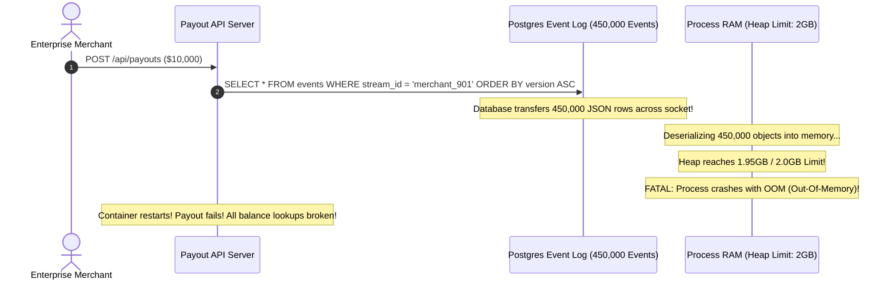

# Module 06: Event Sourcing

Traditional relational applications rely on state-in-place mutation: executing an SQL `UPDATE orders SET status = 'shipped'` overwrites prior data on disk. While simple, in-place updates discard the historical record of *how* and *why* an entity transitioned between states. When audit compliance, financial forensics, or time-travel queries are required ("What was this customer's balance last Tuesday at 3:15 PM?"), state-in-place storage cannot answer. **Event Sourcing** inverts this paradigm: instead of storing current state, you store the **complete, immutable, append-only sequence of domain events** that occurred (`AccountOpened`, `MoneyDeposited`, `MoneyWithdrawn`). Current state is never stored as the source of truth—it is computed dynamically as a mathematical **fold (reduction)** over the event log.

> [!TIP]
> **The Golden Rule:** Current state is a derived, recomputable fold over an immutable, append-only event log. Commands validate business invariants; events record immutable facts; optimistic version checks (`expected_version`) guarantee stream concurrency; and snapshots serve strictly as disposable performance caches.

---

## 1. Visual Mental Models

### State as a Pure Mathematical Fold over Domain Events

Current aggregate state is calculated by reducing historical events using a deterministic, side-effect-free reducer: $\text{State} = \text{reduce}(\text{apply}, \text{Events}, \text{InitialState})$:

```mermaid
flowchart LR
    INIT[("Initial State<br/>Balance: $0")] --> E1["Event 1: AccountOpened<br/>(v1: +$0)"]
    E1 -->|"apply(state, e1)"| S1["State v1: $0"]
    S1 --> E2["Event 2: MoneyDeposited<br/>(v2: +$100)"]
    E2 -->|"apply(state, e2)"| S2["State v2: $100"]
    S2 --> E3["Event 3: MoneyWithdrawn<br/>(v3: -$30)"]
    E3 -->|"apply(state, e3)"| S3["State v3: $70"]
    S3 --> E4["Event 4: MoneyDeposited<br/>(v4: +$50)"]
    E4 -->|"apply(state, e4)"| CURR[("Current State<br/>Balance: $120<br/>Version: 4")]

    classDef ev fill:#fff3e0,stroke:#f57c00,stroke-width:2px;
    classDef st fill:#e1f5fe,stroke:#0288d1,stroke-width:2px;
    classDef cur fill:#e8f5e9,stroke:#388e3c,stroke-width:2px;

    class E1,E2,E3,E4 ev;
    class INIT,S1,S2,S3 st;
    class CURR cur;
```



### The Command-Event Processing Cycle with Optimistic Concurrency Control (OCC)

Every state mutation executes through a rigorous three-step cycle protected by stream versioning:



---

## 2. Structured Reference Grids

### State-in-Place CRUD vs. Event Sourcing Architectural Comparison

| Dimension | Traditional State-in-Place CRUD | Event Sourcing |
| :--- | :--- | :--- |
| **Source of Truth** | Current database row (e.g. `status = 'SHIPPED'`) | **Append-Only Immutable Event Stream** |
| **History Retention** | Lost upon update unless manually tracked in audit tables | **Complete, permanent, untampered historical log** |
| **Temporal Queries** | Impossible ("What was the balance 6 months ago?") | **Native** (Replay events up to target timestamp) |
| **Concurrency Control** | Pessimistic table locks (`SELECT FOR UPDATE`) | **Optimistic Concurrency Control (OCC)** on version |
| **GDPR Deletion** | Trivial (`DELETE FROM users WHERE id = 101`) | Requires **Crypto-Shredding** or tombstone projections |
| **System Complexity** | Low (Intuitive, standard CRUD) | **High** (Requires snapshotting, upcasting, CQRS) |

### Industrial Event Store Relational Schema

```sql
CREATE TABLE event_streams (
    stream_id       UUID PRIMARY KEY,
    aggregate_type  VARCHAR(64) NOT NULL,
    current_version BIGINT NOT NULL DEFAULT 0,
    created_at      TIMESTAMPTZ NOT NULL DEFAULT NOW()
);

CREATE TABLE domain_events (
    id              BIGSERIAL PRIMARY KEY,
    stream_id       UUID NOT NULL REFERENCES event_streams(stream_id),
    version         BIGINT NOT NULL,
    event_type      VARCHAR(128) NOT NULL,
    payload         JSONB NOT NULL,
    metadata        JSONB NOT NULL,               -- trace_id, user_id, timestamp
    created_at      TIMESTAMPTZ NOT NULL DEFAULT NOW(),
    CONSTRAINT uq_stream_version UNIQUE (stream_id, version) -- Prevents concurrent append races!
);

CREATE TABLE aggregate_snapshots (
    stream_id       UUID PRIMARY KEY,
    version         BIGINT NOT NULL,
    state           JSONB NOT NULL,
    created_at      TIMESTAMPTZ NOT NULL DEFAULT NOW()
);
```

---

## 3. Production War Story

### The 450,000 Event Replay Crash & The Unversioned Schema Drift

#### The Incident
A FinTech payment gateway built its merchant accounts using Event Sourcing. Over 4 years, a high-volume merchant accumulated 450,000 transaction events in their stream. The team did not implement snapshotting. Whenever the merchant initiated a payout, the API replayed all 450,000 events from the PostgreSQL event table into memory. During Black Friday, payout requests caused memory allocations to explode by 1.8GB per request. Node.js processes crashed with `JavaScript heap out of memory`, and API timeouts climbed to 45 seconds. Worse, an earlier deploy had renamed the payload field `amount_cents` to `amount` without an upcaster; older historical events failed to deserialize, corrupting balance recalculations for all enterprise accounts.



#### The Root Cause
1. **Missing Snapshots:** Loading state took $O(N)$ operations over all historical events, leading to catastrophic memory and latency degradation as streams aged.
2. **Unversioned Schema Drift:** Modifying event payload structures without implementing **Upcasters** broke backward compatibility for older serialized events.

#### The Verified Production Fix
1. Implemented automatic **Snapshotting**: every 500 events, a worker commits a compressed snapshot of the aggregate state to `aggregate_snapshots`. Loading now takes $O(1)$ snapshot read $+ O(\le 500)$ events.
2. Built an **Event Upcaster Pipeline**: all deserialization logic routes through schema adapters that translate legacy `v1` schemas into modern `v2` objects on-the-fly.

---

## 4. Multi-Language Production Implementations

### Go (Production Aggregate Root with Optimistic Concurrency Control)

```go
package main

import (
	"context"
	"database/sql"
	"encoding/json"
	"errors"
	"fmt"
	"time"

	"github.com/google/uuid"
	_ "github.com/lib/pq"
)

type BankAccountState struct {
	ID      uuid.UUID `json:"id"`
	Balance float64   `json:"balance"`
	Open    bool      `json:"open"`
	Version int64     `json:"version"`
}

// Pure Event Reducer: Absolutely NO side effects or external I/O!
func ApplyEvent(state BankAccountState, eventType string, payload []byte) BankAccountState {
	var data map[string]interface{}
	json.Unmarshal(payload, &data)

	switch eventType {
	case "AccountOpened":
		state.Open = true
		state.Balance = data["initial_balance"].(float64)
	case "MoneyDeposited":
		state.Balance += data["amount"].(float64)
	case "MoneyWithdrawn":
		state.Balance -= data["amount"].(float64)
	}
	return state
}

type EventStore struct {
	db *sql.DB
}

func (s *EventStore) LoadAggregate(ctx context.Context, streamID uuid.UUID) (*BankAccountState, error) {
	rows, err := s.db.QueryContext(ctx, `
		SELECT version, event_type, payload 
		FROM domain_events WHERE stream_id = $1 ORDER BY version ASC;
	`, streamID)
	if err != nil {
		return nil, err
	}
	defer rows.Close()

	state := BankAccountState{ID: streamID, Balance: 0, Open: false, Version: 0}
	for rows.Next() {
		var version int64
		var eventType string
		var payload []byte
		if err := rows.Scan(&version, &eventType, &payload); err != nil {
			return nil, err
		}
		state = ApplyEvent(state, eventType, payload)
		state.Version = version
	}
	return &state, nil
}

func (s *EventStore) AppendEvent(ctx context.Context, streamID uuid.UUID, expectedVersion int64, eventType string, payload interface{}) error {
	payloadBytes, err := json.Marshal(payload)
	if err != nil {
		return err
	}

	newVersion := expectedVersion + 1
	// Optimistic Concurrency Control: UNIQUE(stream_id, version) constraint will reject conflicts
	_, err = s.db.ExecContext(ctx, `
		INSERT INTO domain_events (stream_id, version, event_type, payload, metadata)
		VALUES ($1, $2, $3, $4, '{}');
	`, streamID, newVersion, eventType, payloadBytes)

	if err != nil {
		return fmt.Errorf("concurrency conflict: stream modified by another worker: %w", err)
	}
	return nil
}

// Command Handler: Enforces business invariants before appending
func WithdrawMoney(ctx context.Context, store *EventStore, streamID uuid.UUID, amount float64) error {
	state, err := store.LoadAggregate(ctx, streamID)
	if err != nil {
		return err
	}

	if !state.Open {
		return errors.New("cannot withdraw from a closed account")
	}
	if state.Balance < amount {
		return fmt.Errorf("insufficient funds: balance is %.2f, requested %.2f", state.Balance, amount)
	}

	return store.AppendEvent(ctx, streamID, state.Version, "MoneyWithdrawn", map[string]interface{}{
		"amount": amount,
		"time":   time.Now().UTC().Format(time.RFC3339),
	})
}
```

---

### Node.js / TypeScript (Event-Sourced Aggregate with Snapshots)

```typescript
import { Pool } from 'pg';

const pool = new Pool({ connectionString: process.env.DATABASE_URL });

export interface OrderState {
  orderId: string;
  items: string[];
  status: 'NEW' | 'PAID' | 'CANCELLED';
  version: number;
}

export class OrderAggregate {
  public state: OrderState;

  constructor(orderId: string) {
    this.state = { orderId, items: [], status: 'NEW', version: 0 };
  }

  // Pure Reducer: No async calls, no validation, deterministic state transitions
  apply(eventType: string, payload: any): void {
    switch (eventType) {
      case 'OrderCreated':
        this.state.items = payload.items;
        this.state.status = 'NEW';
        break;
      case 'OrderPaid':
        this.state.status = 'PAID';
        break;
      case 'OrderCancelled':
        this.state.status = 'CANCELLED';
        break;
    }
  }

  // Command: Validate rules and return new event
  pay(): { eventType: string; payload: any } {
    if (this.state.status === 'CANCELLED') {
      throw new Error('Cannot pay for a cancelled order');
    }
    if (this.state.status === 'PAID') {
      throw new Error('Order is already paid');
    }
    return { eventType: 'OrderPaid', payload: { paidAt: new Date().toISOString() } };
  }
}

export async function appendWithOCC(streamId: string, expectedVersion: number, event: { eventType: string; payload: any }) {
  const client = await pool.connect();
  try {
    const newVersion = expectedVersion + 1;
    await client.query(
      `INSERT INTO domain_events (stream_id, version, event_type, payload, metadata) 
       VALUES ($1, $2, $3, $4, '{}');`,
      [streamId, newVersion, event.eventType, JSON.stringify(event.payload)]
    );
  } catch (err: any) {
    if (err.code === '23505') { // Postgres Unique Violation
      throw new Error(`OCC Conflict: Stream ${streamId} was updated concurrently.`);
    }
    throw err;
  } finally {
    client.release();
  }
}
```

---

### Python (`EventStore` Engine with Snapshot Cache & Crypto-Shredding)

```python
import json
import psycopg

class EventStore:
    def __init__(self, db_url: str):
        self.db_url = db_url

    def get_state(self, stream_id: str):
        with psycopg.connect(self.db_url) as conn:
            with conn.cursor() as cur:
                # 1. Fetch latest snapshot if available
                cur.execute("SELECT version, state FROM aggregate_snapshots WHERE stream_id = %s;", (stream_id,))
                snapshot = cur.fetchone()
                
                version_offset = 0
                state = {"balance": 0.0, "status": "OPEN"}
                if snapshot:
                    version_offset = snapshot[0]
                    state = snapshot[1]

                # 2. Replay events occurring AFTER snapshot
                cur.execute(
                    "SELECT version, event_type, payload FROM domain_events WHERE stream_id = %s AND version > %s ORDER BY version ASC;",
                    (stream_id, version_offset)
                )
                events = cur.fetchall()
                
                current_version = version_offset
                for ver, event_type, payload in events:
                    state = self._apply(state, event_type, payload)
                    current_version = ver

                return state, current_version

    def _apply(self, state: dict, event_type: str, payload: dict) -> dict:
        """Pure reducer function"""
        if event_type == "Deposited":
            state["balance"] += payload["amount"]
        elif event_type == "Withdrawn":
            state["balance"] -= payload["amount"]
        return state

    def append_event(self, stream_id: str, expected_version: int, event_type: str, payload: dict):
        new_version = expected_version + 1
        with psycopg.connect(self.db_url) as conn:
            with conn.cursor() as cur:
                try:
                    cur.execute(
                        "INSERT INTO domain_events (stream_id, version, event_type, payload, metadata) VALUES (%s, %s, %s, %s, '{}');",
                        (stream_id, new_version, event_type, json.dumps(payload))
                    )
                    conn.commit()
                except psycopg.errors.UniqueViolation:
                    conn.rollback()
                    raise RuntimeError(f"Concurrency Conflict: Stream {stream_id} version changed concurrently.")
```

---

## 5. Practical Hands-On Verification

### 1. Inspect Stream Event Chronology via SQL

Query the raw immutable events that compose an aggregate's lifecycle:

```sql
SELECT version, event_type, payload, created_at 
FROM domain_events 
WHERE stream_id = '11111111-2222-3333-4444-555555555555' 
ORDER BY version ASC;
```

**Output:**
```text
 version |   event_type   |             payload              |          created_at           
---------+----------------+----------------------------------+-------------------------------
       1 | AccountOpened  | {"initial_balance": 100.0}       | 2026-11-09 17:00:00.104201+00
       2 | MoneyDeposited | {"amount": 50.0}                 | 2026-11-09 17:02:15.201402+00
       3 | MoneyWithdrawn | {"amount": 30.0}                 | 2026-11-09 17:05:40.910240+00
```
*(Computed Current Balance: $100 + $50 - $30 = $120).*

### 2. Test Optimistic Concurrency Control (OCC) Rejection

Simulate two concurrent workers attempting to write version `4` simultaneously:

```sql
-- Worker 1 succeeds
INSERT INTO domain_events (stream_id, version, event_type, payload, metadata) 
VALUES ('11111111-2222-3333-4444-555555555555', 4, 'MoneyDeposited', '{"amount": 10}', '{}');

-- Worker 2 attempts same version
INSERT INTO domain_events (stream_id, version, event_type, payload, metadata) 
VALUES ('11111111-2222-3333-4444-555555555555', 4, 'MoneyWithdrawn', '{"amount": 5}', '{}');
```

**Output (Worker 2):**
```text
ERROR: duplicate key value violates unique constraint "uq_stream_version"
DETAIL: Key (stream_id, version)=(11111111-2222-3333-4444-555555555555, 4) already exists.
```
*(Worker 2 is prevented from corrupting the stream; it catches the conflict, reloads the fresh aggregate state, and reapplies its command).*

---

## 6. Operational Validation Checkpoints

<details>
<summary><strong>Checkpoint 1: The Fatal Side-Effect Inside `Apply()` Anti-Pattern</strong></summary>

**Scenario:** A developer puts email dispatch logic inside the event reducer:
```python
def apply(state, event):
    if event.type == "OrderPlaced":
        send_email(event.user_email) # FATAL FLAW!
        state.status = "PLACED"
    return state
```
When the application restarts and hydrates 1,000 orders from the event store, what disaster occurs?

*Explanation:*
The application replays historical events from months ago. If `apply()` contains side effects, the server re-sends 1,000 historical order emails to customers upon every single boot or state hydration!
**The Invariant:** **Reducers (`apply`) must be 100% pure mathematical functions**. They must contain zero network I/O, zero database queries, and zero side effects. Side effects must execute exclusively in **Command Handlers** or **Event Projections**.
</details>

<details>
<summary><strong>Checkpoint 2: GDPR "Right to be Forgotten" in an Append-Only Log</strong></summary>

**Scenario:** Under European GDPR regulations, a customer requests full deletion of their personal data. However, the application uses an append-only, immutable event log where `DELETE` statements are strictly forbidden. How do you comply with the law without violating immutability?

*Explanation:*
Use **Cryptographic Shredding (Crypto-Shredding)**:
1. Store PII fields (name, email, SSN) encrypted inside event payloads using a unique per-user symmetric cryptographic key stored in a separate key management service (KMS).
2. When the user exercises their "Right to be Forgotten," delete their single symmetric key from the KMS.
3. The events remain in the immutable log, but all personal data is rendered permanently unrecoverable mathematical noise, fulfilling legal erasure requirements while preserving complete transaction graph integrity.
</details>

<details>
<summary><strong>Checkpoint 3: The Danger of Treating Snapshots as Authoritative Truth</strong></summary>

**Scenario:** An application stores snapshots in Redis for fast access. A bug in a deployment writes a corrupted snapshot with `balance = -9999`. A junior engineer proposes fixing it by manually updating the Redis snapshot row. Why is this dangerous?

*Explanation:*
Snapshots are **disposable performance caches**, not the source of truth. If you treat snapshots as authoritative truth, bugs become permanent, and you destroy your ability to rebuild state from the event log.
**The Fix:** Simply delete the corrupted snapshot: `DELETE FROM aggregate_snapshots WHERE stream_id = :id`. The event sourcing engine falls back to replaying from the authoritative immutable event stream, restoring the correct balance immediately.
</details>

---

## Next

[07-consensus-and-coordination](../07-consensus-and-coordination/README.md) — event
sourcing's `append` needed exactly one thing to be correct under concurrency: agreement
on the *order* and *version* of events, so two writers can't both claim version N.
Scale that need up — many nodes agreeing on a single value, a single leader, a single
ordered log — and you arrive at **consensus**, the deepest coordination problem in
distributed systems. The next module gives a practical, concept-level tour of consensus
(Raft), leader election, and — the punchline of the whole track — why you almost always
reach for a battle-tested tool (etcd, ZooKeeper, Postgres) that already solved it
rather than building your own.
