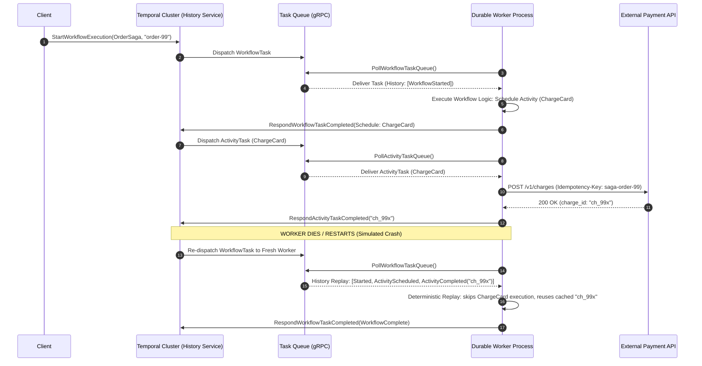
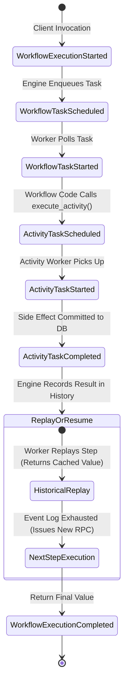
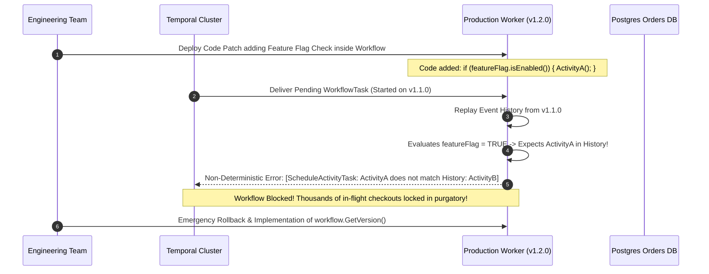

# Module 08: Durable Workflow Orchestration

> [!TIP]
> **The Golden Rule of Durable Orchestration:**
> Workflows must be 100% deterministic functions of their event history, while activities encapsulate all side effects, I/O, and non-determinism. Never query the real clock, generate unseeded randomness, or make direct network calls inside a workflow definition—the engine replays workflow code from step zero on every recovery.



---

## 1. Core Architecture: Hand-Rolled Sagas vs. Durable Execution

In Module 04, we engineered a distributed saga orchestrator by hand: maintaining an explicit `saga_state` database table, writing manual state transitions, storing idempotency tokens, and writing recovery daemons to poll and resume orphaned workflows after crashes.

A **durable execution engine** (such as Temporal, Cadence, or AWS Step Functions) abstracts this entire operational burden into the runtime platform.

```mermaid
flowchart TD
    subgraph HandRolled["Hand-Rolled Saga (Module 04)"]
        H1["Client POST /order"] --> H2["Write saga_state (PENDING)"]
        H2 --> H3["Call Payment Service"]
        H3 --> H4["Write saga_state (CHARGED)"]
        H4 --> H5["Call Inventory Service"]
        H5 -. Crash .-> H6["Database Poller Daemon"]
        H6 --> H7["Manual State Inspection & Recovery Loop"]
    end

    subgraph DurableEngine["Durable Workflow Engine (Temporal)"]
        D1["Client StartWorkflow"] --> D2["Temporal History Service"]
        D2 --> D3["Event History: Append-Only Event Log"]
        D3 --> D4["Task Queues (gRPC Long Poll)"]
        D4 --> D5["Worker Poll & Replay"]
        D5 -. Crash .-> D6["Fresh Worker Replays Event Stream"]
        D6 --> D7["Activities Cached, Re-executes from Exact Point of Interruption"]
    end
```



### Architectural Contrast Grid

| Dimension | Hand-Rolled Saga Pattern | Durable Execution Engine (Temporal / Cadence) |
| :--- | :--- | :--- |
| **State Storage** | Custom relational tables (`saga_state`, `saga_steps`) | Append-only event history managed by cluster engine |
| **Worker Failure Handling** | Custom heartbeat tables, database polling cron jobs | Immediate task reassignment; state rebuilt via event replay |
| **Retry Semantics** | Manual `try/catch` loops, custom retry exponential math | Platform-level `RetryPolicy` with zero application retry loops |
| **Timers & Long Pauses** | Quartz scheduler, Celery Beat, or database cron checks | Native non-blocking durable timers (`workflow.sleep(days=30)`) |
| **Human In The Loop** | Polling state flags or webhook callbacks to custom DB | Native asynchronous **Signals** delivered directly to executions |
| **Observability** | Custom distributed tracing spans and log aggregation | Full visual web UI timeline of every event, input, and output |
| **Code Footprint** | ~500 lines of boilerplate orchestration logic | ~50 lines of pure deterministic business workflow code |

---

## 2. The Determinism Invariant & Replay Mechanics

The central contract of durable orchestration is **Event History Replay**:
When a worker crashes mid-workflow, a completely fresh worker process loads the event history from the Temporal cluster and re-runs the workflow function from line 1.



### The Forbidden Operations in Workflow Code

| Prohibited Operation | Why It Breaks Replay | Compliant Durable Pattern |
| :--- | :--- | :--- |
| `time.Now()` / `datetime.now()` | Returns a different timestamp on historical replay | `workflow.now()` / `workflow.current_time()` |
| `uuid.New()` / `random.random()` | Generates conflicting branch decisions on replay | `workflow.uuid()` or pass UUID from client/activity |
| `http.Get()` / Database query | Re-running side effects violates idempotency and speed | Encapsulate all I/O inside an `@activity.defn` |
| Native `time.Sleep()` / `sleep()` | Blocks worker execution thread and locks memory | `workflow.sleep()` (creates a durable timer event) |
| Uncontrolled Goroutines / Threads | Race conditions cause non-deterministic event order | Sequential workflow steps or framework-managed async constructs |
| Global mutable variables | State bleeding across distinct workflow executions | Workflow instance properties scoped strictly to execution |

---

## 3. Production War Story: The Replay Panic Incident



### Incident Post-Mortem

- **Root Cause**: A developer modified workflow logic without workflow versioning. In-flight workflows started under `v1.1.0` were replayed by `v1.2.0` workers. The new code took a branch that did not exist in the recorded event history, triggering a fatal `NonDeterministicWorkflowError`.
- **System Impact**: 14,200 active customer checkout workflows stalled. No orders completed, and worker task queues backed up to max capacity.
- **Remediation**:
  1. Rolled back the worker deployment immediately to allow in-flight workflows to drain.
  2. Wrapped new workflow branches with `workflow.get_version()` (or `workflow.patched()`), allowing the engine to deterministically differentiate historical executions from new runs.

---

## 4. Multi-Language Implementation: The Order Fulfillment Saga

We implement a complete durable order workflow executing three distinct steps:
1. `ChargeCard` (Activity with retry backoff)
2. `ReserveInventory` (Activity)
3. `WaitForApproval` (Signal: human review if order > $1,000)

````carousel
```go
// order_workflow.go (Go Implementation)
package main

import (
	"context"
	"fmt"
	"time"

	"go.temporal.io/sdk/activity"
	"go.temporal.io/sdk/client"
	"go.temporal.io/sdk/temporal"
	"go.temporal.io/sdk/worker"
	"go.temporal.io/sdk/workflow"
)

type OrderRequest struct {
	OrderID string  `json:"order_id"`
	Amount  float64 `json:"amount"`
}

type OrderActivities struct{}

func (a *OrderActivities) ChargeCard(ctx context.Context, req OrderRequest) (string, error) {
	info := activity.GetInfo(ctx)
	if info.Attempt < 2 {
		return "", fmt.Errorf("transient gateway timeout on attempt %d", info.Attempt)
	}
	return fmt.Sprintf("ch_%s_success", req.OrderID), nil
}

func (a *OrderActivities) ReserveInventory(ctx context.Context, req OrderRequest) error {
	return nil
}

func OrderWorkflow(ctx workflow.Context, req OrderRequest) (string, error) {
	ao := workflow.ActivityOptions{
		StartToCloseTimeout: 10 * time.Second,
		RetryPolicy: &temporal.RetryPolicy{
			InitialInterval:    100 * time.Millisecond,
			BackoffCoefficient: 2.0,
			MaximumAttempts:    5,
		},
	}
	ctx = workflow.WithActivityOptions(ctx, ao)

	var chargeID string
	var act *OrderActivities
	err := workflow.ExecuteActivity(ctx, act.ChargeCard, req).Get(ctx, &chargeID)
	if err != nil {
		return "", err
	}

	err = workflow.ExecuteActivity(ctx, act.ReserveInventory, req).Get(ctx, nil)
	if err != nil {
		return "", err
	}

	// Human-in-the-loop signal if high value
	if req.Amount > 1000 {
		var approved bool
		approvalSignalChan := workflow.GetSignalChannel(ctx, "ManagerApproval")
		s := workflow.NewSelector(ctx)
		s.AddReceive(approvalSignalChan, func(c workflow.ReceiveChannel, more bool) {
			c.Receive(ctx, &approved)
		})
		s.Select(ctx)

		if !approved {
			return "order_rejected_by_manager", nil
		}
	}

	return fmt.Sprintf("confirmed:%s", chargeID), nil
}
```
<!-- slide -->
```typescript
// orderWorkflow.ts (Node.js / TypeScript Implementation)
import { proxyActivities, defineSignal, setHandler, condition } from '@temporalio/workflow';
import type * as activities from './activities';

export interface OrderRequest {
  orderId: string;
  amount: number;
}

const { chargeCard, reserveInventory } = proxyActivities<typeof activities>({
  startToCloseTimeout: '10 seconds',
  retry: {
    initialInterval: '100ms',
    backoffCoefficient: 2,
    maximumAttempts: 5,
  },
});

export const managerApprovalSignal = defineSignal<[boolean]>('ManagerApproval');

export async function orderWorkflow(req: OrderRequest): Promise<string> {
  let isApproved = false;
  let signalReceived = false;

  setHandler(managerApprovalSignal, (approved: boolean) => {
    isApproved = approved;
    signalReceived = true;
  });

  // Step 1: Charge customer with automatic platform retries
  const chargeId = await chargeCard(req);

  // Step 2: Reserve stock
  await reserveInventory(req);

  // Step 3: Human-in-the-loop signal wait if transaction exceeds threshold
  if (req.amount > 1000) {
    await condition(() => signalReceived, '24 hours');
    if (!isApproved) {
      return `cancelled:manager_rejected:${chargeId}`;
    }
  }

  return `confirmed:${chargeId}`;
}
```
<!-- slide -->
```python
# order_workflow.py (Python Implementation)
from datetime import timedelta
from temporalio import workflow, activity
from temporalio.common import RetryPolicy

class OrderRequest:
    def __init__(self, order_id: str, amount: float):
        self.order_id = order_id
        self.amount = amount

@activity.defn
async def charge_card(req: OrderRequest) -> str:
    info = activity.info()
    if info.attempt < 2:
        raise RuntimeError(f"Simulated network hiccup on attempt {info.attempt}")
    return f"ch_{req.order_id}_success"

@activity.defn
async def reserve_inventory(req: OrderRequest) -> None:
    pass

@workflow.defn
class OrderWorkflow:
    def __init__(self) -> None:
        self.approved = False
        self.signal_received = False

    @workflow.signal
    def manager_approval(self, approved: bool) -> None:
        self.approved = approved
        self.signal_received = True

    @workflow.run
    async def run(self, req: OrderRequest) -> str:
        # Step 1: Charge customer with durable retry policy
        charge_id = await workflow.execute_activity(
            charge_card,
            req,
            start_to_close_timeout=timedelta(seconds=10),
            retry_policy=RetryPolicy(
                initial_interval=timedelta(milliseconds=100),
                backoff_coefficient=2.0,
                maximum_attempts=5,
            ),
        )

        # Step 2: Reserve inventory
        await workflow.execute_activity(
            reserve_inventory,
            req,
            start_to_close_timeout=timedelta(seconds=10),
        )

        # Step 3: Human-in-the-loop conditional wait
        if req.amount > 1000:
            await workflow.wait_condition(lambda: self.signal_received, timeout=timedelta(hours=24))
            if not self.approved:
                return f"rejected:manager_denied:{charge_id}"

        return f"confirmed:{charge_id}"
```
````

---

## 5. Practical Hands-On Verification CLI

Verify cluster health, dispatch workflows, send asynchronous signals, and inspect replay logs using the Temporal CLI.

### Step 1: Verify Local Cluster Health

```bash
temporal operator cluster health
```

```text
STATUS: SERVING
COMMIT: 8b072fae9619c9e54a3194
VERSION: 1.22.4
```

### Step 2: Trigger a Workflow Execution

```bash
temporal workflow start \
  --task-queue orders-tq \
  --type OrderWorkflow \
  --workflow-id order-wf-1001 \
  --input '{"order_id":"1001", "amount": 1500.0}'
```

```text
Running execution:
  WorkflowId:  order-wf-1001
  RunId:       2e21b764-8842-4f36-b183-195b0662d5ea
  Type:        OrderWorkflow
  Namespace:   default
  TaskQueue:   orders-tq
```

### Step 3: Query Workflow Status & Deliver Signal

Query the live execution state, then deliver the manager approval signal:

```bash
# Query the live state
temporal workflow show --workflow-id order-wf-1001
```

```text
Progress:
  1  WorkflowExecutionStarted
  2  WorkflowTaskScheduled
  3  WorkflowTaskStarted
  4  ActivityTaskScheduled (ChargeCard)
  5  ActivityTaskStarted
  6  ActivityTaskCompleted (Result: "ch_1001_success")
  7  ActivityTaskScheduled (ReserveInventory)
  8  ActivityTaskCompleted
  9  WorkflowTaskWaiting (Pending Condition: ManagerApproval)
```

Deliver the external signal via CLI:

```bash
temporal workflow signal \
  --workflow-id order-wf-1001 \
  --name ManagerApproval \
  --input 'true'
```

```text
Signal workflow succeeded.
```

Retrieve the final completed workflow result:

```bash
temporal workflow show --workflow-id order-wf-1001 --output json
```

```json
{
  "execution": {
    "workflowId": "order-wf-1001",
    "runId": "2e21b764-8842-4f36-b183-195b0662d5ea"
  },
  "status": "COMPLETED",
  "result": "confirmed:ch_1001_success"
}
```

---

## 6. Operational Validation Checkpoints

<details>
<summary><strong>Checkpoint 1: Why does direct database reading inside a workflow function violate determinism?</strong></summary>

**Root Cause Analysis:**
When a worker crashes, Temporal reconstructs workflow state by re-running the workflow code against the recorded event history. If the workflow function performs a direct SQL query (`SELECT balance FROM accounts`), the value returned during replay months or minutes later might differ from the value seen during initial execution. This causes workflow branching to diverge from recorded events, throwing a fatal `NonDeterministicWorkflowError`.

**Remediation:**
Always execute database reads inside an **Activity**. Temporal records the activity return value into the append-only event log once. On replay, the activity is not re-executed; its historical return value is retrieved directly from the event log.
</details>

<details>
<summary><strong>Checkpoint 2: If an activity times out and is automatically retried by Temporal, why must the activity itself be idempotent?</strong></summary>

**System Dynamic:**
Temporal guarantees that an activity will be scheduled and executed according to its retry policy. However, network timeouts can occur *after* the external service commits a write but *before* Temporal receives the acknowledgment packet. On retry, the activity worker will re-execute the exact same request. If the third-party API (e.g., Stripe, SendGrid) lacks idempotency keys, duplicate charges or duplicated customer notifications will occur. Temporal automates the *retry orchestration*, but idempotency is the responsibility of the underlying activity.
</details>

<details>
<summary><strong>Checkpoint 3: How does a durable workflow handle waiting 30 days for a user action without consuming CPU or database connections?</strong></summary>

**Operational Mechanics:**
When calling `workflow.sleep(30 * 24 * time.Hour)` or waiting for a signal, the Temporal worker does not block an OS thread, hold an open TCP socket, or continuously poll a database. Instead, it informs the Temporal Cluster to record a `TimerStarted` event in the workflow history. The local worker evicts the workflow from memory entirely. 30 days later, the Temporal History engine schedules a `TimerFired` event and places a task onto the task queue. A worker picks up the task, restores the workflow state via history replay, and continues execution.
</details>
