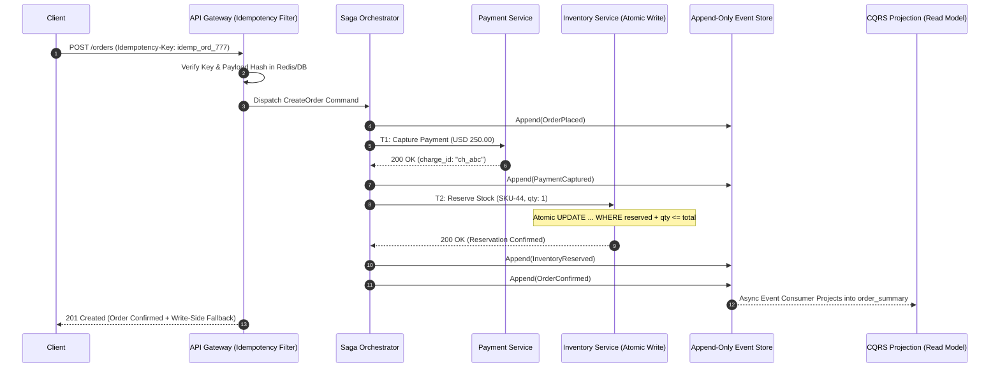
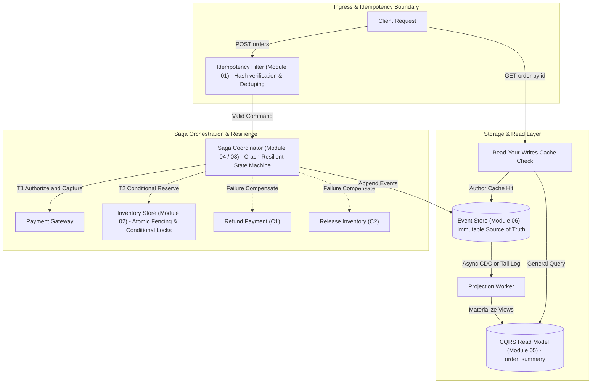
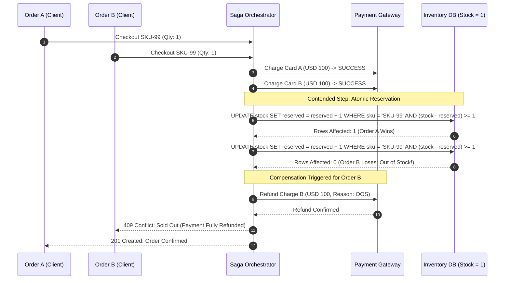
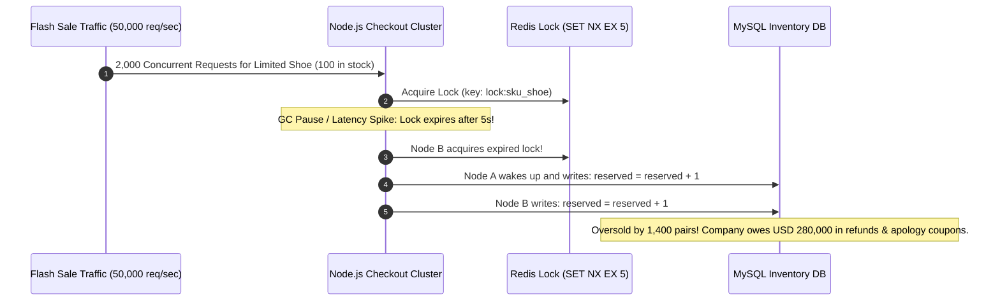

# Module 09: Capstone Project: High-Scale Distributed Order Processing Engine

> **Prerequisites:** Idempotency Keys (`01`), Distributed Locking & Fencing (`02`), CQRS & Event Sourcing (`05`–`06`), and Distributed Sagas (`04`, `08`).  
> **Estimated Reading Time:** 45 minutes  
> **Target Audience:** Senior Backend Engineers, Distributed Systems Architects, Staff/Principal Engineers.

> [!TIP]
> **The Golden Rule of the Capstone Architecture:** Real-world distributed systems are not composed of isolated patterns. An idempotency key guards the gateway against network retries; a distributed saga orchestrates multi-service transactions with compensations; atomic conditional writes prevent overselling under high concurrency; an event-sourced log acts as the immutable source of truth; and CQRS projections serve fast read queries with read-your-writes guarantees.



---

## 1. System Architecture: Integrating the Pattern Spectrum

This capstone integrates every pattern mastered in this track into an end-to-end, crash-resilient distributed system.



### Architectural Seam Reference Matrix

| Seam Junction | Interacting Patterns | Primary Failure Guarded Against | Consistency Model |
| :--- | :--- | :--- | :--- |
| **API Ingress** | Idempotency Keys + Request Hashing | Double-charging on mobile retry / network timeout | Strict Serializability |
| **Orchestration** | Saga Pattern + Durable History | Mid-transaction worker crash leaving dangling money | Eventual Consistency |
| **Inventory Contention** | Distributed Fencing + Conditional SQL | Race condition overselling zero-stock SKU | Strong Consistency (Linearizable) |
| **Source of Truth** | Event Sourcing + Optimistic Concurrency | State corruption and untraceable database mutations | Append-Only Linear History |
| **Query Facade** | CQRS + Read-Your-Writes Engine | Read latency bottleneck + Customer seeing stale orders | Read-Your-Writes / Eventual |

---

## 2. Failure Mode Breakdown: Competing Orders & Worker Crash



---

## 3. Production War Story: The Ghost Inventory Collapse

| Field | Incident Details |
| :--- | :--- |
| **Severity** | **SEV-1** (1,400 Oversold Limited-Edition SKUs During Flash Sale) |
| **Detection / Resolution Time** | Detected in 8 minutes via fulfillment mismatch alert / Mitigated in 35 minutes |
| **Impact** | Oversold 1,400 units past physical stock, incurring \$280,000 in refunds and customer apology credits |



### Incident Post-Mortem

- **Root Cause**: The engineering team relied solely on an un-fenced Redis distributed lock with a 5-second TTL to serialize inventory updates. A stop-the-world garbage collection pause exceeded the TTL, releasing the lock while Node A was still in-flight. Node B acquired the lock, resulting in concurrent database writes.
- **The Architectural Fix**:
  1. Replaced application-level distributed locks for inventory with an **in-database atomic conditional update**:
     `UPDATE inventory SET reserved = reserved + :qty WHERE sku = :sku AND (total_stock - reserved) >= :qty;`
  2. Integrated a Saga compensator: if `RowsAffected == 0`, immediately trigger an automatic Stripe refund activity and record `OrderFailedDueToStockout` in the event store.

---

## 4. Multi-Language Implementation: The Integrated Capstone Engine

Below is the integrated implementation demonstrating:
1. Idempotency Key Gateway Check.
2. Distributed Saga Orchestration (Payment -> Inventory -> Confirm).
3. Reverse Compensating Transactions on Failure.
4. Event Store Append.

````carousel
```go
// capstone_engine.go (Go Implementation)
package main

import (
	"context"
	"database/sql"
	"errors"
	"fmt"
	"time"
)

type OrderCommand struct {
	IdempotencyKey string  `json:"idempotency_key"`
	OrderID        string  `json:"order_id"`
	SKU            string  `json:"sku"`
	Quantity       int     `json:"quantity"`
	Amount         float64 `json:"amount"`
}

type OrderEvent struct {
	OrderID   string    `json:"order_id"`
	Type      string    `json:"type"`
	Payload   string    `json:"payload"`
	CreatedAt time.Time `json:"created_at"`
}

type CapstoneOrchestrator struct {
	db *sql.DB
}

func (co *CapstoneOrchestrator) ProcessOrder(ctx context.Context, cmd OrderCommand) (string, error) {
	// Step 1: Idempotency Barrier Check
	var existingResponse string
	err := co.db.QueryRowContext(ctx,
		"SELECT response_body FROM idempotency_keys WHERE key = $1 AND expires_at > NOW()",
		cmd.IdempotencyKey).Scan(&existingResponse)
	if err == nil && existingResponse != "" {
		return existingResponse, nil // Return cached result
	}

	// Record initial pending idempotency claim
	_, err = co.db.ExecContext(ctx,
		"INSERT INTO idempotency_keys (key, status, created_at, expires_at) VALUES ($1, 'PROCESSING', NOW(), NOW() + INTERVAL '1 hour')",
		cmd.IdempotencyKey)
	if err != nil {
		return "", errors.New("concurrent request with same idempotency key in progress")
	}

	// Step 2: Saga T1 - Charge Payment
	chargeID, err := co.chargeExternalPayment(cmd.OrderID, cmd.Amount)
	if err != nil {
		return "", fmt.Errorf("payment failed: %w", err)
	}
	co.appendEvent(ctx, cmd.OrderID, "PaymentCaptured", fmt.Sprintf(`{"charge_id":"%s"}`, chargeID))

	// Step 3: Saga T2 - Atomic Conditional Inventory Reservation (Prevent Oversell)
	res, err := co.db.ExecContext(ctx,
		`UPDATE inventory SET reserved = reserved + $1
		 WHERE sku = $2 AND (total_stock - reserved) >= $1`,
		cmd.Quantity, cmd.SKU)
	if err != nil {
		co.compensatePayment(chargeID)
		return "", err
	}
	rows, _ := res.RowsAffected()
	if rows == 0 {
		// Out of stock: Trigger compensating transaction
		co.compensatePayment(chargeID)
		co.appendEvent(ctx, cmd.OrderID, "OrderFailedStockout", `{"reason":"insufficient_inventory"}`)
		return "", errors.New("SKU out of stock, payment refunded")
	}
	co.appendEvent(ctx, cmd.OrderID, "InventoryReserved", fmt.Sprintf(`{"sku":"%s","qty":%d}`, cmd.SKU, cmd.Quantity))

	// Step 4: Confirm Order & Commit Idempotency Response
	co.appendEvent(ctx, cmd.OrderID, "OrderConfirmed", `{"status":"COMPLETED"}`)
	finalResponse := fmt.Sprintf(`{"status":"CONFIRMED","order_id":"%s","charge_id":"%s"}`, cmd.OrderID, chargeID)

	_, _ = co.db.ExecContext(ctx,
		"UPDATE idempotency_keys SET status = 'COMPLETED', response_body = $1 WHERE key = $2",
		finalResponse, cmd.IdempotencyKey)

	return finalResponse, nil
}

func (co *CapstoneOrchestrator) appendEvent(ctx context.Context, orderID, eventType, payload string) {
	_, _ = co.db.ExecContext(ctx,
		"INSERT INTO event_store (order_id, event_type, payload, created_at) VALUES ($1, $2, $3, NOW())",
		orderID, eventType, payload)
}

func (co *CapstoneOrchestrator) chargeExternalPayment(orderID string, amount float64) (string, error) {
	return fmt.Sprintf("ch_%s", orderID), nil
}

func (co *CapstoneOrchestrator) compensatePayment(chargeID string) {
	// Issue refund call to payment gateway
	fmt.Printf("[COMPENSATION] Refunding charge %s\n", chargeID)
}
```
<!-- slide -->
```typescript
// capstoneEngine.ts (Node.js / TypeScript Implementation)
import { Pool, PoolClient } from 'pg';

export interface OrderCommand {
  idempotencyKey: string;
  orderId: string;
  sku: string;
  quantity: number;
  amount: number;
}

export class CapstoneOrchestrator {
  constructor(private pool: Pool) {}

  async processOrder(cmd: OrderCommand): Promise<string> {
    const client = await this.pool.connect();
    try {
      // 1. Idempotency Gate
      const existing = await client.query(
        'SELECT response_body FROM idempotency_keys WHERE key = $1 AND expires_at > NOW()',
        [cmd.idempotencyKey]
      );
      if (existing.rows.length > 0 && existing.rows[0].response_body) {
        return existing.rows[0].response_body;
      }

      await client.query(
        "INSERT INTO idempotency_keys (key, status, created_at, expires_at) VALUES ($1, 'PROCESSING', NOW(), NOW() + INTERVAL '1 hour')",
        [cmd.idempotencyKey]
      );

      // 2. Saga Step 1: Charge
      const chargeId = `ch_${cmd.orderId}_pg`;
      await this.appendEvent(client, cmd.orderId, 'PaymentCaptured', { chargeId });

      // 3. Saga Step 2: Atomic Inventory Reservation
      const updateResult = await client.query(
        `UPDATE inventory
         SET reserved = reserved + $1
         WHERE sku = $2 AND (total_stock - reserved) >= $1`,
        [cmd.quantity, cmd.sku]
      );

      if ((updateResult.rowCount ?? 0) === 0) {
        // Compensating Transaction (Refund)
        await this.compensateRefund(chargeId);
        await this.appendEvent(client, cmd.orderId, 'OrderFailedStockout', { reason: 'insufficient_inventory' });
        throw new Error('ERR_STOCKOUT: Inventory exhausted, payment refunded.');
      }

      await this.appendEvent(client, cmd.orderId, 'InventoryReserved', { sku: cmd.sku, qty: cmd.quantity });
      await this.appendEvent(client, cmd.orderId, 'OrderConfirmed', { status: 'CONFIRMED' });

      const responsePayload = JSON.stringify({
        status: 'CONFIRMED',
        orderId: cmd.orderId,
        chargeId,
      });

      await client.query(
        "UPDATE idempotency_keys SET status = 'COMPLETED', response_body = $1 WHERE key = $2",
        [responsePayload, cmd.idempotencyKey]
      );

      return responsePayload;
    } finally {
      client.release();
    }
  }

  private async appendEvent(client: PoolClient, orderId: string, type: string, payload: Record<string, unknown>) {
    await client.query(
      'INSERT INTO event_store (order_id, event_type, payload, created_at) VALUES ($1, $2, $3, NOW())',
      [orderId, type, JSON.stringify(payload)]
    );
  }

  private async compensateRefund(chargeId: string) {
    console.log(`[COMPENSATE] Issued full refund for ${chargeId}`);
  }
}
```
<!-- slide -->
```python
# capstone_engine.py (Python Implementation)
import json
import psycopg2
from psycopg2.extras import RealDictCursor


class CapstoneOrchestrator:
    def __init__(self, dsn: str):
        self.dsn = dsn

    def process_order(self, cmd: dict) -> dict:
        with psycopg2.connect(self.dsn) as conn:
            with conn.cursor(cursor_factory=RealDictCursor) as cur:
                # 1. Idempotency Key Gateway Check
                cur.execute(
                    "SELECT response_body FROM idempotency_keys WHERE key = %s AND expires_at > NOW()",
                    (cmd["idempotency_key"],),
                )
                row = cur.fetchone()
                if row and row["response_body"]:
                    return json.loads(row["response_body"])

                cur.execute(
                    "INSERT INTO idempotency_keys (key, status, created_at, expires_at) "
                    "VALUES (%s, 'PROCESSING', NOW(), NOW() + INTERVAL '1 hour')",
                    (cmd["idempotency_key"],),
                )

                # 2. Saga Step 1: Charge
                charge_id = f"ch_{cmd['order_id']}"
                self._append_event(cur, cmd["order_id"], "PaymentCaptured", {"charge_id": charge_id})

                # 3. Saga Step 2: Atomic Inventory Write
                cur.execute(
                    """
                    UPDATE inventory
                    SET reserved = reserved + %s
                    WHERE sku = %s AND (total_stock - reserved) >= %s
                    """,
                    (cmd["quantity"], cmd["sku"], cmd["quantity"]),
                )
                if cur.rowcount == 0:
                    # Stockout detected: Compensating Transaction
                    self._compensate_refund(charge_id)
                    self._append_event(
                        cur, cmd["order_id"], "OrderFailedStockout", {"reason": "insufficient_inventory"}
                    )
                    conn.commit()
                    raise ValueError("SKU out of stock. Payment has been refunded.")

                self._append_event(
                    cur, cmd["order_id"], "InventoryReserved", {"sku": cmd["sku"], "qty": cmd["quantity"]}
                )
                self._append_event(cur, cmd["order_id"], "OrderConfirmed", {"status": "CONFIRMED"})

                result = {
                    "status": "CONFIRMED",
                    "order_id": cmd["order_id"],
                    "charge_id": charge_id,
                }

                cur.execute(
                    "UPDATE idempotency_keys SET status = 'COMPLETED', response_body = %s WHERE key = %s",
                    (json.dumps(result), cmd["idempotency_key"]),
                )
                conn.commit()
                return result

    def _append_event(self, cur, order_id: str, event_type: str, payload: dict):
        cur.execute(
            "INSERT INTO event_store (order_id, event_type, payload, created_at) VALUES (%s, %s, %s, NOW())",
            (order_id, event_type, json.dumps(payload)),
        )

    def _compensate_refund(self, charge_id: str):
        print(f"[COMPENSATION] Executing refund for {charge_id}")
```
<!-- slide -->
```csharp
// CapstoneEngine.cs (C# / .NET Implementation)
using System.Text.Json;
using Npgsql;

public sealed record OrderCommand(string IdempotencyKey, string OrderId, string Sku, int Quantity, decimal Amount);

public sealed class CapstoneOrchestrator(NpgsqlDataSource dataSource)
{
    public async Task<string> ProcessOrderAsync(OrderCommand cmd, CancellationToken ct = default)
    {
        await using var conn = await dataSource.OpenConnectionAsync(ct);

        // 1. Idempotency Barrier Check
        await using (var checkCmd = new NpgsqlCommand(
            "SELECT response_body FROM idempotency_keys WHERE key = @key AND expires_at > NOW()", conn))
        {
            checkCmd.Parameters.AddWithValue("key", cmd.IdempotencyKey);
            var existing = await checkCmd.ExecuteScalarAsync(ct) as string;
            if (!string.IsNullOrEmpty(existing))
            {
                return existing;
            }
        }

        await using (var claimCmd = new NpgsqlCommand(
            "INSERT INTO idempotency_keys (key, status, created_at, expires_at) " +
            "VALUES (@key, 'PROCESSING', NOW(), NOW() + INTERVAL '1 hour')", conn))
        {
            claimCmd.Parameters.AddWithValue("key", cmd.IdempotencyKey);
            await claimCmd.ExecuteNonQueryAsync(ct);
        }

        // 2. Saga Step 1: Charge Payment
        string chargeId = $"ch_{cmd.OrderId}";
        await AppendEventAsync(conn, cmd.OrderId, "PaymentCaptured", new { charge_id = chargeId }, ct);

        // 3. Saga Step 2: Atomic Conditional Inventory Reservation
        int affected;
        await using (var invCmd = new NpgsqlCommand(
            "UPDATE inventory SET reserved = reserved + @qty " +
            "WHERE sku = @sku AND (total_stock - reserved) >= @qty", conn))
        {
            invCmd.Parameters.AddWithValue("qty", cmd.Quantity);
            invCmd.Parameters.AddWithValue("sku", cmd.Sku);
            affected = await invCmd.ExecuteNonQueryAsync(ct);
        }

        if (affected == 0)
        {
            // Stockout detected: Execute Compensating Refund
            await CompensateRefundAsync(chargeId);
            await AppendEventAsync(conn, cmd.OrderId, "OrderFailedStockout", new { reason = "insufficient_inventory" }, ct);
            throw new InvalidOperationException("SKU out of stock. Payment has been refunded.");
        }

        await AppendEventAsync(conn, cmd.OrderId, "InventoryReserved", new { sku = cmd.Sku, qty = cmd.Quantity }, ct);
        await AppendEventAsync(conn, cmd.OrderId, "OrderConfirmed", new { status = "CONFIRMED" }, ct);

        string responsePayload = JsonSerializer.Serialize(new
        {
            status = "CONFIRMED",
            order_id = cmd.OrderId,
            charge_id = chargeId
        });

        await using (var completeCmd = new NpgsqlCommand(
            "UPDATE idempotency_keys SET status = 'COMPLETED', response_body = @body WHERE key = @key", conn))
        {
            completeCmd.Parameters.AddWithValue("body", responsePayload);
            completeCmd.Parameters.AddWithValue("key", cmd.IdempotencyKey);
            await completeCmd.ExecuteNonQueryAsync(ct);
        }

        return responsePayload;
    }

    private static async Task AppendEventAsync(
        NpgsqlConnection conn, string orderId, string eventType, object payload, CancellationToken ct)
    {
        await using var cmd = new NpgsqlCommand(
            "INSERT INTO event_store (order_id, event_type, payload, created_at) VALUES (@id, @type, @payload::jsonb, NOW())",
            conn);
        cmd.Parameters.AddWithValue("id", orderId);
        cmd.Parameters.AddWithValue("type", eventType);
        cmd.Parameters.AddWithValue("payload", JsonSerializer.Serialize(payload));
        await cmd.ExecuteNonQueryAsync(ct);
    }

    private static Task CompensateRefundAsync(string chargeId)
    {
        Console.WriteLine($"[COMPENSATION] Executing refund for {chargeId}");
        return Task.CompletedTask;
    }
}
```
````

---

## 5. Practical Hands-On Verification CLI

Simulate duplicate idempotency requests, atomic conditional updates under concurrent contention, and failure compensation triggering.

### Step 1: Initialize Capstone Schema

```bash
psql -U postgres -d order_capstone -c "
CREATE TABLE IF NOT EXISTS idempotency_keys (
    key VARCHAR(64) PRIMARY KEY,
    status VARCHAR(20) NOT NULL,
    response_body TEXT,
    created_at TIMESTAMP NOT NULL,
    expires_at TIMESTAMP NOT NULL
);

CREATE TABLE IF NOT EXISTS inventory (
    sku VARCHAR(32) PRIMARY KEY,
    total_stock INT NOT NULL,
    reserved INT NOT NULL DEFAULT 0
);

CREATE TABLE IF NOT EXISTS event_store (
    id SERIAL PRIMARY KEY,
    order_id VARCHAR(64) NOT NULL,
    event_type VARCHAR(64) NOT NULL,
    payload JSONB NOT NULL,
    created_at TIMESTAMP NOT NULL
);

INSERT INTO inventory (sku, total_stock, reserved) VALUES ('LAPTOP-X1', 1, 0)
ON CONFLICT (sku) DO UPDATE SET total_stock = 1, reserved = 0;
"
```

### Step 2: Dispatch Order 1 (Happy Path)

```bash
curl.exe -i -X POST http://localhost:8000/orders \
  -H "Content-Type: application/json" \
  -H "Idempotency-Key: idem_key_alpha_01" \
  -d '{"order_id":"ord_101","sku":"LAPTOP-X1","quantity":1,"amount":1200.00}'
```

**Expected Output:**
```http
HTTP/1.1 201 Created
Content-Type: application/json

{
  "status": "CONFIRMED",
  "order_id": "ord_101",
  "charge_id": "ch_ord_101"
}
```

### Step 3: Verify Deduplication on Retried Request

Resend identical request with the same `Idempotency-Key`:

```bash
curl.exe -i -X POST http://localhost:8000/orders \
  -H "Content-Type: application/json" \
  -H "Idempotency-Key: idem_key_alpha_01" \
  -d '{"order_id":"ord_101","sku":"LAPTOP-X1","quantity":1,"amount":1200.00}'
```

**Expected Output:**
```http
HTTP/1.1 200 OK
Content-Type: application/json
X-Cache: Idempotency-Hit

{
  "status": "CONFIRMED",
  "order_id": "ord_101",
  "charge_id": "ch_ord_101"
}
```

### Step 4: Dispatch Competing Order (Simulating Contended Stockout)

Order 2 attempts to claim the same single unit:

```bash
curl.exe -i -X POST http://localhost:8000/orders \
  -H "Content-Type: application/json" \
  -H "Idempotency-Key: idem_key_beta_02" \
  -d '{"order_id":"ord_102","sku":"LAPTOP-X1","quantity":1,"amount":1200.00}'
```

**Expected Output:**
```http
HTTP/1.1 409 Conflict
Content-Type: application/json

{
  "error": "SKU out of stock. Payment has been refunded.",
  "order_id": "ord_102",
  "compensation": "REFUNDED"
}
```

### Step 5: Audit Event Sourcing Trail

```bash
psql -U postgres -d order_capstone -c "SELECT id, order_id, event_type, payload FROM event_store ORDER BY id ASC;"
```

**Expected Output:**
```text
 id | order_id |      event_type       |                  payload                  
----+----------+-----------------------+-------------------------------------------
  1 | ord_101  | PaymentCaptured       | {"charge_id": "ch_ord_101"}
  2 | ord_101  | InventoryReserved     | {"qty": 1, "sku": "LAPTOP-X1"}
  3 | ord_101  | OrderConfirmed        | {"status": "CONFIRMED"}
  4 | ord_102  | PaymentCaptured       | {"charge_id": "ch_ord_102"}
  5 | ord_102  | OrderFailedStockout   | {"reason": "insufficient_inventory"}
```

---

## 6. Operational Validation Checkpoints

<details>
<summary><strong>Checkpoint 1: Why must the idempotency record be saved before external payment calls are made?</strong></summary>

**System Dynamic:**
If a network partition or client timeout causes the client to retry while the first payment request is in-flight with Stripe, two concurrent worker threads could execute simultaneously. If the idempotency key is only stored *after* the payment succeeds, both threads will charge the credit card twice. Inserting a `PROCESSING` status row inside the database transaction first creates an exclusive mutual-exclusion lock on the key.

</details>

<details>
<summary><strong>Checkpoint 2: Why is in-database atomic conditional update superior to a Redis distributed lock for inventory reservation?</strong></summary>

**Failure Analysis:**
Distributed locks rely on expiring leases (TTLs). If the worker process experiences a GC pause, event loop starvation, or database connection pool delay exceeding the lock TTL, the lock silently lapses. A second worker acquires the lock, and both write to the database concurrently, causing overselling. An in-database conditional update (`WHERE (total - reserved) >= requested`) leverages the database engine's internal row-level locks, guaranteeing linearizability regardless of application process pauses.

</details>

<details>
<summary><strong>Checkpoint 3: What guarantees that the CQRS read model eventually catches up with the event store?</strong></summary>

**Architectural Guarantee:**
Event projections consume the event log via an offset pointer (e.g., PostgreSQL replication slot, Kafka consumer offset, or monotonic auto-incrementing `id`). Because events are append-only and strictly ordered, a projection worker that crashes simply resumes reading from its last committed checkpoint offset. Even if the projection table is dropped or corrupted, it can be re-materialized from scratch by replaying the entire immutable event history from offset 0.

</details>
