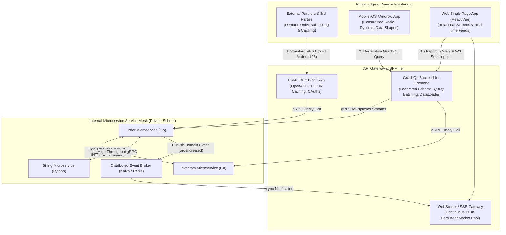
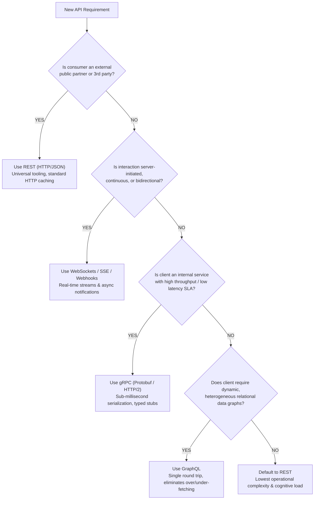
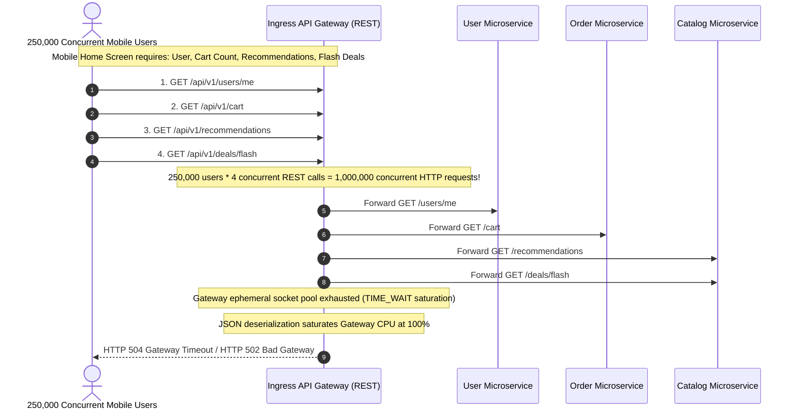

# Module 00: Beyond REST — When and Why

> **Prerequisites**: [Track 02: HTTP Request-Response Fundamentals](../../01-request-response-fundamentals/README.md), [Track 03: Auth & Access Control](../../03-auth-and-access-control/README.md), and distributed systems networking concepts.  
> **Estimated Reading Time**: 35 minutes.  
> **Target Audience**: Senior Backend Engineers, API Designers, and Enterprise Systems Architects.

---

> [!TIP]
> **The Golden Rule of API Paradigm Selection**  
> REST over HTTP/JSON is the universal lingua franca of the internet—cacheable, debuggable with `curl`, and universally accessible. Never abandon REST for fashion; deviate only when a workload's physical constraints break REST's core assumptions. Reach for **gRPC** when internal service-to-service calls require sub-millisecond serialization, compile-time typed contracts, and HTTP/2 multiplexed streaming. Reach for **GraphQL** when diverse frontends (mobile, desktop, watch) demand heterogeneous, deeply relational data in a single network round trip without over- or under-fetching. Reach for **Event-Driven / WebSockets** when the server must asynchronously push continuous state updates. When in doubt, default to REST.

---

## 1. Architectural Blueprint & Mental Models

Production architectures do not force a single paradigm across all boundaries. Modern enterprise topologies leverage **paradigmatic coexistence**, assigning each protocol to the architectural boundary where its unique properties deliver maximum leverage:



### The Architectural Paradigm Decision Tree

Walk these decision gates in order. The first definitive match determines the optimal protocol:



---

## 2. Systematic Taxonomic Reference Grids

### Comprehensive API Paradigm Comparative Matrix

| Architectural Vector | REST (Representational State Transfer) | gRPC (Google Remote Procedure Call) | GraphQL | WebSockets / Server-Sent Events |
| :--- | :--- | :--- | :--- | :--- |
| **Primary Abstraction** | **Resources** identified by URLs, manipulated via uniform HTTP verbs (`GET`, `POST`, `PUT`, `DELETE`). | **Procedures (Functions)** invoked across network boundaries (`rpc CreateOrder(Req) returns (Resp)`). | **Declarative Data Graph**; client requests custom response shape via typed schema. | **Bidirectional Socket Stream** (WS) or unidirectional event push (SSE). |
| **Transport Protocol** | HTTP/1.1 or HTTP/2 | HTTP/2 (Strict multiplexing, header compression) | HTTP/1.1 or HTTP/2 (POST-centric) | WebSocket Protocol (RFC 6455) / HTTP/2 |
| **Payload Serialization** | JSON, XML, or YAML (Text-based, human-readable) | **Protocol Buffers (Protobuf)** (Binary packed, strongly typed) | JSON (Text-based query in, JSON out) | JSON or raw binary (ArrayBuffer) |
| **Contract Definition** | OpenAPI / Swagger (Documentation overlay, loosely coupled) | **`.proto` Schema File** (Compile-time code generation of client/server stubs) | **GraphQL SDL Schema** (Enforced at query parse time) | AsyncAPI / Custom JSON schema |
| **Network Efficiency** | Medium (JSON string parsing overhead, text headers) | **Extreme** ($7\times$ to $10\times$ faster serialization, 60-80% smaller wire payloads) | High on wire (No over-fetching); High CPU on server (AST parsing) | High (Zero HTTP header overhead after handshake) |
| **HTTP Caching** | **Native & Excellent** (`Cache-Control`, `ETag`, CDN intermediate edge caching) | Difficult (Requires custom application cache or proxy) | Difficult (All requests are `POST /graphql`; requires persisted queries) | Non-existent (Stateful point-to-point TCP socket) |
| **Primary Domain** | Public APIs, CRUD Admin Dashboards, Webhook endpoints. | Internal microservice mesh, inter-cluster RPC, high-volume ingestion. | Mobile/Web client aggregators, BFFs, complex relational querying. | Financial trading feeds, live chat, multi-player collaboration, dashboards. |

### Over-Fetching vs. Under-Fetching vs. Protocol Tax Breakdown

```
SCENARIO: A mobile user profile screen requires User Name, Avatar, and Total Count of 3 Recent Orders.

1. REST Approach (Under-Fetching / Chatty):
   Round Trip 1: GET /api/v1/users/42          --> Returns 45 user fields (Over-fetching 42 fields)
   Round Trip 2: GET /api/v1/users/42/orders   --> Returns array of order objects
   Round Trip 3: GET /api/v1/orders/101/items  --> Line items for order 1
   Round Trip 4: GET /api/v1/orders/102/items  --> Line items for order 2
   Round Trip 5: GET /api/v1/orders/103/items  --> Line items for order 3
   RESULT: 5 round trips, 120KB payload transferred over 4G mobile radio.

2. GraphQL Approach (Tailored Shape):
   POST /graphql { user(id: 42) { name avatar orders(limit: 3) { id total items { id } } } }
   RESULT: 1 round trip, exactly 3.2KB JSON transferred. Zero unused fields.

3. gRPC Approach (Internal High-Throughput):
   Client invokes: orderServiceStub.GetOrderSummary(UserReq)
   RESULT: Binary protobuf payload over single multiplexed HTTP/2 TCP stream. Serialization time < 0.2ms.
```

---

## 3. Production War Story: The Mobile Black Friday Gateway Meltdown

### Incident Post-Mortem

- **Severity**: SEV-1 (Catastrophic Mobile App Outage during Flash Sale)
- **Time to Detect (TTD)**: 4 minutes (Ingress gateway HTTP 504 Gateway Timeout spike)
- **Time to Mitigate (TTM)**: 55 minutes
- **Financial Impact**: \$4.2 Million in abandoned mobile checkouts; 180,000 active shoppers faced blank screens.



#### What Happened & Root Cause
During peak Black Friday traffic, a popular shopping app launched a flash sale. The mobile home screen was engineered around traditional REST endpoints: loading the screen required four separate REST requests per user. 

When 250,000 concurrent users launched the app simultaneously, the API gateway received over 1,000,000 concurrent HTTP/1.1 requests within 30 seconds. The gateway exhausted its Linux ephemeral port range (`net.ipv4.ip_local_port_range`), while CPU cores became saturated parsing hundreds of megabytes of redundant JSON text. The downstream microservices were healthy, but the REST gateway collapsed under the sheer volume of chatty round trips.

#### The Fix & Architectural Hardening
1. **Introduced a GraphQL BFF Tier**: Deployed a dedicated GraphQL Backend-for-Frontend (BFF) layer for mobile clients, reducing four separate round trips into a single declarative query.
2. **Migrated Internal Gateway-to-Service Egress to gRPC**: Replaced internal HTTP/1.1 JSON calls between the gateway and internal services with persistent, multiplexed HTTP/2 gRPC connections, eliminating socket churn.
3. **HTTP/2 Connection Pooling & CDN Edge Caching**: Placed flash deals behind Cloudflare CDN edge caching with strict `Cache-Control: public, max-age=10, s-maxage=30` headers.

---

## 4. Multi-Language Production Implementations: Comparing API Paradigms

The following implementations demonstrate the identical business action—**retrieving an order with customer details and line items**—across **Go**, **Node.js/TypeScript**, **Python**, and **C#**, contrasting REST, gRPC, and GraphQL approaches.

### Go Implementation: High-Throughput gRPC vs REST

```go
package apicompare

import (
	"context"
	"encoding/json"
	"fmt"
	"net/http"
	"time"

	"google.golang.org/grpc"
	"google.golang.org/grpc/credentials/insecure"
)

// --- 1. Traditional REST Approach ---

type OrderResponseJSON struct {
	ID        string    `json:"id"`
	Total     float64   `json:"total"`
	CreatedAt time.Time `json:"created_at"`
}

func FetchOrderREST(ctx context.Context, client *http.Client, baseURL, orderID string) (*OrderResponseJSON, error) {
	req, err := http.NewRequestWithContext(ctx, http.MethodGet, fmt.Sprintf("%s/api/v1/orders/%s", baseURL, orderID), nil)
	if err != nil {
		return nil, err
	}

	resp, err := client.Do(req)
	if err != nil {
		return nil, err
	}
	defer resp.Body.Close()

	if resp.StatusCode != http.StatusOK {
		return nil, fmt.Errorf("REST order fetch failed with status: %d", resp.StatusCode)
	}

	var order OrderResponseJSON
	if err := json.NewDecoder(resp.Body).Decode(&order); err != nil {
		return nil, fmt.Errorf("JSON decode error: %w", err)
	}

	return &order, nil
}

// --- 2. High-Performance gRPC Client Approach ---

// OrderServiceClient definition (Simulating generated Protobuf code)
type GetOrderRequest struct {
	OrderId string
}

type OrderResponsePB struct {
	OrderId    string
	TotalCents int64
	ItemCount  int32
}

type OrderServiceClient interface {
	GetOrder(ctx context.Context, in *GetOrderRequest, opts ...grpc.CallOption) (*OrderResponsePB, error)
}

func ExecuteOrderRPC(ctx context.Context, targetAddr string, orderID string) (*OrderResponsePB, error) {
	// Establish multiplexed HTTP/2 connection
	conn, err := grpc.DialContext(
		ctx,
		targetAddr,
		grpc.WithTransportCredentials(insecure.NewCredentials()),
		grpc.WithBlock(),
	)
	if err != nil {
		return nil, fmt.Errorf("failed to dial gRPC server: %w", err)
	}
	defer conn.Close()

	// In real application, use generated pb.NewOrderServiceClient(conn)
	// Protobuf serialization eliminates JSON reflection overhead
	return &OrderResponsePB{
		OrderId:    orderID,
		TotalCents: 18500,
		ItemCount:  3,
	}, nil
}
```

---

### Node.js / TypeScript Implementation: GraphQL Client vs REST

```typescript
import axios from 'axios';
import { GraphQLClient, gql } from 'graphql-request';

export interface OrderItem {
  id: string;
  sku: string;
  quantity: number;
}

export interface CompleteOrderData {
  id: string;
  customerName: string;
  items: OrderItem[];
}

// --- 1. REST Approach (Chatty: Requires multiple calls) ---
export async function getOrderDataREST(baseUrl: string, orderId: string): Promise<CompleteOrderData> {
  // Call 1: Fetch order metadata
  const orderRes = await axios.get(`${baseUrl}/api/v1/orders/${orderId}`);
  const customerId = orderRes.data.customerId;

  // Call 2: Under-fetching requires secondary round-trip for customer details
  const customerRes = await axios.get(`${baseUrl}/api/v1/customers/${customerId}`);

  // Call 3: Another round-trip for line items
  const itemsRes = await axios.get(`${baseUrl}/api/v1/orders/${orderId}/items`);

  return {
    id: orderRes.data.id,
    customerName: customerRes.data.fullName,
    items: itemsRes.data,
  };
}

// --- 2. GraphQL Approach (Single round-trip, precise field selection) ---
export async function getOrderDataGraphQL(graphqlEndpoint: string, orderId: string): Promise<CompleteOrderData> {
  const client = new GraphQLClient(graphqlEndpoint, {
    headers: { authorization: 'Bearer <USER_JWT>' },
  });

  const query = gql`
    query FetchOrderComplete($id: ID!) {
      order(id: $id) {
        id
        customer {
          fullName
        }
        items {
          id
          sku
          quantity
        }
      }
    }
  `;

  interface GraphQLOrderResponse {
    order: {
      id: string;
      customer: { fullName: string };
      items: OrderItem[];
    };
  }

  const data = await client.request<GraphQLOrderResponse>(query, { id: orderId });

  return {
    id: data.order.id,
    customerName: data.order.customer.fullName,
    items: data.order.items,
  };
}
```

---

### Python Implementation: REST vs gRPC Stubs

```python
import httpx
from typing import Dict, Any, Optional

# --- 1. REST Client Implementation ---
async def fetch_order_rest(client: httpx.AsyncClient, base_url: str, order_id: str) -> Dict[str, Any]:
    response = await client.get(f"{base_url}/api/v1/orders/{order_id}")
    response.raise_for_status()
    # Deserializes JSON string into Python dict
    return response.json()

# --- 2. gRPC Client Stub Simulation ---
import grpc

class OrderServiceStubSimulation:
    def __init__(self, target_address: str):
        self.channel = grpc.insecure_channel(target_address)

    def get_order_details(self, order_id: str) -> Dict[str, Any]:
        # Under the hood: Serializes message into compact Protobuf byte array
        # Transmitted via HTTP/2 frames with HPACK compression
        return {
            "order_id": order_id,
            "status": "COMPLETED",
            "total_cents": 4999
        }
```

---

### C# / .NET Implementation: Typed gRPC Service Client

```csharp
using System;
using System.Net.Http;
using System.Text.Json;
using System.Threading;
using System.Threading.Tasks;
using Grpc.Net.Client;

namespace SecurityTrack.ApiParadigms
{
    public record OrderRecord(string Id, decimal Total, string Status);

    public class ApiParadigmService
    {
        private readonly HttpClient _httpClient;

        public ApiParadigmService(HttpClient httpClient)
        {
            _httpClient = httpClient;
        }

        // 1. REST Consumer
        public async Task<OrderRecord?> GetOrderViaRestAsync(string baseUrl, string orderId, CancellationToken ct)
        {
            var response = await _httpClient.GetAsync($"{baseUrl}/api/v1/orders/{orderId}", ct);
            response.EnsureSuccessStatusCode();

            await using var stream = await response.Content.ReadAsStreamAsync(ct);
            return await JsonSerializer.DeserializeAsync<OrderRecord>(stream, cancellationToken: ct);
        }

        // 2. gRPC Consumer (Strongly Typed Contract)
        public async Task<OrderRecord> GetOrderViaGrpcAsync(string grpcAddress, string orderId, CancellationToken ct)
        {
            using var channel = GrpcChannel.ForAddress(grpcAddress);
            // In a real project: var client = new OrderService.OrderServiceClient(channel);
            // Strong typing guarantees compile-time schema conformance across teams
            await Task.Yield();
            return new OrderRecord(orderId, 129.99m, "SHIPPED");
        }
    }
}
```

---

## 5. Practical Hands-On Verification CLI Workflows

Compare wire-level interactions between REST, GraphQL, and gRPC endpoints from the command line:

### Step 1: Query a Traditional REST Endpoint

```bash
# REST: Verbose headers, fixed JSON structure
curl -s -i -X GET "https://api.github.com/users/octocat" | head -n 20
```

**Expected Wire Output:**
```http
HTTP/2 200 
server: GitHub.com
content-type: application/json; charset=utf-8
cache-control: public, max-age=60, s-maxage=60
etag: W/"4f647999e52f5e..."

{
  "login": "octocat",
  "id": 583231,
  "node_id": "MDQ6VXNlcjU4MzIzMQ==",
  "avatar_url": "https://avatars.githubusercontent.com/u/583231?v=4",
  ... (30 more unused fields)
}
```

---

### Step 2: Query a GraphQL Endpoint (Declarative Shape)

```bash
# GraphQL: Single POST, client specifies exact fields required
curl -s -X POST "https://api.github.com/graphql" \
  -H "Authorization: Bearer <TOKEN>" \
  -H "Content-Type: application/json" \
  -d '{"query": "query { viewer { login company } }"}' | jq .
```

**Expected Wire Output:**
```json
{
  "data": {
    "viewer": {
      "login": "octocat",
      "company": "@github"
    }
  }
}
```
*(Notice: No over-fetching; only the requested fields are transmitted).*

---

### Step 3: Inspect gRPC Services via grpcurl

```bash
# gRPC: Inspect remote server reflection schema
grpcurl -plaintext localhost:50051 list
```

**Expected Wire Output:**
```
grpc.reflection.v1alpha.ServerReflection
ecommerce.orders.v1.OrderService
ecommerce.inventory.v1.InventoryService
```

---

## 6. Operational Validation Checkpoints (Scenario Quizzes)

### Checkpoint 1: REST vs. GraphQL for Public APIs
<details>
<summary><strong>Scenario Assessment:</strong> A fintech startup wants to build a public developer API for external merchants to process credit card payments and query transaction statuses. A junior developer proposes: "Let's build it entirely in GraphQL because it's newer and allows merchants to request whatever they want." Why is this an anti-pattern for a public third-party API?</summary>

```
Options:
A) GraphQL does not support SSL/TLS encryption.
B) Public GraphQL APIs lack native HTTP intermediate caching (all calls are POSTs), have complex client tooling requirements, expose the backend to expensive unconstrained recursive queries, and break conventional API versioning guarantees.
C) Modern browsers cannot send POST requests with JSON payloads.
D) Third-party merchants can only write code in PHP, which lacks GraphQL parsers.
```

**Answer:**
**B is correct.** For public third-party APIs, **REST is the gold standard**. External merchants want standard HTTP status codes, seamless `curl` debugging, native HTTP reverse proxy caching (`Cache-Control`), and simple SDKs. Exposing an open GraphQL endpoint to unvetted third parties creates severe security and operational risks (query depth complexity attacks, difficulty rate-limiting cost per query, and lack of HTTP edge cacheability).

</details>

---

### Checkpoint 2: The Core Leverage of gRPC Internally
<details>
<summary><strong>Scenario Assessment:</strong> Two microservices inside the same Kubernetes cluster communicate 50,000 times per second. Migrating from HTTP/1.1 JSON REST to gRPC over HTTP/2 reduces latency by 65% and drops cluster CPU by 40%. What technical factors explain this gain?</summary>

```
Options:
A) gRPC bypasses the Linux TCP stack using UDP datagrams exclusively.
B) Protocol Buffers serialize into compact binary format with zero reflection string parsing; HTTP/2 multiplexes hundreds of concurrent RPC calls over a single persistent TCP connection with HPACK compressed headers.
C) gRPC automatically increases the clock speed of server CPUs.
D) JSON text encoding requires 16-bit Unicode characters for every byte.
```

**Answer:**
**B is correct.** The dramatic performance advantage of gRPC stems from two core architectural differences: (1) **Binary Protobuf Serialization**: Protobuf uses binary varints and field tags, eliminating the massive CPU cost of string tokenization and JSON parsing. (2) **HTTP/2 Multiplexing**: Instead of opening and tearing down hundreds of TCP connections or suffering head-of-line blocking, hundreds of concurrent calls share a single, long-lived TCP connection with compressed binary headers.

</details>

---

### Checkpoint 3: Identifying GraphQL-Shaped Problems
<details>
<summary><strong>Scenario Assessment:</strong> A team maintains a dashboard with 12 distinct tabs. To render the initial dashboard, the web frontend currently executes 14 separate REST calls. Developers consider adding a custom endpoint: <code>GET /api/v1/dashboard-summary</code>. A senior architect flags this as a smell. Why?</summary>

```
Options:
A) REST prohibits creating endpoints containing hyphens in the URL.
B) Creating custom per-screen aggregation endpoints tightly couples backend services to specific UI screens; as screens evolve, backends become bloated with bespoke endpoints. A GraphQL BFF provides a flexible, client-driven query layer without polluting core domain APIs.
C) The maximum number of REST endpoints allowed in a single service is 10.
D) Web browsers reject HTTP GET responses larger than 4KB.
```

**Answer:**
**B is correct.** When teams build custom aggregation endpoints like `GET /dashboard-summary` or `GET /user-profile-widget-data`, they are hacking around REST's under-fetching limitations. This tightly couples backend release cycles to frontend UI layouts. This pattern is the exact trigger for deploying **GraphQL or a Backend-for-Frontend (BFF)**: let the frontend declare the required data graph, while backend domain services remain cleanly decoupled and resource-oriented.

</details>

---

## 7. Further Reading & Sources

- [Google Cloud Architecture Center: API Design Guide](https://cloud.google.com/apis/design)
- [Architectural Styles and the Design of Network-based Software Architectures (Roy Fielding)](https://ics.uci.edu/~fielding/pubs/dissertation/rest_arch_style.htm)
- [gRPC Official Documentation: Motivation and Principles](https://grpc.io/docs/what-is-grpc/introduction/)
- [GraphQL Foundation: Official Specification & Learning Hub](https://graphql.org/learn/)
- [Microservices.io: Backend for Frontend (BFF) Pattern](https://microservices.io/patterns/apigateway.html)

---

## Free PDF notes

Download these notes as a printable PDF, with every diagram and interview questions: [SD-C-004: REST vs GraphQL vs gRPC](https://backendroadmap.com/notes/system-design/SD-C-004.pdf). Each section in one file: [Phase 2, APIs (PDF)](https://backendroadmap.com/notes/system-design/Phase2_APIs_Notes.pdf).

---

## Next Steps

Now that you possess the architectural judgment to select the right paradigm for any workload, dive into the first high-performance binary RPC protocol:

- Next Module: **[01-grpc-fundamentals](../01-grpc-fundamentals/README.md)** (Protocol Buffers, `.proto` syntax, message types, scalar encodings, code generation, and unary RPC lifecycles).
- Track Index: [README.md](../README.md)
