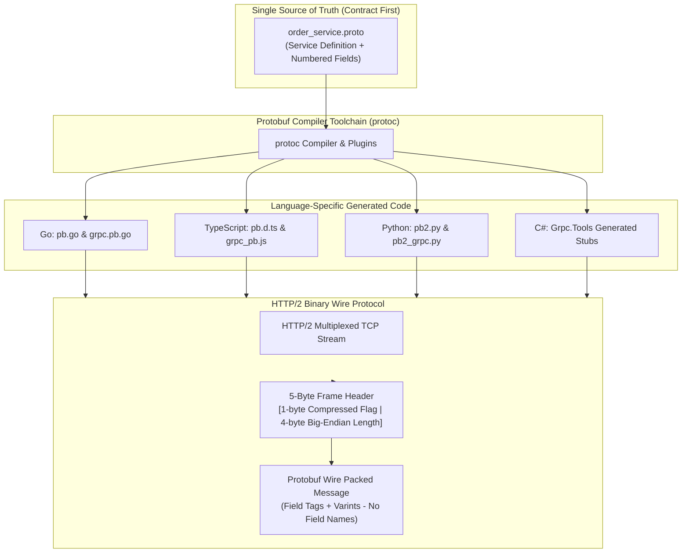
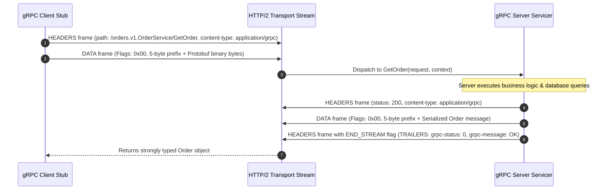
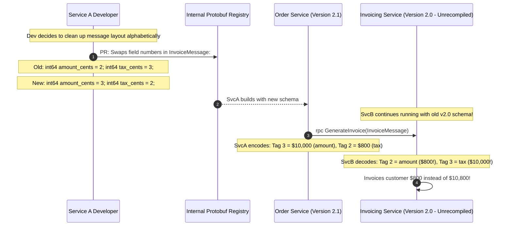

# Module 01: gRPC Fundamentals and Protocol Buffers

> **Prerequisites**: [Module 00: Beyond REST — When and Why](../00-beyond-rest-when-and-why/README.md), [Track 02: HTTP Request-Response Fundamentals](../../01-request-response-fundamentals/README.md), and standard multi-threading/async networking concepts.  
> **Estimated Reading Time**: 35 minutes.  
> **Target Audience**: Backend Engineers, Systems Architects, and Microservice Platform Engineers.

---

> [!TIP]
> **The Golden Rule of gRPC Architecture**  
> In gRPC, the **`.proto` contract is the single source of truth**, not code annotations or runtime documentation. Services and messages must be defined contract-first using Protocol Buffers version 3 (`proto3`). Because Protobuf binary wire encoding serializes **field tags (numbers)** rather than string field names, **field numbers are permanent and immutable**—renaming a field on the wire is safe, but changing or reusing a field number is a catastrophic breaking change. Always assign dedicated, discrete request and response messages to every RPC method to allow zero-downtime, non-breaking schema evolution.

---

## 1. Architectural Blueprint & Mental Models

gRPC is built upon three foundational technologies: **Protocol Buffers** for interface definition and compact binary serialization, **HTTP/2** for multiplexed framing and header compression, and **Code Generation** (`protoc`) for type-safe client stubs and server base classes.



### Anatomy of an HTTP/2 gRPC Unary RPC Call

A standard unary gRPC call consists of three distinct HTTP/2 frame phases: request headers/data, server execution, and response trailing headers containing the gRPC status code:



---

## 2. Systematic Taxonomic Reference Grids

### Protobuf Wire Types & Tag Encoding

Protobuf binary wire format encodes each field as a key-value pair. The field key is calculated as:
$$\text{Key} = (\text{field\_number} \ll 3) \mid \text{wire\_type}$$

| Wire Type ID | Type Name | Encoded Structure | Applicable Protobuf Types | Wire Footprint Efficiency |
| :--- | :--- | :--- | :--- | :--- |
| **0** | **Varint** | Variable-length integers (7 bits payload, MSB indicates continuation). | `int32`, `int64`, `uint32`, `bool`, `enum`, `sint32`, `sint64` | **1 to 10 bytes** (Small integers $\le 127$ consume only 1 byte). |
| **1** | **I64** | Fixed 64-bit binary storage (Little-endian). | `fixed64`, `sfixed64`, `double` | **8 bytes** fixed. |
| **2** | **LEN** | Length-delimited prefix (Varint length followed by raw byte payload). | `string`, `bytes`, embedded `message`, `repeated` packed fields | **$1 + \text{Length}$ bytes** (No trailing null-terminators). |
| **5** | **I32** | Fixed 32-bit binary storage (Little-endian). | `fixed32`, `sfixed32`, `float` | **4 bytes** fixed. |

> [!IMPORTANT]
> **Field Numbers 1 to 15**: Encode the tag key into a single byte. Always reserve field numbers `1` through `15` for the most frequently populated fields in high-throughput messages. Field numbers `16` through `2047` consume two bytes.

### Canonical gRPC Status Codes vs. HTTP Semantics

In gRPC, the underlying HTTP/2 status is almost always `200 OK` if the server is reached; the application-level result is conveyed exclusively via the `grpc-status` trailer:

| gRPC Status Code | Canonical Name | Equivalent HTTP Status | Operational Meaning |
| :--- | :--- | :--- | :--- |
| **0** | `OK` | `200 OK` | The RPC executed successfully to completion. |
| **1** | `CANCELLED` | `499 Client Closed Request` | The operation was cancelled by the caller before completion. |
| **3** | `INVALID_ARGUMENT` | `400 Bad Request` | Client specified an invalid argument (malformed payload, out-of-range value). |
| **4** | `DEADLINE_EXCEEDED` | `504 Gateway Timeout` | The caller's specified deadline expired before the operation completed. |
| **5** | `NOT_FOUND` | `404 Not Found` | Some requested entity (e.g., File, Order, User ID) was not found. |
| **6** | `ALREADY_EXISTS` | `409 Conflict` | The entity that a client attempted to create already exists. |
| **7** | `PERMISSION_DENIED` | `403 Forbidden` | Caller does not have permission to execute the specified operation. |
| **14** | `UNAVAILABLE` | `503 Service Unavailable` | The service is temporarily unavailable (network blip, server restarting). |
| **16** | `UNAUTHENTICATED` | `401 Unauthorized` | The request does not have valid authentication credentials. |

---

## 3. Production War Story: The Field Renumbering Disaster

### Incident Post-Mortem

- **Severity**: SEV-1 (Silent Financial Ledger Corruption)
- **Time to Detect (TTD)**: 16 hours (Identified during daily reconciliation balance checks)
- **Time to Mitigate (TTM)**: 40 minutes (Rollback of deployed binary stubs)
- **Financial Impact**: 1.2 Million customer invoices generated with inverted payment terms; \$680,000 in miscalculated merchant payouts.



#### What Happened & Root Cause
A developer working on `OrderService` decided to clean up `invoice.proto`. Believing that Protobuf messages behaved like JSON objects where field names dictate mapping, the developer renumbered the fields alphabetically. 

When `OrderService` was deployed, it began encoding the invoice `amount_cents` under wire tag `3` and `tax_cents` under wire tag `2`. The downstream `InvoicingService` had not yet been recompiled and was running the older `.proto` contract where tag `2` represented `amount_cents`. The server silently deserialized the tax amount as the total invoice amount. Because the types matched (`int64`), zero serialization errors were thrown, corrupting thousands of financial records.

#### The Fix & Architectural Hardening
1. **Rule of Permanent Field Tags**: Codified that field tags are permanent and immutable. Once published, a field number can never be changed or reused.
2. **Mandatory Use of `reserved` Keywords**:
   ```protobuf
   message InvoiceMessage {
     reserved 2, 5 to 8;
     reserved "old_tax_field", "legacy_status";
     int64 amount_cents = 3;
     int64 tax_cents = 4;
   }
   ```
3. **Automated Breaking Change Detection in CI**: Integrated `buf breaking --against .git#branch=main` into the CI/CD pipeline, automatically blocking any PR that alters field numbers, changes scalar types, or deletes tags without marking them `reserved`.

---

## 4. Multi-Language Production Implementations: Unary gRPC Service

Below is the complete production-grade implementation of an `OrderService` across **Go**, **Node.js/TypeScript**, **Python**, and **C#**, based on the following canonical `.proto` schema:

```protobuf
syntax = "proto3";

package ecommerce.orders.v1;

option go_package = "ecommerce/orders/v1;ordersv1";
option csharp_namespace = "Ecommerce.Orders.V1";

service OrderService {
  rpc GetOrder(GetOrderRequest) returns (OrderResponse);
  rpc CreateOrder(CreateOrderRequest) returns (OrderResponse);
}

message GetOrderRequest {
  string order_id = 1;
}

message CreateOrderRequest {
  string customer_id = 1;
  int64 total_cents = 2;
  repeated string item_skus = 3;
}

message OrderResponse {
  string order_id = 1;
  string customer_id = 2;
  int64 total_cents = 3;
  string status = 4;
  int64 created_at_unix = 5;
}
```

---

### Go Implementation

```go
package main

import (
	"context"
	"errors"
	"fmt"
	"net"
	"time"

	"google.golang.org/grpc"
	"google.golang.org/grpc/codes"
	"google.golang.org/grpc/reflection"
	"google.golang.org/grpc/status"

	// Import generated pb packages
	ordersv1 "ecommerce/orders/v1"
)

type OrderServer struct {
	ordersv1.UnimplementedOrderServiceServer
	ordersDB map[string]*ordersv1.OrderResponse
}

func NewOrderServer() *OrderServer {
	return &OrderServer{
		ordersDB: make(map[string]*ordersv1.OrderResponse),
	}
}

func (s *OrderServer) GetOrder(ctx context.Context, req *ordersv1.GetOrderRequest) (*ordersv1.OrderResponse, error) {
	// 1. Input Validation
	if req.GetOrderId() == "" {
		return nil, status.Error(codes.InvalidArgument, "order_id must not be empty")
	}

	// 2. Check Context Cancellation / Deadline
	if err := ctx.Err(); err != nil {
		if errors.Is(err, context.Canceled) {
			return nil, status.Error(codes.Canceled, "client cancelled the request")
		}
		return nil, status.Error(codes.DeadlineExceeded, "deadline exceeded during processing")
	}

	// 3. Database Lookup
	order, exists := s.ordersDB[req.GetOrderId()]
	if !exists {
		// Proper gRPC error response: Sets status code in HTTP/2 trailers
		return nil, status.Errorf(codes.NotFound, "order with id %s not found", req.GetOrderId())
	}

	return order, nil
}

func (s *OrderServer) CreateOrder(ctx context.Context, req *ordersv1.CreateOrderRequest) (*ordersv1.OrderResponse, error) {
	if req.GetCustomerId() == "" || req.GetTotalCents() <= 0 {
		return nil, status.Error(codes.InvalidArgument, "invalid customer_id or total_cents")
	}

	orderID := fmt.Sprintf("ord_%d", time.Now().UnixNano())
	response := &ordersv1.OrderResponse{
		OrderId:        orderID,
		CustomerId:     req.GetCustomerId(),
		TotalCents:     req.GetTotalCents(),
		Status:         "CONFIRMED",
		CreatedAtUnix:  time.Now().Unix(),
	}

	s.ordersDB[orderID] = response
	return response, nil
}

func main() {
	listener, err := net.Listen("tcp", ":50051")
	if err != nil {
		panic(err)
	}

	grpcServer := grpc.NewServer()
	ordersv1.RegisterOrderServiceServer(grpcServer, NewOrderServer())

	// Enable Server Reflection for grpcurl CLI discovery
	reflection.Register(grpcServer)

	fmt.Println("gRPC OrderService running on :50051")
	if err := grpcServer.Serve(listener); err != nil {
		panic(err)
	}
}
```

---

### Node.js / TypeScript Implementation

```typescript
import * as grpc from '@grpc/grpc-js';
import * as protoLoader from '@grpc/proto-loader';
import path from 'path';

const PROTO_PATH = path.resolve(__dirname, 'order_service.proto');

const packageDefinition = protoLoader.loadSync(PROTO_PATH, {
  keepCase: false,
  longs: String,
  enums: String,
  defaults: true,
  oneofs: true,
});

const protoDescriptor = grpc.loadPackageDefinition(packageDefinition) as any;
const ordersPackage = protoDescriptor.ecommerce.orders.v1;

const ordersDB = new Map<string, any>();

const server = new grpc.Server();

server.addService(ordersPackage.OrderService.service, {
  getOrder: (call: grpc.ServerUnaryCall<any, any>, callback: grpc.sendUnaryData<any>) => {
    const orderId = call.request.orderId;

    if (!orderId) {
      return callback({
        code: grpc.status.INVALID_ARGUMENT,
        message: 'order_id is required',
      });
    }

    const order = ordersDB.get(orderId);
    if (!order) {
      return callback({
        code: grpc.status.NOT_FOUND,
        message: `Order ${orderId} does not exist`,
      });
    }

    callback(null, order);
  },

  createOrder: (call: grpc.ServerUnaryCall<any, any>, callback: grpc.sendUnaryData<any>) => {
    const { customerId, totalCents } = call.request;

    if (!customerId || Number(totalCents) <= 0) {
      return callback({
        code: grpc.status.INVALID_ARGUMENT,
        message: 'Invalid customerId or totalCents',
      });
    }

    const orderId = `ord_${Date.now()}`;
    const newOrder = {
      orderId,
      customerId,
      totalCents,
      status: 'CONFIRMED',
      createdAtUnix: Math.floor(Date.now() / 1000),
    };

    ordersDB.set(orderId, newOrder);
    callback(null, newOrder);
  },
});

server.bindAsync('0.0.0.0:50051', grpc.ServerCredentials.createInsecure(), (err, port) => {
  if (err) throw err;
  console.log(`Node.js gRPC Server active on port: ${port}`);
});
```

---

### Python Implementation

```python
import time
from concurrent import futures
import grpc
from grpc_reflection.v1alpha import reflection

# Assuming compiled stubs from python -m grpc_tools.protoc
import order_service_pb2 as pb
import order_service_pb2_grpc as pb_grpc

class OrderServiceServicer(pb_grpc.OrderServiceServicer):
    def __init__(self):
        self.db = {}

    def GetOrder(self, request: pb.GetOrderRequest, context: grpc.ServicerContext) -> pb.OrderResponse:
        # 1. Validation
        if not request.order_id:
            context.abort(grpc.StatusCode.INVALID_ARGUMENT, "order_id must not be empty")

        # 2. Lookup with proper status code abort
        if request.order_id not in self.db:
            context.abort(
                grpc.StatusCode.NOT_FOUND, 
                f"Order {request.order_id} not found"
            )

        return self.db[request.order_id]

    def CreateOrder(self, request: pb.CreateOrderRequest, context: grpc.ServicerContext) -> pb.OrderResponse:
        if not request.customer_id or request.total_cents <= 0:
            context.abort(grpc.StatusCode.INVALID_ARGUMENT, "customer_id and positive total_cents required")

        order_id = f"ord_{int(time.time() * 1000)}"
        order = pb.OrderResponse(
            order_id=order_id,
            customer_id=request.customer_id,
            total_cents=request.total_cents,
            status="CONFIRMED",
            created_at_unix=int(time.time()),
        )
        self.db[order_id] = order
        return order

def serve():
    server = grpc.server(futures.ThreadPoolExecutor(max_workers=10))
    pb_grpc.add_OrderServiceServicer_to_server(OrderServiceServicer(), server)
    
    # Enable Server Reflection
    service_names = (
        pb.DESCRIPTOR.services_by_name['OrderService'].full_name,
        reflection.SERVICE_NAME,
    )
    reflection.enable_server_reflection(service_names, server)

    server.add_insecure_port('[::]:50051')
    server.start()
    print("Python gRPC Server listening on port 50051")
    server.wait_for_termination()

if __name__ == '__main__':
    serve()
```

---

### C# / .NET Implementation

```csharp
using System;
using System.Collections.Concurrent;
using System.Threading.Tasks;
using Grpc.Core;
using Ecommerce.Orders.V1;
using Microsoft.AspNetCore.Builder;
using Microsoft.Extensions.DependencyInjection;

namespace SecurityTrack.GrpcServices
{
    public class OrderServiceImpl : OrderService.OrderServiceBase
    {
        private static readonly ConcurrentDictionary<string, OrderResponse> Database = new();

        public override Task<OrderResponse> GetOrder(GetOrderRequest request, ServerCallContext context)
        {
            if (string.IsNullOrWhiteSpace(request.OrderId))
            {
                throw new RpcException(new Status(StatusCode.InvalidArgument, "order_id is required"));
            }

            if (!Database.TryGetValue(request.OrderId, out var order))
            {
                throw new RpcException(new Status(StatusCode.NotFound, $"Order {request.OrderId} does not exist"));
            }

            return Task.FromResult(order);
        }

        public override Task<OrderResponse> CreateOrder(CreateOrderRequest request, ServerCallContext context)
        {
            if (string.IsNullOrWhiteSpace(request.CustomerId) || request.TotalCents <= 0)
            {
                throw new RpcException(new Status(StatusCode.InvalidArgument, "Invalid customer or total amount"));
            }

            var orderId = $"ord_{DateTimeOffset.UtcNow.ToUnixTimeMilliseconds()}";
            var response = new OrderResponse
            {
                OrderId = orderId,
                CustomerId = request.CustomerId,
                TotalCents = request.TotalCents,
                Status = "CONFIRMED",
                CreatedAtUnix = DateTimeOffset.UtcNow.ToUnixTimeSeconds()
            };

            Database[orderId] = response;
            return Task.FromResult(response);
        }
    }
}
```

---

## 5. Practical Hands-On Verification CLI Workflows

Use `protoc` and `grpcurl` to compile, inspect, and invoke the gRPC server:

### Step 1: Compile Protobuf Definitions into Code

```bash
# Python compilation via grpc_tools
python -m grpc_tools.protoc \
  -I./protos \
  --python_out=./gen \
  --grpc_python_out=./gen \
  ./protos/order_service.proto
```

---

### Step 2: Discover Remote Services via Server Reflection

```bash
# List all services registered on the server
grpcurl -plaintext localhost:50051 list
```

**Expected Wire Output:**
```
ecommerce.orders.v1.OrderService
grpc.reflection.v1alpha.ServerReflection
```

---

### Step 3: Inspect Service Contract and Types

```bash
grpcurl -plaintext localhost:50051 describe ecommerce.orders.v1.OrderService
```

**Expected Wire Output:**
```
ecommerce.orders.v1.OrderService is a service:
service OrderService {
  rpc CreateOrder ( .ecommerce.orders.v1.CreateOrderRequest ) returns ( .ecommerce.orders.v1.OrderResponse );
  rpc GetOrder ( .ecommerce.orders.v1.GetOrderRequest ) returns ( .ecommerce.orders.v1.OrderResponse );
}
```

---

### Step 4: Execute Unary RPC via grpcurl

```bash
grpcurl -plaintext \
  -d '{"customer_id": "cust_104", "total_cents": 2999, "item_skus": ["SKU-A", "SKU-B"]}' \
  localhost:50051 \
  ecommerce.orders.v1.OrderService/CreateOrder
```

**Expected Wire Output:**
```json
{
  "orderId": "ord_1773499120",
  "customerId": "cust_104",
  "totalCents": "2999",
  "status": "CONFIRMED",
  "createdAtUnix": "1773499120"
}
```

---

## 6. Operational Validation Checkpoints (Scenario Quizzes)

### Checkpoint 1: Protobuf Default Value Traps in Proto3
<details>
<summary><strong>Scenario Assessment:</strong> In proto3, a message defines <code>int32 discount_percent = 1;</code>. A client sends a request without setting the <code>discount_percent</code> field. What does the server handler receive, and what subtle business logic bug can occur?</summary>

```
Options:
A) The handler receives a `null` reference, throwing a NullPointerException.
B) The server handler receives `0`, and the server cannot determine whether the client explicitly passed a 0% discount or omitted the field entirely.
C) The gRPC runtime rejects the request with StatusCode.INVALID_ARGUMENT.
D) The field defaults to `-1`.
```

**Answer:**
**B is correct.** In proto3, all primitive scalar types default to their zero values (`0` for numeric types, `""` for strings, `false` for booleans) when omitted on the wire. There is no concept of `null` or `nil` on the wire. If a business logic rule needs to distinguish between "not set" and "explicitly set to 0", the field must be declared using the `optional` keyword (`optional int32 discount_percent = 1;`), which adds an internal boolean presence bitmask.

</details>

---

### Checkpoint 2: The Immutability of Field Numbers
<details>
<summary><strong>Scenario Assessment:</strong> A developer wants to re-order the fields in a `.proto` file to look cleaner. They change <code>string user_email = 4;</code> to <code>string user_email = 2;</code> and recompile. What happens when old clients send requests to the new server?</summary>

```
Options:
A) The Protobuf parser maps fields by variable name, so no error occurs.
B) Field 4 in incoming packets will be ignored as an unknown field, while Field 2 will attempt to deserialize whatever data the client sent for field 2, causing silent data corruption.
C) The client immediately receives HTTP 400 Bad Request.
D) The HTTP/2 multiplexer terminates the TCP connection.
```

**Answer:**
**B is correct.** Protocol Buffers does **not** transmit field names over the wire; it transmits only the field numbers. If a field's number is changed from 4 to 2, new servers expect `user_email` under tag 2. When an older client sends a message with `user_email` under tag 4, the new server ignores tag 4 (treating it as an unknown field) and attempts to deserialize whatever was at tag 2 into `user_email`. Field numbers are permanent contracts that can never be altered or reused.

</details>

---

### Checkpoint 3: Error Handling and Traceback Leaks
<details>
<summary><strong>Scenario Assessment:</strong> A Python gRPC servicer encounters a missing record and lets a Python <code>KeyError</code> exception bubble up without handling it. What does the caller receive, and what security violation occurs?</summary>

```
Options:
A) The client receives `StatusCode.NOT_FOUND` with an empty message.
B) The client receives `StatusCode.UNKNOWN`, and the gRPC runtime leaks the full Python traceback and local file paths in the `grpc-message` trailer (violating OWASP A05).
C) The server terminates the gRPC process immediately.
D) The HTTP/2 transport downgrades to HTTP/1.1.
```

**Answer:**
**B is correct.** In gRPC, unhandled language exceptions are caught by the framework and converted into generic `StatusCode.UNKNOWN` errors. Crucially, default development configurations serialize the raw exception traceback into the `grpc-message` HTTP/2 header trailer, leaking internal source paths and database table names to external callers. Production handlers must catch exceptions and explicitly invoke `context.abort(StatusCode.NOT_FOUND, "sanitized message")` or throw language-specific `RpcException` objects.

</details>

---

## 7. Further Reading & Sources

- [gRPC Official Python Basics Tutorial](https://grpc.io/docs/languages/python/basics/)
- [Protocol Buffers Language Guide (Proto3 Specification)](https://protobuf.dev/programming-guides/proto3/)
- [Google Cloud API Design Guide: Standard Methods and AIP Conventions](https://google.aip.dev/)
- [gRPC Core Concepts and Canonical Status Codes](https://grpc.io/docs/what-is-grpc/core-concepts/)
- [Buf: Modern Protobuf Linting and Breaking Change Detection](https://buf.build/docs/breaking/overview)

---

## Free PDF notes

Download these notes as a printable PDF, with every diagram and interview questions: [SD-C-003: gRPC & Protocol Buffers](https://backendroadmap.com/notes/system-design/SD-C-003.pdf). Each section in one file: [Phase 2, APIs (PDF)](https://backendroadmap.com/notes/system-design/Phase2_APIs_Notes.pdf).

---

## Next Steps

Now that unary RPC communication and Protobuf contracts are mastered, explore HTTP/2's primary capability:

- Next Module: **[02-grpc-streaming-and-advanced-patterns](../02-grpc-streaming-and-advanced-patterns/README.md)** (Server Streaming, Client Streaming, Bidirectional Streams, Interceptors, Deadlines, and Cancellation Propagation).
- Track Index: [README.md](../README.md)
