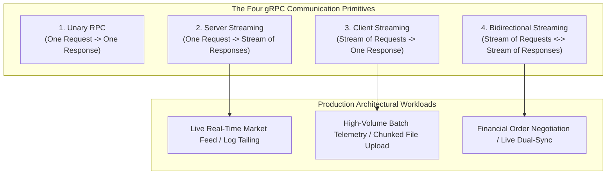
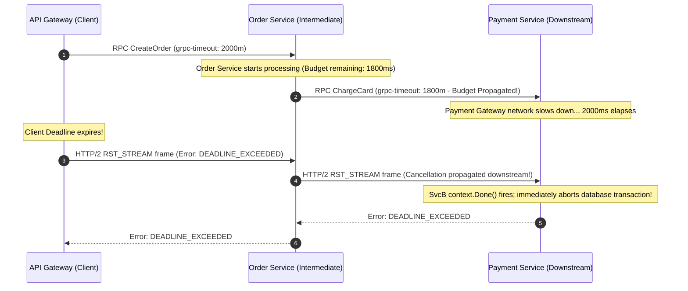
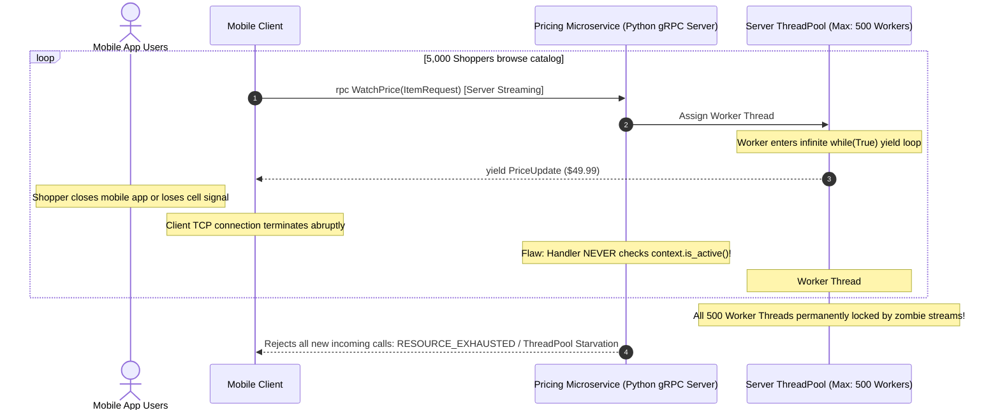

# Module 02: gRPC Streaming and Advanced Patterns

> **Prerequisites**: [Module 01: gRPC Fundamentals](../01-grpc-fundamentals/README.md), HTTP/2 framing concepts, and asynchronous programming primitives (generators, iterators, channels).  
> **Estimated Reading Time**: 35 minutes.  
> **Target Audience**: Senior Backend Engineers, Distributed Systems Engineers, and Platform Architects.

---

> [!TIP]
> **The Golden Rule of Production gRPC Engineering**  
> Every gRPC call in production must be bounded by an **explicit, propagated deadline** (`timeout`), and every server streaming loop must actively monitor **connection liveness** (`context.is_active()` / `ctx.Done()`). In distributed microservices, a missing deadline causes cascading thread starvation across the entire upstream caller chain. Centralize all cross-cutting concerns (authentication, telemetry, tracing, and structured error translation) into **interceptors**, and restrict automated client retries strictly to idempotent operations failing with transient status codes (`UNAVAILABLE`, `RESOURCE_EXHAUSTED`).

---

## 1. Architectural Blueprint & Mental Models

gRPC leverages the full multiplexing power of HTTP/2 to support four distinct communication primitives. Rather than opening separate TCP sockets, multiple concurrent streams are interleaved over a single persistent TCP connection.



### Deadline Propagation & Distributed Cancellation

A gRPC deadline is not merely a local client timeout; it is an absolute wall-clock timestamp transmitted across network boundaries via the `grpc-timeout` header. Downstream services calculate the remaining time budget, automatically aborting work when the budget reaches zero:



---

## 2. Systematic Taxonomic Reference Grids

### The Four gRPC Communication Paradigms

| Paradigm Pattern | Protobuf Signature | Protocol Flow Characteristics | Idiomatic Language Primitives | Primary Failure Mode & Resource Trap |
| :--- | :--- | :--- | :--- | :--- |
| **Unary** | `rpc Op(Req) returns (Resp)` | 1 Request Message $\to$ 1 Response Message. | Standard Async Function / Future. | Indefinite hangs when client omits `deadline`. |
| **Server Streaming** | `rpc Op(Req) returns (stream Resp)` | 1 Request Message $\to$ Infinite or Finite stream of Response Messages. | Generator (`yield` in Python), Channel in Go, `IAsyncEnumerable` in C#. | **Zombie Worker Leak**: Server continues generating events after client disconnects if liveness is not checked. |
| **Client Streaming** | `rpc Op(stream Req) returns (Resp)` | Stream of Request Messages $\to$ 1 Summary Response Message. | Iterator argument in Python, Channel in Go. | High server memory buffer accumulation when processing unbounded streams without backpressure. |
| **Bidirectional Streaming** | `rpc Op(stream Req) returns (stream Resp)` | Full-duplex concurrent streams; messages flow independently in both directions. | Dual independent coroutines/goroutines sharing stream context. | Deadlock if server waits for client to finish before sending, or uncoordinated stream termination. |

### Error Retryability Decision Matrix

| gRPC Status Code | Nature | Is It Safe to Retry? | Architectural Justification | Recommended Retry Policy |
| :--- | :--- | :--- | :--- | :--- |
| `UNAVAILABLE` (14) | Transient | **YES** | Target server is restarting, load balancer blip, or socket connection reset. | Exponential backoff with full jitter (e.g., initial 100ms, max 2s). |
| `RESOURCE_EXHAUSTED` (8) | Transient | **YES** (with caution) | Upstream rate limiter tripped or worker pool temporarily full. | Backoff honoring `Retry-After` metadata from server. |
| `DEADLINE_EXCEEDED` (4) | Ambiguous | **CONDITIONAL** | Safe **only if** the target RPC is provably **idempotent** (e.g., read or carries idempotency key). | Do not retry non-idempotent creates without unique idempotency token. |
| `INVALID_ARGUMENT` (3) | Permanent | **NEVER** | The request body violated schema constraints; retrying the exact payload will fail again. | Surface HTTP 400 Bad Request to caller immediately. |
| `NOT_FOUND` (5) | Permanent | **NEVER** | The requested resource key does not exist in the database. | Return HTTP 404 to caller. |
| `PERMISSION_DENIED` (7) | Permanent | **NEVER** | Caller lacks the required RBAC/ABAC role or authorization scope. | Return HTTP 403 Forbidden. |
| `ALREADY_EXISTS` (6) | Permanent | **NEVER** | Resource unique constraint violation (e.g., duplicate email). | Return HTTP 409 Conflict. |

---

## 3. Production War Story: The Zombie Server-Stream Storm

### Incident Post-Mortem

- **Severity**: SEV-1 (Complete Microservice Cluster Collapse)
- **Time to Detect (TTD)**: 15 minutes (Triggered by 100% thread pool exhaustion alerts)
- **Time to Mitigate (TTM)**: 35 minutes
- **Impact**: All inventory and pricing RPCs timed out; 80,000 active checkout sessions frozen.



#### What Happened & Root Cause
A retail pricing service implemented a server-streaming RPC: `WatchPrice(ProductRequest) returns (stream PriceUpdate)`. The Python servicer handler was written as:
```python
# VULNERABLE: Infinite yield loop with zero connection liveness checks
def WatchPrice(self, request, context):
    while True:
        price = calculate_dynamic_price(request.item_id)
        yield prices_pb2.PriceUpdate(price=price)
        time.sleep(1)
```
When shoppers closed the mobile app or entered subway tunnels, their client connections terminated. However, because the handler did not check `context.is_active()`, the server thread continued looping forever, calculating prices for ghost connections. Within 20 minutes of a marketing notification blast, all 500 worker threads in the gRPC server's `ThreadPoolExecutor` were permanently consumed by zombie generators, rendering the service completely unresponsive.

#### The Fix & Architectural Hardening
1. **Mandated Liveness Checks on All Stream Yields**:
   ```python
   def WatchPrice(self, request, context):
       while context.is_active():  # Stops loop immediately on client disconnect
           yield prices_pb2.PriceUpdate(price=fetch_price())
           time.sleep(1)
   ```
2. **Migrated to AsyncIO gRPC**: Replaced the thread-blocking `grpc.server(ThreadPoolExecutor)` with the native `grpc.aio.server()`, enabling lightweight asynchronous coroutines that release memory immediately upon cancellation.
3. **Hard Stream Lifetimes**: Enforced a maximum lifetime of 10 minutes on all streaming subscriptions, requiring clients to reconnect and re-authenticate.

---

## 4. Multi-Language Production Implementations: Streaming & Interceptor Guard

Below is the complete, production-grade implementation of a Streaming Service featuring:
- Server streaming with active cancellation and liveness detection.
- Server interceptor enforcing JWT metadata authentication.
- Client stubs configured with strict deadlines.

### The Canonical Proto Schema

```protobuf
syntax = "proto3";

package market.feed.v1;

option go_package = "market/feed/v1;feedv1";
option csharp_namespace = "Market.Feed.V1";

service MarketFeedService {
  // Server Streaming: Caller subscribes to real-time price updates
  rpc WatchTicker(TickerRequest) returns (stream TickerUpdate);
  // Client Streaming: Worker streams batch telemetry ticks
  rpc IngestTicks(stream TickerTick) returns (IngestSummary);
}

message TickerRequest {
  string symbol = 1;
}

message TickerUpdate {
  string symbol = 1;
  int64 price_cents = 2;
  int64 timestamp_unix = 3;
}

message TickerTick {
  string symbol = 1;
  int64 price_cents = 2;
}

message IngestSummary {
  int64 total_ticks_processed = 1;
}
```

---

### Go Implementation

```go
package main

import (
	"context"
	"errors"
	"fmt"
	"log/slog"
	"net"
	"strings"
	"time"

	"google.golang.org/grpc"
	"google.golang.org/grpc/codes"
	"google.golang.org/grpc/metadata"
	"google.golang.org/grpc/status"

	feedv1 "market/feed/v1"
)

type MarketServer struct {
	feedv1.UnimplementedMarketFeedServiceServer
}

// WatchTicker demonstrates server streaming with explicit context cancellation handling
func (s *MarketServer) WatchTicker(req *feedv1.TickerRequest, stream feedv1.MarketFeedService_WatchTickerServer) error {
	ctx := stream.Context()
	ticker := time.NewTicker(500 * time.Millisecond)
	defer ticker.Stop()

	var price int64 = 15000 // $150.00 base

	for {
		select {
		case <-ctx.Done():
			// Client disconnected, cancelled, or deadline expired
			if errors.Is(ctx.Err(), context.Canceled) {
				return status.Error(codes.Canceled, "client closed stream")
			}
			return status.Error(codes.DeadlineExceeded, "stream deadline exceeded")
		case t := <-ticker.C:
			price += 25 // Simulated price movement
			update := &feedv1.TickerUpdate{
				Symbol:        req.GetSymbol(),
				PriceCents:    price,
				TimestampUnix: t.Unix(),
			}

			if err := stream.Send(update); err != nil {
				return fmt.Errorf("failed to send stream message: %w", err)
			}
		}
	}
}

// IngestTicks demonstrates client streaming
func (s *MarketServer) IngestTicks(stream feedv1.MarketFeedService_IngestTicksServer) error {
	var count int64
	for {
		tick, err := stream.Recv()
		if errors.Is(err, context.Canceled) {
			return status.Error(codes.Canceled, "client aborted upload")
		}
		if err != nil {
			// Stream completed by client
			return stream.SendAndClose(&feedv1.IngestSummary{
				TotalTicksProcessed: count,
			})
		}
		count++
		_ = tick // Process tick
	}
}

// AuthServerInterceptor enforces JWT Bearer tokens from gRPC metadata
func AuthServerInterceptor(ctx context.Context, req any, info *grpc.UnaryServerInfo, handler grpc.UnaryHandler) (any, error) {
	md, ok := metadata.FromIncomingContext(ctx)
	if !ok {
		return nil, status.Error(codes.Unauthenticated, "metadata missing")
	}

	authHeaders := md.Get("authorization")
	if len(authHeaders) == 0 || !strings.HasPrefix(authHeaders[0], "Bearer ") {
		return nil, status.Error(codes.Unauthenticated, "missing or malformed bearer token")
	}

	token := strings.TrimPrefix(authHeaders[0], "Bearer ")
	if token != "valid-production-jwt-secret" {
		return nil, status.Error(codes.PermissionDenied, "invalid token credentials")
	}

	return handler(ctx, req)
}

func main() {
	lis, err := net.Listen("tcp", ":50051")
	if err != nil {
		panic(err)
	}

	server := grpc.NewServer(
		grpc.UnaryInterceptor(AuthServerInterceptor),
	)
	feedv1.RegisterMarketFeedServiceServer(server, &MarketServer{})

	fmt.Println("gRPC Server listening on :50051")
	if err := server.Serve(lis); err != nil {
		panic(err)
	}
}
```

---

### Node.js / TypeScript Implementation

```typescript
import * as grpc from '@grpc/grpc-js';
import * as protoLoader from '@grpc/proto-loader';
import path from 'path';

const PROTO_PATH = path.resolve(__dirname, 'market_feed.proto');
const packageDef = protoLoader.loadSync(PROTO_PATH, { keepCase: false, defaults: true });
const proto = (grpc.loadPackageDefinition(packageDef) as any).market.feed.v1;

const server = new grpc.Server();

server.addService(proto.MarketFeedService.service, {
  // Server Streaming Implementation with liveness detection
  watchTicker: (call: grpc.ServerWritableStream<any, any>) => {
    const symbol = call.request.symbol || 'UNKNOWN';
    let currentPrice = 10000;

    const intervalId = setInterval(() => {
      // Check if client has cancelled or disconnected
      if (call.cancelled) {
        clearInterval(intervalId);
        return;
      }

      currentPrice += Math.floor(Math.random() * 50) - 20;
      call.write({
        symbol,
        priceCents: currentPrice,
        timestampUnix: Math.floor(Date.now() / 1000),
      });
    }, 500);

    call.on('cancelled', () => {
      clearInterval(intervalId);
      console.log(`Client disconnected from ${symbol} stream`);
    });

    call.on('error', err => {
      clearInterval(intervalId);
      console.error('Stream error:', err);
    });
  },

  // Client Streaming Implementation
  ingestTicks: (call: grpc.ServerReadableStream<any, any>, callback: grpc.sendUnaryData<any>) => {
    let tickCount = 0;

    call.on('data', tick => {
      tickCount++;
    });

    call.on('end', () => {
      callback(null, { totalTicksProcessed: tickCount });
    });

    call.on('error', err => {
      callback({ code: grpc.status.INTERNAL, message: err.message });
    });
  },
});

server.bindAsync('0.0.0.0:50051', grpc.ServerCredentials.createInsecure(), (err, port) => {
  if (err) throw err;
  console.log(`TypeScript gRPC streaming server active on :${port}`);
});
```

---

### Python Implementation (AsyncIO)

```python
import asyncio
import grpc
from grpc import aio

import market_feed_pb2 as pb
import market_feed_pb2_grpc as pb_grpc

class MarketFeedServicer(pb_grpc.MarketFeedServiceServicer):
    # Server Streaming with cancellation guard
    async def WatchTicker(self, request: pb.TickerRequest, context: aio.ServicerContext):
        symbol = request.symbol
        price = 10000

        while True:
            # Crucial: Check if client disconnected or deadline expired
            if context.done():
                break

            price += 10
            yield pb.TickerUpdate(
                symbol=symbol,
                price_cents=price,
                timestamp_unix=int(asyncio.get_event_loop().time())
            )
            await asyncio.sleep(0.5)

    # Client Streaming
    async def IngestTicks(self, request_iterator, context: aio.ServicerContext):
        count = 0
        async for tick in request_iterator:
            count += 1
        return pb.IngestSummary(total_ticks_processed=count)

# Authentication Interceptor
class AuthInterceptor(aio.ServerInterceptor):
    async def intercept_service(self, continuation, handler_call_details):
        metadata = dict(handler_call_details.invocation_metadata)
        token = metadata.get("authorization", "")

        if not token.startswith("Bearer valid-secret-key"):
            async def abort_handler(request, context):
                await context.abort(grpc.StatusCode.UNAUTHENTICATED, "Invalid Bearer Token")
            return grpc.unary_unary_rpc_method_handler(abort_handler)

        return await continuation(handler_call_details)

async def serve():
    server = aio.server(interceptors=[AuthInterceptor()])
    pb_grpc.add_MarketFeedServiceServicer_to_server(MarketFeedServicer(), server)
    server.add_insecure_port('[::]:50051')
    await server.start()
    print("Python AsyncIO gRPC server listening on port 50051")
    await server.wait_for_termination()

if __name__ == '__main__':
    asyncio.run(serve())
```

---

### C# / .NET Implementation

```csharp
using System;
using System.Threading;
using System.Threading.Tasks;
using Grpc.Core;
using Market.Feed.V1;

namespace SecurityTrack.Streaming
{
    public class MarketFeedServiceImpl : MarketFeedService.MarketFeedServiceBase
    {
        // Server Streaming with CancellationToken Propagation
        public override async Task WatchTicker(
            TickerRequest request, 
            IServerStreamWriter<TickerUpdate> responseStream, 
            ServerCallContext context)
        {
            var price = 25000L;
            var cancellationToken = context.CancellationToken;

            while (!cancellationToken.IsCancellationRequested)
            {
                price += 15;
                var update = new TickerUpdate
                {
                    Symbol = request.Symbol,
                    PriceCents = price,
                    TimestampUnix = DateTimeOffset.UtcNow.ToUnixTimeSeconds()
                };

                await responseStream.WriteAsync(update);

                try
                {
                    // Cooperative delay respecting cancellation token
                    await Task.Delay(500, cancellationToken);
                }
                catch (TaskCanceledException)
                {
                    break; // Clean exit when client terminates stream
                }
            }
        }

        // Client Streaming
        public override async Task<IngestSummary> IngestTicks(
            IAsyncStreamReader<TickerTick> requestStream, 
            ServerCallContext context)
        {
            long tickCount = 0;

            while (await requestStream.MoveNext(context.CancellationToken))
            {
                var tick = requestStream.Current;
                tickCount++;
            }

            return new IngestSummary { TotalTicksProcessed = tickCount };
        }
    }
}
```

---

## 5. Practical Hands-On Verification CLI Workflows

### Step 1: Subscribe to Server Stream via grpcurl

```bash
# Connect to streaming endpoint with a 5-second deadline
grpcurl -plaintext -max-time 5 \
  -d '{"symbol": "BTC-USD"}' \
  localhost:50051 \
  market.feed.v1.MarketFeedService/WatchTicker
```

**Expected Wire Output (Streamed Line-by-Line):**
```json
{
  "symbol": "BTC-USD",
  "priceCents": "15025",
  "timestampUnix": "1773499401"
}
{
  "symbol": "BTC-USD",
  "priceCents": "15050",
  "timestampUnix": "1773499402"
}
{
  "symbol": "BTC-USD",
  "priceCents": "15075",
  "timestampUnix": "1773499403"
}
```

---

### Step 2: Verify Unauthenticated Metadata Rejection via Interceptor

```bash
# Call without Bearer token
grpcurl -plaintext localhost:50051 market.feed.v1.MarketFeedService/WatchTicker
```

**Expected Wire Output:**
```
ERROR:
  Code: Unauthenticated
  Message: missing or malformed bearer token
```

---

### Step 3: Trigger Client Deadline Expiration

```bash
# Set an impossible 50ms deadline on a streaming call
grpcurl -plaintext -max-time 0.05 \
  -d '{"symbol": "AAPL"}' \
  localhost:50051 \
  market.feed.v1.MarketFeedService/WatchTicker
```

**Expected Wire Output:**
```
ERROR:
  Code: DeadlineExceeded
  Message: timeout exceeded before completion
```

---

## 6. Operational Validation Checkpoints (Scenario Quizzes)

### Checkpoint 1: Client Disconnection & Server Resource Leaks
<details>
<summary><strong>Scenario Assessment:</strong> You deploy a server-streaming gRPC service in Python using standard synchronous <code>ThreadPoolExecutor</code>. Under peak traffic, thousands of clients connect and disconnect. After 2 hours, CPU is normal, but the server stops accepting any new requests. Why?</summary>

```
Options:
A) The server ran out of Protobuf field numbers.
B) Each disconnected client left a generator running inside a worker thread because the handler lacked `context.is_active()` checks, permanently leaking all thread pool workers into zombie loops.
C) HTTP/2 enforces a global ceiling of 100 total lifetime streams per IP.
D) The server's SSL certificate expired prematurely.
```

**Answer:**
**B is correct.** When using a thread-pool-backed synchronous gRPC server, every active stream occupies a dedicated OS worker thread. If the handler executes an infinite `yield` loop without verifying `context.is_active()`, the thread continues executing even after the client disconnects and the TCP socket closes. Over time, every worker in the `ThreadPoolExecutor` becomes a "zombie", causing thread starvation and blocking all incoming connections.

</details>

---

### Checkpoint 2: Deadlines vs. Local Timeouts
<details>
<summary><strong>Scenario Assessment:</strong> An API Gateway calls Service A, which calls Service B. Service B hangs on a slow database query. The Gateway has a 2-second timeout, but uses raw HTTP client timeouts rather than gRPC deadlines. What happens?</summary>

```
Options:
A) Service B immediately detects the Gateway timeout and cancels its query.
B) The Gateway aborts its connection to Service A after 2 seconds, but Service A and Service B continue executing the expensive database query to completion, wasting server CPU and database locks.
C) The database drops the table due to lock contention.
D) The Gateway automatically retries the call on port 80.
```

**Answer:**
**B is correct.** A standard local client timeout only cancels the local connection; the remote server has no awareness that the client gave up. In contrast, **gRPC deadlines propagate across the network wire** via the `grpc-timeout` header. Service A and Service B both receive the deadline; when the deadline expires, the gRPC runtime fires cancellation tokens down the entire call graph, aborting in-flight work immediately.

</details>

---

### Checkpoint 3: Safe Client Retry Policies
<details>
<summary><strong>Scenario Assessment:</strong> A microservice team configures a declarative gRPC client retry policy that automatically retries any call failing with <code>DEADLINE_EXCEEDED</code> up to 3 times. The endpoint is <code>rpc ChargeCreditCard(ChargeRequest) returns (ChargeResponse)</code>. What catastrophic outcome will occur during network latency spikes?</summary>

```
Options:
A) The client will be banned by the gRPC reflection engine.
B) If the payment gateway charged the card successfully but the response was delayed past the deadline, the client will retry the call, charging the customer's card multiple times.
C) The Protobuf binary payload will be converted to XML.
D) The HTTP/2 multiplexer will split the stream into separate TCP sockets.
```

**Answer:**
**B is correct.** `DEADLINE_EXCEEDED` is an ambiguous status: it means the client stopped waiting, but does **not** guarantee the server did not process the mutation. Retrying a non-idempotent operation like `ChargeCreditCard` will charge the customer repeatedly. Non-idempotent operations must either **never be retried automatically**, or must require a unique client-generated **Idempotency Key** so that retried calls are safely deduplicated by the server.

</details>

---

## 7. Further Reading & Sources

- [gRPC Core Concepts: The Streaming RPC Lifecycle](https://grpc.io/docs/what-is-grpc/core-concepts/)
- [gRPC Deadlines: Best Practices for Distributed Systems](https://grpc.io/docs/guides/deadlines/)
- [gRPC Retries: Declarative Service Config Specification](https://grpc.io/docs/guides/retry/)
- [gRPC Interceptors: Architecture and Middleware Patterns](https://grpc.io/docs/guides/interceptors/)
- [IETF RFC 7540: Hypertext Transfer Protocol Version 2 (HTTP/2)](https://datatracker.ietf.org/doc/html/rfc7540)

---

## Next Steps

Now that you have mastered high-throughput internal RPCs, streaming, deadlines, and interceptors, pivot to the primary paradigm for frontend client aggregation:

- Next Module: **[03-graphql-fundamentals](../03-graphql-fundamentals/README.md)** (GraphQL SDL Schemas, Queries, Mutations, Resolvers, N+1 Problem, and DataLoader).
- Track Index: [README.md](../README.md)
