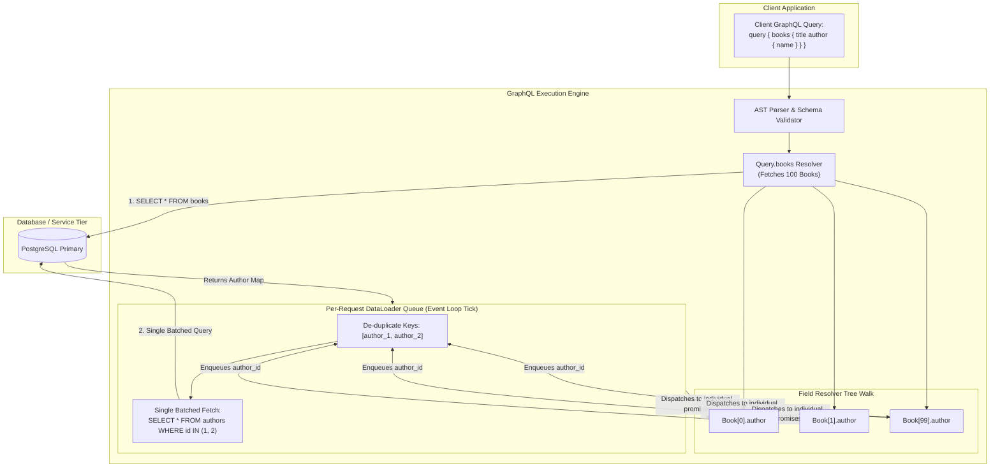
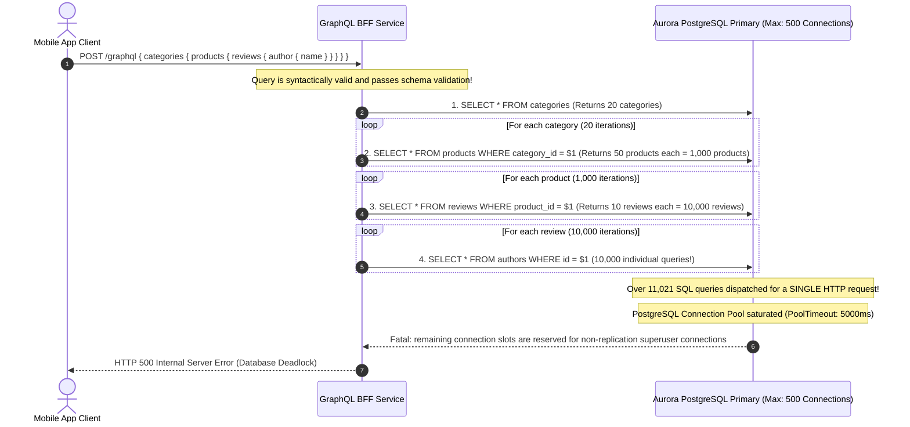

# Module 03: GraphQL Fundamentals and the N+1 Problem

> **Prerequisites**: [Module 00: Beyond REST — When and Why](../00-beyond-rest-when-and-why/README.md), [Track 02: HTTP Request-Response Fundamentals](../../01-request-response-fundamentals/README.md), and relational database SQL query optimization.  
> **Estimated Reading Time**: 35 minutes.  
> **Target Audience**: Backend Engineers, Full-Stack Architects, and API Platform Developers.

---

> [!TIP]
> **The Golden Rule of GraphQL Architecture**  
> GraphQL grants clients the power to declare their desired response shape, but **resolves data field-by-field as an abstract syntax tree (AST)**. Because naive nested field resolvers execute independently, fetching relational child objects without batching triggers the catastrophic **N+1 Query Problem**, converting a single HTTP query into thousands of synchronous database round trips. In production, **every relational field resolver must be backed by a request-scoped DataLoader**. Never reuse DataLoader instances across distinct HTTP requests—DataLoaders must be instantiated per request to prevent cross-tenant data cache poisoning.

---

## 1. Architectural Blueprint & Mental Models

In contrast to REST endpoints that return static pre-computed payloads, GraphQL operates as an execution engine that parses an incoming query string into an Abstract Syntax Tree (AST), validates it against the Schema Definition Language (SDL), and executes field resolvers recursively.



### The N+1 Database Explosion vs. DataLoader Batching

Without a DataLoader, resolving a list of $N$ books and their corresponding authors triggers $1$ initial query plus $N$ individual child queries:

```mermaid
sequenceDiagram
    autonumber
    participant Client as Web / Mobile Client
    participant Resolver as GraphQL Execution Engine
    participant DB as PostgreSQL Database

    Client->>Resolver: POST /graphql { books(limit: 5) { title author { name } } }
    Resolver->>DB: 1. SELECT * FROM books LIMIT 5;
    DB-->>Resolver: Returns 5 Books (Authors: ID 1, 2, 1, 3, 2)
    
    rect rgb(255, 220, 220)
    Note over Resolver,DB: VULNERABLE: Naive Resolver Execution (N+1 Storm)
    Resolver->>DB: 2. SELECT * FROM authors WHERE id = 1;
    Resolver->>DB: 3. SELECT * FROM authors WHERE id = 2;
    Resolver->>DB: 4. SELECT * FROM authors WHERE id = 1; (Redundant!)
    Resolver->>DB: 5. SELECT * FROM authors WHERE id = 3;
    Resolver->>DB: 6. SELECT * FROM authors WHERE id = 2; (Redundant!)
    Note over DB: Total: 6 distinct database network round trips!
    end

    rect rgb(220, 255, 220)
    Note over Resolver,DB: HARDENED: DataLoader Batching & Deduplication
    Resolver->>Resolver: DataLoader coalesces unique author IDs: [1, 2, 3]
    Resolver->>DB: 2. SELECT * FROM authors WHERE id IN (1, 2, 3);
    DB-->>Resolver: Returns 3 Author records in a single round trip
    Note over DB: Total: Exactly 2 database network round trips!
    end
    Resolver-->>Client: 200 OK (Clean Nested JSON Response)
```

---

## 2. Systematic Taxonomic Reference Grids

### API Paradigm Comparison: REST vs. gRPC vs. GraphQL

| Architectural Dimension | REST (Track 02) | gRPC (Modules 01–02) | GraphQL (Modules 03–04) |
| :--- | :--- | :--- | :--- |
| **Entry Point Model** | Multi-endpoint URLs (`/users`, `/orders/:id`). | Multi-method RPC service stubs. | **Single Endpoint** (`POST /graphql`). |
| **Client Control** | Low (Server dictates fixed representation). | Low (Strict request/response message contracts). | **Maximum** (Client declares exact fields and relations). |
| **Network Efficiency** | Moderate (Suffers from over-/under-fetching). | **Highest** (HTTP/2 binary Protobuf frames). | High on wire (No excess fields); High CPU on server (AST evaluation). |
| **Database Query Patterns** | Predictable (Handlers map 1:1 to pre-optimized SQL queries). | Predictable (RPC handlers execute static queries). | **Dynamic & Unbounded** (Client query depth dictates DB queries; requires DataLoader). |
| **Edge HTTP Caching** | **Native** (URLs and HTTP `GET` verbs cached by CDNs). | Difficult (Requires custom application proxies). | **Non-Trivial** (POST payloads require persisted queries or hash-caching). |
| **Contract Enforcement** | OpenAPI JSON schema (Loose runtime checks). | `.proto` compiler (`protoc` compile-time stubs). | **GraphQL SDL Schema** (Enforced at query parse time). |

### DataLoader Contract & Ordering Invariants

When implementing a batch loading function for a DataLoader, three absolute invariants must be honored:

| DataLoader Invariant | Operational Requirement | Architectural Consequence If Violated |
| :--- | :--- | :--- |
| **1. Length Parity** | The returned array of results **must have the exact same length** as the array of input keys. | The DataLoader throws `TypeError: DataLoader must be constructed with a function which accepts Array<key> and returns Promise<Array<value>> of the same length`. |
| **2. Index Alignment** | Each index in the results array **must correspond directly** to the key at the identical index in the input array. | If key order is shuffled (e.g., SQL `WHERE IN` returns rows in arbitrary order), child data will be mapped to the wrong parent entities. |
| **3. Request Scoping** | A DataLoader instance must be created fresh for **every unique HTTP request context**. | Storing DataLoaders in global or singleton scope causes severe security breaches: User B will see cached records loaded by User A (Cross-Tenant Data Leak). |

---

## 3. Production War Story: The 100,000-Query Cascade

### Incident Post-Mortem

- **Severity**: SEV-1 (Production Database Exhaustion & Outage)
- **Time to Detect (TTD)**: 3 minutes (AWS Aurora PostgreSQL CPU hit 100%)
- **Time to Mitigate (TTM)**: 25 minutes
- **Financial Impact**: \$320,000 in delayed e-commerce order processing; connection pool saturation took down payment webhooks.



#### What Happened & Root Cause
A mobile team deployed a new nested query: fetching product categories, their products, recent reviews, and review authors. The backend developers implemented standard object-oriented field resolvers in Strawberry/Python:
```python
# VULNERABLE: Field resolver executes a synchronous database query per object
@strawberry.field
def author(self) -> Author:
    return db.query(Author).filter(Author.id == self.author_id).first()
```
Because the resolver was called individually for every nested leaf node in the query tree, a single HTTP request generated over 11,000 sequential SQL queries. When 50 concurrent mobile clients loaded the home screen, over 500,000 queries bombarded the database within seconds, exhausting Aurora's connection pool and knocking out core checkout pipelines.

#### The Fix & Hardening
1. **Integrated Request-Scoped DataLoaders**: Wrapped all relational lookups (`products_by_category`, `reviews_by_product`, `author_by_id`) in DataLoaders using SQL `WHERE id = ANY($1)` batch queries, reducing the 11,000 queries to exactly 4 SQL calls.
2. **Enforced Query Depth Limiting**: Configured maximum query depth protection (`max_depth=4`), rejecting deeply nested queries before execution.
3. **Query Complexity Budgeting**: Assigned cost points to fields and rejected queries exceeding 500 complexity points.

---

## 4. Multi-Language Production Implementations: Schema, Resolvers & DataLoader

Below is the complete production-grade implementation of a GraphQL service resolving Authors and Books with strict N+1 protection across **Go**, **Node.js/TypeScript**, **Python**, and **C#**.

### The Canonical GraphQL Schema (SDL)

```graphql
type Author {
  id: ID!
  name: String!
}

type Book {
  id: ID!
  title: String!
  author: Author!
}

type Query {
  books(limit: Int): [Book!]!
}

type Mutation {
  createBook(title: String!, authorId: ID!): Book!
}
```

---

### Python Implementation (Strawberry + Async DataLoader)

```python
import asyncio
from typing import List, Dict, Optional
import strawberry
from strawberry.dataloader import DataLoader
from fastapi import FastAPI, Request
from strawberry.fastapi import GraphQLRouter

# --- 1. Database Simulation ---

AUTHORS_DB = {
    "1": {"id": "1", "name": "Frank Herbert"},
    "2": {"id": "2", "name": "Isaac Asimov"},
}

BOOKS_DB = [
    {"id": "101", "title": "Dune", "author_id": "1"},
    {"id": "102", "title": "Dune Messiah", "author_id": "1"},
    {"id": "103", "title": "Foundation", "author_id": "2"},
    {"id": "104", "title": "Second Foundation", "author_id": "2"},
]

# --- 2. DataLoader Batch Function ---

async def batch_load_authors(keys: List[str]) -> List[Optional["Author"]]:
    # Single batched SQL query: SELECT * FROM authors WHERE id = ANY(:keys)
    print(f"--> [DB BATCH FETCH] Fetching authors for IDs: {keys}")
    author_map = {k: Author(id=v["id"], name=v["name"]) for k, v in AUTHORS_DB.items() if k in keys}
    
    # Invariant: Must return items in exact order of requested keys
    return [author_map.get(k) for k in keys]

# --- 3. GraphQL Schema Definitions ---

@strawberry.type
class Author:
    id: strawberry.ID
    name: str

@strawberry.type
class Book:
    id: strawberry.ID
    title: str
    author_id: strawberry.Private[str]

    # Resolves author using the request-scoped DataLoader
    @strawberry.field
    async def author(self, info: strawberry.Info) -> Author:
        loader: DataLoader[str, Author] = info.context["author_loader"]
        return await loader.load(self.author_id)

@strawberry.type
class Query:
    @strawberry.field
    def books(self, limit: Optional[int] = 10) -> List[Book]:
        return [
            Book(id=b["id"], title=b["title"], author_id=b["author_id"])
            for b in BOOKS_DB[:limit]
        ]

@strawberry.type
class Mutation:
    @strawberry.mutation
    def create_book(self, title: str, author_id: str) -> Book:
        new_id = str(len(BOOKS_DB) + 101)
        new_book = {"id": new_id, "title": title, "author_id": author_id}
        BOOKS_DB.append(new_book)
        return Book(id=new_id, title=title, author_id=author_id)

# --- 4. Context Factory: Ensures DataLoader is Per-Request ---

async def get_context(request: Request):
    return {
        "request": request,
        # Critical: Instantiate a NEW DataLoader per HTTP request
        "author_loader": DataLoader(load_fn=batch_load_authors),
    }

schema = strawberry.Schema(query=Query, mutation=Mutation)
graphql_app = GraphQLRouter(schema, context_getter=get_context)

app = FastAPI()
app.include_router(graphql_app, prefix="/graphql")
```

---

### Node.js / TypeScript Implementation (GraphQL + DataLoader)

```typescript
import express from 'express';
import { createHandler } from 'graphql-http/lib/use/express';
import { GraphQLSchema, GraphQLObjectType, GraphQLString, GraphQLID, GraphQLList, GraphQLNonNull } from 'graphql';
import DataLoader from 'dataloader';

// Database Models
interface AuthorRecord {
  id: string;
  name: string;
}

interface BookRecord {
  id: string;
  title: string;
  authorId: string;
}

const AUTHORS: Record<string, AuthorRecord> = {
  '1': { id: '1', name: 'Frank Herbert' },
  '2': { id: '2', name: 'Arthur C. Clarke' },
};

const BOOKS: BookRecord[] = [
  { id: '101', title: 'Dune', authorId: '1' },
  { id: '102', title: 'Children of Dune', authorId: '1' },
  { id: '103', title: '2001: A Space Odyssey', authorId: '2' },
];

// Batch Loading Function honoring Ordering Invariant
async function batchLoadAuthors(authorIds: readonly string[]): Promise<(AuthorRecord | Error)[]> {
  console.log(`[SQL BATCH] Executing single query for author IDs: [${authorIds.join(', ')}]`);
  return authorIds.map(id => AUTHORS[id] || new Error(`Author ${id} not found`));
}

// GraphQL Types
const AuthorType = new GraphQLObjectType({
  name: 'Author',
  fields: {
    id: { type: new GraphQLNonNull(GraphQLID) },
    name: { type: new GraphQLNonNull(GraphQLString) },
  },
});

const BookType = new GraphQLObjectType({
  name: 'Book',
  fields: {
    id: { type: new GraphQLNonNull(GraphQLID) },
    title: { type: new GraphQLNonNull(GraphQLString) },
    author: {
      type: new GraphQLNonNull(AuthorType),
      resolve: (book: BookRecord, _args, context) => {
        // Enqueue into request-scoped DataLoader
        return context.authorLoader.load(book.authorId);
      },
    },
  },
});

const QueryType = new GraphQLObjectType({
  name: 'Query',
  fields: {
    books: {
      type: new GraphQLNonNull(new GraphQLList(new GraphQLNonNull(BookType))),
      resolve: () => BOOKS,
    },
  },
});

const schema = new GraphQLSchema({ query: QueryType });

const app = express();
app.use(
  '/graphql',
  createHandler({
    schema,
    context: () => ({
      // Per-request DataLoader instantiation prevents cross-tenant cache leak
      authorLoader: new DataLoader<string, AuthorRecord>(batchLoadAuthors),
    }),
  })
);

app.listen(4000, () => console.log('GraphQL server active on :4000/graphql'));
```

---

### Go Implementation (graphql-go)

```go
package main

import (
	"context"
	"fmt"
	"net/http"

	"github.com/graph-gophers/dataloader/v7"
	"github.com/graphql-go/graphql"
	"github.com/graphql-go/handler"
)

type Author struct {
	ID   string `json:"id"`
	Name string `json:"name"`
}

type Book struct {
	ID       string `json:"id"`
	Title    string `json:"title"`
	AuthorID string `json:"author_id"`
}

var authorsDB = map[string]Author{
	"1": {ID: "1", Name: "J.R.R. Tolkien"},
	"2": {ID: "2", Name: "George R.R. Martin"},
}

// Batch author batching function
func batchAuthors(ctx context.Context, keys []string) []*dataloader.Result[Author] {
	fmt.Printf("[DB] Batch fetching authors for keys: %v\n", keys)
	results := make([]*dataloader.Result[Author], len(keys))
	for i, key := range keys {
		if author, ok := authorsDB[key]; ok {
			results[i] = &dataloader.Result[Author]{Data: author}
		} else {
			results[i] = &dataloader.Result[Author]{Error: fmt.Errorf("author not found")}
		}
	}
	return results
}

func main() {
	authorType := graphql.NewObject(graphql.ObjectConfig{
		Name: "Author",
		Fields: graphql.Fields{
			"id":   &graphql.Field{Type: graphql.NewNonNull(graphql.ID)},
			"name": &graphql.Field{Type: graphql.NewNonNull(graphql.String)},
		},
	})

	bookType := graphql.NewObject(graphql.ObjectConfig{
		Name: "Book",
		Fields: graphql.Fields{
			"id":    &graphql.Field{Type: graphql.NewNonNull(graphql.ID)},
			"title": &graphql.Field{Type: graphql.NewNonNull(graphql.String)},
			"author": &graphql.Field{
				Type: graphql.NewNonNull(authorType),
				Resolve: func(p graphql.ResolveParams) (interface{}, error) {
					book := p.Source.(Book)
					loader := p.Context.Value("authorLoader").(*dataloader.Loader[string, Author])
					thunk := loader.Load(p.Context, book.AuthorID)
					return func() (interface{}, error) {
						res, err := thunk()
						return res, err
					}, nil
				},
			},
		},
	})

	queryType := graphql.NewObject(graphql.ObjectConfig{
		Name: "Query",
		Fields: graphql.Fields{
			"books": &graphql.Field{
				Type: graphql.NewList(bookType),
				Resolve: func(p graphql.ResolveParams) (interface{}, error) {
					return []Book{
						{ID: "1", Title: "The Hobbit", AuthorID: "1"},
						{ID: "2", Title: "The Fellowship of the Ring", AuthorID: "1"},
						{ID: "3", Title: "A Game of Thrones", AuthorID: "2"},
					}, nil
				},
			},
		},
	})

	schema, _ := graphql.NewSchema(graphql.SchemaConfig{Query: queryType})

	h := handler.New(&handler.Config{
		Schema:   &schema,
		Pretty:   true,
		GraphiQL: true,
	})

	http.HandleFunc("/graphql", func(w http.ResponseWriter, r *http.Request) {
		// Create request-scoped DataLoader
		loader := dataloader.NewBatchedLoader(batchAuthors)
		ctx := context.WithValue(r.Context(), "authorLoader", loader)
		h.ContextHandler(ctx, w, r)
	})

	http.ListenAndServe(":8080", nil)
}
```

---

### C# / .NET Implementation (HotChocolate)

```csharp
using System.Collections.Generic;
using System.Linq;
using System.Threading;
using System.Threading.Tasks;
using GreenDonut;
using HotChocolate;
using Microsoft.AspNetCore.Builder;
using Microsoft.Extensions.DependencyInjection;

namespace SecurityTrack.GraphQL
{
    public record Author(string Id, string Name);
    public record Book(string Id, string Title, string AuthorId);

    // GreenDonut Batch DataLoader
    public class AuthorBatchDataLoader : BatchDataLoader<string, Author>
    {
        public AuthorBatchDataLoader(
            IBatchScheduler batchScheduler, 
            DataLoaderOptions? options = null) 
            : base(batchScheduler, options) { }

        protected override async Task<IReadOnlyDictionary<string, Author>> LoadBatchAsync(
            IReadOnlyList<string> keys, 
            CancellationToken cancellationToken)
        {
            // Single batched SQL query: SELECT * FROM authors WHERE id IN (@keys)
            var authors = new List<Author>
            {
                new("1", "Frank Herbert"),
                new("2", "Arthur C. Clarke")
            };

            return authors.Where(a => keys.Contains(a.Id)).ToDictionary(a => a.Id);
        }
    }

    public class BookType
    {
        public async Task<Author> GetAuthorAsync(
            [Parent] Book book, 
            AuthorBatchDataLoader dataLoader, 
            CancellationToken ct)
        {
            return await dataLoader.LoadAsync(book.AuthorId, ct);
        }
    }

    public class Query
    {
        public IEnumerable<Book> GetBooks() => new List<Book>
        {
            new("101", "Dune", "1"),
            new("102", "Dune Messiah", "1"),
            new("103", "2001: A Space Odyssey", "2")
        };
    }
}
```

---

## 5. Practical Hands-On Verification CLI Workflows

### Step 1: Execute a Nested Query via cURL

```bash
curl -s -X POST "http://localhost:8000/graphql" \
  -H "Content-Type: application/json" \
  -d '{
    "query": "query GetCatalog { books(limit: 5) { id title author { name } } }"
  }' | jq .
```

**Expected Wire Output:**
```json
{
  "data": {
    "books": [
      {
        "id": "101",
        "title": "Dune",
        "author": { "name": "Frank Herbert" }
      },
      {
        "id": "102",
        "title": "Dune Messiah",
        "author": { "name": "Frank Herbert" }
      },
      {
        "id": "103",
        "title": "Foundation",
        "author": { "name": "Isaac Asimov" }
      }
    ]
  }
}
```

---

### Step 2: Verify Server Log Confirms Single Batched DB Execution

Check application server logs during the query execution above:

```
INFO: 127.0.0.1:52134 - "POST /graphql HTTP/1.1" 200 OK
--> [DB BATCH FETCH] Fetching authors for IDs: ['1', '2']
```
*(Notice: Despite returning multiple books, the author resolver made exactly ONE batch database query for IDs `['1', '2']`, proving N+1 mitigation).*

---

### Step 3: Execute a Mutation with Tailored Response Field Selection

```bash
curl -s -X POST "http://localhost:8000/graphql" \
  -H "Content-Type: application/json" \
  -d '{
    "query": "mutation { createBook(title: \"Neuromancer\", authorId: \"2\") { id title } }"
  }' | jq .
```

**Expected Wire Output:**
```json
{
  "data": {
    "createBook": {
      "id": "105",
      "title": "Neuromancer"
    }
  }
}
```

---

## 6. Operational Validation Checkpoints (Scenario Quizzes)

### Checkpoint 1: DataLoader Cache Lifecycle & Cross-Tenant Data Leaks
<details>
<summary><strong>Scenario Assessment:</strong> A software engineer initializes a DataLoader as a global singleton variable at the module level: <code>global_author_loader = DataLoader(batch_load)</code>. The service runs in a multi-tenant cloud application. What severe operational and security failure will occur?</summary>

```
Options:
A) The DataLoader will fail to compile because Python forbids global classes.
B) The DataLoader's internal in-memory memoization cache will persist across requests; User B will receive cached data fetched by User A, leading to stale reads and catastrophic cross-tenant privacy leaks.
C) The database connection will drop every 60 seconds.
D) HTTP POST requests will be converted to GET requests.
```

**Answer:**
**B is correct.** A DataLoader serves two roles: **batching** (coalescing keys within a single event loop tick) and **memoization caching** (caching results by key to avoid duplicate fetches within the same query). If a DataLoader is shared across requests as a singleton, its cache never clears between requests. Tenant B querying an object by ID will receive Tenant A's cached private object directly from memory, completely bypassing tenant isolation barriers. DataLoaders **must be instantiated fresh per request context**.

</details>

---

### Checkpoint 2: The Ordering Invariant in Batch Loaders
<details>
<summary><strong>Scenario Assessment:</strong> A developer writes a DataLoader batch function in SQL: <code>SELECT * FROM users WHERE id IN (:keys)</code>. The SQL database returns rows in index order: `[User 3, User 1, User 2]`, while `keys` were requested as `[1, 2, 3]`. The developer returns the raw SQL rows directly. What bug occurs?</summary>

```
Options:
A) GraphQL will throw a syntax error during parsing.
B) The DataLoader maps results strictly by array index position; User 1's data will be assigned to User 3, corrupting all client entity associations.
C) The database will throw an ambiguous column error.
D) The query runs 3 times slower.
```

**Answer:**
**B is correct.** The foundational invariant of all DataLoader implementations (JavaScript, Python, Go, C#) is **Index-to-Key Alignment**: the output list index $i$ must correspond strictly to input key $i$. Relational databases do not guarantee row return order matching `IN (...)` parameters. The batch loader must index the database results in a dictionary/map and explicitly construct the return array ordered by the requested input keys: `return [data_map.get(k) for k in keys]`.

</details>

---

### Checkpoint 3: Mutations vs. Queries Semantic Invariants
<details>
<summary><strong>Scenario Assessment:</strong> A developer designs a GraphQL query: <code>query { deleteAccount(id: "123") { success } }</code>. The handler deletes the user row and returns success. Why is placing a state mutation inside a `Query` field an architectural anti-pattern?</summary>

```
Options:
A) GraphQL queries do not support string arguments.
B) GraphQL specifications dictate that `Query` fields must be idempotent, side-effect-free reads that can execute in parallel; GraphQL tools, gateways, and HTTP proxies may execute queries speculatively, prefetch data, or retry requests, causing accidental destructive operations.
C) The mutation will be rejected by the PostgreSQL transaction engine.
D) Browsers automatically block query operations with arguments.
```

**Answer:**
**B is correct.** In GraphQL, the division between `Query` and `Mutation` is the foundational contract for side-effects. The GraphQL specification permits query field resolvers to be executed in parallel in any arbitrary order. Furthermore, intermediate caching proxies and client libraries assume queries are safe, idempotent reads. All state-changing operations (Create, Update, Delete) must strictly be declared under the `Mutation` root type, which the engine executes serially.

</details>

---

## 7. Cumulative Review: Modules 00–03 (Closed-Book Self Assessment)

Verify foundational retention across API paradigms before proceeding to advanced GraphQL patterns:

1. **Paradigmatic Boundary Assignment**: For a high-scale microservice architecture with external merchants, web/mobile frontends, and internal payment services, map each boundary to its optimal protocol (REST, gRPC, or GraphQL) and justify your choice.
2. **Silent Contract Violations**: Explain how swapping Protobuf field numbers (Module 01) and placing state mutations inside GraphQL `Query` types (Module 03) represent the same class of failure: *valid code that silently destroys the contract*.
3. **Transient vs. Permanent Status Codes**: Classify the following into retryable vs. non-retryable errors and explain why: `INVALID_ARGUMENT`, `UNAVAILABLE`, `DEADLINE_EXCEEDED`, `NOT_FOUND`.
4. **Lifecycle Scoping**: Contrast why a gRPC authentication interceptor can be a stateless application singleton, whereas a GraphQL DataLoader must strictly be scoped to a single HTTP request context.

---

## 8. Further Reading & Sources

- [GraphQL Official Specification (June 2021 Edition)](https://spec.graphql.org/)
- [Strawberry GraphQL: Modern Python Type-Hint Library](https://strawberry.rocks/docs)
- [DataLoader: Original Implementation and Architecture (Lee Byron)](https://github.com/graphql/dataloader)
- [Apollo GraphQL: Solving the N+1 Problem in Practice](https://www.apollographql.com/docs/technotes/TN0021-graph-fundamentals/)
- [Web Architecture: HTTP Caching Constraints with GraphQL](https://graphql.org/learn/caching/)

---

## Free PDF notes

Download these notes as a printable PDF, with every diagram and interview questions: [SD-C-002: GraphQL for System Design](https://backendroadmap.com/notes/system-design/SD-C-002.pdf). Each section in one file: [Phase 2, APIs (PDF)](https://backendroadmap.com/notes/system-design/Phase2_APIs_Notes.pdf).

---

## Next Steps

Now that schema definition, resolver execution trees, and N+1 DataLoader mitigations are mastered, advance to enterprise GraphQL patterns:

- Next Module: **[04-graphql-advanced-patterns](../04-graphql-advanced-patterns/README.md)** (GraphQL Subscriptions over WebSockets, Cursor-Based Relay Pagination, Directive-Based Field Authorization, Schema Federation, and Apollo Federation v2).
- Track Index: [README.md](../README.md)
