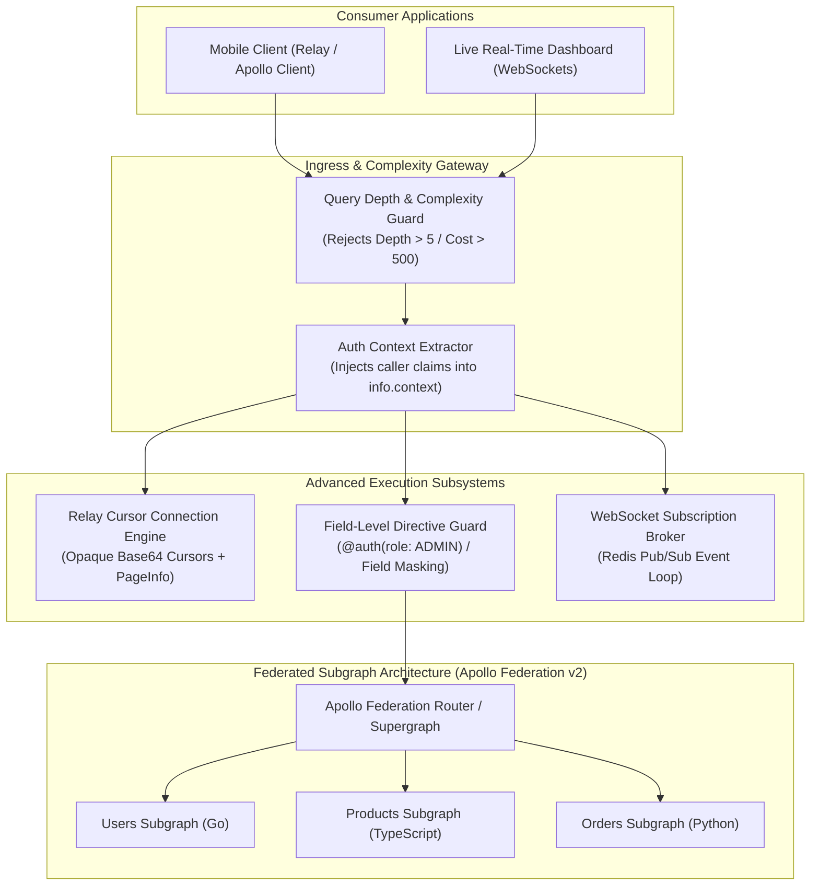
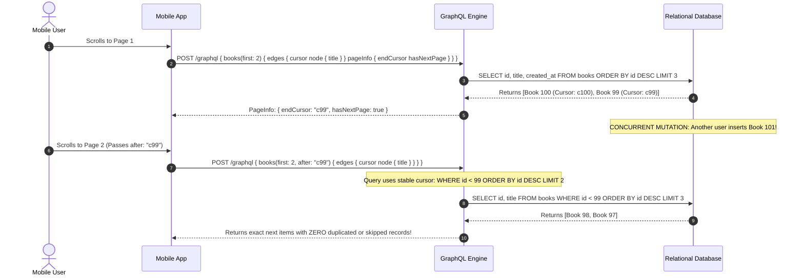
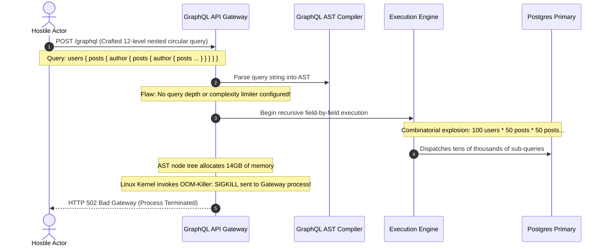

# Module 04: GraphQL Advanced Patterns (Subscriptions, Relay Pagination, and Field Authorization)

> **Prerequisites**: [Module 03: GraphQL Fundamentals](../03-graphql-fundamentals/README.md), [Track 03: Auth & Access Control](../../03-auth-and-access-control/README.md), and WebSocket connection management concepts.  
> **Estimated Reading Time**: 35 minutes.  
> **Target Audience**: Senior Backend Engineers, Full-Stack Architects, and Enterprise API Developers.

---

> [!TIP]
> **The Golden Rule of Production GraphQL Architecture**  
> In GraphQL, **authorization must be enforced at the individual field/resolver level**, never at the route perimeter. Because GraphQL presents a single endpoint capable of traversing arbitrary relational graph paths, routing-level access controls leave nested sensitive fields vulnerable to data exfiltration. Furthermore, every list field must enforce **cursor-based Relay pagination with strict, server-side page size caps**, and all incoming queries must be bounded by **static depth and complexity limits** to prevent denial-of-service via recursive circular query expansion.

---

## 1. Architectural Blueprint & Mental Models

Enterprise GraphQL architectures extend beyond basic CRUD by integrating continuous event streams, standardized cursor pagination, per-field security boundaries, and multi-team schema composition.



### Relay Cursor Pagination vs. Offset Pagination Under Concurrent Writes

Standard offset pagination (`offset: 20, limit: 10`) suffers from row-shifting anomalies when items are inserted or deleted during user pagination. **Relay Cursor Pagination** anchors the query to an opaque, immutable entity cursor:



---

## 2. Systematic Taxonomic Reference Grids

### Advanced GraphQL Architectural Patterns

| Subsystem Component | Specification / Pattern | Core Architectural Guarantee | Critical Anti-Pattern / Failure Mode |
| :--- | :--- | :--- | :--- |
| **Real-time Push** | GraphQL Subscriptions (RFC 6455 / WebSockets) | Asynchronous push of typed schema entities via async generators. | Retaining open subscriptions across worker restarts without a distributed Redis Pub/Sub backing. |
| **List Navigation** | Relay Cursor Connection (`edges`, `node`, `cursor`, `pageInfo`) | Deterministic pagination stable under concurrent record insertions and deletions. | Unbounded `first` arguments allowing clients to request `first: 1000000` (OutOfMemory DoS). |
| **Field Security** | Per-Field Resolvers & Schema Directives (`@auth`) | Denies access to sensitive fields (`email`, `ssn`) even if the parent entity is public. | Relying on perimeter route guards; leaking confidential fields via public nested graph edges. |
| **Cost Control** | Query Depth & Complexity Analysis | Statically analyzes query AST to reject recursively nested circular requests before execution. | Executing unconstrained queries, allowing attackers to trigger combinatorial database cartesian explosions. |
| **Schema Composition** | Apollo Federation v2 / Schema Stitching | Multiple autonomous teams deploy independent subgraphs unified by a single supergraph router. | Building a monolithic schema where multiple development teams deploy code to a single shared repository. |

### Query Complexity & Depth Defense Matrix

```graphql
# Attack Vector: Recursive Circular Denial-of-Service Query
query MaliciousCartesianExplosion {
  author(id: "1") {
    books {
      author {
        books {
          author {
            books {
              author {
                books { title } # Depth = 8, Multiplier: 10^4 queries!
              }
            }
          }
        }
      }
    }
  }
}
```

| Protection Engine | Evaluation Stage | Mathematical Algorithm | Production Threshold | Action on Exceed |
| :--- | :--- | :--- | :--- | :--- |
| **Max Depth Limiting** | Pre-Execution (AST Inspection) | Traverses AST tree from Root Node; increments depth counter per nested selection set. | `max_depth = 5` | Reject query immediately with `GraphQLError("Query depth exceeds limit of 5")`. |
| **Complexity Budgeting** | Pre-Execution (Cost Analysis) | Assigns base point per scalar field ($1$) and multiplier per list connection ($\text{first} \times \text{cost}$). | `max_complexity = 500` | Abort execution with `GraphQLError("Query complexity 1240 exceeds budget 500")`. |
| **Pagination Cap** | Resolver Execution | Clamps incoming pagination arguments: $\text{limit} = \min(\text{requested}, 50)$. | `max_page_size = 50` | Automatically enforce max boundary; reject negative numbers. |

---

## 3. Production War Story: The Recursive Query Denial-of-Service

### Incident Post-Mortem

- **Severity**: SEV-1 (Complete Platform Outage)
- **Time to Detect (TTD)**: 2 minutes (Edge Envoy proxy reported 100% 504 Gateway Timeouts)
- **Time to Mitigate (TTM)**: 18 minutes (Deployed emergency depth-limiting rule)
- **Impact**: Entire customer dashboard offline; GraphQL gateway node memory spiked from 512MB to 16GB, triggering OOMKills.



#### What Happened & Root Cause
A commercial social collaboration platform deployed a GraphQL BFF to serve their React web app and native mobile apps. The schema defined circular bidirectional edges: a `User` has `posts: [Post]`, and each `Post` has an `author: User`. 

An external attacker discovered the unauthenticated `/graphql` endpoint and submitted a 12-level deeply nested query requesting circular references. Because the server had no query depth or complexity limits, the execution engine attempted to materialize hundreds of thousands of in-memory resolver promises. The Node.js heap exhausted its 4GB memory ceiling, causing consecutive Kubernetes pod crashes and bringing down the entire platform.

#### The Fix & Architectural Hardening
1. **Enforced Hard Depth Limiter**: Implemented AST validation rejecting any query with depth greater than 5 (`graphql-depth-limit`).
2. **Integrated Query Cost Budgeting**: Configured a cost validator restricting any single query to a maximum complexity budget of 250 points.
3. **Persisted Queries for Production Clients**: Disabled arbitrary dynamic query execution in production, restricting incoming requests to pre-registered cryptographic query hashes (Automatic Persisted Queries - APQ).

---

## 4. Multi-Language Production Implementations: Relay Pagination & Field Security

Below is the complete, production-grade implementation of an enterprise GraphQL service implementing Relay cursor pagination and per-field authorization across **Go**, **Node.js/TypeScript**, **Python**, and **C#**.

### Python Implementation (Strawberry + Relay Connections + Permissions)

```python
import base64
from typing import List, Optional, Any
import strawberry
from strawberry.permission import BasePermission
from strawberry.types import Info
from fastapi import FastAPI, Request
from strawberry.fastapi import GraphQLRouter

# --- 1. Security Context & Permission Layer ---

class IsAuthenticated(BasePermission):
    message = "Caller must be authenticated to access this field"

    def has_permission(self, source: Any, info: Info, **kwargs) -> bool:
        user = info.context.get("user")
        return user is not None

class IsOwnerOrAdmin(BasePermission):
    message = "Unauthorized: Caller cannot view private resource"

    def has_permission(self, source: Any, info: Info, **kwargs) -> bool:
        user = info.context.get("user")
        if not user:
            return False
        if user.get("role") == "admin":
            return True
        # Check ownership: source is the parent User instance
        return user.get("id") == getattr(source, "id", None)

# --- 2. Relay Cursor Pagination Types ---

@strawberry.type
class PageInfo:
    has_next_page: bool
    has_previous_page: bool
    start_cursor: Optional[str]
    end_cursor: Optional[str]

@strawberry.type
class UserEdge:
    node: "User"
    cursor: str

@strawberry.type
class UserConnection:
    edges: List[UserEdge]
    page_info: PageInfo

@strawberry.type
class User:
    id: strawberry.ID
    name: str

    # Field-Level Authorization: Only owner or admin can read email
    @strawberry.field(permission_classes=[IsOwnerOrAdmin])
    def email(self) -> str:
        return self._email

    def __init__(self, id: str, name: str, email: str):
        self.id = strawberry.ID(id)
        self.name = name
        self._email = email

# --- 3. Query Engine with Clamped Pagination ---

USER_DATABASE = [
    User(id=str(i), name=f"User {i}", email=f"user{i}@company.com")
    for i in range(1, 101)
]

@strawberry.type
class Query:
    @strawberry.field
    def users(
        self, 
        first: int = 10, 
        after: Optional[str] = None
    ) -> UserConnection:
        # Enforce server-side pagination ceiling (anti-DoS)
        limit = min(max(first, 1), 50)

        start_index = 0
        if after:
            try:
                decoded = base64.b64decode(after).decode("utf-8")
                start_index = int(decoded.replace("cursor:", "")) + 1
            except Exception:
                start_index = 0

        end_index = start_index + limit
        sliced_users = USER_DATABASE[start_index:end_index]

        edges = [
            UserEdge(
                node=user, 
                cursor=base64.b64encode(f"cursor:{start_index + idx}".encode()).decode()
            )
            for idx, user in enumerate(sliced_users)
        ]

        has_next = end_index < len(USER_DATABASE)
        start_cursor = edges[0].cursor if edges else None
        end_cursor = edges[-1].cursor if edges else None

        return UserConnection(
            edges=edges,
            page_info=PageInfo(
                has_next_page=has_next,
                has_previous_page=start_index > 0,
                start_cursor=start_cursor,
                end_cursor=end_cursor
            )
        )

# Context Injection
async def get_context(request: Request):
    auth_header = request.headers.get("authorization", "")
    user = None
    if auth_header == "Bearer admin-token":
        user = {"id": "admin", "role": "admin"}
    elif auth_header == "Bearer user-1-token":
        user = {"id": "1", "role": "member"}

    return {"user": user}

schema = strawberry.Schema(query=Query)
graphql_app = GraphQLRouter(schema, context_getter=get_context)

app = FastAPI()
app.include_router(graphql_app, prefix="/graphql")
```

---

### Node.js / TypeScript Implementation (Relay Connection + Custom Directives)

```typescript
import express, { Request } from 'express';
import { createHandler } from 'graphql-http/lib/use/express';
import { 
  GraphQLSchema, 
  GraphQLObjectType, 
  GraphQLString, 
  GraphQLID, 
  GraphQLList, 
  GraphQLNonNull, 
  GraphQLBoolean, 
  GraphQLInt 
} from 'graphql';

interface UserRecord {
  id: string;
  name: string;
  email: string;
}

const USERS: UserRecord[] = Array.from({ length: 50 }, (_, i) => ({
  id: String(i + 1),
  name: `Engineer ${i + 1}`,
  email: `eng${i + 1}@techcorp.internal`,
}));

// Relay PageInfo Type
const PageInfoType = new GraphQLObjectType({
  name: 'PageInfo',
  fields: {
    hasNextPage: { type: new GraphQLNonNull(GraphQLBoolean) },
    endCursor: { type: GraphQLString },
  },
});

// User Type with Field Authorization
const UserType = new GraphQLObjectType({
  name: 'User',
  fields: {
    id: { type: new GraphQLNonNull(GraphQLID) },
    name: { type: new GraphQLNonNull(GraphQLString) },
    email: {
      type: GraphQLString,
      resolve: (user: UserRecord, _args, context) => {
        // Enforce Field-Level AuthZ: Only user or admin can view email
        const caller = context.user;
        if (caller && (caller.role === 'admin' || caller.id === user.id)) {
          return user.email;
        }
        return null; // Mask field gracefully
      },
    },
  },
});

const UserEdgeType = new GraphQLObjectType({
  name: 'UserEdge',
  fields: {
    node: { type: new GraphQLNonNull(UserType) },
    cursor: { type: new GraphQLNonNull(GraphQLString) },
  },
});

const UserConnectionType = new GraphQLObjectType({
  name: 'UserConnection',
  fields: {
    edges: { type: new GraphQLNonNull(new GraphQLList(new GraphQLNonNull(UserEdgeType))) },
    pageInfo: { type: new GraphQLNonNull(PageInfoType) },
  },
});

const QueryType = new GraphQLObjectType({
  name: 'Query',
  fields: {
    users: {
      type: new GraphQLNonNull(UserConnectionType),
      args: {
        first: { type: GraphQLInt, defaultValue: 10 },
        after: { type: GraphQLString },
      },
      resolve: (_root, args) => {
        const first = Math.min(Math.max(args.first || 10, 1), 25);
        let startIndex = 0;

        if (args.after) {
          const rawId = Buffer.from(args.after, 'base64').toString('utf8');
          const found = USERS.findIndex(u => u.id === rawId);
          if (found !== -1) startIndex = found + 1;
        }

        const slice = USERS.slice(startIndex, startIndex + first);
        const edges = slice.map(u => ({
          node: u,
          cursor: Buffer.from(u.id).toString('base64'),
        }));

        return {
          edges,
          pageInfo: {
            hasNextPage: startIndex + first < USERS.length,
            endCursor: edges.length > 0 ? edges[edges.length - 1].cursor : null,
          },
        };
      },
    },
  },
});

const schema = new GraphQLSchema({ query: QueryType });

const app = express();
app.use(
  '/graphql',
  createHandler({
    schema,
    context: (req: Request) => {
      const auth = req.headers.authorization;
      let user = null;
      if (auth === 'Bearer admin') user = { id: 'admin', role: 'admin' };
      if (auth === 'Bearer user-1') user = { id: '1', role: 'user' };
      return { user };
    },
  })
);

app.listen(4000, () => console.log('Relay GraphQL server running on :4000/graphql'));
```

---

### Go Implementation (Relay Connections in Go)

```go
package main

import (
	"encoding/base64"
	"fmt"
	"net/http"
	"strconv"
	"strings"

	"github.com/graphql-go/graphql"
	"github.com/graphql-go/handler"
)

type User struct {
	ID    string `json:"id"`
	Name  string `json:"name"`
	Email string `json:"email"`
}

type CallerContext struct {
	ID   string
	Role string
}

func encodeCursor(id string) string {
	return base64.StdEncoding.EncodeToString([]byte(fmt.Sprintf("cursor:%s", id)))
}

func decodeCursor(cursor string) string {
	b, err := base64.StdEncoding.DecodeString(cursor)
	if err != nil {
		return ""
	}
	return strings.TrimPrefix(string(b), "cursor:")
}

func main() {
	var usersDB []User
	for i := 1; i <= 50; i++ {
		usersDB = append(usersDB, User{
			ID:    strconv.Itoa(i),
			Name:  fmt.Sprintf("User %d", i),
			Email: fmt.Sprintf("user%d@corp.com", i),
		})
	}

	userType := graphql.NewObject(graphql.ObjectConfig{
		Name: "User",
		Fields: graphql.Fields{
			"id":   &graphql.Field{Type: graphql.NewNonNull(graphql.ID)},
			"name": &graphql.Field{Type: graphql.NewNonNull(graphql.String)},
			"email": &graphql.Field{
				Type: graphql.String,
				Resolve: func(p graphql.ResolveParams) (interface{}, error) {
					u := p.Source.(User)
					caller, ok := p.Context.Value("caller").(CallerContext)
					// Enforce Field-Level RBAC
					if ok && (caller.Role == "admin" || caller.ID == u.ID) {
						return u.Email, nil
					}
					return nil, nil // Return null when unauthorized
				},
			},
		},
	})

	pageInfoType := graphql.NewObject(graphql.ObjectConfig{
		Name: "PageInfo",
		Fields: graphql.Fields{
			"hasNextPage": &graphql.Field{Type: graphql.NewNonNull(graphql.Boolean)},
			"endCursor":   &graphql.Field{Type: graphql.String},
		},
	})

	userEdgeType := graphql.NewObject(graphql.ObjectConfig{
		Name: "UserEdge",
		Fields: graphql.Fields{
			"node":   &graphql.Field{Type: graphql.NewNonNull(userType)},
			"cursor": &graphql.Field{Type: graphql.NewNonNull(graphql.String)},
		},
	})

	userConnectionType := graphql.NewObject(graphql.ObjectConfig{
		Name: "UserConnection",
		Fields: graphql.Fields{
			"edges":    &graphql.Field{Type: graphql.NewNonNull(graphql.NewList(graphql.NewNonNull(userEdgeType)))},
			"pageInfo": &graphql.Field{Type: graphql.NewNonNull(pageInfoType)},
		},
	})

	queryType := graphql.NewObject(graphql.ObjectConfig{
		Name: "Query",
		Fields: graphql.Fields{
			"users": &graphql.Field{
				Type: graphql.NewNonNull(userConnectionType),
				Args: graphql.FieldConfigArgument{
					"first": &graphql.ArgumentConfig{Type: graphql.Int, DefaultValue: 10},
					"after": &graphql.ArgumentConfig{Type: graphql.String},
				},
				Resolve: func(p graphql.ResolveParams) (interface{}, error) {
					first := p.Args["first"].(int)
					if first > 25 {
						first = 25 // Clamp page size ceiling
					}

					startIndex := 0
					if after, ok := p.Args["after"].(string); ok && after != "" {
						targetID := decodeCursor(after)
						for idx, u := range usersDB {
							if u.ID == targetID {
								startIndex = idx + 1
								break
							}
						}
					}

					endIndex := startIndex + first
					if endIndex > len(usersDB) {
						endIndex = len(usersDB)
					}

					var edges []map[string]interface{}
					for _, u := range usersDB[startIndex:endIndex] {
						edges = append(edges, map[string]interface{}{
							"node":   u,
							"cursor": encodeCursor(u.ID),
						})
					}

					var endCursor interface{} = nil
					if len(edges) > 0 {
						endCursor = edges[len(edges)-1]["cursor"]
					}

					return map[string]interface{}{
						"edges": edges,
						"pageInfo": map[string]interface{}{
							"hasNextPage": endIndex < len(usersDB),
							"endCursor":   endCursor,
						},
					}, nil
				},
			},
		},
	})

	schema, _ := graphql.NewSchema(graphql.SchemaConfig{Query: queryType})
	h := handler.New(&handler.Config{Schema: &schema, Pretty: true})

	http.Handle("/graphql", h)
	http.ListenAndServe(":8080", nil)
}
```

---

### C# / .NET Implementation (HotChocolate Relay Pagination)

```csharp
using System.Linq;
using System.Security.Claims;
using HotChocolate;
using HotChocolate.Authorization;
using HotChocolate.Types;

namespace SecurityTrack.AdvancedGraphQL
{
    public class UserEntity
    {
        public string Id { get; set; } = string.Empty;
        public string Name { get; set; } = string.Empty;

        // Field-Level Authorization: Only authenticated callers with 'Admin' role
        [Authorize(Roles = new[] { "Admin" })]
        public string Email { get; set; } = string.Empty;
    }

    public class Query
    {
        // HotChocolate native Relay Connection with MaxPageSize clamping
        [UsePaging(MaxPageSize = 50, DefaultPageSize = 10, IncludeTotalCount = true)]
        public IQueryable<UserEntity> GetUsers()
        {
            return Enumerable.Range(1, 100).Select(i => new UserEntity
            {
                Id = i.ToString(),
                Name = $"Engineer {i}",
                Email = $"eng{i}@internal.corp"
            }).AsQueryable();
        }
    }
}
```

---

## 5. Practical Hands-On Verification CLI Workflows

### Step 1: Query Relay Cursor Connection via cURL

```bash
# Request the first 2 users and inspect Relay cursors
curl -s -X POST "http://localhost:8000/graphql" \
  -H "Content-Type: application/json" \
  -d '{
    "query": "query { users(first: 2) { edges { cursor node { id name } } pageInfo { hasNextPage endCursor } } }"
  }' | jq .
```

**Expected Wire Output:**
```json
{
  "data": {
    "users": {
      "edges": [
        {
          "cursor": "Y3Vyc29yOjA=",
          "node": {
            "id": "1",
            "name": "User 1"
          }
        },
        {
          "cursor": "Y3Vyc29yOjE=",
          "node": {
            "id": "2",
            "name": "User 2"
          }
        }
      ],
      "pageInfo": {
        "hasNextPage": true,
        "endCursor": "Y3Vyc29yOjE="
      }
    }
  }
}
```

---

### Step 2: Fetch Subsequent Page Using Cursor Anchor

```bash
# Fetch next 2 records anchoring after endCursor "Y3Vyc29yOjE="
curl -s -X POST "http://localhost:8000/graphql" \
  -H "Content-Type: application/json" \
  -d '{
    "query": "query { users(first: 2, after: \"Y3Vyc29yOjE=\") { edges { node { id name } } pageInfo { endCursor } } }"
  }' | jq .
```

**Expected Wire Output:**
```json
{
  "data": {
    "users": {
      "edges": [
        {
          "node": { "id": "3", "name": "User 3" }
        },
        {
          "node": { "id": "4", "name": "User 4" }
        }
      ],
      "pageInfo": {
        "endCursor": "Y3Vyc29yOjM="
      }
    }
  }
}
```

---

### Step 3: Verify Field-Level Authorization Masking

```bash
# Query private email field without credentials
curl -s -X POST "http://localhost:8000/graphql" \
  -H "Content-Type: application/json" \
  -d '{"query": "query { users(first: 1) { edges { node { name email } } } }"}' | jq .
```

**Expected Wire Output:**
```json
{
  "data": {
    "users": {
      "edges": [
        {
          "node": {
            "name": "User 1",
            "email": null
          }
        }
      ]
    }
  },
  "errors": [
    {
      "message": "Unauthorized: Caller cannot view private resource",
      "path": ["users", "edges", 0, "node", "email"]
    }
  ]
}
```
*(Notice: The public name field resolves successfully, while the unauthorized email field is masked with `null` alongside a granular field error).*

---

## 6. Operational Validation Checkpoints (Scenario Quizzes)

### Checkpoint 1: Route-Level vs. Field-Level Authorization
<details>
<summary><strong>Scenario Assessment:</strong> A developer adds an Express authentication middleware guarding the <code>POST /graphql</code> route to verify that the caller is logged in. Is this sufficient to protect confidential user salary information accessible via <code>users { salary }</code>?</summary>

```
Options:
A) Yes, because unauthenticated users are rejected with HTTP 401 at the route.
B) No; any authenticated standard employee can query the GraphQL endpoint and request another employee's private salary field. Authorization must be enforced at the resolver level for the `salary` field itself.
C) Yes, if HTTPS TLS 1.3 is active.
D) No, because GraphQL does not support numeric fields.
```

**Answer:**
**B is correct.** Protecting the HTTP route only establishes authentication (the caller is a logged-in user). In GraphQL, a single query can traverse relational edges to read any field in the schema. If the `salary` field does not have field-level authorization (verifying the caller is an HR admin or the owner of that specific user record), any standard logged-in user can exfiltrate corporate salaries. Authorization in GraphQL **must live at the field/resolver level**.

</details>

---

### Checkpoint 2: The Fallacy of Offset Pagination in Dynamic Graphs
<details>
<summary><strong>Scenario Assessment:</strong> An e-commerce mobile app uses offset pagination (<code>products(skip: 20, limit: 10)</code>) to display inventory. While a user browses page 1, 5 new products are published. When the user loads page 2, what visual defect occurs?</summary>

```
Options:
A) The mobile app crashes with a JSON parsing exception.
B) The 5 newly inserted items shift the entire database index window, causing the user to see the last 5 items from page 1 repeated on page 2.
C) The server throws an HTTP 409 Conflict error.
D) The user is automatically logged out.
```

**Answer:**
**B is correct.** Offset pagination (`skip` / `offset`) is fundamentally stateless and position-based. If new rows are inserted at the beginning of the table, existing records shift down by 5 slots. When the client requests offset 20, it receives records that have shifted into slots 20–29, which duplicates products already viewed on page 1. **Cursor-based pagination** solves this by anchoring queries to a stable entity pointer (`WHERE id < cursor`), guaranteeing consistent windows regardless of concurrent insertions.

</details>

---

### Checkpoint 3: Apollo Federation vs. Schema Stitching
<details>
<summary><strong>Scenario Assessment:</strong> A company has 6 independent engineering teams (Billing, Catalog, Users, Orders, Reviews, Inventory). A tech lead proposes unifying their backends using a single central GraphQL gateway where the gateway team writes all linking and merging code. Why does Apollo Federation v2 scale better than this centralized stitching model?</summary>

```
Options:
A) Federation converts all GraphQL queries into gRPC binary Protobuf frames.
B) In Federation, subgraphs own their domain types and declare cross-service relationships via schema directives (`@key`, `@external`); the router automatically composes the supergraph without requiring a centralized gateway team to manually code stitching glue.
C) Schema stitching cannot run in Kubernetes.
D) Federation eliminates the need for database indexing.
```

**Answer:**
**B is correct.** Centralized schema stitching forces a single gateway team to maintain brittle custom resolver glue code that links disparate backend schemas, recreating a development bottleneck. **Apollo Federation v2** is a declarative, distributed architecture: each microservice team owns their autonomous subgraph and publishes schema extensions using standardized directives. The federation router dynamically composes the supergraph, enabling teams to deploy independently without coordination bottlenecks.

</details>

---

## 7. Further Reading & Sources

- [GraphQL Official Specification: Subscriptions](https://spec.graphql.org/June2021/#sec-Subscription)
- [Relay Specification: GraphQL Cursor Connections](https://relay.dev/graphql/connections.htm)
- [Apollo Federation v2 Architectural Documentation](https://www.apollographql.com/docs/federation/)
- [Strawberry GraphQL: Declarative Permissions and Directives](https://strawberry.rocks/docs/guides/permissions)
- [OWASP GraphQL Security Best Practices & Query Limiting](https://cheatsheetseries.owasp.org/cheatsheets/GraphQL_Cheat_Sheet.html)

---

## Next Steps

Now that you have mastered enterprise GraphQL subscriptions, Relay cursor pagination, field authorization, and federation, explore protocol lifecycles and contracts:

- Next Module: **[05-graphql-schema-evolution-and-deprecation](../05-graphql-schema-evolution-and-deprecation/README.md)** (Schema Evolution Without Versioning, The `@deprecated` Directive, Field Sunsetting Strategies, and Breaking Change Detection).
- Track Index: [README.md](../README.md)
