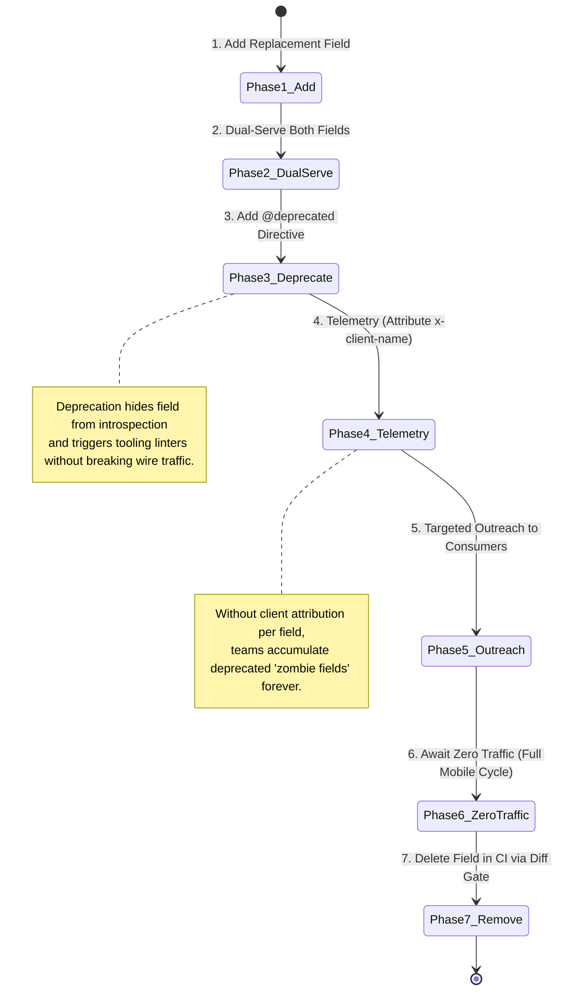
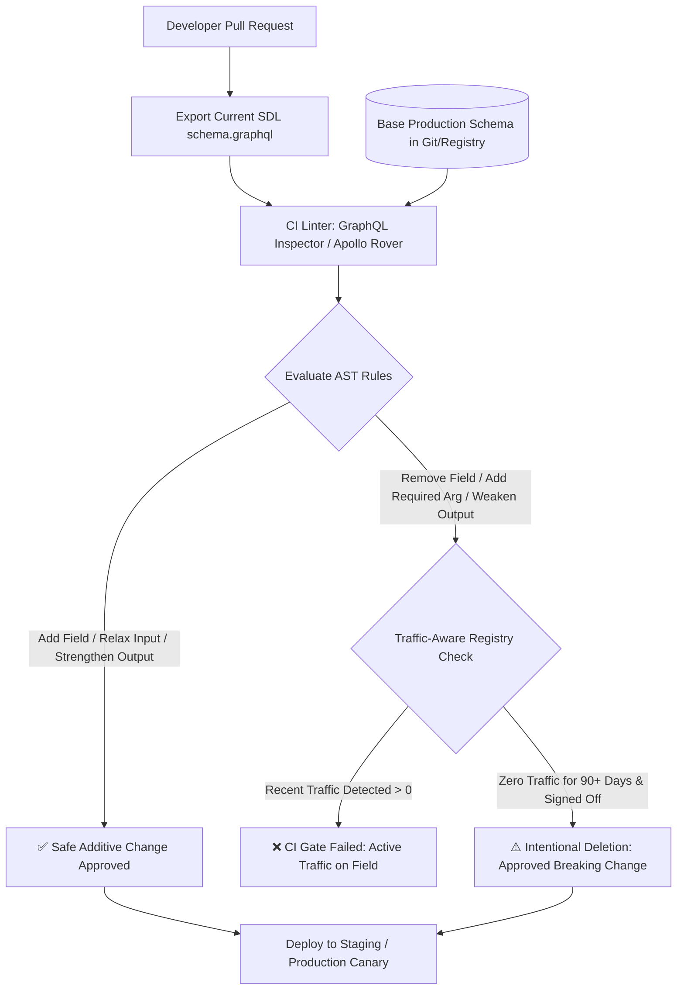
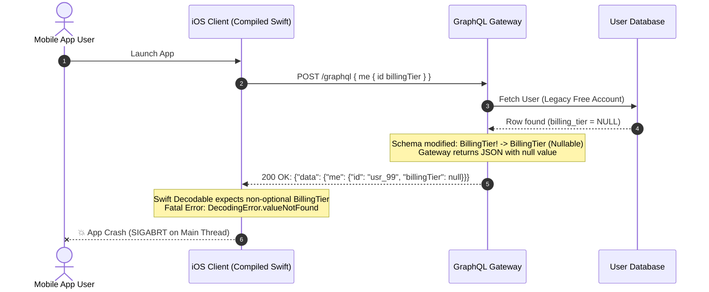

# Module 05: GraphQL Schema Evolution and Deprecation

> **Prerequisites**: Strong familiarity with GraphQL schemas, queries, and SDL from [03-graphql-fundamentals](../03-graphql-fundamentals/README.md), and resolver execution patterns from [04-graphql-advanced-patterns](../04-graphql-advanced-patterns/README.md).  
> **Estimated Reading Time**: 28 minutes  
> **Target Audience**: Senior Backend Engineers, API Platform Engineers, and Technical Leads building long-lived public or multi-client APIs.

---

> [!TIP]
> **The Golden Rule of GraphQL Schema Evolution**  
> Never version an entire GraphQL schema (`/graphql/v1` vs `/graphql/v2`). In GraphQL, the unit of compatibility is the **individual field**, because clients request only what they need. You may **strengthen output promises** (`String` &rarr; `String!`) and **relax input demands** (`String!` &rarr; `String`), but you must never do the inverse without an end-to-end deprecation lifecycle backed by **field-level client telemetry**. If you cannot measure who selects a field, you can never safely delete it.

---

## Visual Mental Models & Architecture

### The Field Lifecycle: Additive Evolution vs Silent Breakage

In REST, changing a resource representation breaks every client because payloads are monolithic. In GraphQL, client queries declare an explicit selection set. Adding fields is completely invisible to existing callers, while removing or altering a field only impacts callers selecting that exact field.



---

### The Schema Diffing & Breaking Change Boundary



---

## Systematic Evolution Reference Grids

### Output vs Input Nullability Inversion Matrix

The direction of compatibility flips 180 degrees depending on whether a type is in an **Input** position (arguments, input objects) or an **Output** position (object fields, query roots).

| Change Direction | Output Position (`type User`) | Input Position (`input UserInput`) | Operational Blast Radius |
| :--- | :--- | :--- | :--- |
| **`Type` &rarr; `Type!`** (Nullable &rarr; Non-Null) | **SAFE** ✅ | **BREAKING** ❌ | For Output: client expecting `Type \| null` receives strictly `Type`. For Input: callers omitting the argument now fail schema validation immediately with HTTP 400. |
| **`Type!` &rarr; `Type`** (Non-Null &rarr; Nullable) | **BREAKING** ❌ | **SAFE** ✅ | For Output: client type generators (`graphql-codegen`, Swift Apollo) assume non-null and crash with NullPointer/Undefined panics when `null` arrives. For Input: server relaxes requirements, allowing callers to omit values. |
| **Add optional field / arg** | **SAFE** ✅ | **SAFE** ✅ | Output: unselected by existing clients. Input: existing clients omit it; default value or `None`/`nil` applies. |
| **Add required field / arg** | **SAFE** ✅ (if default provided on server) | **BREAKING** ❌ | Callers omitting the mandatory argument receive immediate `Field "x" of required type "y!" was not provided` validation errors. |
| **Remove field / arg** | **BREAKING** ❌ | **BREAKING** ❌ | Output: clients selecting field crash on validation. Input: clients passing arg fail validation (`Unknown argument`). |
| **Add value to Enum** | **POTENTIALLY BREAKING** ⚠️ | **SAFE** ✅ | Output: clients switching over enum values without a `default`/`else` wildcard branch trigger runtime exceptions or fallback bugs. Input: servers accept new valid variant. |
| **Add type to Union** | **POTENTIALLY BREAKING** ⚠️ | N/A (Unions cannot be inputs) | Existing client queries lacking `... on NewType` fragments silently receive `__typename: "NewType"` with unhandled UI states. |

---

## Production Incident War Story: The Nullability Panic

### Incident Post-Mortem: SEV-1

* **Incident ID**: INC-8491
* **Severity Level**: SEV-1 (Critical Revenue Interruption)
* **Detection Time**: 4 minutes after canary deployment
* **Time to Recovery (TTR)**: 19 minutes (via instant roll-forward hotfix)
* **Impact**: 4.1 million iOS and Android sessions crashed immediately upon app launch when attempting to render user profiles.

#### 1. What Happened
A backend team refactored the user billing subsystem. In the GraphQL schema, `User.billingTier` was originally defined as non-null:
```graphql
type User {
  id: ID!
  billingTier: BillingTier!
}
```
During migration to a flexible billing engine where free-tier legacy users lacked a billing record, a backend engineer observed that queries failed when `billingTier` was missing. The engineer modified the schema:
```graphql
type User {
  id: ID!
  billingTier: BillingTier # Changed from BillingTier! to BillingTier (nullable)
}
```
The developer reasoned: *"Making something optional is always backward-compatible."* Local tests passed, and CI schema validation passed because GraphQL Inspector was not configured to treat weakening output nullability as a blocking break.

Within 4 minutes of production rollout, mobile crash rates surged to 94% across active mobile clients.

#### 2. Root Cause Analysis
The mobile client was compiled with Apollo iOS / Swift codegen. Because the schema had guaranteed `billingTier` was non-null (`BillingTier!`), the generated Swift model declared:
```swift
struct User {
    let id: String
    let billingTier: BillingTier // Non-optional Swift property
}
```
When legacy free-tier users received `{"id": "usr_99", "billingTier": null}`, the JSON decoder encountered `null` where a concrete enum was required, throwing an uncaught `DecodingError.valueNotFound` which crashed the app on startup.



#### 3. The Architectural Hardening & Resolution
1. **Immediate Hotfix**: Restored `billingTier: BillingTier!` immediately by having resolvers map `null` database rows to a default enum variant `BillingTier.FREE` on the backend.
2. **Evolution Rule Enforcement**: Added Apollo Rover schema checks into GitHub Actions CI. Weakening an output type's nullability (`T!` &rarr; `T`) is flagged as a catastrophic breaking change.
3. **Telemetry & Client Deprecation**: To safely migrate, the team introduced a new field `subscriptionPlan: SubscriptionPlan` (nullable from day 1), marked `billingTier` as `@deprecated(reason: "Use subscriptionPlan. Defaulted to FREE for legacy users. Removal Q4 2027.")`, and tracked mobile app version adoption until older app versions dropped below 0.1% traffic.

---

## Multi-Language Production Code Tabs: Field Usage & Telemetry

To safely evolve and deprecate GraphQL schemas, backend servers must record field usage tagged with **`ParentType.fieldName`** and the **`x-client-name`** request header.

```
### Language Tabs
1. Go (gqlgen middleware / field interceptor)
2. Node.js / TypeScript (@apollo/server plugin)
3. Python (Strawberry SchemaExtension)
4. C# (Hot Chocolate DiagnosticEventListener)
```

### Go (gqlgen)
```go
package main

import (
	"context"
	"fmt"
	"net/http"

	"github.com/99designs/gqlgen/graphql"
	"github.com/99designs/gqlgen/graphql/handler"
	"github.com/prometheus/client_golang/prometheus"
	"github.com/prometheus/client_golang/prometheus/promauto"
)

var fieldUsageCounter = promauto.NewCounterVec(
	prometheus.CounterOpts{
		Name: "graphql_field_resolutions_total",
		Help: "Total field resolution executions tracked by parent type, field, and client identifier",
	},
	[]string{"parent_type", "field_name", "client_name"},
)

type contextKey string
const clientNameKey contextKey = "clientName"

// ClientContextMiddleware extracts x-client-name into context
func ClientContextMiddleware(next http.Handler) http.Handler {
	return http.HandlerFunc(func(w http.ResponseWriter, r *http.Request) {
		clientName := r.Header.Get("x-client-name")
		if clientName == "" {
			clientName = "unknown-client"
		}
		ctx := context.WithValue(r.Context(), clientNameKey, clientName)
		next.ServeHTTP(w, r.WithContext(ctx))
	})
}

// FieldTelemetryInterceptor hooks into gqlgen field execution pipeline
func NewFieldTelemetryInterceptor() graphql.AroundFields {
	return func(ctx context.Context, next graphql.Resolver) (res interface{}, err error) {
		fc := graphql.GetFieldContext(ctx)
		if fc != nil && !fc.IsMethod {
			// Skip scalar fields if overhead is high, or track all object boundary resolvers
			clientName, _ := ctx.Value(clientNameKey).(string)
			if clientName == "" {
				clientName = "unknown-client"
			}
			parentType := fc.Object
			fieldName := fc.Field.Name

			fieldUsageCounter.WithLabelValues(parentType, fieldName, clientName).Inc()
		}
		return next(ctx)
	}
}

func main() {
	srv := handler.NewDefaultServer(NewExecutableSchema(Config{Resolvers: &Resolver{}}))
	srv.AroundFields(NewFieldTelemetryInterceptor())

	http.Handle("/graphql", ClientContextMiddleware(srv))
	fmt.Println("GraphQL server running with field telemetry on :8080")
	_ = http.ListenAndServe(":8080", nil)
}
```

### Node.js / TypeScript (@apollo/server)
```typescript
import { ApolloServer } from '@apollo/server';
import { ApolloServerPlugin } from '@apollo/server';
import { startStandaloneServer } from '@apollo/server/standalone';
import { Counter } from 'prom-client';

const fieldUsageMetric = new Counter({
  name: 'graphql_field_usage_total',
  help: 'Tracks field execution count tagged by parent, field name, and client name',
  labelNames: ['parentType', 'fieldName', 'clientName'] as const,
});

interface GraphQLContext {
  clientName: string;
}

export function FieldUsageTelemetryPlugin(): ApolloServerPlugin<GraphQLContext> {
  return {
    async requestDidStart() {
      return {
        async executionDidStart() {
          return {
            willResolveField({ info, contextValue }) {
              const parentType = info.parentType.name;
              const fieldName = info.fieldName;
              const clientName = contextValue.clientName || 'unknown_client';

              // Ignore introspection meta-queries
              if (!parentType.startsWith('__')) {
                fieldUsageMetric.inc({ parentType, fieldName, clientName });
              }
            },
          };
        },
      };
    },
  };
}

const typeDefs = `#graphql
  type User {
    id: ID!
    name: String!
    fullName: String! @deprecated(reason: "Use 'name'. Scheduled removal 2027-01-01.")
    email: String!
  }

  type Query {
    user(id: ID!): User
  }
`;

const resolvers = {
  Query: {
    user: (_: any, { id }: { id: string }) => ({
      id,
      name: "Margaret Hamilton",
      fullName: "Margaret Hamilton",
      email: "margaret@nasa.gov"
    }),
  },
};

const server = new ApolloServer<GraphQLContext>({
  typeDefs,
  resolvers,
  plugins: [FieldUsageTelemetryPlugin()],
});

async function run() {
  const { url } = await startStandaloneServer(server, {
    listen: { port: 4000 },
    context: async ({ req }) => ({
      clientName: (req.headers['x-client-name'] as string) || 'anonymous-consumer',
    }),
  });
  console.log(`Server ready at ${url}`);
}
run();
```

### Python (Strawberry + FastAPI)
```python
import time
from typing import Optional
from fastapi import FastAPI, Request
from prometheus_client import Counter, make_asgi_app
import strawberry
from strawberry.extensions import SchemaExtension
from strawberry.fastapi import GraphQLRouter

field_usage_counter = Counter(
    "graphql_field_resolution_count",
    "Usage count of GraphQL fields by client",
    ["parent_type", "field_name", "client_name"]
)

class FieldUsageTelemetry(SchemaExtension):
    def resolve(self, _next, root, info, *args, **kwargs):
        parent = info.parent_type.name
        field = info.field_name
        
        # Do not record internal introspection queries
        if not parent.startswith("__"):
            request: Request = self.execution_context.context["request"]
            client_name = request.headers.get("x-client-name", "unknown_client")
            field_usage_counter.labels(
                parent_type=parent,
                field_name=field,
                client_name=client_name
            ).inc()
            
        return _next(root, info, *args, **kwargs)

@strawberry.type
class User:
    id: strawberry.ID
    name: str
    full_name: str = strawberry.field(
        deprecation_reason="Use `name`. Target removal date: 2027-06-30."
    )
    email: str

@strawberry.type
class Query:
    @strawberry.field
    def user(self, id: strawberry.ID) -> User:
        return User(id=id, name="Grace Hopper", full_name="Grace Hopper", email="grace@navy.mil")

schema = strawberry.Schema(query=Query, extensions=[FieldUsageTelemetry])

async def get_context(request: Request):
    return {"request": request}

graphql_app = GraphQLRouter(schema, context_getter=get_context)
app = FastAPI()
app.include_router(graphql_app, prefix="/graphql")
app.mount("/metrics", make_asgi_app())
```

### C# (Hot Chocolate)
```csharp
using HotChocolate.Execution.Instrumentation;
using HotChocolate.Resolvers;
using Microsoft.AspNetCore.Builder;
using Microsoft.Extensions.DependencyInjection;
using System.Diagnostics.Metrics;

var builder = WebApplication.CreateBuilder(args);

builder.Services.AddSingleton<FieldTelemetryObserver>();

builder.Services
    .AddGraphQLServer()
    .AddQueryType<Query>()
    .AddDiagnosticEventListener<FieldTelemetryDiagnosticListener>();

var app = builder.Build();
app.MapGraphQL();
app.Run();

public class User
{
    public string Id { get; set; } = "usr_101";
    public string Name { get; set; } = "Katherine Johnson";
    
    [GraphQLDeprecated("Use 'Name'. Target decommission: 2027-06-30.")]
    public string FullName => Name;
}

public class Query
{
    public User GetUser(string id) => new User { Id = id };
}

public class FieldTelemetryObserver
{
    private static readonly Meter Meter = new("GraphQL.SchemaEvolution", "1.0");
    public Counter<long> FieldUsageCounter { get; } = 
        Meter.CreateCounter<long>("graphql_field_usage_total");
}

public class FieldTelemetryDiagnosticListener : ExecutionDiagnosticEventListener
{
    private readonly FieldTelemetryObserver _observer;

    public FieldTelemetryDiagnosticListener(FieldTelemetryObserver observer)
    {
        _observer = observer;
    }

    public override IDisposable ExecuteField(IMiddlewareContext context)
    {
        var parentType = context.ObjectType.Name;
        var fieldName = context.Selection.Field.Name;

        if (!parentType.StartsWith("__"))
        {
            var httpContext = context.GetGlobalStateOrDefault<Microsoft.AspNetCore.Http.HttpContext>("HttpContext");
            var clientName = httpContext?.Request.Headers["x-client-name"].ToString();
            if (string.IsNullOrWhiteSpace(clientName)) clientName = "unknown-client";

            _observer.FieldUsageCounter.Add(1, 
                new KeyValuePair<string, object?>("parent_type", parentType),
                new KeyValuePair<string, object?>("field_name", fieldName),
                new KeyValuePair<string, object?>("client_name", clientName));
        }

        return EmptyScope;
    }
}
```

---

## Practical Hands-On Verification Workflows

### 1. Verify Introspection Filtering of Deprecated Fields

Issue an introspection query using `curl` to prove that deprecated fields are omitted by default, but surfaced when `includeDeprecated: true` is requested.

```bash
# Query introspection without includeDeprecated
curl -s -X POST http://localhost:8080/graphql \
  -H "Content-Type: application/json" \
  -d '{
    "query": "{ __type(name: \"User\") { fields { name isDeprecated } } }"
  }' | jq .
```

**Expected JSON Response:**
```json
{
  "data": {
    "__type": {
      "fields": [
        {
          "name": "id",
          "isDeprecated": false
        },
        {
          "name": "name",
          "isDeprecated": false
        },
        {
          "name": "email",
          "isDeprecated": false
        }
      ]
    }
  }
}
```

Now request deprecated fields explicitly:
```bash
curl -s -X POST http://localhost:8080/graphql \
  -H "Content-Type: application/json" \
  -d '{
    "query": "{ __type(name: \"User\") { fields(includeDeprecated: true) { name isDeprecated deprecationReason } } }"
  }' | jq .
```

**Expected JSON Response:**
```json
{
  "data": {
    "__type": {
      "fields": [
        {
          "name": "id",
          "isDeprecated": false,
          "deprecationReason": null
        },
        {
          "name": "name",
          "isDeprecated": false,
          "deprecationReason": null
        },
        {
          "name": "fullName",
          "isDeprecated": true,
          "deprecationReason": "Use `name`. Target removal date: 2027-06-30."
        },
        {
          "name": "email",
          "isDeprecated": false,
          "deprecationReason": null
        }
      ]
    }
  }
}
```

---

### 2. CI Automation: Detecting Breaking Changes via GraphQL Inspector

Add automated schema diffing to your Git pre-commit or GitHub Actions pipeline.

```bash
# 1. Export schema from branch
npx graphql-inspector diff base-schema.graphql pr-schema.graphql
```

**Simulated Breaking Diff Output:**
```
✖ Field 'User.billingTier' changed type from 'BillingTier!' to 'BillingTier' (Breaking change: output nullability weakened)
✖ Argument 'currency' on field 'Query.products' changed type from 'String' to 'String!' (Breaking change: required argument added)
✖ Field 'User.legacySSN' was removed (Breaking change: field removed)

Detected 3 breaking changes!
Validation failed. Exit code 1.
```

---

## Operational Validation Checkpoints (Scenario Quizzes)

<details>
<summary><strong>Checkpoint 1: The Input vs Output Nullability Trap</strong></summary>

**Scenario:** You need to refactor two GraphQL operations:
1. On the output type `Order`, `trackingUrl: String!` is changed to `trackingUrl: String` because some warehouse providers do not supply live tracking URLs.
2. On the mutation input `CreateOrderInput`, `notes: String!` is changed to `notes: String` because customer notes should be optional.

Which of these changes is a breaking change to existing clients, and why?

**Answer:**
Change 1 is **strictly breaking**; Change 2 is **completely safe**.
- In output types (`Order.trackingUrl`), clients (especially typed clients in TypeScript, Swift, Kotlin, and C#) generate models assuming the field is guaranteed non-null. If the backend begins returning `null`, those clients trigger decoding exceptions or null-pointer dereferences.
- In input types (`CreateOrderInput.notes`), changing from non-null (`String!`) to nullable (`String`) **relaxes** the caller's obligations. Existing clients that pass notes continue working normally, while newer callers can now legally omit the field. The rule is: *strengthen output promises, relax input demands*.
</details>

<details>
<summary><strong>Checkpoint 2: The Enum Exhaustiveness Bug</strong></summary>

**Scenario:** You add a new enum value `REFUND_PENDING` to an existing schema enum:
```graphql
enum PaymentState {
  AUTHORIZED
  CAPTURED
  FAILED
  REFUND_PENDING # Newly added enum value
}
```
Schema validators report this change as non-breaking. However, when rolled out to production, several Android mobile clients begin crashing on checkout screens. Why did this happen, and how should mobile client code be structured to handle GraphQL enum evolution?

**Answer:**
Adding an enum value is valid SDL and passes GraphQL document validation. However, client-side typed languages (Kotlin, Swift, TypeScript with exhaustive switch checks, Rust, C#) frequently implement pattern matching or `switch` statements over enums:
```kotlin
when (payment.state) {
    PaymentState.AUTHORIZED -> showPendingUI()
    PaymentState.CAPTURED -> showSuccessUI()
    PaymentState.FAILED -> showErrorUI()
    // No else branch!
}
```
When `REFUND_PENDING` arrives over the wire, the compiled code throws a `NoWhenBranchMatchedException` or crashes runtime deserialization. To protect against this open-enum evolution hazard:
1. Client code must **always include an `@unknown default` or `else` branch** for server enums.
2. Modern GraphQL client codegen libraries (like Apollo Client) configure an `UNKNOWN__` fallback enum value for unrecognized enum variants.
</details>

<details>
<summary><strong>Checkpoint 3: Decommissioning Zombie Fields</strong></summary>

**Scenario:** Your company's GraphQL schema has 75 fields marked `@deprecated`, some dating back over 3 years. The tech leads want to delete them to clean up tech debt, but previous attempts caused outages for enterprise partners. What concrete, 4-step engineering protocol should you implement to safely delete deprecated fields without causing breaking outages?

**Answer:**
1. **Instrument Field Telemetry with Client Identity:** Add resolver interceptors that record metrics with labels `(parent_type, field_name, client_id/app_name)` extracted from the `x-client-name` header or API token.
2. **Actionable Deprecation Messages:** Audit all `@deprecated` directives to ensure they state the exact alternative and a hard sunset date (e.g., `@deprecated(reason: "Use 'customer.primaryEmail'. Removal Q3 2027.")`).
3. **Traffic-Aware Monitoring Across Full Client Upgrade Cycle:** For public or mobile APIs, monitor metrics until field resolution counts hit absolute zero for a duration that exceeds the p99 mobile app update curve (typically 6 to 9 months for native mobile apps, or after contacting registered enterprise API key holders).
4. **CI Schema Diffing & Registry Gate:** Integrate tools like Apollo Rover or GraphQL Inspector into CI to reject any PR that removes a field while telemetry reports active traffic within the last 30 days.
</details>

---

## Further Reading & Next Steps

* [GraphQL Official Specification: Deprecation](https://spec.graphql.org/draft/#sec-Deprecation) - Official specification guidelines on `@deprecated`.
* [Apollo GraphQL: Schema Checks & Safe Evolution](https://www.apollographql.com/docs/graphos/delivery/schema-checks) - How traffic-aware checks prevent breaking changes.
* [The Guild: GraphQL Inspector](https://the-guild.dev/graphql/inspector) - Open-source CI tooling for diffing schemas and spotting breaking changes.
* Next up: [06-graphql-errors-nullability-and-partial-results](../06-graphql-errors-nullability-and-partial-results/README.md) to master partial failures, error propagation, and the critical architecture of result unions.
