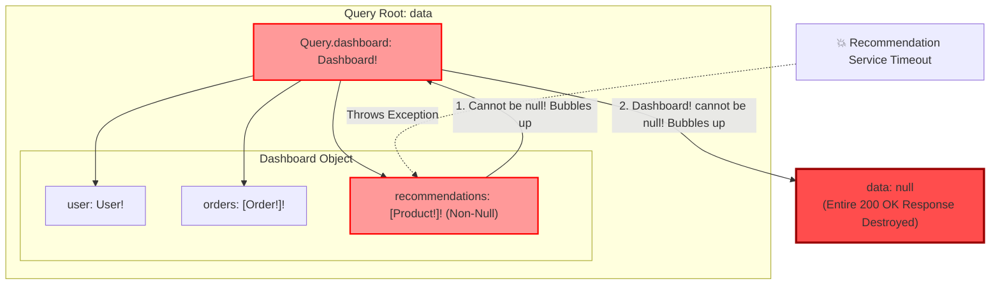
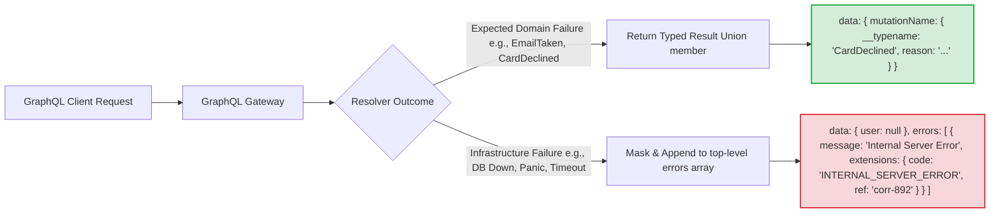
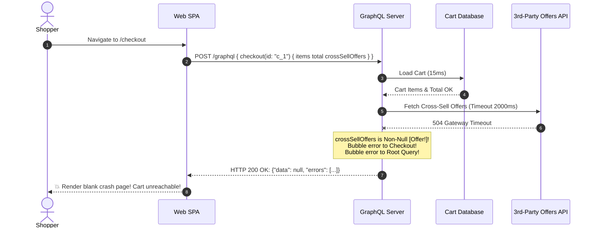

# Module 06: GraphQL Errors, Nullability, and Partial Results

> **Prerequisites**: [03-graphql-fundamentals](../03-graphql-fundamentals/README.md), [04-graphql-advanced-patterns](../04-graphql-advanced-patterns/README.md), and [05-graphql-schema-evolution-and-deprecation](../05-graphql-schema-evolution-and-deprecation/README.md).  
> **Estimated Reading Time**: 30 minutes  
> **Target Audience**: Backend Engineers, API Designers, and Reliability Engineers designing resilient distributed systems and robust client-facing GraphQL contracts.

---

> [!TIP]
> **The Golden Rule of GraphQL Error Handling & Nullability**  
> In GraphQL, nullability (`!`) is not an aesthetic typing choice—it is your **error blast radius boundary**. Non-null fields (`!`) force errors to bubble upward and destroy enclosing parent objects when a resolver throws or returns null. Follow the core architectural principle: **mark fields non-null within a single data-fetch boundary (local entity attributes), but mark fields nullable across remote network and service boundaries**. Furthermore, model expected domain business failures as **first-class Result Unions in the schema**, reserving the top-level `errors[]` array strictly for unexpected infrastructure faults.

---

## Visual Mental Models & Architecture

### The Null Propagation Bubbling Avalanche

When a resolver throws an unhandled exception or returns `null` for a field marked with `!`, GraphQL cannot fulfill the non-null contract at that position. It forces the parent object to become `null`. If the parent is also marked non-null, this bubbling cascades upward until it encounters a nullable boundary—or obliterates the entire `data` envelope.



---

### Errors as Schema Data vs Exceptional Errors



---

## Systematic Reference Grids

### Comparison: Top-Level `errors[]` vs Typed Result Unions

| Dimension | Top-Level `errors[]` Array | Typed Result Unions (`union Result = Success \| Failure`) |
| :--- | :--- | :--- |
| **Intended Use Case** | Unexpected infrastructure faults (database timeouts, network partitions, unhandled code panics). | Expected business outcomes (validation failures, card declined, email already taken, out of stock). |
| **Schema Discoverability** | **Hidden** ❌: Callers cannot inspect the SDL to see what failure codes exist without external docs. | **First-Class** ✅: Discoverable in SDL, auto-generated in client SDK types (`graphql-codegen`, Apollo). |
| **Client Handling** | Requires ad-hoc string comparisons or checking non-standard `extensions.code` dictionaries. | Enforced by client type compilers (e.g., TypeScript/Swift `switch` statements requiring handling each type). |
| **Impact on `data`** | Can trigger null bubbling, corrupting or blanking out healthy partial sibling fields. | Preserved completely within `data`; partial responses remain structurally intact. |
| **HTTP Transport Status** | Almost always **HTTP 200 OK** (unless document fails parsing or schema validation). | **HTTP 200 OK**; success payload contains polymorphic failure representation. |
| **Overhead** | Minimal boilerplate on backend. | Requires defining dedicated SDL types, unions, and resolver `__resolveType` discriminators. |

---

### Collection Nullability Spectrum: The List Failure Matrix

When querying collections (`posts`), the combination of inner and outer exclamation marks dictates how individual item failures affect the dataset:

| Syntax | Nullable List? | Nullable Items? | Failure Outcome when 1 of 50 Items Fails | Best For |
| :--- | :--- | :--- | :--- | :--- |
| **`[Post!]!`** | **No** | **No** | **Catastrophic Failure**: List cannot contain null, so error bubbles to the parent object. All 50 posts and the parent are lost. | Highly coupled local data (e.g., coordinates in a geographic polygon: `[Coordinate!]!`). |
| **`[Post!]`** | **Yes** | **No** | **Collection Failure**: List becomes `null`. 49 successful posts are discarded, but parent object survives. | Subordinate resources that must either be complete or omitted entirely. |
| **`[Post]!`** | **No** | **Yes** | **Per-Item Graceful Degradation**: List returns 50 elements: 49 valid posts and `null` at index of failed item. List cannot be omitted. | Aggregated feeds, social media walls, and federated search results. |
| **`[Post]`** | **Yes** | **Yes** | **Maximum Resilience**: Individual items can be `null`, and the entire collection can be `null` if the backing service is down. | Third-party enrichments and optional recommendation widgets. |

---

## Production Incident War Story: The Black Friday Blackout

### Incident Post-Mortem: SEV-1

* **Incident ID**: INC-9104
* **Severity Level**: SEV-1 (Complete E-Commerce Checkout Outage)
* **Detection Time**: 2 minutes after traffic spike
* **Time to Recovery (TTR)**: 14 minutes
* **Impact**: \$3.2M in abandoned checkout carts over a 14-minute window during Black Friday peak.

#### 1. What Happened
A retail platform overhauled its checkout GraphQL schema. The `Checkout` type was configured with:
```graphql
type Query {
  checkout(id: ID!): Checkout!
}

type Checkout {
  id: ID!
  items: [CartItem!]!
  totalAmount: Money!
  crossSellOffers: [Offer!]! # Third-party recommendation engine
}
```
During Black Friday peak traffic, the third-party recommendation microservice suffered an outage and began returning HTTP 504 Gateway Timeouts. The backend resolver for `crossSellOffers` timed out and threw a `ServiceUnavailableException`.

Because `crossSellOffers` was marked non-null (`[Offer!]!`), GraphQL could not set the field to `null`. It bubbled up to `Checkout`. Because `Checkout!` on `checkout(id:)` was also non-null, the error bubbled up to the root, resulting in:
```json
{
  "data": null,
  "errors": [
    {
      "message": "Recommendation microservice timed out",
      "path": ["checkout", "crossSellOffers"]
    }
  ]
}
```
Every customer attempting to view their cart or complete their purchase saw a blank screen with a generic "Something went wrong" message.



#### 2. Root Cause Analysis
1. **Schema Design Flaw**: Non-essential enrichment fields (`crossSellOffers`) crossed a remote network/service boundary but were modeled with strict non-null assertions (`[Offer!]!`).
2. **Lack of Error Isolation**: An optional marketing feature took down core business capabilities (calculating totals and processing payment transactions).
3. **Internal Error Leaking**: Unmasked internal error messages and internal cluster DNS addresses were returned in `errors[].message` to public end-users.

#### 3. The Architectural Hardening & Resolution
1. **Schema Nullability Boundary**: Relaxed `crossSellOffers: [Offer!]` to be nullable. If the recommendation service fails, GraphQL resolves `crossSellOffers: null` and populates `errors[]`, allowing `items` and `totalAmount` to render without disruption.
2. **Circuit Breakers & Timeouts**: Wrapped remote third-party resolvers in circuit breakers with a tight 250ms SLA. On failure, return an empty list `[]` instead of throwing.
3. **Error Masking Extension**: Implemented an automated error filter that scrubs all stack traces, replaces unexpected errors with generic messages, and attaches a correlation ID (`ref`) mapped to server-side logs.

---

## Multi-Language Production Code Tabs: Resilient Errors & Result Unions

The following code examples demonstrate:
1. Expected business outcomes modeled as **Result Unions** (`CreateUserResult = UserSuccess | EmailTaken | WeakPassword`).
2. Robust **Error Masking** that scrubs internal stack traces and assigns an opaque UUID `ref`.
3. Standardized machine-readable error codes via `extensions.code`.

```
### Language Tabs
1. Go (gqlgen with result unions and error presenter)
2. Node.js / TypeScript (Apollo Server formatError & Unions)
3. Python (Strawberry SchemaExtension & Result Unions)
4. C# (Hot Chocolate Error Filters & Union Types)
```

### Go (gqlgen)
```go
package main

import (
	"context"
	"errors"
	"fmt"
	"net/http"

	"github.com/99designs/gqlgen/graphql"
	"github.com/99designs/gqlgen/graphql/handler"
	"github.com/google/uuid"
	"github.com/vektah/gqlparser/v2/gqlerror"
)

// Safe error presenter that sanitizes internal exceptions
func CustomErrorPresenter(ctx context.Context, e error) *gqlerror.Error {
	err := graphql.DefaultErrorPresenter(ctx, e)

	var customErr *DomainException
	if errors.As(e, &customErr) {
		// Safe business exception - allow message to pass through
		return &gqlerror.Error{
			Message: customErr.Message,
			Path:    err.Path,
			Extensions: map[string]interface{}{
				"code": customErr.Code,
			},
		}
	}

	// Unexpected system error: Mask internal details and generate correlation ID
	refID := uuid.New().String()
	fmt.Printf("[ERROR] ref=%s path=%v err=%v\n", refID, err.Path, e)

	return &gqlerror.Error{
		Message: "Internal server error occurred",
		Path:    err.Path,
		Extensions: map[string]interface{}{
			"code": "INTERNAL_SERVER_ERROR",
			"ref":  refID,
		},
	}
}

type DomainException struct {
	Code    string
	Message string
}

func (d *DomainException) Error() string { return d.Message }

func main() {
	srv := handler.NewDefaultServer(NewExecutableSchema(Config{Resolvers: &Resolver{}}))
	srv.SetErrorPresenter(CustomErrorPresenter)

	http.Handle("/graphql", srv)
	_ = http.ListenAndServe(":8080", nil)
}
```

### Node.js / TypeScript (@apollo/server)
```typescript
import { ApolloServer } from '@apollo/server';
import { startStandaloneServer } from '@apollo/server/standalone';
import { GraphQLError } from 'graphql';
import { v4 as uuidv4 } from 'uuid';

const typeDefs = `#graphql
  type User {
    id: ID!
    email: String!
  }

  type EmailTaken {
    message: String!
    suggestedEmail: String!
  }

  type WeakPassword {
    message: String!
    minimumLength: Int!
  }

  union RegisterResult = User | EmailTaken | WeakPassword

  type Query {
    _dummy: String
  }

  type Mutation {
    register(email: String!, pass: String!): RegisterResult!
  }
`;

const resolvers = {
  RegisterResult: {
    __resolveType(obj: any) {
      if (obj.email && obj.id) return 'User';
      if (obj.suggestedEmail) return 'EmailTaken';
      if (obj.minimumLength) return 'WeakPassword';
      return null;
    },
  },
  Mutation: {
    register: (_: any, { email, pass }: { email: string; pass: string }) => {
      // 1. Business Validation 1: Weak Password
      if (pass.length < 8) {
        return { message: "Password too weak", minimumLength: 8 };
      }
      // 2. Business Validation 2: Email Taken
      if (email === "taken@example.com") {
        return { message: "Email is already registered", suggestedEmail: "taken_alt@example.com" };
      }
      // 3. Success
      return { id: "usr_42", email };
    },
  },
};

const server = new ApolloServer({
  typeDefs,
  resolvers,
  formatError: (formattedError, error) => {
    // If the error has a recognized code extension, let it pass
    const code = formattedError.extensions?.code;
    if (code && code !== 'INTERNAL_SERVER_ERROR') {
      return formattedError;
    }

    // Mask unexpected crashes
    const correlationId = uuidv4();
    console.error(`[UNHANDLED_ERROR] Ref: ${correlationId}`, error);

    return new GraphQLError('Internal server error', {
      extensions: {
        code: 'INTERNAL_SERVER_ERROR',
        ref: correlationId,
      },
    });
  },
});

startStandaloneServer(server, { listen: { port: 4000 } }).then(({ url }) => {
  console.log(`Server running at ${url}`);
});
```

### Python (Strawberry)
```python
import uuid
import logging
from typing import Annotated, Union
import strawberry
from strawberry.extensions import SchemaExtension
from strawberry.types import ExecutionContext

logger = logging.getLogger("graphql")

class ErrorMaskingExtension(SchemaExtension):
    def on_operation(self):
        yield
        execution_context: ExecutionContext = self.execution_context
        if execution_context.result and execution_context.result.errors:
            sanitized_errors = []
            for err in execution_context.result.errors:
                ref_id = str(uuid.uuid4())[:8]
                logger.error("GraphQL Error [%s] path=%s: %s", ref_id, err.path, err.original_error)
                
                # Check for explicit safe GraphQL error codes
                extensions = err.extensions or {}
                if extensions.get("code") in ("UNAUTHENTICATED", "FORBIDDEN", "BAD_USER_INPUT"):
                    sanitized_errors.append(err)
                else:
                    sanitized_err = strawberry.types.ExecutionError(
                        message="Internal server error",
                        path=err.path,
                        extensions={"code": "INTERNAL_SERVER_ERROR", "ref": ref_id}
                    )
                    sanitized_errors.append(sanitized_err)
            execution_context.result.errors = sanitized_errors

@strawberry.type
class User:
    id: strawberry.ID
    email: str

@strawberry.type
class EmailTaken:
    message: str
    existing_user_id: strawberry.ID

@strawberry.type
class WeakPassword:
    message: str
    minimum_length: int

RegisterResult = Annotated[
    Union[User, EmailTaken, WeakPassword],
    strawberry.union("RegisterResult")
]

@strawberry.type
class Mutation:
    @strawberry.mutation
    def register(self, email: str, password: str) -> RegisterResult:
        if len(password) < 8:
            return WeakPassword(message="Password requires at least 8 characters", minimum_length=8)
        if email == "admin@domain.com":
            return EmailTaken(message="Email is unavailable", existing_user_id="usr_admin")
        return User(id=strawberry.ID("usr_123"), email=email)

@strawberry.type
class Query:
    @strawberry.field
    def health(self) -> str:
        return "ok"

schema = strawberry.Schema(query=Query, mutation=Mutation, extensions=[ErrorMaskingExtension])
```

### C# (Hot Chocolate)
```csharp
using HotChocolate;
using HotChocolate.Execution;
using HotChocolate.Types;
using Microsoft.AspNetCore.Builder;
using Microsoft.Extensions.DependencyInjection;

var builder = WebApplication.CreateBuilder(args);

builder.Services
    .AddGraphQLServer()
    .AddQueryType<Query>()
    .AddMutationType<Mutation>()
    .AddType<User>()
    .AddType<EmailTaken>()
    .AddType<WeakPassword>()
    .AddErrorFilter<CustomErrorFilter>();

var app = builder.Build();
app.MapGraphQL();
app.Run();

public class User { public string Id { get; set; } = "usr_1"; public string Email { get; set; } = ""; }
public class EmailTaken { public string Message { get; set; } = ""; }
public class WeakPassword { public string Message { get; set; } = ""; public int MinLength { get; set; } = 8; }

[UnionType("RegisterResult")]
public interface IRegisterResult { }

public class Query { public string Health() => "healthy"; }

public class Mutation
{
    public IRegisterResult RegisterUser(string email, string password)
    {
        if (password.Length < 8)
            return new WeakPassword { Message = "Password too short", MinLength = 8 };
            
        if (email == "exists@test.com")
            return new EmailTaken { Message = "Email address already registered" };
            
        return new User { Id = "usr_55", Email = email };
    }
}

public class CustomErrorFilter : IErrorFilter
{
    private readonly ILogger<CustomErrorFilter> _logger;
    public CustomErrorFilter(ILogger<CustomErrorFilter> logger) => _logger = logger;

    public IError OnError(IError error)
    {
        var code = error.Code;
        if (code == "AUTH_REQUIRED" || code == "BAD_INPUT")
        {
            return error;
        }

        var refId = Guid.NewGuid().ToString("N")[..8];
        _logger.LogError(error.Exception, "GraphQL Error [Ref: {RefId}] Path: {Path}", refId, error.Path);

        return error
            .WithMessage("Internal server error")
            .WithCode("INTERNAL_SERVER_ERROR")
            .SetExtension("ref", refId)
            .RemoveException();
    }
}
```

---

## Practical Hands-On Verification Workflows

### 1. Execute a Mutation with Expected Result Unions

Send a request that triggers an expected domain failure (`WeakPassword`) and verify that it returns **HTTP 200** with no entries in the top-level `errors[]` array.

```bash
curl -s -X POST http://localhost:4000/graphql \
  -H "Content-Type: application/json" \
  -d '{
    "query": "mutation { register(email: \"test@corp.com\", pass: \"123\") { __typename ... on User { id email } ... on WeakPassword { message minimumLength } ... on EmailTaken { message suggestedEmail } } }"
  }' | jq .
```

**Expected JSON Response:**
```json
{
  "data": {
    "register": {
      "__typename": "WeakPassword",
      "message": "Password too weak",
      "minimumLength": 8
    }
  }
}
```

---

### 2. Verify Partial Success & Error Masking

Trigger an unhandled database exception on an enrichment field while selecting an intact root property.

```bash
curl -s -X POST http://localhost:4000/graphql \
  -H "Content-Type: application/json" \
  -d '{
    "query": "query { user(id: \"usr_10\") { name profile { avatarUrl secretNotes } } }"
  }' | jq .
```

**Expected JSON Response (Partial Data + Sanitized Error):**
```json
{
  "data": {
    "user": {
      "name": "Alan Turing",
      "profile": null
    }
  },
  "errors": [
    {
      "message": "Internal server error",
      "path": ["user", "profile"],
      "extensions": {
        "code": "INTERNAL_SERVER_ERROR",
        "ref": "e7b1a90c"
      }
    }
  ]
}
```
*Notice that the SQL connection string and internal cluster IP address are stripped, while `name: "Alan Turing"` remains accessible.*

---

## Operational Validation Checkpoints (Scenario Quizzes)

<details>
<summary><strong>Checkpoint 1: The Null Bubbling Cascade</strong></summary>

**Scenario:** Consider the following GraphQL schema definition:
```graphql
type Query {
  order(id: ID!): Order!
}

type Order {
  id: ID!
  customer: Customer!
  shippingTracker: TrackingInfo!
}

type TrackingInfo {
  carrier: String!
  trackingCode: String!
}
```
If the logistics microservice responsible for resolving `shippingTracker` crashes and raises an uncaught network timeout exception, what is the exact JSON structure returned under the `"data"` key in the HTTP response?

**Answer:**
`"data": null` (the entire response payload is empty).
- **Execution trace**: `shippingTracker` fails &rarr; because it is marked `TrackingInfo!` (non-null), it cannot evaluate to `null`, bubbling the failure to its parent `Order`.
- Because `order(id: ID!): Order!` is also defined as non-null, `Order` cannot evaluate to `null`, bubbling the failure to the query root.
- The GraphQL execution engine is forced to null the entire root `data` object. A single non-critical field failure obliterated all order and customer data. To fix this, `shippingTracker: TrackingInfo` must be made nullable.
</details>

<details>
<summary><strong>Checkpoint 2: Architectural Modeling: Result Unions vs Top-Level Errors</strong></summary>

**Scenario:** An engineering team is designing a checkout mutation: `checkout(cartId: ID!, paymentNonce: String!)`. The following failure conditions must be supported:
1. The user's credit card was declined due to insufficient funds.
2. The cart contains an item that just went out of stock.
3. The database connection pool is exhausted and queries are timing out.

How should each condition be represented in GraphQL according to production best practices?

**Answer:**
- Conditions 1 and 2 are **Expected Business Domain Outcomes**. They must be modeled as members of a **Result Union** (`union CheckoutResult = OrderConfirmation | CardDeclined | OutOfStockItem`). They return under `"data"` with `__typename` discriminators. This forces client engineers to write UI branches handling these states, avoids null bubbling, and keeps failure types discoverable in the schema.
- Condition 3 is an **Exceptional Infrastructure Failure**. It must throw an exception on the server, be intercepted by error masking middleware, sanitized to `"Internal server error"`, and placed in the top-level **`errors[]` array** with `extensions: { code: "INTERNAL_SERVER_ERROR", ref: "<uuid>" }`.
</details>

<details>
<summary><strong>Checkpoint 3: The HTTP 200 Ambiguity Problem</strong></summary>

**Scenario:** A company puts an API Gateway in front of their GraphQL service. Their monitoring alarms trigger on HTTP 5xx responses. Despite hundreds of users reporting broken checkout pages, the HTTP 5xx alarm never fires, and uptime dashboards report 100% green. Why did this occur, and how should edge gateways and observability agents monitor GraphQL service health?

**Answer:**
GraphQL servers conform to the GraphQL specification by returning **HTTP 200 OK** even when query execution encounters resolver exceptions and populates the `errors[]` array. Edge proxies and reverse proxies inspecting only the HTTP status code see `200` and consider the request successful.
To properly monitor GraphQL service health:
1. Observability agents and gateways must inspect the response payload body (or rely on custom response headers like `X-GraphQL-Error-Count`) to track error rates.
2. The GraphQL server should export Prometheus metrics (`graphql_resolver_errors_total` and `graphql_operation_errors_total`) categorized by `extensions.code` (`INTERNAL_SERVER_ERROR` vs domain codes).
3. Synthetic health check endpoints (`/healthz`) must execute end-to-end read queries against backing datastores rather than hitting static ping routes.
</details>

---

## Further Reading & Next Steps

* [GraphQL Official Specification: Errors](https://spec.graphql.org/draft/#sec-Errors) - The formal error format, propagation mechanics, and path specifications.
* [Sasha Solomon: 200 OK! Error Handling in GraphQL](https://sachee.medium.com/200-ok-error-handling-in-graphql-7ec869aec9bc) - The industry-standard thesis on Result Unions.
* [Apollo GraphQL Error Handling Guide](https://www.apollographql.com/docs/apollo-server/data/errors/) - Standard machine-readable codes and client propagation.
* Next up: [07-graphql-security-caching-and-observability](../07-graphql-security-caching-and-observability/README.md) to defend your GraphQL API against alias bombs, implement cost-based rate limiting, and achieve true HTTP CDN caching.
