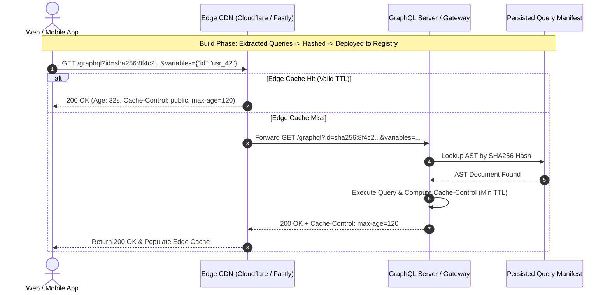
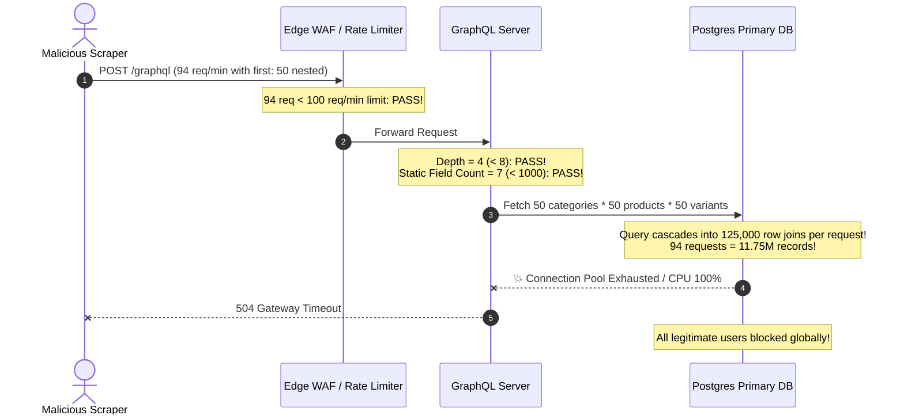

# Module 07: GraphQL Security, Caching, and Observability

> **Prerequisites**: [03-graphql-fundamentals](../03-graphql-fundamentals/README.md), [04-graphql-advanced-patterns](../04-graphql-advanced-patterns/README.md), and [06-graphql-errors-nullability-and-partial-results](../06-graphql-errors-nullability-and-partial-results/README.md).  
> **Estimated Reading Time**: 32 minutes  
> **Target Audience**: Senior Backend Engineers, Security Architects, and Platform Engineers operating high-scale GraphQL infrastructure in production.

---

> [!TIP]
> **The Golden Rule of GraphQL Security, Caching, and Observability**  
> Never rely on static depth limits or request-count rate limiting to protect GraphQL endpoints. Attackers bypass depth limits using **alias amplification** and bypass request counting using **multiplicative pagination** (`first: 100`). Enforce **multiplicative complexity scoring** before execution, rate-limit clients by **complexity points consumed**, and deploy **Persisted Queries in registry-only mode** to reduce your public attack surface to zero. To unlock CDN caching on GraphQL, execute persisted queries via HTTP `GET` with explicit `Cache-Control` max-age hints.

---

## Visual Mental Models & Architecture

### The CDN Caching Flow: Unlocking HTTP GET via Persisted Queries

Standard GraphQL sends HTTP `POST` requests with arbitrary query strings in the body, rendering traditional CDN edge caches (Cloudflare, Fastly, CloudFront) completely ineffective. Persisted Queries convert operations into cryptographic hashes (`sha256`) that can be safely routed over HTTP `GET`.



---

### Multiplicative Complexity vs Naive Field Counting

A query with depth 3 can easily consume more server CPU and memory than a query with depth 20 if it exploits list pagination arguments.

```mermaid
flowchart TD
    subgraph Naive Scorer: Cost = 4 points
        A1["Query.users (1 pt)"] --> B1["User.posts (1 pt)"]
        B1 --> C1["Post.comments (1 pt)"]
        C1 --> D1["Comment.author (1 pt)"]
    end

    subgraph Multiplicative Scorer: Cost = 1,010,100 points
        A2["Query.users(first: 100) [100 items]"] --> B2["User.posts(first: 100) [10,000 items]"]
        B2 --> C2["Post.comments(first: 100) [1,000,000 items]"]
        C2 --> D2["Comment.author [1,000,000 items]"]
    end

    style Naive Scorer fill:#f8d7da,stroke:#dc3545,stroke-width:2px
    style Multiplicative Scorer fill:#d4edda,stroke:#28a745,stroke-width:2px
```

---

## Systematic Reference Grids

### Attack Vectors & Defensive Countermeasures

| Attack Vector | Attacker Technique | Why Naive Defenses Fail | Production Countermeasure |
| :--- | :--- | :--- | :--- |
| **Alias Amplification** | Repeating the same field thousands of times using distinct aliases (`a1: user(id:1), a2: user(id:2)...`). | **Depth limits ignore width**: Query depth is only 2, but resolves 10,000 database queries in one HTTP call. | Enforce a strict **Max Alias Limit** (e.g., &le; 20) and **Max Total Field Node Count** (e.g., &le; 250) at the AST validation stage. |
| **Multiplicative List Bomb** | Nesting connection arguments: `users(first:100) { posts(first:100) { comments(first:100) } }`. | **Per-field complexity scorers** count 4 fields instead of the 1,000,000 entities requested. | Implement **Multiplicative Complexity Analysis** that parses AST argument values and multiplies child node costs by `first`/`last`. |
| **Batching Array Flood** | Sending an array of 5,000 JSON query operations in a single HTTP `POST` body. | **Per-operation limits** validate each single query as cheap, while request-count rate limiters count 1 HTTP request. | Cap batch array size (e.g., &le; 10 operations), sum complexity across the entire batch, or disable batching entirely. |
| **Introspection Reconnaissance** | Querying `__schema` and `__type` to map sensitive types, mutations, and deprecated endpoints. | Security by obscurity: disabling introspection doesn't stop guessing, and field suggestions leak types. | Disable introspection in public production AND disable **field suggestions** ("Did you mean..."). Use **Persisted Queries**. |
| **Denial of Service via Regex / Large Strings** | Passing 10MB GraphQL documents or deeply nested recursive fragments. | Parsing massive documents consumes CPU and memory before execution even begins. | Enforce **Max Request Body Size** (e.g., 50KB) and **Max Fragment Spread Depth** (e.g., &le; 5) at the HTTP parser layer. |

---

### The Three-Tier Caching Hierarchy

| Caching Layer | Technology | Keying Strategy | Cache Invalidation Mechanism | Primary Benefit |
| :--- | :--- | :--- | :--- | :--- |
| **Tier 1: HTTP / CDN Edge** | Cloudflare, Fastly, Varnish, Akamai | URL Path + SHA256 Hash + Stringified Variables | Time-To-Live (TTL) via `Cache-Control` header; Surrogate-Key / Cache-Tags purging. | Zero backend execution overhead; global latency under 30ms for static/unauthenticated queries. |
| **Tier 2: Whole-Response Cache** | Redis, In-Memory Memcached | Client Role + Query Hash + Variable Hashes | `@cacheControl(maxAge: 300, scope: PUBLIC)` computed across AST fields (most restrictive wins). | Offloads repeated identical queries from application server CPU. |
| **Tier 3: Object / Entity Cache** | Redis + DataLoader | Entity Typename + Primary Key (e.g., `User:usr_99`) | Event-driven invalidation (Kafka/Debezium/CDC mutation events). | Accelerates authenticated, dynamic queries by caching shared underlying domain entities across different query shapes. |

---

## Production Incident War Story: The 94-Request Collapse

### Incident Post-Mortem: SEV-1

* **Incident ID**: INC-7822
* **Severity Level**: SEV-1 (Primary Database CPU Saturation)
* **Detection Time**: 3 minutes after automated scraper started
* **Time to Recovery (TTR)**: 22 minutes
* **Impact**: Total database lockup; all checkout transactions, user logins, and order views stalled globally.

#### 1. What Happened
A publicly exposed GraphQL endpoint was protected by standard industry guardrails:
1. Depth limiting: Maximum query depth of 8.
2. Static complexity limit: Maximum 1,000 points (1 point per field).
3. Rate limiting: 100 HTTP requests per minute per IP address.
4. Introspection: Disabled in production.

A competitor script attempted to scrape inventory by executing the following query:
```graphql
query ScrapeCatalog {
  categories(first: 50) {
    products(first: 50) {
      variants(first: 50) {
        id
        sku
        price
        inventoryCount
      }
    }
  }
}
```
The scraper executed this query across 94 requests within a single minute. 

Because the query depth was only 4 (well within the limit of 8), the static field count was only 7 fields (well within the 1,000-point limit), and the total request volume was 94 requests (under the 100 req/min rate limit), **all requests were admitted unconditionally**.

However, each single query resolved:
$$\text{Entities} = 50 \times 50 \times 50 = 125,000 \text{ variants}$$
Across 94 requests, the backend attempted to hydrate and serialize **11,750,000 database entities** in 60 seconds. The PostgreSQL database hit 100% CPU utilization, connection pool workers starved, and the entire API ground to a halt.



#### 2. Root Cause Analysis
1. **Flawed Complexity Heuristic**: The complexity calculator evaluated AST nodes statically without incorporating pagination multiplier arguments (`first` and `last`).
2. **Request-Count Rate Limiting**: The rate limiter treated a single lightweight query (`{ me { id } }`) identically to a query that fetched 125,000 records.
3. **Missing Hard Bounds on Pagination**: The GraphQL schema did not enforce a maximum allowed integer on `first` arguments.

#### 3. The Architectural Hardening & Resolution
1. **Multiplicative Complexity Algorithm**: Configured query analysis to multiply child node complexity by the integer value of `first` / `last`. The scraper query scored over 150,000 points and was rejected during document validation before executing a single database call.
2. **Cost-Based Rate Limiting**: Replaced request-count rate limiting with a Redis token bucket denominated in **complexity points** (allocating 5,000 points/min per client).
3. **Strict Argument Clamping**: Hard-coded a global maximum limit on all pagination arguments: `first: Int = 20` with a server-side cap of `50`. Any query requesting `first > 50` fails validation.

---

## Multi-Language Production Code Tabs: Multiplicative Complexity & Protection

The following implementations demonstrate:
1. Multiplicative query complexity calculation accounting for list pagination (`first`/`last`).
2. Alias limits to prevent alias amplification attacks.
3. Automated persisted query verification.

```
### Language Tabs
1. Go (gqlgen with custom complexity rules)
2. Node.js / TypeScript (graphql-armor / custom validation rule)
3. Python (Strawberry SchemaExtension complexity estimator)
4. C# (Hot Chocolate MaxAllowedExecutionDepth & Cost Analysis)
```

### Go (gqlgen)
```go
package main

import (
	"context"
	"fmt"
	"net/http"

	"github.com/99designs/gqlgen/graphql"
	"github.com/99designs/gqlgen/graphql/handler"
	"github.com/99designs/gqlgen/graphql/handler/extension"
)

func main() {
	// 1. Initialize gqlgen server with schema
	srv := handler.NewDefaultServer(NewExecutableSchema(Config{Resolvers: &Resolver{}}))

	// 2. Set maximum query depth
	srv.Use(extension.FixedComplexityLimit(1000))

	// 3. Define multiplicative complexity calculation function
	complexityConfig := ComplexityRoot{
		Query: struct {
			Categories func(childComplexity int, first *int) int
		}{
			Categories: func(childComplexity int, first *int) int {
				multiplier := 10 // Default pagination limit
				if first != nil {
					multiplier = *first
					if multiplier > 50 {
						multiplier = 50 // Enforce hard cap
					}
				}
				// Multiplicative cost: child fields * number of items
				return 1 + (childComplexity * multiplier)
			},
		},
	}

	srv.Use(extension.ComplexityLimit{
		Func: func(ctx context.Context, rc *graphql.OperationContext) int {
			// Dynamic calculation based on user tier or token
			return 2500 // Max budget per query
		},
	})

	http.Handle("/graphql", srv)
	fmt.Println("GraphQL security gateway listening on :8080")
	_ = http.ListenAndServe(":8080", nil)
}
```

### Node.js / TypeScript (Apollo Server + GraphQL Armor)
```typescript
import { ApolloServer } from '@apollo/server';
import { startStandaloneServer } from '@apollo/server/standalone';
import { GraphQLError, ValidationContext, ASTVisitor, FieldNode } from 'graphql';

// Custom validation rule: Alias count limiter
export function maxAliasesRule(maxAllowed: number) {
  return (context: ValidationContext): ASTVisitor => {
    let aliasCount = 0;
    return {
      Field(node: FieldNode) {
        if (node.alias) {
          aliasCount++;
          if (aliasCount > maxAllowed) {
            context.reportError(
              new GraphQLError(
                `Too many aliases: Query defines ${aliasCount} aliases, exceeding limit of ${maxAllowed}`,
                { extensions: { code: 'BAD_USER_INPUT' } }
              )
            );
          }
        }
      },
    };
  };
}

const typeDefs = `#graphql
  type Product { id: ID! title: String! }
  type Query {
    products(first: Int = 10): [Product!]!
  }
`;

const resolvers = {
  Query: {
    products: (_: any, { first }: { first: number }) => {
      const clamped = Math.min(first, 50);
      return Array.from({ length: clamped }, (_, i) => ({ id: `${i}`, title: `Item ${i}` }));
    },
  },
};

const server = new ApolloServer({
  typeDefs,
  resolvers,
  validationRules: [
    maxAliasesRule(15), // Enforce alias protection
  ],
  introspection: process.env.NODE_ENV !== 'production', // Disable in prod
});

startStandaloneServer(server, { listen: { port: 4000 } }).then(({ url }) => {
  console.log(`Secured Apollo Server running at ${url}`);
});
```

### Python (Strawberry + Multiplicative Analysis)
```python
from typing import List, Optional
import strawberry
from strawberry.extensions import SchemaExtension
from strawberry.types import ExecutionContext
from graphql import GraphQLError, FieldNode, OperationDefinitionNode

class ComplexityGuardExtension(SchemaExtension):
    MAX_BUDGET = 2000

    def on_operation(self):
        ctx: ExecutionContext = self.execution_context
        if ctx.graphql_document:
            total_cost = self._calculate_cost(ctx.graphql_document.definitions)
            if total_cost > self.MAX_BUDGET:
                raise GraphQLError(
                    f"Query complexity limit exceeded: cost {total_cost} exceeds limit of {self.MAX_BUDGET}",
                    extensions={"code": "COMPLEXITY_LIMIT_EXCEEDED", "cost": total_cost}
                )
        yield

    def _calculate_cost(self, definitions) -> int:
        cost = 0
        for defn in definitions:
            if isinstance(defn, OperationDefinitionNode):
                cost += self._score_selection_set(defn.selection_set, multiplier=1)
        return cost

    def _score_selection_set(self, selection_set, multiplier: int) -> int:
        if not selection_set:
            return 0
        local_cost = 0
        for selection in selection_set.selections:
            if isinstance(selection, FieldNode):
                field_cost = 1
                child_multiplier = 1
                for arg in selection.arguments:
                    if arg.name.value in ("first", "limit"):
                        try:
                            child_multiplier = min(int(arg.value.value), 50)
                        except (ValueError, AttributeError):
                            child_multiplier = 10
                
                local_cost += (field_cost * multiplier)
                if selection.selection_set:
                    local_cost += self._score_selection_set(
                        selection.selection_set, 
                        multiplier=multiplier * child_multiplier
                    )
        return local_cost

@strawberry.type
class Product:
    id: strawberry.ID
    name: str

@strawberry.type
class Query:
    @strawberry.field
    def catalog(self, first: int = 10) -> List[Product]:
        limit = min(first, 50)
        return [Product(id=strawberry.ID(str(i)), name=f"Product {i}") for i in range(limit)]

schema = strawberry.Schema(query=Query, extensions=[ComplexityGuardExtension])
```

### C# (Hot Chocolate)
```csharp
using HotChocolate.Execution.Configuration;
using Microsoft.AspNetCore.Builder;
using Microsoft.Extensions.DependencyInjection;

var builder = WebApplication.CreateBuilder(args);

builder.Services
    .AddGraphQLServer()
    .AddQueryType<Query>()
    // 1. Enforce maximum execution depth
    .AddMaxExecutionDepthRule(7)
    // 2. Enforce total document node limit (alias protection)
    .AddMaxExecutionNodesRule(250)
    // 3. Configure cost / complexity analysis
    .AddCostAnalysis()
    .ModifyCostOptions(o =>
    {
        o.MaxAllowedCost = 2500;
        o.EnforceCostLimits = true;
    });

var app = builder.Build();
app.MapGraphQL();
app.Run();

public class Product
{
    public string Id { get; set; } = "prod_1";
    public string Name { get; set; } = "Hardened Server";
}

public class Query
{
    // Apply cost multipliers to collection arguments
    [Cost(Complexity = 5, Multipliers = new[] { "first" })]
    public IEnumerable<Product> GetProducts(int first = 10)
    {
        var limit = Math.Clamp(first, 1, 50);
        return Enumerable.Range(1, limit).Select(i => new Product { Id = $"{i}", Name = $"Item {i}" });
    }
}
```

---

## Practical Hands-On Verification Workflows

### 1. Execute an Alias Attack & Observe Rejection

Simulate an alias bomb designed to bypass naive depth limits and verify AST rejection:

```bash
# Send 25 aliased root queries to server with limit of 15 aliases
curl -s -X POST http://localhost:4000/graphql \
  -H "Content-Type: application/json" \
  -d '{
    "query": "{ a1: products { id } a2: products { id } a3: products { id } a4: products { id } a5: products { id } a6: products { id } a7: products { id } a8: products { id } a9: products { id } a10: products { id } a11: products { id } a12: products { id } a13: products { id } a14: products { id } a15: products { id } a16: products { id } }"
  }' | jq .
```

**Expected JSON Wire Error:**
```json
{
  "errors": [
    {
      "message": "Too many aliases: Query defines 16 aliases, exceeding limit of 15",
      "extensions": {
        "code": "BAD_USER_INPUT"
      }
    }
  ]
}
```

---

### 2. Verify CDN Cache-Control Headers on HTTP GET

Issue a persisted query via HTTP `GET` and inspect headers to confirm CDN cacheability:

```bash
curl -i "http://localhost:4000/graphql?query=%7Bproducts(first%3A5)%7Bid%20title%7D%7D"
```

**Expected Wire HTTP Headers:**
```http
HTTP/1.1 200 OK
Content-Type: application/json; charset=utf-8
Cache-Control: public, max-age=120, s-maxage=300
ETag: W/"3a8-bFm9a76p"
Vary: Accept-Encoding
Date: Mon, 10 Nov 2026 17:00:00 GMT
```

---

## Operational Validation Checkpoints (Scenario Quizzes)

<details>
<summary><strong>Checkpoint 1: The Multiplicative Pagination Vulnerability</strong></summary>

**Scenario:** An engineering team configures GraphQL depth limiting to 6 and static complexity calculation to 500 points (assigning 1 point per field). A client issues:
```graphql
query Exploit {
  departments(first: 20) {
    teams(first: 20) {
      engineers(first: 20) {
        id
        email
      }
    }
  }
}
```
What is the query depth, what is the static complexity score, how many engineer records will the backend attempt to materialize, and how do you fix this vulnerability?

**Answer:**
- **Query Depth**: 4 (well within the limit of 6).
- **Static Complexity Score**: 5 points (`departments`, `teams`, `engineers`, `id`, `email`), well within the 500-point limit.
- **Materialized Records**: $20 \times 20 \times 20 = 8,000$ engineer entities plus 400 team entities plus 20 department entities = 8,420 objects hydrated.
- **The Fix**: Implement **multiplicative complexity scoring** where each nested field's weight is multiplied by its parent's `first` argument ($1 + 20 \times (1 + 20 \times (1 + 20 \times 2)) = 16,821$ points), which immediately triggers the 500-point rejection gate prior to execution.
</details>

<details>
<summary><strong>Checkpoint 2: The Fallacy of APQ as a Security Boundary</strong></summary>

**Scenario:** A tech lead claims: *"We have enabled Automatic Persisted Queries (APQ) on our Apollo Gateway, so we no longer need query complexity scoring or depth limits because clients can only send pre-approved query hashes."* Is this statement accurate? Explain why or why not.

**Answer:**
The statement is **false and dangerous**.
Standard APQ is a **network bandwidth optimization protocol**, not an authorization or security boundary. Under default APQ:
1. When a client sends a hash the server has not seen (`PersistedQueryNotFound`), the client immediately retries by sending the **full GraphQL query text** along with the hash.
2. The server compiles the arbitrary query, registers the hash into its cache, and executes it.
3. Therefore, an attacker can construct malicious alias bombs or recursive queries, compute the SHA256 locally, send the pair to the server, and have the server execute and persist the attack payload.
To use persisted queries as a security boundary, you must operate in **Registry-Only / Safe-List Mode**, where unregistered query hashes are rejected immediately with HTTP 403/400 and arbitrary query strings are never executed.
</details>

<details>
<summary><strong>Checkpoint 3: The Most-Restrictive-Wins Cache Trap</strong></summary>

**Scenario:** A team adds Apollo `@cacheControl` hints to their user profile query:
```graphql
type User @cacheControl(maxAge: 3600) { # 1 hour
  id: ID!
  name: String!
  avatarUrl: String!
  lastActiveNotificationCount: Int @cacheControl(maxAge: 10) # 10 seconds
}
```
When querying `User` including `lastActiveNotificationCount`, edge CDN caches report near-zero hit ratios. Why is this occurring, and what architectural redesign should be applied?

**Answer:**
In GraphQL response caching, the cache policy calculation enforces **"most restrictive wins"**:
- If any single field in the selection set has `maxAge: 10`, the HTTP `Cache-Control` header for the entire response envelope is capped at `max-age=10`.
- Furthermore, if any field specifies `scope: PRIVATE` (e.g., user-specific unread count), the entire HTTP response becomes `Cache-Control: private`, preventing all CDN edge caching.
- **Architectural Redesign**: Separate volatile or personalized real-time attributes from static entity profiles. The client should issue two queries: a high-TTL query for static profile data (`maxAge: 3600`, cached at CDN edge), and a separate lightweight, un-cached query or WebSocket/SSE subscription for real-time notification counters.
</details>

---

## Further Reading & Next Steps

* [OWASP GraphQL Cheat Sheet](https://cheatsheetseries.owasp.org/cheatsheets/GraphQL_Cheat_Sheet.html) - Canonical security checklist for GraphQL production systems.
* [Apollo GraphQL: Performance and Caching](https://www.apollographql.com/docs/apollo-server/performance/caching/) - Guide to cache control directives and edge caching.
* [GraphQL Armor](https://escape.tech/graphql-armor/) - Enterprise security middleware for Apollo and Yoga.
* Next up: [08-webhooks-vs-polling-vs-websockets-tradeoffs](../08-webhooks-vs-polling-vs-websockets-tradeoffs/README.md) to evaluate real-time data delivery paradigms beyond synchronous query-response cycles.
