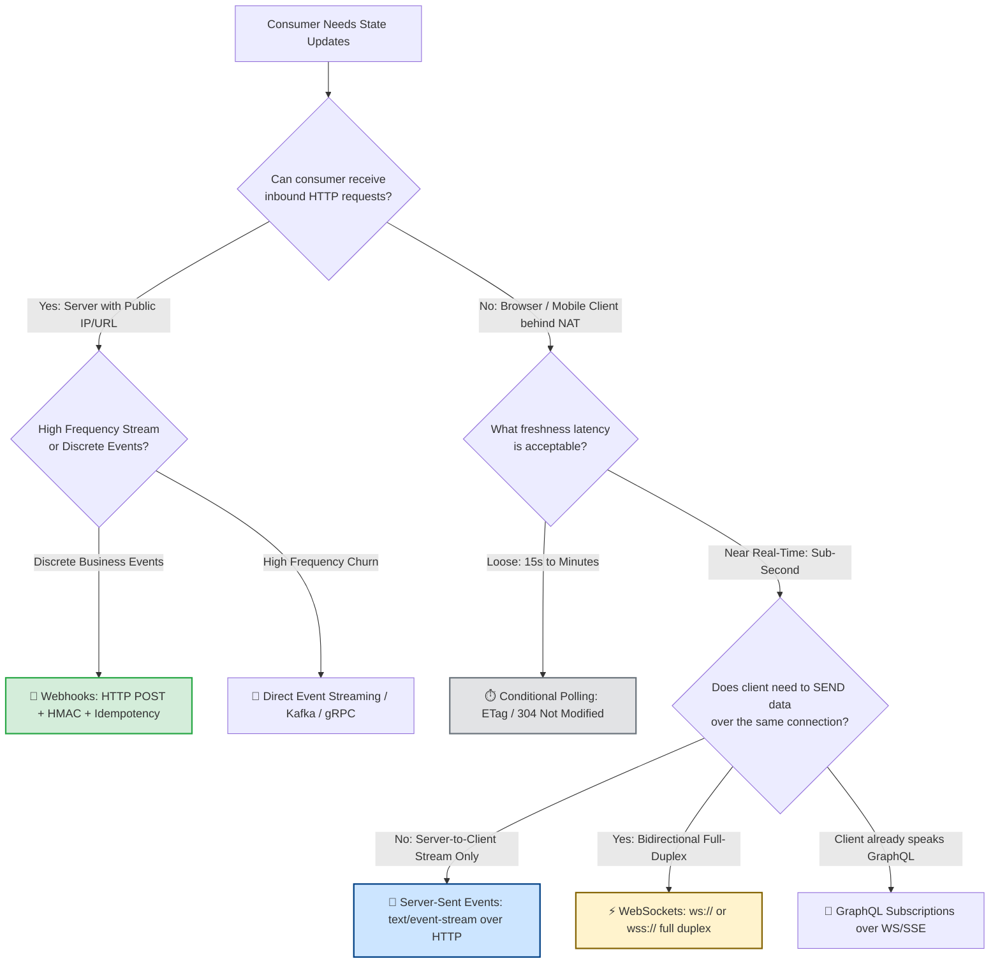
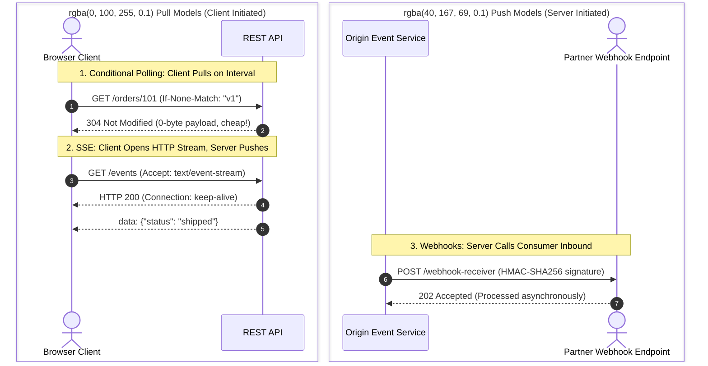
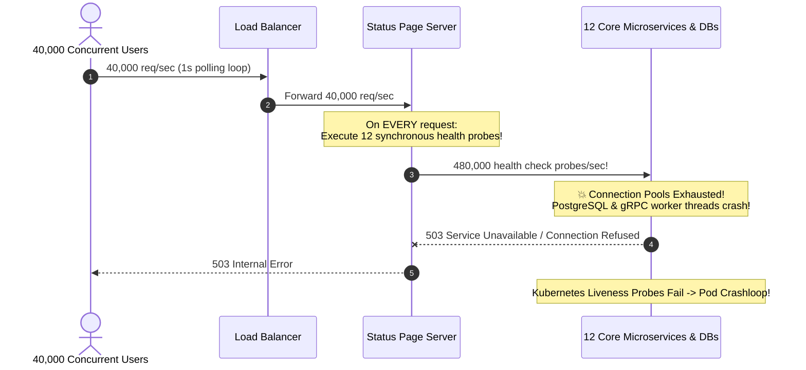

# Module 08: Webhooks vs Polling vs WebSockets — Tradeoffs

> **Prerequisites**: [00-beyond-rest-when-and-why](../00-beyond-rest-when-and-why/README.md), [03-graphql-fundamentals](../03-graphql-fundamentals/README.md), and [04-graphql-advanced-patterns](../04-graphql-advanced-patterns/README.md).  
> **Estimated Reading Time**: 28 minutes  
> **Target Audience**: Backend Engineers, Distributed Systems Designers, and Solutions Architects designing server-initiated, real-time, or event-driven communication protocols.

---

> [!TIP]
> **The Golden Rule of Real-Time Delivery Selection**  
> Never choose WebSockets simply because they sound modern. Every real-time protocol carries an operational tax: WebSockets demand standing memory per connection and a shared Redis/pub-sub cluster to fan out across horizontally scaled nodes; Webhooks invert availability dependencies by making your delivery reliability contingent on the customer's HTTP endpoint. **Start with conditional REST polling (`ETag` / `304 Not Modified`)**. Only migrate to server-to-server **Webhooks** if the receiver is an addressable HTTP server, to **Server-Sent Events (SSE)** if the client is a browser/mobile device requiring one-way live streams, and to **WebSockets** if and only if the application requires high-frequency, bidirectional full-duplex communication (e.g., collaborative canvases, live financial trading terminals, or multiplayer games).

---

## Visual Mental Models & Architecture

### Real-Time Paradigm Decision Routing Tree

Before choosing a protocol, ask the fundamental topological question: **Can the consumer receive an inbound HTTP call?**



---

### Inbound vs Outbound Topological Boundaries



---

## Systematic Reference Grids

### Comprehensive Delivery Paradigm Comparison

| Dimension | Short Polling | Long Polling | Webhooks | Server-Sent Events (SSE) | WebSockets |
| :--- | :--- | :--- | :--- | :--- | :--- |
| **Directionality** | Client pull (timer) | Client pull (held) | Server push (outbound HTTP) | Server push (unidirectional) | Full-duplex (bidirectional) |
| **Transport Protocol** | HTTP/1.1 or HTTP/2 | HTTP/1.1 or HTTP/2 | HTTP/1.1 or HTTP/2 POST | HTTP/1.1 or HTTP/2 Stream | TCP WebSocket Upgrade (`ws://`, `wss://`) |
| **Consumer Requirement** | Basic HTTP client | Basic HTTP client | Publicly addressable URL & TLS cert | EventSource API / HTTP client | WebSocket client engine |
| **Firewall & Proxy Friendliness** | **High** (Standard HTTP GET) | **Medium** (Proxies may timeout held connections) | **Low** (Requires open inbound firewall port) | **High** (Standard HTTP port 80/443) | **Medium** (Proxies/firewalls may terminate long-lived TCP) |
| **Idle Server Resource Cost** | **Zero** between polling ticks | High (thread/socket held per caller) | **Zero** until an event is dispatched | 1 open file descriptor & keep-alive socket | 1 persistent socket & memory buffer per client |
| **Horizontal Scaling Mechanism** | Stateless load balancer | Stateless load balancer | Async Job Queue (Celery/BullMQ/Temporal) | Redis Pub/Sub backplane | Redis Pub/Sub backplane |
| **Failure & Reconnect Model** | Client retries next interval | Client reconnects immediately | Server retries with exponential backoff | Native browser auto-reconnect | Custom client reconnect & heartbeat logic |
| **Ideal Production Use Case** | Infrequent updates (e.g. background job progress, order status tracking). | Legacy fallback when WebSockets/SSE blocked by corporate proxy. | B2B SaaS notifications (e.g. Stripe payments, GitHub push triggers). | Live dashboards, notifications bell, real-time sports/score tickers. | Multiplayer gaming, collaborative document editing, chat apps. |

---

## Production Incident War Story: The Status Page Stampede

### Incident Post-Mortem: SEV-1

* **Incident ID**: INC-6641
* **Severity Level**: SEV-1 (Internal Microservice Cascade Failure)
* **Detection Time**: 1 minute after incident launch
* **Time to Recovery (TTR)**: 18 minutes
* **Impact**: Total outage of internal infrastructure; status page collapse caused false-positive health checks to cycle and restart all 12 core microservices.

#### 1. What Happened
A platform engineering team deployed a public status page to monitor the health of 12 core internal microservices. To make the status dashboard feel "instant and reactive," the frontend single-page application (SPA) was configured to poll `GET /api/v1/system-status` every **1,000 milliseconds (1 second)**.

The `/api/v1/system-status` endpoint executed inline health probes: on every incoming HTTP request, the status server opened 12 live TCP connections and executed `SELECT 1` queries against 12 underlying databases and services.

During an unexpected regional cloud networking brownout, 40,000 concurrent enterprise users rushed to the status page to verify system health.

$$40,000 \text{ concurrent clients} \times 1 \text{ req/sec} = 40,000 \text{ req/sec}$$
$$40,000 \text{ req/sec} \times 12 \text{ inline probes} = 480,000 \text{ health checks/sec}$$

The database connection pools across all 12 backend services were exhausted within 30 seconds. Services began failing liveness checks, triggering Kubernetes pod restarts that completely destroyed production traffic.



#### 2. Root Cause Analysis
1. **The Polling Tightening Trap**: The team attempted to simulate a push stream by setting an aggressive 1-second polling interval on static, rarely changing health data.
2. **Synchronous Fan-Out on the Request Path**: The server re-evaluated external health checks synchronously on every incoming request rather than reading from a decoupled background cache.
3. **Absence of Conditional Caching**: The endpoint did not return `ETag` headers or check `If-None-Match`, forcing full JSON payload serialization on all 40,000 req/sec.

#### 3. The Architectural Hardening & Resolution
1. **Decoupled Background Polling**: Moved health checks out of the HTTP request path into an isolated background worker running once every 10 seconds, storing the result in Redis.
2. **Migration to Server-Sent Events (SSE)**: Replaced client-side 1s polling loops with an SSE endpoint (`/api/v1/status/stream`). Browsers maintain a single connection; the server pushes an event *only when a service status actually changes*.
3. **Conditional HTTP Fallback**: For clients that do not support SSE, configured the `GET /status` route with `ETag` and `Cache-Control: public, max-age=5, stale-while-revalidate=10`, answering 99.9% of pollers with lightweight `304 Not Modified` responses.

---

## Multi-Language Production Code Tabs: Resilient SSE & Conditional Polling

The following examples demonstrate:
1. High-performance **Server-Sent Events (SSE)** with keep-alive heartbeats and graceful connection teardown.
2. **Conditional Polling (`ETag` / `304 Not Modified`)** to make unchanged polling cycles zero-payload.

```
### Language Tabs
1. Go (net/http SSE stream with ticker & context cancellation)
2. Node.js / TypeScript (Express SSE with heartbeat & ETag middleware)
3. Python (FastAPI SSE StreamingResponse + ETag conditional check)
4. C# (ASP.NET Core Minimal APIs SSE with CancellationToken)
```

### Go
```go
package main

import (
	"crypto/sha256"
	"encoding/hex"
	"fmt"
	"net/http"
	"sync/atomic"
	"time"
)

var systemState = atomic.Pointer[string]{}

func init() {
	initial := `{"status":"HEALTHY","updated_at":"2026-11-10T12:00:00Z"}`
	systemState.Store(&initial)
}

// 1. Conditional Polling Handler with ETag
func handlePollStatus(w http.ResponseWriter, r *http.Request) {
	currentData := *systemState.Load()
	
	// Compute weak ETag from payload hash
	hash := sha256.Sum256([]byte(currentData))
	etag := fmt.Sprintf(`W/"%s"`, hex.EncodeToString(hash[:8]))

	if match := r.Header.Get("If-None-Match"); match == etag {
		w.WriteHeader(http.StatusNotModified) // 304 - No body serialized
		return
	}

	w.Header().Set("Content-Type", "application/json")
	w.Header().Set("ETag", etag)
	w.Header().Set("Cache-Control", "public, max-age=5")
	w.WriteHeader(http.StatusOK)
	_, _ = w.Write([]byte(currentData))
}

// 2. Server-Sent Events (SSE) Handler with Heartbeat & Clean Teardown
func handleSSEStatus(w http.ResponseWriter, r *http.Request) {
	flusher, ok := w.(http.Flusher)
	if !ok {
		http.Error(w, "Streaming unsupported", http.StatusInternalServerError)
		return
	}

	w.Header().Set("Content-Type", "text/event-stream")
	w.Header().Set("Cache-Control", "no-cache")
	w.Header().Set("Connection", "keep-alive")

	ctx := r.Context()
	ticker := time.NewTicker(15 * time.Second) // Heartbeat ticker
	defer ticker.Stop()

	// Send initial state on connection
	fmt.Fprintf(w, "data: %s\n\n", *systemState.Load())
	flusher.Flush()

	for {
		select {
		case <-ctx.Done():
			// Client disconnected - avoid leaking goroutine and socket
			return
		case <-ticker.C:
			// Send comment heartbeat to keep intermediate NATs alive
			fmt.Fprintf(w, ": heartbeat\n\n")
			flusher.Flush()
		}
	}
}

func main() {
	http.HandleFunc("/api/status/poll", handlePollStatus)
	http.HandleFunc("/api/status/stream", handleSSEStatus)
	_ = http.ListenAndServe(":8080", nil)
}
```

### Node.js / TypeScript (Express)
```typescript
import express, { Request, Response } from 'express';
import crypto from 'crypto';

const app = express();
let currentStatus = { status: 'OPERATIONAL', activeIncidents: 0 };

// 1. Conditional Polling Endpoint with ETag
app.get('/api/status/poll', (req: Request, res: Response) => {
  const payload = JSON.stringify(currentStatus);
  const etag = `W/"${crypto.createHash('md5').update(payload).digest('hex')}"`;

  if (req.headers['if-none-match'] === etag) {
    return res.status(304).end(); // Cheap 304 response
  }

  res.setHeader('Content-Type', 'application/json');
  res.setHeader('ETag', etag);
  res.setHeader('Cache-Control', 'public, max-age=5');
  return res.status(200).send(payload);
});

// 2. Server-Sent Events (SSE) Stream
app.get('/api/status/stream', (req: Request, res: Response) => {
  res.setHeader('Content-Type', 'text/event-stream');
  res.setHeader('Cache-Control', 'no-cache');
  res.setHeader('Connection', 'keep-alive');
  res.flushHeaders();

  // Send initial snapshot
  res.write(`data: ${JSON.stringify(currentStatus)}\n\n`);

  // Periodic heartbeat to prevent proxy timeout
  const heartbeatTimer = setInterval(() => {
    res.write(': keepalive\n\n');
  }, 15000);

  req.on('close', () => {
    clearInterval(heartbeatTimer);
    res.end();
  });
});

app.listen(3000, () => console.log('Status service active on port 3000'));
```

### Python (FastAPI)
```python
import asyncio
import hashlib
import json
from fastapi import FastAPI, Request, Response, status
from fastapi.responses import StreamingResponse

app = FastAPI()

status_state = {"status": "OPERATIONAL", "updated_at": "2026-11-10T12:00:00Z"}

# 1. Conditional Polling Endpoint with ETag
@app.get("/api/status/poll")
def poll_status(request: Request, response: Response):
    payload = json.dumps(status_state, sort_keys=True)
    etag = f'W/"{hashlib.md5(payload.encode()).hexdigest()[:12]}"'

    if request.headers.get("if-none-match") == etag:
        return Response(status_code=status.HTTP_304_NOT_MODIFIED)

    response.headers["ETag"] = etag
    response.headers["Cache-Control"] = "public, max-age=5"
    return status_state

# 2. Server-Sent Events (SSE) Endpoint
@app.get("/api/status/stream")
async def stream_status(request: Request):
    async def event_generator():
        # Emit initial state snapshot
        yield f"data: {json.dumps(status_state)}\n\n"
        
        while True:
            # Check client disconnect
            if await request.is_disconnected():
                break
                
            await asyncio.sleep(15)
            # Emit comment heartbeat frame to maintain NAT table mapping
            yield ": ping\n\n"

    return StreamingResponse(event_generator(), media_type="text/event-stream")
```

### C# (ASP.NET Core Minimal APIs)
```csharp
using System.Security.Cryptography;
using System.Text;
using System.Text.Json;
using Microsoft.AspNetCore.Builder;
using Microsoft.AspNetCore.Http;

var builder = WebApplication.CreateBuilder(args);
var app = builder.Build();

var currentStatus = new { Status = "HEALTHY", LatencyMs = 12 };

// 1. Conditional Polling with ETag
app.MapGet("/api/status/poll", (HttpContext context) =>
{
    var json = JsonSerializer.Serialize(currentStatus);
    var hash = Convert.ToHexString(SHA256.HashData(Encoding.UTF8.GetBytes(json)))[..12];
    var etag = $"W/\"{hash}\"";

    if (context.Request.Headers.IfNoneMatch == etag)
    {
        return Results.StatusCode(StatusCodes.Status304NotModified);
    }

    context.Response.Headers.ETag = etag;
    context.Response.Headers.CacheControl = "public, max-age=5";
    return Results.Content(json, "application/json");
});

// 2. Server-Sent Events (SSE) Stream
app.MapGet("/api/status/stream", async (HttpContext context, CancellationToken ct) =>
{
    context.Response.Headers.ContentType = "text/event-stream";
    context.Response.Headers.CacheControl = "no-cache";
    context.Response.Headers.Connection = "keep-alive";

    var json = JsonSerializer.Serialize(currentStatus);
    await context.Response.WriteAsync($"data: {json}\n\n", ct);
    await context.Response.Body.FlushAsync(ct);

    using var timer = new PeriodicTimer(TimeSpan.FromSeconds(15));
    while (!ct.IsCancellationRequested && await timer.WaitForNextTickAsync(ct))
    {
        await context.Response.WriteAsync(": keepalive\n\n", ct);
        await context.Response.Body.FlushAsync(ct);
    }
});

app.Run();
```

---

## Practical Hands-On Verification Workflows

### 1. Verify Conditional Polling (`304 Not Modified`)

Make an initial request to retrieve the data and extract the `ETag`:

```bash
# First request: 200 OK + ETag
curl -i http://localhost:8080/api/status/poll
```

**Expected HTTP Response:**
```http
HTTP/1.1 200 OK
Content-Type: application/json
ETag: W/"a9c4b12f"
Cache-Control: public, max-age=5

{"status":"HEALTHY","updated_at":"2026-11-10T12:00:00Z"}
```

Issue the subsequent polling request passing `If-None-Match`:
```bash
curl -i -H 'If-None-Match: W/"a9c4b12f"' http://localhost:8080/api/status/poll
```

**Expected HTTP Response (Zero Payload Bytes Transferred):**
```http
HTTP/1.1 304 Not Modified
ETag: W/"a9c4b12f"
Cache-Control: public, max-age=5
```

---

### 2. Stream Real-Time Server-Sent Events (SSE) via CLI

Connect to the SSE streaming endpoint and inspect continuous event delivery and keep-alive frames:

```bash
curl -N -H "Accept: text/event-stream" http://localhost:8080/api/status/stream
```

**Expected Real-Time Terminal Output:**
```text
data: {"status":"HEALTHY","updated_at":"2026-11-10T12:00:00Z"}

: heartbeat

: heartbeat
```

---

## Operational Validation Checkpoints (Scenario Quizzes)

<details>
<summary><strong>Checkpoint 1: The Delivery Mechanism Selection Decision</strong></summary>

**Scenario:** An enterprise payroll SaaS platform needs to support three distinct communication features:
1. Notifying external partner ERP servers (Workday, SAP) whenever a monthly payroll disbursement run completes.
2. A web-based banking dashboard showing the status of a background report export job that takes between 10 and 45 seconds to generate.
3. A real-time collaborative compensation planning spreadsheet where multiple HR managers simultaneously edit salary rows and see live cursor movements.

Which delivery mechanism should be selected for each feature, and why?

**Answer:**
1. **Feature 1 &rarr; Webhooks (Server-to-Server HTTP POST):** External partner ERP systems are dedicated servers with static public URLs. They want discrete, guaranteed business events without executing continuous polling loops. The sender signs payloads with HMAC and retries with exponential backoff.
2. **Feature 2 &rarr; Short Conditional Polling (REST with `ETag`):** The job takes 10–45 seconds; polling every 3–5 seconds from the browser costs very little, requires zero standing connection infrastructure, and automatically completes when the job finishes.
3. **Feature 3 &rarr; WebSockets:** Collaborative spreadsheet editing with live cursor presence requires low-latency, high-frequency, **bidirectional full-duplex** communication where both the client and server send sub-100ms updates simultaneously over a single persistent TCP connection.
</details>

<details>
<summary><strong>Checkpoint 2: The Fallacy of WebSockets for Server-to-Server Integrations</strong></summary>

**Scenario:** A junior engineer proposes: *"Instead of building a webhook dispatch engine with queues and retries for our payment gateway, let's require our enterprise merchant partners to open a persistent WebSocket connection to our cluster so we can push payment notifications instantly."* What operational problems will this architecture create for both your company and your merchant partners?

**Answer:**
1. **Server-Side Scaling & State Burden:** Instead of a stateless API, your cluster must now maintain tens of thousands of idle, long-lived WebSocket connections, requiring Redis Pub/Sub clusters to route messages across instances.
2. **Merchant Operational Complexity:** Merchant backends (which often run on serverless platforms like AWS Lambda or traditional Apache/PHP environments) are not designed to maintain standing 24/7 outbound TCP connections. A pod restart or deploy drops the socket and misses notifications unless a heavy persistent daemon is built.
3. **Loss of Native Delivery Guarantees:** Webhooks naturally decouple sender and receiver via message queues with persistent retry backoffs (e.g. retrying for 72 hours). WebSockets deliver messages ephemeral-in-flight; if the merchant's socket drops for 5 seconds during a deployment, in-flight transactions are permanently lost unless an expensive message replay protocol is engineered on top.
</details>

<details>
<summary><strong>Checkpoint 3: The At-Least-Once Webhook Trap</strong></summary>

**Scenario:** A merchant integrates with your webhook system. When an order is paid, your system dispatches an `order.payment_succeeded` webhook. The merchant complains that during network blips, their backend database occasionally creates duplicate fulfillment shipments for a single order. How must the merchant backend and your webhook dispatch service be architected to solve this?

**Answer:**
In distributed systems, webhook delivery is **strictly at-least-once, never exactly-once**. 
- If your dispatch worker sends the HTTP POST and the merchant processes the shipment, but a network drop occurs before the merchant's HTTP `200 OK` reaches your server, your dispatcher will time out and retry the webhook.
- **The Fix**:
  1. The webhook payload must include a globally unique, immutable event ID (e.g., `evt_01J8Y...`) or deterministic idempotency key.
  2. The merchant receiver must implement **idempotent processing**: store processed event IDs in an atomic database table with a unique constraint. If a duplicate event ID arrives, the merchant must acknowledge with HTTP `200 OK` immediately without repeating the fulfillment action.
  3. The merchant endpoint must acknowledge (`200 OK`) quickly (&le; 2 seconds) and offload the actual fulfillment work to a background worker.
</details>

---

## Further Reading & Next Steps

* [MDN: Using Server-Sent Events](https://developer.mozilla.org/en-US/docs/Web/API/Server-sent_events/Using_server-sent_events) - W3C specification and client-side implementation.
* [Stripe: Designing Webhooks & Idempotency](https://docs.stripe.com/webhooks) - The gold standard in production webhook signatures and event schemas.
* [RFC 6455: The WebSocket Protocol](https://datatracker.ietf.org/doc/html/rfc6455) - The official IETF WebSocket specification.
* Next up: [09-api-gateways-and-bff](../09-api-gateways-and-bff/README.md) to place API Gateways and Backend-For-Frontend (BFF) layers at the operational edge of your architecture.
