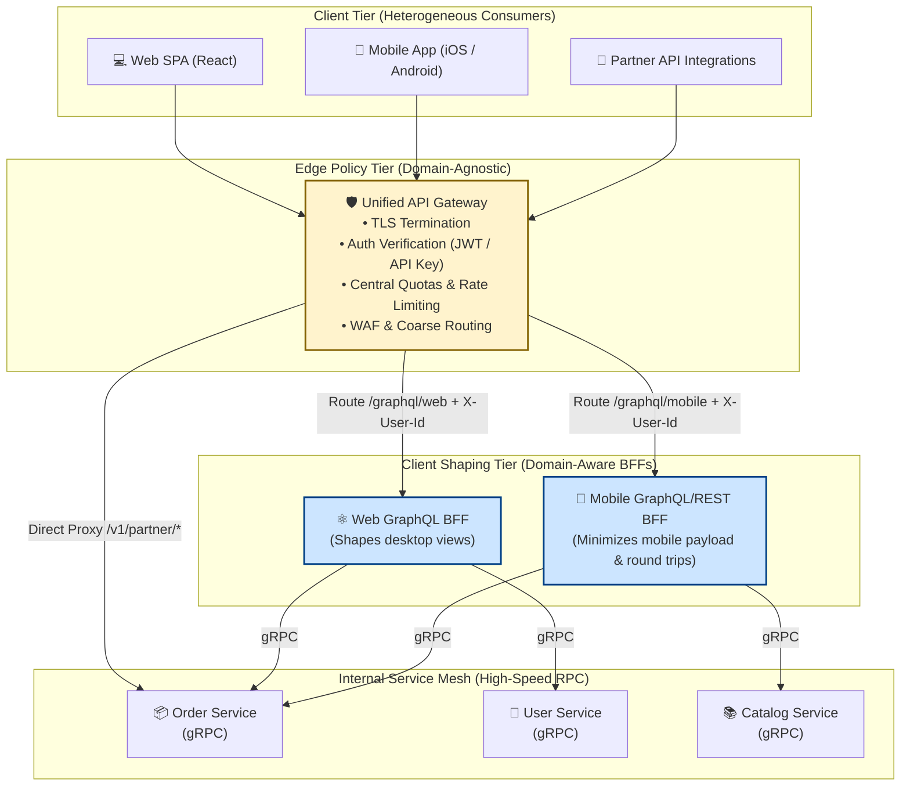
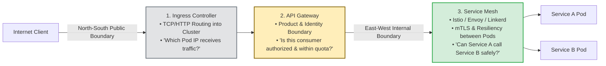
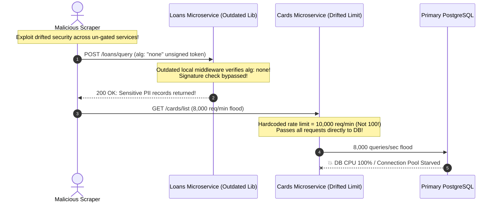

# Module 09: API Gateways and Backend-for-Frontend (BFF)

> **Prerequisites**: [00-beyond-rest-when-and-why](../00-beyond-rest-when-and-why/README.md), [01-grpc-fundamentals](../01-grpc-fundamentals/README.md), [03-graphql-fundamentals](../03-graphql-fundamentals/README.md), and [08-webhooks-vs-polling-vs-websockets-tradeoffs](../08-webhooks-vs-polling-vs-websockets-tradeoffs/README.md).  
> **Estimated Reading Time**: 30 minutes  
> **Target Audience**: Principal Backend Engineers, Cloud Architects, and Engineering Managers structuring scalable edge tiers for multi-service and multi-client systems.

---

> [!TIP]
> **The Golden Rule of Edge Architecture**  
> Clearly decouple **Edge Policy** from **Client Shaping**. An **API Gateway** is a single, domain-agnostic operational front door that enforces cross-cutting concerns (TLS termination, authentication verification, rate limiting, and coarse routing) without knowing anything about your business domain. A **Backend-for-Frontend (BFF)** is a domain-aware client adapter owned by the frontend team that aggregates and shapes backend data for one specific client application (web, iOS, smart TV). **Never put domain aggregation logic into your API gateway, and never duplicate authentication verification logic across multiple downstream services.**

---

## Visual Mental Models & Architecture

### The Layered Edge Topology

In a mature multi-client, microservice architecture, traffic flows through specialized architectural tiers rather than permitting direct client-to-service communication.



---

### Ingress vs API Gateway vs Service Mesh

Teams frequently conflate these three networking layers. Each answers an entirely distinct architectural question:



---

## Systematic Reference Grids

### API Gateway vs Backend-for-Frontend (BFF) vs Ingress vs Mesh

| Architectural Concern | Ingress Controller | API Gateway | Backend-for-Frontend (BFF) | Service Mesh |
| :--- | :--- | :--- | :--- | :--- |
| **Primary Scope** | L7 Cluster Entry Point | Public Product API Boundary | Client-Specific Screen Adapter | Internal Service-to-Service |
| **Traffic Direction** | North-South (Network) | North-South (Product) | North-South (Data Aggregation) | East-West (Cluster Internal) |
| **Domain Awareness** | **Zero** (Host & Path only) | **Zero** (Generic Headers, Tokens) | **High** (Knows UI screen requirements) | **Zero** (mTLS, telemetry, retry policies) |
| **Typical Quantity** | 1 per Kubernetes cluster | 1 (or 2) per organization | 1 per client frontend application | 1 sidecar per application pod |
| **Owning Team** | Infrastructure / SRE | Platform Engineering | Frontend / Feature Product Team | Platform / Cloud Infrastructure |
| **Standard Technologies** | Traefik, NGINX Ingress, AWS ALB | Kong, Envoy, Apigee, AWS API GW | Node.js, Go, FastAPI, GraphQL | Istio, Linkerd, Consul Connect |
| **Typical Responsibilities** | Host header routing, TLS offload | Auth termination, rate limits, quotas | Fan-out queries, DTO transformations | Zero-trust mTLS, circuit breaking |

---

### Complexity Ledger: When to Adopt vs When Premature

| Architectural Component | When It Earns Its Keep (Adopt) | When It Is Premature (Anti-Pattern) |
| :--- | :--- | :--- |
| **API Gateway** | &bull; 3+ microservices duplicating authentication & rate limiting.<br/>&bull; Managing public/partner API keys and usage quotas.<br/>&bull; Decoupling external URLs from shifting internal topologies. | &bull; Single monolithic backend or 1–2 simple services.<br/>&bull; Single client application.<br/>&bull; Adds an unnecessary network hop, SPOF, and deployment pipeline. |
| **BFF (Backend-for-Frontend)** | &bull; Diverse clients (Web vs Mobile vs Smart Watch) needing drastically different data shapes.<br/>&bull; Mobile clients suffer latency from excessive round trips over cellular networks.<br/>&bull; Frontend teams need autonomy to iterate on screens without waiting for backend changes. | &bull; Only one client exists (e.g., single web SPA).<br/>&bull; Trivial CRUD APIs where REST endpoints match UI 1:1.<br/>&bull; Results in code duplication and maintaining unnecessary middleware microservices. |
| **GraphQL Federation** | &bull; 4+ separate engineering teams owning completely disjoint business subgraphs that must compose into one schema. | &bull; Single engineering team owning the whole GraphQL API.<br/>&bull; Introduces router latency, subgraph directives, and complex CI schema composition pipelines. |

---

## Production Incident War Story: The Drift of Six Gates

### Incident Post-Mortem: SEV-1

* **Incident ID**: INC-5502
* **Severity Level**: SEV-1 (Data Breach & Distributed Denial of Service)
* **Detection Time**: 6 hours after rogue client activity began
* **Time to Recovery (TTR)**: 45 minutes
* **Impact**: 1.8M customer PII records scraped; 3 internal databases crashed due to unmetered concurrent partner scraping.

#### 1. What Happened
A financial technology company grew from 1 to 6 microservices: `auth`, `accounts`, `transfers`, `loans`, `cards`, and `investments`. Rather than deploying an API gateway, the team relied on a shared copy-pasted JWT validation and rate-limiting middleware package.

Over 18 months of independent deployments, the middleware copies drifted:
1. `transfers` upgraded to strict RS256 token verification with a 100 req/min rate limit.
2. `loans` had an outdated middleware version that failed to verify JWT signatures if the header specified `"alg": "none"`.
3. `cards` had its rate limit raised to 10,000 req/min for a legacy migration script that was never reverted.

An unauthorized automated scraper discovered that sending requests directly to the `loans` service with an unsigned JWT allowed arbitrary access to loan applications, and sending 8,000 req/sec to `cards` bypassed rate limits and overwhelmed the underlying PostgreSQL primary replica.



#### 2. Root Cause Analysis
1. **Decentralized Edge Policy**: Security policy enforcement (JWT signature verification and rate limiting) was smeared across 6 separate service codebases instead of being terminated once at a hardened edge gateway.
2. **Configuration Drift**: Independent service deployment cycles caused security patches and quota updates to be applied inconsistently.
3. **Topology Exposure**: Clients addressed individual backend services directly (`https://api-loans.company.com`, `https://api-cards.company.com`), exposing internal architecture to public probing.

#### 3. The Architectural Hardening & Resolution
1. **Unified API Gateway**: Deployed an Envoy/Kong API Gateway as the single public entry point (`https://api.company.com`).
2. **Centralized Auth & Rate Limiting**: The gateway terminates TLS, strictly verifies JWT cryptographic signatures (rejecting `"alg": "none"`), enforces centralized Redis token-bucket rate limits per client ID, and forwards verified identity headers (`X-User-Id`, `X-User-Roles`) to downstream services.
3. **Zero-Trust VPC Perimeter**: Configured internal security groups so downstream microservices only accept traffic originating from the API Gateway's private subnet.

---

## Multi-Language Production Code Tabs: Gateway & BFF

The following code tabs illustrate:
1. An **API Gateway Router** that terminates authentication, enforces rate limits, and injects trusted identity headers.
2. A **GraphQL BFF Resolver** that aggregates multiple backend services server-side to fulfill a single client screen request.

```
### Language Tabs
1. Go (ReverseProxy Gateway with Auth & Identity Injection)
2. Node.js / TypeScript (Express Gateway with http-proxy-middleware)
3. Python (FastAPI Gateway with httpx streaming proxy)
4. C# (YARP - Yet Another Reverse Proxy Gateway with Auth Policy)
```

### Go (ReverseProxy Gateway)
```go
package main

import (
	"context"
	"fmt"
	"net/http"
	"net/http/httputil"
	"net/url"
	"strings"
	"sync"
	"time"
)

// In-memory token bucket rate limiter per API Key
type RateLimiter struct {
	mu     sync.Mutex
	limits map[string]int
}

func (rl *RateLimiter) Allow(apiKey string) bool {
	rl.mu.Lock()
	defer rl.mu.Unlock()
	// Production implementation: Redis sliding window
	rl.limits[apiKey]++
	return rl.limits[apiKey] <= 100
}

func GatewayAuthMiddleware(limiter *RateLimiter, next http.Handler) http.Handler {
	return http.HandlerFunc(func(w http.ResponseWriter, r *http.Request) {
		apiKey := r.Header.Get("X-API-Key")
		if apiKey == "" || !strings.HasPrefix(apiKey, "sec_key_") {
			http.Error(w, `{"error":"Unauthorized: Invalid or missing API key"}`, http.StatusUnauthorized)
			return
		}

		if !limiter.Allow(apiKey) {
			http.Error(w, `{"error":"Too Many Requests: Rate limit exceeded"}`, http.StatusTooManyRequests)
			return
		}

		// Inject trusted verified identity header downstream
		authenticatedUserID := "usr_" + apiKey[8:]
		r.Header.Set("X-User-Id", authenticatedUserID)
		r.Header.Del("X-API-Key") // Strip raw secret from downstream services

		next.ServeHTTP(w, r)
	})
}

func NewRoutingProxy(targetURL string) *httputil.ReverseProxy {
	target, _ := url.Parse(targetURL)
	proxy := httputil.NewSingleHostReverseProxy(target)
	return proxy
}

func main() {
	limiter := &RateLimiter{limits: make(map[string]int)}
	orderProxy := NewRoutingProxy("http://order-service:8081")
	userProxy := NewRoutingProxy("http://user-service:8082")

	mux := http.NewServeMux()
	mux.Handle("/v1/orders/", http.StripPrefix("/v1/orders", orderProxy))
	mux.Handle("/v1/users/", http.StripPrefix("/v1/users", userProxy))

	securedGateway := GatewayAuthMiddleware(limiter, mux)
	fmt.Println("API Gateway listening on :8080...")
	_ = http.ListenAndServe(":8080", securedGateway)
}
```

### Node.js / TypeScript (Express + http-proxy-middleware)
```typescript
import express, { Request, Response, NextFunction } from 'express';
import { createProxyMiddleware } from 'http-proxy-middleware';

const app = express();

// 1. Edge Authentication & Quota Middleware
const gatewaySecurity = (req: Request, res: Response, next: NextFunction) => {
  const token = req.headers['authorization'];
  if (!token || !token.startsWith('Bearer valid-jwt-token')) {
    return res.status(401).json({ error: 'Unauthorized: Gateway token validation failed' });
  }

  // Terminate Auth once at edge and forward trusted user identity
  req.headers['x-user-id'] = 'usr_ada_lovelace';
  req.headers['x-client-tier'] = 'enterprise';
  delete req.headers['authorization']; // Remove raw JWT before forwarding

  next();
};

app.use(gatewaySecurity);

// 2. Gateway Coarse Routing
app.use(
  '/v1/orders',
  createProxyMiddleware({
    target: 'http://order-service:8081',
    changeOrigin: true,
    pathRewrite: { '^/v1/orders': '' },
  })
);

app.use(
  '/v1/users',
  createProxyMiddleware({
    target: 'http://user-service:8082',
    changeOrigin: true,
    pathRewrite: { '^/v1/users': '' },
  })
);

app.listen(8080, () => {
  console.log('API Gateway running on port 8080');
});
```

### Python (FastAPI Reverse Proxy Gateway)
```python
import httpx
from fastapi import FastAPI, Request, Response, HTTPException, status

app = FastAPI()

SERVICE_MAP = {
    "orders": "http://order-service:8001",
    "users": "http://user-service:8002",
    "bff": "http://graphql-bff:4000",
}

@app.middleware("http")
async def gateway_edge_policy(request: Request, call_next):
    # Public health check bypass
    if request.url.path == "/healthz":
        return await call_next(request)

    # 1. Edge Authentication Termination
    auth_header = request.headers.get("Authorization")
    if not auth_header or not auth_header.startswith("Bearer "):
        return Response(
            content='{"error":"Missing or invalid Authorization header"}',
            status_code=status.HTTP_401_UNAUTHORIZED,
            media_type="application/json"
        )

    # 2. Add trusted identity downstream
    request.state.user_id = "usr_99182"
    return await call_next(request)

@app.api_route("/{service_key}/{path:path}", methods=["GET", "POST", "PUT", "DELETE"])
async def route_traffic(service_key: str, path: str, request: Request):
    upstream_base = SERVICE_MAP.get(service_key)
    if not upstream_base:
        raise HTTPException(status_code=404, detail="Service not registered on gateway")

    upstream_url = f"{upstream_base}/{path}"
    body = await request.body()
    
    headers = dict(request.headers)
    headers["X-User-Id"] = getattr(request.state, "user_id", "anonymous")
    headers.pop("authorization", None) # Strip outer auth

    async with httpx.AsyncClient() as client:
        proxy_resp = await client.request(
            method=request.method,
            url=upstream_url,
            headers=headers,
            content=body,
            params=request.query_params,
            timeout=10.0
        )

    return Response(
        content=proxy_resp.content,
        status_code=proxy_resp.status_code,
        headers=dict(proxy_resp.headers)
    )
```

### C# (YARP - Yet Another Reverse Proxy)
```csharp
using Microsoft.AspNetCore.Builder;
using Microsoft.Extensions.DependencyInjection;
using Yarp.ReverseProxy.Transforms;

var builder = WebApplication.CreateBuilder(args);

// Configure YARP from configuration or in-memory routes
builder.Services.AddReverseProxy()
    .LoadFromMemory(
        routes: new[]
        {
            new Yarp.ReverseProxy.Configuration.RouteConfig
            {
                RouteId = "orders-route",
                ClusterId = "orders-cluster",
                Match = new Yarp.ReverseProxy.Configuration.RouteMatch { Path = "/v1/orders/{**catch-all}" }
            }
        },
        clusters: new[]
        {
            new Yarp.ReverseProxy.Configuration.ClusterConfig
            {
                ClusterId = "orders-cluster",
                Destinations = new Dictionary<string, Yarp.ReverseProxy.Configuration.DestinationConfig>
                {
                    { "dest1", new Yarp.ReverseProxy.Configuration.DestinationConfig { Address = "http://order-service:8081" } }
                }
            }
        })
    .AddTransforms(builderContext =>
    {
        // Inject trusted X-User-Id header and strip Authorization
        builderContext.AddRequestTransform(async transformContext =>
        {
            var authHeader = transformContext.HttpContext.Request.Headers.Authorization.ToString();
            if (string.IsNullOrEmpty(authHeader))
            {
                transformContext.HttpContext.Response.StatusCode = 401;
                return;
            }

            transformContext.ProxyRequest.Headers.Remove("Authorization");
            transformContext.ProxyRequest.Headers.Add("X-User-Id", "usr_dotnet_edge_99");
        });
    });

var app = builder.Build();
app.MapReverseProxy();
app.Run();
```

---

## Practical Hands-On Verification Workflows

### 1. Execute an Unauthenticated Call to the Gateway

Attempt to call the gateway without credentials and verify that the request is dropped at the edge without reaching downstream services.

```bash
curl -i -X GET http://localhost:8080/v1/orders/101
```

**Expected HTTP Response:**
```http
HTTP/1.1 401 Unauthorized
Content-Type: application/json; charset=utf-8
Content-Length: 54

{"error":"Unauthorized: Invalid or missing API key"}
```

---

### 2. Verify Downstream Identity Injection via Authenticated Call

Supply a valid API key. The gateway verifies the credential, strips `X-API-Key`, injects `X-User-Id`, and proxies to the upstream service.

```bash
curl -i -X GET http://localhost:8080/v1/orders/101 \
  -H "X-API-Key: sec_key_ada_lovelace"
```

**Expected HTTP Response:**
```http
HTTP/1.1 200 OK
Content-Type: application/json; charset=utf-8
Date: Mon, 10 Nov 2026 17:15:00 GMT

{
  "orderId": "101",
  "status": "PROCESSED",
  "userId": "usr_ada_lovelace",
  "verifiedBy": "EdgeGateway"
}
```

---

## Operational Validation Checkpoints (Scenario Quizzes)

<details>
<summary><strong>Checkpoint 1: The Gateway vs BFF Responsibility Split</strong></summary>

**Scenario:** A company is building a mobile e-commerce application. A developer proposes adding a GraphQL resolver inside the central Kong API Gateway to query the `inventory-service` and `pricing-service` and stitch together a "Product Detail Page" response. Why is this an architectural anti-pattern, and where should this functionality reside?

**Answer:**
This is an architectural anti-pattern known as **"The Bloated Smart Gateway"**.
- An API Gateway should remain **strictly domain-agnostic**. Embedding GraphQL schemas, entity stitching, and business aggregation into the gateway couples the platform edge to UI product requirements, turns the gateway into an operational bottleneck, and forces every team to edit gateway deployment configs.
- **The Correct Architecture**: Keep the API Gateway focused on generic edge policies (TLS, auth verification, IP rate limiting, and coarse routing). Deploy a dedicated **Mobile BFF** (Backend-for-Frontend) running behind the gateway. The Mobile BFF is owned by the mobile engineering team, speaks GraphQL or custom REST to the mobile app, and fans out calls to internal `inventory` and `pricing` microservices.
</details>

<details>
<summary><strong>Checkpoint 2: The Premature Gateway Dilemma</strong></summary>

**Scenario:** A two-person startup has a single monolithic backend written in Go and a single React web application. The lead engineer insists on deploying an Envoy API Gateway and two BFF microservices (Web BFF and Mobile BFF) before launching their MVP. Evaluate this design decision from the perspective of operational complexity and latency.

**Answer:**
This architecture is **grossly premature** and introduces significant unearned technical debt:
1. **Unnecessary Operational Overhead**: The startup now has to build, deploy, monitor, and scale 4 separate services (Envoy + Web BFF + Mobile BFF + Monolith) instead of 1.
2. **Latency Penalty**: Every request pays a double or triple network hop penalty (Browser &rarr; Envoy &rarr; BFF &rarr; Monolith) inside the infrastructure.
3. **No Mobile Client Exists**: Building a Mobile BFF before a mobile app even exists is speculative waste.
- **Recommended Approach**: The single Go monolith can easily terminate its own authentication via middleware, enforce rate limits via standard in-memory or Redis libraries, and serve the React app directly. A gateway should only be introduced when multiple microservices emerge or when partner API key governance becomes a concrete business requirement.
</details>

<details>
<summary><strong>Checkpoint 3: The Downstream Trust Boundary</strong></summary>

**Scenario:** An API Gateway validates JWTs at the edge and forwards the user's ID as `X-User-Id: usr_123` to internal services over plain HTTP. An internal developer notes that any attacker who manages to send an HTTP request directly to an internal microservice port could spoof `X-User-Id: usr_admin` and bypass all security. How do you secure the boundary between the API Gateway and downstream services?

**Answer:**
1. **VPC Network Isolation & Private Subnets**: Place downstream microservices inside private VPC subnets with strictly configured Network Security Groups (or Kubernetes NetworkPolicies) that only permit inbound traffic originating from the API Gateway's specific IP addresses or service accounts.
2. **Mutual TLS (mTLS) via Service Mesh**: Use a service mesh (Istio, Linkerd) or internal TLS certificates so downstream services verify that the incoming connection was authenticated and signed by the API Gateway's client certificate.
3. **Internal Cryptographic Token Exchange**: Instead of plain plaintext headers, the gateway can exchange the incoming public token for a short-lived internal signed JWT (or HMAC signature) specifying the caller identity, which internal services verify using an internal shared secret or public key.
</details>

---

## Free PDF notes

Download these notes as a printable PDF, with every diagram and interview questions: [SD-C-017: API Gateway Explained](https://backendroadmap.com/notes/system-design/SD-C-017.pdf). Each section in one file: [Phase 2, APIs (PDF)](https://backendroadmap.com/notes/system-design/Phase2_APIs_Notes.pdf).

---

## Further Reading & Next Steps

* [Sam Newman: Backends For Frontends Pattern](https://samnewman.io/patterns/architectural/bff/) - The seminal article establishing BFF architecture.
* [Microservices.io: API Gateway Pattern](https://microservices.io/patterns/apigateway.html) - Structural analysis of gateway tradeoffs and variations.
* [Kong API Gateway Architecture](https://docs.konghq.com/gateway/latest/) - Production deployment patterns for high-scale edge proxies.
* Next up: [10-api-design-tradeoffs-in-practice](../10-api-design-tradeoffs-in-practice/README.md) to synthesize multi-paradigm coexistence across REST, gRPC, and GraphQL in real-world platforms.
